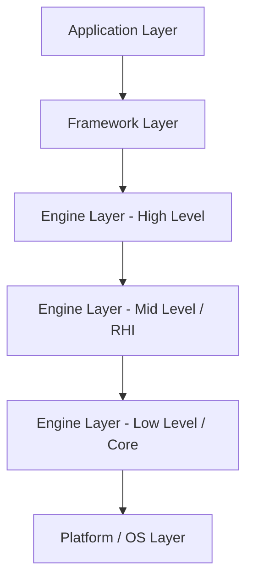

# Break Engine 架构概览

> 纯 C (C11) 跨平台 3D 渲染引擎

---

## 目录

1. [项目概述](#1-项目概述)
2. [顶层目录结构](#2-顶层目录结构)
3. [分层架构设计](#3-分层架构设计)
4. [核心模块总览](#4-核心模块总览)
5. [模块依赖关系](#5-模块依赖关系)
6. [技术栈](#6-技术栈)
7. [关键设计决策](#7-关键设计决策)
8. [外部依赖](#8-外部依赖)
9. [平台支持](#9-平台支持)
10. [后续文档索引](#10-后续文档索引)

---

## 1. 项目概述

| 项目 | 说明 |
|------|------|
| **项目名称** | Break Engine |
| **定位** | 纯 C (C11) 跨平台 3D 渲染引擎 |
| **核心目标** | 避免 C++ 隐式成本，提供高性能、可移植的渲染引擎框架 |
| **当前状态** | Phase 0-8Y 文档记录已完成；CTest 主套件与图形集成套件持续维护，性能数字以具体日期、硬件和配置为准 |

### 技术优势

- **编译速度快 2-5 倍** — 无模板展开、无 header-only 膨胀
- **ABI 稳定** — C 结构体布局明确，跨版本/跨编译器兼容
- **调试透明** — 无名称修饰（name mangling），栈帧清晰可读
- **任何语言可调用** — 天然 FFI 友好（Python/Rust/Zig/Lua 等可直接绑定）
- **内存确定性** — 显式分配/释放，无隐式拷贝、无 RAII 魔法

---

## 2. 顶层目录结构

```
break/
├── engine/           # 核心引擎（纯 C，主代码库）
│   ├── src/          #   源码实现（按模块划分子目录）
│   ├── include/      #   公共头文件
│   ├── external/     #   第三方库（单头文件）
│   ├── shaders/      #   GLSL/SPIR-V 着色器
│   ├── assets/       #   引擎内置资源
│   └── tools/        #   离线工具（packer 等）
├── framework/        # C++ 框架层（应用生命周期管理）
│   ├── interface/    #   抽象接口定义
│   └── common/       #   基础实现（BaseApplication）
├── empty/            # 最小化示例应用
├── platform/         # 平台演示代码（Windows/Linux）
│   ├── linux/        #   X11/XCB + OpenGL 示例
│   └── windows/      #   Win32 + D3D11 示例
├── docs/             # 技术文档
└── build*/           # 构建输出（build-gl, build-vk, build-asan 等）
```

### 各目录职责

| 目录 | 职责 |
|------|------|
| `engine/` | 引擎核心，纯 C11 实现，包含所有运行时子系统（渲染、物理、音频、ECS 等） |
| `framework/` | C++ 应用框架，提供模块化的生命周期管理接口（Init/Tick/DeInit） |
| `empty/` | 最小化应用骨架，演示如何接入 framework 层 |
| `platform/` | 各平台的 Hello World 级别演示程序 |
| `docs/` | 架构设计、执行计划、技术笔记等文档 |
| `build*/` | CMake 构建产物输出目录（不纳入版本控制） |

---

## 3. 分层架构设计

Break Engine 采用**严格分层、单向依赖**的架构模型：

```
┌─────────────────────────────────────────────────────────────────┐
│                     Application Layer（应用层）                   │
│         empty_application / 用户游戏逻辑 / 编辑器                │
├─────────────────────────────────────────────────────────────────┤
│                     Framework Layer（框架层）                     │
│  RuntimeModuleInterface → ApplicationInterface → BaseApplication│
├─────────────────────────────────────────────────────────────────┤
│                      Engine Layer（引擎层）                       │
│  ┌───────────────────────────────────────────────────────────┐  │
│  │  High-Level: Renderer / ECS / Asset / Animation / Physics │  │
│  ├───────────────────────────────────────────────────────────┤  │
│  │  Mid-Level:  RHI (VK/Metal/D3D12, GL 兼容期) / Task / Script / UI   │  │
│  ├───────────────────────────────────────────────────────────┤  │
│  │  Low-Level:  Core (Log/Alloc/String) / Math / Platform    │  │
│  └───────────────────────────────────────────────────────────┘  │
├─────────────────────────────────────────────────────────────────┤
│                   Platform/OS Layer（平台层）                     │
│              X11 / Win32 / Vulkan Driver / OpenGL Driver         │
└─────────────────────────────────────────────────────────────────┘
```

### 层级职责

- **Application Layer** — 最终用户代码，实现具体的游戏/应用逻辑
- **Framework Layer** — C++ 模块化框架，定义 `RuntimeModuleInterface`（Init/Tick/DeInit 三阶段），提供 `BaseApplication` 基类
- **Engine Layer** — 纯 C 引擎核心，提供所有运行时子系统
  - High-Level：面向场景的渲染管线、ECS、资源管理、动画、物理
  - Mid-Level：硬件抽象层（RHI）、并行任务、脚本、调试 UI
  - Low-Level：内存分配、日志、字符串、数学库、平台窗口/输入/时间
- **Platform/OS Layer** — 操作系统 API（X11、Win32）及 GPU 驱动

### Mermaid 层级图



---

## 4. 核心模块总览

| 模块 | 位置 | 职责 |
|------|------|------|
| **Core** | `engine/src/core/` | 基础设施：日志(log)、内存分配器(alloc)、字符串(string)、性能剖析(profiler)、类型定义(types)、断言(assert) |
| **Platform** | `engine/src/platform/` | 平台抽象：窗口管理(window_x11 / window_wayland / window_win32 / window_cocoa)、输入处理(input，含键盘/鼠标/游戏手柄)、高精度时间(time)、文件监视(filewatch，递归；macOS kqueue/FSEvents 自适应)、高 DPI 与多显示器查询 |
| **RHI** | `engine/src/rhi/` | 渲染硬件接口：统一的 GPU API 抽象层，编译期单后端：Vulkan (`rhi_vk.c`)、Metal (`rhi_metal.m`，Apple)、D3D12 (`rhi_d3d12.c`，仅 Windows)、兼容期 OpenGL (`rhi_gl.c`，deprecated，计划 v2.0.0 移除)、headless fail-closed stub (`rhi_headless.c`) |
| **Math** | `engine/src/math/` | 数学库：向量、矩阵、四元数、变换等 |
| **ECS** | `engine/src/ecs/` | 实体-组件-系统架构，数据驱动的对象管理；不可变 Snapshot/Delta 与确定性组件 schema 见 [`design/ecs_snapshot_replication_aoi.md`](design/ecs_snapshot_replication_aoi.md) |
| **Asset** | `engine/src/asset/` | 资源管理：资产加载(asset)、热重载(hotreload)、虚拟文件系统(vfs) |
| **Renderer** | `engine/src/renderer/` | 渲染管线：相机、剔除、天空盒、地形、水体、粒子、光照、阴影、后处理全链路（SSAO/TAA/SSR/DoF/Bloom/FXAA/运动模糊/色调映射/体积光/God Rays 等） |
| **Animation** | `engine/src/animation/` | 骨骼动画系统 |
| **Physics** | `engine/src/physics/` | 物理模拟：刚体物理、角色控制器 |
| **Audio** | `engine/src/audio/` | 音频系统（基于 miniaudio） |
| **Task** | `engine/src/task/` | 多线程任务调度系统 |
| **Script** | `engine/src/script/` | 脚本系统（运行时行为驱动） |
| **UI** | `engine/src/ui/` | 调试 UI 和字体渲染 |

---

## 5. 模块依赖关系

```
                          ┌─────────┐
                          │  Game   │
                          └────┬────┘
                               │
            ┌──────────────────┼──────────────────┐
            │                  │                  │
       ┌────▼────┐      ┌─────▼─────┐     ┌─────▼─────┐
       │Renderer │      │    ECS    │     │   Asset   │
       └────┬────┘      └─────┬─────┘     └─────┬─────┘
            │                  │                  │
            │    ┌─────────────┼─────────────┐    │
            │    │             │             │    │
       ┌────▼────▼──┐   ┌─────▼─────┐  ┌───▼────▼───┐
       │    RHI     │   │ Animation │  │  Physics   │
       └────┬───────┘   └─────┬─────┘  └─────┬──────┘
            │                  │              │
            └──────────────────┼──────────────┘
                               │
                    ┌──────────▼──────────┐
                    │   Core / Math       │
                    └──────────┬──────────┘
                               │
                    ┌──────────▼──────────┐
                    │     Platform        │
                    └──────────┬──────────┘
                               │
                    ┌──────────▼──────────┐
                    │      OS / GPU       │
                    └─────────────────────┘
```

### 依赖规则

- **严格单向依赖**：上层依赖下层，禁止反向引用
- **无循环依赖**：任意模块间的依赖关系构成有向无环图 (DAG)
- **Core/Math 是最底层引擎模块**：所有模块可依赖，但 Core 不依赖任何引擎模块
- **Platform 为平台隔离层**：仅 Core 和 RHI 可直接依赖 OS API

---

## 6. 技术栈

| 类别 | 技术 |
|------|------|
| **语言** | C11（引擎核心）、C++11（框架层） |
| **构建系统** | `engine/` 要求 CMake 3.20+；仓库根项目要求 CMake 3.25+，支持 GL/VK/ASAN/UBSAN/TSAN/Debug 配置 |
| **图形 API** | Vulkan 1.2 / Metal / D3D12（按平台单选）；OpenGL 4.x 兼容期保留（deprecated，计划 v2.0.0 移除） |
| **窗口系统** | X11 / Wayland（Linux，编译时互斥）、Win32（Windows）、Cocoa（macOS）；iOS/Android/OHOS 的 CMake 平台识别不等于完整窗口 runtime 支持 |
| **着色器语言** | GLSL 450、SPIR-V（Vulkan 路径使用 shaderc 编译） |
| **编译器** | GCC、Clang、MSVC（/W4 /WX 级别警告） |
| **静态分析** | -Wall -Wextra -Werror -pedantic |
| **运行时检测** | AddressSanitizer、UBSan、TSAN（均可选；TSAN 不在当前 CI gate） |
| **第三方库** | cgltf、glad、miniaudio、stb_image、stb_truetype |

---

## 7. 关键设计决策

| 决策领域 | 方案 | 理由 |
|----------|------|------|
| **多态/虚函数** | 函数指针表（手动 vtable） | 内存布局透明、无 C++ RTTI 开销 |
| **泛型编程** | `_Generic` 宏 + `void*` | 编译期类型分发，零运行时成本 |
| **封装** | 不透明指针（opaque pointer） | 隐藏实现细节，保持 ABI 稳定 |
| **错误处理** | 返回值（bool/错误码） | 无异常表、可预测的控制流 |
| **字符串** | Slice 模式（指针 + 长度） | 避免隐式 `strlen()`，支持非拷贝子串 |
| **GPU 抽象** | RHI 层 + 编译期单后端链接 | 统一接口（VK/Metal/D3D12，GL 兼容期），SPIR-V/MSL/DXIL 着色器路径 |
| **内存管理** | 自定义分配器 + Arena | 显式生命周期，避免碎片化 |
| **并行** | 任务系统（Task） | 基于线程池的细粒度并行 |
| **资源热重载** | inotify/文件监视 | 开发期免重启，即时看到修改效果 |
| **模块化** | 目录隔离 + 头文件接口 | 每个子系统独立编译，清晰边界 |

---

## 8. 外部依赖

所有第三方库位于 `engine/external/`，均为单头文件/单源文件实现：

| 库 | 文件 | 用途 | 许可证 |
|----|------|------|--------|
| **cgltf** | `cgltf.h` | glTF 2.0 模型加载（解析 .glb/.gltf） | MIT |
| **glad** | `glad.h` + `glad.c` | OpenGL 函数加载器（GL 4.x Core） | MIT / Public Domain |
| **KHR** | `khrplatform.h` | Khronos 平台类型定义（glad 依赖） | MIT |
| **miniaudio** | `miniaudio.h` | 跨平台音频播放/录制 | MIT-0 / Public Domain |
| **stb_image** | `stb_image.h` + `stb_image_impl.c` | 图像加载（PNG/JPG/BMP/TGA） | MIT / Public Domain |
| **stb_image_write** | `stb_image_write.h` | 图像写入（截图/纹理导出） | MIT / Public Domain |
| **stb_truetype** | `stb_truetype.h` | TrueType 字体光栅化 | MIT / Public Domain |

### 设计原则

- 全部为**零依赖**单文件库，无额外传递依赖
- 均选择 **宽松许可证**（MIT/Public Domain），商用友好
- 通过单独编译单元隔离（如 `stb_image_impl.c`），避免头文件实现污染

---

## 9. 平台支持

平台兼容描述符在 `engine/src/platform/platform_compat.h` 中分别记录 native
graphics baseline、target graphics API、Vulkan support level 与 support evidence。Linux/Windows 保留
OpenGL 作为 native performance baseline；macOS 保留 Metal 作为 baseline，Vulkan
路径明确是 MoltenVK。iOS/Android 只有宿主注入的 Vulkan compile/integration 边界，
HarmonyOS 在 native surface 存在前保持 unavailable/unsupported。证据状态按
`compiled`、`headless`、`native-surface`、`GPU-runtime`、`benchmark-comparable`
递进，状态不会因编译成功自动升级。`target_graphics_api` 只是迁移目标元数据，
不表示对应 Metal/D3D12 RHI 已实现；实际能力仍由真实 backend build/runtime gate 决定。

Windows D3D12 已经过 contract-first 阶段并落地为可选后端（计划 D，2026-10-15）：
真实设备、flip-model swapchain、资源/PSO、HLSL→DXIL shader 路径、DXR BLAS/TLAS
（tier < 1.0 fail-closed）、debug layer + GBV + DRED 全部实现，本机 RTX 4060 Laptop
真 GPU 契约测试 6/6 绿（GPU_RUNTIME；收据见 `docs/rhi_backend_evidence.md`），PIX
捕获 runbook 见 `docs/rhi_rollback_runbook.md`。Vulkan 继续保持现有实现与回滚基线；
OpenGL 为兼容期保留（deprecated：显式 fallback、白名单钉死，计划 v2.0.0 移除——删除
闸门 BLOCKED，解锁条件见 `docs/rhi_backend_evidence.md` 计划 F 前置确认节）。macOS
原生 Metal 已落地（计划 C：BENCHMARK_COMPARABLE，M2 真机收据）。CI 证据面为六类
lane（计划 F Task 7：headless / native-surface / GPU-runtime / validation / benchmark /
proton），每 lane 上传 `evidence-receipt-*` 收据 artifact（最近全绿 run
https://github.com/konyka/break/actions/runs/38990768014 ）。

The Windows D3D12 shader gate compiles a minimal `vs_6_0` HLSL input to DXIL in
the build directory only. It proves the compiler toolchain, not a D3D12 device,
surface, command queue, validation layer, or GPU runtime.

Profiler 的 `profiler_export_provenance_sidecar()` 写入独立 JSON sidecar，记录
platform、window system、backend、native baseline、GPU、build、validation、
resolution 与 frame count；`profiler_export_chrome_trace()` 和既有 trace 格式不变。

RHI 现在提供 backend-neutral 的 `RHI_DEVICE_STATUS_UNKNOWN`、`READY`、`LOST`
状态查询。该合同只统一设备健康状态，不表示 Metal 或 D3D12 已实现；原生后端
仍必须分别通过其 native-surface、GPU-runtime 和 validation gate 后才能标记可用。

Backend linking model (计划 F 收尾态): compile-time single backend, chosen by the
explicit CMake selector `ENGINE_RHI_BACKEND=auto|opengl|vulkan|d3d12`（`metal` 仅
Apple；`opengl` 兼容期显式 fallback，计划 v2.0.0 移除）. The `engine` core static
library contains only `RHI_CORE_SOURCES` (rhi.c dispatch/validation + ownership +
validation + resources + present_history). Each backend builds as its own static
library — `engine_rhi_vulkan` | `engine_rhi_metal` | `engine_rhi_d3d12`（仅 Windows；
兼容期含 `engine_rhi_opengl`，deprecated）— and `engine_link_rhi_backend(<target>)`
links exactly one of them. Headless contract tests link `engine_rhi_headless`
instead (fail-closed on every entry point, never GPU evidence).

### RHI 分层（2026-10-14 起）

```
应用 / renderer（rhi.h 公共 API，后端中性）
  └─ engine（RHI_CORE_SOURCES：rhi.c 调度/校验 + ownership + validation + resources + present_history）
       └─ 恰好一个后端静态库：engine_rhi_vulkan | engine_rhi_metal | engine_rhi_d3d12 |（兼容期 engine_rhi_opengl）| engine_rhi_headless
            └─ 平台图形栈（GL/EGL、Vulkan+shaderc、D3D12+DXGI+Agility SDK（仅 Windows）、或 fail-closed stub）
```

- 编译期单后端、直接符号链接（无 vtable 分发）；`engine_link_rhi_backend(<target>)` 按 `ENGINE_RHI_BACKEND_EFFECTIVE` 选择。
- Vulkan 形状的 native interop（`RHINativeDevice` 等）在 `engine/src/rhi/rhi_native_vulkan.h`，`rhi.h` 保持后端中性。

计划 B（2026-10-15）在 RHI 之下补出 WSI 适配层：

```
rhi_vk.c（vk_init / present / 销毁门控）
  ├─ platform_vk_surface.h（PAL Vulkan surface 适配：platform_vk_create_surface{,_handles}）
  │    └─ 分层规则：platform 层不包含 <vulkan/vulkan.h>——VkInstance 以 void* 传入、
  │       VkSurfaceKHR 以 u64 传出；create-info ABI 由 platform_vk_surface_vkabi.h
  │       + test_platform_vk_surface_abi 钉死
  └─ platform_wsi.h（WSI 状态机：UNAVAILABLE/CREATED/RESIZED/LOST/SUSPENDED/DESTROYING）
       └─ window_*.c 事件源推进状态（Win32/X11/Wayland/Cocoa/Android 五后端）
            └─ rhi_device_attach_wsi() 挂载到设备；platform_wsi_frame_allowed()
               门控帧进入 RHI（仅 CREATED/RESIZED 放行）；销毁顺序契约：
               rhi_device_destroy_ex 必须先于 platform_destroy（DESTROYING 后拒绝销毁）
```

尺寸语义（logical 与 drawable 谁是输入，各平台方向不同）由 `engine/src/platform/platform_size.h` 单点定义，`window_*.c` 只准调用。


The first source-split preparation now centralizes the shared `RHIDevice` layout,
resource-slot types, current-device TLS declaration, and backend-facing resource
helpers in the private `engine/src/rhi/rhi_backend_internal.h` contract. That
split is now complete: each backend compiles in its own translation unit inside
its static library (`engine_rhi_vulkan` / `engine_rhi_metal` /
`engine_rhi_d3d12` / `engine_rhi_headless`; 兼容期另含 `engine_rhi_opengl`，
deprecated，计划 v2.0.0 移除), with `rhi_backend_internal.h`
as the shared private contract.

The `test_rhi_backend_internal_contract` CMake test now requires `rhi.c`,
`rhi_gl.c`, and `rhi_vk.c` to include the private contract explicitly. This
keeps each backend's separate translation unit from relying on transitive
declarations.

Frame-owner and device-control helpers are now part of that private contract as
well. Both current backends use the same ownership semantics, and the first
helper group now lives in `rhi_ownership.c`; larger backend moves remain gated
by separate translation-unit builds.

The pure TLAS instance encoder now lives in `rhi_validation.c`; this is only a
source split with headless link coverage, not a new backend or ray-tracing
capability.

The remaining `rhi.c` code is intentionally classified before further movement:
resource-slot/generation ownership, backend dispatch proxies, acceleration
structure forwarding, frame-damage state, and test-only glue remain coupled
contracts. They are not moved speculatively into a backend file.

Acceleration-structure descriptor and BLAS input validation is pure and now
lives in `rhi_validation.c`. Build-size queries, device addresses, build
submission, creation/destruction, and opaque Vulkan handle forwarding remain
backend dispatch contracts; they are not presented as Metal/D3D12 APIs.

Resource-slot initialization, generation allocation, typed lookup, and free-list
recycling now live in `rhi_resources.c`. The public `rhi.c` layer retains only
resource API forwarding and test glue; backend code consumes the private resource
contract explicitly.

The internal CMake contract also verifies that every direct RHI consumer lists
`rhi_ownership.c`, `rhi_validation.c`, and `rhi_resources.c` explicitly. This
prevents source-split regressions from being hidden by implicit transitive linking.

Frame-damage state remains in `rhi.c` because both current backends mutate its
partial-present fields during begin/end/present. Existing owner-busy and damage
publication tests are the contract; moving this state requires a dedicated WSI
lifecycle split rather than a helper-only extraction.

Public native proxy queries are now explicitly fail-closed in headless tests:
outputs are zeroed before backend dispatch, invalid devices/resources return
false, and no fake native handle is exposed. The Vulkan-specific opaque AS
handle query remains intentionally separate from future Metal/D3D12 contracts.

The remaining public wrappers in `rhi.c` are split by responsibility: device/info
and native-handle queries are backend-neutral forwarding contracts, while AS build,
creation/destruction, and Vulkan-handle wrappers remain coupled to backend dispatch.

Texture, buffer, and cubemap descriptor validation now shares the same pure
validation translation unit. Backend implementations continue to receive the
same public validation results without inheriting API-specific state.

### 计划 E：capability contract 与反射绑定（2026-10-16）

**Capability contract**——renderer / ui / myui / main.c 的后端差异判断一律改为运行时消费
`RHICapabilities`（`engine/src/rhi/rhi.h`，`rhi_device_get_capabilities` 查询），禁止新增
`ENGINE_VULKAN` / `ENGINE_RHI_BACKEND_*` 编译期分支（白名单逃生舱除外，见下）。字段总表：

| 字段 | 语义 |
|---|---|
| `backend` / `feature_bits` | 后端枚举；特性位（ray-tracing pipeline / ray query / acceleration structure） |
| `color_sample_counts` / `depth_sample_counts` / `surface_sample_count` | 采样计数位掩码（`rhi_sample_count_bit`） |
| `color_resolve_supported` / `depth_resolve_supported` / `scissor_supported` | MSAA resolve 与 scissor 支持 |
| `present_target_preserved` / `present_damage_supported` / `present_buffer_age_supported` | present 保留 / damage / buffer-age 语义 |
| `dynamic_rendering_supported` / `synchronization2_supported` | VK_KHR 扩展探测（迁移期追加，只探测） |
| `push_constants_supported` / `max_push_constant_size` | **计划 E 新增**：push 常量支持位与字节上限（VK=true/设备 limit≥128，GL=false/0） |
| `hiz_supported` / `compute_supported` / `indirect_draw_supported` | **计划 E 新增**：Hi-Z 金字塔 / `rhi_cmd_dispatch` / indirect draw 族 |
| `shader_variant` | **计划 E 新增**：`RHI_SHADER_VARIANT_GLSL`（desktop 源）/ `RHI_SHADER_VARIANT_GLSL_VK`（`*_vk` 后缀 push-constant 块源）；`shader_variant_path()` 负责换源 |

新增 6 字段在每个后端（GL/VK/headless）有真实消费，并由 `test_rhi_capabilities` 契约测试钉死。

**Shader 绑定与反射权威**——`shader_reflect_push_constants()`（`engine/src/core/shader_io.h`）
按 std430 规则解析 GLSL `layout(push_constant)` 块，是 uniform/push 布局的唯一权威源；VK 后端在
shader/pipeline create 时缓存反射结果，GL 走 `glGetActiveUniform`，slot 值全后端同源。每管线一次
`rhi_pipeline_bindings_create()` 物化 name→slot 表（VK=push 字节偏移 / GL=location），取值用
`rhi_pipeline_bindings_resolve()`（成员不存在返回 -1；反射 fail-closed 时不伪造槽位）。计划 E 已将
412 个 legacy 逐名查询调用点全部迁移并删除 VK 手写 push offset 表；旧 API
`rhi_pipeline_get_uniform_location` 已 DEPRECATED（残留 = rhi.h 声明 + 各后端实现 + 注释，调用点 0），
随计划 F 的 OpenGL 退役删除。反射布局与实际 VK 布局的一致性由 `test_shader_io` 的
反射×push 表交叉对照 gate 钉死（graphics + compute）。

**`RHI-ESCAPE` 逃生舱**——确实无法用 capability contract 表达的后端原生差异（native handle 桥接、
VK 专属扩展计数器等）必须收进白名单块：命中行本身或其上一行携带 `RHI-ESCAPE` 注释。当前白名单
5 处：`engine/src/main.c:8933`（F5 VK validation 消息计数器）、`engine/src/renderer/rt_trace.c:11`
（VK native handle 桥接）、`engine/src/renderer/sl_dlss.c:33/269/304`（DLSS native 块 ×3）。
gate = `test_renderer_backend_token_gate`（headless label，扫描 main.c / renderer / ui / myui/myr
中的后端 token；白名单外命中即红）。新增逃生舱必须同步登记进该白名单。

| 平台 | 窗口系统 | 图形 API | 构建配置 | 状态 |
|------|----------|----------|----------|------|
| **Linux** | X11 | OpenGL 4.x（兼容期，deprecated，v2.0.0 移除） | `build-verify-x11-gl/` | ✅ GPU_RUNTIME（CI `lane-gpu-runtime-linux-gl`，Xvfb 软渲染） |
| **Linux** | X11 | Vulkan 1.2 | `build-verify-x11-vk/` | ✅ GPU_RUNTIME（CI `lane-gpu-runtime-linux-vk` lavapipe 软渲染 + 本机真 GPU；validation lane `lane-validation-linux-vk`） |
| **Linux** | Wayland | OpenGL 4.x（兼容期）/ Vulkan 1.2 | `build-verify-wl-*/` | ✅ NATIVE_SURFACE（weston headless；CI `wayland-gl` / `lane-native-surface-wayland`） |
| **Windows** | Win32 | Vulkan 1.2（Win32 Surface；D3D12 的 fallback 形态） | `build-win-vk/` | ✅ GPU_RUNTIME（本机真 GPU 收据 + CI `lane-headless-windows-clang` win32 trio） |
| **Windows** | Win32 | D3D12（原生，Agility SDK 1.616.0 + Windows SDK 10.0.26100.0） | `build-d3d12*/`（`-DENGINE_RHI_BACKEND=d3d12`） | ✅ GPU_RUNTIME + BENCHMARK_COMPARABLE（本机 RTX 4060 Laptop 真机收据；CI `windows-d3d12.yml` WARP floor；收据见 `docs/rhi_backend_evidence.md`） |
| **macOS** | Cocoa | Metal（原生） | `build-metal/`（`-DENGINE_RHI_BACKEND=metal`） | ✅ BENCHMARK_COMPARABLE（M2 真机 2026-10-16；CI `lane-gpu-runtime-macos-metal`） |
| **macOS** | Cocoa | Vulkan via MoltenVK | `build-macos/` | ✅ GPU_RUNTIME 并行基线（M2 本机 133/133；CI `lane-native-surface-cocoa`；不计入原生 Metal 证据） |
| **iOS** | — | Metal | iOS toolchain | ⚠️ COMPILED（模拟器 compile only，无真机——`ios-metal-build` lane；OpenGL 删除闸门 BLOCKED 原因之一） |
| **Android** | — | Vulkan（需 `ENGINE_ANDROID_NATIVE_WINDOW=ON` 和 NDK `android/native_window.h`） | Android toolchain | ⚠️ COMPILED（host-injected，无 runtime 收据） |
| **OHOS** | — | — | OHOS toolchain | ❌ UNAVAILABLE（fail-closed；`test_platform_compat_harmonyos`） |
| **WebAssembly** | — | — | — | 📋 规划中 |

### Linux 已验证范围

Linux 的 X11、Wayland 配置和部分 runtime 路径已有实现与 CI 验证，但下表不代表所有 GPU、驱动或 compositor 组合都已覆盖：

- **窗口系统**：X11（Xlib）与 Wayland（XDG Shell + xkbcommon）双后端，编译时通过 `ENGINE_ENABLE_WAYLAND` 选项互斥切换；Wayland 后端通过 EGL 管理 OpenGL 上下文，并支持 Vulkan `VK_KHR_wayland_surface`。
- **输入系统**：键盘、鼠标（含侧键、捕获/隐藏/相对模式）、游戏手柄（基于 evdev，支持热插拔、摇杆/扳机归一化、最多 4 个手柄）。
- **音频设备**：基于 miniaudio 的设备枚举与选择 API（`audio_get_device_count` / `audio_set_device`）。
- **文件监视**：Linux 基于 inotify 的递归目录监视与结构化事件解析，macOS 基于 kqueue/FSEvents 自适应监视，驱动 Shader/资源热重载。
- **高 DPI / 多显示器**：`platform_get_dpi` / `platform_get_scale_factor` / `platform_get_monitor_info` 统一 API。

### 线程与任务边界

`engine/src/task/task.h` 定义的 `TaskSystem` 是进程内单实例 API，创建第二个存活实例会与全局任务释放状态冲突。任务提交可来自外部线程，系统内部使用 worker 线程；`task_wait()` 和 `task_wait_handle()` 不能从 worker task 调用，否则会形成自等待死锁并按头文件契约直接返回。UI 和窗口 API 仍必须在所属主循环线程执行，跨线程 UI 操作应投递 command。规则引擎的 engine、facts、windows 和 provider handle 是单线程句柄，调用方必须为同一 handle 提供外部同步；可选 C11 executor 只在私有 worker 中评估只读条件，再回到 engine 线程合并结果。

### Snowflake C11 网络适配器边界

启用 `BREAK_ENABLE_SNOWFLAKE=ON` 时，`engine/src/network/` 中的
`break_net_adapter.*` 以不透明 C11 `BreakNetReactor` 包装 Snowflake 的
passive reactor，并通过 `SNOWFLAKE_SOURCE_DIR` 绑定真实的 `snow::net` 目标；
没有替代 transport。Snowflake 继续拥有 socket、连接、readiness backend 和
transport queue，Break 只拥有生命周期、驱动线程、状态同步，以及有界消息
view/copy/release 和 envelope validation。

适配器支持两种互斥驱动方式：`BREAK_NET_DRIVE_STEP` 由单一调用方逐次调用
`break_net_reactor_step`，`BREAK_NET_DRIVE_THREAD` 由 Break 创建并 join 一个
host thread。每个 reactor 只能有一个 Snowflake driver；回调/网络线程不调用
GameThread、Session、ECS、World、Lua、UI 或 RHI。`start` 通过真实的
`snow_net_thread_add_acceptor_with_handlers` 注册 parser/open/packet/send-drained/close
handlers；adapter loopback fixture 驱动真实 accept/read/write/close。消息 view 借用输入，owned
message 由 Break 拷贝并由 `break_net_message_release` 释放。adapter focused normal/ASan/TSan
均为 30/30；真实 loopback 已覆盖 inbound、outbound、close notification、identity
cleanup，bounded stop 也已实现。

当前 Session/Protocol 切片已提供 18-byte little-endian `BreakNetEnvelope`、默认
message registry、256 项有界 adapter event/outbound queues，以及由 GameThread
串行拥有的 `BreakSessionManager`。Session 状态迁移为
`NEW -> AUTHENTICATING -> AUTHENTICATED -> CLOSING -> CLOSED`，也允许
`NEW -> CLOSING -> CLOSED`；已关闭或未知 connection 的后续 event 被拒绝。
Session manager 的 `poll` 当前只推进 `CLOSING -> CLOSED`，不自动轮询 adapter
队列；推荐的 `poll_adapter` 消费 adapter event、应用 close watermark，并在队列排空后
完成 `CLOSING -> CLOSED`。outbound queue 已接线为 18-byte little-endian envelope 到
Snowflake send context 的真实发送路径；adapter 与 Session focused loopback 覆盖真实
wire-level 入站、handler dispatch、出站 response、client close、identity cleanup 和
stale 语义。完整当前 API、ownership、wire layout、stale-event 边界和未实现项见
[`design/session_protocol.md`](design/session_protocol.md)。

停止顺序是 terminate Snowflake、必要时 join Break host thread、destroy
Snowflake reactor、再发布 stopped。`break_net_reactor_stop` 的 `timeout_ms` 是
adapter-owned bounded deadline：thread mode 等待 host exit，step mode 等待 active
step 完成；超时返回 false 并保留 STOPPING、reactor 和 thread/step ownership，后续
stop 可完成清理。stop 不在 lifecycle lock 内调用 Snowflake step。非 Linux timeout/stop
platform lane 尚未在本机验证；Snowflake per-context completion/drop notification 仍较粗粒度；adapter ownership、callback signatures 和停止语义见
[`design/snowflake_c11_adapter.md`](design/snowflake_c11_adapter.md)。

### ECS Snapshot / Replication / AoI 边界

最新验证记录（2026-10-23，Task 7）：clean 构建树 `build-sdd-t7`（`-DBREAK_ENABLE_SNOWFLAKE=ON`，187 项注册测试）中 5 个 fuzz executable 全部显式构建，`ctest -L fuzz` **5/5**；完整构建后非 graphics/fuzz CTest 178 项入选：**177 通过、0 失败、1 platform skip**（`test_d3d12_dependency_gate`，Windows-only lane）。ASan+UBSan 树（`build-sdd-t7-asan`）与 TSan 树（`build-sdd-t7-tsan`）的 runtime/ecs/net focused lane 各 **16/16** 通过、无 sanitizer 报告。早期记录中的 `test_myui_text_layout` Hebrew boundary 失败本次未复现（该测试在 full run 中通过）；`test_vulkan` 带 graphics label，本轮未在本机执行。`test_break_replication_fragment` 在各 lane 均通过；它带有一条与本计划提交无关的间歇性 flake 记录（已在 ledger 停放）。该证据确认 focused API 与正式可选 target 已实现及其测试边界，不等同于正式 engine runtime/session integration；后者另列边界，包括真实 Snowflake registration/socket-send E2E、Task 6 scheduler/close-event integration、Task 7 timeout/eviction chain、timeout/eviction 或 cryptographic authentication。fragment checksum 仍非加密认证。

ECS 的 GameThread 拥有可变 `World`；系统完成并进入结构屏障后，`world_snapshot.*` 才能深拷贝
带 `(index,generation)` 身份的实体和已注册确定性 POD 组件。Snapshot build 不会自动建立
barrier，调用方必须维持 GameThread/结构屏障纪律。`world_delta.*` 只在不可变 Snapshot 间
做 diff，并通过 ECS-owned deep clone/staging、最终验证和 atomic replace commit 应用；失败时
销毁 staging，原 World 保持不变。schema hash 基于 canonical component ID，delta 还要求 tick
单调递增；clone、mutation、final-validation fault injection 仅用于测试。`break_aoi.*`
用简单空间网格、Witness、owner/dormant/relevancy flags 和 hysteresis 计算确定性的
`enter/stay/leave`；`break_replication.*` 将 Real/Ghost 生命周期转换成 baseline、dirty、
destroy/dormant 消息，并通过 BreakNetAdapter 有界 outbound queue 发送。

网络线程只处理有界消息 view/copy 和队列事件，不访问 World/ECS/Lua/UI/RHI；网络回调不
直接变更 GameThread 状态。Task 7 的 `break_replication_fragment.*` 已实现 transport-independent
分片与 opaque reassembly：携带 delta/base ID、fragment index/count、FNV-1a checksum，支持
乱序、完整性校验、精确重复识别、冲突拒绝、owned 完整 payload、reset/destroy；该 API 不
直接调用 Snowflake 或 World。需要明确：snapshot/schema/delta/AoI/replication focused API 已实现，并由两个正式的可选、
非 Snowflake static target 承载：`break_ecs_replication`（ECS schema/snapshot/delta、AoI
独立依赖及 core logging）和 `break_replication_core`（AoI、replication、fragmentation）。
`break_ecs_replication_test` 只供测试使用并私有启用 `BREAK_WORLD_DELTA_TESTING=1`，生产库
不包含 fault-injection hooks。两个 formal target 当前不加入 `engine`，`engine_demo`/`dxx_break`
也不链接它们；这样 runtime/session owner 必须先定义 snapshot publication、authority 和线程
生命周期边界。`break_net` 在 `BREAK_ENABLE_SNOWFLAKE=ON` 时生成（独立于 `ENGINE_BUILD_TESTS`），并通过链接 `break_replication_core` 复用非 Snowflake 实现。timeout/eviction、checksum 的加密认证，
以及正式 runtime/session integration 仍是另列边界。
完整边界、线程/生命周期 Mermaid 图和 future work 见
[`design/ecs_snapshot_replication_aoi.md`](design/ecs_snapshot_replication_aoi.md)。

### 构建变体

```bash
# X11 + OpenGL 后端
cmake -B build-gl -DENGINE_VULKAN=OFF && make -C build-gl

# X11 + Vulkan 后端
cmake -B build-vk -DENGINE_VULKAN=ON && make -C build-vk

# Wayland + OpenGL 后端
cmake -B build-wl-gl -DENGINE_ENABLE_WAYLAND=ON && make -C build-wl-gl

# Wayland + Vulkan 后端
cmake -B build-wl-vk -DENGINE_ENABLE_WAYLAND=ON -DENGINE_VULKAN=ON && make -C build-wl-vk

# ASAN 检测
cmake -B build-asan -DENGINE_USE_ASAN=ON && make -C build-asan
```

---

## 10. 后续文档索引

| 文档 | 说明 |
|------|------|
| [PureC_Engine_ExecutionPlan.md](PureC_Engine_ExecutionPlan.md) | 纯 C 引擎执行计划（Phase 分阶段路线图） |
| [PureC_Engine_Proposal.md](PureC_Engine_Proposal.md) | 纯 C 引擎技术提案 |
| [PureC_Engine_DeepDive.md](PureC_Engine_DeepDive.md) | 纯 C 引擎技术深潜 |
| [Phase5B_ClusteredLighting.md](Phase5B_ClusteredLighting.md) | Clustered Lighting 技术方案 |
| [BW191_Architecture.md](BW191_Architecture.md) | BW191 架构参考 |
| [CryENGINE_Architecture.md](CryENGINE_Architecture.md) | CryENGINE 架构分析 |
| [GEFS_Architecture.md](GEFS_Architecture.md) | GEFS 架构参考 |
| [T3DGameR1_Architecture.md](T3DGameR1_Architecture.md) | T3D 游戏引擎架构参考 |

### 待创建文档

- `Engine_Modules.md` — 各引擎模块详细设计文档
- `Rendering_Pipeline.md` — 渲染管线详解（前向/延迟、后处理链路）
- `Build_Guide.md` — 构建指南（环境配置、交叉编译、CI/CD）
- `RHI_Design.md` — 渲染硬件接口抽象层设计
- `ECS_Design.md` — 实体组件系统设计

---

*文档版本: v1.1 | 最后更新: 2026-05（Linux 全功能支持）*
