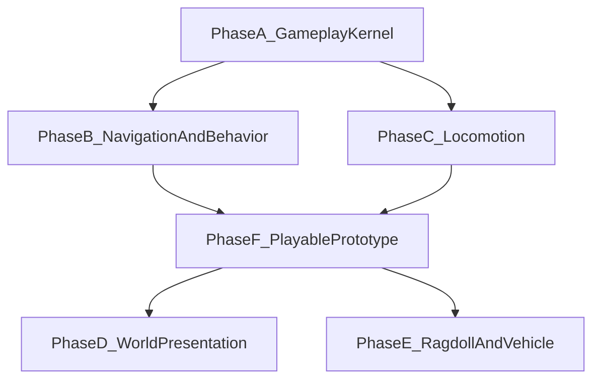

# 补齐 Cry 式游戏能力

## 1. 文档定位

本文记录 2026-11-01 的 CryENGINE 模块对照如何收成一条可验收的补齐路线，并钉到当前仓库里已经存在的模块。实施步骤在 [`docs/superpowers/plans/2026-11-01-cry-style-gameplay.md`](../superpowers/plans/2026-11-01-cry-style-gameplay.md)。

阶段 A 到 F、D、E 已有代码和 focused 测试，normal / ASan+UBSan / TSan 通过。可玩原型是 headless 的：没有 GPU、声音或网络。植被、昼夜、VisArea 和块驻留的 CPU 结果不证明画面。布娃娃和射线载具的测试不证明驾驶手感。`break_game` 与 `break_ai` 没有链入 `engine`。

对照来源是 CryENGINE 各模块与 Break 现有代码的差距，不是代码行数竞赛。Cry 侧行数只说明对方体量；Break 侧以源码路径为准。外部行为未在本仓库复核的细节保持未知，不写成需求。

“可做 Cry 式游戏”在本文里是两个递进的验收切片，不是 CryENGINE 3.1 的源码级复刻：

| 切片 | 玩家能做的事 | 包含的阶段 |
|---|---|---|
| 可玩原型 | 在一张已加载的关卡里用键鼠/手柄移动；一个敌人沿导航网格追过来，进入视野后切换行为；走进触发区会发出一次进入事件 | A 游戏内核、B 导航与行为、C 运动混合 |
| Cry 式关卡 | 同一张关卡有植被、随时间变化的日光、室内外裁剪，以及角色死亡后的布娃娃和一辆可驾驶载具；大地形按块驻留 | D 世界表现与流式、E 布娃娃与载具 |

阶段 F 把可玩原型接到一个 headless 关卡测试上。D 与 E 各自独立，不阻塞可玩原型。

## 2. 现状（2026-11-01）

| 模块 | 结论 | 已有、后续直接复用 | 本路线要补的部分 |
|---|---|---|---|
| 3D 引擎 | 部分 | 地形、水面、粒子、遮挡剔除、LOD、体积雾、天空盒、后处理；植被、昼夜、VisArea、块驻留、贴花吸附、体素外露面、道路条带 | 贴花/体素/道路的 GPU、把流式块读进 `World` |
| 动画 | 部分，且小 | [`engine/src/animation/animation.h`](../../engine/src/animation/animation.h)：8 层混合、淡入淡出、64 位骨骼遮罩、两骨 IK、动画事件。骨架上限 128 关节（[`skeleton.h`](../../engine/src/animation/skeleton.h)） | 一维参数混合、挂点、瞄准/注视 IK。变形、面部、压缩、布娃娃驱动放到明确的后续阶段 |
| 物理 | 部分 | 盒/球/胶囊、CCD、距离与球铰、朝向、铰链、可设刚度的滑轨、布娃娃、射线载具、绳索、带斜向弹簧和自碰撞的布料、可破坏盒子（最多 512 块）、4 至 128 质点的形状匹配软体 | 滑轨刚度上限 1e6。超过 128 个质点不做。一个世界最多 4 块布自动做自碰撞 |
| 游戏框架 | 基本没有 | [`scene_serial`](../../docs/Engine_Modules.md) 场景存取；规则引擎是事实/推理引擎，不承担关卡脚本 | Actor、关卡加载、ActionMap、Area。物品/武器/背包只做组件形状，Flow Graph 不做 |
| AI | 没有 | 物理射线和角色控制器可被查询，仓库内无寻路、感知、行为树 | 烘焙导航网格、A*、跟随、视野感知、小型行为树、胶囊避障 |
| 实体 | 核心较好 | [`engine/src/ecs/ecs.h`](../../engine/src/ecs/ecs.h) archetype、缓存查询、快照与增量、AOI、对象池 | 实体类注册表、触发区。代理/扩展体系用组件代替 |
| 输入 | 大部分等价 | [`engine/src/platform/input.h`](../../engine/src/platform/input.h) 键鼠与手柄 | ActionMap 重绑定。振动与触摸留在范围外 |
| 网络 | 部分，安全面更强 | UDP 可靠/不可靠、实体复制、会话、TLS、AUTH-v2、重放窗口、消息限速 | 本路线不补大厅、NAT、语音、aspect 压缩 |
| 脚本 | 部分 | Lua 运行时、绑定、热重载、指令与内存预算 | 本路线用现有 `break_lua` 跑 Actor 脚本。调试器与 ScriptTable 绑定不做 |
| 声音 | 部分，且小 | miniaudio 的 2D/3D 播放、衰减、总线、流式 | 本路线不补音乐、DSP、遮挡、声音事件 |
| 系统 | 部分 | 日志、VFS、计时器、任务、分配器、性能分析、崩溃捕获 | 本路线不补全局 CVar、XML、插件动态加载 |

## 3. 顺序

AI 是最大的空白，但它要挂在 Actor 和关卡上才成为游戏能力。所以先做一层很薄的游戏内核，再做导航和行为。动画的运动混合与 AI 并行的前提是内核里已经有速度和朝向；世界表现和物理扩展都读这三层的结果，彼此不互相阻塞。

规则引擎保持独立。行为树求值不调用规则引擎，规则引擎也不变成 Flow Graph。

## 4. 所有权与语言

- 运行时核心继续是 C11。新增公共类型使用 `engine/src/core/types.h` 的 `u8/u16/u32/u64/f32`。
- Game 线程独占可变的 `World`、Actor 表、导航查询缓存、行为树、动画混合状态和物理世界。其它线程只提交烘焙结果或资源字节，不调用这些对象的 step。
- 网络回调继续只做校验、拷贝和入队。AI、动画、关卡加载都不在网络线程上运行。
- `break_game` 与 `break_ai` 是正式可选静态库：顶层 CMake target，`ENGINE_BUILD_TESTS=OFF` 时也产出，本计划不把它们链入 `engine`、`engine_demo`、`dxx_break`。接入 demo 是每阶段最后单独的集成任务，通过之后才能写“已接入运行时”。
- 动画和物理的增量改现有模块，因为类型已经在 `engine` 里。改动保持固定容量，热路径不在 step 内 `malloc`。
- 渲染增量（植被、昼夜、VisArea、地形块）留在 `engine/src/renderer/`，因为它们必须碰 RHI。`break_ai` 不包含 `renderer/terrain.h`：导航烘焙吃一份纯 CPU 的高度图副本（`f32` 网格、原点、格子大小、高度缩放）。

错误码沿用九类形状：`OK / INVALID / CLOSED / OVERLOAD / OOM / TIMEOUT / STALE / REJECTED / FAILED`，各自带库前缀。容量用尽返回 `OVERLOAD`，不扩容、不阻塞。句柄带 generation，销毁后的 id 返回 `STALE`。

## 5. 阶段 A — 游戏内核

CryAction 里本阶段只取关卡能跑起来所必需的四块。物品、武器、背包、载具框架、Flow Graph、可视化脚本编辑器不在本阶段。

### 5.1 Actor

Actor 不是 C++ 类层次。一个 Actor 是一个 `Entity` 加上类注册表里的一条记录。

- 类记录：稳定的 `u32` 类 id、不超过 63 字节的名字、必须有的组件 id 列表、可选的 Lua 模块名。
- 生成：按类 id 创建实体，把列出的组件加到实体上并清零，记下 generation。
- 销毁：销毁实体，并作废该类实例槽。
- 每帧：对仍存活的实例调用已绑定的 Lua `on_actor_tick(dt)`。未绑定脚本的类只保留组件，tick 为空操作。

组件集合就是 Cry 的实体类。不另做代理指针或扩展 vtable。

固定上限：64 个类，4096 个同时存活的 Actor。超出返回 `OVERLOAD`。

### 5.2 关卡

关卡加载由宿主回调完成。`break_game` 不链接 `scene_serial` 和渲染器。回调签名接收路径和 `World*`，由集成层调用现有 `scene_load_binary`。

加载成功后，内核按一份关卡侧车（每行：实体 index、类名）把已有实体登记成 Actor。侧车缺失时关卡仍然算加载成功，Actor 数量为 0。卸载销毁内核登记过的 Actor，并调用宿主的卸载回调；`World` 本身由宿主释放。

同一内核同时只有一个已加载关卡。重复加载返回 `REJECTED`，调用方先卸载。

### 5.3 ActionMap

动作是名字到一串绑定的映射。绑定来自键、鼠标按键/轴或手柄按钮/轴，数据放在调用方提供的表里，运行时可以整表替换（重绑定）。

每帧根据 `InputState` 写出固定的 `ActionState`：每个动作一个 `bool down` 和一个 `f32 axis`。轴同时有正负绑定时相加后钳到 [-1, 1]。评估顺序固定，同帧内不分配。

上限：64 个动作，每个动作 8 个绑定。动作名不超过 63 字节。

角色移动不放进 `character_update`。内核的移动适配把“前进/侧移”轴和相机 yaw 合成世界 XZ，再连同跳跃动作交给现有 `character_update`。`CharacterController` 继续没有朝向；朝向记在 Actor 的移动组件里。

### 5.4 Area

触发区是轴对齐盒或球，挂在关卡坐标里。每帧用 Actor 脚底位置做进入/停留/离开，边界外加 0.25 m 滞回，避免站在边上反复触发。回调在 Game 线程同步调用，签名是区域 id、Actor 实体、事件种类。

上限：256 个区域，每个区域每帧最多报告 64 个进入或离开。超出的 Actor 留到下一帧，返回值里带 `OVERLOAD` 计数，不丢状态。

## 6. 阶段 B — 导航与行为

本阶段交付一个烘焙好的导航网格和一只会追人的代理。群组战术、智能对象、动态雕刻、局部避障速度障碍算法不在本阶段。

### 6.1 导航网格

烘焙输入是三角形汤或高度图副本，输出是分块多边形和邻接。运行时只查询，不在寻路当帧重建。

范围：一块 256 m × 256 m 的区域，32 m 一块，最多 64 块。每块最多 1024 个多边形。文件格式版本化，读取时任何越界计数整份拒绝。

查询是多边形中心上的 A*，再用漏斗算法拉成折线。起终点落在网格外返回 `FAILED` 且不写出部分路径。路径点上限 256。

高度图路径不包含 RHI 类型。集成层从 `Terrain.heightmap` 拷出 `f32` 缓冲再交给烘焙器。

### 6.2 跟随、感知、行为

- 跟随：沿路径点推进，输出本帧位移方向和剩余距离。真正的位移仍交给 `character_update`，跟随器不写物理体位置。
- 感知：一个视野圆锥（距离、半角、眼高）。圆锥内的目标再做一次 `physics_raycast`；被挡则看不见。每代理每帧最多 8 个候选。
- 行为：选择节点、序列节点、叶子。叶子只做三件事：待机、沿路径走向黑板里的目标、在距离内置“攻击”标记。黑板是 Actor 上的一块固定 POD（目标实体、最后看见的位置、看见与否）。
- 避障：对附近其它代理的胶囊做侧向偏置。不实现 RVO。

行为树的节点图在 C 数组里，用索引引用子节点。Lua 可以写黑板，不能替换节点函数指针。

## 7. 阶段 C — 运动混合与瞄准

现有混合器已经能叠 8 层并做一次淡入淡出。本阶段在它上面加三件游戏会用到的东西，不改评估结果的存储方式（局部 TRS 数组）。

- **一维参数混合。** 一个参数（水平速度）在最多 4 个剪辑之间按阈值线性混合，输出写进指定层的权重。阈值必须严格递增，否则 `INVALID`。这是 locomotion 的最小参数混合，不带二维运动图编辑器。
- **挂点。** 名字（≤31 字节）对应关节索引加局部偏移。查询时用 `Skeleton.current_pose` 的世界矩阵变换偏移。未知名字返回 `STALE`。每骨架 32 个挂点。
- **瞄准 / 注视。** 复用两骨 IK。瞄准链和注视链各占 `IKSystem` 里的一个槽，权重由调用方每帧设置。被遮罩的骨骼必须落在 0..63，因为层遮罩仍是一个 `u64`。超过 63 的关节可以存在于骨架（上限 128），但不能被层遮罩单独挑选。

变形目标、面部动画、曲线压缩留在范围外。布娃娃驱动骨骼属于阶段 E，本阶段的 IK 不读物理姿态。

## 8. 阶段 D — 世界表现与流式

四条线都接在现有渲染器上，可分别合入。

### 8.1 植被

密度图（与地形网格对齐的 `u8`）在每个非零格子放一棵实例。实例是现有网格的副本，带每实例变换和一种原型 id。LOD 走现有 `lod` 路径。第一版不响应风，不可砍伐。单块上限 65536 实例，超出的格子忽略并计数。

### 8.2 昼夜

一个 `f32` 时钟（秒）映射到太阳方向、太阳颜色、环境色和雾强度。这些字段写进地形和天空盒已经有的光照 uniform（`loc_light_dir`、`loc_light_color`、`loc_ambient`、`loc_fog_strength`）。不模拟天气、云影和日期。

### 8.3 VisArea / Portal

房间是一个轴对齐体积加最多 8 个门户（矩形，带邻接房间 id）。摄像机在房间内时，可见集是当前房间、穿过门户视锥能看见的房间，以及被标成室外的物体。室外物体继续走现有遮挡剔除。门户裁剪在 CPU 上产出可见 id 列表，不替换遮挡剔除的实现。

上限：128 个房间，每房间 512 个物体 id。

### 8.4 流式

对象按 64 m 的块记录在清单里。摄像机周围 Chebyshev 距离 ≤ 1 的块为驻留，距离 ≥ 3 的块卸载。`world_stream_apply` 把这些意图提交给现有任务系统，由一个任务写回驻留位图，调用方在 `task_wait` 返回后看到结果。它不读 VFS，也不把块提交进 `World`。地形窗口外的格子不在这份 CPU 合同里进 GPU 缓冲。

这不是服务端 Cell，也不改网络 AOI。AOI 仍只决定谁的状态要复制。

贴花可以吸到高度图上（`decal_place_on_heightfield`），没有进 GPU。体素外露面和道路条带同样是 CPU 网格。绳索在物理节。

## 9. 阶段 E — 布娃娃与载具

`RigidBody` 今天只有位置和线速度，球铰的锚点是世界空间固定偏移。布娃娃和载具都要先有姿态。

### 9.1 姿态与铰链

给动态刚体增加四元数朝向和角速度，惯性用对角张量。球铰改为局部锚点，求解前用朝向变换到世界。新增铰链：一个轴、可选的角度上下限。距离约束保持原语义。

固定步长仍由调用方传入 `physics_step`。热路径继续使用世界内的固定数组，铰链计入现有 `PHYSICS_MAX_CONSTRAINTS`（64）的同一上限；需要更多约束时返回 `OVERLOAD`，本阶段不提高这个常数，除非单独的容量任务先改测试。

### 9.2 布娃娃

布娃娃是骨架关节到刚体的一张表，相邻关节之间一条铰链。激活时用当前世界姿态生成刚体；之后每物理步把刚体的位置和朝向写回关节的世界矩阵，再转回局部 TRS 交给蒙皮。激活前动画评估照常。同一骨架不能同时写 IK 和布娃娃；激活布娃娃时把 IK 权重置 0。

### 9.3 载具

第一辆载具是射线悬架：一个带朝向的底盘刚体，四个轮子各自向下做扫掠（现有 `physics_sweep_test`），用压缩量产生弹簧力。轮子不是刚体，因此不需要滑轨约束。油门、刹车、转向是 ActionMap 动作，写进载具组件，由底盘积分。

车上的角色每帧把脚底位置设到底盘上的挂点，并停用自己的 `character_update`。下车时在车体外侧找一个扫掠通过的落点，找不到则拒绝下车并保持在车上。

## 10. 阶段 F — 可玩原型验收

一个 headless 测试关卡，不依赖 GPU：

1. 加载包含地面碰撞、玩家出生点、一个敌人出生点、一个触发区的关卡描述。
2. 绑定 ActionMap：前进轴推满 3 秒，玩家水平位移超过 2 m，朝向与位移一致。
3. 敌人的行为树在视野射线畅通时选“走向玩家”，导航路径长度大于直线距离（中间有一个绕行障碍）。
4. 玩家速度从 0 增到跑步阈值时，一维混合的跑步剪辑权重大于步行剪辑。
5. 玩家进入触发区正好一次 `ENTER`，离开一次 `LEAVE`，站在边界上抖动不超过滞回时不重复进入。

D 和 E 另有自己的测试，不作为本切片的门槛。

## 11. 明确留在范围外

这些缺口在对照表里是真的，本路线不排期，避免和上面的验收缠在一起：

- Flow Graph 与可视化节点编辑器。Actor 脚本用现有 Lua 模块。
- 武器数值、背包网格、物品数据库。阶段 A 只保留“类可以声明额外组件”的口子。
- 变形、面部、动画压缩。滑轨刚度单独设置，默认 100 rad/s² 每弧度，上限 1e6。软体可以到 128 个质点。布料自碰撞在 `physics_step` 末尾自动跑，跳过已经有距离约束的点对；同一个世界最多 4 块布。可破坏物可以再碎到 512 块，容量不够就停在 64。都没有渲染。
- 导航群组、智能对象、动态网格雕刻。
- 大厅、匹配、NAT、语音、aspect 式复制压缩。
- 脚本断点调试器、Cry ScriptTable 式全表绑定。
- 音乐、DSP、混响、声音遮挡、声音事件工程。
- 全局控制台 / CVar、XML 场景格式、插件 DLL 加载框架。
- 手柄振动、触摸。
- 规则引擎改造成关卡脚本。

## 12. 测试与证据

每个阶段在合入前提供：

- 该阶段新增的 focused 测试，先红后绿。
- normal、ASan+UBSan、TSan 三棵树中 focused 目标通过。图形测试仅阶段 D 需要，且与 CPU 测试分开标记。
- 新静态库的 target contract：`ENGINE_BUILD_TESTS=OFF` 时仍生成，且不出现在 `engine`、`engine_demo`、`dxx_break` 的链接行上。
- `docs/Implementation_Status.md` 顶部追加一条，写明已交付行为和未交付边界。设计文档在对应阶段落地后把状态从“设计-only”改成“已交付”并指向测试名。

未跑的平台（Windows 执行、macOS、真实 GPU 截图）保持未交付，不由 Linux CPU 测试推断。
