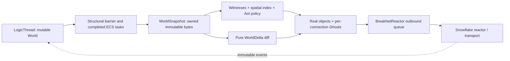
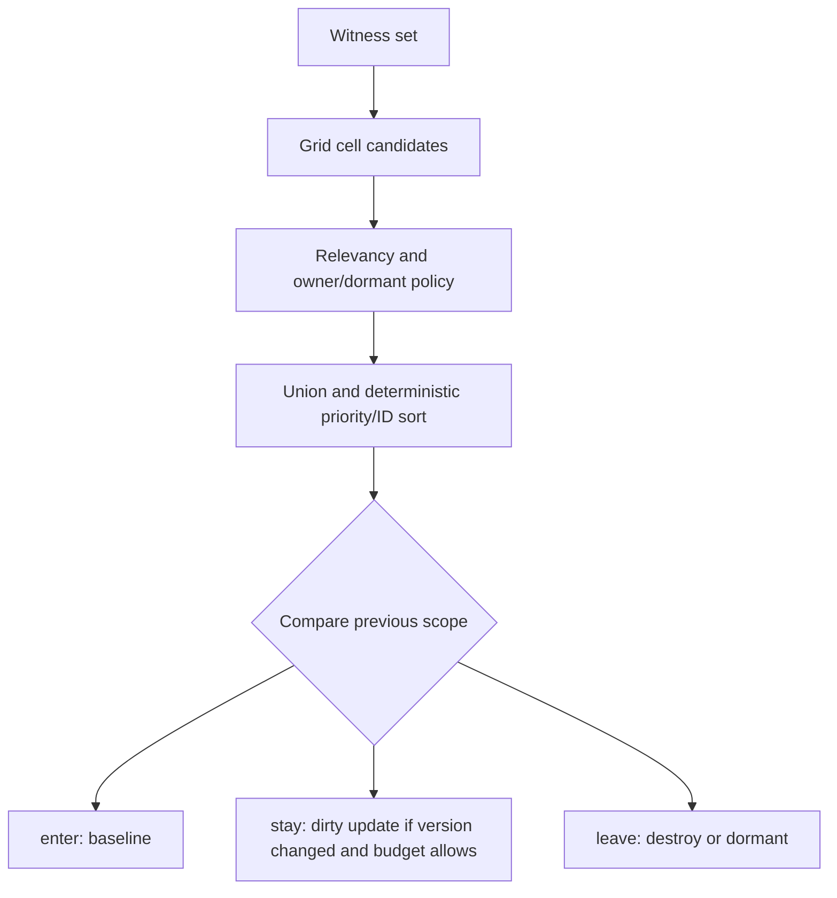
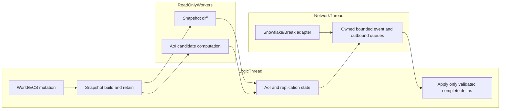

# ECS Snapshot, Replication and AoI

**Status:** Task 8 documentation for the currently implemented ECS/AoI slice. This document separates shipped behavior from planned transport and authority features. The focused schema/snapshot/delta/AoI/replication APIs are implemented; formal runtime/session integration is a separate boundary.

## Scope and Current Boundary

The current implementation is a C11, LogicThread-facing foundation:

- `replication_schema.*` registers deterministic component schemas and computes a stable schema hash from canonical component IDs.
- `world_snapshot.*` builds an owned, immutable copy of live entity handles and registered component bytes. Snapshot build remains a LogicThread operation after the structural barrier; there is no automatic ECS barrier.
- `world_delta.*` diffs two immutable snapshots and applies a validated delta through ECS-owned deep-clone staging and an atomic replace commit.
- `break_aoi.*` maintains a simple spatial index and computes deterministic `enter`, `stay`, and `leave` sets for one or more witnesses.
- `break_replication.*` tracks per-connection Ghost state, sends baselines/dirty/destroy/dormant records through `BreakNetReactor`, and enforces a byte budget.
- `break_replication_fragment.*` splits non-empty payloads under `BREAK_NET_MAX_PAYLOAD_SIZE` and reassembles one delta at a time after metadata, checksum, duplicate/conflict, and completeness validation. P8 adds caller-storage fragment views with a shared planner/fill. A monotonically newer delta supersedes an incomplete old delta only after all new metadata/first-fragment/result allocations succeed, otherwise the old stream is preserved. A persistent high-water also rejects older deltas after completion; explicit reset starts a new epoch.
- P8 `break_online_aspect.*` adds fixed aspect schemas, generation-aware stores, sparse change-mask packets and transactional apply with per-object record epochs. Explicit-epoch encoding is read-only, and apply advances record ordering without overwriting the public local-value revision. The compatibility `break_aspect_encode` owns a separate per-object automatic encoder high-water, committed only after successful output; callers must not switch back to automatic encoding after issuing a larger explicit epoch on that object. `break_online_aspect_replication.*` maps them onto the existing AOI enter/stay/leave sets with per-connection dirty state and fixed fragment metadata. Each actual send attempt gets a fresh epoch after budget/fragmentation preflight and before the first datagram; callback failure preserves that high-water and dirty state, while only complete success clears dirty. Ordinary scope leaves deactivate without retiring the reusable handle, while explicit object destruction still retires generation. The send callback is the authenticated transport boundary, not a replacement for Session security.

The formal optional libraries are `break_ecs_replication` (ECS schema/snapshot/delta plus ECS-owned AoI-independent dependencies and core logging) and `break_replication_core` (AoI, replication scheduling, and fragmentation). They are non-Snowflake targets and are available even when `ENGINE_BUILD_TESTS=OFF`; the umbrella header is `ecs/replication_runtime.h`. They are deliberately not linked into `engine`, `engine_demo`, or `dxx_break` until a runtime/session owner defines publication, authority, and thread-lifecycle integration. `break_ecs_replication_test` is a test-only composition carrying `BREAK_WORLD_DELTA_TESTING=1`; production libraries never receive that fault-injection macro. `break_net` remains an optional Snowflake adapter: it is produced whenever `BREAK_ENABLE_SNOWFLAKE=ON`, independent of `ENGINE_BUILD_TESTS`, and links `break_replication_core` and `snow::net`. P8 `break_online` is likewise optional and links `break_replication_core`; its actual aspect behavior and limits are recorded in `docs/design/online_session_network.md`.

Task 7 is implemented as a transport-independent fragmentation/reassembly layer. Fragment metadata carries `delta_id`, `base_id`, `fragment_index`, `fragment_count`, and a deterministic FNV-1a checksum over each fragment payload. The reassembler accepts out-of-order fragments, returns `INCOMPLETE` while fragments are missing, returns `COMPLETE` with newly allocated owned bytes only after every fragment is present, reports exact duplicate fragments separately from conflicts, rejects checksum/base/index/count/delta mismatches, and exposes explicit reset/destroy lifecycle operations.

The current Snowflake adapter remains an adapter boundary: it owns transport integration and bounded outbound queues, while the replication layer submits complete messages to `break_net_reactor_send`. Replication and fragmentation do not call Snowflake directly.

## Architecture and Data Flow



The intended lifecycle is: systems finish, the LogicThread establishes the structural barrier, the LogicThread builds a snapshot, and readers retain that snapshot while diff/AoI work runs. Snapshot build still requires that LogicThread/structural-barrier discipline; the builder does not insert an automatic barrier. The current snapshot builder is stop-the-world and owns all copied bytes; it stores no `World *`, archetype, chunk, RHI, or Scene pointer. Entity identity includes both `index` and `generation`, so index reuse is not mistaken for the same entity.

### Snapshot publication and delta application

```mermaid
sequenceDiagram
    participant G as LogicThread
    participant W as World
    participant S as Snapshot
    participant X as Worker/read-only consumer
    participant V as Validated delta

    G->>W: finish systems and enter structural barrier
    G->>S: build(tick, schema registry; no automatic barrier)
    S-->>G: owned snapshot (refcount 1)
    G->>S: publish/retain for consumers
    X->>S: diff immutable base -> target
    X-->>G: complete delta message
    G->>V: validate base/schema/records and tick monotonicity
    G->>V: deep-clone World into ECS-owned staging
    alt staging apply and final validation succeed
        G->>W: atomically replace contents; consume staging
    else mismatch, malformed, allocation/fault failure
        G-->>X: reject; destroy staging; original World unchanged
    end
```

Implemented snapshot identity is the deterministic hash of tick, schema hash, sorted entity handles, component IDs, and bytes. The schema hash uses canonical component IDs, so registration order does not change the schema identity. The current API exposes snapshot tick, ID/hash, entity lookup, component bytes, and retain/release. Publication is not yet a separate mutex-protected current-snapshot service; callers must retain the object they receive.

A delta retains its base and target snapshots, records entity create/destroy and component add/remove/update operations, validates the complete base world before staging, predicts entity allocation/generation before applying creates, and verifies the final target state. Delta apply requires a target tick greater than the base tick. `break_world_delta_apply` deep-clones the World using ECS-owned clone helpers, applies and final-validates only the staging World, then atomically replaces the destination contents. Any validation, allocation, mutation fault-injection, or final-validation failure destroys staging and leaves the original World unchanged. Clone allocation injection (`ECS_TESTING`) and mutation/final-validation injection (`BREAK_WORLD_DELTA_TESTING`) are test-only hooks, not production behavior.

## Component Schema Rules

A registered component declares component ID, version, size, alignment, flags, and optional encode/decode callbacks. Registration rejects duplicate IDs, zero sizes, invalid alignment, and raw-byte schemas marked pointer-containing. Snapshot raw bytes are accepted only for deterministic POD schemas with `BREAK_SCHEMA_FLAG_RAW_BYTES`; resource references, derived caches, and pointer-containing components are rejected by the snapshot policy.

The registry is initialization/LogicThread-owned. It is not a synchronized hot-path object. A schema change changes the schema hash and therefore requires a new compatible snapshot/delta stream; schema negotiation and online schema updates are not implemented.

## Real, Ghost, Witness, and AoI

- **Real:** `BreakReplicationObject` registered by the replication owner, with stable AoI entity ID, owner ID, position, flags, and priority. Payload/version state is owned by the replication object. Version increments fail closed at `UINT64_MAX`: `register` updates and `mark_dirty` reject before allocating or replacing payload state, preserving the old Real payload and all Ghost state. `UINT64_MAX` is terminal for that object; no epoch rollover is implied.
- **Ghost:** per-connection state recording whether a baseline was sent and the last sent object version. Ghosts are destroyed on disconnect and are not authoritative.
- **Witness:** connection interest source with position, direction, velocity, radius or AABB half-extents, hysteresis, connection ID, and priority.
- **AoI scope:** spatial candidates are filtered by always-relevant, owner-only, and dormant flags, deduplicated across witnesses, and `enter`, `stay`, and `leave` are all returned in deterministic priority-descending/entity-ID-ascending order. Leave ordering uses the current object priority from the spatial index while the object remains indexed. With no witnesses, non-dormant `ALWAYS_RELEVANT` objects enter scope only when they are not `OWNER_ONLY`; owner-only objects require a matching connection witness. Candidate cell bounds use `max(enter_hysteresis, leave_hysteresis)`, while exact inclusion selects enter or leave margin from prior scope membership.



The explicit set contract is `enter = new - old`, `stay = new ∩ old`, and `leave = old - new`. Sphere and AABB shapes, hysteresis, multiple-witness union, duplicate suppression, boundary validation, and safe rejection of non-finite/negative inputs are covered by `test_ecs_replication`. Replication scheduling then sends complete records through the Break adapter, prioritizing higher-priority objects and deferring records that exceed the connection budget or outbound queue capacity.

## Thread Ownership and Lifecycle



The LogicThread owns mutable `World`, ECS structural state, schema registration, Real objects, Ghost maps, and connection scope state. Snapshot and AoI consumers may read only owned immutable values. Network callbacks and reactor workers handle bounded message views/copies and queue events; they must not call World/ECS/Lua/UI/RHI or mutate replication state directly. The adapter has one driver per reactor (`BREAK_NET_DRIVE_STEP` or its host-thread mode), and shutdown is terminate, join when applicable, destroy reactor, then publish stopped. The adapter's `timeout_ms` is currently compatibility-only because the underlying thread abstraction has no timed join.

Replication version safety is fail-closed: an object at `UINT64_MAX` cannot be registered again or marked dirty, and the rejection occurs before payload allocation, freeing, or version mutation. This is a terminal-version policy rather than an epoch rollover; callers must replace the object identity if they need a new version domain.

Lifecycle on a connection is: open connection state, compute scope, send baseline on `enter`, send dirty versioned payloads on `stay`, send destroy/dormant on `leave`, and discard all Ghost state on disconnect. Queue overload is reported without blocking the LogicThread; a later sync can retry unsent baseline or dirty records.

## Fragmentation and Validation Boundary

The transport payload limit is `BREAK_NET_MAX_PAYLOAD_SIZE` (64 KiB), and the total reassembly budget is `BREAK_REPLICATION_MAX_REASSEMBLY_SIZE` (16 MiB). `break_replication_fragment_payload()` rejects empty or over-budget payloads, rejects a zero fragment size, reports a caller-selected fragment size above the transport limit as `OVER_LIMIT`, and emits non-owning fragment views into the caller's payload. The caller releases only the metadata array with `break_replication_fragments_free()` and must keep the source payload alive until fragmentation is finished.

Each emitted fragment carries:

- `delta_id` and `base_id`;
- zero-based `fragment_index` and common `fragment_count`;
- fragment byte length and FNV-1a checksum.

`break_replication_reassembler_create(expected_base_id)` owns one in-progress delta assembly. `push()` validates non-empty data, transport size, base ID, checksum, index/count bounds, and rejects fragment counts or metadata allocations beyond the 16 MiB reassembly budget before allocating per-fragment state; it also rejects any `total_size` growth beyond that budget. It then fixes the first fragment's delta ID/count as the assembly identity. Later fragments with another delta/count are conflicts. Exact duplicate bytes return `DUPLICATE`; same-index bytes with different size/checksum/content return `CONFLICT`. Fragments are copied into reassembler-owned storage, so the input view may be temporary. Missing fragments return `INCOMPLETE`; only the final validated set produces a newly allocated contiguous payload and `COMPLETE`. The caller owns that result and releases it with `break_replication_reassembly_free()`.

Completion clears the assembly state. An incomplete or failed final allocation leaves collected fragments available for retry; `break_replication_reassembler_reset()` explicitly discards that state, and destroy also frees all owned fragment storage. The focused API has no timeout or eviction policy: the owning replication scheduler must bound lifetime and call reset/recreate on loss or expiry. The checksum is integrity validation, not cryptographic authentication. No Snowflake call and no World mutation belongs in this layer. The LogicThread applies only the fully reassembled result after its own base/schema/delta validation; the fragmentation API itself does not enqueue or apply deltas.

## Implemented vs Future Work

| Area | Implemented now | Not implemented / future boundary |
|---|---|---|
| Snapshot | Deep copy, generation-aware handles, canonical-ID schema hash, deterministic hash, refcount lifetime; LogicThread/structural-barrier build contract | Automatic barrier, mutex publication service, epoch reclamation; formal runtime/session publication integration |
| Delta | Immutable diff, base-world validation, generation prediction, staging final validation, ECS-owned deep clone, atomic replace commit, unchanged-on-failure behavior | Wire schema/tick fields, authority protocol; formal runtime/session integration |
| AoI | Grid, sphere/AABB, witnesses, flags, hysteresis, enter/stay/leave | Distributed spatial cells, occlusion/LOD policy, prediction; formal runtime/session integration |
| Replication | Real/Ghost records, baseline/dirty/destroy/dormant, budget and queue retry | Full authority handoff and client prediction/rollback; formal runtime/session integration |
| Transport | Break adapter queue boundary and owned payloads; Task 7 fragmentation/reassembly, checksum, reorder, duplicate/conflict, base validation, owned output, reset | Real Snowflake registration/socket send integration, timeout/eviction scheduler, cryptographic authentication |
| Logic | No network-thread mutation; LogicThread-owned apply boundary | Lua callbacks, editor RPC, online updates, security/authentication |

Distributed Cell services, cross-World persistent NetEntityId, client prediction, rollback, authority handoff, Lua logic integration, editor tooling, online schema updates, and security policy are deliberately outside this slice.

## Validation

Focused validation uses `test_ecs_replication`, `test_break_replication_fragment`, and, when Snowflake is enabled, `test_break_replication`. Earlier fragment and Snowflake replication focused evidence was **7/7** in normal, ASan, and TSan lanes, with independent fuzz smoke evidence of **5/5**. The Task 7 closeout record (2026-10-23, clean `build-sdd-t7`/`build-sdd-t7-asan`/`build-sdd-t7-tsan` trees, `BREAK_ENABLE_SNOWFLAKE=ON`): the focused runtime/ecs/net lane passes **16/16** in each of the normal, ASan+UBSan, and TSan trees; all five fuzz executables are explicitly built and `ctest -L fuzz` passes **5/5**; the full non-graphics/non-fuzz CTest run has 178 selected tests with **177 passed, 0 failed, and 1 platform skip** (`test_d3d12_dependency_gate`, Windows-only lane) out of 187 registered tests. `test_break_replication_fragment` passed in every lane in this record; it carries a pre-existing intermittent flake note parked outside this plan's commits. The historical `test_myui_text_layout` Hebrew boundary failure did not reproduce (the test passed in the full run); `test_vulkan` is graphics-labeled and was not exercised in this host run. Documentation changes are checked with `git diff --check`.


## 补充（2026-11-20）：arm64 ECS/replication 验证

arm64 lane 新增 `test_ecs`（45 例）、`test_ecs_system`（6 例）、`test_ecs_replication`（35 例）与 `test_replication_target_contract`，统一选择达到四十二项。原生与交叉 focused 均为 4/4，快照/增量/AOI 和事务回滚用例直接经 QEMU 执行，目标契约保持宿主 CMake 源码结构检查。

选择使用 `test_ecs(_system|_replication)?$` 与 `test_replication_target_contract$`，局部结尾锚点覆盖整个名称，防止未来派生前缀自动混入。本项证据不外推为 world streaming、网络传输或全量 arm64 覆盖。


## 补充（2026-11-23）：分片重组超时与驱逐

`break_replication_reassembler` 新增调用者时钟驱动的超时原语：`break_replication_reassembler_push_at(r, fragment, now, …)` 在接受分片（含完全相同的重复分片）时记录未完成 stream 的最近活动时间，结果与 `push` 一致；`break_replication_reassembler_expire(r, now, max_idle)` 在空闲达到 `max_idle` 时丢弃未完成 stream 并返回 true（`now` 早于记录时间视为 0 空闲，`max_idle=0` 立即驱逐）；`break_replication_reassembler_pending_bytes` 报告其占用的负载字节（不含每分片元数据，后者另有至多 16 MiB 的预算）。被拒绝的分片（CONFLICT、CHECKSUM_MISMATCH、BASE_MISMATCH、失败的 supersession 等）不刷新活动时间，因此无效分片无法让 stream 长期存活；完全相同的重复分片会刷新，这是有意的取舍：FNV-1a 不是认证，能重放已接受分片的一方本来也能伪造新分片，内存上限不变。由普通 `push` 开始的 stream 为“未计时”，`expire` 不驱逐它，之后同一 stream 的 `push_at` 也不会开始计时；要使用驱逐，应始终用 `push_at` 喂入分片。high-water 保留：更旧 delta 仍为 CONFLICT，被驱逐 delta 的迟到分片与完成后一样重新开始。模块不读墙钟、不新增结果枚举值。上文“fragment timeout/eviction 未实现”中的**驱逐原语**由此交付；周期性调用 `expire` 的调度器以及与 session/网络的接线仍未实现。


## 补充（2026-11-23）：多 delta 并发重组池

`BreakReplicationReassemblyPool` 在既有单流重组器之上提供固定槽位的多 delta 并发重组，不改变旧单流 API 或“较新 delta 取代旧流”的语义。本切片新增：

```c
size_t break_replication_reassembly_pool_expire(
    BreakReplicationReassemblyPool *pool, uint64_t now, uint64_t max_idle);
void break_replication_reassembly_pool_reset(BreakReplicationReassemblyPool *pool);
```

池按 `delta_id` 路由，槽位数为 1..64，所有活跃流共享创建时的 `max_pending_bytes` 负载预算。满槽或新增负载超预算返回 `OVER_LIMIT`，不覆盖活跃流且拒绝前后状态不变；完全相同的重复分片不重复计预算。完成或过期推进“已退出高水位”的最大值：严格小于它的新流返回 `CONFLICT`，等于它的迟到分片可重新开始，已经活跃的较旧流仍可完成。`completed_delta_id` 标识实际完成的 delta，payload 仍由 `break_replication_reassembly_free()` 释放。

`expire` 逐槽复用单流计时契约，只驱逐达到阈值的计时未完成流并返回数量；重复分片只刷新自己的槽，校验失败或冲突不刷新，时钟回退按 0 空闲，`max_idle=0` 驱逐全部计时流。`reset` 清空所有流、pending 计数和高水位，与同配置新池行为一致，同时保留槽位容量、负载预算和 expected base。所有池 API 均为所有者线程语义，不读墙钟，不引入锁、线程或网络调用。

`test_break_replication_fragment` 现为 **22/22**。测试覆盖三流独立过期、复位对照、高水位单调性、交织时非零 pending 字节，以及带 pending 数据销毁。八项定向变异（错误路由、满槽覆盖、漏 completed id、共享预算不累计、重复计预算、expire 漏槽、过期不推进高水位、reset 漏清 pending）均成功构建并被行为断言判红。完整 Vulkan 为 462 项注册、458 通过、4 条件 skip、0 失败；OpenGL 为 453 项注册、449 通过、4 条件 skip、0 失败；ASan+UBSan（含显式 leak 检测）与 TSan focused 均为 22/22、无诊断。

本项只交付传输无关的池原语。周期性调用 `expire` 的调度器、session/网络接线、真实网络与生产服务验收仍未完成；FNV-1a 仍不是安全认证。


## 补充（2026-11-24）：池预算范围与恢复/丢弃完成验收

`max_pending_bytes` 只限制池内各活跃流已接收、尚未完成或驱逐的**分片负载字节之和**，不是进程总 RSS 上限，也不包含全部分配。每个槽的分片元数据仍独立遵循单流原有 `BREAK_REPLICATION_MAX_REASSEMBLY_SIZE`（16 MiB）上限；池最多 64 槽，这些元数据及固定槽存储不共享 `max_pending_bytes`。完成时的拼装临时缓冲不计共享 pending；已移交调用方的 payload 也不再计入，其所有权和释放责任仍属调用方。因此不能由该配置推断总 RSS 或所有暂存内存的上限。

新增 `reassembly_pool_expire_releases_shared_budget_for_retry`：8 字节共享预算下，delta 59/60 共占 6 字节，单分片 delta 61 首次为 `OVER_LIMIT`；只驱逐较低 id 的 60 后 pending 降为 2 字节，原 61 分片重试完成，活跃较旧 59 随后完成，最终 high-water 仍为 61 并拒绝新 delta 60。新增 `reassembly_pool_complete_with_null_outputs_discards_and_recycles`：单分片完成时 `completed_delta_id`、`payload`、`payload_size` 全部为 NULL，仍返回 `COMPLETE`、pending 归零，容量 1 的槽可接收下一 delta，且高水位拒绝较旧流。

本次只补测试和文档，生产代码未变。focused normal、ASan+UBSan（显式 LSan）和 TSan 均为 **24/24**，无 sanitizer/leak 诊断。


## 补充（2026-11-24）：重组池周期过期调度

`BreakReplicationReassemblyPool` 新增 `break_replication_reassembly_pool_set_expiry_schedule`、`break_replication_reassembly_pool_disable_expiry_schedule` 和 `break_replication_reassembly_pool_tick`。调度默认禁用；set 启用或替换 `interval/max_idle` 并清纪元，第一次 tick 立即检查，后续仅在 `now-last_tick>=interval` 时执行一次 expire 并把纪元记录为本次 `now`。时钟回退不执行也不改纪元，长间隔不做 catch-up；`interval=0` 每次 tick 到期，`max_idle=0` 在到期 tick 清理全部计时未完成流。手动 expire 不推进纪元。

`push_at` 在校验、路由、容量与预算准入前先 tick，因此到期维护可先释放槽位；随后被拒绝的分片仍不刷新活动时间。disable 保留流并关闭调度、清纪元；reset 保留策略和创建配置、清空流与高水位并清纪元。所有入口仍为所有者线程串行语义，不新增分配、墙钟读取、锁、线程或网络调用。

TDD 先新增四组测试，三个缺失 API 的隐式声明在 `-Werror` 下构成编译 RED；实现后 focused 从基线 **24/24** 到 **28/28**。八项定向变异均成功构建并被行为断言判红：首次 tick 不立即执行 **27 通过/1 失败**，`>=` 改 `>` **24/4**，push 在准入后维护 **27/1**，回退按无符号差值 **27/1**，disable 后仍 tick **27/1**，reset 丢失策略 **26/2**，reset 保留旧纪元 **27/1**，长间隔循环 catch-up **27/1**；恢复后再次 **28/28**。

最终完整 Vulkan CTest 注册 **462** 项，**458 通过、4 条件 skip、0 失败**；OpenGL 注册 **453** 项，**449 通过、4 条件 skip、0 失败**。两者 skip 均为 `test_d3d12_dependency_gate`、`test_core_app_nm_missing`、`test_core_app_nm_unsupported`、`test_core_app_nm_symbol_missing_unsupported`，不计为执行通过。`ENGINE_USE_ASAN=ON + ENGINE_USE_UBSAN=ON` 且显式 `detect_leaks=1` 的 focused 为 **28/28**，TSan focused 为 **28/28**，均无 sanitizer/leak 诊断；未运行完整 sanitizer suite。

本项关闭“周期性调用 expire 的调度器”缺口，但应用仍必须在 owner tick/frame 调用 `pool_tick`，或由 `push_at` 触发维护；无流量且不 tick 时没有后台维护。session/网络接线、真实网络与生产服务验收仍未完成，FNV-1a 仍不是安全认证。


## 补充（2026-11-24）：分片重组池接入认证 Session

复制分片消息 `0x4009` 已注册为 v1、64 KiB、`AUTHENTICATED + IDEMPOTENT`，默认 registry count 在 crypto 开启/关闭时为 **30/29**。`BreakReplicationSessionBridge` 提供 create/destroy、open/close、send、tick、handler、poll/release 和 stats；它复用 `BreakReplicationReassemblyPool` 与 BRFG codec，不改变 snapshot、AOI 或 World delta 的线格式。

每个 connection key 在 open 时获得独立 pool 和 expected base；每连接 pending 乘积不能超过创建时的总预算，完成 queue 另有条数、单包和总字节上限。完成项按 FIFO 保存 connection、delta id 和 owned payload，只有 `poll_completed` 才执行 ownership-at-poll；`completion_release` 释放已取项，close 释放未取项和池，同 key 再 open 使用全新 high-water。stats 提供连接/pending/completion 快照以及 rejected、duplicate、completed、dropped、expired 计数。网络 handler 只重组并入队，不调用 aspect/World，不新增线程或锁。

两个真实 Snowflake loopback 用例验证 AUTH 后的乱序双 delta、相同 BRFG bytes 重复、错误 expected base 拒绝、FIFO/connection/delta/payload、poll 前 consumer 为 0，以及同 key 真实 close/reconnect 后不继承旧 high-water。bridge 现为 **19/19**，Session/wire/fragment 分别为 **43/43、9/9、28/28**。完整 Vulkan **464 通过 + 4 条件 skip/468，0 失败**，OpenGL **455 通过 + 4 条件 skip/459，0 失败**；skip 不计执行通过。ASan+UBSan（显式 `detect_leaks=1`）和 TSan focused 均 **4/4**，直接 case 计数同为 **19/19、43/43、9/9、28/28**，无诊断。

本项没有完成 **生产 core_app/editor 接线、aspect drain、World delta、可靠恢复或完整资产链**。后续 drain 仍需校验 `BRA1.schema_hash == expected_base` 并在所有者线程显式 apply；本项真实 loopback 不等于上述集成已经交付。


## 补充（2026-11-24）：AOI BRA1 包的 Session drain 边界

既有 AOI `BreakAspectReplication` 现在可通过 `BreakAspectSession` 把完成包交给远端 aspect store。open 的 expected base 固定为 `break_aspect_schema_hash(store)`，与 BRA1 内 schema hash 校验构成同一兼容边界。发送 fragment_size 收窄至 **65496**，不允许把 65536 数据片交给需要 40 字节头的 BRFG/v1。

网络 handler 不触碰 aspect/World。owner-thread 的 `break_aspect_session_drain` 才按 FIFO 调用 `break_aspect_apply`，每个 completion 都 release；apply 失败计入 rejected 并继续后续包，stats 保留 bridge 计数。`break_net`/`break_net_test` PUBLIC 传递 `break_online`，独立 link-only 测试 **1/1**。这只连接 aspect record，不定义 ECS snapshot/World delta 的线格式。

真实 socket 用例从 AUTH 后的 AOI enter/stay sync 产生 BRA1，经 0x4009 和 `poll_adapter` 到达 bridge。drain 前预 adopt 占位 handle 无 active aspect、revision 或可读字段；首次 drain 后 U32/I32=42/-17。内部 schema 不匹配的包被 drain 拒绝，原值不变；同 key close/reopen 后 delta 1 在旧 40/41 之后完成，最终值为 84/-34。三次发送/完成、consumer 0→3、applied/rejected/drained=2/1/3 均直接断言。默认 registry 负对照 **11/12**，恢复 **12/12**。

normal、ASan+UBSan（显式 `detect_leaks=1`）和 TSan focused 均为 **6/6、112/112**；aspect session/link/bridge/Session/wire/fragment 分别为 **12/12、1/1、19/19、43/43、9/9、28/28**。完整 Vulkan 注册 **463** 项，**459 执行通过、4 条件 skip、0 失败**；OpenGL 注册 **461** 项，**457 执行通过、4 条件 skip、0 失败**。四项为 `test_d3d12_dependency_gate`、`test_core_app_nm_missing`、`test_core_app_nm_unsupported`、`test_core_app_nm_symbol_missing_unsupported`，不计执行通过。

**生产 core_app/editor 接线、World delta、可靠恢复和完整资产链仍未完成**。本项不改变 AOI、snapshot、delta 或 fragment/reassembly 的既有格式与高水位契约。


## 补充（2026-11-24）：core_app 的固定 POD 对象 AOI 复制

`core_app` 的可选 aspect transport 复用本节既有 AOI/fragment/session 组件，而不改变 ECS snapshot 或 World delta 格式。authoritative store 的槽 0 被保留，两个注册对象因此固定为 handle `{1,1}`、`{2,1}`，inbound store adopt 相同身份。schema 1..6 依次是 index、generation、x/y/z、flags；值只从现有两个 snapshot POD 实体读取。对象标记 `BREAK_AOI_OBJECT_ALWAYS_RELEVANT`，以零 witness 计算 AOI，scope 按连接保存且只在完整 sync 成功后推进。

`BreakAspectReplication` 负责 baseline/dirty 发送，`BreakAspectSession` 负责接收重组；只有 CoreAppThread 的显式 drain 调 `break_aspect_apply`，目标仅是 diagnostic inbound store。网络输入不会改变 simulation/World，也没有把共享 inbound handle 命名空间解释为按客户端权威合并。

真实 loopback 先验证两个固定 handle 的六类值与 snapshot 完全一致，再反序发送 3 个有效片及 1 个重复片，并发送 3 个 schema-mismatch 片。服务端 applied=1、rejected=1、drained=2、sent_fragments≥2、queue_depth=0、dropped=0；负对照移除 0x4009 handler 后为 **0/1**（0/0/0），恢复为 **1/1**。core_app network **12/12**、lifecycle **12/12**、ASan+UBSan **9/9**、TSan 直接目标 **7/7**、TSan 客户端 loopback **1/1**；两个 core_app TSan 场景受既有 Lua longjmp 环境限制。

**World delta、inbound 到 simulation、level rebaseline、可靠恢复仍未完成**；本项没有分布式 cell、预测回滚或完整资产链结论。


## 补充（2026-11-24）：ECS World snapshot/delta 的 BRWD/v1 表达

`world_delta_wire.{h,c}` 为既有 immutable snapshot 和 delta record 提供独立 BRWD/v1 编解码，不改变 `world_snapshot`、`world_delta`、AOI、BRA1 或 BRFG 的格式。60 字节消息头依次保存 magic/version/kind、schema/level、base/target id、base/target tick 和 record count；17 字节记录头保存 record kind、generation-aware u64 entity handle、component id 和 byte size。整数显式小端逐字节读写，count 上限 **1,048,576**，整包上限 **64 MiB（67,108,864 字节）**。

校验覆盖枚举范围、count/size 上限、精确剩余长度、零 handle/component、各 record 的 component/payload 形状、target tick 严格大于 base tick，以及 full 零 base 与 delta 非零 base id。full 只含 CREATE/ADD，delta 支持五种既有 record kind；canonical decode 的 payload 借用输入，重新编码与原文逐字节一致。失败输出清零，输入与 encode 输出缓冲按 API 契约保持不变。

重建继续使用 staging 隔离：full 从空 World 应用完整记录，遇到稀疏 entity index 时先创建临时占位、达到目标稀疏句柄后再销毁占位，因此 snapshot 不需要为缺失 index 伪造实体。delta 在 caller World 的 deep clone 上应用，先核对 base snapshot id/tick、schema hash 和 level generation。两边都重新构建 snapshot 并用 `break_world_snapshot_id` 验证 wire target id；schema/base/tick/hash 不符均拒绝，caller World 不变。

测试为 **21/21**：真实 4 实体、3 组件 full/delta 在同一 delta 中覆盖五种记录，另有宽 u64 id/tick、空记录 full、最大尺寸记录、稀疏 full 和 3–16 轮 canonical re-encoding。deterministic fuzz **2000** 次（534/1324/142 为 accepted/rejected/over_limit），libFuzzer **20000 runs**，均无发现。

本模块不直接写调用方 World，也不接 session、bridge 或 runtime owner drain。跨 level rebaseline、ACK/恢复、权威应用和生产启用仍未完成。

最终完整 CTest：Vulkan **471 注册、467 执行通过、4 条件 skip、0 失败**；OpenGL **462 注册、458 执行通过、4 条件 skip、0 失败**。五项 focused ASan+UBSan（`detect_leaks=1`）与 TSan 均为 **5/5 CTest、146/146 直接测试**，无诊断；条件 skip 不计执行通过。


## 补充（2026-11-24）：BRWD owner drain、ACK 历史与 full 恢复

`world_session.{h,c}` 现已把 World snapshot/delta 接入认证 Session。0x400A 的 BRFG base 是协议/schema/level 派生的固定 stream epoch；BRWD 内的 base/target snapshot id 才参与 delta 基线判断。接收 handler 只重组并入队，owner-thread 的 `break_world_session_drain` 先按连接取出 completion，再 decode、核对 confirmed base。delta 用 `break_world_delta_wire_rebuild` 重建并验证 target hash，再通过 `break_world_delta_apply` staging 提交；full 则在空 staging World 重建并验证 target 后原子替换 destination，不经过旧 World 的 allocator-history delta。任何 base/schema/level/hash/apply 失败都保留 World 和 baseline。

恢复由 0x400B 的 32 字节 BRWC 控制完成。ACK 包含 delta id、target id/tick；NEED_FULL 的 delta id 为 0，target 是接收方 last-good id/tick，并在每连接每 N tick 最多产生一次。发送方保存有界未确认历史：ACK 必须精确匹配三元组并裁剪到该项，full 在末片成功前不破坏旧历史。未知 confirmed baseline 或 NEED_FULL 会产生 fresh-delta-id full；entry/byte/packet 预算压力也会尝试 full，但若 full 本身超过 packet cap，publish 返回 INVALID，不消耗历史或 delta id。OVERLOAD 保存原 snapshot、BRWD bytes 和 fragment cursor，后续 publish 即使收到不同 World/tick 参数也只续发原 attempt。重连清空接收 baseline、发送 confirmed/history、pending control 和序号。

新增 recovery **6/6** 覆盖限速与控制线格式、ACK 裁剪、full/fresh id、entry/byte 上限、packet cap、OVERLOAD 字节一致性和重连清零；真实 loopback **2/2** 覆盖 AUTH、乱序重复、drain 后 snapshot id、base mismatch→NEED_FULL→full，以及移除/恢复 0x400A 的负对照。与 world session **11/11**、bridge **20/20**、aspect **12/12**、Session **43/43**、wire **9/9**、fragment **28/28**、ECS **35/35**、world delta wire **23/23** 合计 **189/189**。normal focused CTest **11/11**；ASan+UBSan（detect_leaks=1）与 TSan 九项 focused 均 **9/9**，八项变异均判红并恢复。

完整 Vulkan **463/467 执行通过、4 条件 skip、0 失败**；OpenGL **461/465 执行通过、4 条件 skip、0 失败**，skip 不计通过。**core_app 启用、生产 level rebaseline 策略、跨连接共享 World、跨 World 持久身份和权威 simulation 合并仍未完成**。本节只建立库级 at-least-once/final-consistency 边界，不声明 exactly-once 或完整资产链。


## 补充（2026-11-24）：core_app BRWD target 的 drain-only 重建证据

真实 core_app loopback 将库级 World session 契约推进到应用边界：客户端收到服务端 BRWD full/delta 后，以反序分片和每包一个重复片驱动真实接收桥。两个 completion 都先保持 World snapshot id、entity 状态和 confirmed baseline 不变，只有 `break_world_session_drain` 后才用 target tick 重建 snapshot，并要求其确定性 id 等于线上服务端 target id。一次实际运行的接收侧计数为 full=1、delta=1、target_matches=2、pre_drain=2、duplicates=2、reversed=9。

反向诊断输入先形成一个 full baseline，再发送篡改内部 base snapshot id 的 delta。服务端保留 last-good World 并返回 NEED_FULL；恢复 full 的 ACK 再次确认 diagnostic target id。服务端最终 applied=2、need_full=1、rejected=1，非 network trace 与离线运行一致，证明这些 apply 没有进入权威 simulation。移除 0x400A handler 时上述反向 apply 不发生，恢复 handler 后合同重新通过。

本项不引入跨 World 持久身份、预测回滚或资产依赖解析。**生产 level rebaseline、跨连接共享 live World、Runtime Core 映射、权威 simulation 合并和完整资产链仍未完成**；库级 World session 的既有验证与远端收据保持原记录，不在本节重复。


### 最终 HEAD 验证补充（2026-11-24）

代码与测试提交 `13d74092e52b084e8036c9d0324abd99079f584c` 的完整 CTest 实际结果：OpenGL 注册 **477**，**473 执行通过、4 条件 skip、0 失败**（310.06 s）；Vulkan 注册 **479**，**475 执行通过、4 条件 skip、0 失败**（297.11 s）。两项 skip 均为 `test_d3d12_dependency_gate`、`test_core_app_nm_missing`、`test_core_app_nm_unsupported`、`test_core_app_nm_symbol_missing_unsupported`，不计执行通过。World loopback、clean-room 与两个 core_app archive 契约在两套后端均实际通过。后续仅追加验证文档，最终文档 HEAD 的 naming 门禁为 **2/2**；不重跑已完整通过的套件，不预写远端结果。


## 补充（2026-11-24）：ECS World stream 的显式 epoch 再基线

`BreakWorldSession` 现在支持 owner 显式、非零且严格递增的 level 换代。新 stream epoch 仍由 protocol version、schema hash 和 level generation 派生。pool/bridge 复用固定 slot 与 connection/completion 存储完成无分配复位，清 pending、retired high-water 和旧 completion；每连接再清 baseline、confirmed、history、attempt 与控制状态，保留 key 和 history 数组。接收 World 不因换代立即清空，而是在新 full 成功 drain 前保持旧内容；没有新 baseline 的 delta 只产生 NEED_FULL。full 仍在空 staging World 重建并验证 target 后原子替换，随后该连接才建立新 baseline；发送侧也须当前 ACK 后才发 delta。

初始代继续使用 32 字节 BRWC/v1。新代以 40 字节 BRWC/v2 在 offset 32 携带 level，outer/payload version 均为 2；精确版本、长度和当前 level 是控制修改 history/confirmed/force_full 的前置条件。这样即使 delta id、snapshot id 和 tick 跨代复用，旧 ACK 也不能碰撞新 history。BRWD/v1 的 60 字节头、record 编码和 target 重建规则不变。

真实 loopback 在同一 AUTH/TCP 连接完成 7→8，旧 epoch 反序/重复片及旧 v1/v2 控制不推进 World、baseline 或 history；新 full 前 delta 被拒绝并请求 full，新 full drain 后 snapshot id 等于新 target，当前 ACK 后才发布 delta。断言同时保留旧 World 到成功 drain 的边界和连接 key/session/TCP 身份连续性，不直接注入 completion。

本项不选择或加载资产，不做自动换级、schema online migration 或混合 level，也不实现共享 live World、Runtime Core 映射、权威 simulation 合并、跨 World 持久身份和完整资产链。AOI/BRA1 语义不变；既有集成复验收据不重复，本补充不预写远端结果。


## 补充（2026-11-25）：immutable snapshot 短锁 publication 与逐连接 delta 链

新增 publication 只发布 ECS structural barrier 后构建的 immutable snapshot。acquire/replace/close 的短锁不包裹 build、diff、AOI、编码、分片、发送、drain 或回调；acquire 在锁内 retain，replace 先完成准入再交换 current，旧 publication 引用在锁外 release。publish/close 是 single-owner 操作；destroy 前先 close 并停止并发 publication API。lease 不保存 publication 指针，依靠 snapshot refcount 在 replace/close/destroy 后保持旧字节可读，并由 lease release 最终释放、清零。

准入要求 target/schema/tick/level/closed/epoch 全部有效，失败保持 current 与元数据原子不变；同 level tick 严格递增，高 level 可复用同一 snapshot 并重置 tick。session 发布 borrowed target 时再检查当前 level，每个连接的 attempt/history 独立 retain。于是一次 S1/S2/S3 构建可以 fan-out 到多个连接，而 AOI/diff 使用各连接自己的 confirmed/newest-unacknowledged base；ACK、NEED_FULL、history、OVERLOAD 与 rebaseline 不跨连接传播。active OVERLOAD attempt 保留原 target、BRWD bytes 和 fragment cursor，优先于任何新输入。

真实双连接 socket/AUTH 用例同时验证交错收片、A 背压不妨碍 B、A NEED_FULL 不强迫 B full、B 的未确认 S2 作为 S3 base，以及两个 World 在各自 drain 前不变。释放调用方 S2/S3 lease 后 diff/ACK 仍有效；level 7→8 后旧 S1 lease 可读但不能发布，新代两连接均 full。普通和 ASan+UBSan/LSan focused 均 39/39，TSan library/server-socket 13/13；完整 core_app TSan 仍受既有 Lua longjmp 限制，混合客户端运行不冒充服务端覆盖。

这里共享的是只读 snapshot，不是可变 World，也不是通用 epoch/hazard 回收框架。跨连接共享 live World、跨 World 持久身份、权威 simulation 合并、Runtime Core 映射、预测回滚、自动换级与完整资产链仍未实现；AOI/BRA1 语义不变，不预写远端结果。


## 补充（2026-11-25）：Runtime 标量控制与 ECS 数据面的边界

独立 Runtime bridge 现在能把 open、close、rebaseline、ACK、NEED_FULL 交给既有 World Session。其 owned command 固定 **56 字节**：u32 kind/reserved_zero 与六个 u64（connection key、connection epoch、level、delta id、target snapshot id、target tick）。bridge 分配的非零单调 `connection_epoch` 隔离同 key 重连；它不等于 level、queue generation 或 publication epoch。完整 correlation 独立穿过 bus/queue/BRWC envelope，不改 BRWD、snapshot id 或网络 sequence。

生产者只复制标量，只有 owner drain 能调用 World Session。control queue 满不改变 World，排空后同内容/cid 可重试；OUTBOUND 饱和保留原控制及 level/epoch/cid，下一次先重试再继续 FIFO，每次 OVERLOAD 计数且 applied 只一次。close 停止新提交但保留 FIFO/pending drain；pending 非零 destroy=false 且资源保留，清空后 destroy=true，调用方随后才销毁 session/publication。admission 默认 false 保持全局 256，显式 true 的既有双连接公平行为不变。

**这里没有实现 Runtime snapshot/lease/BRWD/BRFG 数据面映射**，immutable publication、AOI、completion 和 authoritative World 不会因此自动接入 Runtime；Coordinator 自动注册、跨连接共享 live World、权威 simulation 合并与完整资产链也仍未完成。本节只追加本地控制面证据，不预写远端结果。


## 修订（2026-11-25）：标量控制共享 Bus 的计数与生命周期

Runtime 标量控制的 direct submit 不再 Bus fan-out，而是只 copy/enqueue 到目标 adapter；外部合法 `0x5753` publish 仍可到达每个订阅者，并仅在各自 drain 时改变对应 World Session。`submitted` 只计 direct 成功，`drained` 包括所有实际消费；pending 与 stats.queued 取 Runtime queue 的 `enqueued-dequeued`，pending 另加 transport control，避免外部消息造成无符号下溢。

destroy 现在先 close/退订再判断真实 pending，false 后没有新 ingress，旧 FIFO/pending 继续由 owner drain，成功重试不重复退订；epoch 耗尽是计数的 REJECTED。该修复不涉及 snapshot/lease/BRWD/BRFG 数据面、AOI、publication epoch 或权威 World 合并，World Session 仍只能从 owner drain 调用。
## 补充（2026-11-24）：重组元数据独立预算

复审发现，原池只按首片 payload 检查共享预算，而 `fragment_count` 对应的 fragment、ownership pointer 和 received bitmap 三个数组只受“每流 16 MiB”限制。小分片因此可在 64 条流上放大为约 870 MiB 动态元数据，payload 统计仍只有数十字节。

现在每条流记录三个数组的实际 `metadata_bytes`，池在分配前按 `fragment_count × (sizeof(BreakReplicationFragment) + sizeof(uint8_t *) + sizeof(uint8_t))` 检查共享元数据余额；complete、expire 和 reset 对称扣回。原 `break_replication_reassembly_pool_create` 保留，默认整个池最多 16 MiB 动态元数据；新增 `..._create_with_metadata` 允许调用方设置更低上限，`..._pool_metadata_bytes` 提供实际占用。固定池槽位、payload 与完成队列仍分别核算。

`BreakReplicationSessionBridgeConfig` 新增必填的 `max_metadata_bytes_per_connection` 和 `max_total_metadata_bytes`，与 payload 一样校验连接乘积且每连接上限为 16 MiB。bridge stats 新增 `pending_metadata_bytes`。零初始化配置若未设置这两个字段会明确创建失败，不会回退到无界分配。

新增池用例覆盖超限原子拒绝、重复片不重复计费、expire/reset/complete 释放；session 用例在真实 BRFG handler 入口拒绝 250000 片声明，并检查第二条流无法抢占剩余元数据。合入上游 rebaseline 后，普通及 ASan+UBSan 的 fragment/wire 分别为 **30/30、9/9**，无诊断。Snowflake session/socket 结果以新增 CI job 为准，不用本地未启用 Snowflake 的全量套件代替。

## 补充（2026-11-25）：Runtime snapshot notice 数据面的真实双 socket loopback 验证

本节只记录通过真实双 socket loopback 对 Runtime snapshot notice 数据面做端到端验证得到的本地证据，不改写上面的历史收据，也不预写远端结果。

immutable publication 仍只保留 latest-current：`break_world_snapshot_publication_publish` 以严格单调递增的 `publication_epoch` 替换当前快照，`break_world_snapshot_publication_acquire` 返回独立引用的 lease。loopback 测试先 publish E1，再 publish E2 覆盖 current；随后 `break_world_snapshot_lease_release` 把 lease 的 `snapshot/level_generation/publication_epoch` 清零，而调用方对 E1 的引用释放后，Session 上仍 pending 的 active attempt 继续独立持有 E1，续发字节与 `encode_full(E1)` 逐字节一致且不等于 E2。这坐实了 lease/epoch 与 snapshot id 是三类不同的身份：lease 是短锁引用，`publication_epoch` 是发布代次，snapshot id 是内容标识；adapter 判账用 epoch，wire 续发用 attempt 持有的 snapshot id，不依赖调用方指针寿命。

真实路径是 snapshot build → publication publish → direct notice（`submit_publish_current`）→ owner `drain` → 每连接 `break_world_session_publish_snapshot` → BRWD/BRFG 分片 → AUTH socket；入站侧每连接各自的 remote World 独立 drain，两条入站 S1 不会写进同一个 World。**这里仍然没有实现 AOI、共享 live World 或权威 simulation 合并**：每连接是独立的 outbound 快照流与独立的入站 World，没有可见性裁剪，也没有把多个连接合并到同一权威世界。

## 补充（2026-11-26）：跨 World 持久身份

World 的 `Entity{index, generation}` 只在所属 World 内有效，随 World 一起消失。`engine/src/ecs/net_entity_map.{h,c}`（属于 `break_ecs_replication` 与 `break_ecs_replication_test`）提供跨 World 的网络身份 `BreakNetEntityId`（u64，0 表示无）：对象迁入新 World（换级、cell 交接、重建的 inbound World）时把同一个 id 重新绑定到新 Entity，线上名字不变。

- **分配**：`bind_new(map, world_key, entity, &id)` 从 `first_id` 起严格递增分配，release 后也不复用，因此线上的过期 id 不会指向别的对象。`adopt(map, id, world_key, entity)` 登记别处（如权威端）分配的 id，并把本地分配器推到它之后。分配到 `UINT64_MAX` 之后为 `EXHAUSTED`，失败关闭。
- **一一对应**：每个 id 只绑定一个 `(world_key, Entity)`，每个 `(world_key, Entity)` 至多一个 id；重复绑定为 `CONFLICT` 且不改变状态。`rebind(map, id, world_key, entity)` 把已有 id 移到新位置，目标已被其他 id 占用为 `CONFLICT`，重绑到当前位置为 `OK`。
- **查询**：`entity(map, id, &world_key, &entity)` 与 `id(map, world_key, entity, &id)` 双向查找；`world_key` 是调用方选的 u32（例如关卡代际），映射表从不解引用 World。
- **有界**：最多 `capacity`（≤ 65536）个活绑定，满为 `OVERLOAD`；只在 create 时分配。非线程安全，由拥有 World 的线程（LogicThread）持有。
- **验证**：`test_net_entity_map` 8/8（normal/ASan+UBSan/TSan），覆盖配置校验、单调不复用、双向查找、跨 World 重绑、冲突、满表与释放、adopt 推进分配器、id 空间耗尽。五项变异判红：adopt 不推进分配器、rebind 不查占用、耗尽检查去掉、admit 不查 `(world_key, Entity)` 占用、rebind 冲突判定失效。arm64 QEMU lane 已加入该测试。

边界：本节只交付身份映射本身。它尚未接入 BRWD/aspect 线上格式、World snapshot/delta 或 core_app 换级路径；权威 simulation 合并、inbound apply、预测回滚、共享 live World 与 AOI 裁剪仍未实现。本节不预写远端结果。

## 补充（2026-11-26）：按连接的 AOI 快照裁剪

`break_world_snapshot_filter(snapshot, keep, user)`（`engine/src/ecs/world_snapshot.{h,c}`）从一个 immutable snapshot 派生出只含 `keep` 谓词所接纳实体的新 snapshot，并复制这些实体的组件字节；视图不引用原 snapshot，原 snapshot 可先释放。tick 与 schema hash 继承自原 snapshot，hash/id 与 `break_world_snapshot_build` 对同一组实体的计算完全相同（二者共用内部 `snapshot_seal`）。因此过滤视图可以直接进入既有 `break_world_delta_diff`/`apply` 链：两个视图之间的 delta 只描述该连接可见的实体，进入范围的实体作为新增、离开范围的作为删除。

典型接线：对每个连接用 `break_aoi_compute` 得到 scope，传入一个按 scope 判定的谓词得到视图，再以该连接上次 ACK 的视图为 base 做 diff。谓词在调用线程上按 snapshot 顺序逐实体调用一次；NULL snapshot/谓词或分配失败返回 NULL。

验证：`test_world_snapshot_filter` 5/5（normal/ASan+UBSan/TSan），覆盖只保留被接纳实体及其字节且原 snapshot 释放后视图仍有效、视图 hash/id 与直接 build 同一组实体一致、空客户端经 baseline 与 enter 两个 delta 后与目标视图 hash 相同、真实 AOI 球形 witness 驱动裁剪、空视图与 NULL 参数。四项变异判红：忽略谓词、tick 偏移、字节偏移错误、id 与 hash 脱钩。`test_ecs_replication` 35/35 不变。arm64 QEMU lane 已加入该测试。

边界：本节只交付裁剪原语；尚未接入 `BreakWorldSnapshotPublication`、world session 的逐连接 delta 链或 core_app 的 `--world-replication`，所以生产路径仍向每个连接发送完整 World。AOI 的实体 id 与 World Entity 的对应由调用方决定（测试中用 `index | generation << 32`）。本节不预写远端结果。

## 补充（2026-11-26）：World session 的按连接 AOI 过滤发布

`break_world_session_publish_filtered(session, connection, world, tick, keep, keep_user)`（`engine/src/ecs/world_session.{h,c}`）是 `break_world_session_publish` 的 AOI 版本：先对权威 World 构建完整 snapshot，再用 `break_world_snapshot_filter` 按该连接的谓词裁剪，把裁剪后的视图交给原有的 attempt/delta 链。该连接的 history 与 confirmed baseline 保存的就是它自己的过滤视图，所以 delta 的 base 与 target 都在同一连接的可见范围内；实体进入范围表现为新增，离开范围表现为删除，各连接互不影响。

行为约束：`keep` 为 NULL 时与 `break_world_session_publish` 完全相同；已有未完成 attempt 时只续发，不重建也不重新过滤（与未过滤版本一致）；中间的完整 snapshot 在过滤后立即释放，过滤视图的所有权交给 attempt，失败路径由 `world_session_build_attempt_from_snapshot` 统一释放。谓词在调用线程上按 snapshot 顺序逐实体调用一次。

验证：`test_world_session_recovery` 27/27（原 23 例，新增 4 例；normal/ASan+UBSan 含 leak 检测/TSan 均 27/27），新增用例覆盖：只发送范围内实体且远端重建的 snapshot id 等于过滤视图 id、`keep == NULL` 等同未过滤发布、两个连接使用不同谓词时各自收到不同视图、范围变化后同一连接先收到 full 再收到以自身过滤视图为 base 的 delta 且远端重建结果与目标视图一致。四项变异判红：忽略过滤、非 NULL 谓词也走未过滤发布、NULL 谓词返回 INVALID、过滤发布强制 full。`ctest -L "ecs|replication|session|runtime_core"` 34/34。

边界：只关闭库级 world session 的逐连接过滤发布。`BreakWorldSnapshotPublication` 的共享 target fan-out、Runtime adapter 的 direct notice 路径与 core_app `--world-replication` 仍向每个连接发送完整 World，没有接入该函数；如何从 `break_aoi_compute` 的 scope 生成谓词、`BreakNetEntityId` 与 World Entity 的对应、以及 ACK 与范围变化之间的 baseline 复用，由后续切片接入。权威 simulation 合并、inbound apply、预测回滚、共享 live World 仍未实现。本节不预写远端结果。

## 补充（2026-11-26）：AOI scope 到过滤谓词的适配器

`break_net_entity_scope_keep`（`engine/src/ecs/net_entity_map.{h,c}`）把一条连接的可见 `BreakNetEntityId` 集合变成 `BreakWorldSnapshotEntityFilter`，直接喂给 `break_world_snapshot_filter` 或 `break_world_session_publish_filtered`。`user` 是 `BreakNetEntityScope{map, world_key, ids, count}`：谓词用 `break_net_entity_map_id(map, world_key, entity, &id)` 把 snapshot 的 World Entity 解析成稳定 id，id 在 `ids` 集合中才保留。这样 scope 基于跨 World 稳定身份而非 World 局部 Entity，级别切换或 cell 交接后 World 重建、Entity 变化时，连接的可见集合仍由同一组 id 表达。

语义：没有绑定 id 的实体（`NOT_FOUND`）、id 不在集合中的实体、以及 `world_key` 不匹配的实体都被裁掉；NULL scope、NULL map 或 NULL snapshot 一律保留空（返回 false），不崩溃。查找是 O(count) 线性扫描，与 AOI scope 规模相称，且只在所有者线程发布时调用。典型用法：对每条连接用 `break_aoi_compute` 得到 scope id 集合，填 `BreakNetEntityScope` 后调用 `break_world_session_publish_filtered(session, connection, world, tick, break_net_entity_scope_keep, &scope)`。

验证：`test_net_entity_map` 新增 2 例（共 10 例，normal/ASan+UBSan 含 leak 检测/TSan 均 10/10）：范围外实体被裁、未绑定实体与错误 world_key 被裁、NULL 参数保留空。两项变异判红：成员判定恒真、NULL map 不拒绝。第三项“去掉查找失败的早返回”是等价变异：查找失败时 id 保持 0，而分配的 id 恒为非零，成员循环本就返回 false。`ctest -R "test_net_entity_map|test_world_snapshot_filter|test_ecs_replication"` 3/3。

边界：这是把 scope 接到过滤发布的最后一块库级胶水；`BreakNetEntityId` 与 Entity 的绑定（bind/adopt/rebind）仍由调用方维护，`break_aoi_compute` 输出到 `BreakNetEntityScope` 的组装、以及 Publication/Runtime adapter/core_app `--world-replication` 是否启用过滤，仍由各自后续切片决定。本节不预写远端结果。

## 补充（2026-11-26）：共享发布 target 的按连接 AOI 过滤

`break_world_session_publish_snapshot_filtered(session, connection, target, level_generation, keep, keep_user)`（`engine/src/ecs/world_session.{h,c}`）是 `break_world_session_publish_snapshot` 的 AOI 版本：对一个共享的 immutable `target` 按该连接的谓词裁剪出私有视图，再进入 attempt/delta 链（strict_tick，同非过滤版本）。`target` 是借用且不被修改，所以调用方可以把一份已发布的快照 fan-out 给多条连接，每条用不同 scope 得到各自的视图；这正是 publication 共享 fan-out 路径（`BreakWorldSnapshotPublication` + Runtime adapter）需要的按连接裁剪原语，区别于 `break_world_session_publish_filtered`（对权威 World 现场构建再裁剪）。

行为约束：`keep` 为 NULL 时与 `break_world_session_publish_snapshot` 完全相同；已有未完成 attempt 时只续发，不重新过滤；过滤视图拥有权交给 attempt，`target` 的引用计数不变；过滤失败返回 INVALID。

验证：`test_world_session_recovery` 29/29（原 27 例，新增 2 例；normal/ASan+UBSan 含 leak 检测/TSan 均 29/29）：一份共享 target fan-out 给两条连接、各自得到与独立 `break_world_snapshot_filter` 视图相同的 target id 且共享 target 实体数不变、`keep == NULL` 等同未过滤。两项变异判红：忽略过滤直接用 target、NULL keep 也走过滤路径。

边界：这是共享 fan-out 路径的按连接裁剪原语；core_app `net_world_publish_runtime` 与 Runtime adapter 尚未调用它（仍发送完整视图），AOI scope 到谓词由 `break_net_entity_scope_keep` 提供、scope 的生产组装与启用由后续切片接入。本节不预写远端结果。

## 补充（2026-11-26）：按连接过滤发布回传目标身份

`break_world_session_publish_snapshot_filtered_id`（`engine/src/ecs/world_session.{h,c}`）与
`break_world_session_publish_snapshot_filtered` 行为相同，但回传该连接实际 target 的 id/tick：
`keep` 非空时是过滤视图的 id/tick，`keep` 为 NULL 时是共享 target 自身的。这解决
`docs/design/runtime_world_aoi_integration.md` 记录的约束——Runtime adapter 的 attempt/epoch
对账需要“该连接应得的目标 id”，而各连接过滤视图的 id 互不相同。`publish_snapshot_filtered`
现在是 `_id(..., NULL, NULL)` 的薄封装。输出只在 OK/OVERLOAD（存在新建或续发 attempt）时写入，
续发路径从 `state->attempt.target` 读取，两个 out 指针均可为 NULL。

验证：`test_world_session_recovery` 31/31（原 29 例，新增 2 例；normal/ASan+UBSan 含 leak 检测/
TSan 均 31/31）：过滤发布回传视图 id/tick（≠ 共享 target）、NULL keep 回传 target 自身 id/tick
且允许 NULL 输出。两项变异判红：回传 target id 而非视图 id、完全不写输出。

边界：仅库级原语与回传；Runtime adapter 改用它对账、core_app 启用过滤仍由后续切片按
`runtime_world_aoi_integration.md` 实施。本节不预写远端结果。

## 复查记录（2026-11-26）：过滤实现的两处可疑点经核实不是缺陷

对已推送的 `break_world_snapshot_filter` 做了一次针对性复查，重点是「测试只走顺利路径」这类
盲区（同日在重试队列排空里确实发现过这种缺陷）。两处最初判断为可疑，核实后都不是缺陷，
记录在此以免后来者重复怀疑或「修」掉正确代码：

1. **中途失败的清理路径**：失败分支调用 `snapshot_destroy(view)`，而 `view->entity_count`
   此时已被设为最终的 `kept_count`，但只填充了 `slot` 个条目。`snapshot_destroy` 会一直循环到
   `entity_count` 去 `free(entities[i].components)`。看似会释放未初始化指针——但
   `view->entities` 由 **calloc** 分配，未填充条目的 `components` 为 NULL，`free(NULL)` 合法。
   不是缺陷；这条依赖 calloc，改成 malloc 就会变成真缺陷，所以不要改那次分配。
2. **谓词返回不一致**：两趟遍历之间若 `keep` 对同一实体给出不同答案，计数与拷贝循环可能
   不一致。实际实现第一趟把结果记进 `kept[]` 数组，第二趟只读 `kept[i]` 而不再调用 `keep`，
   所以谓词每个实体恰好被调用一次，不一致的谓词无法让两趟脱钩。这是正确结构。

**覆盖缺口与随后发现的真缺陷**：`engine/src/ecs/world_snapshot.c` 原本没有分配失败注入钩子，
上述清理路径与其余 OOM 分支从未被测试执行过。随后按 `editor_test_hooks.h` 的模式新增了
`world_snapshot_test_hooks.h`（仅 `BREAK_WORLD_DELTA_TESTING` 构建可见，生产归档经 `nm` 核实
不含任何 `break_world_snapshot_test_*` 符号），并写了逐个预算扫描所有分配点的用例。

扫描**立刻**在 `break_world_snapshot_build` 里打出一个 NULL 解引用崩溃（ASan：SEGV at
`snapshot_destroy`）。原因：build 在分配实体数组**之前**就把 `entity_count` 设为 `live_count`；
实体数组分配失败时走到 `snapshot_destroy`，它循环 `entity_count` 次去读 `entities[i]`，而
`entities` 为 NULL。这条路径在生产构建中同样可达（只要 calloc 返回 NULL），只是从未被执行。

注意它和上面第 1 点的区别：filter 的清理之所以安全，是因为 view 的实体数组先分配成功、
calloc 置零后才进入逐条填充；build 的清理则是在**实体数组本身分配失败**时触发，此时连
被置零的数组都不存在。上一版复查记录只看了 filter 一侧，把「依赖 calloc 所以安全」的结论
不加区分地写得像是覆盖了整个 OOM 路径，是不准确的，这里更正。

修复：`snapshot_destroy` 在遍历前检查 `entities` 非空。修复后同一扫描在 ASan（含 leak 检测）
下 6/6 通过，无泄漏。
