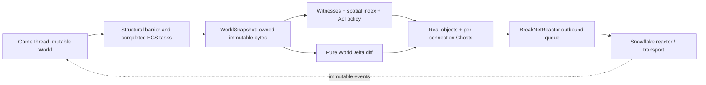
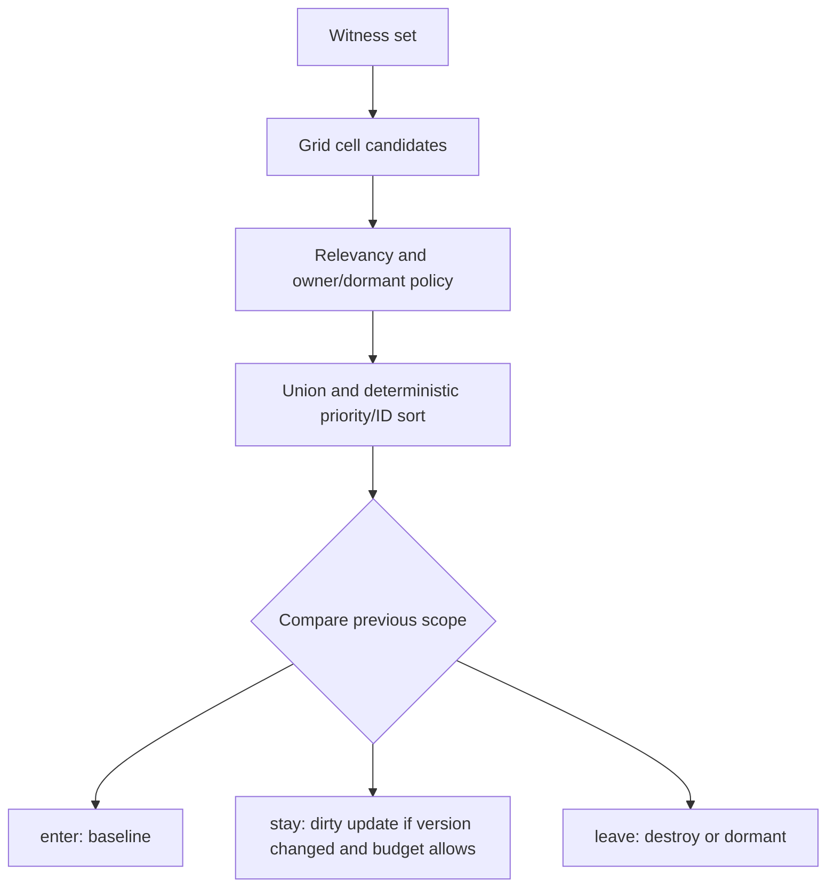
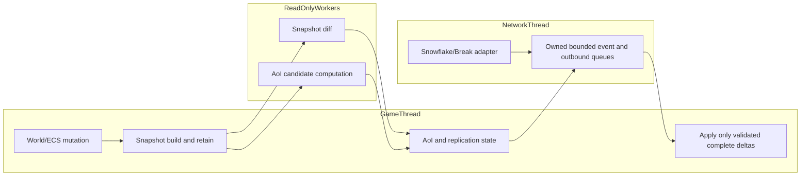

# ECS Snapshot, Replication and AoI

**Status:** Task 8 documentation for the currently implemented ECS/AoI slice. This document separates shipped behavior from planned transport and authority features. The focused schema/snapshot/delta/AoI/replication APIs are implemented; formal runtime/session integration is a separate boundary.

## Scope and Current Boundary

The current implementation is a C11, GameThread-facing foundation:

- `replication_schema.*` registers deterministic component schemas and computes a stable schema hash from canonical component IDs.
- `world_snapshot.*` builds an owned, immutable copy of live entity handles and registered component bytes. Snapshot build remains a GameThread operation after the structural barrier; there is no automatic ECS barrier.
- `world_delta.*` diffs two immutable snapshots and applies a validated delta through ECS-owned deep-clone staging and an atomic replace commit.
- `break_aoi.*` maintains a simple spatial index and computes deterministic `enter`, `stay`, and `leave` sets for one or more witnesses.
- `break_replication.*` tracks per-connection Ghost state, sends baselines/dirty/destroy/dormant records through `BreakNetReactor`, and enforces a byte budget.
- `break_replication_fragment.*` splits non-empty payloads under `BREAK_NET_MAX_PAYLOAD_SIZE` and reassembles one delta at a time after metadata, checksum, duplicate/conflict, and completeness validation.

The formal optional libraries are `break_ecs_replication` (ECS schema/snapshot/delta plus ECS-owned AoI-independent dependencies and core logging) and `break_replication_core` (AoI, replication scheduling, and fragmentation). They are non-Snowflake targets and are available even when `ENGINE_BUILD_TESTS=OFF`; the umbrella header is `ecs/replication_runtime.h`. They are deliberately not linked into `engine`, `engine_demo`, or `dxx_break` until a runtime/session owner defines publication, authority, and thread-lifecycle integration. `break_ecs_replication_test` is a test-only composition carrying `BREAK_WORLD_DELTA_TESTING=1`; production libraries never receive that fault-injection macro. `break_net` remains an optional Snowflake adapter: it is produced whenever `BREAK_ENABLE_SNOWFLAKE=ON`, independent of `ENGINE_BUILD_TESTS`, and links `break_replication_core` and `snow::net`.

Task 7 is implemented as a transport-independent fragmentation/reassembly layer. Fragment metadata carries `delta_id`, `base_id`, `fragment_index`, `fragment_count`, and a deterministic FNV-1a checksum over each fragment payload. The reassembler accepts out-of-order fragments, returns `INCOMPLETE` while fragments are missing, returns `COMPLETE` with newly allocated owned bytes only after every fragment is present, reports exact duplicate fragments separately from conflicts, rejects checksum/base/index/count/delta mismatches, and exposes explicit reset/destroy lifecycle operations.

The current Snowflake adapter remains an adapter boundary: it owns transport integration and bounded outbound queues, while the replication layer submits complete messages to `break_net_reactor_send`. Replication and fragmentation do not call Snowflake directly.

## Architecture and Data Flow



The intended lifecycle is: systems finish, the GameThread establishes the structural barrier, the GameThread builds a snapshot, and readers retain that snapshot while diff/AoI work runs. Snapshot build still requires that GameThread/structural-barrier discipline; the builder does not insert an automatic barrier. The current snapshot builder is stop-the-world and owns all copied bytes; it stores no `World *`, archetype, chunk, RHI, or Scene pointer. Entity identity includes both `index` and `generation`, so index reuse is not mistaken for the same entity.

### Snapshot publication and delta application

```mermaid
sequenceDiagram
    participant G as GameThread
    participant W as World
    participant S as Snapshot
    participant X as Worker/read-only consumer
    participant V as Validated delta

    G->>W: finish systems and enter structural barrier
    G->>S: build(tick, schema registry; no automatic barrier)
    S-->>G: owned snapshot (refcount 1)
    G->>S: publish/retain for consumers
    X->>S: diff immutable base -> target
    X-->>G: complete delta message
    G->>V: validate base/schema/records and tick monotonicity
    G->>V: deep-clone World into ECS-owned staging
    alt staging apply and final validation succeed
        G->>W: atomically replace contents; consume staging
    else mismatch, malformed, allocation/fault failure
        G-->>X: reject; destroy staging; original World unchanged
    end
```

Implemented snapshot identity is the deterministic hash of tick, schema hash, sorted entity handles, component IDs, and bytes. The schema hash uses canonical component IDs, so registration order does not change the schema identity. The current API exposes snapshot tick, ID/hash, entity lookup, component bytes, and retain/release. Publication is not yet a separate mutex-protected current-snapshot service; callers must retain the object they receive.

A delta retains its base and target snapshots, records entity create/destroy and component add/remove/update operations, validates the complete base world before staging, predicts entity allocation/generation before applying creates, and verifies the final target state. Delta apply requires a target tick greater than the base tick. `break_world_delta_apply` deep-clones the World using ECS-owned clone helpers, applies and final-validates only the staging World, then atomically replaces the destination contents. Any validation, allocation, mutation fault-injection, or final-validation failure destroys staging and leaves the original World unchanged. Clone allocation injection (`ECS_TESTING`) and mutation/final-validation injection (`BREAK_WORLD_DELTA_TESTING`) are test-only hooks, not production behavior.

## Component Schema Rules

A registered component declares component ID, version, size, alignment, flags, and optional encode/decode callbacks. Registration rejects duplicate IDs, zero sizes, invalid alignment, and raw-byte schemas marked pointer-containing. Snapshot raw bytes are accepted only for deterministic POD schemas with `BREAK_SCHEMA_FLAG_RAW_BYTES`; resource references, derived caches, and pointer-containing components are rejected by the snapshot policy.

The registry is initialization/GameThread-owned. It is not a synchronized hot-path object. A schema change changes the schema hash and therefore requires a new compatible snapshot/delta stream; schema negotiation and online schema updates are not implemented.

## Real, Ghost, Witness, and AoI

- **Real:** `BreakReplicationObject` registered by the replication owner, with stable AoI entity ID, owner ID, position, flags, and priority. Payload/version state is owned by the replication object. Version increments fail closed at `UINT64_MAX`: `register` updates and `mark_dirty` reject before allocating or replacing payload state, preserving the old Real payload and all Ghost state. `UINT64_MAX` is terminal for that object; no epoch rollover is implied.
- **Ghost:** per-connection state recording whether a baseline was sent and the last sent object version. Ghosts are destroyed on disconnect and are not authoritative.
- **Witness:** connection interest source with position, direction, velocity, radius or AABB half-extents, hysteresis, connection ID, and priority.
- **AoI scope:** spatial candidates are filtered by always-relevant, owner-only, and dormant flags, deduplicated across witnesses, and `enter`, `stay`, and `leave` are all returned in deterministic priority-descending/entity-ID-ascending order. Leave ordering uses the current object priority from the spatial index while the object remains indexed. With no witnesses, non-dormant `ALWAYS_RELEVANT` objects enter scope only when they are not `OWNER_ONLY`; owner-only objects require a matching connection witness. Candidate cell bounds use `max(enter_hysteresis, leave_hysteresis)`, while exact inclusion selects enter or leave margin from prior scope membership.



The explicit set contract is `enter = new - old`, `stay = new ∩ old`, and `leave = old - new`. Sphere and AABB shapes, hysteresis, multiple-witness union, duplicate suppression, boundary validation, and safe rejection of non-finite/negative inputs are covered by `test_ecs_replication`. Replication scheduling then sends complete records through the Break adapter, prioritizing higher-priority objects and deferring records that exceed the connection budget or outbound queue capacity.

## Thread Ownership and Lifecycle



The GameThread owns mutable `World`, ECS structural state, schema registration, Real objects, Ghost maps, and connection scope state. Snapshot and AoI consumers may read only owned immutable values. Network callbacks and reactor workers handle bounded message views/copies and queue events; they must not call World/ECS/Lua/UI/RHI or mutate replication state directly. The adapter has one driver per reactor (`BREAK_NET_DRIVE_STEP` or its host-thread mode), and shutdown is terminate, join when applicable, destroy reactor, then publish stopped. The adapter's `timeout_ms` is currently compatibility-only because the underlying thread abstraction has no timed join.

Replication version safety is fail-closed: an object at `UINT64_MAX` cannot be registered again or marked dirty, and the rejection occurs before payload allocation, freeing, or version mutation. This is a terminal-version policy rather than an epoch rollover; callers must replace the object identity if they need a new version domain.

Lifecycle on a connection is: open connection state, compute scope, send baseline on `enter`, send dirty versioned payloads on `stay`, send destroy/dormant on `leave`, and discard all Ghost state on disconnect. Queue overload is reported without blocking the GameThread; a later sync can retry unsent baseline or dirty records.

## Fragmentation and Validation Boundary

The transport payload limit is `BREAK_NET_MAX_PAYLOAD_SIZE` (64 KiB), and the total reassembly budget is `BREAK_REPLICATION_MAX_REASSEMBLY_SIZE` (16 MiB). `break_replication_fragment_payload()` rejects empty or over-budget payloads, rejects a zero fragment size, reports a caller-selected fragment size above the transport limit as `OVER_LIMIT`, and emits non-owning fragment views into the caller's payload. The caller releases only the metadata array with `break_replication_fragments_free()` and must keep the source payload alive until fragmentation is finished.

Each emitted fragment carries:

- `delta_id` and `base_id`;
- zero-based `fragment_index` and common `fragment_count`;
- fragment byte length and FNV-1a checksum.

`break_replication_reassembler_create(expected_base_id)` owns one in-progress delta assembly. `push()` validates non-empty data, transport size, base ID, checksum, index/count bounds, and rejects fragment counts or metadata allocations beyond the 16 MiB reassembly budget before allocating per-fragment state; it also rejects any `total_size` growth beyond that budget. It then fixes the first fragment's delta ID/count as the assembly identity. Later fragments with another delta/count are conflicts. Exact duplicate bytes return `DUPLICATE`; same-index bytes with different size/checksum/content return `CONFLICT`. Fragments are copied into reassembler-owned storage, so the input view may be temporary. Missing fragments return `INCOMPLETE`; only the final validated set produces a newly allocated contiguous payload and `COMPLETE`. The caller owns that result and releases it with `break_replication_reassembly_free()`.

Completion clears the assembly state. An incomplete or failed final allocation leaves collected fragments available for retry; `break_replication_reassembler_reset()` explicitly discards that state, and destroy also frees all owned fragment storage. The focused API has no timeout or eviction policy: the owning replication scheduler must bound lifetime and call reset/recreate on loss or expiry. The checksum is integrity validation, not cryptographic authentication. No Snowflake call and no World mutation belongs in this layer. The GameThread applies only the fully reassembled result after its own base/schema/delta validation; the fragmentation API itself does not enqueue or apply deltas.

## Implemented vs Future Work

| Area | Implemented now | Not implemented / future boundary |
|---|---|---|
| Snapshot | Deep copy, generation-aware handles, canonical-ID schema hash, deterministic hash, refcount lifetime; GameThread/structural-barrier build contract | Automatic barrier, mutex publication service, epoch reclamation; formal runtime/session publication integration |
| Delta | Immutable diff, base-world validation, generation prediction, staging final validation, ECS-owned deep clone, atomic replace commit, unchanged-on-failure behavior | Wire schema/tick fields, authority protocol; formal runtime/session integration |
| AoI | Grid, sphere/AABB, witnesses, flags, hysteresis, enter/stay/leave | Distributed spatial cells, occlusion/LOD policy, prediction; formal runtime/session integration |
| Replication | Real/Ghost records, baseline/dirty/destroy/dormant, budget and queue retry | Full authority handoff and client prediction/rollback; formal runtime/session integration |
| Transport | Break adapter queue boundary and owned payloads; Task 7 fragmentation/reassembly, checksum, reorder, duplicate/conflict, base validation, owned output, reset | Real Snowflake registration/socket send integration, timeout/eviction scheduler, cryptographic authentication |
| Gameplay | No network-thread mutation; GameThread-owned apply boundary | Lua callbacks, editor RPC, online updates, security/authentication |

Distributed Cell services, cross-World persistent NetEntityId, client prediction, rollback, authority handoff, Lua gameplay integration, editor tooling, online schema updates, and security policy are deliberately outside this slice.

## Validation

Focused validation uses `test_ecs_replication`, `test_break_replication_fragment`, and, when Snowflake is enabled, `test_break_replication`. Earlier fragment and Snowflake replication focused evidence was **7/7** in normal, ASan, and TSan lanes, with independent fuzz smoke evidence of **5/5**. The Task 7 closeout record (2026-10-23, clean `build-sdd-t7`/`build-sdd-t7-asan`/`build-sdd-t7-tsan` trees, `BREAK_ENABLE_SNOWFLAKE=ON`): the focused runtime/ecs/net lane passes **16/16** in each of the normal, ASan+UBSan, and TSan trees; all five fuzz executables are explicitly built and `ctest -L fuzz` passes **5/5**; the full non-graphics/non-fuzz CTest run has 178 selected tests with **177 passed, 0 failed, and 1 platform skip** (`test_d3d12_dependency_gate`, Windows-only lane) out of 187 registered tests. `test_break_replication_fragment` passed in every lane in this record; it carries a pre-existing intermittent flake note parked outside this plan's commits. The historical `test_myui_text_layout` Hebrew boundary failure did not reproduce (the test passed in the full run); `test_vulkan` is graphics-labeled and was not exercised in this host run. Documentation changes are checked with `git diff --check`.
