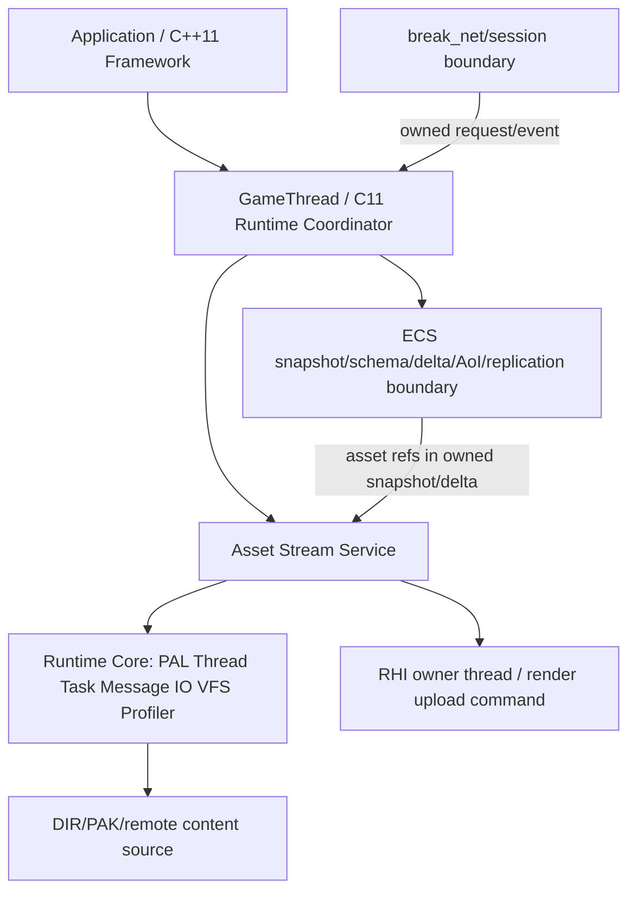
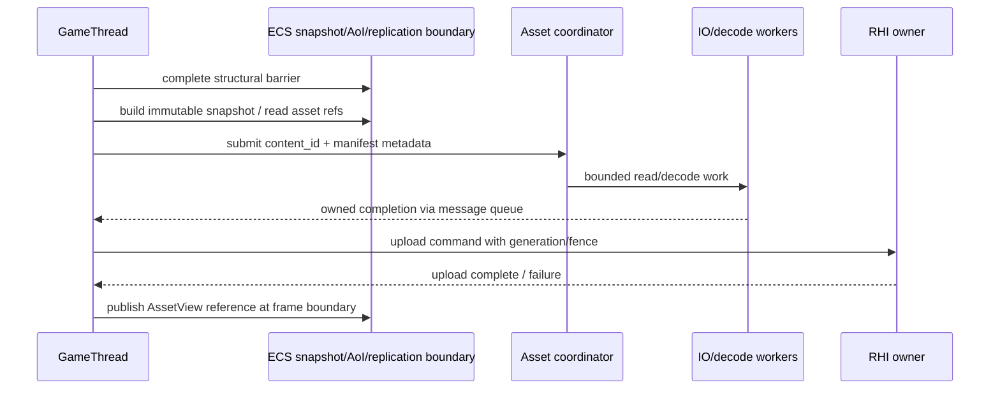

# Runtime Asset Streaming 设计

## 1. 文档定位与状态词汇

本文是 Stage 2 的设计文档，不是实现报告，也不改变源码或 CMake。目标是定义资源流式运行时如何接入现有 ECS snapshot/schema/delta/AoI/replication/fragment 与 `break_net/session` 边界，并在这些边界正式化之后接入 PAL/Thread/Task/Message/IO/VFS/Profiler Runtime Core。

文中状态严格区分：

所有接口方向都保持“设计目标/未实现”；本文不要求 Stage 2 已有 Lua VM 或 Lua facade。Asset/HotReload 的跨文档状态/结果集合统一为 `LOADING`、`VALIDATING`、`COMMITTED`、`FAILED_KEEP_OLD`、`CANCELLED`、`TIMEOUT`、`OOM`。

- **当前已有**：源代码和测试已经存在，并可由真实文件/target 证实。
- **focused/test-only**：存在实现或测试，但尚未进入正式 `engine` runtime target，不能作为生产集成。
- **设计目标**：本文定义的接口、队列、生命周期和验收要求，尚未实现。
- **未实现/不承诺**：明确不属于本设计当前交付范围的能力。

Stage 2 的顺序是硬约束：先把网络复制和资源请求的 target、线程、所有权边界正式化，再实现 Runtime Core。资源系统不能通过网络 callback 直接改 World、Lua、UI、RHI，也不能因加入资源请求而把 focused network 源码隐式变成生产库。

## 2. 真实现状与证据

### 2.1 资源基础设施

当前 `engine` static library 在 `engine/CMakeLists.txt:319-403` 已包含：

- `src/asset/asset.c`
- `src/asset/async_loader.c`
- `src/asset/decode_pipeline.c`
- `src/asset/hotreload.c`
- `src/asset/vfs.c`
- `src/asset/mipmap_stream.c`
- `src/platform/filewatch.c` / `filewatch_backend.c`
- `src/task/task.c`
- `src/core/profiler.c`

这些是当前已有的正式 `engine` 源文件，但“已有异步 loader”不等于“完整 Runtime Asset Streaming contract 已实现”。

现有接口和限制：

- `engine/src/asset/vfs.h:5-12` 定义 16 个 mount、260 字节路径和 128 MiB `VFS_MAX_FILE_BYTES`；支持 DIR/PAK mount，PAK 共享文件游标由 `VFS::pak_lock` 串行化（`vfs.h:42-60`）。
- `engine/src/asset/async_loader.h:38-87` 定义异步全文件、range、priority、texture decode 请求；完成 callback 由 `async_loader_tick()` 在主线程派发。
- `engine/src/asset/async_loader.c:16-25` 当前 pending heap 为 256，request slot 为 1024，completion queue 为 1024；legacy compatibility loader 在队列满时会等待消费者，这是当前实现事实，不是 Runtime Core formal facade 合同。
- `engine/src/asset/decode_pipeline.c:12-14,227-249` 当前有 2 个 decode worker 和 256 项输入队列；输入队列满时提交失败，调用方释放 raw bytes。
- `engine/src/asset/mipmap_stream.h:19-27,69-87` 当前最多 1024 个 texture、每个最多 16 个 mip、64 个 request context slot；`mipmap_stream.c:321-411` 按可见覆盖率、预算和 eviction 发起 range load，完成回调在主线程执行 GPU upload hook。
- `engine/src/asset/hotreload.h:5-36` 当前以同步 `poll` 的 watcher + RHI target callback 形式存在；它没有版本化 commit、失败保留旧资源或统一 request graph 语义。
- `engine/src/platform/filewatch.h:5-60` 当前 watcher 有 64 个直接 watch entry，并另有递归 `FileWatch` structured event API；事件没有进入统一 Runtime Message queue。
- `engine/src/core/profiler.h:4-19,55-101` 当前 profiler 支持每线程 tid、最多 32 线程、120 帧 ring 和 Chrome trace 导出；它可作为设计目标的 telemetry sink，但还不是 asset-streaming 专属指标合同。

### 2.2 ECS/网络复制边界

ECS 和网络切片的事实来源是 `docs/design/ecs_snapshot_replication_aoi.md`、`docs/design/session_protocol.md`、`docs/design/snowflake_c11_adapter.md`，并由 `docs/Architecture_Overview.md:482-506` 与 `docs/Implementation_Status.md` 的最新条目交叉记录。

- **focused/test-only 当前已有**：`replication_schema.*` 的 deterministic POD schema/hash；`world_snapshot.*` 的 GameThread 构建、generation-aware entity identity、owned immutable bytes；`world_delta.*` 的 immutable diff、base/schema/tick validation、staging + atomic replace；`break_aoi.*` 的 deterministic enter/stay/leave；`break_replication.*` 的 Real/Ghost/baseline/dirty/destroy/dormant 与预算；`break_replication_fragment.*` 的有界分片、乱序重组、duplicate/conflict、FNV-1a 完整性检查。
- **target 证据**：`engine/CMakeLists.txt:3165-3179` 把 snapshot/schema/delta/AoI 源直接编入 `test_ecs_replication`，而不是 `engine`；`engine/CMakeLists.txt:3219-3233` 将 fragment 编成 test-only `break_replication_fragment`；`engine/CMakeLists.txt:3235-3283` 仅在 `ENGINE_BUILD_TESTS=ON && BREAK_ENABLE_SNOWFLAKE=ON` 时生成 `break_net`，并且 `engine_demo`/`dxx_break` 不链接它。
- **线程事实**：GameThread 独占可变 World/ECS/schema/Real/Ghost/apply；snapshot/delta/AoI 消费者只读 owned immutable values；网络 callback 只验证、复制、入 bounded queue，不访问 World/ECS/Lua/UI/RHI。`BreakSessionManager` 是同一 GameThread 串行拥有的非线程安全对象。
- **仍未实现**：正式 `engine` runtime/session integration、snapshot publication service、wire-level schema/tick negotiation、fragment timeout/eviction scheduler、加密认证、authority handoff、client prediction/rollback、Lua/editor/network gameplay integration。

资源请求只能引用这些边界提供的 stable asset identity 和 snapshot data，不能绕过边界在网络线程或 worker 中消费 World 指针。

## 3. 设计原则与分层

### 3.1 目标分层



Runtime Core 提供机制，不拥有 gameplay World。Asset Stream Service 编排 manifest/identity、优先级、range/decode/residency 和 RHI upload；ECS/replication 只提供资源引用与版本事件；Session/network 只提供有界 owned command/event。

### 3.2 语言与 ABI 边界

- **C11**：`engine/` runtime core、asset service、PAL、Thread、Task、Message、IO、VFS、Profiler、ECS/network public contracts。示例类型统一使用项目 `u8/u16/u32/u64/usize`（定义见 `engine/src/core/types.h`）；公共对象使用 opaque pointer、显式 `bool`/error enum、caller-visible ownership；不依赖异常、RTTI、模板、隐式析构或 C++ ABI。
- **C++11**：`framework/`、`BaseApplication`、editor/application orchestration。C++ 只能通过 C11 opaque API 和显式 command/message 接入，不能把 C++ 对象指针放入跨线程消息、snapshot、delta、网络 payload 或 VFS cache。
- **Lua**：唯一计划中的 runtime scripting language。Lua 只在明确的 GameThread Lua facade 上运行，后续由 Stage 3 定义；Lua 不直接获得 `World *`、RHI handle、socket、worker queue、VFS internal pointer 或 allocator ownership。Asset API 对 Lua 暴露 request/status/metadata/owned result 的受限 C facade，不暴露内部线程同步原语。
- **跨语言 ownership**：C11 API 返回的 buffer 必须配对 release API；C++/Lua wrapper 不可自行 `free` C11-owned memory。callback 只在文档声明的线程调用，payload 只在 callback 期间有效，除非 API 明确交付 owned handle。

## 4. 目标接口方向

以下是设计方向，不代表当前头文件已经存在。Asset/HotReload formal facade 的状态/结果至少覆盖 `LOADING`、`VALIDATING`、`COMMITTED`、`FAILED_KEEP_OLD`、`CANCELLED`、`TIMEOUT`、`OOM`；这些是局部状态，必须映射到 Runtime coordinator 的全局生命周期。

### 4.1 Asset identity 与 manifest

```c
typedef struct BreakAssetStream BreakAssetStream;
typedef struct BreakAssetRequest BreakAssetRequest;
typedef struct BreakAssetBlob BreakAssetBlob;
typedef struct BreakAssetCompletion BreakAssetCompletion;
typedef u64 BreakAssetRequestHandle;
typedef u64 BreakAssetGeneration;

typedef struct {
    u64 content_id;            /* content-addressed identity, not RHI handle */
    u32 type;
    u32 version;
    u64 byte_size;
    u32 flags;
    const char *vfs_path;       /* borrowed during submit only */
} BreakAssetKey;

typedef enum BreakAssetResult {
    BREAK_ASSET_OK = 0,
    BREAK_ASSET_QUEUED,
    BREAK_ASSET_OVERLOAD,
    BREAK_ASSET_INVALID,
    BREAK_ASSET_CLOSED,
    BREAK_ASSET_NOT_FOUND,
    BREAK_ASSET_STALE,
    BREAK_ASSET_CANCELLED,
    BREAK_ASSET_TIMEOUT,
    BREAK_ASSET_OOM,
    BREAK_ASSET_IO_FAILED,
    BREAK_ASSET_DECODE_FAILED,
    BREAK_ASSET_COMMIT_DEFERRED,
    BREAK_ASSET_FAILED_KEEP_OLD
} BreakAssetResult;

typedef enum BreakAssetCompletionState {
    BREAK_ASSET_COMPLETION_QUEUED = 0,
    BREAK_ASSET_COMPLETION_LOADING,
    BREAK_ASSET_COMPLETION_VALIDATING,
    BREAK_ASSET_COMPLETION_COMMITTED,
    BREAK_ASSET_COMPLETION_FAILED_KEEP_OLD,
    BREAK_ASSET_COMPLETION_CANCELLED,
    BREAK_ASSET_COMPLETION_TIMEOUT,
    BREAK_ASSET_COMPLETION_OOM
} BreakAssetCompletionState;

struct BreakAssetCompletion {
    BreakAssetRequestHandle request;
    BreakAssetGeneration generation;
    BreakAssetCompletionState state;
    BreakAssetResult result;
    BreakAssetBlob *blob; /* owned by completion until release */
    u64 content_id;
    u32 asset_type;
    u32 asset_version;
};

BreakAssetResult break_asset_request(BreakAssetStream *,
                                     const BreakAssetKey *,
                                     u32 priority,
                                     u64 deadline_frame,
                                     BreakAssetRequestHandle *out_request);
BreakAssetResult break_asset_cancel(BreakAssetStream *, BreakAssetRequestHandle request);
BreakAssetResult break_asset_poll(BreakAssetStream *, BreakAssetCompletion *out);
void break_asset_completion_release(BreakAssetCompletion *completion);
void break_asset_request_release(BreakAssetStream *, BreakAssetRequestHandle request);
```

实现时应优先采用 stable content identity + manifest metadata，而不是把当前 `RHITexture.index` 当跨线程/跨进程 identity。`asset.h:102-149` 的 `SceneResource` 已有 `guid/type/ref_index/path` 形状，可作为离线 scene manifest 的证据；但 `guid` 当前是场景序列化身份，不自动等价于已签名 manifest 或网络认证。

Manifest 必须在提交时验证 type、size、range、alignment、依赖和版本；路径必须经过 VFS canonicalization，禁止 `..` 越界、NUL 截断和未授权 mount。request handle 由 stream 分配，使用 opaque `u64` token（实现必须含 generation，防止 slot reuse）；submit 成功后 stream 持有 request ownership，poll 将一次 completion ownership 转移给调用方，调用方必须调用 `break_asset_completion_release`。cancel/release 只释放调用方持有的 request reference，不能使已发布 completion 的 blob 失效；stream destroy 前必须拒绝新 request、完成/取消所有 handle，并保留可重试的 live ownership。content hash/签名、远程下载和在线更新属于 Stage 5，当前设计只保留验证插槽，不声称已有安全更新。

### 4.2 Queue 与 completion API

设计目标使用显式 bounded queues。Runtime Core facade 满载统一非阻塞返回 `BREAK_RUNTIME_OVERLOAD`；现有 async loader/compatibility API 的等待或其他行为保持独立，不因文档契约改写。Network/IO/Audio/RHI 热路径禁止 inline，completion wait 必须可被 deadline/shutdown 打断。Asset request/result 状态方向为 `LOADING -> VALIDATING -> COMMITTED`，失败为 `FAILED_KEEP_OLD`，取消为 `CANCELLED`，deadline 为 `TIMEOUT`，分配失败为 `OOM`；这些仍是设计目标/未实现。Asset manifest 与 blob 使用独立预算，16 MiB 只表示单 assembly 上限，不是 blob 上限。

| 队列 | 所有者/生产者 | 消费者 | 初始容量目标 | 满时行为 |
|---|---|---|---:|---|
| request ingress | GameThread/C++/Lua facade | Asset coordinator | 256 | 返回 `OVERLOAD`，不阻塞调用者 |
| IO work | coordinator | IO workers | 256 | 保留 request 为 `QUEUED`，按 priority/backpressure 拒绝新请求 |
| decode work | IO workers | decode workers | 256（与当前 `DECODE_INPUT_CAP` 对齐） | 释放 raw ownership，request `FAILED_OVERLOAD` |
| completion | IO/decode workers | GameThread tick | 1024（与当前 `ASYNC_QUEUE_SIZE` 对齐） | 生产者等待不可接受；设计目标是预留 credit 或 fail request，禁止覆盖未消费槽 |
| GPU upload command | GameThread/asset completion | RHI/render owner | 256 | 低优先级请求降级/延迟；不可在 worker 直接调用 RHI |
| network asset command | GameThread replication/session | network adapter | 256（与 `BreakNet` outbound queue 对齐） | 返回 overload；不阻塞 GameThread |

容量是可观测 contract，不是“建议值”。每项应能查询 current/depth/high-water/rejected。禁止无界 malloc 链表作为 backpressure 替代。优先级只决定有界队列内服务顺序，不允许低优先级请求无限饿死高优先级之外的公平性；设计目标是按 frame budget 和 aging 做有限 aging。

当前 legacy async loader 的 completion queue 在满时会通过 CAS/yield 等待消费者（`async_loader.c:168-197`）；这是 compatibility 行为，不是 formal facade 语义。Runtime Message/IO facade 必须非阻塞返回 `BREAK_RUNTIME_OVERLOAD`，Network/IO/Audio/RHI 热路径禁止 inline 或等待；迁移前需定义 shutdown 可打断的取消、请求 deadline 和 credit/reject 结果。

### 4.3 IO/VFS 方向

IO worker 只拥有 request 的 immutable path/range copy 和临时 bytes。VFS 由 Asset Stream 创建/注入，mount table 生命周期长于所有 IO workers。DIR/PAK read 必须统一经过 `vfs_open/read/close`；PAK 的共享 FILE cursor 只能由 VFS 内部 lock 保护，不能把 `FILE *` 泄漏给 worker。

建议按三层数据流实现：

1. **Read**：从 VFS 按 bounded range 读入 IO-owned buffer；检查 offset+length、最大文件和 request generation。
2. **Decode/parse**：对需要解码的类型转移 buffer ownership 到 decode queue；decoder 产生 typed CPU blob 或 failed result，不持有 VFS file。
3. **Publish/upload**：completion 由 GameThread 消费；创建/替换 RHI resource 的命令只能进入 RHI owner queue。旧版本在新版本完全验证并完成 GPU fence 前保持可用。

当前 `mipmap_stream` 的 range contract（`mipmap_stream.h:93-115`）可作为纹理 streaming 的 focused 先验：resident bytes 先 reserve、失败释放 reservation、stale completion 用 request ID 丢弃、budget 超限先 eviction。但它假设 raw mip chain、RGBA8 和宿主 upload callback；通用 Runtime Asset Stream 不能把这个假设扩展成所有 asset type。

### 4.4 RHI 与 resource lifetime

- RHI handle 只能由 RHI owner thread 创建、更新、销毁；asset worker 不得调用 `rhi_*`。
- GameThread 收到 decoded blob 后提交 `AssetGpuUploadCommand`，其中只包含 copied/owned bytes、asset generation、目标 descriptor 和 fence policy。
- upload 成功后，GameThread 在下一安全 publication point 切换 `AssetView`；旧 GPU resource 由 fence/retire queue 延迟释放。
- upload 失败保持旧资源，记录可诊断错误；第一次加载失败返回 placeholder/failed，不伪造 ready。
- `hotreload_pipeline_*`/`hotreload_texture_*` 当前 callback 形式只能作为 adapter；设计目标增加 staged candidate、validation、atomic swap、old-version retention 和 bounded retry。

## 5. 与 ECS、AoI、replication、fragment、session 的数据流

### 5.1 正常本地/场景流



Snapshot build 仍必须由 GameThread 在结构屏障后执行；资源 service 只读 snapshot 中已经 deep-copied 的 deterministic data。资源引用若放进 replicated component，schema 必须把它作为稳定 POD/content ID 处理；pointer-containing、derived cache、RHI handle 不得进入 `BREAK_SCHEMA_FLAG_RAW_BYTES` snapshot policy（现有约束见 `ecs_snapshot_replication_aoi.md:74-78`）。

### 5.2 AoI 进入/离开与资源优先级

AoI `enter` 可提升相关 asset request 优先级，`stay` 维持或按可见性/距离更新，`leave` 取消尚未开始的低优先级请求或允许已进入 decode 的 request 完成后丢弃。AoI worker 只产生 deterministic scope result；它不直接触碰 Asset Stream mutable cache。GameThread 负责把 scope result 转成 request commands，因此取消和 generation 都在单一 owner 上串行化。

资源系统不把 AoI 当作权威安全策略：远端客户端传来的 asset request 仍需 session/auth/manifest policy 验证。当前 Session 只做 envelope/registry/state/handler 边界，没有 player authentication backend（`session_protocol.md:15-19`），故不能声称网络资源授权已实现。

### 5.3 Delta/fragment/session 网络流

设计目标的数据流是：

```text
BreakNet callback
  -> validate envelope + copy bounded owned payload
  -> 256-item event queue
  -> GameThread poll_adapter/apply
  -> validate session and asset command schema
  -> Asset request queue
  -> IO/decode/upload
```

反向发布若需要远端资源 manifest/delta：

```text
GameThread-owned asset manifest event
  -> replication/message encoder
  -> optional fragmenter (<=64 KiB transport payload, <=16 MiB reassembly budget)
  -> BreakNet outbound queue (256)
  -> Snowflake reactor
```

`break_replication_fragment` 当前只做 transport-independent payload fragmentation/reassembly，checksum 是 FNV-1a integrity 而非 authentication；其没有 timeout/eviction。设计目标的 asset manifest/download protocol 必须在 fragment reassembly 外层增加 request ID、content ID、schema/version、deadline、bounded timeout/eviction 和认证策略；这些尚未实现，不能直接复用 fragment API 就宣称安全下载。

网络线程不能直接启动 IO request，因为 request coordinator 的 owner、quota、Lua/editor policy 和 cancel generation 都属于 GameThread/runtime coordinator。网络线程只产生事件；GameThread 批量 poll 后再提交。

## 6. 线程所有权、shutdown 与 failure

### 6.1 所有权表

| 对象 | 唯一 owner | 允许读取者 | 禁止行为 |
|---|---|---|---|
| mutable Asset registry/request map | Asset coordinator（GameThread） | immutable query snapshot | worker 直接写 map |
| VFS mount table | Runtime coordinator | IO workers via VFS API | worker destroy/mount concurrently |
| request bytes | queue stage owner | next stage after ownership transfer | 双方同时 free |
| decode result | completion queue until poll | GameThread after poll | callback 外借用 result |
| CPU asset view | GameThread/asset cache | read-only consumers via retained view | worker 原地替换 published view |
| RHI resource | RHI/render owner | opaque read-only handles | IO/decode/GameThread 直接 destroy |
| World/ECS/schema/Real/Ghost | GameThread | owned immutable snapshot readers | network/asset worker mutation |
| Session manager | one GameThread owner | none without command API | callback/worker 调用 |
| Lua VM | Lua/GameThread owner | none | asset/network/RHI worker调用 |

### 6.2 Stop 顺序

Asset shutdown 由 `runtime_overview.md` 的唯一 Runtime coordinator 编排；全局状态和顺序不在本节重复。Asset 的 `LOADING/VALIDATING/COMMITTED/FAILED_KEEP_OLD/CANCELLED/TIMEOUT/OOM` 只是局部状态。局部动作是：admission quiesce 后拒绝新 request；停止 watcher/IO/decode producer；关闭 asset queues 并发布 watermark；在 coordinator 的 drain deadline 内 poll completion；取消可取消 request，保留不可取消 decode/upload 的 ownership；在 `STOPPING` join 已停止 admission 的 IO/decode workers；将 RHI upload/fence retire 与 live ownership 交回 coordinator。Asset 不自行 destroy Network/RHI/PAL/VFS，也不发布全局 `STOPPED`。

Timeout 保留资源并由同一 coordinator retry；失败只保留诊断、cleanup 和安全 retry，不重新开放普通 admission。

现有 `async_loader.c:454-514` 与 `decode_pipeline.c:387-435` 已体现“在锁下发布 running=false + broadcast、join 后清理”的重要原则；新 Runtime Core 应沿此原则，并禁止像当前 process-stable primitive workaround 那样由各子系统各自隐藏生命周期。任何 worker join、GPU fence wait 或 Snowflake stop 都不得在持有会被 callback 反向获取的 lifecycle lock 时执行。

Stop deadline 到期时必须返回明确的 `TIMEOUT`，保留 live ownership，禁止 free 后让迟到 worker 访问已销毁对象。与 `break_net_reactor_stop` 当前“超时保留 STOPPING/live resources、后续 stop 重试”语义一致；不得用 detached thread 或强杀线程规避所有权。

### 6.3 Failure 分类

Asset/HotReload formal facade 统一映射到 `BreakRuntimeError`：`OK`、`INVALID`、`CLOSED`、`OVERLOAD`、`OOM`、`TIMEOUT`、`STALE`、`REJECTED`、`FAILED`；兼容 API 的 `NOT_FOUND`、`IO_ERROR`、`DECODE_ERROR` 等名称只在 legacy 边界保留。资源状态/结果固定为 `LOADING`、`VALIDATING`、`COMMITTED`、`FAILED_KEEP_OLD`、`CANCELLED`、`TIMEOUT`、`OOM`；request submit/poll/commit/cancel 的返回结果必须区分 `OK/QUEUED`、`OVERLOAD`、`CLOSED`、`INVALID`、`STALE`、`TIMEOUT`、`OOM` 和阶段失败，不得用空 completion 或 bool 混淆状态。

规则：

- 参数、manifest、size/range overflow 在分配前 fail-closed。
- 失败不得替换仍可用的旧版本；第一次失败只发布 failed/placeholder，不发布伪 ready。
- stale completion 必须释放自己拥有的 bytes，但不能改写新 generation 的 state。
- queue overload 不重试忙等；上层按 priority/deadline/backoff 重试，且 retry 受总次数和总字节预算限制。
- decode/parse 失败不自动把原始网络 bytes交给 gameplay/Lua。
- 未知 schema/version、bad base、fragment conflict、checksum mismatch 进入丢弃/计数路径；不调用 World apply。
- 日志和 profiler 记录 request/content ID、stage、error、bytes、generation，不记录未脱敏 payload。

## 7. 当前已有、focused、设计目标、未实现矩阵

| 领域 | 当前已有 | focused/test-only | 本文设计目标 | 未实现/不承诺 |
|---|---|---|---|---|
| VFS/PAK/DIR | `engine/src/asset/vfs.*` 正式编入 `engine`，mount/path/file cap | VFS 单元测试按现有 CTest 配置 | manifest-aware canonical asset source、mount policy、IO facade | signed package、online update/A-B rollback |
| Async IO | `async_loader.*` 正式编入 `engine`，range/priority/cancel/callback | `test_async_loader` 验证当前行为 | Runtime IO queue、credit/backpressure、request generation API | 任意 worker 直接 RHI |
| Decode | `decode_pipeline.*` 2 worker/256 input、RGBA8 mip decode | 现有 async/decode tests | typed decoder registry、每类型预算、取消与失败语义 | 所有格式/压缩格式均已支持 |
| Mipmap | `mipmap_stream.*` 最多1024 texture/16 mip/预算/eviction | 现有 mipmap tests | 通用 residency/cache 与 GPU command queue | distributed asset cache |
| Hot reload | file watcher + pipeline/texture poll/callback | watcher/hotreload tests | staged candidate + atomic swap + old version retention | production online patch |
| ECS snapshot/schema/delta/AoI | focused C11 APIs已实现 | `test_ecs_replication` 直接编源码 | 正式 runtime target 前先冻结边界、publication service | 自动 barrier、distributed Cell、prediction/rollback |
| Replication/fragment | focused Real/Ghost、fragment integrity/reassembly | `break_replication_fragment`、Snowflake focused tests | asset manifest message integration、timeout/eviction scheduler | cryptographic auth currently absent |
| break_net/session | optional Snowflake adapter、256 event/outbound queue、GameThread Session | `break_net`/tests仅 Snowflake + tests 条件下 | formal target promotion after contract review | player auth backend、Lua/editor RPC |
| Profiling | global 120-frame/32-thread Chrome trace | existing profiler tests | asset stage/queue/failure counters and trace metadata | remote telemetry/upload |

## 8. 验证与验收

### 8.1 RED/GREEN focused tests（设计目标）

在任何源码/CMake 实现前，先建立 focused test contract；测试 target 必须明确标注 focused/test-only，不能借此声称正式 runtime 集成。至少覆盖：

1. manifest/path/range/size/alignment/identity validation；
2. FIFO/priority、每个队列容量、满队列 `OVERLOAD`、无覆盖/无丢 slot；
3. request cancel race、stale completion、duplicate completion、generation replacement；
4. VFS DIR/PAK 并发读、PAK cursor serialization、file cap、missing/truncated file；
5. decode failure、allocation failure、short read、bad header、unsupported type；
6. budget reserve/evict、mip visibility、leave/cancel、upload command ownership；
7. hot reload candidate failure保留旧资源、成功时单次 atomic swap；
8. shutdown 在 queued/running/decode-ready/upload-pending 各阶段都能完成或返回 bounded timeout，且不 UAF/double-free；
9. ECS snapshot asset reference 只读、schema mismatch/base mismatch 不触碰原 World；
10. Session/network callback 只 enqueue owned event，队列满不调用 Asset/Game/Lua/RHI；
11. fragment reorder/duplicate/conflict/checksum/over-budget，以及上层 timeout/eviction reset；
12. profiler trace 至少包含 request ID、stage、bytes、queue depth、latency、failure code。

### 8.2 Normal / ASan / TSan 验收

每个 focused lane 必须分别在 normal、ASan/UBSan、TSan 构建运行；不能以旧 build tree 或仅 compile 作为新实现证据。最低验收：

- normal：全部 asset focused tests 绿，重复运行验证 deterministic ordering、bounded queue 和 shutdown；
- ASan/UBSan：覆盖取消、短读、OOM/fault injection、重复 shutdown、stale callback、fragment malformed input；无 leak/UAF/OOB/UB；
- TSan：至少覆盖多 IO worker、decode worker、completion consumer、PAK lock、shutdown/re-init、queue full/empty race；零 data race、无死锁、无自等待；
- network-enabled lane：Snowflake adapter/session/replication focused 测试与 asset command bridge 分开报告；没有 Snowflake 时不伪造 network E2E；
- full CTest：明确记录未构建的 fuzz smoke、已知环境失败和 skipped backend，不把 focused 绿扩大成全树绿。

建议 fault injection 只在测试 target 开启（类似 `BREAK_WORLD_DELTA_TESTING`），不得把测试钩子放入生产默认路径。所有测试通过后才可讨论把 snapshot/schema/delta/AoI/replication/fragment 从 focused source 编译迁移到正式 runtime library；迁移本身需独立 target-contract 测试。

### 8.3 性能与容量验收

性能验收不以单一硬件数字为合同，而记录日期、平台、backend、worker 数、队列容量、cache budget 和 asset corpus。至少报告：IO/decode/upload p50/p95、每帧 completion 数、queue high-water/reject、resident bytes、evictions、stale completion、shutdown latency。Profiler sidecar 继续使用 `profiler_export_provenance_sidecar()` 的平台/backend/build provenance 语义；没有同等环境证据时不得比较数字。

## 9. 实施顺序与后续依赖

1. **先冻结 Stage 2 边界**：为 snapshot/schema/delta/AoI/replication/fragment 与 break_net/session 写正式 target contract，明确哪些 focused 源迁移、哪些保持 test-only；补齐 snapshot publication、fragment timeout/eviction 和 wire schema/tick 的独立设计。
2. **Runtime Core contracts**：定义 C11 PAL/Thread/Task/Message/IO/VFS/Profiler opaque APIs、错误码、allocator、bounded queue 和 shutdown deadline；禁止直接把现有内部全局 async loader 当公共 ABI。
3. **Asset coordinator**：先做 manifest/identity/request state machine 和 CPU IO/decode completion，不接 Lua、网络下载或编辑器。
4. **GPU publication**：加入 RHI owner command/fence/retire contract；先覆盖静态 texture/mip，再扩展 mesh/material/scene typed assets。
5. **ECS/AoI bridge**：只消费 immutable snapshot/owned scope result；用 asset generation 处理 enter/stay/leave 与 stale completion。
6. **Network/session bridge**：仅在 Session contract、auth policy 和 fragment timeout/eviction 明确后加入 manifest/request messages；Snowflake callback 仍只 copy/enqueue。
7. **Lua/editor integration**：Stage 3/4 独立设计后，通过 C11 facade/commands 接入；不让脚本或 UI 获得内部 ownership。
8. **Stage 5 security/update**：signed manifest、content-addressed package、resume/rollback、authentication、rate limit 和 crash/update policy 另行设计验收。

## 10. 未决风险

- **正式 target 迁移风险**：当前 ECS/network focused 源直接编译进测试目标；若直接加入 `engine`，可能引入 Snowflake、线程、链接和生命周期循环，必须先做 target graph 与 ABI 评审。
- **旧异步 loader 生命周期风险**：`async_loader`/`decode_pipeline` 使用 process-stable synchronization workaround；新 Runtime Core 若复用其 global state，re-init、并行 manager、测试隔离和多 VFS 实例仍需专门验证。
- **completion backpressure 风险**：当前 completion producer 在满队列时等待；shutdown deadline、低帧率 GameThread 和 callback re-entry 可能造成阻塞链。目标 contract 必须选择 credit/fail/可中断等待之一并写测试。
- **RHI thread语义风险**：现有部分 asset upload callback 在主线程触发，但不同 backend 的 device/frame ownership 不能从“callback 在主线程”推断安全；必须以实际 RHI owner/fence contract 为准。
- **资源 identity 风险**：Scene `guid`、RHI generation handle、网络 content ID 语义不同；若混用会造成 stale upload、错误 cache hit 或跨进程错误引用。
- **网络可信边界风险**：fragment checksum 非认证，Session 当前无 player authentication backend；任何远端资源下载/manifest 接受都不能默认可信。
- **AoI 抖动与取消风险**：快速 enter/leave 可能造成 priority thrash、重复 range request 和 completion 洪峰，需要 generation、debounce、aging 与预算策略的实测参数。
- **VFS 语义风险**：PAK 共享 `FILE*` lock 解决 cursor race，但 mount mutation、destroy 与 IO worker 的并发关系尚未形成统一 owner contract。
- **跨平台验证风险**：当前 adapter stop timeout 非 Linux lane 尚未完整验证；PAL/Thread queue 的 Windows/macOS/Wayland 差异必须分别跑 ASan/TSan 可用矩阵，不能由 Linux 结果推断。
- **Lua/editor 反向依赖风险**：若先暴露 raw asset pointers 或同步 `force_level`，会把 frame budget、shutdown 和 owner 纪律泄漏给上层；必须坚持异步 handle/status/command API。
- **安全与更新范围风险**：本文不实现签名、加密、在线更新、A/B rollback、反作弊或 crash upload；后续文档必须保持这些能力的独立验收，不得把 local VFS streaming 证据升级为生产更新安全证据。
