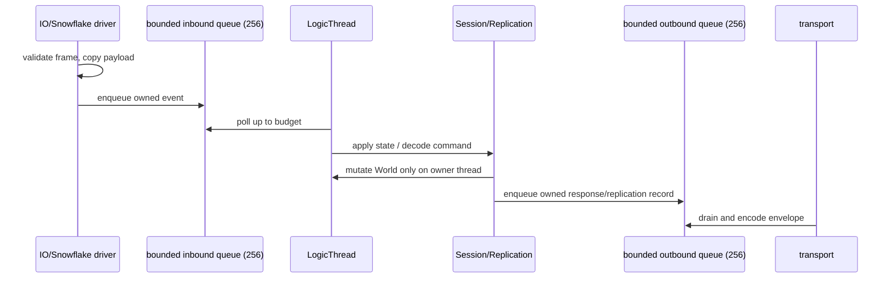

# Runtime Network Design

**状态：Stage 2 设计稿；不是实现声明**  
**范围：ECS snapshot/schema/delta/AoI/replication/fragment、`break_net`/Session 边界，以及其后 Runtime Core 的 PAL/Thread/Task/Message/IO/VFS/Profiler 接口方向。**

本文只定义架构、边界、接口方向、数据流、失败语义和验收门。它不修改源码或 CMake，也不把提案描述成已经接入 `engine` 正式运行时的功能。

## 1. 证据与状态分类

### 1.1 仓库事实

语言和分层的基线来自 `docs/Architecture_Overview.md`：引擎层是 C11，应用/框架层是 C++11；Lua 是计划中的唯一运行时脚本语言。`engine/CMakeLists.txt` 的 `project(... LANGUAGES C)`、`CMAKE_C_STANDARD 11`、`CMAKE_C_EXTENSIONS OFF` 是编译约束的直接证据。C++ 只在可选 `sl_dlss_streamline_adapter` 中启用，框架层的 C++11 边界仍由架构文档约定，而非网络模块的实现依赖。

以下状态词在本文中具有固定含义：

- **当前已有**：源码和当前文档明确描述，且有对应验证证据；不表示已完成产品级网络服务。
- **focused/test-only**：代码存在并可由专门测试 target 编译/运行，但没有进入正式 `engine` 静态库，不能被 `engine_demo` 或 `dxx_break` 当作运行时能力。
- **设计目标**：本文建议的正式化或新接口，尚未实现；后续实施必须先有 RED 测试、target 变更和证据。
- **未实现/明确排除**：本文不假设其存在，也不以接口草图冒充交付，包括认证后端、加密认证、authority handoff、预测回滚、分布式 Cell、Lua logic callback、editor RPC 和在线更新。

### 1.2 当前 target 证据

`engine/CMakeLists.txt` 当前把下列网络基础放入正式 `engine` target：`src/network/network.c`、`packet.c`、`net_replication.c`，以及按平台选择的 `net_loop_epoll.c`、`net_loop_iouring.c`、`net_loop_kqueue.c` 或 `net_loop_iocp.c`。`engine/src/network/net_loop.h` 规定 event-loop 操作除 `net_loop_wakeup()` 外均 loop-thread-affine，事件批量上限为 `NET_LOOP_MAX_EVENTS == 65536`。

ECS/network 新切片仍有明确边界：

- `engine` 静态库没有 snapshot/schema/delta/AoI 源；2026-10-22 起它们由正式可选 `break_ecs_replication`（`engine/CMakeLists.txt:313-324`）承载。`test_ecs_replication` 改经 fault-injection 变体 `break_ecs_replication_test`（`:3235-3249`，`BREAK_WORLD_DELTA_TESTING=1`）编译这些源。formal runtime/session integration 仍未完成。
- AoI/replication/fragment 由正式可选非 Snowflake `break_replication_core`（`:326-333`）承载；`test_break_replication_fragment`（`:3405-3412`）链接该正式库。
- `break_net` 在 `BREAK_ENABLE_SNOWFLAKE=ON` 时生成（独立于 `ENGINE_BUILD_TESTS`），链接 `break_replication_core` 与真实 `snow::net`；它包含 adapter、protocol/envelope/message/registry 和 Session 源（`:362-377`）。`engine_demo`/`dxx_break` 当前不链接它。
- `test_break_net_adapter`、`test_break_replication`、`test_break_session` 只在 Snowflake 条件满足时生成。`SNOWFLAKE_SOURCE_DIR` 缺失或没有 CMake target `snow::net` 时配置失败；没有替代 transport。

因此，正式化的第一步不是“再加一个网络回调”，而是建立清晰的生产 library target 边界，并在不改变当前 focused 语义的前提下逐步接入。

## 2. Stage 2 顺序和非目标

Stage 2 的顺序固定为：

1. **先正式化既有 ECS/network 边界**：确认 snapshot/schema/delta/AoI/replication/fragment 的可发布 C11 contract，明确它们与 `break_net`/Session、Snowflake 和正式 `engine` 的依赖方向；将 focused tests 变成正式库之前，先补集成契约。
2. **再实现 Runtime Core**：PAL、Thread、Task、Message、IO、VFS、Profiler 的正式边界和 target graph，供网络与后续 Lua/editor 使用。
3. **最后接线**：Runtime Core 只通过 owned message/command/snapshot/fence 连接 ECS 与网络，不让网络线程获得 `World *`、Lua、UI 或 RHI 访问权。

本文不设计完整 wire authentication、账号系统、跨服迁移、客户端预测/回滚或分布式空间分区。fragment checksum 仍只能作为完整性检查；加密认证属于 Stage 5 安全设计。

## 3. 目标架构与依赖方向

目标依赖方向如下；箭头表示“使用下层 contract”，不是线程调用关系：

```text
C++11 Framework/Application
        |
        v
Runtime facade (C11 opaque handles; C++ wrapper is optional)
        |
        +--> Session / protocol policy (LogicThread-owned)
        |       +--> ECS replication policy
        |       +--> owned Message queues
        |
        +--> Runtime Core: Message -> IO -> PAL/Thread
        |                         |
        |                         +--> platform socket/event backends
        |
        +--> VFS / Profiler / Task

ECS World/snapshot/delta/schema <--- LogicThread command boundary ---> Session/Replication
```

目标规则：

- `World`、ECS 结构、schema registry、Real/Ghost、Session state 都由 LogicThread 负责修改。
- Network/IO callbacks 只做 bounded validation、copy、identity bookkeeping 和 enqueue；不得直接调用 World/ECS/Lua/UI/RHI。
- Read-only workers 只读取已拥有的 immutable snapshot/delta/AoI 输入；不能保存指向 live World 或 transient callback payload 的指针。
- `break_net`/Snowflake 仍拥有 socket/readiness/transport queue。Break 只拥有 adapter lifecycle、事件记录和有界副本；正式化不能把 Snowflake 内部对象泄漏进公共 C11 header。
- C++11 Framework 只能调用不透明 C11 facade；不得把 `std::thread`、异常、RTTI、`std::string` 或 C++ ownership 传进 C11 ABI。Lua 只能通过后续 `BreakLuaRuntime` facade 消费 command/query，不直接持有 `World`、socket、RHI 或 Message queue 内部指针。

## 4. 既有 ECS 与 replication contract

### 4.1 Snapshot/schema/delta

当前 focused API 已在以下源码中存在：`engine/src/ecs/replication_schema.{h,c}`、`world_snapshot.{h,c}`、`world_delta.{h,c}`。

- schema 注册包含 component ID、version、size、alignment、flags 和可选 encode/decode；确定性 schema 的 hash 使用 canonical component ID。pointer-containing、resource reference、derived cache 不应走 raw snapshot policy。
- `break_world_snapshot_build(World *, schemas, tick)` 是 LogicThread 操作，要求调用方已经完成结构屏障；builder 不自动建立 barrier。snapshot 深拷贝 entity `(index,generation)` 和组件 bytes，拥有 immutable storage，并通过 retain/release 管理生命周期。
- delta 只在 immutable snapshots 之间 diff。apply 先验证 base/schema/tick/records，再对 World 做 ECS-owned staging clone；只在 staging 上 mutation 和最终验证，成功后 atomic replace，任何失败销毁 staging 且原 World 不变。

**设计目标：formal snapshot library**  
将上述 API 作为独立、可被 `engine`/runtime 使用的 C11 library contract，而不是把源文件直接散落到测试 executable。目标库不得依赖网络 transport、Snowflake、Lua、UI 或 RHI；正式集成由上层 bridge 负责。第一版保持 stop-the-world build 语义，不偷偷引入自动 barrier 或全局 current-snapshot mutex service。

建议的后续接口方向（名称仅为设计，不代表已存在）：

```c
typedef struct BreakSnapshotPublisher BreakSnapshotPublisher;
bool break_snapshot_publish(BreakSnapshotPublisher *, BreakWorldSnapshot *owned);
bool break_snapshot_acquire(const BreakSnapshotPublisher *, BreakWorldSnapshot **out);
```

publisher 必须明确 acquire/release 和 shutdown fence；不能返回无生命周期保护的裸指针。schema 变更产生新 schema hash；schema negotiation/online schema update 当前未实现，必须在 wire/session 设计中显式拒绝或版本隔离。

### 4.2 AoI/Real/Ghost/replication

`engine/src/network/break_aoi.{h,c}` 当前提供 sphere/AABB witness、空间网格、owner/always-relevant/dormant flags、hysteresis 和确定性 `enter/stay/leave`。`break_replication.{h,c}` 当前维护 Real/Ghost、baseline/dirty/destroy/dormant，并按 bandwidth budget 尝试向 `BreakNetReactor` 发送；连接断开时由 replication owner 清理 Ghost。

这些逻辑自 2026-10-22 起由正式可选 `break_replication_core` 承载（不链入 `engine`/demo），但 replication header 仍直接引用 adapter（`break_replication.h` include `break_net_adapter.h`，reactor send 符号在消费方最终链接解析）。完整正式化仍应拆为两层：

1. **transport-independent policy library**：AoI、scope diff、Real/Ghost 和 record scheduling 只产出 owned `BreakReplicationCommand`；不调用 Snowflake。
2. **network bridge**：LogicThread 消费 command，编码成 Session/Message envelope，再调用 Message/IO queue。

这样可以在没有 Snowflake 的 headless、ASan 和 TSan lane 中验证 policy；也能避免把 replication queue overload 当成 World mutation 失败。

### 4.3 Fragment/reassembly

`engine/src/network/break_replication_fragment.{h,c}` 已实现有界分片和 opaque reassembly：payload 非空；单片受 `BREAK_NET_MAX_PAYLOAD_SIZE`（当前 64 KiB）限制；总重组预算 `BREAK_REPLICATION_MAX_REASSEMBLY_SIZE`（当前 16 MiB）；携带 `delta_id`、`base_id`、index/count、FNV-1a checksum；支持乱序、精确 duplicate、冲突拒绝、owned complete payload、reset/destroy。

当前没有 timeout/eviction；上层 scheduler 必须管理半成品 lifetime。正式 bridge 的设计目标是：每个 connection/stream 有 bounded assembly budget 和 deadline；超时进入 `EXPIRED` 并释放 storage，重复/冲突/校验失败进入可计数的 drop reason。checksum 不得升级为 authentication。完整重组之后仍需回到 LogicThread 做 schema/base/tick/delta validation，再 apply。

## 5. `break_net` 与 Session 边界

### 5.1 当前 adapter

`engine/src/network/break_net_adapter.h` 的 `BreakNetReactor` 是 opaque C11 handle，支持互斥的 `BREAK_NET_DRIVE_THREAD` 和 `BREAK_NET_DRIVE_STEP`。Snowflake callback 只产生有界 `BreakNetEvent`；adapter event queue 和 outbound queue 均为 **256** 项，identity capacity 也是 **256**。payload view 是借用，入队前必须复制成 `BreakNetOwnedMessage`；poll 后 ownership 转给 caller，最终由 `break_net_event_release` 释放。

`break_net_reactor_send` 在 queue 满时立即返回 `BREAK_NET_SEND_OVERLOAD`，不阻塞 LogicThread；CREATED/FAILED/STOPPING/STOPPED 返回 `BREAK_NET_SEND_CLOSED`。stale connection UID 被丢弃。thread-mode stop 的顺序是 terminate Snowflake、等待 adapter-owned `host_exited` deadline、确认退出后 join、destroy reactor、发布 STOPPED；超时返回 false 并保留 live resources，后续 stop 可重试。step mode 的唯一 driver 由 atomic guard 保护。

### 5.2 当前 Session

`engine/src/network/break_session.{h,c}` 的 `BreakSessionManager` 是 LogicThread-only、非线程安全 opaque handle。状态为 `NEW -> AUTHENTICATING -> AUTHENTICATED -> CLOSING -> CLOSED`，也允许 `NEW -> CLOSING -> CLOSED`。`poll_adapter()` 在 LogicThread 分页消费 adapter queue；只有 event queue 排空后才 finalise close。closed entry 不回收，`max_sessions` 是 manager lifetime capacity，不是并发在线数。

当前 envelope 是固定 18-byte little-endian prefix，default registry 最大 64 项，目前 AUTH/PING 是已实现定义。Session handler 的 payload 只在 handler 调用期间有效；需要长期保存必须显式复制。当前 custom registry 可用于 Session policy，但 adapter envelope codec 仍使用 default registry；这是真实未决边界，不应在设计中默认为已解决。

### 5.3 目标 bridge

设计目标是将 Session 消费的输入固定为：

```text
adapter callback -> bounded owned event -> LogicThread poll_adapter
                   -> Session validation/state transition
                   -> handler/replication command
                   -> Message encode -> bounded outbound queue -> IO driver
```

Session 不拥有 socket，不执行 blocking I/O，不从 handler 线程调用 Lua 或 ECS。认证后端、权限和加密 handshake 不属于当前 Session slice；未来 handler 只能发布 `AuthCommand`/`SessionCommand`，由安全域另行批准。

## 6. Runtime Core 接口方向

Runtime Core 的首批 contract 已作为正式可选 `runtime_core` 交付（2026-10-22/23 Tasks 3-6：coordinator、owned message、bounded queue、task/thread/IO facade、reload coordinator、profiler bridge），但不链入 `engine`/demo；统一 PAL facade 与真实子系统接线仍是后续实现目标。每个模块先形成 C11 contract，再由 CMake 形成正式 target；focused targets 可以继续存在，但必须明确链接层级。

### 6.1 PAL / Thread

PAL 负责时间、线程、mutex/cond、socket native handle 和平台错误映射。现有 `engine/src/core/platform_thread.h` 已提供 Win32/POSIX `PlatformThread`、`PlatformMutex`、`PlatformCond` 包装；现有 `engine/src/platform/` 还包含 window/input/time/filewatch。新接口应保持 C11 opaque/explicit lifetime，并把 platform-specific types 留在 private implementation。

目标 contract：

- `runtime_thread_create/join/detach` 明确 owner、joinable 状态和唯一 joiner；默认禁止 detach 生产线程。
- `runtime_mutex`/`runtime_cond` 只保护队列/lifecycle，不允许在 lock 内调用 Snowflake step、World apply、用户 callback 或 blocking join。
- 每个 IO loop、TaskSystem、SessionManager、World 都记录 owner thread ID；跨线程只能通过 message/command/snapshot/fence。
- PAL 失败返回 `bool`/enum + 可查询错误，不抛异常、不跨 ABI 传播 errno 指针。

### 6.2 Task

现有 `engine/src/task/task.h` 的 TaskSystem 是进程内单实例；`SUBMIT_QUEUE_CAPACITY == 256`，worker 每优先级有 `DEQUE_CAPACITY == 1024` 的 Chase-Lev deque；worker task 调 `task_wait()`/`task_wait_handle()` 会自等待，按契约立即返回。

设计目标保持这些事实并补齐正式 contract：外部 submit 在 256 项 global queue 满时返回 overload（不无限分配）；worker local deque 满时按显式策略 reject 或转入 bounded overflow，禁止静默丢 task。TaskSystem shutdown 先停止接受新任务，再 drain/取消策略明确，唤醒所有 waiter，join workers，最后释放 task registry。网络 callback 不直接提交任意 logic task；只投递固定大小 command 或由 LogicThread 预算调度。

### 6.3 Message

Message 是跨 domain 的唯一通道之一。目标为固定 registry + type/version/sequence + bounded payload + explicit ownership：

```c
typedef struct RuntimeMessage RuntimeMessage;
typedef struct {
    u16 type;
    u16 version;
    u32 sequence;
    const void *data;
    usize size;
} RuntimeMessageView;
```

View 只借用且只在 callback/poll 期间有效；owned message 深拷贝并由创建域 release。每条 queue 必须给出 capacity、当前 count、drop/overload reason 和 shutdown 状态。禁止用 `void *` 指向 World、Lua stack、Snowflake context 或 UI 对象来逃避 ownership。

### 6.4 IO

Runtime Core formal facade 的 queue 满统一非阻塞返回 `BREAK_RUNTIME_OVERLOAD`；Network/IO/Audio/RHI 热路径禁止 inline。现有 compatibility API 的等待/丢弃行为保持其原有边界，不因 formal facade 改写。

现有 `network.h` 提供 TCP/UDP socket、nonblocking、send/recv；`net_loop.h` 提供 epoll/io_uring/kqueue/IOCP 选择，loop thread affine，`wakeup()` 是唯一线程安全操作。目标 IO facade 应优先复用该 readiness contract，并将 Snowflake adapter 与普通 `NetSocket` 作为两个明确 backend，不在上层混淆 transport ownership。

IO loop 目标容量和 backpressure：event batch 受 `NET_LOOP_MAX_EVENTS` 限制；上层 inbound/outbound message queue 默认沿用 256，正式化时允许按配置降低但不能无界增长。读到合法 bytes 但 owned queue 满时，默认策略是停止继续 drain/取消 read interest（若 backend 支持），记录 `OVERLOAD`，并在 consumer drain 后 wakeup；不得阻塞 callback。无法暂停的 transport 必须丢弃整条 bounded frame 并计数，而不能保留悬空 view。

### 6.5 VFS / Profiler

正式 `engine` 当前已编译 `src/asset/vfs.c`、`async_loader.c`、`hotreload.c`、`mipmap_stream.c` 和 `src/core/profiler.c`。VFS 有 `VFS_MAX_MOUNTS == 16`、`VFS_MAX_PAK_ENTRIES == 4096`、`VFS_MAX_FILE_BYTES == 128 MiB`；PAK 的共享 FILE seek 已用内部 lock 保护。async loader 的完成 callback 在 `async_loader_tick()` 的 main thread 派发，IO worker 不直接调用宿主 callback。

Profiler 当前有固定 `PROFILER_MAX_FRAMES == 120`、`PROFILER_MAX_REGIONS == 64`、`PROFILER_MAX_THREADS == 32`，支持 per-thread Chrome trace 和 provenance sidecar。网络设计只要求在 queue/IO/Session/replication 的关键路径打 bounded region 和 drop/latency counters，不把 profiler API 变成同步网络依赖；export 失败只报告，不阻塞 shutdown。

## 7. 队列、backpressure 与数据流

Runtime Core formal facade 的统一 queue 满载结果为非阻塞 `BREAK_RUNTIME_OVERLOAD`；compatibility API 与 formal facade 分离记录。legacy Task queue-full inline 仅是当前 Task 兼容事实；Network/IO/Audio/RHI 无 inline 或等待例外，legacy Network/IO 的其他行为不得升级为 formal contract。Network wire fragment（单片 64 KiB）、Runtime internal message、asset manifest 和 asset blob 是四种不同预算域；16 MiB 仅为单 assembly 上限，per-connection aggregate bytes/assembly-count 仍是设计方向。

### 7.1 正常路径



snapshot path独立于 transport：LogicThread 完成 systems 和结构屏障后 build snapshot；read-only worker 对 retained snapshot 做 diff/AoI；LogicThread 消费结果并决定 replication command。网络线程不读取 live snapshot pointer，除非通过明确 retain/release 的 publication service。

### 7.2 Backpressure policy

- inbound event queue：满则 callback 不阻塞；丢弃当前 bounded event，记录 connection/type/drop reason。若协议需要 close，发布一个优先级受保护的 close/error event，但该保留槽必须是有界的。
- outbound message queue：满返回 overload，保留调用方的 replication dirty state，使下一次 sync 可 retry；不得假报 sent。
- fragment assembly：超过 16 MiB、fragment metadata 不合理、deadline 到期或 connection close 时 reset/evict；计数后释放全部 owned fragments。
- Task submit：超过 256 external submit slots 返回失败；调用方必须选择 retry/defer/drop，不得在锁内无限扩容。
- VFS/async loader：遵守现有 128 MiB file cap；request pool/worker queue 的容量应在正式 target contract 中公开，完成 callback 仍只在 main tick 派发。

任何 overload 都必须区分 `RETRYABLE`、`DROPPED`、`CLOSED`、`MALFORMED`，并由 formal facade 映射到 `BreakRuntimeError`：`OK/INVALID/CLOSED/OVERLOAD/OOM/TIMEOUT/STALE/REJECTED/FAILED`；不能把内存不足、协议错误和 shutdown 混成 false。Runtime Core facade 统一返回 `BreakRuntimeError` 的 `OK/INVALID/CLOSED/OVERLOAD/OOM/TIMEOUT/STALE/REJECTED/FAILED`；兼容 API 的 `BREAK_NET_SEND_OVERLOAD` 等名称仅在其现有边界保留并映射到统一类别。Runtime Core 队列满统一非阻塞返回 `BREAK_RUNTIME_OVERLOAD`，Network/IO/Audio/RHI 热路径禁止 inline；legacy Task queue-full inline 保持不变，formal task submit 使用 reject/credit policy。

## 8. Shutdown、failure 与恢复

### 8.1 统一生命周期与启动失败

Runtime Core 的唯一 coordinator 按 `runtime_overview.md` 发布全局状态 `CREATED -> STARTING -> RUNNING -> QUIESCING -> DRAINING -> STOPPING -> STOPPED/FAILED`。Network、Session、adapter 等状态均为局部映射，不能另立全局生命周期。本文件只规定 Network 局部动作：在 coordinator 的 admission/callback/queue/drain/join 阶段分别停止网络提交、停止 driver callback、关闭网络队列并处理 close watermark、等待 host exit 后 join；资源仍由 coordinator 在无 live ownership 后销毁。completion wait 必须可被 deadline/shutdown 打断；timeout 保留资源并由同一 coordinator retry，FAILED 只允许诊断/cleanup/safe retry。

启动必须按阶段发布状态：allocate -> configure -> register callbacks -> start driver -> ready。任何阶段失败都要回滚已取得的 ownership；adapter 当前已覆盖 Snowflake thread 创建后的 setter/registration failure cleanup，并发布 FAILED。正式 Runtime Core 应保留同一原则：失败返回前 queue、thread、socket、context 均有唯一 owner，重复 destroy 安全或明确拒绝。

### 8.2 有序关闭

全局 coordinator 已在本文件 8.1 和 `runtime_overview.md` 定义；Network/Session 状态只能作为局部映射。本小节不重复定义全局顺序，只列 adapter 的局部 stop 动作：

1. coordinator 进入 admission quiesce 后，Network 拒绝新 outbound submit；
2. 停止 network producer callbacks，并发布 close watermark；
3. 在 coordinator 的 drain deadline 内 poll 有界 event/completion；
4. terminate transport，等待 adapter-owned host exit 后 join；
5. 将仍存活的 adapter ownership 交回 coordinator；不在 Network 局部动作中 destroy 其他域资源。

超时保留 live resources 并返回 `TIMEOUT`，由同一 coordinator retry；不可恢复错误进入 `FAILED`，只允许诊断和清理，不重新开放 admission。

shutdown 必须幂等；timeout 返回明确 `TIMEOUT` 并保留仍存活的 owner，允许后续继续 stop。不得在 lifecycle lock 内执行可能调用 callback、step、join 或用户代码的操作。

### 8.3 运行时失败

- malformed frame/schema/base mismatch：拒绝单条，保留当前 World，计数并可按 Session policy close；
- staging allocation/mutation/final validation failure：销毁 staging，原 World 不变；
- handler failure：Session 记录 `HANDLER_FAILED`，不在网络线程重试用户代码；由 LogicThread policy 决定 close/retry；
- transport error/close：先发布 owned event，Session 设置不可逆 close watermark，replication 清理 Ghost；
- profiler/VFS export failure：降级为错误计数，不阻塞网络 shutdown。

## 9. C11/C++11/Lua 边界

### C11 runtime

C11 拥有 opaque handles、POD wire records、显式 alloc/free、错误码、线程和 queue contracts。示例类型统一采用项目 `u8/u16/u32/u64/usize`，定义见 `engine/src/core/types.h`。公共 header 不暴露 Snowflake concrete structs、pthread/Win32 handles、C++ types 或内部 container。所有 ABI-facing structs 固定宽度字段并显式 little-endian 编解码；禁止 packed struct 直接作为 wire format。

### C++11 framework

C++11 `RuntimeModuleInterface`/`BaseApplication` 负责生命周期编排和 UI/editor integration，但只能在 owner thread 调 C11 facade。C++ wrapper 可用 RAII 管理 C11 handle，却必须把 destroy 顺序映射到 C11 contract；异常不得穿过 C ABI，跨层错误转换为 enum/result。Frame/Tick 不能直接从 UI thread 修改 ECS，须投递 LogicThread command。

### Lua

当前 `engine/src/script/script_lua.h` 的 `LuaScript` 是已有脚本加载/调用能力，并不等于稳定 `BreakLuaRuntime` facade。Lua VM 应由单一 Script/Application owner thread 持有；network/IO/worker 不进入 Lua。未来 facade 只接收 bounded command batch、snapshot/query 的 copied view 和 scalar configuration；禁止暴露 raw `World *`、socket、RHI handle、allocator 或 queue internals。Lua error、过量 command、超时和 reload failure 都回到 LogicThread result，不允许异常式跨线程传播。稳定 facade 属 Stage 3，本文只定义其不得越过的边界。

## 10. 验收与验证矩阵

### 10.1 Stage 2 focused RED/GREEN

在任何正式 target 迁移前，必须先为下列 contract 增加 focused tests：

- snapshot：结构屏障前拒绝/或由调用方明确负责、generation identity、schema hash、retain/release、publication lifetime；
- delta：base/schema/tick mismatch、staging apply、allocation/mutation/final-validation failure 后 World byte/state 不变；
- AoI/replication：多 witness union、hysteresis、owner/dormant、确定性排序、budget overload 后 retry、disconnect Ghost cleanup；
- fragment：over-limit、乱序、duplicate/conflict、checksum mismatch、16 MiB cap、timeout/eviction；
- adapter/session：256 queue overload、borrowed-to-owned copy、stale close watermark、custom registry boundary、start failure cleanup、bounded stop retry；
- Runtime Core：queue FIFO/capacity、producer/consumer ownership、wakeup、single driver、shutdown idempotence、task self-wait rejection、VFS cap、profiler per-thread export。

### 10.2 Normal / ASan / TSan

每个新增正式 runtime target 和 focused integration target 都必须提供：

1. normal build + CTest；
2. ASan（必要时 UBSan）build + 同一 focused tests，覆盖 queue full、fragment cap、close/stop timeout、payload lifetime；
3. TSan build + 多 producer/consumer、step/stop race、TaskSystem submit/shutdown、Session poll/adapter callback 并发场景；不得有 data race 报告；
4. Snowflake loopback lane（可用时）覆盖真实 accept/read/write/close，但不能将 loopback 通过等同于认证/生产部署；
5. `git diff --check`、target 显式 build、CTest 结果按 code/environment/not-built 分类。

当前证据只能引用已有 focused 结果：fragment 和 Snowflake replication focused normal/ASan/TSan 为 7/7；adapter 为 30/30，Session 为 20/20；full CTest 曾有 fuzz executable 未构建、`test_myui_text_layout` Hebrew boundary、`test_vulkan` golden drift 和 D3D12 dependency skip。它们证明对应 focused 边界，不证明正式 runtime/session integration 已完成。

### 10.3 通过条件

Stage 2 网络边界只有在以下条件同时满足后才能标记“formal runtime integration”：

- snapshot/schema/delta/AoI/replication/fragment 的 library target 与 `engine`/runtime target 依赖已由 CMake contract test 钉死；
- `break_net`/Session 的 Snowflake 可选性、payload ownership、queue capacity 和 shutdown semantics 在无 Snowflake/headless 与有 Snowflake 两条 lane 都有明确结果；
- LogicThread-only mutation、network callback no-logic、worker read-only snapshot 由测试和代码扫描共同验证；
- normal/ASan/TSan focused integration 全部通过，失败项没有以“未构建”冒充通过；
- timeout/eviction、schema negotiation、认证和安全项仍分别标为未实现，直到各自 Stage 计划和验收完成。

## 11. 后续依赖与未决风险

1. **target promotion 风险**：把 focused sources 直接加入 `engine` 可能引入 Snowflake、测试 fault-injection 宏或重复符号；必须先拆 transport-independent library，再决定是否并入 `engine`。
2. **snapshot publication 风险**：当前没有 mutex-protected current-snapshot service，也没有 epoch reclamation；在 publisher contract 交付前禁止跨线程保存裸 snapshot 指针。
3. **queue 语义风险**：当前 adapter 256 项容量是事实，但 Runtime Core 可能需要按 workload 配置；扩容不能隐式改变 overload/retry 语义或允许无界 payload。
4. **Snowflake 生命周期风险**：per-context completion/drop 通知较粗粒度，pending send identity 仍依靠 send-drained/close 顺序；正式 bridge 需继续保留 failure-atomic cleanup。
5. **protocol/security 风险**：当前 envelope default registry、sequence 和 FNV-1a 只提供边界/完整性；不能推断为 authentication、replay protection 或可信 client identity。
6. **跨平台风险**：adapter bounded stop 的非 Linux lane 尚未在本机验证；PAL/IO 的 Windows/macOS/移动平台必须分别完成 compile、headless/native-surface 和 sanitizer 证据。
7. **Task/VFS 共享资源风险**：TaskSystem 是进程内单实例；VFS PAK FILE seek 已需锁；Runtime Core 设计不可创建第二套隐式 worker pool 或绕过现有锁模型。
8. **Lua/editor 依赖风险**：Lua facade、editor RPC、remote diagnostics 和 online update 尚未实现；网络设计只能提供 owned command 边界，不能提前承诺 logic/editor integration。
9. **验证完整性风险**：已有 full CTest 记录包含未构建 fuzz smoke 和无关环境/图形失败；后续报告必须逐项说明“测试通过”“未构建”“跳过”或“与本改动无关”。

**结论：**当前仓库已经有可验证的 ECS snapshot/replication 和 Snowflake adapter/Session contract，target/ownership/queue/lifecycle 边界正式化已交付（2026-10-22 Tasks 1-2：正式可选 `break_ecs_replication`/`break_replication_core`/`break_net`），Runtime Core 首批 contract 也已交付（2026-10-22/23 Tasks 3-6 的 `runtime_core`）；但它们尚未构成正式 runtime network——各库均不链入 `engine`/`engine_demo`/`dxx_break`，LogicThread 集成、snapshot publication、authority 与真实子系统接线仍属后续 plan。

## 补充（2026-11-15）：Envelope 关联 ID 扩展

`engine/src/network/break_net_envelope.{h,c}` 的线格式新增一个可选扩展，用来把 Runtime Core 的 `correlation_id` 带过网络。

- 18 字节基础头不变（小端）。新增编解码器专用的标志位 `BREAK_NET_ENVELOPE_FLAG_CORRELATED = 0x0010`，它位于调用方标志掩码 `0x000f` 之外。
- 设置该标志时，头部之后、payload 之前跟一个 8 字节小端的非 0 关联 ID。偏移 14 的长度字段此时表示「扩展 + payload」的总长度，所以只读长度字段分帧的代码（adapter 明文分帧器）仍然能找到帧边界；该分帧器的上限改为 `BREAK_NET_ENVELOPE_MAX_BODY_SIZE`。
- `BreakNetEnvelope.correlation_id` 为 0 时不写扩展，编码结果与改动前逐字节相同。payload 上限只计 payload，不计扩展。`BREAK_NET_ENVELOPE_MAX_SIZE` 增加了 8 字节。
- 编码：调用方在 `flags` 里传 `0x0010` 返回 INVALID_FLAGS，这一位只能由编解码器设置。
- 解码：设置了标志但长度字段小于 8 返回 INVALID_LENGTH；扩展里的 ID 为 0 属于非规范编码，返回 INVALID_FLAGS。输出的 `flags` 去掉该位，`payload_size` 不含扩展。
- 兼容性：旧解码器遇到该标志会返回 INVALID_FLAGS，不会把扩展误读成 payload。发送方只应对同版本的对端设置关联 ID。
- 仍未接线：`BreakNetMessageView`、adapter 事件和 session 层还不传递这个 ID，属于下一个切片。

## 补充（2026-11-15）：消息与 adapter 传递关联 ID

上一节的线格式扩展现在接到了消息层和 adapter。

- `BreakNetMessageView` 和 `BreakNetOwnedMessage`（`engine/src/network/break_net_message.h`）新增末尾成员 `uint64_t correlation_id`，0 表示不关联。`break_net_message_view_init` 签名不变，会把它置 0；`break_net_message_copy` 复制它，`break_net_message_release` 清零它。
- adapter 的明文和 TLS 两条收包路径都把解码出的 `envelope.correlation_id` 放进 `BREAK_NET_EVENT_MESSAGE_RECEIVED` 事件的消息里。
- 新增 `break_net_reactor_send_correlated(reactor, key, id, version, cid, data, size)`。`break_net_reactor_send` 等价于 cid 为 0 的调用。outbound drain 把排队消息的 ID 写进 envelope 扩展。非 0 ID 只应发给能解码扩展的对端。
- 仍未接线：session 层（`break_session.c`）和 Runtime Core 消息之间的 ID 映射。

## 补充（2026-11-15）：Session AUTH 回复回带关联 ID

客户端 session 层收到 CHALLENGE 后自动生成 AUTH v2 回复。该回复现在复制 CHALLENGE 的 `correlation_id`，CHALLENGE 未带关联扩展时回复也不带。session handler 收到的 `BreakNetOwnedMessage` 本来就含 `correlation_id`，业务 handler 需要回带时自行调用 `break_net_reactor_send_correlated`。测试注入辅助 `break_net_reactor_enqueue_correlated_message_for_test` 仅在 `BREAK_NET_TESTING` 下可用。


## 补充（2026-11-20）：Linux arm64 QEMU 核心网络证据

arm64 lane 在既有二十项服务/安全测试上新增八项无 Snowflake 依赖的网络测试，统一为二十八项 CTest：packet 20/20、network 18/18、online lobby 10/10、online NAT 23/23、online voice 16/16、voice mixer 11/11、replay window 5/5、message rate 4/4。未修改的 emulator 交叉树八项全部通过，focused CTest 1.68 秒；全部是直接可执行目标，没有嵌套工具或新 skip。

QUIC 勘察保留独立边界：当前 arm64 multiarch OpenSSL 为 3.0.13，且未配置 Snowflake，不能满足 `BREAK_ENABLE_QUIC=ON` 所需的 Snowflake + OpenSSL≥3.5。Snowflake adapter/session/TLS/replication 与 QUIC C/C++20 均未纳入本次，不降低版本门槛、不把缺依赖记为通过。它们需要独立的 pinned 依赖交叉构建项目。

本结果是选定 QEMU 目标进程证据，不是生产网络部署、全量 arm64 CTest、GPU 或物理设备验证。


## 补充（2026-11-20）：aspect 与分片复制 arm64 证据

统一 arm64 选择新增 `test_break_online_aspect`（12/12）、`test_break_online_aspect_replication`（9/9）和 `test_break_replication_fragment`（12/12），总计达到三十一项。未修改 emulator 树的 focused CTest 为 0.26 秒，三项均为直接目标进程，无嵌套工具或新 skip。

覆盖原子变更与 epoch 冲突、预算/重试、分片重组、离开/重入、乱序与重复分片、校验和、容量边界及 supersession。Snowflake 适配器/会话/TLS、core_app 网络驱动、QUIC 和生产部署仍未纳入；QUIC 依赖门控不变。


## 补充（2026-11-24）：复制分片 BRFG/v1 canonical wire codec

`break_replication_core` 新增传输无关的 `break_replication_wire_{encoded_size,encode,decode}`。线格式为 40 字节显式 little-endian 头加非空数据：`BRFG`、version=1、header_bytes=40，随后依次是 delta/base（各 8 字节）、index/count/checksum/fragment_bytes（各 4 字节）。数据最多 65496 字节，完整 payload 最多 65536 字节；delta 非零，count 为 1..1048576 且 index<count，声明长度必须精确等于实际剩余长度。

`encoded_size` 可独立查询容量。非法结构返回 `INVALID`，超上限或容量不足返回 `OVER_LIMIT`；三个 API 都在入口清零可写输出，encode 失败不写输出缓冲。decode 不做未对齐整数读取、不分配，也不重新计算 FNV-1a；成功输出的 data 恰好借用输入+40，checksum/base/high-water 仍由重组池校验。调用者必须让输入至少存活到重组池接收并复制该分片。

TDD 先取得缺少 wire 头的编译 RED，随后 focused 新测试 **7/7**、既有 fragment/scheduler **28/28**。delta 端序、magic、非 40 header、容量差一、尾随、delta0、borrowed 偏移和 count/index 八项可构建变异均由行为测试判红并恢复。项目选项 ASan+UBSan 与独立 TSan 的 focused 也分别为 **7/7、28/28**，无 sanitizer/leak 诊断；这不是完整 sanitizer suite。

提交前完整 Vulkan/OpenGL 各注册 463/454 项，新增与既有功能测试通过，但两个 core_app contract 因其 `git archive HEAD` 尚不含未提交新文件而失败；另有 4 个既有条件 skip。该中间结果不记为完整通过，最终提交后复跑结果另段追加。消息 ID 注册、session/reactor/aspect 接线、真实网络、认证、可靠传输和 World delta 协议仍未实现。


### 最终 HEAD 完整验证（2026-11-24）

新文件进入 HEAD 后复跑完整构建与 CTest，上一段的两个 archive contract 均通过。Vulkan 注册 **463** 项，**459 执行通过、4 条件 skip、0 失败**；OpenGL 注册 **454** 项，**450 执行通过、4 条件 skip、0 失败**。两套 skip 均为 `test_d3d12_dependency_gate`、`test_core_app_nm_missing`、`test_core_app_nm_unsupported`、`test_core_app_nm_symbol_missing_unsupported`，不计为执行通过。该结果仍不构成真实 session/网络或完整 sanitizer suite 验收。


### 最终 HEAD 与 fix 后证据对齐（2026-11-24）

控制器在精确提交 `2f1c28d08ab9444f119fdf24bdc5d1c4fac16a26` 上重跑：Vulkan **100%（463/463）**，即 459 执行通过、4 条件 skip、0 失败；OpenGL **100%（454/454）**，即 450 执行通过、4 条件 skip、0 失败。四项 skip 仍为 `test_d3d12_dependency_gate`、`test_core_app_nm_missing`、`test_core_app_nm_unsupported`、`test_core_app_nm_symbol_missing_unsupported`，不转换为执行通过。

fix 后 normal、ASan+UBSan/LSan、TSan focused 均为 wire **9/9**、旧 fragment/scheduler **28/28**；首轮八项加 fix 六项共 **14 项定向变异均判红并恢复**。此前 **7/7** 和八项变异仅是 fix 前历史记录，最终证据以 **9/9、14 项**为准。新增覆盖包括每个截断的独立精确可访问区域、仅高 32 位非零的 delta、宽 base、count/index 最大值，以及完整 magic/version/header/fragment_bytes 高位负例。

完整 sanitizer suite、Session/真实网络与远端验收仍未完成；本补充不预写推送或 CI 结论。


## 补充（2026-11-24）：复制分片的 Session/Runtime 所有权边界

默认消息表新增 `BREAK_NET_MESSAGE_ID_REPLICATION_FRAGMENT = 0x4009`（v1、64 KiB、`AUTHENTICATED`、`IDEMPOTENT`），crypto 开启/关闭时 registry count 为 **30/29**。`BreakReplicationSessionBridge` 已提供 create/destroy、每连接 open/close、canonical send、owner tick、Session handler、completion poll/release 与 stats 的完整库级 API；它不依赖 Runtime Core，也不把 network callback 升级为 World/aspect 修改入口。

open 的 connection key 各自持有 pool 与 expected base，连接数和每连接 pending 乘积受创建配置的总预算静态约束。完成 queue 独立限制条数、单包字节与队列总字节，采用 FIFO；只有所有者调用 `poll_completed` 才发生 ownership-at-poll，调用者随后用 `completion_release` 释放。close 释放该连接的 pool 和未取 completion，同 key 重开不继承 high-water。stats 包含 connections、pending/completion 大小和 rejected/duplicate/completed/dropped/expired 计数；tick 遍历所有已 open 连接，没有后台维护、线程或锁。

真实 loopback 使用 raw TCP client 先 AUTH，再由 `break_net_reactor_step` 与 `break_session_manager_poll_adapter` 驱动真实 registry、envelope、Session、pool 和 completion queue。覆盖两个 delta 的乱序与逐字节重复片、expected base 拒绝、FIFO/connection/delta/payload、poll 前 consumer 为 0，以及真实 close 后同 key 重连时从 delta 40 到新 delta 1。最终 bridge **19/19**、Session **43/43**、wire **9/9**、fragment **28/28**；Vulkan **464 通过 + 4 skip/468**、OpenGL **455 通过 + 4 skip/459**，均 0 失败且 skip 不计通过。ASan+UBSan（`detect_leaks=1`）与 TSan focused 均 **4/4**，直接 case 计数与 normal 相同，无 sanitizer/leak/race 诊断。

这只是 runtime 可消费的库级 ownership 边界。**生产 core_app/editor 接线、aspect drain、World delta、可靠恢复和完整资产链仍未完成**，也没有据此声明远端部署或完整 sanitizer suite 已验收。


## 补充（2026-11-24）：Runtime 所有线程边界上的 aspect drain

`BreakAspectSession` 把 bridge completion 的所有权转移延伸为明确的 owner-thread 消费步骤。open 时 expected base 由 `break_aspect_schema_hash(store)` 决定；网络回调只重组并入队，`break_aspect_session_drain` 是唯一 `break_aspect_apply` 入口。drain 按 FIFO 每次最多消费 `max_packets`，逐项记录 applied/rejected/drained，apply 失败不升级为连接关闭，并在分支结束后 release completion。零预算不解包、不访问 store；未 drain 的项仍由 bridge 持有。模块不新增线程、锁或原子。

发送端 fragment data 上限为 **65496**，与 BRFG/v1 总 payload 65536 及 40 字节头一致。`break_aspect_session_send` 将 runtime 错误映射到 `OK/INVALID/OVERLOAD/CLOSED` 并保持 0x4009/v1。`break_net` 与 `break_net_test` PUBLIC 链接 `break_online`。`test_break_online_aspect_session_link` 只链接 `break_net_test`、不显式链接 `break_online`，契约测试 **1/1**，证明 aspect 符号会随正式依赖传播。

真实 loopback 依次穿过 raw socket AUTH、默认 registry、reactor、SessionManager、既有 AOI aspect scheduler、bridge 和 owner drain。drain 前占位 handle 无 active aspect 或字段值；第一次 drain 后为 42/-17，schema mismatch 后保持原值并计 rejected，同 key 重开后 delta 1 不继承 40/41 高水位，最后为 84/-34。三个真实发送回调和三个 completion 均有计数，consumer=3，Session applied=5、invalid=0、handler_failed=0。移除 registry 项时 **11/12**，恢复后 **12/12**。

六项目标在 normal、ASan+UBSan（`detect_leaks=1`）和 TSan 下均为 **6/6 CTest、112/112 直接测试**，包括 aspect session 12、link 1、bridge 19、Session 43、wire 9、fragment 28。完整 Vulkan 注册 **463** 项，**459 执行通过、4 条件 skip、0 失败**；OpenGL 注册 **461** 项，**457 执行通过、4 条件 skip、0 失败**。四项为 `test_d3d12_dependency_gate`、`test_core_app_nm_missing`、`test_core_app_nm_unsupported`、`test_core_app_nm_symbol_missing_unsupported`，不计执行通过。

本补充没有实现 Runtime Core 消息映射或生产接线。**core_app/editor 接线、World delta、可靠恢复和完整资产链仍未完成**；focused sanitizer 不等于完整 sanitizer suite。


## 补充（2026-11-24）：CoreAppThread 的 aspect 所有权与诊断边界

可选 `--aspect-replication` 把现有 bridge/aspect session 接入 `core_app_net_transport`，不改变 Runtime Core 消息映射。两个 store、spatial index、replication、session 和所有 AOI scope 都由 transport 在 CoreAppThread 拥有；open 位于 `net_slot_add` 后、adapter event 应用前，失败回滚，close 先 replication disconnect 再 session close。`net_tick` 与 shutdown `net_drain` 在 pump 后执行 session tick 和最多 64 包的 drain，发送位于 welcome 之后。没有新线程、锁或后台维护。

inbound store 仅证明 BRFG/schema/BRA1 校验与 drain，永不写回 simulation 或 World。唯一 apply 入口是 `break_aspect_session_drain`，固定 handle 1/2 只用于两个现有 POD 实体的诊断复制。`network_aspect_stats` 暴露 opened/closed、applied/rejected/drained、sent_fragments、queue_depth、dropped、duplicates、pending_bytes；默认关闭无此行，`network_stats` 文本保持原样。

真实 loopback **1/1** 验证本地重组、两个句柄全部值、反序 3 片 + 重复 1 片 + mismatch 3 片，服务端 applied/rejected/drained=1/1/2、queue/dropped=0，发送至少 2 片。0x4009 负对照 **0/1** 后恢复 **1/1**；network **12/12**、lifecycle **12/12**、ASan+UBSan **9/9**、TSan 直接目标 **7/7** 和 TSan 客户端 loopback **1/1**。core_app TSan 进程场景仍有既有 Lua longjmp 环境失败。

World delta、inbound-to-simulation、level rebaseline、可靠恢复、Runtime Core 新映射及远端验收均不在本项。


## 补充（2026-11-24）：World delta BRWD/v1 canonical codec 与目标重建

`break_ecs_replication` 新增传输无关的 `break_world_delta_wire_{encoded_size,encode,decode,clear,rebuild}`。BRWD/v1 使用 60 字节显式 little-endian 头：`BRWD`、u16 version=1、u16 kind（full=1/delta=2），随后是 schema_hash、level_generation、base/target snapshot id、base/target tick（均 u64）和 u32 record_count。每条记录为 17 字节头加 payload：u8 kind、u64 entity_handle（低 32 位 index、高 32 位 generation）、u32 component_id、u32 byte_size。整包至多 **67,108,864** 字节，至多 **1,048,576** 条记录；线上没有宿主 `usize` 或 packed struct。

解码拒绝错误 magic/version/kind/record kind、超限 count/size、零 entity handle、组件记录的零 component id、实体记录的非零 component/payload、ADD/UPDATE 的空 payload、REMOVE 的非空 payload、非递增 tick 和任何截断/尾随。full 的 base id/tick 必须都为零且只允许 CREATE/ADD；delta 的 base id 必须非零。成功 decode 拥有 record 数组但借用输入 payload，重复 decode→encode 必须逐字节一致；所有失败清零输出，encode 失败不写输出缓冲。

`rebuild` 只在私有 staging World 上应用记录。full 从空 World 重建，稀疏 entity index 用临时占位创建后销毁，保留目标 index/generation；delta 要求调用方 World、base snapshot、schema、level、base id/tick 全部匹配。最终用 `break_world_snapshot_build` 重算 target，并要求 `break_world_snapshot_id` 等于线上 target id；线传 id 不是信任依据，失败不改变调用方 World 且输出为 NULL。

`test_world_delta_wire` 现为 **21/21**，覆盖 4 实体/3 组件 full+delta、单 delta 内混合 CREATE/DESTROY/ADD/REMOVE/UPDATE、宽 u64、空 full、精确 64 MiB 边界、稀疏句柄和重复 canonical re-encoding。既有 deterministic fuzz 运行 **2000** 次（accepted 534、rejected 1324、over_limit 142），Clang libFuzzer 入口完成 **20000 runs**，均无发现。

本项没有注册 BRWD 消息 ID，也没有 session/bridge/core_app 接线、ACK/NACK、重试、断线恢复或生产启用；BRFG 的可靠性与 session 语义不自动延伸到 BRWD。

最终完整 CTest：Vulkan 注册 **471** 项，**467 执行通过、4 条件 skip、0 失败**；OpenGL 注册 **462** 项，**458 执行通过、4 条件 skip、0 失败**。五项 focused ASan+UBSan（`detect_leaks=1`）与 TSan 均为 **5/5 CTest、146/146 直接测试**，无 sanitizer/leak/race 诊断；条件 skip 不计执行通过。


## 补充（2026-11-24）：World session 的 owner 基线与恢复边界

`BreakWorldSession` 把接收 World、发送 confirmed baseline、未确认历史、不可变 publish attempt 和控制事件全部限定在 owner-thread。网络 callback 只做 BRFG decode/reassembly/completion queue；`break_world_session_drain(connection, world, max)` 才执行 BRWD decode、base 检查和 target hash 校验；delta 通过 `break_world_delta_apply` staging 提交，full 则在空 staging World 重建后原子替换 destination，不经过旧 World 的 allocator-history delta。因此网络线程不会借 ACK 或恢复路径直接修改 World，其他连接的 completion FIFO 也不会被当前 drain 消耗。

0x400A 用于 BRWD 分片，0x400B 用于 32 字节 BRWC 控制。接收方 ACK 合并到最后成功 target；NEED_FULL 携带 last-good id/tick，并按连接每 N tick 限流。发送方只把精确 `(delta_id,target_id,tick)` ACK 当作 confirmed baseline 推进，裁剪对应历史。没有 ACK 或需要恢复时发送 full；历史 entry/byte/packet 限制退化为 full，fresh delta id 防止把新 full 与旧 attempt 混淆。OVERLOAD 后 World 可以已经变化，但重试仍使用原 BRWD bytes、snapshot、delta id 和未发分片位置，不重新生成部分内容。重连清空所有接收/发送状态。

测试既覆盖这些状态机，也覆盖真实 AUTH/socket 的乱序重复、base mismatch/NEED_FULL/full，以及移除并恢复 0x400A 注册的负对照。直接测试 **189/189**，其中新增 recovery **6/6**、loopback **2/2**；normal focused CTest **11/11**。ASan+UBSan 显式 `detect_leaks=1` 与 TSan 九项 focused 均 **9/9**。八项定向变异（限速、ACK 字节、full 回退、history bytes、payload 生命周期、OVERLOAD 游标、重连序号、confirmed reset）均先判红再恢复。实现早期还由测试定位并修复了 fragment descriptor 借用 BRWD 缓冲而 attempt 提前释放的问题，最终 payload 存活到末片发送完成。

完整 Vulkan **463/467 执行通过**，另有 **4 条件 skip、0 失败**；OpenGL **461/465 执行通过**，另有 **4 条件 skip、0 失败**。skip 名称与既有四项相同，不转为通过。**core_app 启用、生产 level 策略、跨连接共享 World 和 Runtime Core 消息映射仍未完成**，focused sanitizer 不等于完整 sanitizer suite。


## 补充（2026-11-24）：CoreAppThread 的 World drain 与诊断所有权验收

真实 loopback 现在穿过生产 `core_app` 的可选 `--world-replication` transport。0x400A handler 只重组并入队，CoreAppThread 在 tick/shutdown 有界 drain；每个连接使用独立 diagnostic World，network 输入不写生产 simulation。客户端本地也使用真实 `BreakWorldSession`，直接证明 completion 不改 World、只有 drain 才推进 target。服务端 ACK/NEED_FULL 中的 last-good/target id 与客户端构造的 snapshot 一致，且联网与离线运行的全部非 network trace 行一致。

仅开启时输出的 `network_world_stats` 字段为 opened、closed、applied、need_full、rejected、full_publishes、delta_publishes、sent_fragments、queue_depth、dropped；默认关闭没有该行，既有 `network_stats` 格式不变。本次真实用例得到 2 次诊断 apply、1 次 base mismatch 拒绝与 NEED_FULL、1 次 full 和 1 次 delta 发布，queue/drop 均为 0。

本项没有 Runtime Core 消息映射、跨连接共享 live World 或权威 simulation 合并；full/delta 的诊断重建不等于生产 World 已接入网络权威。


### 最终 HEAD 验证补充（2026-11-24）

代码与测试提交 `13d74092e52b084e8036c9d0324abd99079f584c` 的完整 CTest 实际结果：OpenGL 注册 **477**，**473 执行通过、4 条件 skip、0 失败**（310.06 s）；Vulkan 注册 **479**，**475 执行通过、4 条件 skip、0 失败**（297.11 s）。两项 skip 均为 `test_d3d12_dependency_gate`、`test_core_app_nm_missing`、`test_core_app_nm_unsupported`、`test_core_app_nm_symbol_missing_unsupported`，不计执行通过。World loopback、clean-room 与两个 core_app archive 契约在两套后端均实际通过。后续仅追加验证文档，最终文档 HEAD 的 naming 门禁为 **2/2**；不重跑已完整通过的套件，不预写远端结果。


## 补充（2026-11-24）：World session 换代的所有权与线协议边界

库级 `break_world_session_rebaseline` 由 owner 显式调用，要求非零且严格大于当前 generation。它先在既有固定 pool/slot、bridge connection 和 completion 数组上完成无分配 epoch 复位，再逐连接释放旧 baseline/confirmed/history/attempt、清 pending ACK/NEED_FULL 与限速纪元；连接 key、history 数组、容量、expiry 策略和单调统计保留。每连接都必须先收到并 drain 新 full，发送侧也须独立等到当前 ACK 才恢复 delta，连接 A 的 ACK 不推进连接 B。

初始 generation 保持 32 字节 BRWC/v1、outer/payload version 1。换代后的控制改为 40 字节 BRWC/v2、outer/payload version 2，offset 32 写入当前 u64 level；v2 的版本、长度和 level 全部校验后才可触碰 sender 状态，v1 在换代后一律拒绝。BRWD/v1 和 0x400A 不变。网络回调仍只重组并入队，只有 owner drain 可修改调用方 World；full 成功前保留旧 World，新 full 在 staging 重建并核对 target 后原子替换。

同 socket 验收让 raw TCP 客户端和服务端在 AUTH 后从 level 7 显式进入 8，真实收发 BRFG/BRWC，覆盖旧 epoch 乱序重复片、旧 v1/v2 ACK/NEED_FULL、新代 full 前 NEED_FULL、full target id 和当前 ACK 后 delta。旧 completion 不直接注入，连接 key/session id 与 TCP 身份保持连续。

本项没有自动换级、资产处理、混合 level、共享 live World、Runtime Core 消息映射、权威合并或完整资产链，也没有把 CoreAppThread 诊断 drain 扩展成生产权威 World 集成。既有远端与集成复验收据不复制，本追加不预写新的远端结果。


## 补充（2026-11-25）：只读 snapshot lease 与 Runtime 所有线程 fan-out 边界

snapshot publication 的短锁只覆盖 acquire 与 replace/close 的状态检查、retain 和 current/元数据更新；旧引用的 release 在锁外，构建、diff、编码、发送、drain、回调、渲染和音频处理也都不得进入该临界区。owner 串行调用 publish/close，close 后 acquire 返回 CLOSED；destroy 要求先 close 并停止全部并发 publication 调用。已 acquire 的 lease 通过 snapshot refcount 独立存活，replace/close/destroy 不使其字节失效，lease release 可晚于 publication destroy。

publish 在替换 current 前原子检查 schema/tick/level/closed/epoch；同 level tick 必须递增，高 level 开启新纪元且允许更小 tick。World session 不接触 publication 锁，只在热路径前消费调用方取得的 immutable lease。`break_world_session_publish_snapshot` 对每连接 retain target，既有一次 snapshot 构建因而可供多个认证连接复用，但各连接仍从自己的 confirmed 或 newest-unacknowledged history 选择 base，独立处理 ACK、NEED_FULL、OVERLOAD 和 level 复位；active attempt 始终优先续发原字节。

真实双 socket/AUTH 验收通过有界 reactor/Session dispatch 交错收片，未直接注入 completion。A 的队列 OVERLOAD 不阻断 B，A 的 NEED_FULL 不改变 B 的 delta 基线，B 的 S2 未确认时 S3 仍基于 S2；两个接收 World 只在各自 drain 后变化。7→8 换代使旧 lease 不可发布但不影响其只读生命期，两个连接的新代首包均为 full。focused normal 与 ASan+UBSan/LSan 均 39/39，TSan 的 library/server socket 组为 13/13；core_app TSan 的既有 Lua longjmp 和混合客户端证据另列，不扩展为完整服务端 sanitizer 结论。

Runtime Core 消息映射仍未实现，CoreAppThread 诊断 drain 也没有变成权威合并。跨连接共享的是 immutable snapshot，不是 live `World *`；共享 live World、多写入者仲裁、权威 simulation 合并、自动资产选择/加载和完整资产链继续开放。本节不预写远端结果。


## 补充（2026-11-25）：可配置 outbound admission 兼容边界

动态每连接配额不再是默认全局迁移。`BreakNetReactorConfig.fair_outbound_admission` 位于 config 尾部，默认 false 时只使用旧的全局 256 限制；显式 true 时才在 `queue_mutex` 内分别做一次有界 identity 和 outbound 扫描，计算 `share=max(1,256/max(1,active_count))`。active 严格为 `valid && key!=0 && !retired`，closing 未 retired 仍占份额。key queued 达份额即拒绝，全局满也拒绝；unknown key 不增加 active_count，但仍按相同 key queued 检查。

late join 会动态缩小份额，已排队旧消息不驱逐，超过新份额的旧 key 暂停新准入直到 drain；若全局已满，即使 sender 未达自身份额也返回 OVERLOAD。退休后 active_count 相应下降，剩余身份可恢复更大份额。队列总容量、drain 扫描、每 key FIFO、payload 深拷贝与释放责任不变。

直接 adapter 测试使用真实 socket、硬 RST、slot 复用重连和既有 outbound ownership seam，覆盖默认 false、late join 旧消息保留、closing 未退休占份额及退休后恢复、unknown key 和 global full，不通过伪造状态 getter 代替生命周期。World 双连接 fixture 显式 opt-in，默认 core_app/raw-key 配置不变。

legacy World API 的 full tick 规则也保持兼容：未 ACK full 与 NEED_FULL fresh full 可复用 tick，只有 delta 要求递增；borrowed snapshot API 的 full/delta 准入仍严格。publication 的 single-owner/acquire/destroy/lease 线程与生命期合同已写入公共头。本节不构成默认全局公平调度或最终全量验收声明。


## 补充（2026-11-25）：Runtime World 控制面的背压与 shutdown

Runtime 新增独立可选控制桥，kind `0x5753`/version 1 的 payload 固定 **56 字节**：两个 u32 的 kind/reserved_zero 加 connection key、connection epoch、level、delta id、target snapshot id、target tick 六个 u64。bridge 本地 `connection_epoch` 防止同 key close/reopen 后旧命令串代；它与 session level、queue generation、publication epoch 分离。ACK/NEED_FULL 经 Task 1 correlated BRWC 保留完整 u64 cid，cid 0 仍为 uncorrelated，Runtime sequence 不变成网络 sequence。

submit 不触碰 World，只有 owner drain 执行 open/close/rebaseline/control。queue OVERLOAD 不改变 World，允许排空后以同内容和同 cid 重试；reactor OUTBOUND OVERLOAD 将原 control、level、epoch、cid 留在 pending，后续 drain 必须先成功重试该控制再处理下一命令。连续饱和每次都计 transport OVERLOAD，成功应用只计一次。close 后 submit=CLOSED，但已排队和 pending 控制仍按 FIFO 恰好一次排空；pending 非零拒绝 destroy 并保留资源，归零后才允许 adapter 销毁，再由调用方销毁 session/publication。

真实 socket 回归同时固定 admission 兼容：零初始化 `fair_outbound_admission=false` 保持旧全局 256，A 占满后 B 同样 OVERLOAD；只有两个既有双连接公平用例显式 true，继续验证 A 达自身份额时 B 可推进。本项没有 snapshot/BRWD 数据面 Runtime 映射、Coordinator 自动注册、共享 live World 或权威合并，也不预写远端验收。


## 修订（2026-11-25）：World 控制 ingress 隔离与关停竞态

Runtime direct submit 改为自有 `message_copy + queue_enqueue`，不再经 Bus fan-out；合法外部生产者仍可直接 publish 已注册的 `0x5753`，每个 adapter 独立接收、drain 和关闭。统计上 submitted 只属于 direct 成功，外部消息只增加 drained/applied；queue occupancy 来自 `enqueued-dequeued`，所以共享 Bus 不再导致 pending 下溢或 destroy 永久拒绝。

destroy 在任何 pending 判定之前先关闭 queue admission 并退订，且记录退订状态供后续重试跳过。false 返回后不会再接受 direct 或外部新命令，但已排队及 transport pending 仍由原 cid/内容 drain 清空，随后 destroy 重试成功。connection epoch 耗尽返回本地 `BREAK_RUNTIME_REJECTED` 并计 rejected，不进入网络重试，也不改变 BRWC/BRWD、correlation、wire sequence 或 admission 协议。


## 补充（2026-11-25）：World 控制 Coordinator 的 TIMEOUT 恢复

独立 Runtime World adapter 现可显式注册到真实 Coordinator，以六阶段完成 stop_admission、stop_producers、close_queues、drain、join、destroy。stop_producers/join 属于调用方外部生产者与 transport 的退出协议；adapter 没有因此获得 worker。close 是幂等准入关闭，direct 与外部 Bus 已接受命令继续 drain，close 后新命令不增加 pending，最终退订后 Bus 发布 delivered=0。

有界 drain 和 OUTBOUND OVERLOAD 都以真实 pending 决定 TIMEOUT。ACK/NEED_FULL pending 在连续重试中保持 control、level、connection_epoch 与完整 cid，解除后 applied 只一次；transport CLOSED 则清 control_pending、计 rejected，并允许后续 queue 项继续 drain，最终 STOPPED。已消费且 pending=0 的 STALE/INVALID/REJECTED/CLOSED 不进入永久 TIMEOUT。join 首次 TIMEOUT 只从 join 重试；destroy=false 保留 binding，后续仅重试 destroy。成功 destroy 只释放 adapter，借用 Bus、World Session 和 publication 仍由调用方持有。

本项没有新增 Runtime snapshot/BRWD/BRFG 数据面、共享 live World、core_app authoritative World 或权威 simulation 合并。当前 core_app 已有 `"network"` subsystem 注册，较早“未注册 network”文字只代表历史时点；该 transport 注册不能被写成 World adapter 已注册。详细本地验证见 Task 2 报告，本节不预写远端结果。


## 修正（2026-11-25）：恢复真实网络场景后的完整矩阵

前次 OpenGL 469 / Vulkan 470 来自 `CORE_APP_ENABLE_NETWORK=OFF`，缺少的不是 Runtime World 测试，而是同一 `_core_app_net_transport AND NOT WIN32` 条件块中的 12 项：loopback、aspect、world、single_session、late_auth、voice、voice_relay、voice_relay_off、voice_mute、voice_flood、start_failure 以及独立 `test_core_app_net_transport`。恢复原 backend、tests 和固定 Snowflake pin，仅以 ON 重新 configure 后，这 12 项全部注册并执行。

当前 OpenGL 注册 **481**。旧 480 与它的名称差集是 `test_rhi_device_type`，由当前旧 cache 中残留的 Vulkan include/library 配置触发；同 ON/backend/pin 的新 OpenGL 探针无这些变量时为 480。该 RHI 条件差异与 network ON/OFF 差集分开记录，未删减网络或 transport 测试凑数。

最终 OpenGL **477 执行通过、4 条件 skip、0 失败**，build 11.72 s、CTest 303.85 s；Vulkan **478 执行通过、4 条件 skip、0 失败**，build 11.85 s、CTest 306.76 s。共同 skip 为 `test_d3d12_dependency_gate`、`test_core_app_nm_missing`、`test_core_app_nm_unsupported`、`test_core_app_nm_symbol_missing_unsupported`。所有最终 CTest 均未过滤且 rc=0；本修正不改生产源码，不预写远端结果。


## 修订（2026-11-25）：World 控制生命周期的外部 quiesce 与 abandon

注册成功后 adapter 的 lifecycle binding 唯一归属于一个 Coordinator，同/跨 Coordinator 重复注册均 REJECTED；已绑定直接 destroy 返回 false，不再可能绕过 Coordinator 释放 queue。注册分配或入表失败会回滚占用，lifecycle destroy 的 false 保留 binding 供精确重试。

`break_runtime_world_session_abandon` 只在 CREATED/FAILED 可用：精确 unregister 成功后才清 binding 并 free，失败不改变 adapter 或 Coordinator。正常路径由 stop_producers/join 先停止并 join 外部生产者与 transport，再 stop 到 STOPPED。若 Coordinator 未 STOPPED 而要销毁，调用方必须先 quiesce 所有外部生产者及其他 adapter API，再 abandon；归还所有权后手动 close/drain/destroy adapter，不能借 abandon 丢弃网络 pending 或借用 Bus/Session/publication。

该修订不改变 wire、BRWC correlation 或 transport OVERLOAD/CLOSED 语义，也不自动接入 core_app World adapter。


## 补充（2026-11-25）：core_app World adapter 的真实网络路径

生产 `--world-replication` 已把独立 Runtime adapter 注册在既有 `"network"` subsystem 之前。首 tick 对同一 World Session rebaseline 后，认证连接的 OPEN、本地 ACK/NEED_FULL 和 CLOSE 都经过 adapter submit/drain；BRWD publish、每连接 diagnostic World drain、simulation/physics 与权威 trace 边界保持原样。world off 不创建 adapter 或 subscription，仍只有原五子系统。

真实 TLS/AUTH loopback 现在要求服务端 ACK、NEED_FULL、恢复 ACK 各出现一次，outer/payload 均为 BRWC v2，level、delta id、target id/tick 不变，envelope correlation 非零且控制/cid 均不重复。客户端用于确认服务端 full 的 BRWC v2 仍以 correlation=0 入站，证明旧 uncorrelated 兼容未被放宽或删除；完整高位的精确保留另由 transport 的高位常量用例验证。completion 在 adapter/Session drain 前不改 World，drain 后重建 target 一致，旧直接发送不会产生第二份控制。

关闭时 adapter 先于 network，session/reactor 后于 adapter，net_bus 最后回收。CREATED/FAILED 先 abandon/manual drain/destroy；pending 未排空时 network 不得先销毁。`on_destroy` 只在 adapter 成功销毁后清指针，network 自身随后的 TIMEOUT 不影响该顺序。

本项不做 snapshot/BRWD Runtime 数据面、自动后续换级、共享 live World、权威 simulation 合并或默认全局公平调度，不预写远端结果。

## 补充（2026-11-25）：snapshot notice 数据面的预算/cursor 与 E1/E2 在真实 socket 上的验证

本小节记录 Runtime snapshot notice 数据面经真实双 socket loopback 验证的网络行为，不改写历史小节，也不预写远端结果。

预算/cursor：`publish_connection_budget=1` 时一次 `drain` 只推进一个连接，round-robin cursor 下一次才轮到下一个连接；A 收到 full 后 pending 仍为 1，第二次 drain 才让 B 收到 full，A 不重复 full。full/delta/ACK/NEED_FULL 的选择由每连接的已确认 baseline 决定：已 ACK S1 的连接在 S2 发 DELTA/base=S1，未确认的连接发 FULL/base=0，两者 target 同为 S2；只 ACK 一个连接不裁剪另一个连接的 history。

E1/E2：A 填满自身 share 后第一次 drain 返回 OVERLOAD，`attempt_target_snapshot_id==E1`、`publish_overloads==1`；显式 fair admission 下第二次 drain 让 B 收到 E1 full（A 饱和不阻断 B）。publication publish 用 E2 替换 current 后，不提交新 notice，continuation 自行 acquire E2，但 A 仍先续发旧 E1（resumed 字节等于 `encode_full(E1)`、不等于 E2），E2 此时不得 completed；后续 drain 才分别让两连接发 E2，pending 归零。fair admission 默认 false、测试显式 true；BRWC/BRWD/BRFG wire 不变。

## 逐连接诊断快照（2026-11-26）

`break_runtime_world_session_connection_snapshots()` 在 adapter mutex 内复制每条已打开连接的标量判账字段（key、connection epoch、completed/terminal/attempt publication epoch、adapter 记录的 attempt target id/tick、`retry_publish`、`publish_dirty`），按 slot 升序写入调用方数组，并返回**实际打开连接数**——`capacity` 不足时仍返回完整计数，便于调用方扩容重查。

`publish_dirty` 镜像 fanout continuation 中 adapter 自己持有的判据：有 retry，或任一保存的 attempt 标量非零，或 completed/terminal 都不等于最近一次 drain 观察到的 publication epoch。它**不含** continuation 还会查的 Session `attempt_pending`，因此回答的是“该 adapter 还欠一次发布”，既不等于 `pending()==0`，也不代表权威 World 与快照存在差异。查询只读：不调用 World Session、publication 或 queue，不推进状态机，也不改变 pending、聚合统计或 retry 状态。

该 API 不提供指标导出、历史采样或告警，也不暴露 World Session 私有 attempt 字节；远程指标与告警仍是缺口。

## 发布进度摘要（2026-11-26）

`break_runtime_world_session_publish_progress()` 返回 adapter 级只读摘要：`observed_publication_epoch` 是最近一次 drain acquire 到的 publication epoch（0 表示尚未 drain）；`open_connections` 与 `dirty_connections` 在同一临界区内统计；`request_pending`/`continuation_pending` 分别表示 notice 已消费未 fanout、以及跨 drain 续发未完成。

`dirty_connections` 使用与 `BreakRuntimeWorldConnectionSnapshot.publish_dirty` 逐字相同的判据，两者不会分叉；但它同样**不含** Session `attempt_pending`，因此摘要不为零不代表 `pending()` 非零，反之亦然。`adapter` 或输出为 NULL 时返回 false 并清零输出；查询不调用 World Session、publication 或 queue，不推进状态机。
