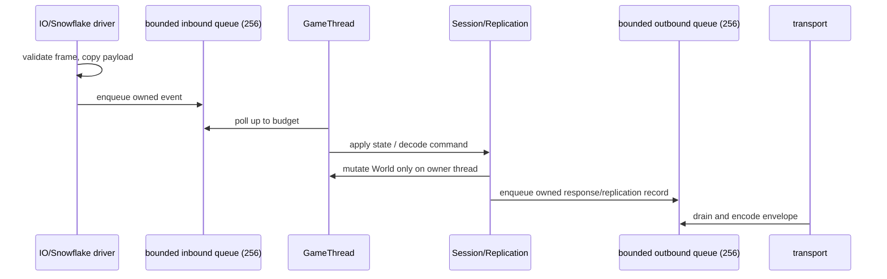

# Runtime Network Design

**状态：Stage 2 设计稿；不是实现声明**  
**范围：ECS snapshot/schema/delta/AoI/replication/fragment、`break_net`/Session 边界，以及其后 Runtime Core 的 PAL/Thread/Task/Message/IO/VFS/Profiler 接口方向。**

本文只定义架构、边界、接口方向、数据流、失败语义和验收门。它不修改源码或 CMake，也不把提案描述成已经接入 `engine` 正式运行时的功能。

## 1. 证据与状态分类

### 1.1 仓库事实

语言和分层的基线来自 `docs/Architecture_Overview.md`：引擎层是 C11，应用/框架层是 C++11；Lua 是计划中的唯一运行时脚本语言。`engine/CMakeLists.txt` 的 `project(... LANGUAGES C)`、`CMAKE_C_STANDARD 11`、`CMAKE_C_EXTENSIONS OFF` 是编译约束的直接证据。C++ 只在可选 `sl_dlss_streamline_adapter` 中启用，框架层的 C++11 边界仍由架构文档约定，而非网络模块的实现依赖。

以下状态词在本文中具有固定含义：

- **当前已有**：源码和当前文档明确描述，且有对应验证证据；不表示已完成产品级网络服务。
- **focused/test-only**：代码存在并可由专门测试 target 编译/运行，但没有进入正式 `engine` 静态库，不能被 `engine_demo` 或 `dxx_break` 当作运行时能力。
- **设计目标**：本文建议的正式化或新接口，尚未实现；后续实施必须先有 RED 测试、target 变更和证据。
- **未实现/明确排除**：本文不假设其存在，也不以接口草图冒充交付，包括认证后端、加密认证、authority handoff、预测回滚、分布式 Cell、Lua gameplay callback、editor RPC 和在线更新。

### 1.2 当前 target 证据

`engine/CMakeLists.txt` 当前把下列网络基础放入正式 `engine` target：`src/network/network.c`、`packet.c`、`net_replication.c`，以及按平台选择的 `net_loop_epoll.c`、`net_loop_iouring.c`、`net_loop_kqueue.c` 或 `net_loop_iocp.c`。`engine/src/network/net_loop.h` 规定 event-loop 操作除 `net_loop_wakeup()` 外均 loop-thread-affine，事件批量上限为 `NET_LOOP_MAX_EVENTS == 65536`。

ECS/network 新切片仍有明确边界：

- `test_ecs_replication` 直接编译 `engine/src/ecs/ecs.c`、`replication_schema.c`、`world_snapshot.c`、`world_delta.c`、`break_aoi.c`；`engine` 静态库没有这些 snapshot/schema/delta/AoI 源。CMake 注释明确写着 formal runtime/session integration 尚未完成。
- `break_replication_fragment` 是单独的静态 test-only library，只编译 `break_replication_fragment.c`；其 CMake 注释明确排除正式 runtime target graph。
- `break_net` 仅在 `ENGINE_BUILD_TESTS=ON && BREAK_ENABLE_SNOWFLAKE=ON` 时生成，链接真实 `snow::net`；它包含 adapter、protocol/envelope/message/registry、Session、AoI、replication 和 fragment 源。`engine_demo`/`dxx_break` 当前不链接它。
- `test_break_net_adapter`、`test_break_replication`、`test_break_session` 只在 Snowflake 条件满足时生成。`SNOWFLAKE_SOURCE_DIR` 缺失或没有 CMake target `snow::net` 时配置失败；没有替代 transport。

因此，正式化的第一步不是“再加一个网络回调”，而是建立清晰的生产 library target 边界，并在不改变当前 focused 语义的前提下逐步接入。

## 2. Stage 2 顺序和非目标

Stage 2 的顺序固定为：

1. **先正式化既有 ECS/network 边界**：确认 snapshot/schema/delta/AoI/replication/fragment 的可发布 C11 contract，明确它们与 `break_net`/Session、Snowflake 和正式 `engine` 的依赖方向；将 focused tests 变成正式库之前，先补集成契约。
2. **再实现 Runtime Core**：PAL、Thread、Task、Message、IO、VFS、Profiler 的正式边界和 target graph，供网络与后续 Lua/editor 使用。
3. **最后接线**：Runtime Core 只通过 owned message/command/snapshot/fence 连接 ECS 与网络，不让网络线程获得 `World *`、Lua、UI 或 RHI 访问权。

本文不设计完整 wire authentication、账号系统、跨服迁移、客户端预测/回滚或分布式空间分区。fragment checksum 仍只能作为完整性检查；加密认证属于 Stage 5 安全设计。

## 3. 目标架构与依赖方向

目标依赖方向如下；箭头表示“使用下层 contract”，不是线程调用关系：

```text
C++11 Framework/Application
        |
        v
Runtime facade (C11 opaque handles; C++ wrapper is optional)
        |
        +--> Session / protocol policy (GameThread-owned)
        |       +--> ECS replication policy
        |       +--> owned Message queues
        |
        +--> Runtime Core: Message -> IO -> PAL/Thread
        |                         |
        |                         +--> platform socket/event backends
        |
        +--> VFS / Profiler / Task

ECS World/snapshot/delta/schema <--- GameThread command boundary ---> Session/Replication
```

目标规则：

- `World`、ECS 结构、schema registry、Real/Ghost、Session state 都由 GameThread 负责修改。
- Network/IO callbacks 只做 bounded validation、copy、identity bookkeeping 和 enqueue；不得直接调用 World/ECS/Lua/UI/RHI。
- Read-only workers 只读取已拥有的 immutable snapshot/delta/AoI 输入；不能保存指向 live World 或 transient callback payload 的指针。
- `break_net`/Snowflake 仍拥有 socket/readiness/transport queue。Break 只拥有 adapter lifecycle、事件记录和有界副本；正式化不能把 Snowflake 内部对象泄漏进公共 C11 header。
- C++11 Framework 只能调用不透明 C11 facade；不得把 `std::thread`、异常、RTTI、`std::string` 或 C++ ownership 传进 C11 ABI。Lua 只能通过后续 `BreakLuaRuntime` facade 消费 command/query，不直接持有 `World`、socket、RHI 或 Message queue 内部指针。

## 4. 既有 ECS 与 replication contract

### 4.1 Snapshot/schema/delta

当前 focused API 已在以下源码中存在：`engine/src/ecs/replication_schema.{h,c}`、`world_snapshot.{h,c}`、`world_delta.{h,c}`。

- schema 注册包含 component ID、version、size、alignment、flags 和可选 encode/decode；确定性 schema 的 hash 使用 canonical component ID。pointer-containing、resource reference、derived cache 不应走 raw snapshot policy。
- `break_world_snapshot_build(World *, schemas, tick)` 是 GameThread 操作，要求调用方已经完成结构屏障；builder 不自动建立 barrier。snapshot 深拷贝 entity `(index,generation)` 和组件 bytes，拥有 immutable storage，并通过 retain/release 管理生命周期。
- delta 只在 immutable snapshots 之间 diff。apply 先验证 base/schema/tick/records，再对 World 做 ECS-owned staging clone；只在 staging 上 mutation 和最终验证，成功后 atomic replace，任何失败销毁 staging 且原 World 不变。

**设计目标：formal snapshot library**  
将上述 API 作为独立、可被 `engine`/runtime 使用的 C11 library contract，而不是把源文件直接散落到测试 executable。目标库不得依赖网络 transport、Snowflake、Lua、UI 或 RHI；正式集成由上层 bridge 负责。第一版保持 stop-the-world build 语义，不偷偷引入自动 barrier 或全局 current-snapshot mutex service。

建议的后续接口方向（名称仅为设计，不代表已存在）：

```c
typedef struct BreakSnapshotPublisher BreakSnapshotPublisher;
bool break_snapshot_publish(BreakSnapshotPublisher *, BreakWorldSnapshot *owned);
bool break_snapshot_acquire(const BreakSnapshotPublisher *, BreakWorldSnapshot **out);
```

publisher 必须明确 acquire/release 和 shutdown fence；不能返回无生命周期保护的裸指针。schema 变更产生新 schema hash；schema negotiation/online schema update 当前未实现，必须在 wire/session 设计中显式拒绝或版本隔离。

### 4.2 AoI/Real/Ghost/replication

`engine/src/network/break_aoi.{h,c}` 当前提供 sphere/AABB witness、空间网格、owner/always-relevant/dormant flags、hysteresis 和确定性 `enter/stay/leave`。`break_replication.{h,c}` 当前维护 Real/Ghost、baseline/dirty/destroy/dormant，并按 bandwidth budget 尝试向 `BreakNetReactor` 发送；连接断开时由 replication owner 清理 Ghost。

这些逻辑目前仍是 focused/test-only，且 replication header 直接引用 adapter。正式化时应拆为两层：

1. **transport-independent policy library**：AoI、scope diff、Real/Ghost 和 record scheduling 只产出 owned `BreakReplicationCommand`；不调用 Snowflake。
2. **network bridge**：GameThread 消费 command，编码成 Session/Message envelope，再调用 Message/IO queue。

这样可以在没有 Snowflake 的 headless、ASan 和 TSan lane 中验证 policy；也能避免把 replication queue overload 当成 World mutation 失败。

### 4.3 Fragment/reassembly

`engine/src/network/break_replication_fragment.{h,c}` 已实现有界分片和 opaque reassembly：payload 非空；单片受 `BREAK_NET_MAX_PAYLOAD_SIZE`（当前 64 KiB）限制；总重组预算 `BREAK_REPLICATION_MAX_REASSEMBLY_SIZE`（当前 16 MiB）；携带 `delta_id`、`base_id`、index/count、FNV-1a checksum；支持乱序、精确 duplicate、冲突拒绝、owned complete payload、reset/destroy。

当前没有 timeout/eviction；上层 scheduler 必须管理半成品 lifetime。正式 bridge 的设计目标是：每个 connection/stream 有 bounded assembly budget 和 deadline；超时进入 `EXPIRED` 并释放 storage，重复/冲突/校验失败进入可计数的 drop reason。checksum 不得升级为 authentication。完整重组之后仍需回到 GameThread 做 schema/base/tick/delta validation，再 apply。

## 5. `break_net` 与 Session 边界

### 5.1 当前 adapter

`engine/src/network/break_net_adapter.h` 的 `BreakNetReactor` 是 opaque C11 handle，支持互斥的 `BREAK_NET_DRIVE_THREAD` 和 `BREAK_NET_DRIVE_STEP`。Snowflake callback 只产生有界 `BreakNetEvent`；adapter event queue 和 outbound queue 均为 **256** 项，identity capacity 也是 **256**。payload view 是借用，入队前必须复制成 `BreakNetOwnedMessage`；poll 后 ownership 转给 caller，最终由 `break_net_event_release` 释放。

`break_net_reactor_send` 在 queue 满时立即返回 `BREAK_NET_SEND_OVERLOAD`，不阻塞 GameThread；CREATED/FAILED/STOPPING/STOPPED 返回 `BREAK_NET_SEND_CLOSED`。stale connection UID 被丢弃。thread-mode stop 的顺序是 terminate Snowflake、等待 adapter-owned `host_exited` deadline、确认退出后 join、destroy reactor、发布 STOPPED；超时返回 false 并保留 live resources，后续 stop 可重试。step mode 的唯一 driver 由 atomic guard 保护。

### 5.2 当前 Session

`engine/src/network/break_session.{h,c}` 的 `BreakSessionManager` 是 GameThread-only、非线程安全 opaque handle。状态为 `NEW -> AUTHENTICATING -> AUTHENTICATED -> CLOSING -> CLOSED`，也允许 `NEW -> CLOSING -> CLOSED`。`poll_adapter()` 在 GameThread 分页消费 adapter queue；只有 event queue 排空后才 finalise close。closed entry 不回收，`max_sessions` 是 manager lifetime capacity，不是并发在线数。

当前 envelope 是固定 18-byte little-endian prefix，default registry 最大 64 项，目前 AUTH/PING 是已实现定义。Session handler 的 payload 只在 handler 调用期间有效；需要长期保存必须显式复制。当前 custom registry 可用于 Session policy，但 adapter envelope codec 仍使用 default registry；这是真实未决边界，不应在设计中默认为已解决。

### 5.3 目标 bridge

设计目标是将 Session 消费的输入固定为：

```text
adapter callback -> bounded owned event -> GameThread poll_adapter
                   -> Session validation/state transition
                   -> handler/replication command
                   -> Message encode -> bounded outbound queue -> IO driver
```

Session 不拥有 socket，不执行 blocking I/O，不从 handler 线程调用 Lua 或 ECS。认证后端、权限和加密 handshake 不属于当前 Session slice；未来 handler 只能发布 `AuthCommand`/`SessionCommand`，由安全域另行批准。

## 6. Runtime Core 接口方向

Runtime Core 是 Stage 2 的后续实现目标，不是当前状态。每个模块先形成 C11 contract，再由 CMake 形成正式 target；focused targets 可以继续存在，但必须明确链接层级。

### 6.1 PAL / Thread

PAL 负责时间、线程、mutex/cond、socket native handle 和平台错误映射。现有 `engine/src/core/platform_thread.h` 已提供 Win32/POSIX `PlatformThread`、`PlatformMutex`、`PlatformCond` 包装；现有 `engine/src/platform/` 还包含 window/input/time/filewatch。新接口应保持 C11 opaque/explicit lifetime，并把 platform-specific types 留在 private implementation。

目标 contract：

- `runtime_thread_create/join/detach` 明确 owner、joinable 状态和唯一 joiner；默认禁止 detach 生产线程。
- `runtime_mutex`/`runtime_cond` 只保护队列/lifecycle，不允许在 lock 内调用 Snowflake step、World apply、用户 callback 或 blocking join。
- 每个 IO loop、TaskSystem、SessionManager、World 都记录 owner thread ID；跨线程只能通过 message/command/snapshot/fence。
- PAL 失败返回 `bool`/enum + 可查询错误，不抛异常、不跨 ABI 传播 errno 指针。

### 6.2 Task

现有 `engine/src/task/task.h` 的 TaskSystem 是进程内单实例；`SUBMIT_QUEUE_CAPACITY == 256`，worker 每优先级有 `DEQUE_CAPACITY == 1024` 的 Chase-Lev deque；worker task 调 `task_wait()`/`task_wait_handle()` 会自等待，按契约立即返回。

设计目标保持这些事实并补齐正式 contract：外部 submit 在 256 项 global queue 满时返回 overload（不无限分配）；worker local deque 满时按显式策略 reject 或转入 bounded overflow，禁止静默丢 task。TaskSystem shutdown 先停止接受新任务，再 drain/取消策略明确，唤醒所有 waiter，join workers，最后释放 task registry。网络 callback 不直接提交任意 gameplay task；只投递固定大小 command 或由 GameThread 预算调度。

### 6.3 Message

Message 是跨 domain 的唯一通道之一。目标为固定 registry + type/version/sequence + bounded payload + explicit ownership：

```c
typedef struct RuntimeMessage RuntimeMessage;
typedef struct {
    u16 type;
    u16 version;
    u32 sequence;
    const void *data;
    usize size;
} RuntimeMessageView;
```

View 只借用且只在 callback/poll 期间有效；owned message 深拷贝并由创建域 release。每条 queue 必须给出 capacity、当前 count、drop/overload reason 和 shutdown 状态。禁止用 `void *` 指向 World、Lua stack、Snowflake context 或 UI 对象来逃避 ownership。

### 6.4 IO

Runtime Core formal facade 的 queue 满统一非阻塞返回 `BREAK_RUNTIME_OVERLOAD`；Network/IO/Audio/RHI 热路径禁止 inline。现有 compatibility API 的等待/丢弃行为保持其原有边界，不因 formal facade 改写。

现有 `network.h` 提供 TCP/UDP socket、nonblocking、send/recv；`net_loop.h` 提供 epoll/io_uring/kqueue/IOCP 选择，loop thread affine，`wakeup()` 是唯一线程安全操作。目标 IO facade 应优先复用该 readiness contract，并将 Snowflake adapter 与普通 `NetSocket` 作为两个明确 backend，不在上层混淆 transport ownership。

IO loop 目标容量和 backpressure：event batch 受 `NET_LOOP_MAX_EVENTS` 限制；上层 inbound/outbound message queue 默认沿用 256，正式化时允许按配置降低但不能无界增长。读到合法 bytes 但 owned queue 满时，默认策略是停止继续 drain/取消 read interest（若 backend 支持），记录 `OVERLOAD`，并在 consumer drain 后 wakeup；不得阻塞 callback。无法暂停的 transport 必须丢弃整条 bounded frame 并计数，而不能保留悬空 view。

### 6.5 VFS / Profiler

正式 `engine` 当前已编译 `src/asset/vfs.c`、`async_loader.c`、`hotreload.c`、`mipmap_stream.c` 和 `src/core/profiler.c`。VFS 有 `VFS_MAX_MOUNTS == 16`、`VFS_MAX_PAK_ENTRIES == 4096`、`VFS_MAX_FILE_BYTES == 128 MiB`；PAK 的共享 FILE seek 已用内部 lock 保护。async loader 的完成 callback 在 `async_loader_tick()` 的 main thread 派发，IO worker 不直接调用宿主 callback。

Profiler 当前有固定 `PROFILER_MAX_FRAMES == 120`、`PROFILER_MAX_REGIONS == 64`、`PROFILER_MAX_THREADS == 32`，支持 per-thread Chrome trace 和 provenance sidecar。网络设计只要求在 queue/IO/Session/replication 的关键路径打 bounded region 和 drop/latency counters，不把 profiler API 变成同步网络依赖；export 失败只报告，不阻塞 shutdown。

## 7. 队列、backpressure 与数据流

Runtime Core formal facade 的统一 queue 满载结果为非阻塞 `BREAK_RUNTIME_OVERLOAD`；compatibility API 与 formal facade 分离记录。legacy Task queue-full inline 仅是当前 Task 兼容事实；Network/IO/Audio/RHI 无 inline 或等待例外，legacy Network/IO 的其他行为不得升级为 formal contract。Network wire fragment（单片 64 KiB）、Runtime internal message、asset manifest 和 asset blob 是四种不同预算域；16 MiB 仅为单 assembly 上限，per-connection aggregate bytes/assembly-count 仍是设计方向。

### 7.1 正常路径



snapshot path独立于 transport：GameThread 完成 systems 和结构屏障后 build snapshot；read-only worker 对 retained snapshot 做 diff/AoI；GameThread 消费结果并决定 replication command。网络线程不读取 live snapshot pointer，除非通过明确 retain/release 的 publication service。

### 7.2 Backpressure policy

- inbound event queue：满则 callback 不阻塞；丢弃当前 bounded event，记录 connection/type/drop reason。若协议需要 close，发布一个优先级受保护的 close/error event，但该保留槽必须是有界的。
- outbound message queue：满返回 overload，保留调用方的 replication dirty state，使下一次 sync 可 retry；不得假报 sent。
- fragment assembly：超过 16 MiB、fragment metadata 不合理、deadline 到期或 connection close 时 reset/evict；计数后释放全部 owned fragments。
- Task submit：超过 256 external submit slots 返回失败；调用方必须选择 retry/defer/drop，不得在锁内无限扩容。
- VFS/async loader：遵守现有 128 MiB file cap；request pool/worker queue 的容量应在正式 target contract 中公开，完成 callback 仍只在 main tick 派发。

任何 overload 都必须区分 `RETRYABLE`、`DROPPED`、`CLOSED`、`MALFORMED`，并由 formal facade 映射到 `BreakRuntimeError`：`OK/INVALID/CLOSED/OVERLOAD/OOM/TIMEOUT/STALE/REJECTED/FAILED`；不能把内存不足、协议错误和 shutdown 混成 false。Runtime Core facade 统一返回 `BreakRuntimeError` 的 `OK/INVALID/CLOSED/OVERLOAD/OOM/TIMEOUT/STALE/REJECTED/FAILED`；兼容 API 的 `BREAK_NET_SEND_OVERLOAD` 等名称仅在其现有边界保留并映射到统一类别。Runtime Core 队列满统一非阻塞返回 `BREAK_RUNTIME_OVERLOAD`，Network/IO/Audio/RHI 热路径禁止 inline；legacy Task queue-full inline 保持不变，formal task submit 使用 reject/credit policy。

## 8. Shutdown、failure 与恢复

### 8.1 统一生命周期与启动失败

Runtime Core 的唯一 coordinator 按 `runtime_overview.md` 发布全局状态 `CREATED -> STARTING -> RUNNING -> QUIESCING -> DRAINING -> STOPPING -> STOPPED/FAILED`。Network、Session、adapter 等状态均为局部映射，不能另立全局生命周期。本文件只规定 Network 局部动作：在 coordinator 的 admission/callback/queue/drain/join 阶段分别停止网络提交、停止 driver callback、关闭网络队列并处理 close watermark、等待 host exit 后 join；资源仍由 coordinator 在无 live ownership 后销毁。completion wait 必须可被 deadline/shutdown 打断；timeout 保留资源并由同一 coordinator retry，FAILED 只允许诊断/cleanup/safe retry。

启动必须按阶段发布状态：allocate -> configure -> register callbacks -> start driver -> ready。任何阶段失败都要回滚已取得的 ownership；adapter 当前已覆盖 Snowflake thread 创建后的 setter/registration failure cleanup，并发布 FAILED。正式 Runtime Core 应保留同一原则：失败返回前 queue、thread、socket、context 均有唯一 owner，重复 destroy 安全或明确拒绝。

### 8.2 有序关闭

全局 coordinator 已在本文件 8.1 和 `runtime_overview.md` 定义；Network/Session 状态只能作为局部映射。本小节不重复定义全局顺序，只列 adapter 的局部 stop 动作：

1. coordinator 进入 admission quiesce 后，Network 拒绝新 outbound submit；
2. 停止 network producer callbacks，并发布 close watermark；
3. 在 coordinator 的 drain deadline 内 poll 有界 event/completion；
4. terminate transport，等待 adapter-owned host exit 后 join；
5. 将仍存活的 adapter ownership 交回 coordinator；不在 Network 局部动作中 destroy 其他域资源。

超时保留 live resources 并返回 `TIMEOUT`，由同一 coordinator retry；不可恢复错误进入 `FAILED`，只允许诊断和清理，不重新开放 admission。

shutdown 必须幂等；timeout 返回明确 `TIMEOUT` 并保留仍存活的 owner，允许后续继续 stop。不得在 lifecycle lock 内执行可能调用 callback、step、join 或用户代码的操作。

### 8.3 运行时失败

- malformed frame/schema/base mismatch：拒绝单条，保留当前 World，计数并可按 Session policy close；
- staging allocation/mutation/final validation failure：销毁 staging，原 World 不变；
- handler failure：Session 记录 `HANDLER_FAILED`，不在网络线程重试用户代码；由 GameThread policy 决定 close/retry；
- transport error/close：先发布 owned event，Session 设置不可逆 close watermark，replication 清理 Ghost；
- profiler/VFS export failure：降级为错误计数，不阻塞网络 shutdown。

## 9. C11/C++11/Lua 边界

### C11 runtime

C11 拥有 opaque handles、POD wire records、显式 alloc/free、错误码、线程和 queue contracts。示例类型统一采用项目 `u8/u16/u32/u64/usize`，定义见 `engine/src/core/types.h`。公共 header 不暴露 Snowflake concrete structs、pthread/Win32 handles、C++ types 或内部 container。所有 ABI-facing structs 固定宽度字段并显式 little-endian 编解码；禁止 packed struct 直接作为 wire format。

### C++11 framework

C++11 `RuntimeModuleInterface`/`BaseApplication` 负责生命周期编排和 UI/editor integration，但只能在 owner thread 调 C11 facade。C++ wrapper 可用 RAII 管理 C11 handle，却必须把 destroy 顺序映射到 C11 contract；异常不得穿过 C ABI，跨层错误转换为 enum/result。Frame/Tick 不能直接从 UI thread 修改 ECS，须投递 GameThread command。

### Lua

当前 `engine/src/script/script_lua.h` 的 `LuaScript` 是已有脚本加载/调用能力，并不等于稳定 `BreakLuaRuntime` facade。Lua VM 应由单一 Script/Game owner thread 持有；network/IO/worker 不进入 Lua。未来 facade 只接收 bounded command batch、snapshot/query 的 copied view 和 scalar configuration；禁止暴露 raw `World *`、socket、RHI handle、allocator 或 queue internals。Lua error、过量 command、超时和 reload failure 都回到 GameThread result，不允许异常式跨线程传播。稳定 facade 属 Stage 3，本文只定义其不得越过的边界。

## 10. 验收与验证矩阵

### 10.1 Stage 2 focused RED/GREEN

在任何正式 target 迁移前，必须先为下列 contract 增加 focused tests：

- snapshot：结构屏障前拒绝/或由调用方明确负责、generation identity、schema hash、retain/release、publication lifetime；
- delta：base/schema/tick mismatch、staging apply、allocation/mutation/final-validation failure 后 World byte/state 不变；
- AoI/replication：多 witness union、hysteresis、owner/dormant、确定性排序、budget overload 后 retry、disconnect Ghost cleanup；
- fragment：over-limit、乱序、duplicate/conflict、checksum mismatch、16 MiB cap、timeout/eviction；
- adapter/session：256 queue overload、borrowed-to-owned copy、stale close watermark、custom registry boundary、start failure cleanup、bounded stop retry；
- Runtime Core：queue FIFO/capacity、producer/consumer ownership、wakeup、single driver、shutdown idempotence、task self-wait rejection、VFS cap、profiler per-thread export。

### 10.2 Normal / ASan / TSan

每个新增正式 runtime target 和 focused integration target 都必须提供：

1. normal build + CTest；
2. ASan（必要时 UBSan）build + 同一 focused tests，覆盖 queue full、fragment cap、close/stop timeout、payload lifetime；
3. TSan build + 多 producer/consumer、step/stop race、TaskSystem submit/shutdown、Session poll/adapter callback 并发场景；不得有 data race 报告；
4. Snowflake loopback lane（可用时）覆盖真实 accept/read/write/close，但不能将 loopback 通过等同于认证/生产部署；
5. `git diff --check`、target 显式 build、CTest 结果按 code/environment/not-built 分类。

当前证据只能引用已有 focused 结果：fragment 和 Snowflake replication focused normal/ASan/TSan 为 7/7；adapter 为 30/30，Session 为 20/20；full CTest 曾有 fuzz executable 未构建、`test_myui_text_layout` Hebrew boundary、`test_vulkan` golden drift 和 D3D12 dependency skip。它们证明对应 focused 边界，不证明正式 runtime/session integration 已完成。

### 10.3 通过条件

Stage 2 网络边界只有在以下条件同时满足后才能标记“formal runtime integration”：

- snapshot/schema/delta/AoI/replication/fragment 的 library target 与 `engine`/runtime target 依赖已由 CMake contract test 钉死；
- `break_net`/Session 的 Snowflake 可选性、payload ownership、queue capacity 和 shutdown semantics 在无 Snowflake/headless 与有 Snowflake 两条 lane 都有明确结果；
- GameThread-only mutation、network callback no-gameplay、worker read-only snapshot 由测试和代码扫描共同验证；
- normal/ASan/TSan focused integration 全部通过，失败项没有以“未构建”冒充通过；
- timeout/eviction、schema negotiation、认证和安全项仍分别标为未实现，直到各自 Stage 计划和验收完成。

## 11. 后续依赖与未决风险

1. **target promotion 风险**：把 focused sources 直接加入 `engine` 可能引入 Snowflake、测试 fault-injection 宏或重复符号；必须先拆 transport-independent library，再决定是否并入 `engine`。
2. **snapshot publication 风险**：当前没有 mutex-protected current-snapshot service，也没有 epoch reclamation；在 publisher contract 交付前禁止跨线程保存裸 snapshot 指针。
3. **queue 语义风险**：当前 adapter 256 项容量是事实，但 Runtime Core 可能需要按 workload 配置；扩容不能隐式改变 overload/retry 语义或允许无界 payload。
4. **Snowflake 生命周期风险**：per-context completion/drop 通知较粗粒度，pending send identity 仍依靠 send-drained/close 顺序；正式 bridge 需继续保留 failure-atomic cleanup。
5. **protocol/security 风险**：当前 envelope default registry、sequence 和 FNV-1a 只提供边界/完整性；不能推断为 authentication、replay protection 或可信 client identity。
6. **跨平台风险**：adapter bounded stop 的非 Linux lane 尚未在本机验证；PAL/IO 的 Windows/macOS/移动平台必须分别完成 compile、headless/native-surface 和 sanitizer 证据。
7. **Task/VFS 共享资源风险**：TaskSystem 是进程内单实例；VFS PAK FILE seek 已需锁；Runtime Core 设计不可创建第二套隐式 worker pool 或绕过现有锁模型。
8. **Lua/editor 依赖风险**：Lua facade、editor RPC、remote diagnostics 和 online update 尚未实现；网络设计只能提供 owned command 边界，不能提前承诺 gameplay/editor integration。
9. **验证完整性风险**：已有 full CTest 记录包含未构建 fuzz smoke 和无关环境/图形失败；后续报告必须逐项说明“测试通过”“未构建”“跳过”或“与本改动无关”。

**结论：**当前仓库已经有可验证的 ECS snapshot/replication 和 Snowflake adapter/Session focused contract，但它们尚未构成正式 runtime network。Stage 2 的第一交付是 target/ownership/queue/lifecycle 边界正式化；Runtime Core 的实现只能在该边界稳定并通过 normal/ASan/TSan 验收后开始。
