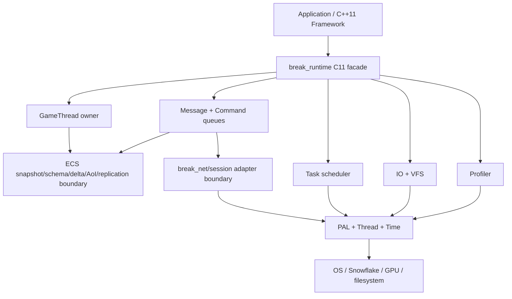
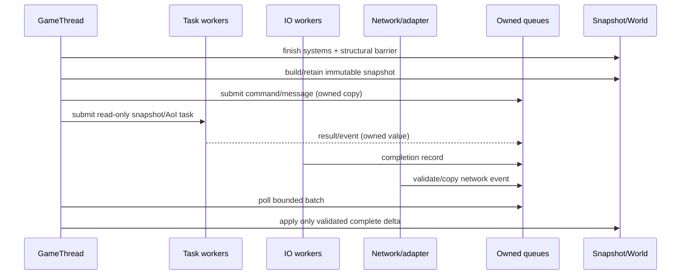

# Break Runtime Overview

## 1. 文档目的与非承诺

本文是 Stage 2 Runtime Design 的总览设计，不是实现状态报告，也不要求本轮修改源码、CMake 或 target。Stage 2 的顺序已经确定：

1. 先正式化现有 ECS snapshot/schema/delta/AoI/replication/fragment 与 `break_net`/Session 的 target 边界；
2. 再在这些边界之上实现 PAL、Thread、Task、Message、IO、VFS、Profiler Runtime Core。

本文中的“当前已有”只表示在代码和构建定义中有证据的能力；“focused/test-only”表示可独立构建或测试、但尚未成为正式 runtime 集成；“设计目标”表示后续接口方向；“未实现”不应被读取为隐含实现。

证据基线：C11 engine 与 C++11 framework 的语言分界见 `docs/Architecture_Overview.md:188-217`；Stage 2 的顺序和验收要求见 `docs/design/roadmap_2026-10-22.md:31-50`；当前实现/验证边界见 `docs/Implementation_Status.md:26-38`。本文不把这些计划写成已经完成的产品能力。

## 2. 语言、分层与 target 边界

### 2.1 C11 / C++11 / Lua

- **示例类型约定**：本文及所有 Stage 2 示例统一使用项目 `u8/u16/u32/u64/usize`，定义见 `engine/src/core/types.h`；不混用裸 `uint*_t`/`size_t`。
- **C11 Engine Runtime Core**：PAL、线程同步、任务调度、消息/命令、IO、VFS、Profiler、ECS 数据快照与网络适配边界均使用 C11 ABI。公共头文件优先使用不透明句柄、定长/有界数据、显式 retain/release 和返回值/错误码；不使用异常、RTTI、模板、隐式析构或 C++ 容器。
- **C++11 Application/Framework**：`framework/interface/runtime_module_interface.h:21-30` 的 `RuntimeModuleInterface` 只负责 `Init/Tick/DeInit` 生命周期；`framework/common/base_application.h:22-32` 是应用层实现方向。C++ 层可以组合 C11 runtime，但不得把 World、ECS、Lua VM 或网络 callback 的所有权转移给 C++ 对象的隐式生命周期。
- **Lua**：Lua 是计划中的唯一 runtime scripting language（roadmap `:5-13`、`:51-68`）。Lua VM 应由后续 `BreakLuaRuntime` opaque C11 facade 独占；Lua callback 只能通过有界 command/message 访问 GameThread-owned state，不能直接持有 raw RHI、World、网络或 PAL 句柄。Lua facade、reload、模块版本和脚本测试不属于本文已实现能力。

### 2.2 正式与 focused target 的事实

`engine/CMakeLists.txt:319-403` 的 `engine` static library 已包含 `src/task/task.c`、`src/asset/async_loader.c`、`src/asset/vfs.c`、`src/core/profiler.c`、`src/network/network.c`、`src/network/net_loop_*` 和 ECS core；`engine_demo` 在 `engine/CMakeLists.txt:1512-1514` 链接 `engine`，`dxx_break` 在 `:1168-1169` 链接 `dxx_core break_myui engine`。这证明的是底层基础设施已进入正式 `engine` target，不证明新的 Runtime facade 已存在。

以下边界必须在实现前保持显式：

| 能力 | 当前分类 | 证据 | Stage 2 设计结论 |
|---|---|---|---|
| ECS schema/snapshot/delta/AoI | focused/test-only | `engine/CMakeLists.txt:3168-3179` 直接把源编入 `test_ecs_replication`；`docs/design/ecs_snapshot_replication_aoi.md:5-20` | 先定义正式 library 的 ownership/ABI/target contract，再决定逐步迁入 `engine` |
| replication + fragment | focused；fragment 有独立 test library | `engine/CMakeLists.txt:3221-3233`；`docs/design/ecs_snapshot_replication_aoi.md:134-159` | fragment 保持 transport-independent；正式集成需另有 scheduler、schema/tick wire contract 和 failure policy |
| `break_net` + Session | optional/test-gated | `engine/CMakeLists.txt:3235-3283`；只在 `BREAK_ENABLE_SNOWFLAKE` 下生成且链接 `snow::net` | 先固定 adapter/session public boundary，再决定 formal `engine_net`/runtime target；不让 demo 隐式依赖 Snowflake |
| Task | formal `engine` source，但单实例限制 | `engine/src/task/task.h:67-113`、`:129-147`；`task.c:482-530` | Runtime Core facade 应包住现有 TaskSystem 的 ownership、shutdown 和 overload 语义，不复制第二套 scheduler |
| Async IO/VFS | formal `engine` source | `engine/src/asset/async_loader.h:38-87`；`async_loader.c:16-24`；`engine/src/asset/vfs.h:5-12` | 以现有有界请求/完成队列和 VFS caps 为基线，补统一 Runtime IO contract |
| Profiler | formal `engine` source | `engine/src/core/profiler.h:4-11,47-119`；`profiler.c:12-35` | Runtime facade 统一 frame/thread lifecycle，不伪称已有完整 cross-domain trace service |
| PAL / Thread / Message Runtime Core | 尚无本文所述统一 facade | `engine/src/core/platform_thread.h:3-17` 仅提供 primitive wrapper；现有 network/PAL API 分散 | 设计目标；必须先有 focused contract tests，再实现正式 target |

`engine/CMakeLists.txt:3239-3249` 目前还把 `break_aoi.c`、`break_replication.c` 和 `break_replication_fragment.c` 放入 `break_net`，但这只在 Snowflake 开启时成立；该耦合不应成为最终 Runtime Core 的强制依赖。正式 target graph 应禁止“为了使用 ECS replication 而引入 Snowflake transport”。

## 3. 目标架构

Runtime Core 采用 C11 的分层、单向依赖图：

目标依赖规则：

- PAL 只依赖 core types、OS headers 和平台实现；PAL 不知道 ECS、Lua、UI、RHI 或 Snowflake concrete types。
- Thread/Task 依赖 PAL synchronization/thread primitives；Task 不拥有 World，也不允许 worker 直接调用 gameplay。
- Message/Command 只传递 owned bytes 或固定大小 value；不跨线程传 raw borrowed pointer，除非 view 的有效期在 API 中明确且不越过 callback。
- ECS replication 依赖 Message contract，但不直接依赖 Snowflake；adapter 依赖 Message/Protocol 并把网络事件转成 owned event。
- C++ framework 依赖 C11 runtime facade，不反向进入 engine internals；Lua 只能依赖其 facade。

## 4. Stage 2 分阶段边界

### 4.1 Phase A：正式化现有 ECS/network 边界

这是实现 Runtime Core 前置条件，不是把现有 focused 代码直接标成 production：

1. **Schema/Snapshot**：保留 GameThread 对可变 `World`、schema registry 和 structural barrier 的独占；`world_snapshot.*` 生成 owned immutable bytes，消费者只能 retain/release snapshot。现状证据为 `engine/src/ecs/world_snapshot.h:11-28` 和 `docs/design/ecs_snapshot_replication_aoi.md:43-72`。设计目标是一个不持有 `World *` 的正式 C11 library contract；自动 barrier、mutex publication service 和 epoch reclamation 仍另立项。
2. **Delta**：diff 只能读取 immutable snapshots；apply 必须执行 base/schema/tick 验证、ECS-owned staging、final validation 和 atomic replace。失败销毁 staging、原 World 不变。`engine/src/ecs/world_delta.h:39-63` 已暴露该方向，但正式 runtime integration、wire schema/tick fields 和 authority protocol 仍未实现。
3. **AoI/Replication**：GameThread 拥有 Real/Ghost、witness、scope 和 budget state；AoI worker 只能消费 snapshot/owned values，不能写 World 或 Session。queue overload 必须返回可分类错误并允许下一次 sync retry；distributed cells、authority handoff、prediction/rollback 未实现。
4. **Fragment**：transport-independent 的 fragment/reassembly 只拥有 metadata 和完整 payload，支持乱序、duplicate/conflict、checksum、reset/destroy；它不调用 Snowflake、不 enqueue、不 apply World。当前 checksum 是 FNV-1a 完整性检查，不是加密认证；timeout/eviction 必须由上层 scheduler 设计。
5. **`break_net`/Session**：adapter callback 只验证、copy、enqueue；GameThread 才 poll event、推进 Session、调用 ECS/Lua/UI/RHI。`BreakNetReactor` 当前有 256 event 与 256 outbound capacity（`engine/src/network/break_net_adapter.h:39-63`），Session 是 GameThread-only 且 registry/reactor/handler 为 borrowed contract（`engine/src/network/break_session.h:64-95`）。正式化不改变这个线程纪律。

Phase A 的 target 方向是拆出不依赖 Snowflake 的 `break_ecs_replication`（或等价正式库）与保留 Snowflake optional 的 `break_net`；具体 target 名称需在单独 implementation plan 中定案，本文不把未来 target 写成当前存在。

### 4.2 Phase B：Runtime Core

Phase B 才实现下列统一 facade：

- **PAL**：time、thread、mutex/cond、native handle、filesystem/event-loop capability；各平台 fail-closed，不把编译宏能力误报为 runtime capability。
- **Thread**：opaque `BreakThread`、thread id/affinity、joinable lifecycle、deadline wait 和 named registration。现有 `platform_thread.h` 是 inline primitive wrapper，不是完整 ownership API。
- **Task**：统一 task submission、dependency、priority、cancel/stop token、worker affinity 和 metrics；复用现有 Chase-Lev/submit queue 机制。现有 contract 明确 worker 不得调用 `task_wait`/`task_wait_handle`（`engine/src/task/task.h:120-143`），第二个 live TaskSystem 也被拒绝（`:101-112`），这些约束应成为 facade 的明确错误而非隐式死锁。
- **Message**：固定容量 MPSC/SPSC queues、owned payload、message type/version、sequence、drop/overload metrics。网络 event queue 使用现有 256 上限；Runtime Core 的其他 queue 不得复用同一容量而不说明预算。
- **IO**：把 async loader 的 request heap 256、request slots/completion ring 1024（`engine/src/asset/async_loader.c:16-24,45-82`）抽象为有界 IO service；完成 callback 仍只在 owner/GameThread tick dispatch。`net_loop.h:67-83` 的 loop-thread affinity 继续有效，wakeup 是唯一跨线程唤醒入口。
- **VFS**：保留最多 16 mounts、260-byte path、4096 PAK entries、128 MiB file cap（`engine/src/asset/vfs.h:5-12`），所有 mount/read failure 返回错误，不由 worker 越过 VFS ownership。
- **Profiler**：复用 120-frame ring、64 regions、32 thread tracks（`engine/src/core/profiler.h:4-11`）；每线程 TLS open stack 和 region allocation lock 是已有并发事实，目标 facade 只统一 registration/frame boundaries，不声称已有 always-on distributed tracing。

## 5. 线程所有权与数据流

所有权规则：

- GameThread 是唯一可变 `World`、ECS structural state、schema registration、Real/Ghost、SessionManager 和 Lua VM owner。线程 owner 不是“最后调用 API 的线程”，而是 runtime create 时固定并可查询的 contract。
- Task worker 只执行显式提交的 function/context；context 若跨异步生命周期必须由提交方持有到 completion。worker 不调用 UI/window/RHI 主循环、不直接 mutate World、不调用 SessionManager。
- IO worker 只读 VFS/文件或 decode buffer；完成事件复制为 bounded record，`async_loader_tick()` 在 owner thread dispatch callback。VFS mount/unmount 与 loader shutdown 必须先停止新请求，再 drain/join。
- Network callback/driver 只拥有 transport-local identity、borrowed input view 和 copied event；不得访问 World/ECS/Lua/UI/RHI。Session 与 replication apply 由 GameThread poll。
- Profiler region 可跨 recording threads，但 frame ring publication 由 frame owner 控制；线程注册不等于线程拥有业务对象。

## 6. 统一容量、backpressure 与错误契约

容量是 ABI/运行时预算，不是实现细节。Runtime Core formal facade 的所有 bounded queue 满载统一非阻塞返回 `BREAK_RUNTIME_OVERLOAD`，Network、IO、Audio、RHI 热路径禁止 inline 执行，也禁止等待队列空间或隐式扩容。Compatibility API 与 formal facade 是两个明确层次：legacy Task external-submit queue 满载时 inline execute 是当前兼容事实，必须单独保留并计数；其他 legacy API 的既有行为只作为兼容事实记录，不得被解释为 Runtime Core 合同，也不得为 Network/IO/Audio/RHI 增加 inline 例外。

| 队列/池 | 当前证据或目标 | formal 满载策略 |
|---|---:|---|
| Runtime Core message/mailbox | 设计目标，固定 slots + byte budget | 非阻塞 `BREAK_RUNTIME_OVERLOAD`；控制/关闭 watermark 只使用有界 reserved capacity |
| Network/IO/Audio/RHI ingress | 各子系统局部容量 | compatibility 行为不变；经 Runtime Core facade 时统一 `BREAK_RUNTIME_OVERLOAD`，热路径禁止 inline |
| Task external submit | 256；legacy 满载 inline（`task.c:238-251`） | legacy queue 保持 inline；formal task submit 按 reject/credit policy 返回 overload，必须可观测 |
| Worker deque | 1024/priority | formal 不越界、不无限转移；按 reject/credit policy 返回 overload |
| Async IO request/completion | 256 / 1024 | formal ingress reject/credit；completion 等待必须可被 deadline/shutdown 打断 |
| Network wire fragment | 单片默认 64 KiB | 只限制 wire fragment，不等同 Runtime message 或 asset blob |
| Runtime internal message | 按 kind 的固定 slot/byte budget | 超预算返回 `BREAK_RUNTIME_OVERLOAD`，不隐式分片 |
| Asset manifest/blob | manifest 与 blob 分开预算 | manifest 元数据和 blob bytes 各自校验；不套用 wire fragment 预算 |
| Fragment assembly | 单 assembly 16 MiB | 分配前拒绝；另设 per-connection aggregate bytes/assembly-count 预算方向，timeout/eviction 仍未实现 |
| VFS mounts / PAK entries / file | 16 / 4096 / 128 MiB | mount/read fail-closed |
| Profiler frames/regions/threads | 120 / 64 / 32 | drop/fold，不分配无界内存 |

统一 `BreakRuntimeError` 类别为：`OK`、`INVALID`、`CLOSED`、`OVERLOAD`、`OOM`、`TIMEOUT`、`STALE`、`REJECTED`、`FAILED`。专题 API 可保留 compatibility-specific 名称（例如 `BREAK_NET_SEND_OVERLOAD`），但 Runtime Core facade 必须映射到上述类别。禁止静默覆盖、malformed length 先分配、checksum 冒充 authentication，或以“后续扩容”掩盖 backpressure。

## 7. 统一生命周期、shutdown 与 failure

Runtime Core 的唯一 coordinator 发布全局状态：`CREATED -> STARTING -> RUNNING -> QUIESCING -> DRAINING -> STOPPING -> STOPPED`，启动/运行时不可恢复错误进入 `FAILED`。Network、IO、Task、Audio、RHI、Asset、HotReload 等子系统状态只能标注为局部映射，不得另立一套全局状态机。

统一顺序：停止新 admission（Network/IO/Task external submit） -> 停止 producer callbacks -> 关闭 mailbox/queues -> drain bounded completions/close watermarks -> join workers -> destroy IO/Network/RHI/PAL。`QUIESCING` 仍允许 owner poll；`DRAINING` 只处理有界 completion/close watermark。timeout 必须返回 `BREAK_RUNTIME_TIMEOUT`/`TIMEOUT`，保留 live resources、ownership 和 `STOPPING` 状态，后续 coordinator stop 可 retry；禁止 detached thread、强拆或 UAF。`FAILED` 保留诊断和仍存活资源，只允许 cleanup/diagnostic 与安全 retry，不重新开放普通 admission；retry 规则由同一 coordinator 串行执行，禁止子系统各自 retry。

`break_net_reactor_stop(timeout_ms)` 超时保留 host thread/reactor 的现有 compatibility 语义；formal facade 通过 coordinator 映射到上述状态和错误，不改变 legacy API。

## 8. 错误处理与安全边界

- C11 API 以 `bool`、枚举错误码和 out parameter 表达失败；输出对象在失败前清零或保持原对象不变。Delta apply、VFS mount、message decode 和 fragment push 都采用 fail-closed。
- borrowed view 只在调用期间有效；跨线程/队列必须 copy 成 owned message。所有 size/offset/count 加法在分配前做 checked arithmetic。
- schema hash、tick、entity generation、message version、sequence 都是验证字段；不匹配不得“尽量应用”。
- Lua、Session、网络、editor RPC 和 online update 不应绕过 command queue 直接调用 GameThread。身份认证、加密、replay protection、anti-cheat 和 crash upload 属于 Stage 5/Stage 3 专门设计，本文不假设其存在。
- `FNV-1a` fragment checksum 只能检测传输损坏/冲突，不能提供 authenticity 或 confidentiality；后续安全设计必须使用维护中的密码库/平台原语。

## 9. 验证与验收门

每个 Runtime Core slice 先写 focused RED/GREEN contract，再进入正式 target。验收至少包括：

### 9.1 Normal

- clean configure/build 明确构建 formal engine、ECS/network formal candidate、focused/test-only targets；记录 target 是否实际生成。
- snapshot schema hash 对 registration order 稳定；generation reuse、delta base/schema/tick mismatch、staging failure 保持原 World 不变。
- AoI 多 witness/owner/dormant/hysteresis 排序确定；replication queue overload 可重试；fragment reorder/duplicate/conflict/size cap 正确。
- Session loopback 维持 AUTH/PING/close watermark/stale 语义；adapter outbound 维持真实 envelope send；不允许 network thread 直接触发 gameplay。
- Runtime Core 队列 FIFO、容量边界、backpressure、close race、double stop/destroy、OOM/failure injection 和 deterministic shutdown。

### 9.2 ASan/UBSan

在支持的 GCC/Clang lane 运行上述 focused targets 和 runtime contract：覆盖 borrowed-to-owned lifetime、queue slot reuse、VFS malformed PAK、fragment oversized metadata、shutdown cleanup、double release、staging rollback。ASan 通过必须是实际构建并运行的 binary；不能以已有 build tree 的旧结果代替 clean evidence。UBSan 同样记录具体 target 与配置。

### 9.3 TSan

TSan lane 必须覆盖：多生产者消息 queue、Task submit/steal/wait、IO completion producer 与 owner tick、Profiler concurrent push/pop、adapter callback 与 poll、stop 与 driver race。任何 worker 调用 `task_wait`/`task_wait_handle` 必须被安全拒绝而不是死锁；`net_loop_*` loop-thread-affine API 的并发违规应被 contract test 拦截。零 TSan report 才能进入正式 target promotion；不能把编译成功写成 race-free。

### 9.4 Full-suite 解释规则

full CTest 的失败必须分类为 code、environment、skipped/not-built；fuzz smoke 未构建时不得写作 full gate。当前已有记录明确指出 full tree 可能有 5 个 fuzz `Not Run`、`test_myui_text_layout` Hebrew boundary、`test_vulkan` golden drift 和 platform dependency skip（`docs/Implementation_Status.md:26-30`）。这些证据不自动证明 Runtime Core 通过或失败，必须在新 target 的实际 lane 中单独报告。

## 10. 后续依赖与未决风险

1. **target 命名和迁移顺序**：需要单独 plan 决定 `break_ecs_replication`、`break_net`、Session 与 formal `engine` 的最终拆分；不能在未解决 Snowflake optional dependency 前把 `break_net` 链进 demo。
2. **snapshot publication service**：当前没有 mutex-protected current-snapshot service；需要明确单 writer、retain/release、epoch/reclamation 和 frame boundary，避免读者拿到已释放 snapshot。
3. **TaskSystem 单实例**：现有 global `g_task_system` 与 4096-entry pool 使第二实例不安全；Runtime Core 是保留单实例、改为显式 runtime-owned instance，还是彻底移除 global，需先做 ownership 设计和 TSan 验证。
4. **Compatibility 与 formal backpressure**：legacy Task external-submit 满载时 inline 是当前兼容事实；legacy async loader completion 满载等待也是当前兼容实现事实。二者都不属于 Runtime Core formal facade。formal Task/IO 必须采用非阻塞 overload/credit 结果，且 Network/IO/Audio/RHI 不得 inline；迁移前需定义 deadline、取消和 priority-inversion 诊断。
5. **network queue loss**：callback 入队失败当前不阻塞且可能只记录 drop；正式 Session/replication 需要 close/error watermark 或可恢复 sequence gap 机制。
6. **schema/wire negotiation**：schema hash 已可计算，但 schema negotiation、版本兼容和 wire-level delta fields 未实现；在此之前不能声称跨版本 replication。
7. **fragment timeout/eviction**：当前 focused reassembler 没有时钟或 eviction；必须由 replication scheduler 提供 bounded lifetime，否则 16 MiB 预算仍可能长期占用。
8. **PAL capability 误报**：编译成功不等于 native-surface/GPU/runtime 能力；Runtime Core 应沿 `docs/Architecture_Overview.md:243-276` 的 evidence ladder 表达状态。
9. **Lua/editor/security**：Lua VM facade、editor RPC、online update、authentication、cryptographic integrity 和 crash reporting 都是后续设计；本文只定义它们不能越过的 message/ownership 边界。
10. **跨平台 shutdown**：现有 adapter bounded stop 在非 Linux lane 尚未全部验证；Windows/macOS/Wayland/Android 等平台必须分别留下真实 normal/ASan/TSan 或明确 unavailable 证据。

## 11. 结论与实施前置条件

本设计的完成标准不是“已有文件很多”，而是：ECS/network focused APIs 的正式与测试 target 边界可由 CMake 和文档同时证明；GameThread、worker、IO、network callback、Lua 和 C++ framework 的所有权不重叠；每个队列有容量和可观察 backpressure；shutdown/failure 不造成资源悬挂；normal/ASan/TSan 测试在实际 target 上通过。

只有 Phase A 的 formal-vs-focused target contract、snapshot publication、wire/schema/fragment scheduler 边界被单独评审并验收后，才进入 Phase B Runtime Core 的 PAL/Thread/Task/Message/IO/VFS/Profiler 实现。本文没有实现这些目标，也没有修改源码或 CMake。
