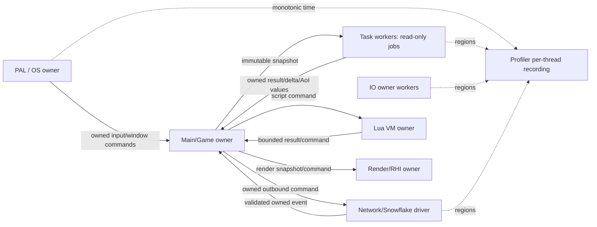

# Runtime Thread Model

## 1. 文档定位与状态词汇

本文是 Stage 2 的线程、所有权与运行时边界设计，不是实现报告，也不改变任何源码或 CMake target。Stage 2 的明确顺序是：

1. 先正式化现有 ECS snapshot/schema/delta/AoI/replication/fragment 与 `break_net`/Session 的 target 边界；
2. 再实现 PAL、Thread、Task、Message、IO、VFS、Profiler Runtime Core；
3. Lua facade、编辑器、在线更新、安全与更完整的网络 authority 依赖这些合同，不能倒置实现。

本文使用以下状态：

- **当前已有**：仓库中有源码/API，并有对应测试或正式 target 证据。
- **focused/test-only**：已有实现只编入 focused 测试或条件 target，不能当作正式 runtime 集成。
- **设计目标**：本文建议的接口、所有权、队列和生命周期；尚未声称存在。
- **未实现**：当前源码和测试边界尚未提供的能力。

证据基线来自 `docs/design/roadmap_2026-10-22.md`、`docs/superpowers/plans/2026-10-22-runtime-expansion-todo.md`、`docs/Architecture_Overview.md`、`docs/Implementation_Status.md` 及下列真实源码/target。本文不把提案写成已实现功能。

## 2. 语言、ABI 与分层边界

### 2.1 C11 Runtime Core

`engine/` 的运行时核心继续使用 C11：Core、Platform/PAL、Task、Message、IO/VFS、Profiler、ECS、网络适配和未来的 runtime coordinator 都必须以 C11 ABI 暴露。公共跨边界对象优先使用：

- 不透明指针（如 `TaskSystem`、`VFS`、`LuaScript`、`BreakNetReactor`）；
- 显式大小的整数、`const void * + size` view、返回值/错误码；
- 调用方明确 retain/release 或 destroy 的所有权；
- 不把 pthread、Win32、Snowflake、Lua 或 C++ 类型泄漏进不需要它们的公共头。

`engine/src/core/platform_thread.h` 已提供 Win32/POSIX 的 `PlatformThread`、mutex、condition 和 join wrapper；它是现有实现证据，不等于已经存在统一 PAL Runtime Core。设计目标是将平台差异继续收敛在 PAL，C11 上层只依赖不透明 handle 与结果码。

### 2.2 C++11 Application/Framework

`framework/` 是 C++11 应用生命周期层；`docs/Architecture_Overview.md` 记载 `RuntimeModuleInterface` 的 `Init/Tick/DeInit`。C++11 层可以拥有应用编排、编辑器和宿主窗口循环，但不得反向定义 C11 runtime 的数据布局或线程同步语义。C++ 侧通过 C11 facade 调用 Runtime Core；不得把 STL 容器、异常、RAII 所有权或 C++ mutex 作为 C ABI 合同。

主循环/窗口/UI API 仍由所属线程调用。`engine/src/platform/platform.h` 的 `platform_poll()`、输入、IME、窗口尺寸和 WSI 查询属于平台/宿主线程域；跨线程请求必须变成 owned command/message，由 owner 在自己的 tick 消费。

### 2.3 Lua 边界

Lua 是唯一计划中的运行时脚本语言；Zig 不作为 gameplay scripting dependency。当前 `engine/src/script/script_lua.h` 已有真实 Lua 5.4 `lua_State`、文件加载、hook 调用、mtime reload 和可选 host pointer 绑定，但尚无稳定的 `BreakLuaRuntime` facade、旧版本保留/失败回滚策略或严格 ECS batch command contract。

设计目标是：Lua VM 由明确的 Script/Game owner 线程独占；其他线程不得调用 Lua C API。Lua 只能通过 bounded command/message API 请求 ECS、配置或 editor automation，不能获得 raw RHI、physics、network socket 或 World 内部指针。Lua callback failure 转为脚本错误事件/metrics，不穿透线程边界调用网络 callback、UI 或 RHI。

## 3. 当前 target 与边界证据

### 3.1 正式已有 target

`engine/CMakeLists.txt:319-403` 的正式 `engine` static library 当前包含：

- `src/core/profiler.c`；
- `src/platform/input.c`、`platform_config.c`、`time.c`、`filewatch.c` 等平台基础设施；
- `src/asset/async_loader.c`、`vfs.c`、`hotreload.c`；
- `src/ecs/ecs.c`、`src/task/task.c`；
- `src/script/script.c`、`script_lua.c`；
- 现有 `network.c`、`packet.c`、`net_replication.c`。

因此 PAL/Task/IO/VFS/Profiler 的基础能力是**当前已有**，但本文建议的统一 Runtime Core coordinator、消息合同、线程 owner ledger 和跨 subsystem shutdown graph 仍是**设计目标**。2026-10-22 更新：生命周期 coordinator 骨架已作为正式可选 target `runtime_core` 交付（见 §7.1 已交付事实），仍不接入 `engine`/demo；消息合同、owner ledger 与 shutdown graph 的其余部分保持设计目标。

`engine_demo` 与 `dxx_break` 分别在 `engine/CMakeLists.txt:1512-1514` 和 `:1161-1169` 链接正式 `engine`/UI/RHI；它们不是当前 ECS snapshot/session 集成的证据。

### 3.2 focused/test-only target

`engine/CMakeLists.txt:3165-3179` 明确将 `test_ecs_replication` 的 `replication_schema.c`、`world_snapshot.c`、`world_delta.c` 和 `break_aoi.c` 直接编入测试 executable，并注明不在 `engine` static library。`engine/CMakeLists.txt:3219-3233` 把 `break_replication_fragment` 建成 test-only library。`engine/CMakeLists.txt:3235-3263` 的 `break_net` 只在 `BREAK_ENABLE_SNOWFLAKE=ON` 时生成，并链接真实 `snow::net`；`engine_demo`/`dxx_break` 不链接它。

所以以下都是**focused/test-only 当前已有**，不是正式 runtime：

- `engine/src/ecs/replication_schema.*`：确定性 schema 注册/查找/hash；
- `world_snapshot.*`：GameThread barrier 后的深拷贝、generation-aware entity、immutable snapshot；
- `world_delta.*`：不可变 snapshot diff、校验、staging、final validation、atomic replace；
- `break_aoi.*`：grid、witness、owner/dormant/relevancy、hysteresis、确定性 enter/stay/leave；
- `break_replication.*`：Real/Ghost、baseline/dirty/destroy/dormant、budget 和 queue retry；
- `break_replication_fragment.*`：bounded fragmentation/reassembly、乱序、duplicate/conflict、FNV-1a integrity、reset/destroy；
- `break_net_adapter.*`、envelope/message/registry、`break_session.*`：bounded adapter queues、wire validation、GameThread-owned Session state machine。

`docs/design/ecs_snapshot_replication_aoi.md`、`session_protocol.md` 和 `snowflake_c11_adapter.md` 是这些切片的事实边界；它们明确指出 timeout/eviction、cryptographic authentication、schema negotiation、正式 runtime/session integration 等仍未实现。

## 4. 目标运行时拓扑

### 4.1 Owner domains



**设计目标**是单写者优先，而不是给所有对象加 mutex：

- Main/Game owner 独占可变 `World`、ECS structural state、schema registry、Real/Ghost、AoI scope、Session manager 和 gameplay state；
- Task workers 只读取 retained immutable snapshot/delta/AoI 输入，或写入自己拥有的 job result；不得写 World、Lua、UI、RHI；
- Network driver 只拥有 transport/reactor 与网络队列，callback 只 validate/copy/enqueue；不得调用 Game/ECS/Lua/UI/RHI；
- IO workers 只读 VFS/文件/解码输入，完成品进入 bounded completion queue；completion callback 由 Main owner tick；
- Lua VM 只有一个 owner；
- RHI/UI/window 只由其既有 owner thread 调用；
- Profiler 记录接口支持 per-thread track，但 frame ring 的发布/导出必须有明确 owner。

### 4.2 正式化顺序

1. **Boundary promotion（先做）**：为 ECS/network focused sources 定义正式 library 归属、include 依赖、初始化顺序、shutdown 顺序和 target-level sanitizer lane；在此之前不声称 engine runtime/session integration。
2. **Runtime Core contracts（后做）**：PAL、Thread、Task、Message、IO、VFS、Profiler 作为低层 C11 contracts；它们不能反向依赖 Session、World、Lua 或 RHI。
3. **Consumers（再做）**：将 snapshot publication、replication/session coordinator、Lua facade、editor commands 接到 contracts 上，每个 consumer 仍由自己的 owner 串行提交/应用。

## 5. 接口方向与数据流

### 5.1 ECS snapshot/replication

当前接口证据：`world_snapshot.h` 的 `break_world_snapshot_build/retain/release`；`world_delta.h` 的 `break_world_delta_diff/apply`；`replication_schema.h` 的 registry/register/lookup/hash。

设计目标接口方向：

```c
typedef struct BreakRuntimeSnapshotStore BreakRuntimeSnapshotStore;

bool break_runtime_snapshot_publish(BreakRuntimeSnapshotStore *,
                                    BreakWorldSnapshot *owned_snapshot);
bool break_runtime_snapshot_acquire(const BreakRuntimeSnapshotStore *,
                                    BreakWorldSnapshot **out_snapshot);
```

这不是当前 API。它必须保证 publish 只由 Game owner 执行，acquire 返回 retain 后的 immutable object，替换 current pointer 后旧 snapshot 在最后一个 release 前继续有效。schema registry 仍由 Game owner 初始化/冻结；schema hash 变化必须切断旧 delta stream，schema negotiation/online schema update 不在本设计中自动实现。

数据流：systems 完成 -> structural barrier -> Game owner build snapshot -> publish/retain -> Task workers 做 diff/AoI -> Game owner 验证完整 delta -> ECS-owned staging apply -> final validation -> atomic replace。任何失败销毁 staging，原 World 不变。fragment reassembly 完成不等于可 apply：必须回到 Game owner 做 base/schema/tick/delta validation。

### 5.2 Network/Session

当前 `BreakNetReactor` 有 256 项 event queue 和 256 项 outbound queue；`BreakSessionManager` 是 GameThread-only，`BreakNetMessageView` 借用，`BreakNetOwnedMessage` 显式复制和 release。当前 send queue 满返回 overload 且不阻塞，adapter callback 入队失败不阻塞 reactor。

设计目标保持并扩展该方向：

```c
BreakNetSendResult break_net_reactor_send(/* copied bounded command */);
bool break_net_reactor_poll_event(/* transfers owned event to caller */);
bool break_session_manager_apply_adapter_event(/* Game owner only */);
```

Network callback -> envelope/registry/sequence validation -> owned event copy -> bounded event queue -> Game owner poll -> Session transition/handler -> bounded outbound command -> reactor-only encode/send。handler 只在 Game owner 调用，payload 仅在调用期间有效；需要保留时再次 copy。Session close watermark 不允许迟到 event 复活已关闭 connection。

### 5.3 Message、Task、IO 与 VFS

**Message（设计目标；Runtime Core formal facade）**：所有跨 owner 消息包含 type/version/byte size/sequence 或 correlation ID，payload 具有明确 borrowed/owned 标记。Queue slot 只存值或 owned allocation，不存指向 producer stack、Lua userdata、World chunk、Snowflake connection 或 UI object 的裸指针。formal Runtime Core queue 满统一非阻塞返回 `BREAK_RUNTIME_OVERLOAD`；Network/IO/Audio/RHI 热路径禁止 inline 或等待。错误统一映射为 `BreakRuntimeError`：`OK/INVALID/CLOSED/OVERLOAD/OOM/TIMEOUT/STALE/REJECTED/FAILED`。

**Task（兼容 API 与 formal facade 分开）**：`engine/src/task/task.h` 定义 3 个 priority、每个 worker 的 `DEQUE_CAPACITY=1024`、外部 `SUBMIT_QUEUE_CAPACITY=256`、依赖 handle 和 worker 内禁止 `task_wait`/`task_wait_handle` 的自等待契约。legacy Task queue 满载时 inline execute 的现有行为不改变；formal task submit 使用 reject/credit policy，返回统一 overload 并记录 inline/reject 计数，不把两种 API 混成一个语义。

**IO/VFS（当前已有）**：`async_loader.h` 规定 IO worker 读取 VFS、每帧 `async_loader_tick()` 在 Main thread dispatch completion；`vfs.h` 有 16 mounts、128 MiB `VFS_MAX_FILE_BYTES`、PAK entry cap 4096，`vfs.c` 对共享 PAK file cursor 已有 lock。formal IO queue 满返回 `BREAK_RUNTIME_OVERLOAD` 或 credit rejection；completion wait 必须可被 deadline/shutdown wakeup 打断，而 compatibility loader 的现有等待语义不因本文改变。

**Profiler（当前已有）**：`profiler.h` 有 120 frame ring、64 regions、32 thread tracks，`profiler_register_thread/current_tid` 和 Chrome trace/provenance export。设计目标是线程注册、region stack 和 export 的并发合同：worker 可记录自己的 track；frame begin/end、ring publish 和文件 export 必须由 profiler owner 或明确 snapshot；export 失败不影响 runtime execution。

## 6. Queue 容量、backpressure 与调度

### 6.1 固定容量基线

| 队列/存储 | 当前证据 | 设计决策 |
|---|---:|---|
| Network event | 256 (`session_protocol.md`, adapter headers) | bounded；满则 callback 丢弃并计数/transport error telemetry，不阻塞网络线程 |
| Network outbound | 256 | bounded；满返回 `OVERLOAD`，Game owner 保留 replication dirty/baseline 状态供下次 retry |
| Task external submit | 256 (`task.h`) | bounded；现有 inline fallback 必须显式统计；Runtime Core 新提交 API 可返回 overload |
| Worker deque | 1024/priority (`task.h`) | owner push、thief steal；formal facade 满载返回 `BREAK_RUNTIME_OVERLOAD`，不 inline、不等待；legacy 行为仅按兼容 API 记录 |
| VFS mounts | 16 (`vfs.h`) | 固定上限；mount 失败不替换已有 mounts |
| VFS file | 128 MiB (`vfs.h`) | read-all 及 decode 前 fail-closed |
| Fragment reassembly | 16 MiB (`ecs_snapshot_replication_aoi.md`) | metadata、单片和 total size 均在分配前检查；当前无 timeout/eviction |
| Network wire fragment | 64 KiB (`session_protocol.md`) | 仅限制 wire fragment；超限 reject，不等同内部 message/asset blob |
| Runtime internal message | fixed slots + byte budget | 满载非阻塞返回 `BREAK_RUNTIME_OVERLOAD`，不隐式分片 |
| Asset manifest/blob | separate metadata/byte budgets | 各自校验与计费，不套用 wire fragment 上限 |
| Fragment reassembly | 16 MiB per assembly | 另设 per-connection aggregate bytes/assembly-count 预算方向；当前仍未实现 |
| Message payload | per-kind budget | encode/decode 和 copy 均先做 checked size；超限映射 `BREAK_RUNTIME_OVERLOAD` |

这些容量是当前事实或设计继承值，不表示已经有统一 runtime queue allocator。所有新队列必须在 create 时记录 capacity，运行时暴露 high-water/drop/overload/retry 统计。

### 6.2 backpressure 规则

- Network callback 不等待 Game owner；队列满时拒绝/丢弃当前 event，并保留 transport 可继续运行的能力；不能在 callback 内调用 gameplay。
- Game owner 提交 outbound 失败时得到明确 `OVERLOAD`，replication 不清除 dirty/baseline 事实；后续 sync 重试，超出重试期限的策略另由网络设计文档决定。
- Task submit 满时的语义按层区分：legacy Task API 的 inline fallback 是当前兼容事实，必须记录；formal Runtime Core submit 必须返回 `BREAK_RUNTIME_OVERLOAD` 或显式 credit rejection，不提供 inline 选项，也不得在 shutdown 后触碰已销毁 owner。
- IO completion 满时 worker 不调用 Main callback；保留 request 为 retry/cancel 或转为 `FAILED_OVERLOAD`，并释放其 owned buffers。
- Fragment incomplete 状态保留已收片供 retry；由于当前 focused API 没有 timeout/eviction，正式 runtime promotion 前必须增加 scheduler owner、deadline、最大并发 assembly 和 reset/evict 结果。

## 7. Shutdown、失败与恢复

### 7.1 统一生命周期

Runtime Core 的全局状态（由唯一 Runtime coordinator 发布）统一为：
`CREATED -> STARTING -> RUNNING -> QUIESCING -> DRAINING -> STOPPING -> STOPPED`；任意阶段均可进入 `FAILED`。`FAILED` 是全局可诊断状态：禁止重新开放普通 admission，但允许幂等清理；若保留资源的 stop 超时或外部依赖暂时失败，允许在同一 coordinator 上 retry stop，成功后才发布 `STOPPED`。子系统状态（例如 Session 的 `NEW/CLOSING/CLOSED`、adapter 的 `STOPPING`、Asset 的 `LOADING`）必须明确标注为 Runtime 全局状态的局部映射，不能替代全局 Runtime 状态。

统一 `BreakRuntimeError` 类别为 `OK`、`INVALID`、`CLOSED`、`OVERLOAD`、`OOM`、`TIMEOUT`、`STALE`、`REJECTED`、`FAILED`；兼容 API 可保留自己的错误名，但 formal facade 必须映射到该集合。项目示例类型统一采用 `u8/u16/u32/u64/usize`，定义见 `engine/src/core/types.h`，不在设计示例中混用裸 `uint*_t`/`size_t`。

唯一 coordinator 按 `runtime_overview.md` 的全局顺序编排 shutdown。本节只规定线程域动作：在 coordinator 停止 admission 后拒绝新 submit；停止 producer callbacks 并发出 close watermark；在 bounded drain 期间响应 wakeup/deadline；在 `STOPPING` 仅 join 已停止 admission 的 joinable worker/adapter host；将 live ownership 和 timeout 状态交回 coordinator。线程域不得自行 destroy 其他域资源或发布全局 `STOPPED`。

超时返回 `TIMEOUT`，保留仍被引用的资源、队列和线程状态，不得强拆或 free；后续必须由同一 coordinator retry。不可恢复的启动/不变量/资源失败进入 sticky `FAILED`，保留诊断和安全清理路径，不得伪造 `RUNNING`。现有 Snowflake adapter 的 terminate -> host-exited deadline -> join -> destroy 只是 Network 子系统的局部动作，不能成为第二个 coordinator。

**已交付事实（2026-10-22，Task 3）**：正式可选 target `runtime_core`（不链入 `engine`/`engine_demo`/`dxx_break`，`ENGINE_BUILD_TESTS=OFF` 可独立构建）交付了唯一 coordinator 骨架：`engine/src/runtime/runtime_types.h` 定义统一 `BreakRuntimeError` 与全局 `BreakRuntimeState`（状态 `FAILED` 因 C11 枚举作用域拼写为 `BREAK_RUNTIME_STATE_FAILED`）；`engine/src/runtime/runtime_coordinator.h/.c` 实现 owner-thread-only（无 mutex）状态机、bounded subsystem callback 表（默认/上限 16，超限 `BREAK_RUNTIME_OVERLOAD`）、分阶段 shutdown 顺序（admission → producers → close → drain → join → destroy）、timeout 保留 live ownership 并可从 `STOPPING` retry 恢复、sticky `FAILED` admission 拒绝（`BREAK_RUNTIME_FAILED`）。线程域的 join/deadline 动作仍由各子系统 callback 自行完成（同 §7.1 规则）；真实 worker/adapter 接入、message/task/PAL facade 仍为设计目标。验证：`test_runtime_core` 9/9 + target contract，normal/ASan+UBSan/TSan 三树各 2/2。

### 7.2 失败分类

每个 public operation 都应区分参数/状态错误、容量 overload、OOM、外部 IO/transport failure、timeout、schema/protocol mismatch 和 invariant violation。失败必须：

- 不发布半成品 snapshot/message；
- 不改变 atomic replace 前的 World；
- 不把 borrowed input 转成悬挂 owned pointer；
- 不在 failure callback 中递归调用另一个 owner；
- 记录可查询的 reason/counter，必要时进入 `FAILED` 并阻止继续驱动。

当前已有的 fail-closed 例子包括 envelope exact-length/sequence validation、Snowflake start failure cleanup、delta staging rollback、fragment size/checksum/index checks、VFS file-size cap。它们是设计依据，不等于所有新 Runtime Core 路径已实现。

## 8. 验证与验收门

### 8.1 先验证 focused 边界，再验证 formal target

Stage 2 每一项实现必须先有 focused RED/GREEN test，再决定 source promotion。最低验收矩阵：

- ECS/schema/snapshot/delta/AoI：deterministic hash/order、generation reuse、schema mismatch、base/tick rejection、staging rollback、atomic replace、zero/invalid witness；
- replication/fragment：budget overload retry、duplicate/conflict、out-of-order、16 MiB cap、timeout/eviction（目标新增）；
- network/session：queue FIFO/capacity、borrowed-to-owned lifetime、malformed envelope、stale close watermark、handler failure、bounded stop；
- PAL/Thread：create/start/stop/destroy、owner enforcement、cond wake、thread creation failure、double stop/destroy、platform-specific WSI owner rules；
- Task：priority/dependency, queue full, inline fallback telemetry, worker self-wait rejection, shutdown admission and no use-after-join；
- Message/IO/VFS：size overflow, payload ownership, cancellation, completion overload, PAK concurrent reads, 128 MiB cap；
- Profiler：per-thread IDs, nested regions, frame rollover, concurrent recording/export snapshot, export I/O failure。

### 8.2 Normal、ASan、TSan

每个 promoted formal target 必须有三条可复现 lane（平台支持时）：

1. **Normal**：clean configure/build，相关 CTest 显式 build/run；
2. **ASan/UBSan**：重点检查 owned payload、snapshot/delta staging、queue slot 生命周期、VFS/IO buffers、shutdown cleanup；
3. **TSan**：重点检查 queue producer/consumer、Task deque/submit queue、snapshot publication、adapter event queue、Profiler per-thread state 和 stop/join。

当前证据应如实引用而不是扩写：`docs/Implementation_Status.md` 记录 fragment 和 Snowflake replication focused normal/ASan/TSan 7/7、adapter 30/30、Session 20/20，以及 TSan focused targets；这些证明 focused API 的边界，不证明正式 engine integration。full CTest 还曾因 fuzz executable 未构建而有 `Not Run`，并有与本设计无关的 UI/Vulkan 已知失败，不能写成 full gate 全绿。

### 8.3 验收停止条件

只有同时满足以下条件，某一 slice 才可从 focused/test-only 升为 formal runtime claim：

- source 进入明确的正式 library/target，target graph 和 include/link 关系可审计；
- owner、queue capacity、backpressure、shutdown、failure contract 有 API 和测试；
- normal/ASan/TSan 结果来自实际构建的该 target，缺失 lane 明确标注；
- 原始 end-to-end 场景成立（例如 snapshot -> delta -> fragment -> network queue -> Game apply），而不是只测试 import/compile；
- 文档同步更新“当前已有 / focused / 设计目标 / 未实现”，并通过 `git diff --check`。

## 9. 未实现与未决风险

1. **Target promotion 尚未发生**：ECS snapshot/schema/delta/AoI/replication/fragment 仍不是正式 `engine` library contract；`break_net`/Session 仍是 Snowflake 条件 focused integration。
2. **Snapshot publication service 未实现**：当前没有 mutex-protected current-snapshot service、epoch reclamation 或统一 owner handoff；调用者必须自行 retain 当前 snapshot。
3. **Fragment timeout/eviction 未实现**：没有 scheduler、deadline、最大并发 assembly 或网络断线清理链；16 MiB 是内存上限，不是生命周期上限。
4. **协议与安全未实现**：schema negotiation、wire schema/tick fields、cryptographic authentication、authority handoff、prediction/rollback、player authentication backend 均不属于当前 runtime。
5. **Task API 兼容风险**：当前 `task_system_create` 是进程单实例，external queue 满会 inline execute；将其正式化为多域 Runtime Core 需要先解决 owner/shutdown/admission 语义，不能仅改 target 名称。
6. **PAL 跨平台证据不完整**：现有 thread wrapper 有 POSIX/Win32 分支，但 Snowflake bounded stop 的非 Linux lane 尚未由本机验证；Wayland/Cocoa/mobile WSI 的 owner 和 suspend/resume 仍需各自测试。
7. **Lua VM 线程风险**：现有 `LuaScript` 可绑定 raw `void *world/physics/input`，稳定 facade 尚未限制这些指针的生命周期和跨线程访问；Stage 3 前不得把它当作安全的 runtime boundary。
8. **Profiler 与 frame publication 并发风险**：已有 per-thread tid/trace API，但 frame ring/export 的统一 snapshot 语义尚未成为 Runtime Core contract。
9. **IO/VFS 生命周期风险**：async loader callback 设计为 Main-thread dispatch，但取消、shutdown 中 in-flight request、completion queue overload 的统一错误合同尚未完成。
10. **全局验收风险**：full CTest 的 Not Run、环境性失败和不同 build tree 的 sanitizer 证据必须逐项分类，不能用 focused 绿灯替代 clean formal gate。

## 10. 后续依赖与实施切片

- **Slice A — target boundary**：逐个列出 ECS/network 源文件、公共头、依赖和正式/测试 target；先补 target contract test，暂不改变 runtime 行为。
- **Slice B — ownership/message primitives**：C11 owned message、bounded MPSC/SPSC queue、result/error taxonomy、admission gate；用 network/IO/Task focused tests 验证。
- **Slice C — PAL/Thread/Task lifecycle**：统一 thread identity、cond/deadline、join/stop failure paths；保留现有 `platform_thread.h` 与 Task semantics，补 shutdown/TSan。
- **Slice D — IO/VFS/Profiler Core**：把 async completion、VFS read limits、per-thread profiler publication 接入统一 lifecycle；不把 Lua 或 World 指针跨 worker 传递。
- **Slice E — formal ECS/network integration**：snapshot store、fragment timeout/eviction scheduler、Session/replication Game owner coordinator；端到端验证后才允许正式 target claim。
- **Slice F — consumers**：Lua facade、editor command routing、asset/hot reload 和后续 security/network features 按各自设计文档依赖上述合同。

在 Slice A-E 完成且验收证据齐全前，本文中的 Runtime Core、正式 ECS/network integration 和完整 Stage 2 都必须保持“设计目标/未实现”标记。

## 附录 A：与原始需求 12 线程域表的对照（2026-10-22）

原始需求给出 12 个线程域（Main/Game、UI、Render、RHI、GPU、Network RX、Network TX、IO、Worker、Audio、Physics、Profiler）。本文件正文的 owner domain 模型是其第一阶段子集，对照关系如下；正文规则不变，本附录只做映射与边界澄清。

| 需求线程域 | 本文对应 | 状态与边界 |
|---|---|---|
| Main/Game | Main/Game owner | 已覆盖；独占可变 World/ECS/schema/Session/gameplay |
| UI | PAL window/UI owner + myui 既有线程约束 | 部分覆盖；UI 只在其既有 owner 线程执行，经 owned command 与 Main 交互；myui 事件队列的细节契约属于 Stage 4 编辑器子项目 |
| Render + RHI | Render/RHI owner | 合并为一个 owner；当前 Break 为编译期单后端、主线程驱动的现实边界见 §3；拆成独立 Render/RHI 双线程是后续独立子项目，需自带验收 |
| GPU | 不由用户态调度 | 概念对齐；Fence/Semaphore/Timeline 契约属于 RHI 层，不在本文展开 |
| Network RX + TX | Network/Snowflake driver（单 owner） | 合并为一个 driver owner；callback 只 validate/copy/enqueue。RX/TX 拆成双线程属于 Stage 2 后续性能子项目，拆分前必须保持现有 bounded queue 与 close watermark 语义 |
| IO | IO owner workers | 已覆盖；completion 由 Main owner tick |
| Worker | Task workers | 已覆盖；只读 retained snapshot，写自己拥有的 job result |
| Audio | 未单设 owner | 当前 `engine/src/audio/` 基于 miniaudio，设备回调线程在库内部；需求中的独立 Audio command queue 域属于后续音频子项目，立项前不得宣称独立音频线程域存在 |
| Physics | 未单设 owner | 当前 `engine/src/physics/` 由 Main/Game 步进；需求的 Physics command/result queue 独立线程域属于后续物理子项目，需先定义 world ownership 与固定步长契约 |
| Profiler | Profiler per-thread recording | 已覆盖；frame ring 发布/导出有明确 owner |

映射原则：需求的通信方式列（无锁事件队列、SPSC/MPSC packet queue、command queue、Fence 等）与本文 §5–§6 的 owned message + bounded queue + backpressure 规则一致；合并域（Render/RHI、Network RX/TX）和未设域（Audio、Physics）都必须以独立子项目形式拆分验收，不允许在主线上一次性铺开。
