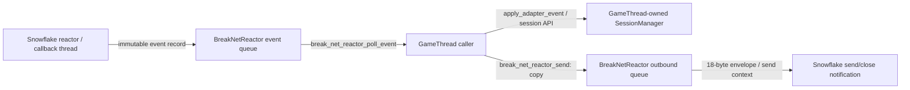

# Session Protocol 当前实现事实

## 范围与状态

本文记录仓库当前已经存在的 Session/Protocol C11 切片，而不是目标设计的完整承诺。实现位于 `engine/src/network/`，测试位于 `engine/tests/test_break_session.c`、`engine/tests/test_break_net_adapter.c` 和 `engine/tests/test_break_net_tls.c`。

Stage 5 Phase D（2026-10-24，branch `sdd/stage5-transport-security`）起本切片增加：TLS 传输模式（§TLS 模式）、CHALLENGE/AUTH-v2 会话认证握手（§CHALLENGE/AUTH-v2）、出站单调序号（§outbound 当前边界）、准入限速（§准入限速）——信任链与安全契约全文见 `docs/design/transport_security.md`。

构建目标事实：`break_net` 是 `engine/CMakeLists.txt` 顶层的正式静态库目标，只要 `BREAK_ENABLE_SNOWFLAKE=ON` 就会生成，独立于 `ENGINE_BUILD_TESTS`；它链接 `break_replication_core` 与 `snow::net`。`BREAK_ENABLE_SNOWFLAKE=ON` 且缺少有效 `SNOWFLAKE_SOURCE_DIR` 时配置以 FATAL_ERROR 失败（fail-closed）。基础 `engine` 目标保持 transport-neutral，不编译 Snowflake 头文件、不链接 `snow::net`/`break_net`；消费方显式 opt-in。`engine_demo` 与 `dxx_break` 均不消费 `break_net`，接入生产应用属于后续独立集成任务。测试可执行文件 `test_break_net_adapter`、`test_break_session`、`test_break_replication` 链接该正式 `break_net` 目标。

当前已有：

- `BreakNetEnvelope` 的编码、解码、默认 registry 校验和序列检查；
- `BreakNetMessageRegistry` 的固定容量消息定义表；
- `BreakNetEvent` 记录、adapter 有界事件队列和有界 outbound command 队列；
- 不透明的 `BreakSessionManager` 及其 GameThread 侧状态迁移 API；
- TLS 传输模式、CHALLENGE/AUTH-v2 认证握手、出站单调序号、准入限速（Stage 5 Phase D，见下文专节与 `docs/design/transport_security.md`）；
- CTest 覆盖 envelope、little-endian 字节序、长度/ID/版本/序列错误、payload 拷贝、队列 FIFO、会话状态迁移和关闭后的拒绝行为；真实 loopback 覆盖 AUTH 入站、Session poll、handler dispatch、PING response、client close、`CLOSED` 和 stale 事件；TLS loopback 覆盖握手/加密往返/mTLS/负例。

当前仍没有：

- player authentication backend、ECS replication、AoI、Lua gameplay callback、editor RPC、online update 或服务端产品/反篡改代码；
- Snowflake per-context completion/drop 通知不足，因此 adapter 仍以 send-drained/close 顺序和 pending 引用维护本地 identity 生命周期；
- 自定义 registry 已用于 Session 的真实 wire codec 边界，但 envelope codec 当前仍以 default registry 为编码/解码入口。

## 数据流与线程所有权



实际线程边界如下：

- `BREAK_NET_DRIVE_STEP`：调用方是该 reactor 的唯一 Snowflake driver；`break_net_reactor_step` 以 atomic guard 拒绝并发 step。GameThread 可以是该调用方，但 API 本身没有自动把调用方标记为 GameThread。
- `BREAK_NET_DRIVE_THREAD`：Break 创建并 join 一个 host thread；该线程执行 `snow_net_thread_step` 循环。它不调用 SessionManager、World、ECS、Lua、UI 或 RHI。
- Snowflake callback 路径只构造 `BreakNetEvent` 并尝试入队；事件队列由 mutex 保护。事件入队失败时 callback 忽略失败，不能阻塞 reactor。
- `BreakSessionManager` 的公开 API 没有内部 mutex，也没有线程安全声明；它的创建、销毁、bind、状态迁移、`poll` 和 `apply_*` 都必须由同一个 GameThread/拥有者串行调用。
- `break_net_reactor_poll_event` 是把队列中的事件记录移交给调用方；调用方负责在使用后调用 `break_net_event_release`。

## Message view、owned payload 与事件

`BreakNetMessageView` 是借用数据：

```c
typedef struct BreakNetMessageView {
    uint16_t message_id;
    uint16_t protocol_version;
    uint32_t sequence;
    const void *data;
    size_t size;
} BreakNetMessageView;
```

`break_net_message_view_init` 只记录 metadata 和指针，不取得 payload 所有权。非零 `size` 要求 `data != NULL`，大小不能超过 `BREAK_NET_MAX_PAYLOAD_SIZE`（64 KiB）。

`BreakNetOwnedMessage` 是 Break 分配并拥有的副本：

```c
typedef struct BreakNetOwnedMessage {
    uint16_t message_id;
    uint16_t protocol_version;
    uint32_t sequence;
    void *data;
    size_t size;
} BreakNetOwnedMessage;
```

`break_net_message_copy` 在成功返回前复制 payload；调用方随后修改或释放借用输入不会影响 owned message。零长度 payload 不分配。`break_net_message_release` 释放 payload、清零记录且可重复调用。

`BreakNetEvent` 包含事件类型、`uint64_t` connection key、reason 和一个可选的 `BreakNetOwnedMessage`：

```c
typedef enum BreakNetEventType {
    BREAK_NET_EVENT_CONNECTION_OPENED = 0,
    BREAK_NET_EVENT_MESSAGE_RECEIVED,
    BREAK_NET_EVENT_SEND_DRAINED,
    BREAK_NET_EVENT_CONNECTION_CLOSED,
    BREAK_NET_EVENT_TRANSPORT_ERROR
} BreakNetEventType;
```

事件入队是结构体所有权转移：`break_net_event_push` 把 event 写入队列后清零 caller 的临时记录。poll 又把记录移给调用方并清零队列槽位。消息事件的 owned payload 因而由队列持有，poll 后由调用方持有，最终由 `break_net_event_release` 释放。`BreakSessionManager` 的 `apply_adapter_event` 只读取事件，不取得或释放 `event->message` 所有权；测试明确验证这一点。

事件队列容量为 `BREAK_NET_EVENT_QUEUE_CAPACITY == 256`。outbound 队列容量为 `BREAK_NET_OUTBOUND_QUEUE_CAPACITY == 256`。

## Envelope wire format

当前 envelope 使用固定 18-byte prefix，字段按下面的 offset 编码，所有整数均为 little-endian：

| Offset | Bytes | Field | 当前约束 |
|---:|---:|---|---|
| 0 | 4 | `magic` | `BREAK_NET_ENVELOPE_MAGIC == 0x42524b31`; wire bytes `31 4b 52 42` |
| 4 | 2 | `protocol_version` | registry definition 的闭区间版本 |
| 6 | 2 | `message_id` | 必须在 default registry 中存在 |
| 8 | 2 | `flags` | 只允许 `BREAK_NET_ENVELOPE_FLAGS_MASK == 0x000f` 内的位 |
| 10 | 4 | `sequence` | context 存在时必须严格大于上一序列 |
| 14 | 4 | `payload_size` | header 之后的 payload 字节数 |
| 18 | `payload_size` | payload | 最大 64 KiB，且不超过 message definition 的 limit |

`BREAK_NET_ENVELOPE_HEADER_SIZE` 为 18，最大完整 envelope 为 18 + 64 KiB。编码用显式 `put16`/`put32`，解码用显式 `get16`/`get32`，不依赖主机字节序或 packed C struct。

`break_net_envelope_encode` 先查 default registry、版本、flags 和 payload limit，再检查 `size_t` 加法和输出 buffer 大小。`break_net_envelope_decode_with_context` 先检查最小 header、magic、payload 上限和“buffer 必须恰好等于 header + payload”，然后做 registry/版本/flags 校验，再做 sequence 校验。拒绝时输出 envelope 被清零；成功时 `payload` 仍是输入 buffer 内的借用指针，不由 decode 分配或释放。

默认 registry 当前只有（`BREAK_ENABLE_CRYPTO=ON` 时三行，OFF 时仅前两行、AUTH 收窄为 v1..1）：

| ID | Version | Payload limit | Phase | Duplicate policy |
|---:|---:|---:|---|---|
| `BREAK_NET_MESSAGE_ID_AUTH == 1` | 1..2（CRYPTO=ON）/ 1..1（OFF） | 64 KiB | `ANY` | `REJECT` |
| `BREAK_NET_MESSAGE_ID_PING == 2` | 1..1 | 64 KiB | `ANY` | `IDEMPOTENT` |
| `BREAK_NET_MESSAGE_ID_CHALLENGE == 3` | 1..1（仅 CRYPTO=ON） | 16 B | `ANY` | `REJECT` |

registry 的最大定义数为 64；register 拒绝 ID 0、重复 ID、反向版本区间、超过全局 payload 上限或满表。公共 `BreakSessionConfig.registry` 也拒绝 `count > BREAK_NET_REGISTRY_MAX_MESSAGES` 的 malformed registry，避免后续 lookup 越过固定定义表；registry 仍是 borrowed immutable storage，必须活到 manager destroy。当前 envelope codec 使用 `break_net_message_registry_default()`，没有把自定义 registry 传入 codec 的 API。`phase` 和 `duplicate_policy` 已记录在定义中；Session 在 GameThread apply/dispatch 阶段执行 phase、版本、payload limit 和 duplicate policy。默认 AUTH/PING 均为有意的 `ANY` phase：默认 registry 下 AUTH 在 `NEW` 中允许并成功后进入 `AUTHENTICATED`，PING 在 pre-auth `NEW` 中也允许且保持 `NEW`；自定义 registry 的 phase 仍严格限制（例如 `AUTHENTICATING` 定义在 `NEW` 中被拒绝）。默认 AUTH 重复策略为 `REJECT`，PING 重复策略为 `IDEMPOTENT`。测试 `break_session_default_registry_allows_auth_in_new_and_ping_pre_auth` 与 `break_session_uses_attached_registry_phase_and_duplicate_policy` 分别锁定这两个边界。

## SessionManager API 与状态机

`BreakSessionManager` 是 GameThread-owned 且非线程安全；所有创建、绑定、状态迁移、poll 和 apply 都必须由同一拥有者串行调用。`BreakSessionConfig.registry` 是 borrowed immutable registry，必须活到 manager destroy；attach 的 reactor 是 borrowed，必须活到 detach（当前没有独立 detach API）或 manager destroy；handler 和 `user_data` 均为 borrowed，且 handler 仅由 GameThread 调用。handler 收到的 message payload 只在 handler 调用期间有效。

`max_sessions` 是 manager lifetime capacity：closed slots 不回收、不复用，因此它表示 manager 生命周期内可绑定的 connection 数，而不是同时在线数。真实 loopback Session 流程已验证 AUTH -> Session poll -> handler -> PING response -> client close -> `CLOSED`/stale。

实际头文件 `engine/src/network/break_session.h` 的核心声明为：

```c
typedef struct BreakSessionManager BreakSessionManager;
typedef uint64_t BreakConnectionKey;
typedef uint64_t BreakSessionId;

typedef enum BreakSessionState {
    BREAK_SESSION_NEW = 0,
    BREAK_SESSION_AUTHENTICATING,
    BREAK_SESSION_AUTHENTICATED,
    BREAK_SESSION_CLOSING,
    BREAK_SESSION_CLOSED,
    BREAK_SESSION_UNKNOWN
} BreakSessionState;

typedef struct BreakSessionConfig {
    size_t max_sessions;
    BreakSessionId first_session_id;
    const BreakNetMessageRegistry *registry;
} BreakSessionConfig;

BreakSessionManager *break_session_manager_create(const BreakSessionConfig *config);
void break_session_manager_destroy(BreakSessionManager *manager);
size_t break_session_manager_poll(BreakSessionManager *manager, uint32_t max_events);
bool break_session_manager_bind(BreakSessionManager *manager, BreakConnectionKey connection);
bool break_session_manager_begin_auth(BreakSessionManager *manager, BreakConnectionKey connection);
bool break_session_manager_auth_succeeded(BreakSessionManager *manager,
                                          BreakConnectionKey connection);
bool break_session_manager_close(BreakSessionManager *manager,
                                  BreakConnectionKey connection, uint32_t reason);
bool break_session_manager_transition(BreakSessionManager *manager,
                                      BreakConnectionKey connection,
                                      BreakSessionState state);
bool break_session_manager_apply_event(BreakSessionManager *manager,
                                        BreakConnectionKey connection,
                                        BreakSessionEvent event);
bool break_session_manager_apply_adapter_event(BreakSessionManager *manager,
                                                const BreakNetEvent *event);
BreakSessionState break_session_manager_state(const BreakSessionManager *manager,
                                               BreakConnectionKey connection);
BreakSessionId break_session_manager_session_id(const BreakSessionManager *manager,
                                                BreakConnectionKey connection);
```

状态迁移实现为：

```text
NEW -> AUTHENTICATING -> AUTHENTICATED -> CLOSING -> CLOSED
  \
   ----------------------------------------> CLOSING
```

`transition` 只接受上述正向边；未知 connection、`BREAK_SESSION_UNKNOWN`、从 `CLOSED` 再迁移、向后迁移和重复 authentication 都返回 false。一个 connection 只能绑定一个 entry；容量由 `max_sessions` 限制，entry 关闭后不会复用。session ID 从 `first_session_id` 开始递增；从 `UINT64_MAX` 已分配 ID 后不能再 bind。

`break_session_manager_apply_adapter_event` 在 GameThread 上处理生命周期和消息：

- `CONNECTION_OPENED`：调用 `bind`；active entry 的重复 open 分类为 duplicate，CLOSING/CLOSED entry 的迟到 open 分类为 stale，容量拒绝分类为 invalid；
- `CONNECTION_CLOSED` 或 `TRANSPORT_ERROR`：调用 `close`，进入 `CLOSING`；关闭后的事件保留为 stale；
- `MESSAGE_RECEIVED`：先校验 manager 所附 registry（未配置时为 default registry）的版本、长度和 phase，再按 definition 的 duplicate policy dispatch；`REJECT` 对重复 sequence 返回 duplicate，`IDEMPOTENT` 对相同 sequence 返回成功但不再次调用 handler；AUTH 的状态迁移仍在 handler 成功后完成，失败进入 `CLOSING`。因此 AUTH/PING 的策略来自 registry definition，而不是 message ID 特判；未来注册项也遵循同一规则。
- `SEND_DRAINED` 和未知事件：分类为 invalid。

`break_session_manager_last_result` 暴露最近一次 apply 分类，`break_session_manager_apply_stats` 暴露 applied、unknown、stale、invalid、phase rejected、duplicate 和 handler failed 的累计计数。handler 收到的 `BreakNetOwnedMessage` 是 manager 当前事件的借用视图，只在 handler 调用期间有效；handler 必须复制需要保留的内容。

`break_session_manager_poll` 是低层 close-finalization 原语：只推进 close finalization，不轮询 `BreakNetReactor`，因此对尚未通过 adapter apply 的 reactor event 不产生任何 session 影响。普通接入应使用推荐入口 `break_session_manager_poll_adapter`；它在 GameThread 上每次最多消费 `max_events` 个 reactor event 并 apply/dispatch，只有在消费后确认 manager 所附 reactor event queue 已排空时，才把最多 `max_events` 个 `CLOSING` entry 改为 `CLOSED`；因此分页消费不会提前 finalize close。

### stale event

关闭会形成不可逆的 close watermark：entry 转为 `CLOSING`/`CLOSED` 后，后续同 connection 的消息和重复生命周期事件不会改变状态，并由 apply-result API 分类为 stale（未知 connection 则为 unknown）。closed entry 不回收、不复用；因此 `max_sessions` 是 manager 生命周期内的 connection-key binding capacity，而不是同时在线容量。adapter event queue 仍由 GameThread 逐条 poll，事件 payload 在 apply 返回后由 caller 释放。

## TLS 模式

Stage 5 Phase D Task 2 起 adapter 支持服务端 TLS 接受模式（`BreakNetTlsConfig{cert_file,key_file,ca_file,verify_peer}` + `break_net_reactor_set_tls` + `break_net_reactor_is_tls`，CREATED 态仅一次）。配置后每条接受的连接必须先完成 TLS handshake 才有任何 envelope 解析；handshake 失败 fail-closed 关闭（零消息事件）。`verify_peer=1` 且 `ca_file==NULL` 直接拒绝配置（OpenSSL 语义下该组合是 VERIFY_NONE 伪装）。parser 在入口分流：`tls_ctx==NULL` 走原明文 parser（逐字节不变），否则走 TLS 路径（整段密文 burst 消费、握手/alert 密文锁外回注、握手完成同 burst 内排空残留应用密文防死锁）。所有 `snow_ssl_t` 触点都在 reactor 唯一驱动线程上（构造性满足）。限制：snow wrapper 吞并 `SSL_ERROR_ZERO_RETURN` 且无 TLS shutdown API——close_notify 与 TCP FIN 不可区分，adapter 以 TCP 层关闭事件为权威；无会话恢复（`SSL_SESS_CACHE_OFF`）。自签 fixture 证书仅供测试（`BREAK_TEST_SSL_FIXTURE_DIR` 宏注入）。全文见 `docs/design/transport_security.md` §2/§7/§8。

## CHALLENGE / AUTH-v2

Stage 5 Phase D Task 3 起（`BREAK_ENABLE_CRYPTO=ON`）Session 支持认证握手：accept 时每连接经 `break_crypto_random` 生成新鲜 16B `server_nonce` 并下发 CHALLENGE(id=3, v1, 16B)；客户端回 AUTH v2（严格 56B：`key_id[8] || client_nonce[16] || tag[32]`），tag = `HMAC-SHA256(psk, "BRKAUTH2" || server_nonce || client_nonce)`，PSK 由应用回调 `BreakNetAuthKeyFn` 按 key_id 解析（provisioning/rotation 留在 app 侧）。未知 key、tag 篡改、错误版本/长度、缺 nonce、配置后 AUTH v1 全部 fail-closed 进 CLOSING；常量时间 32 字节比较；认证只经 `break_crypto_hmac_sha256`/`break_crypto_random`（零自造密码学）。`break_session_set_auth(fn,user)` 为进程级配置（逐字接口无 manager 参数），仅在所有 session 为 NEW 且无认证操作在飞时可变更——操作租约钉住配置快照穿越首次状态迁移（review fix round 1），中途 set/clear 得 false。内置 CHALLENGE client helper 使用全零 key_id（裁决约定：接口无客户端 key 选择参数）。`break_session_set_max_age` 提供可选会话过期（单调时钟；过期扫描有界且不被 close 预算饿死）。重放论证：跨连接逐字节重放因 server_nonce 不同而失败，同连接靠 REJECT 策略 + 严格入站序号；post-auth 应用消息无独立 replay window（文档化边界）。全文见 `docs/design/transport_security.md` §3/§4。

## 准入限速

Stage 5 Phase D Task 4 起 adapter 支持 Snowflake admission hook 限速（`BreakNetRateLimitConfig{global_accept_per_sec,global_burst,per_ip_per_minute}` + `break_net_reactor_set_rate_limits`，CREATED 态仅一次）：全局 token bucket + 每 IP 滑窗（表固定 1024 项，满表 fail-closed 拒绝新 IP、已知 IP 继续计量）；拒绝发生在任何连接对象/identity/session 槽分配之前；拒绝计数为 `_Atomic uint64_t`（relaxed，跨线程公开观测），经 `break_net_reactor_admission_denied` 导出。全字段为 0 时不分配 admission 状态、注册 NULL admit，legacy 行为不变。已记录限制：admit 通过后建链失败不退还 token（保守方向）。全文见 `docs/design/transport_security.md` §5。

## adapter events 与 Snowflake callbacks

adapter 源码中保留了真实 Snowflake `snow_conn_handlers_t` 所需的 callback 形状：

```c
snow_nb_packet_t break_net_parser(snow_network_buffer_t *buffer,
                                  snow_connection_t *connection,
                                  void *ud);
void break_net_on_new_connection(snow_connection_t *connection, void *ud);
void break_net_on_packet(snow_connection_t *connection,
                         snow_recv_context_t *context, void *ud);
void break_net_on_send_drained(snow_connection_t *connection, void *ud);
void break_net_on_closed(snow_connection_t *connection, snow_close_t reason,
                         const char *error, void *ud);
```

这些是 `break_net_adapter.c` 中的 `static` 函数，实际签名来自 Snowflake 的 `snow/connection.h`，并已通过 `snow_net_thread_add_acceptor_with_handlers` 在 adapter `start` 阶段真实注册：

- `parser`：`snow_nb_packet_t (*)(snow_network_buffer_t *, snow_connection_t *, void *)`；
- `on_new_connection`：`void (*)(snow_connection_t *, void *)`；
- `on_packet`：`void (*)(snow_connection_t *, snow_recv_context_t *, void *)`；
- `on_send_drained`：`void (*)(snow_connection_t *, void *)`；
- `on_closed`：`void (*)(snow_connection_t *, snow_close_t, const char *, void *)`。

Snowflake 的真实 registration API 是：

```c
snow_status_t snow_net_thread_add_acceptor_with_handlers(
    snow_net_thread_t *nt,
    snow_acceptor_t *a,
    snow_conn_handlers_t handlers,
    void *handlers_ud);
```

`handlers.parser` 必须非 NULL；acceptor 由 caller 持有，并且应在 reactor 销毁前存活。另有带 admission gate 的 `_ex` 变体，但 Break 当前使用基础 registration API；acceptor 通过 Break 的 borrowed opaque setter 注入。没有 acceptor 时 `start` fail-closed。

因此，callback 函数中已有的 event 构造逻辑现在已由 session wire loopback 测试以真实 socket 驱动；adapter callback 的细节如下：

- parser 从 Snowflake network buffer 读取 18-byte header，使用 envelope decode/context 校验 magic、版本、ID、flags、长度和 sequence，复制 frame 到 `snow_recv_context_t` 并 push 到连接 recv queue；
- open callback 产生 `CONNECTION_OPENED`；
- packet callback 从 recv context 取借用 bytes，当前通过 `break_net_message_view_init`/`break_net_message_copy` 复制为 owned message，再产生 `MESSAGE_RECEIVED`；
- send-drained callback 产生 `SEND_DRAINED`；
- closed callback 按 `error != NULL` 选择 `TRANSPORT_ERROR` 或 `CONNECTION_CLOSED`，并记录 `snow_close_t` 转成的 `uint32_t reason`。

上述 callback 仍受事件队列容量限制；入队失败不会阻塞或直接调用 SessionManager。adapter loopback 测试通过真实 accept/read/write/close 驱动 parser、open/message/send-drained/close callback；Session loopback 测试通过真实 client close 后的 `poll_adapter` 验证 close watermark、`CLOSING -> CLOSED` 和 stale 语义。测试使用条件轮询与超时，不依赖固定事件时序。

## outbound 当前边界

`break_net_reactor_send(reactor, connection_key, message_id, protocol_version, data, size)` 把消息深拷贝到 256 项 outbound queue；驱动会编码 envelope 并接线到 Snowflake `snow_send_context_t`/`snow_net_thread_send`。成功入 Snowflake 后由 send-drained callback 释放对应 identity 的 pending 引用；close callback 只标记 closing，直到 pending 为零才释放其 recv context。失败路径立即释放临时 send context；stale UID 仍安全丢弃。队列满时立即返回 `BREAK_NET_SEND_OVERLOAD`，参数/消息拷贝失败返回 `BREAK_NET_SEND_INVALID`。adapter 已接线真实 outbound 路径，并由 session wire loopback 覆盖 AUTH 入站、handler dispatch、PING 出站 envelope 及 close/stop cleanup。**出站单调序号（Stage 5 Phase D Task 3 起）**：`break_net_reactor_send` 没有 sequence 参数；每个 connection identity 持有独立 `uint32_t outbound_sequence`（初始 0），首次实际 drain envelope 时分配 `++outbound_sequence`，peer 观察到 1、2、3…；重试已分配 command 保持相同 sequence，同连接 FIFO 与跨连接公平扫描不变；identity 复用时归零；到达 `UINT32_MAX` 后饱和不再递增/回绕（后续 command 走失败路径而不是发出 sequence 0）；encode/send 失败的命令留队且本次 drain 内同 connection_key 的后继一律跳过（同连接 FIFO 不可越过失败前项，其他连接不 HOL 阻塞）。入站 `decode_with_context` 的严格递增校验不变。`break_net_reactor_stop` 的 `timeout_ms` 是 bounded deadline：thread mode 等待 host exit，step mode 等待正在执行的 step driver 发布完成；超时统一返回 false 并保留 STOPPING、Snowflake reactor 和线程/step ownership，后续 stop 可完成清理。stop 不在 lifecycle lock 内调用 Snowflake step。

## 验证与边界

Task 5 文档应与实际验证保持一致：adapter focused normal/ASan/TSan 均为 30/30，Session focused normal/ASan/TSan 均为 20/20；真实 loopback 覆盖 Snowflake acceptor registration、parser/open/message/send/close、AUTH 入站、Session poll/handler dispatch、PING response、18-byte wire envelope、client close 后 `CLOSED`/stale 语义和 bounded stop。默认 registry 下 AUTH/PING 均为 `ANY` phase；自定义 registry 的 phase/duplicate policy、duplicate 行为、lifetime capacity、borrowed registry/reactor/handler/payload contract 均已明确。仍不应把本切片写成已完成 player authentication backend、复制、Lua、editor、security、ECS/World 或 gameplay integration；Snowflake per-context completion/drop 通知不足、custom registry codec 当前仍使用 default registry 的真实 adapter codec 边界、GameThread-only contract、full CTest 其他模块失败、fuzz 未运行以及 timeout/stop 的非 Linux 平台 lane 均保留为限制。
