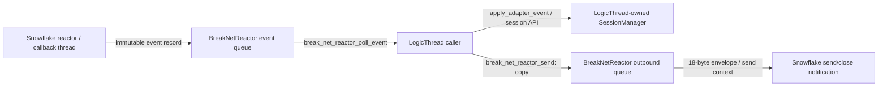

# Session Protocol 当前实现事实

## 范围与状态

本文记录仓库当前已经存在的 Session/Protocol C11 切片，而不是目标设计的完整承诺。实现位于 `engine/src/network/`，测试位于 `engine/tests/test_break_session.c`、`engine/tests/test_break_net_adapter.c` 和 `engine/tests/test_break_net_tls.c`。

Stage 5 Phase D（2026-10-24，branch `sdd/stage5-transport-security`）起本切片增加：TLS 传输模式（§TLS 模式）、CHALLENGE/AUTH-v2 会话认证握手（§CHALLENGE/AUTH-v2）、出站单调序号（§outbound 当前边界）、准入限速（§准入限速）——信任链与安全契约全文见 `docs/design/transport_security.md`。

构建目标事实：`break_net` 是 `engine/CMakeLists.txt` 顶层的正式静态库目标，只要 `BREAK_ENABLE_SNOWFLAKE=ON` 就会生成，独立于 `ENGINE_BUILD_TESTS`；它链接 `break_replication_core` 与 `snow::net`。`BREAK_ENABLE_SNOWFLAKE=ON` 且缺少有效 `SNOWFLAKE_SOURCE_DIR` 时配置以 FATAL_ERROR 失败（fail-closed）。基础 `engine` 目标保持 transport-neutral，不编译 Snowflake 头文件、不链接 `snow::net`/`break_net`；消费方显式 opt-in。`engine_demo` 与 `dxx_break` 均不消费 `break_net`，接入生产应用属于后续独立集成任务。测试可执行文件 `test_break_net_adapter`、`test_break_session`、`test_break_replication` 链接该正式 `break_net` 目标。

当前已有：

- `BreakNetEnvelope` 的编码、解码、默认 registry 校验和序列检查；
- `BreakNetMessageRegistry` 的固定容量消息定义表；
- `BreakNetEvent` 记录、adapter 有界事件队列和有界 outbound command 队列；
- 不透明的 `BreakSessionManager` 及其 LogicThread 侧状态迁移 API；
- TLS 传输模式、CHALLENGE/AUTH-v2 认证握手、出站单调序号、准入限速（Stage 5 Phase D，见下文专节与 `docs/design/transport_security.md`）；
- CTest 覆盖 envelope、little-endian 字节序、长度/ID/版本/序列错误、payload 拷贝、队列 FIFO、会话状态迁移和关闭后的拒绝行为；真实 loopback 覆盖 AUTH 入站、Session poll、handler dispatch、PING response、client close、`CLOSED` 和 stale 事件；TLS loopback 覆盖握手/加密往返/mTLS/负例。
- P8 的 `break_online_session.h` 只把 `AUTHENTICATED` Session 映射为在线大厅/NAT 的 session 域身份，未认证状态不能创建或加入；真实适配测试包含在 `test_break_session` 中。NAT 控制面另要求应用提供每 session 的 `session_key` 和 coordinator 本地 `challenge_key`，使用 stateless 来源绑定 challenge、HMAC-SHA256 和 replay window，不能把身份映射本身当作报文新鲜性证明。大厅、NAT、语音和 aspect 的实际合同见 `docs/design/online_session_network.md`。

当前仍没有：

- 跨重连 player account backend、Lua logic callback、editor RPC、online update 或服务端产品/反篡改代码；
- Snowflake per-context completion/drop 通知不足，因此 adapter 仍以 send-drained/close 顺序和 pending 引用维护本地 identity 生命周期；
- 自定义 registry 已用于 Session 的真实 wire codec 边界，但 envelope codec 当前仍以 default registry 为编码/解码入口。

## 数据流与线程所有权



实际线程边界如下：

- `BREAK_NET_DRIVE_STEP`：调用方是该 reactor 的唯一 Snowflake driver；`break_net_reactor_step` 以 atomic guard 拒绝并发 step。LogicThread 可以是该调用方，但 API 本身没有自动把调用方标记为 LogicThread。
- `BREAK_NET_DRIVE_THREAD`：Break 创建并 join 一个 host thread；该线程执行 `snow_net_thread_step` 循环。它不调用 SessionManager、World、ECS、Lua、UI 或 RHI。
- Snowflake callback 路径只构造 `BreakNetEvent` 并尝试入队；事件队列由 mutex 保护。事件入队失败时 callback 忽略失败，不能阻塞 reactor。
- `BreakSessionManager` 的公开 API 没有内部 mutex，也没有线程安全声明；它的创建、销毁、bind、状态迁移、`poll` 和 `apply_*` 都必须由同一个 LogicThread/拥有者串行调用。
- `break_net_reactor_poll_event` 是把队列中的事件记录移交给调用方；调用方负责在使用后调用 `break_net_event_release`。

## Message view、owned payload 与事件

`BreakNetMessageView` 是借用数据：

```c
typedef struct BreakNetMessageView {
    uint16_t message_id;
    uint16_t protocol_version;
    uint32_t sequence;
    const void *data;
    size_t size;
} BreakNetMessageView;
```

`break_net_message_view_init` 只记录 metadata 和指针，不取得 payload 所有权。非零 `size` 要求 `data != NULL`，大小不能超过 `BREAK_NET_MAX_PAYLOAD_SIZE`（64 KiB）。

`BreakNetOwnedMessage` 是 Break 分配并拥有的副本：

```c
typedef struct BreakNetOwnedMessage {
    uint16_t message_id;
    uint16_t protocol_version;
    uint32_t sequence;
    void *data;
    size_t size;
} BreakNetOwnedMessage;
```

`break_net_message_copy` 在成功返回前复制 payload；调用方随后修改或释放借用输入不会影响 owned message。零长度 payload 不分配。`break_net_message_release` 释放 payload、清零记录且可重复调用。

`BreakNetEvent` 包含事件类型、`uint64_t` connection key、reason 和一个可选的 `BreakNetOwnedMessage`：

```c
typedef enum BreakNetEventType {
    BREAK_NET_EVENT_CONNECTION_OPENED = 0,
    BREAK_NET_EVENT_MESSAGE_RECEIVED,
    BREAK_NET_EVENT_SEND_DRAINED,
    BREAK_NET_EVENT_CONNECTION_CLOSED,
    BREAK_NET_EVENT_TRANSPORT_ERROR
} BreakNetEventType;
```

事件入队是结构体所有权转移：`break_net_event_push` 把 event 写入队列后清零 caller 的临时记录。poll 又把记录移给调用方并清零队列槽位。消息事件的 owned payload 因而由队列持有，poll 后由调用方持有，最终由 `break_net_event_release` 释放。`BreakSessionManager` 的 `apply_adapter_event` 只读取事件，不取得或释放 `event->message` 所有权；测试明确验证这一点。

事件队列容量为 `BREAK_NET_EVENT_QUEUE_CAPACITY == 256`。outbound 队列容量为 `BREAK_NET_OUTBOUND_QUEUE_CAPACITY == 256`。

## Envelope wire format

当前 envelope 使用固定 18-byte prefix，字段按下面的 offset 编码，所有整数均为 little-endian：

| Offset | Bytes | Field | 当前约束 |
|---:|---:|---|---|
| 0 | 4 | `magic` | `BREAK_NET_ENVELOPE_MAGIC == 0x42524b31`; wire bytes `31 4b 52 42` |
| 4 | 2 | `protocol_version` | registry definition 的闭区间版本 |
| 6 | 2 | `message_id` | 必须在 default registry 中存在 |
| 8 | 2 | `flags` | 只允许 `BREAK_NET_ENVELOPE_FLAGS_MASK == 0x000f` 内的位 |
| 10 | 4 | `sequence` | context 存在时必须严格大于上一序列 |
| 14 | 4 | `payload_size` | header 之后的 payload 字节数 |
| 18 | `payload_size` | payload | 最大 64 KiB，且不超过 message definition 的 limit |

`BREAK_NET_ENVELOPE_HEADER_SIZE` 为 18，最大完整 envelope 为 18 + 64 KiB。编码用显式 `put16`/`put32`，解码用显式 `get16`/`get32`，不依赖主机字节序或 packed C struct。

`break_net_envelope_encode` 先查 default registry、版本、flags 和 payload limit，再检查 `size_t` 加法和输出 buffer 大小。`break_net_envelope_decode_with_context` 先检查最小 header、magic、payload 上限和“buffer 必须恰好等于 header + payload”，然后做 registry/版本/flags 校验，再做 sequence 校验。拒绝时输出 envelope 被清零；成功时 `payload` 仍是输入 buffer 内的借用指针，不由 decode 分配或释放。

默认 registry 当前包含下表各行（`BREAK_ENABLE_CRYPTO=ON` 时含 CHALLENGE，OFF 时没有 CHALLENGE、AUTH 收窄为 v1..1）：

| ID | Version | Payload limit | Phase | Duplicate policy |
|---:|---:|---:|---|---|
| `BREAK_NET_MESSAGE_ID_AUTH == 1` | 1..2（CRYPTO=ON）/ 1..1（OFF） | 64 KiB | `ANY` | `REJECT` |
| `BREAK_NET_MESSAGE_ID_PING == 2` | 1..1 | 64 KiB | `ANY` | `IDEMPOTENT` |
| `BREAK_NET_MESSAGE_ID_CHALLENGE == 3` | 1..1（仅 CRYPTO=ON） | 16 B | `ANY` | `REJECT` |
| `BREAK_NET_MESSAGE_ID_CORE_SNAPSHOT == 0x4001` | 1..1 | 32 + 64×24 B | `AUTHENTICATED` | `IDEMPOTENT` |
| `BREAK_NET_MESSAGE_ID_PHYSICS_SYNC_REPORT == 0x4002` | 1..1 | 16 B（`PHYSICS_SYNC_REPORT_BYTES`） | `AUTHENTICATED` | `IDEMPOTENT` |
| `BREAK_NET_MESSAGE_ID_PHYSICS_SYNC_CORRECTION == 0x4003` | 1..1 | 64 KiB | `AUTHENTICATED` | `IDEMPOTENT` |
| `BREAK_NET_MESSAGE_ID_CLOCK_PROBE == 0x4004` | 1..1 | 32 B | `AUTHENTICATED` | `IDEMPOTENT` |
| `BREAK_NET_MESSAGE_ID_SESSION_WELCOME == 0x4005` | 1..1 | 16 B | `AUTHENTICATED` | `IDEMPOTENT` |
| `BREAK_NET_MESSAGE_ID_CORE_VOICE == 0x4006` | 1..1 | 976 B（16 + 480×2，一帧 BRV1） | `AUTHENTICATED` | `IDEMPOTENT` |
| `BREAK_NET_MESSAGE_ID_CORE_VOICE_RELAY == 0x4007` | 1..1 | 992 B（16 字节头 + 一帧 976 B） | `AUTHENTICATED` | `IDEMPOTENT` |
| `BREAK_NET_MESSAGE_ID_CORE_VOICE_MUTE == 0x4008` | 1..1 | 16 B | `AUTHENTICATED` | `IDEMPOTENT` |

`0x4001` 是 core_app 只读 snapshot（`engine/apps/core_app/core_app_network.h`），只在认证后接受；默认表另含编辑器远程消息 4..21（v1..1，4096 B，`ANY`，`IDEMPOTENT`，见 `docs/design/editor_remote.md`），以及 `0x4002`/`0x4003` 物理同步报文（`engine/src/physics/physics_sync.h`：16 字节状态哈希报告；修正包为 16 字节头加完整物理快照，大小随刚体数变化，因此上限取全局 64 KiB），以及 `0x4004` 时钟探测报文（`core_app_network.h`：恰好 32 字节，transport 用 `_Static_assert` 绑定 `CORE_APP_CLOCK_PROBE_BYTES == BREAK_NET_CLOCK_PROBE_PAYLOAD`），以及 `0x4005` 会话欢迎报文（`core_app_network.h`：恰好 16 字节，服务端在认证后告诉对端它的会话号，transport 同样用 `_Static_assert` 绑定大小），因此 count 为 26（CRYPTO=ON）/ 25（OFF）。2026-11-18 追加 `0x4006` core_app 语音帧（服务端发往对端，一帧 BRV1 或 BRV2，见 `network/break_online_voice.h`；上限是一帧 480 样本的 BRV1，`test_break_session` 断言 `BREAK_NET_CORE_VOICE_MAX_PAYLOAD == BREAK_VOICE_MAX_DATAGRAM_SIZE`），count 变为 27 / 26。注册表头文件不依赖物理头文件，`break_session_registry_has_physics_sync_messages` 断言 `BREAK_NET_PHYSICS_SYNC_REPORT_PAYLOAD == PHYSICS_SYNC_REPORT_BYTES`。

同日补充：服务端也接收 `0x4006`（core_app 传输层的 `net_on_voice`，按连接做抖动缓冲，只计数），因此对端发来的语音不再计为 `handler_failed`；格式不符或重复的帧由接收器计数，连接不关闭。

2026-11-19 追加 `0x4007` core_app 语音转发（服务端发往对端；16 字节头含来源会话号，后接来源原样帧，见 `engine/apps/core_app/core_app_network.h`），count 变为 28 / 27。服务端只发不收：对端发来的 `0x4007` 没有处理函数，记为 `handler_failed`，连接保持。

同日追加 `0x4008` core_app 语音屏蔽请求（对端发往服务端，恰好 16 字节：magic、flags、目标会话号，见 `engine/apps/core_app/core_app_network.h`），count 变为 29 / 28。

默认表加入 `0x4001` 后，其他使用默认 registry 的 manager（例如编辑器远程会话）也会通过它的 envelope 校验。这些 manager 没有为 `0x4001` 注册 handler：已认证会话收到它时 `break_session.c` 记为 `HANDLER_FAILED`（计入 `handler_failed`），连接不关闭；只有 AUTH 的 handler 失败才会关闭连接。未认证的会话先受 `AUTHENTICATED` phase 检查。

registry 的最大定义数为 64；register 拒绝 ID 0、重复 ID、反向版本区间、超过全局 payload 上限或满表。公共 `BreakSessionConfig.registry` 也拒绝 `count > BREAK_NET_REGISTRY_MAX_MESSAGES` 的 malformed registry，避免后续 lookup 越过固定定义表；registry 仍是 borrowed immutable storage，必须活到 manager destroy。当前 envelope codec 使用 `break_net_message_registry_default()`，没有把自定义 registry 传入 codec 的 API。`phase` 和 `duplicate_policy` 已记录在定义中；Session 在 LogicThread apply/dispatch 阶段执行 phase、版本、payload limit 和 duplicate policy。默认 AUTH/PING 均为有意的 `ANY` phase：默认 registry 下 AUTH 在 `NEW` 中允许并成功后进入 `AUTHENTICATED`，PING 在 pre-auth `NEW` 中也允许且保持 `NEW`；自定义 registry 的 phase 仍严格限制（例如 `AUTHENTICATING` 定义在 `NEW` 中被拒绝）。默认 AUTH 重复策略为 `REJECT`，PING 重复策略为 `IDEMPOTENT`。测试 `break_session_default_registry_allows_auth_in_new_and_ping_pre_auth` 与 `break_session_uses_attached_registry_phase_and_duplicate_policy` 分别锁定这两个边界。

## SessionManager API 与状态机

`BreakSessionManager` 是 LogicThread-owned 且非线程安全；所有创建、绑定、状态迁移、poll 和 apply 都必须由同一拥有者串行调用。`BreakSessionConfig.registry` 是 borrowed immutable registry，必须活到 manager destroy；attach 的 reactor 是 borrowed，必须活到 detach（当前没有独立 detach API）或 manager destroy；handler 和 `user_data` 均为 borrowed，且 handler 仅由 LogicThread 调用。handler 收到的 message payload 只在 handler 调用期间有效。

`max_sessions` 是 manager lifetime capacity：closed slots 不会分配给其他 key（同一 key 的新 open 原地重开，见下文），因此它表示 manager 生命周期内可绑定的不同 connection key 数，而不是同时在线数。真实 loopback Session 流程已验证 AUTH -> Session poll -> handler -> PING response -> client close -> `CLOSED`/stale。

实际头文件 `engine/src/network/break_session.h` 的核心声明为：

```c
typedef struct BreakSessionManager BreakSessionManager;
typedef uint64_t BreakConnectionKey;
typedef uint64_t BreakSessionId;

typedef enum BreakSessionState {
    BREAK_SESSION_NEW = 0,
    BREAK_SESSION_AUTHENTICATING,
    BREAK_SESSION_AUTHENTICATED,
    BREAK_SESSION_CLOSING,
    BREAK_SESSION_CLOSED,
    BREAK_SESSION_UNKNOWN
} BreakSessionState;

typedef struct BreakSessionConfig {
    size_t max_sessions;
    BreakSessionId first_session_id;
    const BreakNetMessageRegistry *registry;
} BreakSessionConfig;

BreakSessionManager *break_session_manager_create(const BreakSessionConfig *config);
void break_session_manager_destroy(BreakSessionManager *manager);
size_t break_session_manager_poll(BreakSessionManager *manager, uint32_t max_events);
bool break_session_manager_bind(BreakSessionManager *manager, BreakConnectionKey connection);
bool break_session_manager_begin_auth(BreakSessionManager *manager, BreakConnectionKey connection);
bool break_session_manager_auth_succeeded(BreakSessionManager *manager,
                                          BreakConnectionKey connection);
bool break_session_manager_close(BreakSessionManager *manager,
                                  BreakConnectionKey connection, uint32_t reason);
bool break_session_manager_transition(BreakSessionManager *manager,
                                      BreakConnectionKey connection,
                                      BreakSessionState state);
bool break_session_manager_apply_event(BreakSessionManager *manager,
                                        BreakConnectionKey connection,
                                        BreakSessionEvent event);
bool break_session_manager_apply_adapter_event(BreakSessionManager *manager,
                                                const BreakNetEvent *event);
BreakSessionState break_session_manager_state(const BreakSessionManager *manager,
                                               BreakConnectionKey connection);
BreakSessionId break_session_manager_session_id(const BreakSessionManager *manager,
                                                BreakConnectionKey connection);
```

状态迁移实现为：

```text
NEW -> AUTHENTICATING -> AUTHENTICATED -> CLOSING -> CLOSED
  \
   ----------------------------------------> CLOSING
```

`transition` 只接受上述正向边；未知 connection、`BREAK_SESSION_UNKNOWN`、从 `CLOSED` 再迁移、向后迁移和重复 authentication 都返回 false。一个 connection 只能绑定一个 entry；容量由 `max_sessions` 限制，entry 关闭后不会复用。session ID 从 `first_session_id` 开始递增；从 `UINT64_MAX` 已分配 ID 后不能再 bind。

`break_session_manager_apply_adapter_event` 在 LogicThread 上处理生命周期和消息：

- `CONNECTION_OPENED`：调用 `bind`；active entry 的重复 open 分类为 duplicate，CLOSING entry 的迟到 open 分类为 stale，容量拒绝分类为 invalid。CLOSED entry 上的 open 视为 transport key 复用（snow connection uid = list magic | slot，slot 回收后新连接会携带旧 key）：因为 `CLOSED` 只在 reactor event queue 排空后才 finalize，此时的 open 必然属于新连接，entry 原地重置为 `NEW` 并分配新的 session ID（ID 耗尽时仍为 stale）。显式 `bind` API 仍拒绝已关闭的 key；
- `CONNECTION_CLOSED` 或 `TRANSPORT_ERROR`：调用 `close`，进入 `CLOSING`；关闭后的事件保留为 stale；
- `MESSAGE_RECEIVED`：先校验 manager 所附 registry（未配置时为 default registry）的版本、长度和 phase，再按 definition 的 duplicate policy dispatch；`REJECT` 表示每个 session 至多一次（同一 id 的第二条消息无论 sequence 都返回 duplicate，AUTH/CHALLENGE 语义），`IDEMPOTENT` 对相同 sequence 返回成功但不再次调用 handler；AUTH 的状态迁移仍在 handler 成功后完成，失败进入 `CLOSING`。因此 AUTH/PING 的策略来自 registry definition，而不是 message ID 特判；未来注册项也遵循同一规则。
- `SEND_DRAINED` 和未知事件：分类为 invalid。

`break_session_manager_last_result` 暴露最近一次 apply 分类，`break_session_manager_apply_stats` 暴露 applied、unknown、stale、invalid、phase rejected、duplicate 和 handler failed 的累计计数。handler 收到的 `BreakNetOwnedMessage` 是 manager 当前事件的借用视图，只在 handler 调用期间有效；handler 必须复制需要保留的内容。

`break_session_manager_poll` 是低层 close-finalization 原语：只推进 close finalization，不轮询 `BreakNetReactor`，因此对尚未通过 adapter apply 的 reactor event 不产生任何 session 影响。普通接入应使用推荐入口 `break_session_manager_poll_adapter`；它在 LogicThread 上每次最多消费 `max_events` 个 reactor event 并 apply/dispatch，只有在消费后确认 manager 所附 reactor event queue 已排空时，才把最多 `max_events` 个 `CLOSING` entry 改为 `CLOSED`；因此分页消费不会提前 finalize close。

### stale event

关闭会形成不可逆的 close watermark：entry 转为 `CLOSING`/`CLOSED` 后，后续同 connection 的消息和重复生命周期事件不会改变状态，并由 apply-result API 分类为 stale（未知 connection 则为 unknown）。closed entry 不会被其他 key 复用；同一 key 的新 `CONNECTION_OPENED` 会在原 entry 上重新开始（见上）。因此 `max_sessions` 是 manager 生命周期内可绑定的不同 connection key 数，而不是同时在线容量。adapter event queue 仍由 LogicThread 逐条 poll，事件 payload 在 apply 返回后由 caller 释放。

## TLS 模式

Stage 5 Phase D Task 2 起 adapter 支持服务端 TLS 接受模式（`BreakNetTlsConfig{cert_file,key_file,ca_file,verify_peer}` + `break_net_reactor_set_tls` + `break_net_reactor_is_tls`，CREATED 态仅一次）。配置后每条接受的连接必须先完成 TLS handshake 才有任何 envelope 解析；handshake 失败 fail-closed 关闭（零消息事件）。`verify_peer=1` 且 `ca_file==NULL` 直接拒绝配置（OpenSSL 语义下该组合是 VERIFY_NONE 伪装）。parser 在入口分流：`tls_ctx==NULL` 走原明文 parser（逐字节不变），否则走 TLS 路径（整段密文 burst 消费、握手/alert 密文锁外回注、握手完成同 burst 内排空残留应用密文防死锁）。所有 `snow_ssl_t` 触点都在 reactor 唯一驱动线程上（构造性满足）。限制：snow wrapper 吞并 `SSL_ERROR_ZERO_RETURN` 且无 TLS shutdown API——close_notify 与 TCP FIN 不可区分，adapter 以 TCP 层关闭事件为权威；无会话恢复（`SSL_SESS_CACHE_OFF`）。自签 fixture 证书仅供测试（`BREAK_TEST_SSL_FIXTURE_DIR` 宏注入）。全文见 `docs/design/transport_security.md` §2/§7/§8。

## CHALLENGE / AUTH-v2

Stage 5 Phase D Task 3 起（`BREAK_ENABLE_CRYPTO=ON`）Session 支持认证握手：accept 时每连接经 `break_crypto_random` 生成新鲜 16B `server_nonce` 并下发 CHALLENGE(id=3, v1, 16B)；客户端回 AUTH v2（严格 56B：`key_id[8] || client_nonce[16] || tag[32]`），tag = `HMAC-SHA256(psk, "BRKAUTH2" || server_nonce || client_nonce)`，PSK 由应用回调 `BreakNetAuthKeyFn` 按 key_id 解析（provisioning/rotation 留在 app 侧）。未知 key、tag 篡改、错误版本/长度、缺 nonce、配置后 AUTH v1 全部 fail-closed 进 CLOSING；常量时间 32 字节比较；认证只经 `break_crypto_hmac_sha256`/`break_crypto_random`（零自造密码学）。`break_session_set_auth(fn,user)` 为进程级配置（逐字接口无 manager 参数），仅在所有 session 为 NEW 且无认证操作在飞时可变更——操作租约钉住配置快照穿越首次状态迁移（review fix round 1），中途 set/clear 得 false。内置 CHALLENGE client helper 使用全零 key_id（裁决约定：接口无客户端 key 选择参数）。`break_session_set_max_age` 提供可选会话过期（单调时钟；过期扫描有界且不被 close 预算饿死）。重放论证：跨连接逐字节重放因 server_nonce 不同而失败，同连接靠 REJECT 策略 + 严格入站序号；post-auth 应用消息无独立 replay window（文档化边界）。全文见 `docs/design/transport_security.md` §3/§4。

## 准入限速

Stage 5 Phase D Task 4 起 adapter 支持 Snowflake admission hook 限速（`BreakNetRateLimitConfig{global_accept_per_sec,global_burst,per_ip_per_minute}` + `break_net_reactor_set_rate_limits`，CREATED 态仅一次）：全局 token bucket + 每 IP 滑窗（表固定 1024 项，满表 fail-closed 拒绝新 IP、已知 IP 继续计量）；拒绝发生在任何连接对象/identity/session 槽分配之前；拒绝计数为 `_Atomic uint64_t`（relaxed，跨线程公开观测），经 `break_net_reactor_admission_denied` 导出。全字段为 0 时不分配 admission 状态、注册 NULL admit，legacy 行为不变。已记录限制：admit 通过后建链失败不退还 token（保守方向）。全文见 `docs/design/transport_security.md` §5。

## adapter events 与 Snowflake callbacks

adapter 源码中保留了真实 Snowflake `snow_conn_handlers_t` 所需的 callback 形状：

```c
snow_nb_packet_t break_net_parser(snow_network_buffer_t *buffer,
                                  snow_connection_t *connection,
                                  void *ud);
void break_net_on_new_connection(snow_connection_t *connection, void *ud);
void break_net_on_packet(snow_connection_t *connection,
                         snow_recv_context_t *context, void *ud);
void break_net_on_send_drained(snow_connection_t *connection, void *ud);
void break_net_on_closed(snow_connection_t *connection, snow_close_t reason,
                         const char *error, void *ud);
```

这些是 `break_net_adapter.c` 中的 `static` 函数，实际签名来自 Snowflake 的 `snow/connection.h`，并已通过 `snow_net_thread_add_acceptor_with_handlers` 在 adapter `start` 阶段真实注册：

- `parser`：`snow_nb_packet_t (*)(snow_network_buffer_t *, snow_connection_t *, void *)`；
- `on_new_connection`：`void (*)(snow_connection_t *, void *)`；
- `on_packet`：`void (*)(snow_connection_t *, snow_recv_context_t *, void *)`；
- `on_send_drained`：`void (*)(snow_connection_t *, void *)`；
- `on_closed`：`void (*)(snow_connection_t *, snow_close_t, const char *, void *)`。

Snowflake 的真实 registration API 是：

```c
snow_status_t snow_net_thread_add_acceptor_with_handlers_ex(
    snow_net_thread_t *nt,
    snow_acceptor_t *a,
    snow_conn_handlers_t handlers,
    void *handlers_ud,
    snow_nt_admit_fn admit,
    void *admit_ud);
```

`handlers.parser` 必须非 NULL；acceptor 由 caller 持有，并且应在 reactor 销毁前存活。Break 当前使用带 admission gate 的 `_ex` 变体（`break_net_adapter.c` 的 `break_net_reactor_start`；`admission==NULL` 时传 NULL admit 保持 legacy 行为，非 NULL 时传 `break_net_admission_admit`）；acceptor 通过 Break 的 borrowed opaque setter 注入。没有 acceptor 时 `start` fail-closed。

因此，callback 函数中已有的 event 构造逻辑现在已由 session wire loopback 测试以真实 socket 驱动；adapter callback 的细节如下：

- parser 从 Snowflake network buffer 读取 18-byte header，使用 envelope decode/context 校验 magic、版本、ID、flags、长度和 sequence，复制 frame 到 `snow_recv_context_t` 并 push 到连接 recv queue；
- open callback 产生 `CONNECTION_OPENED`；
- packet callback 从 recv context 取借用 bytes，当前通过 `break_net_message_view_init`/`break_net_message_copy` 复制为 owned message，再产生 `MESSAGE_RECEIVED`；
- send-drained callback 产生 `SEND_DRAINED`；
- closed callback 按 `error != NULL` 选择 `TRANSPORT_ERROR` 或 `CONNECTION_CLOSED`，并记录 `snow_close_t` 转成的 `uint32_t reason`。

上述 callback 仍受事件队列容量限制；入队失败不会阻塞或直接调用 SessionManager。adapter loopback 测试通过真实 accept/read/write/close 驱动 parser、open/message/send-drained/close callback；Session loopback 测试通过真实 client close 后的 `poll_adapter` 验证 close watermark、`CLOSING -> CLOSED` 和 stale 语义。测试使用条件轮询与超时，不依赖固定事件时序。

## outbound 当前边界

`break_net_reactor_send(reactor, connection_key, message_id, protocol_version, data, size)` 把消息深拷贝到 256 项 outbound queue；驱动会编码 envelope 并接线到 Snowflake `snow_send_context_t`/`snow_net_thread_send`。成功入 Snowflake 后由 send-drained callback 释放对应 identity 的 pending 引用；close callback 只标记 closing，直到 pending 为零才释放其 recv context。失败路径立即释放临时 send context；stale UID 仍安全丢弃。队列满时立即返回 `BREAK_NET_SEND_OVERLOAD`，参数/消息拷贝失败返回 `BREAK_NET_SEND_INVALID`。adapter 已接线真实 outbound 路径，并由 session wire loopback 覆盖 AUTH 入站、handler dispatch、PING 出站 envelope 及 close/stop cleanup。**出站单调序号（Stage 5 Phase D Task 3 起）**：`break_net_reactor_send` 没有 sequence 参数；每个 connection identity 持有独立 `uint32_t outbound_sequence`（初始 0），首次实际 drain envelope 时分配 `++outbound_sequence`，peer 观察到 1、2、3…；重试已分配 command 保持相同 sequence，同连接 FIFO 与跨连接公平扫描不变；identity 复用时归零；到达 `UINT32_MAX` 后饱和不再递增/回绕（后续 command 走失败路径而不是发出 sequence 0）；encode/send 失败的命令留队且本次 drain 内同 connection_key 的后继一律跳过（同连接 FIFO 不可越过失败前项，其他连接不 HOL 阻塞）。入站 `decode_with_context` 的严格递增校验不变。`break_net_reactor_stop` 的 `timeout_ms` 是 bounded deadline：thread mode 等待 host exit，step mode 等待正在执行的 step driver 发布完成；超时统一返回 false 并保留 STOPPING、Snowflake reactor 和线程/step ownership，后续 stop 可完成清理。stop 不在 lifecycle lock 内调用 Snowflake step。

## 验证与边界

Task 5 文档应与实际验证保持一致：adapter focused normal/ASan/TSan 均为 38/38，Session focused normal/ASan/TSan 均为 34/34，TLS focused normal/ASan/TSan 均为 10/10；真实 loopback 覆盖 Snowflake acceptor registration、parser/open/message/send/close、AUTH 入站、Session poll/handler dispatch、PING response、18-byte wire envelope、client close 后 `CLOSED`/stale 语义和 bounded stop。默认 registry 下 AUTH/PING 均为 `ANY` phase；自定义 registry 的 phase/duplicate policy、duplicate 行为、lifetime capacity、borrowed registry/reactor/handler/payload contract 均已明确。仍不应把本切片写成已完成 player authentication backend、复制、Lua、editor、security、ECS/World 或 logic integration；Snowflake per-context completion/drop 通知不足、custom registry codec 当前仍使用 default registry 的真实 adapter codec 边界、LogicThread-only contract、full CTest 其他模块失败、fuzz 未运行以及 timeout/stop 的非 Linux 平台 lane 均保留为限制。


## 补充（2026-11-24）：0x4009 复制分片 session bridge 与真实 loopback

默认 registry 新增以下定义，crypto 开启/关闭时的总定义数由 29/28 变为 **30/29**；旧消息定义不变。

| ID | Version | Payload limit | Phase | Duplicate policy |
|---:|---:|---:|---|---|
| `BREAK_NET_MESSAGE_ID_REPLICATION_FRAGMENT == 0x4009` | 1..1 | 64 KiB（`BREAK_NET_MAX_PAYLOAD_SIZE`） | `AUTHENTICATED` | `IDEMPOTENT` |

`break_replication_session.{h,c}` 提供库级 `BreakReplicationSessionBridge`。API 分为 create/destroy、`connection_open`/`connection_close`（open 时绑定该连接的 expected base）、`send_fragment`、`bridge_tick`、可直接注册到 SessionManager 的 `handle_message`、`poll_completed`/`completion_release` 和 `bridge_stats`。每个 open key 有独立重组池与 expected base；`max_connections * max_pending_bytes_per_connection <= max_total_pending_bytes` 在 create 时静态保证，另受 stream、fragment size/count 配置约束。pending 只计池内分片负载；元数据、编码 scratch、完成暂存与已移交 payload 不在该预算内，completion queue 由独立的条数、单包和总字节上限约束。

接收 handler 只做 decode、重组和入队，不调用 World/aspect。完成项按 FIFO 保存 connection、delta id 和 owned payload，**ownership-at-poll**：只有 `break_replication_session_poll_completed` 才把 payload 所有权交给调用者，随后由 `completion_release` 释放；队列溢出不会覆盖旧项，close 会释放该连接的池与未取完成项，同 key 再 open 不继承 retired high-water。stats 提供 connections、pending bytes、completion count/bytes，以及 rejected、duplicate、completed、dropped、expired 计数。全部 API 为所有者线程语义，没有新增线程或锁。

真实 Snowflake 证据来自 `bridge_socket_loopback_reassembles_interleaved_duplicates_in_fifo` 和 `bridge_socket_reconnect_same_key_resets_completed_high_water`：raw TCP client 先完成 AUTH，reactor 使用 step 驱动，Session 事件全部由 `break_session_manager_poll_adapter` 消费；两个 delta 的分片乱序交织，相同 BRFG bytes 以不同 envelope sequence 重发，错误 expected base 被拒绝，完成按 delta 200、100 的 FIFO 次序交付，connection 与 payload 逐字节一致，consumer 计数在 poll 前为 0。随后真实 close/reconnect 复用同一 connection key，先完成 delta 40，再在重开池后完成 delta 1，证明 high-water 已重置。临时移除 registry 的 0x4009 项后两个新用例均失败，恢复后通过；没有用 handler 直调替代 socket 路径。

最终 normal focused 为 bridge **19/19**、Session **43/43**、wire **9/9**、fragment **28/28**。完整 Vulkan 注册 **468** 项，**464 执行通过、4 条件 skip、0 失败**；OpenGL 注册 **459** 项，**455 执行通过、4 条件 skip、0 失败**。两套 skip 均为 `test_d3d12_dependency_gate`、`test_core_app_nm_missing`、`test_core_app_nm_unsupported`、`test_core_app_nm_symbol_missing_unsupported`，不计为执行通过。ASan+UBSan（`ASAN_OPTIONS=detect_leaks=1`）与 TSan 的上述 focused CTest 均为 **4/4**，直接运行也分别为 **19/19、43/43、9/9、28/28**，无 sanitizer、leak 或 race 诊断。

本补充只关闭库级 Session/reactor 分片接线与真实 loopback 缺口。**生产 core_app/editor 接线、aspect drain、World delta、可靠恢复和完整资产链仍未完成**；本机结果也不预写远端或其他平台验收。


## 补充（2026-11-24）：aspect completion drain 与真实 0x4009 loopback

`break_online_aspect_session.{h,c}` 在 `BreakReplicationSessionBridge` 上提供 `BreakAspectSession`，并借用 owner-thread 的 `BreakAspectStore`。每次 `break_aspect_session_open` 都以 `break_aspect_schema_hash(store)` 作为该连接唯一的 expected base，调用方不能另传 base。网络 handler 仍只做 BRFG/v1 decode、重组和 completion 入队；只有 `break_aspect_session_drain(max_packets)` 才逐个调用 `break_aspect_apply`，按 FIFO 统计 applied/rejected/drained，继续处理拒绝后的后续包，并无条件 release 已取出的 completion。`max_packets=0` 不访问 store，所有 API 都没有新增线程或锁。

既有 aspect scheduler 的发送片长现在最多为 `BREAK_REPLICATION_WIRE_MAX_FRAGMENT_DATA_SIZE = 65496`，给 40 字节 BRFG 头保留空间；65536 配置返回 `BREAK_RUNTIME_INVALID`。`break_aspect_session_send` 复用 bridge 的 0x4009/v1 发送路径。由于 session 实现调用 aspect store/apply，`break_net` 与 `break_net_test` 的 PUBLIC link interface 均显式传递 `break_online`；`test_break_online_aspect_session_link` 只链接 `break_net_test`，以 **1/1** 证明消费方无需手工补依赖。

新增真实 raw TCP 用例先 AUTH，再由既有 `BreakAspectReplication` 的 AOI sync 产生 BRA1 分片，经默认 registry 的 0x4009、reactor step 和 `break_session_manager_poll_adapter` 到远端 bridge。预 adopt 的占位 handle 在 drain 前 active mask/revision 均为 0，两个字段不可读；drain 后为 42/-17。第二个 BRA1 包只改内部 schema hash 并重算完整性 checksum，bridge 仍接受而 apply 拒绝，值保持 42/-17。随后同 key close/reopen，delta 从 40/41 降为 1 仍完成，最终值为 84/-34。三次发送回调、三次完成、consumer 0→3、applied/rejected/drained=2/1/3、Session applied=5 且 invalid/handler_failed=0 都有非空断言。临时移除 0x4009 registry 项时用例 **11/12**（唯一新 socket 用例失败），恢复后 **12/12**。

focused normal、ASan+UBSan（`ASAN_OPTIONS=detect_leaks=1`）和 TSan 均为 **6/6 CTest、112/112 直接测试**：aspect session 12、link contract 1、bridge 19、Session 43、wire 9、fragment 28，无 sanitizer/leak/race 诊断。完整 Vulkan 注册 **463** 项，**459 执行通过、4 条件 skip、0 失败**；OpenGL 注册 **461** 项，**457 执行通过、4 条件 skip、0 失败**。四项为 `test_d3d12_dependency_gate`、`test_core_app_nm_missing`、`test_core_app_nm_unsupported`、`test_core_app_nm_symbol_missing_unsupported`，不计执行通过。

本节只交付库级 aspect drain 和真实 loopback。**生产 core_app/editor 接线、World delta、可靠恢复和完整资产链仍未完成**；条件 skip 不计执行通过，也不据此预写远端或其他平台结论。


## 补充（2026-11-24）：core_app 可选 aspect 复制传输

生产 `core_app` 新增默认关闭的 `--aspect-replication`，只允许与 `--network` 同用。开启后 transport 在 CoreAppThread 持有 authoritative/inbound 两个同 schema 的 `BreakAspectStore`、`BreakAspectReplication` 与 `BreakAspectSession`，并以 bridge 作为 `0x4009` handler 的 `user_data`。两个 POD 对象固定为 `{index=1,generation=1}` 和 `{index=2,generation=1}`；authoritative 保留槽 0，inbound adopt 同两句柄。welcome 先于 AOI 分片，连接以 reactor connection key open/close，tick 和 shutdown drain 均先 session tick 再有界 drain。默认关闭不创建这些状态，也不写 aspect trace。

网络 handler 仍只重组并入队，只有 `break_aspect_session_drain` 调 `break_aspect_apply`，且只写 diagnostic inbound store，不写 simulation/World。`event=network_aspect_stats` 字段为 opened、closed、applied、rejected、drained、sent_fragments、queue_depth、dropped、duplicates、pending_bytes；旧 `network_stats` 不变。

真实 `test_core_app_network_aspect` 为 **1/1**：客户端 BRFG decode 后本地重组并应用两个固定句柄，六类字段与 snapshot 一致；随后反序发送 3 个有效分片及 1 个重复分片，再发送 3 个内部 schema mismatch 分片。服务端恰为 applied=1、rejected=1、drained=2、queue_depth=0、dropped=0，sent_fragments 合同要求至少 2（一次运行为 12）。临时移除 0x4009 handler 时用例 **0/1**，计数变为 0/0/0；恢复后重新 **1/1**。全部 core_app network/offline **12/12**、lifecycle **12/12**，默认关闭路径没有 aspect trace。ASan+UBSan（detect_leaks=1）focused **9/9**；TSan 直接目标 **7/7**，另以正常服务端 + TSan 客户端完成 aspect loopback **1/1**。两个 core_app TSan 进程场景仍命中既有 Lua `longjmp buf` 环境失败，未记为通过。

**World delta、inbound 到 simulation、level rebaseline、可靠恢复仍未完成**；本节不包含远端或其他平台验收。


## 补充（2026-11-24）：BRWD/v1 仅定义 World delta 载荷，不扩展 Session 协议

World snapshot/delta 现在有独立 BRWD/v1 canonical codec。消息头为 60 字节：`BRWD`、version=1、kind=full/delta、schema_hash、level_generation、base/target snapshot id、base/target tick 和 record_count；记录头为 17 字节：record kind、u64 entity handle、component_id、byte_size，后接精确长度 payload。全部整数显式 little-endian；最多 **1,048,576** 条记录、**67,108,864** 字节整包。full 的 base id/tick 均为零且只含 CREATE/ADD，delta 的 base id 非零，target tick 必须递增。

解码严格检查 magic/version/kind/record kind、字段和总字节上限、非零 handle/component、record payload 形状、精确终止和无尾随，失败输出清零。`rebuild` 核对 schema/level/base/tick，full 支持稀疏 entity index 的占位重建，delta 只修改 caller World 的 staging clone；最终以 `break_world_snapshot_build` 和 `break_world_snapshot_id` 重算并核对 target id，不信任线传 hash。测试 **21/21**，deterministic fuzz **2000** 次（accepted 534、rejected 1324、over_limit 142），libFuzzer **20000 runs**。

**Session/bridge 接线仍未完成**：没有 BRWD message ID、registry 项、fragment 映射、认证 phase、completion drain 或 core_app 启用。ACK/NACK、重试、断点续传、base 恢复和可靠传输策略也均未定义；现有 0x4009 BRFG Session bridge 不会隐式传输或确认 BRWD。

最终完整 CTest：Vulkan **471 注册、467 执行通过、4 条件 skip、0 失败**；OpenGL **462 注册、458 执行通过、4 条件 skip、0 失败**。五项 focused ASan+UBSan（`detect_leaks=1`）与 TSan 均为 **5/5 CTest、146/146 直接测试**，无诊断；条件 skip 不计执行通过，也不构成 Session/bridge 接线验收。


## 补充（2026-11-24）：BRWD session、0x400B 控制与基线恢复

默认 registry 新增 `BREAK_NET_MESSAGE_ID_WORLD_DELTA = 0x400A` 与 `BREAK_NET_MESSAGE_ID_WORLD_CONTROL = 0x400B`，均为 v1、64 KiB payload、`AUTHENTICATED + IDEMPOTENT`；连同既有 0x4009，crypto 开启/关闭时定义总数为 **32/31**。0x400A 的 BRFG 外层 `base_id` 是由协议版本、schema hash、level generation 派生的固定 World stream epoch，真正的 base/target snapshot id 只在 BRWD 内层。0x400B 的 32 字节控制载荷为 `BRWC`、version/kind、delta id、target snapshot id/tick；NEED_FULL 的 delta id 为 0，target 是接收方最后确认的 id/tick，ACK 则以非零 delta id 加 target id/tick 精确确认一次发送。

`break_world_session_drain` 仍是唯一 World apply 入口；full 在空 staging World 重建并验证 target 后原子替换 destination，不把旧 World 的 allocator history 当作 delta base。成功 apply 后接收方合并最新 ACK；base/schema/level/target/apply 失败保留 World 和 confirmed baseline，并产生 NEED_FULL。NEED_FULL 在每连接每 N 个 target tick 最多发出一次，超限只增加 suppressed 统计。发送端在 ACK 建立基线前只发 full；ACK 后可从最新未确认 target 链接 delta。历史条数、BRWD 字节和单包均有界，预算压力或 NEED_FULL 会尝试带新 delta id 的 full；若该 full 本身超过 packet cap，则 publish 返回 INVALID，不消耗历史或 delta id。精确 ACK 裁剪到对应项；full 成功后才淘汰旧历史与旧 confirmed baseline。OVERLOAD 保留同一不可变 BRWD、delta id 和分片游标，下次只继续未发片段；close/reopen 清空双方基线、历史、限速与发送序号。语义是 at-least-once 与最终一致，不是 exactly-once。

真实 raw TCP/AUTH 测试覆盖乱序和重复 0x400A 分片、drain 前 World 不变、drain 后 snapshot id 一致、base mismatch 触发携带 last-good id/tick 的 NEED_FULL，以及后续 full 恢复。移除 0x400A registry 项时真实 Session 记录 invalid 且 bridge/World 均无推进；恢复注册的新鲜 loopback 再次通过。直接计数为 recovery **6/6**、loopback **2/2**、world session **11/11**、bridge **20/20**、aspect session **12/12**、Session **43/43**、wire **9/9**、fragment **28/28**、ECS replication **35/35**、world delta wire **23/23**，合计 **189/189**；focused normal CTest 含 target contract **11/11**。ASan+UBSan（`detect_leaks=1`）与 TSan 的九项 focused 均 **9/9**，无诊断。

完整 Vulkan 注册 **467** 项，**463 执行通过、4 条件 skip、0 失败**；OpenGL 注册 **465** 项，**461 执行通过、4 条件 skip、0 失败**。四项条件 skip 均为 `test_d3d12_dependency_gate`、`test_core_app_nm_missing`、`test_core_app_nm_unsupported`、`test_core_app_nm_symbol_missing_unsupported`，不计执行通过。**core_app 启用、生产 level rebaseline 策略与跨连接共享 World 仍未完成**；本段也不预写远端或其他平台验收。


## 补充（2026-11-24）：core_app World replication 的真实 TLS/AUTH loopback

`test_core_app_network_world` 使用真实 `core_app --network --world-replication` 与 TLS/AUTH-v2 客户端，不新增或修改 0x400A/0x400B 的协议定义。客户端把服务端 full 与 delta 的 BRFG 分片反序送入本地 `BreakWorldSession`，并在每个包完成前重复一个分片；两个包的 duplicate 计数各增加 1。completion 入队后、drain 前，World snapshot id 与 confirmed baseline 均不变；每次仅 drain 一包后，本地重建 snapshot id 与 BRWD 的服务端 target id 一致。首个 full 的 ACK 使后续 `hooks.tick` 自动发布以该 target 为 base 的 delta。

同一连接随后回传 full、内部 base id 不匹配的 delta 和恢复 full。服务端分别以 ACK、携带 last-good id/tick 的 NEED_FULL、ACK 应答，最终 `network_world_stats` 为 opened/closed=1/1、applied=2、need_full=1、rejected=1、full_publishes=1、delta_publishes=1、queue_depth=0、dropped=0，sent_fragments≥2。临时只移除服务端 0x400A handler 后，真实用例在首个入站 ACK 前失败，服务端 applied/need_full/rejected 均为 0；恢复注册后用例重新通过。

所有非 world 网络模式都断言没有 `network_world_stats` 行。该验收不表示 exactly-once，也不改变诊断 World 与权威 simulation 的边界。


### 最终 HEAD 验证补充（2026-11-24）

代码与测试提交 `13d74092e52b084e8036c9d0324abd99079f584c` 的完整 CTest 实际结果：OpenGL 注册 **477**，**473 执行通过、4 条件 skip、0 失败**（310.06 s）；Vulkan 注册 **479**，**475 执行通过、4 条件 skip、0 失败**（297.11 s）。两项 skip 均为 `test_d3d12_dependency_gate`、`test_core_app_nm_missing`、`test_core_app_nm_unsupported`、`test_core_app_nm_symbol_missing_unsupported`，不计执行通过。World loopback、clean-room 与两个 core_app archive 契约在两套后端均实际通过。后续仅追加验证文档，最终文档 HEAD 的 naming 门禁为 **2/2**；不重跑已完整通过的套件，不预写远端结果。


## 补充（2026-11-24）：World session 显式 level 换代与 BRWC/v2

`BreakWorldSession` 新增 owner 显式 `break_world_session_rebaseline` 与 level getter。新 generation 必须非零且严格递增；同一 session 只有一个 active level。pool/bridge 在固定存储上原地更新由 protocol/schema/level 派生的 stream epoch，清掉 pending、retired high-water、旧 completion 和发送侧 expected base，保留连接 key、容量及 expiry 配置；该复位路径不分配、不加锁。每个打开连接另清 baseline、confirmed、未确认 history、attempt 和 pending 控制，重置 delta id，并独立执行“新 full→当前 ACK→delta”。session/bridge 单调统计不因换代清零。

0x400B 初始代发送继续 outer/payload v1 和 32 字节 BRWC/v1；v1 接收仅限 current==initial。v2 使用 outer/payload v2 和 40 字节 BRWC/v2，在 offset 32 增加 u64 little-endian `level_generation`，其余 `BRWC`、version/kind、delta id、target snapshot id/tick 布局保持原偏移。v2 接收要求精确版本、40 字节长度且 level==current，包括初始 current=0 时的 level=0。换代后 v1 拒绝；v2 的旧、零或未来 level 均按 current 等值校验，不匹配时在修改 history、confirmed 或 force_full 前拒绝。0x400A 与 BRWD/v1 不变，registry 仅把 0x400B 的 outer version 上限扩为 2。

真实 raw TCP/AUTH 用例在同一连接内完成 level 7 full/ACK/delta，双方显式切到 8，并注入旧 epoch 反序/重复片及旧 v1/v2 ACK/NEED_FULL。旧流量不改变 World、baseline 或 sender history；新代 delta 在 full 前产生 NEED_FULL，新 full drain 后达到新 target id，只有当前 v2 ACK 后才发布新 delta。测试同时核对 transport key、session id、AUTH 次数和 TCP endpoint 未变，没有直接注入 completion。

本节不实现自动换级、资产选择/加载或 schema online migration，不允许混合 level，也不提供跨连接共享 live World、Runtime Core 映射、权威 simulation 合并或完整资产链。现有集成复验收据保持原记录，本节不预写推送、CI 或其他平台结果。


## 补充（2026-11-25）：共享 immutable snapshot publication 与双连接 fan-out

`BreakWorldSnapshotPublication` 以短锁保护 current 的 acquire/replace/close：acquire 在锁内检查状态并 retain，publish 在锁内完成准入、retain 和指针/元数据替换，旧 publication 引用在解锁后 release。snapshot build、diff、AOI、BRWD 编码、分片、网络发送、drain 和用户回调均在锁外。publish/close 仅由同一 owner 调用；destroy 前必须 close 并停止并发 publication API。lease 持有独立 snapshot 引用，不指向 publication，因此 replace、close 乃至 destroy 后仍可读取，最后由 `break_world_snapshot_lease_release` 清零释放。

publication 准入要求非空 snapshot、非零 tick、匹配 schema、未关闭和 epoch 不溢出；level 不得倒退，同 level tick 严格递增，更高 level 可重置 tick。失败原子保留 current/level/tick/epoch。session 的 `break_world_session_publish_snapshot` 另要求 target level 等于当前 session level，并由每个连接的 attempt/history 独立 retain borrowed target。一次构建的 S1/S2/S3 可发送给多个连接，但 full/delta、ACK/NEED_FULL、confirmed/history、OVERLOAD 游标和 rebaseline 仍逐连接独立；delta base 取该连接 newest-unacknowledged target，否则取 confirmed，绝不取 publisher 的全局 current。

新增真实 raw TCP/AUTH 用例交错读取两个连接的 BRFG 分片，覆盖 A OVERLOAD 时 B 继续、A 延迟 ACK 后 NEED_FULL 只令 A full、B 未 ACK S2 时 S3 仍以 S2 为 base，以及 drain 前两个 World 均不变。level 7→8 后旧 S1 lease 字节仍可读但发布返回 INVALID，新代两连接都重新 full。普通与 ASan+UBSan（显式 leak 检测）focused 均为 library 13/13、core_app 26/26；TSan library 13/13。core_app 的既有 Lua longjmp 与 normal-server/TSan-client 混合运行不冒充 TSan 服务端验收。

本项不新增消息或线格式，也不实现跨连接共享 live World、权威 simulation 合并、Runtime Core 映射、自动换级或完整资产链；publication_epoch 不进入 BRWD/BRWC，也不是持久身份。本补充不预写推送、CI 或其他平台结果。


## 补充（2026-11-25）：legacy full 兼容与 opt-in outbound 公平准入

`break_world_session_publish` 恢复旧的 full 行为：首 full 未 ACK 或收到 NEED_FULL 后，可用相同 tick 和新 delta id 发布 fresh full；实际构造 delta 时，base/target tick 仍必须严格递增。`break_world_session_publish_snapshot` 采用独立严格准入，即使将发 full 也拒绝相对该连接 base 的非递增 tick。内部 helper 仅以私有布尔区分两种准入，不增加公共模式。两个新增 recovery 用例同时验证上述 full 差异、legacy delta 拒绝和 snapshot strict 拒绝。

`BreakNetReactorConfig` 尾部新增 `fair_outbound_admission`，零初始化默认 **false**，保持旧的全局 256 OVERLOAD 合同。显式 true 时才按 `share=max(1,256/max(1,active_count))` 限制每 key queued；active 为 `valid && key!=0 && !retired`，closing 未 retired 仍计入。key 达份额即 OVERLOAD，即使全局未满；全局满同样拒绝。unknown key 不计 active 但按自己的 key queued 计数，active_count=0 时 share=256。late join 会缩小份额但不驱逐旧消息，global full 必须等 drain；每 key FIFO 与消息 ownership 不变。

双连接 World loopback 显式启用 fair admission，保留 A 饱和时 B 可推进及 pending-attempt lease 覆盖。adapter 直接边界用例验证默认旧行为、late join、真实 closing/retire、unknown key 与 global full。publication 公共头同时明确 publish/close single-owner、并发 acquire、destroy 前置条件，以及 immutable snapshot lease 可晚于 publication 的生命期。本文不预写最终全量或远端结果。


## 补充（2026-11-25）：Runtime 控制桥的身份、pending 与关闭合同

`runtime_world_session` 使用固定 **56 字节**控制命令（kind/reserved_zero 两个 u32，加 connection key、connection epoch、level generation、delta id、target snapshot id、target tick 六个 u64），并未改变 32/40 字节 BRWC/v1/v2。open drain 成功后分配的 `connection_epoch` 是 bridge 本地连接身份，close/reopen 不复用；它和 BRWC level、Runtime queue generation、publication epoch 各自独立。Task 1 的 envelope correlation 扩展保留完整 u64 cid，level 不承担 correlation，cid 也不参与逐连接网络序号。

所有有状态 Session 操作只在 owner drain 调用。queue 满返回 OVERLOAD 且 World 不变；OUTBOUND 饱和时 ACK 与 NEED_FULL 都保存同一 control/level/epoch/cid，下一 drain 优先重试，后续命令不得越过，OVERLOAD 逐次计数而 applied 仅成功一次。close 后不再 admit，已有 A1/B1/A2 与 pending 仍可 FIFO drain 恰好一次；pending 非零时 destroy=false 且资源保持，清空后才 unsubscribe/destroy adapter，session/publication 最后由调用方销毁。

默认 `fair_outbound_admission=false` 仍采用全局 256，显式 true 才启用逐 key share；新增默认真实双 socket 用例与原 opt-in 公平用例共同固定该边界。本补充不包含 snapshot/BRWD 数据面桥接、Runtime Coordinator 自动注册或权威 simulation 合并，不声明 exactly-once，也不预写远端结果。


## 修订（2026-11-25）：Runtime 外部控制来源与 epoch 终态

Runtime World 控制桥现在区分 direct submit 与外部 Bus publish：direct submit 只进入调用目标 adapter 的自有 queue，外部同 kind publish 才向各订阅 adapter fan-out。两者共用 56 字节命令和 owner-drain 状态校验，但只有 direct 成功增加 submitted/本地 Runtime sequence；外部消息可令 drained 大于 submitted。pending 使用真实 queue 计数加 control_pending，不再从这两个来源不同的累计值相减。

destroy 先 close admission、退订再检查 pending；false 后 ingress 已关闭而 drain 保持可用，最终重试不会重复退订。bridge 本地 connection epoch 耗尽是 `BREAK_RUNTIME_REJECTED` 并计 rejected，而非可重试 OVERLOAD。该修订不改变 connection epoch 的非零单调分配、level 检查、32/40 字节 BRWC 或网络逐连接 sequence。


## 补充（2026-11-25）：Runtime World 控制的六阶段关闭与终态恢复

`break_runtime_world_session_register_subsystem` 在既有 32/40 字节 BRWC/v1/v2 之外提供本 adapter 的生命周期绑定，不改变线协议。真实 Coordinator 依次运行 stop_admission、stop_producers、close_queues、drain、join、destroy；stop_producers 和 join 是外部 hooks。close 前接受的 direct/Bus 命令恰好一次 drain，close 后 ingress 不增加 pending，destroy 退订后 delivered=0。

pending 是 queue occupancy 加 control_pending。budget 不足或 OUTBOUND 饱和返回 DRAINING/TIMEOUT，连续重试不越过 FIFO，也不改变 control/level/epoch/cid；join TIMEOUT 保持 STOPPING 并仅恢复 join，destroy=false 则仅恢复 destroy。已消费 STALE/INVALID/REJECTED/CLOSED 且 pending=0 可完成关闭；transport CLOSED 清 pending 并计 rejected 后，后续 queue 项仍 drain。只有 pending=0 才销毁 adapter，World Session、Bus、snapshot publication 仍由调用方最后清理。

本切片不实现 snapshot/lease/BRWD/BRFG 的 Runtime 数据面、共享 live World、权威 simulation 合并或自动 core_app World 接线。core_app 现有 `"network"` subsystem 已注册，旧描述不再代表当前缺失；该既有 transport 注册不表示 World adapter 已注册。本节不预写推送、CI 或其他平台结果。


## 修正（2026-11-25）：Session/network 全量矩阵的 ON 配置收据

此前 469/470 是 `CORE_APP_ENABLE_NETWORK=OFF` 的缩减配置，不能代表旧 ON 的 480/482 完整验收。恢复原 RHI backend、`ENGINE_BUILD_TESTS=ON` 和固定 pin 后，ON/OFF 注册差集为 11 个 `test_core_app_network_*` 场景加 `test_core_app_net_transport`，共 12 项；这些真实 TLS/AUTH 与 transport 用例均已进入最终未过滤运行。

OpenGL 最终为 **481** 而非机械计算的 480：当前旧 cache 的 Vulkan include/library 变量额外满足 `test_rhi_device_type` 注册条件。新同 ON/backend/pin OpenGL 探针为 480，逐项差集只有该 RHI 测试，因此当前 481 如实保留，未过滤任何 network/transport 项。

最终 OpenGL **477 通过、4 skip、0 失败**，build 11.72 s、CTest 303.85 s；Vulkan **478 通过、4 skip、0 失败**，build 11.85 s、CTest 306.76 s。两树共同 skip 为 D3D12 dependency gate、`test_core_app_nm_missing`、`test_core_app_nm_unsupported`、`test_core_app_nm_symbol_missing_unsupported`，不计执行通过。完整名称、配置差集和 rc 见 Task 2 报告；不预写远端或其他平台结果。


## 修订（2026-11-25）：Runtime 控制 binding 唯一占用与销毁顺序

同一 World adapter 的 lifecycle binding 在同一或不同 Coordinator 都只能注册一次；第二次注册 REJECTED 且双方状态不变。已注册 adapter 的直接 destroy 在 close/unsubscribe 前返回 false，只有 lifecycle destroy callback 可在 pending=0 后清占用并销毁。注册失败回滚 binding，失败 destroy 保留可重试状态。

CREATED/FAILED 的 `break_runtime_world_session_abandon` 通过通用 Coordinator 的精确 user_data unregister 摘除 binding，再 free 并归还 adapter 所有权；其他状态或错误 Coordinator 返回 false。销毁未达 STOPPED 的 Coordinator 前，调用方必须先 quiesce 外部生产者和其他 adapter API，再 abandon 并手动 close/drain/destroy adapter。FAILED 后剩余命令仍按真实 pending 排空，不改变 BRWC、connection epoch、level、cid 或网络 sequence。

关闭恢复文案统一为：前序阶段不重跑，TIMEOUT callback 精确重入，成功销毁一次。该表述不要求 join/destroy callback 本身只进入一次。


## 补充（2026-11-25）：core_app 使用 BRWC/v2 与 envelope correlation

本次没有改变 0x400A/0x400B、BRWD 或 BRWC 布局。初始代仍可使用 32 字节 BRWC/v1，且 v1 接收仅限 current==initial；core_app 首 tick rebaseline 后，客户端和服务端都使用 40 字节 BRWC/v2，在 offset 32 携带当前 level，其余 delta id、target snapshot id 和 target tick 保持原偏移与含义。换代后的 v1 仍被服务端拒绝，没有通过放宽校验让旧客户端通过。

Runtime adapter 出站控制使用非零 envelope correlation extension；该扩展位于 BRWC payload 之外，不改变 40 字节内容，也不要求对端回显同一 cid。真实 loopback 检查 ACK/NEED_FULL/ACK 的 payload、target、level 和唯一性，并以完整 64 位值比较 cid；transport 另以高位非零常量证明没有截断。客户端向服务端发送的 v2 ACK 继续 correlation=0，沿用既有 uncorrelated 入站兼容。

入站 0x400B 仍只调用 `break_world_session_handle_control` 裁剪 history 或设置 force_full，不经过 adapter 再发 ACK。网络 at-least-once/final-consistency 语义不变，不新增 exactly-once、自动后续换级、Runtime BRWD 数据面、共享 live World 或权威 simulation 合并承诺。
