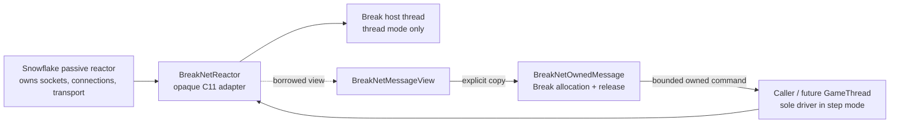
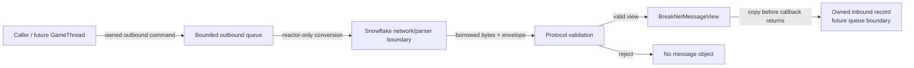

# Snowflake C11 Adapter

## Scope and status

This document describes the adapter currently present in `engine/src/network/`.
It is a C11 Break-side lifecycle and validation boundary over Snowflake's passive
network reactor. Snowflake remains responsible for sockets, readiness polling,
connection objects, transport queues, and the reactor implementation.

The adapter implements Snowflake callback registration and bounded parser/event
translation, but does not implement Session management, ECS/World integration,
Lua, editor integration, online updates, or security policy. It also does not
expose Snowflake concrete structs in its public headers.

When enabled, the engine CMake configuration requires
`SNOWFLAKE_SOURCE_DIR` and links the actual `snow::net` target. There is no
fallback transport; enabling `BREAK_ENABLE_SNOWFLAKE` without a valid
`SNOWFLAKE_SOURCE_DIR` fails configure with a fatal error.

## Target graph

`break_net` is a formal top-level static library target in
`engine/CMakeLists.txt`, produced whenever `BREAK_ENABLE_SNOWFLAKE=ON`,
independent of `ENGINE_BUILD_TESTS`. It contains the adapter, event, message,
protocol, envelope, message-registry, and session sources under
`engine/src/network/`, and links `break_replication_core` and `snow::net`.

The base `engine` target remains transport-neutral: it never compiles
Snowflake headers and never links `snow::net` or `break_net`. Consumers opt
into `break_net` explicitly. `engine_demo` and `dxx_break` do not consume
`break_net`; wiring it into a production application is deferred to a separate
integration task. The adapter/session/replication test executables
(`test_break_net_adapter`, `test_break_session`, `test_break_replication`)
link the formal `break_net` target when tests are enabled.

## Public API

`engine/src/network/break_net_adapter.h` exposes opaque handles:

```c
typedef struct BreakNetReactor BreakNetReactor;
typedef struct BreakNetConnection BreakNetConnection;

typedef enum BreakNetDriveMode {
    BREAK_NET_DRIVE_THREAD = 0,
    BREAK_NET_DRIVE_STEP = 1
} BreakNetDriveMode;

typedef struct BreakNetReactorConfig {
    BreakNetDriveMode drive_mode;
    int logical_index;
    uint32_t max_connections;
    int empty_connection_timeout_ms;
    uint32_t watchdog_interval_ms;
    uint32_t step_timeout_ms;
} BreakNetReactorConfig;

BreakNetReactor *break_net_reactor_create(const BreakNetReactorConfig *config);
void break_net_reactor_destroy(BreakNetReactor *reactor);
bool break_net_reactor_start(BreakNetReactor *reactor);
bool break_net_reactor_step(BreakNetReactor *reactor, int timeout_ms);
bool break_net_reactor_stop(BreakNetReactor *reactor, uint32_t timeout_ms);
bool break_net_reactor_is_ready(const BreakNetReactor *reactor);
```

`create` rejects a null configuration, invalid drive mode, and a negative
logical index. `start` is accepted once from the created state. A duplicate or
post-stop start is rejected. After Snowflake thread creation, every start failure
(missing acceptor, configuration setter failure, or handler registration failure)
terminates and destroys the Snowflake thread, clears the handle, and publishes
`FAILED`; `destroy` is then safe and `stop` does not attempt another reactor
step. `is_ready` reports Snowflake readiness in step mode and host-thread
readiness in thread mode.

## Passive reactor contract

The adapter calls Snowflake's passive C API (`snow_net_thread_create`, the
configuration setters, `snow_net_thread_step`, `snow_net_thread_is_ready`,
`snow_net_thread_terminate`, and `snow_net_thread_destroy`). Snowflake does not
create or own the Break host thread. The adapter owns the choice of driver and
runs exactly one driver for each reactor.

The adapter configures, before driving, the logical reactor index, maximum
connections, empty-connection timeout, and watchdog interval. A successful
Snowflake status is translated to the adapter's boolean success result. Any
non-`SNOW_OK` status fails the operation and moves the lifecycle to `FAILED`
where applicable; the public API intentionally does not expose Snowflake
status values.

### Step mode

With `BREAK_NET_DRIVE_STEP`, the caller is the sole reactor driver. After
`start`, the first `break_net_reactor_step(reactor, 0)` establishes readiness
and each later call performs at most one
`snow_net_thread_step(reactor, timeout_ms)`. `timeout_ms` must be non-negative.
An atomic driver guard rejects concurrent step calls, so callers must serialize
step calls and must not call them from more than one thread.

### Dedicated thread mode

With `BREAK_NET_DRIVE_THREAD`, `start` creates a Break-owned host thread. That
thread performs the initial Snowflake step, publishes readiness, and then runs
the Snowflake step loop. No other thread may drive the same Snowflake reactor.
The host thread does not call game logic or access GameThread-owned state. If
an `on_new_connection` failure marks the reactor `FAILED`, the loop observes
that state and exits without another Snowflake step; callers then use the normal
stop/destroy lifecycle without double cleanup.

## Ownership and boundaries

The opaque `BreakNetReactor` owns its private Snowflake thread handle, lifecycle
state, synchronization objects, and (in thread mode) the host thread handle.
Snowflake owns sockets, connections, readiness backends, parser/transport
internals, and transport queues. GameThread owns future Session/ECS/World
state; none of those systems are called by this adapter today.

Before `start`, callers must install a borrowed opaque Snowflake acceptor with
`break_net_reactor_set_acceptor`. The caller retains acceptor ownership and must
keep it alive through reactor shutdown. `start` fails closed without one and
registers the real `snow_conn_handlers_t` callbacks with Snowflake.

`BreakNetMessageView` is a borrowed view:

```c
typedef struct BreakNetMessageView {
    uint16_t message_id;
    uint16_t protocol_version;
    uint32_t sequence;
    const void *data;
    size_t size;
} BreakNetMessageView;
```

`break_net_message_view_init` only records metadata and checks that a non-empty
view has a non-null data pointer. The default maximum is
`BREAK_NET_MAX_PAYLOAD_SIZE` (64 KiB).

`BreakNetOwnedMessage` is a Break-owned copy. `break_net_message_copy` copies
the bounded payload and envelope metadata; the caller may change the borrowed
input after it returns. `break_net_message_release` frees the owned payload and
zeroes the record, and is idempotent. Zero-length payloads do not allocate.
The adapter exposes bounded inbound/outbound queues and registers the real
Snowflake parser/open/packet/send-drained/close callback vtable. Malformed packet
callbacks release the Snowflake recv context before returning. On connection open,
the adapter copies the UID, fd, reactor index, peer address and port into a private
identity slot; it never stores a raw Snowflake connection pointer. Identity setup is
failure-atomic: if context allocation, slot allocation, peer-address allocation/
formatting, or recv-context creation fails, the slot is zeroed, any recv context and
address are released, and no connection-opened event is emitted. The slot therefore
cannot permanently consume identity capacity or permit outbound work without a
context. `max_connections` must not exceed the fixed
`BREAK_NET_CONNECTION_IDENTITY_CAPACITY` (256); create fails closed rather than
accepting more Snowflake connections than the adapter can represent. Outbound drain constructs an independent `snow_recv_context_t`, encodes the 18-byte
`BreakNetEnvelope`, creates a `snow_send_context_t` with
`snow_send_context_create_with`, and calls `snow_net_thread_send`. Successful send
transfers ownership of the send context to Snowflake; failure frees it and retains
the Break command. `break_net_reactor_send` only accepts commands while the
reactor is `STARTED`; `CREATED`, `FAILED`, `STOPPING`, and `STOPPED` return
`BREAK_NET_SEND_CLOSED` before queue allocation. Commands for stale UIDs are
 dropped, and queue overload remains an explicit `BREAK_NET_SEND_OVERLOAD`
result. Each identity also tracks in-flight
send references: close marks the identity closing, and its recv context is released
only after Snowflake reports send-drained; failed sends release immediately. The
adapter is wire-connected. The focused `test_break_net_adapter` now drives a real
Snowflake TCP client through the adapter: it sends a valid 18-byte Break envelope,
asserts the decoded AUTH event (connection key, id, version, sequence, payload),
round-trips a PING response through `break_net_reactor_send`, then closes the
client and verifies close-event delivery, identity cleanup, and bounded stop
cleanup. Close-event delivery remains an
asynchronous adapter notification and is not used as the stop precondition.



The inbound boundary remains a contract boundary: callbacks validate and copy a
bounded payload before handing an owned record to the adapter event queue. The
outbound command path is implemented through the bounded queue and reactor-only
Snowflake conversion; it never invokes gameplay code from a reactor thread.
The focused adapter contract tests include real inbound, outbound, and close loopback E2E; the test client sends AUTH, receives the PING response, then closes. Close notification remains asynchronous and is not used as the stop precondition.



## Protocol validation

`break_net_protocol_validate` parses a 12-byte big-endian envelope:

- `uint16_t` version at offset 0;
- `uint16_t` message ID at offset 2;
- `uint32_t` sequence at offset 4;
- `uint32_t` payload length at offset 8.

The supported version is `BREAK_NET_PROTOCOL_VERSION` (1), message ID zero is
unknown, and the payload limit is `BREAK_NET_PROTOCOL_MAX_MESSAGE_SIZE` (64
KiB). The received buffer must be exactly header plus payload. Length addition
is checked before evaluation. Per-context sequence validation rejects duplicate
or backward sequences and jumps larger than `max_sequence_jump`. The view is
cleared before validation and remains empty on rejection. Validation has no
Session, ECS, gameplay, or parser callback dependency.

Validation results are `OK`, `INVALID_LENGTH`, `UNSUPPORTED_VERSION`,
`UNKNOWN_MESSAGE`, `INVALID_SEQUENCE`, and `OVER_LIMIT`.

## Lifecycle and stop/join semantics

The implementation uses `CREATED`, `STARTING`, `STARTED`, `STOPPING`,
`STOPPED`, and `FAILED` states internally. `destroy` is safe only when startup
has finished, the host thread is no longer valid, and the reactor is not
started or stopping. If called too early it returns without freeing live
reactor state.

`stop` is idempotent for `STOPPED`, and stopping a never-started `CREATED`
reactor transitions it to `STOPPED`. For an active thread-mode reactor it marks
`STOPPING`, calls `snow_net_thread_terminate`, and waits on the adapter-owned
lifecycle condition until the host thread publishes `host_exited` or the
caller deadline expires. The adapter calls the otherwise-unbounded
`platform_thread_join` only after observing `host_exited`; it then destroys the
Snowflake thread and publishes `STOPPED`.

A timeout returns `false` while retaining `STOPPING`, the host thread,
Snowflake reactor, and all adapter contexts. `destroy` is deliberately a no-op
while those resources remain live, and a later `stop` call may continue the
same shutdown. A lifecycle cleanup-owner flag prevents concurrent stop callers
from joining or destroying the same resources twice. POSIX uses the adapter's
`pthread_cond_timedwait` path; Windows uses `SleepConditionVariableCS` with the
remaining deadline. No platform-specific timed-join extension is used. Step
mode has no host join and retains its existing immediate terminate/destroy
ordering.
Close callbacks enqueue only Break transport events; they do not invoke
GameThread code. Outbound queued commands remain queued when conversion cannot
be proven safe, rather than being dropped or reported as sent.

```mermaid
sequenceDiagram
    participant C as Caller
    participant A as BreakNetReactor
    participant T as Adapter host thread
    participant S as Snowflake reactor

    C->>A: stop(reactor, timeout_ms)
    A->>A: state = STOPPING
    A->>S: snow_net_thread_terminate()
    alt thread mode exits before deadline
        S-->>T: step returns / loop exits
        T-->>A: host_exited + condition signal
        A->>T: platform_thread_join()
        A->>S: snow_net_thread_destroy()
        A->>A: state = STOPPED; signal waiters
        A-->>C: true
    else deadline expires first
        A-->>C: false; retain STOPPING and live resources
    else step mode
        A->>S: snow_net_thread_destroy()
        A->>A: state = STOPPED; signal waiters
        A-->>C: true
    end
```

## Verification boundary

The focused adapter test target exercises null configuration, step and thread
lifecycle, duplicate start, idempotent stop, bounded-stop retention and retry,
message copy lifetime and release, zero/max/over-limit payloads, protocol
version/ID/sequence validation, and real inbound/outbound/close loopback E2E.
Normal, ASan, and TSan runs each pass 30/30 adapter assertions with no sanitizer
report. The standard Snowflake-enabled engine build and full CTest results are recorded
in `docs/Implementation_Status.md`; sanitizer results are recorded there only
for commands actually run on the host.

This document must not be read as evidence that parser callbacks, Session,
ECS, Lua, editor, online-update, or security subsystems are implemented.
