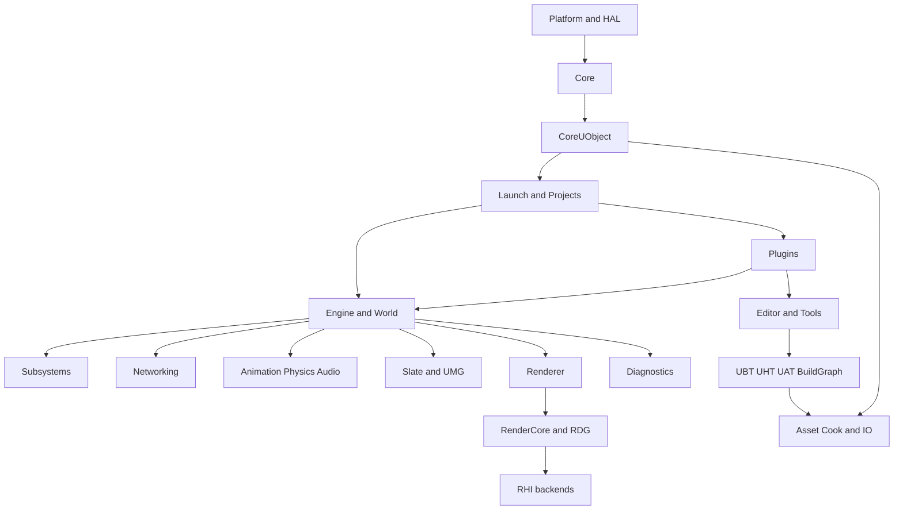
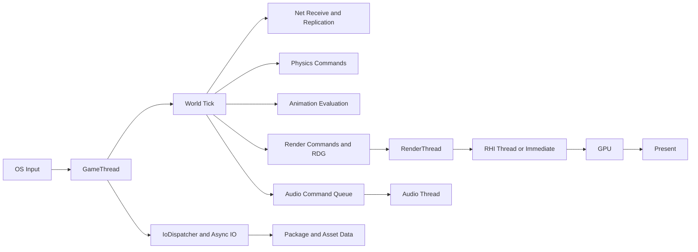
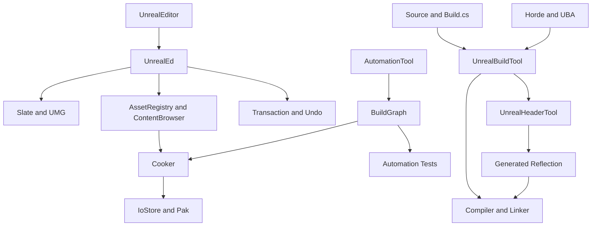
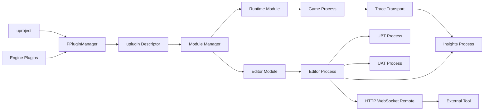

# Unreal Engine 5.8.3 概要设计

## 1. 文档定位与审计边界

本文是基于 Unreal Engine 5.8.3 源码基线的正式概要设计，描述引擎的层次、运行时协作、工具链、扩展点、质量属性和复核方法。源码根为 `/home/timeshift/opensource/game_engine/unreal/UnrealEngine-5.8.3-release`，引擎目录为 `$UE/Engine`。分析基线与详细设计生成时间均为 2026-10-19；章节规范见 `tools/CHAPTER_SPEC.md`，进度事实见 `PROGRESS.md`。

### 1.1 证据等级

| 等级 | 证据 | 本文用法 |
|---|---|---|
| A | `$E/Source`、`$E/Plugins`、`$E/Platforms` 中的 `.h/.cpp/.inl/.Build.cs/.cs`，带路径和行号的详细章节 | 线程、调用链、接口职责和依赖原则的主要依据 |
| B | `appendix/modules.json`、`appendix/dictionary`、`appendix/api`、`appendix/index`、`appendix/shaders_summary.json` | 统计、符号查找、模块/插件/配置/CVar/Shader 目录事实 |
| C | `design/01~32` 的交叉审计与流程归纳 | 跨系统关系、主流程摘要、风险和章节映射 |

“不遗漏”的边界是：在抽取器定义的范围内覆盖源码可见文件、反射宏、C#、Shader、CVar、Build/Target/Project/ini/uplugin 目录事实；不把静态可见性误称为运行时穷举。宏展开后才生成的符号、编译器/代码生成器派生内容、第三方 SDK/库内部实现、平台闭源实现、项目私有代码、运行时下载内容及机器配置不在源码审计可见范围。19 组 NoModule 内容属于 SDK/第三方边界；测试目录按项目规则排除。本文明确保留这些边界，不宣称绝对无遗漏。

## 2. 全引擎总体架构

### 2.1 分层与依赖原则

| 层 | 主要组件 | 职责 | 依赖原则 |
|---|---|---|---|
| 平台与 HAL | `ApplicationCore`、`HAL`、`Sockets`、`Networking`、平台 RHI | OS 窗口、输入、线程、文件、时间、套接字和 GPU 后端抽象 | 上层依赖抽象接口；平台实现不得反向依赖游戏层 |
| Core | `Core`、容器、内存、日志、委托、TaskGraph、Trace 基础 | 无 UObject 的基础运行时 | 只依赖平台/HAL与必要第三方，保持可启动性 |
| CoreUObject | `CoreUObject`、`UObject`、反射、序列化、GC、Package | 受反射对象生命周期和资产包模型 | 依赖 Core；引擎对象通过反射边界交互 |
| Launch/Projects | `Launch`、`Projects`、模块管理、命令行 | 进程入口、项目发现、模块与插件加载 | 只编排基础层和配置，不承载具体玩法 |
| Engine/World/GameFramework | `Engine`、`UEngine`、`UWorld`、`AActor`、组件、Tick | 世界、关卡、玩法、生命周期和子系统容器 | 依赖 CoreUObject；通过接口和委托向下交付 |
| Subsystems | `UEngineSubsystem`、`UGameInstanceSubsystem`、`UWorldSubsystem`、`ULocalPlayerSubsystem` | 按宿主生命周期提供可插拔服务 | 依赖宿主，不跨宿主持有不受控对象 |
| 网络 | `NetCore`、`Networking`、`Sockets`、`Iris`、Replication Graph、Online | 收发、可靠性、复制、预测和在线服务 | 传输与玩法解耦；网络回调回到规定线程 |
| 物理/动画/音频 | Chaos、Animation、ControlRig/RigVM、AudioMixer/MetaSound | 模拟、姿态评估、空间音频和设备输出 | 长计算异步化，结果以快照/命令交回宿主线程 |
| UI | `ApplicationCore`、Slate、UMG、InputCore | OS 消息、Slate 树、UMG、文本和输入路由 | UI 所有权归 UI/GameThread，渲染通过命令交接 |
| 渲染/RHI | `Renderer`、`RenderCore`、RDG、`RHI`、D3D/Vulkan/Metal/OpenGL | 场景组织、资源状态、命令翻译、GPU 提交 | RT/RHI 不直接修改 GT UObject；资源以引用和 fence 交接 |
| 资源/Cook/IO | AssetRegistry、DerivedDataCache、Cook、IoStore、Zen、Pak、Virtualization | 发现、派生、烹饪、容器化和异步 IO | 工具产物与运行时读取分层，缓存键必须稳定 |
| 编辑器 | `UnrealEd`、LevelEditor、ContentBrowser、PropertyEditor、PIE | 编辑、事务、资产和预览世界 | 编辑器能力不得泄漏到 Shipping 运行时 |
| 工具链 | UBT、UHT、UAT、BuildGraph、Horde、UBA、Automation | 编译、代码生成、打包、分布式构建和测试 | 以 Target/Build 配置为边界，工具可独立进程运行 |
| 插件 | `FPluginManager`、`.uplugin`、模块和 GameFeatures | 模块化发现、挂载、加载相位和扩展 | 插件依赖声明化，运行时/编辑器/开发者类型分离 |
| 诊断 | Trace、Insights、Stats、CSV、日志、崩溃、VLog、Profiler | 事件记录、分析、崩溃归档和性能审计 | 观测旁路化，禁止诊断路径阻塞关键帧 |

### 2.2 架构总图

依赖方向是从抽象基础到宿主与功能，再到后端和工具的组合；跨层访问使用模块公开接口、委托、消息或序列化数据。`modules.json` 实测共有 2,388 个模块、46,255 个头文件、1,448,920 个 C++ 符号；另有 2,747 个 Build.cs 文件，Build.cs 文件数与命名模块数不同是平台扩展、共享目录和目标规则等事实造成的。

### 2.3 模块统计事实

| Tier | 模块 | 头文件 | 符号 |
|---|---:|---:|---:|
| Runtime | 287 | 10,937 | 478,001 |
| Plugins | 1,712 | 27,602 | 737,480 |
| Editor | 143 | 4,495 | 128,492 |
| Developer | 147 | 1,838 | 62,339 |
| Programs | 76 | 796 | 23,771 |
| Platforms | 4 | 21 | 525 |
| NoModule | 19 | 566 | 18,312 |
| 合计 | 2,388 | 46,255 | 1,448,920 |

插件目录事实为 922 个 `.uplugin`、1,789 个插件模块声明和 1,598 条插件依赖。配置目录扫描为 348 个 Engine ini、1,780 个 section、14,974 个键；`UCLASS(config=)` 为 1,330 个类、1,641 个属性。

## 3. 跨系统架构图

### 3.1 运行时数据流

### 3.2 编辑器与工具链

### 3.3 插件与外部进程

## 4. 关键架构决策与质量属性

1. **线程隔离与消息传递**：GameThread/UI 维护世界、UObject 和 Slate；RenderThread 消费渲染命令；RHI 层翻译并提交 GPU；Audio、Physics、IO 和 Task workers 通过队列、任务、快照和 fence 交接。跨线程对象直接写入不是默认安全模型。
2. **互斥与所有权**：短临界区使用 `FCriticalSection`/`FScopeLock`，读多写少使用读写锁，等待使用 `FEvent`/`FTaskEvent`，无锁路径使用原子和 `TQueue`/`TMpscQueue` 等；所有权优先随命令移动或以引用计数/GC 可达性保持。
3. **对象、反射与 GC**：`UCLASS`、`USTRUCT`、`UPROPERTY`、`UFUNCTION` 生成反射元数据；`UObject` 由对象哈希、引用跟踪和 GC 管理。跨异步任务保存 UObject 必须遵守可达性和线程约束，非 UObject 数据使用值语义或显式生命周期。
4. **渲染三级流水线**：GT 组织场景并通过 `ENQUEUE_RENDER_COMMAND`/代理提交；RT 构造与编译 RDG，录制渲染命令；RHI 线程或立即模式执行后端命令并提交 GPU，fence/Present 完成闭环。
5. **网络可靠性**：Socket/NetDriver 负责连接和数据报，PacketHandler 负责包处理，Channel/Iris/复制系统负责序列化、可靠性、ack、带宽与重传；接收数据回到 GameThread 的分发点，避免网络线程直接改世界。
6. **异步物理与音频**：Chaos 通过命令和模拟快照隔离物理工作；AudioMixer 将 GT 命令转入音频线程和平台设备回调，实时回调不得执行阻塞 IO 或 UObject 操作。
7. **DDC/IoStore**：DDC 以派生数据键复用编译结果；Cook 将编辑时资产转换为目标平台数据，IoStore/Pak/Zen 提供容器与索引，IoDispatcher 负责异步读取。缓存一致性依赖稳定版本、平台和输入哈希。
8. **插件可扩展性**：`.uplugin` 描述模块、依赖、加载相位、平台限制和内容挂载；`FPluginManager` 发现并启用，模块接口和 Modular Features 提供运行时扩展，GameFeatures 负责可选内容生命周期。
9. **可观测性**：日志、Trace、Stats、CSV、LLM、MemReport、GPU breadcrumbs、Crash Reporter 与 Insights 形成旁路观测链；事件通道应可关闭、限流，并保留会话/线程/时间戳关联。
10. **平台移植性与安全**：平台差异集中在 HAL、TargetPlatform、RHI 和平台插件；外部进程、远程控制、HTTP/WebSocket、脚本和插件加载必须显式配置、校验输入并限制权限。
11. **性能与内存**：任务图、RDG 生命周期、资源池、对象池、增量 GC、Streaming 和 LOD 降低峰值；关键路径避免锁竞争、重复序列化和同步 IO，内存账本通过 LLM/Trace/统计接口审计。

## 5. 关键主流程摘要

### 5.1 启动到第一帧
`Launch` 解析命令行和项目，初始化平台、日志、内存、Trace、模块管理器与 `FPluginManager`；`Projects` 读取 `.uproject`/配置并确定目标模块；`FEngineLoop` 加载 CoreUObject、Engine、渲染、输入、音频和网络模块，创建 `UEngine`、World、GameInstance、Viewport 与子系统。第一帧中 OS 消息泵采集输入，GT Tick 世界和组件，RT/RHI 建立首个图形命令，Audio 接收设备命令，IO 加载首批包，最终 Present。

### 5.2 每帧并行
GT 执行输入、网络 Dispatch、World/Actor/Component Tick、Subsystem Tick 和 `SlateApplication`；RT 消费上一批命令并生成 RDG；RHI 线程执行后端命令；Physics 执行模拟并发布结果；Audio 消费命令并填充设备缓冲；IO/Streaming 读取和解压资源；Task workers 执行可并行任务。`FFrameEndSync`、Render fence、Physics 同步和 Audio fence 定义可见性边界。

### 5.3 输入、网络、资产和打包
输入沿 OS 消息泵→ApplicationCore→Slate/PlayerInput→Gameplay 路由；网络沿 Socket→PacketHandler→NetDriver→Bunch/Channel/Iris→World；资产沿 AssetRegistry/软引用→Async Loading/IoDispatcher→Package/Object→渲染或玩法资源；Cook 沿依赖收集→平台转换→DDC→容器写入→签名/分块；崩溃沿日志/Trace/崩溃处理器→报告与符号→Insights/CrashDebugHelper。

## 6. 全局线程模型与同步机制

本节只给跨章节索引和职责，详细线程创建点、队列、锁和 fence 见 `design/26_threading_concurrency_overall.md`，网络/IO 见 27，UI/输入见 28，渲染见 29，诊断见 30，消息事件见 31。

| 执行实体 | 所属/职责 | 典型输入输出 | 归属与约束 | 详细依据 |
|---|---|---|---|---|
| GameThread | 世界、UObject、Actor、网络分发、主 Tick | 输入、Socket 数据、任务回调 | 游戏逻辑和 UObject 默认归属；常由 `IsInGameThread()` 断言 | 26、27 |
| UI/Slate | OS 消息、Slate Tick/Paint、文本输入 | ApplicationCore 事件、Slate 树 | 通常与 GT 同属主线程；平台消息泵不得越权改 World | 28 |
| Net receive/send | Socket、HTTP、WebSocket、Messaging | Datagram、HTTP completion、消息包 | 收发线程只拥有传输缓冲；分发和玩法修改回 GT | 27 |
| RenderThread | 场景代理、RDG Setup/Compile/Execute、渲染命令 | `ENQUEUE_RENDER_COMMAND`、资源引用 | 不直接访问 GT UObject；通过代理和命令传递 | 26、29 |
| RHI/GPU submission | RHI command list、后端提交、Present/fence | RT 命令、GPU completion | 后端 API 的线程限制由 RHI 实现决定 | 29 |
| Audio thread/device | Audio command queue、Mixer、平台 callback | 声音命令、音频 buffer | 实时回调不可阻塞，不操作 UObject | 14、26 |
| Physics | Chaos solver、异步场景和结果快照 | Physics command/marshal | 模拟数据独占，结果在同步点回 GT | 12、26 |
| IO/Streaming | IoDispatcher、AsyncFileHandle、解压和资源流送 | IO request/completion | 以 request/future 交接，不在 GT 做同步磁盘 IO | 20、27 |
| Task workers | TaskGraph、`UE::Tasks`、并行编译 | Task prerequisite/result | 任务必须声明依赖，禁止隐式共享可变状态 | 02、26 |
| Diagnostics | Trace、Stats、CSV、Crash、Insights 接收 | Event/channel/file/socket | 旁路记录，采集与分析可分离 | 23、30 |

| 机制 | 作用 | 交叉引用 |
|---|---|---|
| `ENQUEUE_RENDER_COMMAND` | GT 到 RT 的命令投递 | 07、29 |
| TaskGraph/`UE::Tasks`/`AsyncTask(ENamedThreads)` | 声明依赖和线程切换 | 02、26 |
| RHI command list/RDG | RT 到 RHI/GPU 的批量翻译 | 06、07、29 |
| `TQueue`、`TMpscQueue`、`TLockFree*` | 非阻塞或低锁消息队列 | 02、26、27 |
| `FEvent`、`FTaskEvent`、委托、`FTSTicker` | 等待、完成通知和主线程 pump | 26、31 |
| `FRenderCommandFence`、GPU fence、AudioFence、Physics sync | 明确资源和结果可见性 | 26、29 |
| `FScopeLock`、读写锁、原子和内存序 | 临界区与共享状态保护 | 02、26 |

## 7. 核心数据字典与接口目录策略

概要设计不重新抄录百万级符号。真实原型、完整字段和行号以 `appendix/api/<Tier>/<Module>[.partNN].md` 及 `appendix/index/<Tier>__<Module>.tsv.gz` 为权威；模块依赖以 `appendix/modules.json` 和 `appendix/dictionary/modules.tsv` 为权威；CVar 以 `appendix/dictionary/cvars.md`、`cvars.tsv` 为权威；Shader 以 `appendix/api/Shaders/`、`appendix/index/shaders.tsv.gz` 为权威；插件/Target/Project/Config/UCLASS 配置以 `appendix/dictionary` 对应文件为权威。

关键 API 族包括：`FEngineLoop`/`UEngine`/`UWorld`、`UObject`/`UClass`/`FGCObject`、`FTaskGraphInterface`/`UE::Tasks`、`ENQUEUE_RENDER_COMMAND`/`FRHICommandList`/`FRDGBuilder`、`UNetDriver`/`ISocketSubsystem`/`FIris`、`FPhysicsSolver`、`FAudioDevice`/`FAudioThread`、`FSlateApplication`/`SWidget`、`IAssetRegistry`/`FAssetManager`/`FIoDispatcher`、`FPluginManager`/`IModuleInterface`、`UE::Trace`/`FOutputDevice`。查找方法是先按 Tier/模块定位 Markdown，再用 TSV 的 `path\tline\tkind\tscope\tname\tvisibility` 精确跳转，最后回到 `$E` 源码核对调用上下文和线程断言。

## 8. 详细章节映射与产物统计

| 章 | 标题 | 文件 | 覆盖域与一句话 |
|---:|---|---|---|
| 01 | Core 基础库 | `design/01_core_foundation.md` | 类型、容器、内存、数学、字符串、委托和模块基础 |
| 02 | HAL、线程、任务与同步 | `design/02_core_hal_threading.md` | 平台抽象、任务图、锁、事件和内存模型 |
| 03 | CoreUObject | `design/03_coreuobject.md` | 对象、反射、GC、序列化和 Package |
| 04 | Engine 核心框架 | `design/04_engine_framework.md` | UEngine/UWorld/AActor/组件/Tick |
| 05 | 世界分区与流式 | `design/05_world_partition_streaming.md` | World Partition、关卡实例和大世界流式 |
| 06 | RHI | `design/06_rhi.md` | 图形硬件接口和后端 |
| 07 | RenderCore/RDG/RenderThread | `design/07_rendercore_rdg_renderthread.md`, `_part2` | 渲染资源、RDG、Shader 与 RT |
| 08 | Renderer | `design/08_renderer_deferred_nanite_lumen.md` | 延迟渲染、Nanite、Lumen、VSM、后处理 |
| 09 | 材质、Shader、DDC | `design/09_shader_material_ddc.md` | 材质编译、Shader、派生数据和 TargetPlatform |
| 10 | Slate、UMG、输入 | `design/10_slate_umg_input.md` | 应用框架、输入、UI 和文本 |
| 11 | 网络与复制 | `design/11_networking_replication.md` | NetDriver、Sockets、Iris、复制和预测 |
| 12 | Chaos 物理 | `design/12_physics_chaos.md`, `_part2` | PhysicsCore、Chaos、碰撞、车辆、破碎 |
| 13 | 动画 | `design/13_animation.md` | AnimInstance、AnimGraph、ControlRig、RigVM |
| 14 | 音频 | `design/14_audio.md` | AudioDevice、Mixer、MetaSound 和音频线程 |
| 15 | AI 与玩法 | `design/15_ai_gameplay_mass.md`, `_part2` | AI、导航、Mass、StateTree、GAS、Tags、GameFeatures |
| 16 | 特效与程序化 | `design/16_fx_niagara_geometry_pcg.md` | Niagara、VectorVM、Geometry、PCG、Water、Hair |
| 17 | Sequencer/媒体/XR | `design/17_sequencer_media_xr_vp.md` | 时序、媒体、XR 和虚拟制片 |
| 18 | 启动与主循环 | `design/18_launch_engine_loop_modules.md` | Launch、FEngineLoop、模块和插件加载 |
| 19 | 构建与工具链 | `design/19_build_system_uht_uat.md`, `_part2` | UBT、UHT、UAT、BuildGraph、Horde、UBA、UGS |
| 20 | 资产与打包 | `design/20_assets_cook_package_io.md` | AssetRegistry、Cook、Pak、IoStore、Zen、Virtualization |
| 21 | 蓝图与脚本 | `design/21_blueprint_kismet_script.md` | Blueprint VM、Kismet、Python、Verse |
| 22 | 编辑器核心 | `design/22_editor_core.md` | UnrealEd、LevelEditor、ContentBrowser、PIE、事务 |
| 23 | 诊断与质量 | `design/23_diagnostics_tracing_testing.md` | Trace、Insights、Stats、日志、崩溃、自动化 |
| 24 | 运行时插件目录 | `design/24_plugins_catalog_runtime.md`及 `_part2~4` | 运行时插件机制、目录和模块依赖，覆盖 348 个插件 |
| 25 | Experimental/Editor 等插件目录 | `design/25_plugins_catalog_experimental_editor.md`及 `_part2~3` | 分类插件全量目录，覆盖 547 个插件 |
| 26 | 全引擎线程与并发 | `design/26_threading_concurrency_overall.md` | 线程、消息、互斥、fence 和并行帧 |
| 27 | 网络收发与 IO 线程 | `design/27_network_io_threads.md` | Socket、HTTP、Messaging、Iris、IoDispatcher |
| 28 | UI 与输入线程 | `design/28_ui_input_threads.md` | OS 消息泵、Slate、IME、触摸、手柄和输入延迟 |
| 29 | 渲染线程深入设计 | `design/29_render_thread_deep.md` | RT/RHI/GPU 提交、后端线程、PSO 和 Shader 编译 |
| 30 | 诊断接口 | `design/30_diagnostics_interfaces.md` | Trace、Insights、Profiler、崩溃、远程控制和调试器 |
| 31 | 消息事件机制 | `design/31_message_event_mechanisms.md` | 委托、Message Bus、FieldNotification、Exec 和回调 |
| 32 | 缺口审计 | `design/32_gap_audit.md` | 逐章复核结构、证据、统计、限制和全局风险 |

产物合计为 40 个章节文件、32,993 行、425 张 Mermaid 图；附录包含 5,177 个文件、1,448,920 个 C++ 符号、5,719 个 C# 文件和 89,219 个 C# 符号、1,693 个 Shader 文件及 55,388 条 Shader 记录。第 24/25 章插件数为 348+547=895，与 922 个全量 `.uplugin` 的差额对应不纳入两章目录口径的项目/平台及边界插件，实际映射以附录目录为准。

## 9. 覆盖率、风险与审计结论

### 9.1 原样覆盖率数字

| 项目 | 命中/总数 | 比率 |
|---|---:|---:|
| C++ 头文件 → api section | 46235/46255 | 99.96% |
| 有声明头文件 → 索引符号 | 43987/44011 | 99.95% |
| 反射宏 → 声明处符号 | 151580/152246 | 99.56% |
| 反射宏 Markdown 抽样 | 2993/3000 | 99.77% |
| C++ 类型抽样 | 1997/2000 | 99.85% |
| C++ 函数抽样 | 2968/3000 | 98.93% |
| 函数声明文本抽样 | 2991/3000 | 99.70% |
| C# 文件 | 5719/5719 | 100.00% |
| C# 类型抽样 | 1000/1000 | 100.00% |
| Shader 文件 | 1693/1693 | 100.00% |
| Shader include | 5193/5193 | 100.00% |
| Shader define | 9208/9208 | 100.00% |
| Shader numthreads | 1044/1046 | 99.81% |
| Shader struct | 1051/1052 | 99.90% |
| Shader 顶层函数 | 12546/12587 | 99.67% |
| CVar 字面量名称 | 12392/12392 | 100.00% |
| ini CVar 行 | 1575/1575 | 100.00% |
| `.uplugin`/Build.cs/Target.cs/uproject/Engine ini | 922/922、2747/2747、160/160、49/49、348/348 | 100.00% |

### 9.2 风险与限制

32 章审计识别 55 个可操作缺口，原始未确认项口径为 286 个；两者不是同一统计口径，均保留。主要风险包括：ctags 对无分号宏、`UPARAM`、`TEnumAsByte<enum E>`、实验性前缀和花括号初始化的识别缺陷；20 个模板头文件因 `PLUGIN_NAME` 占位符和模块同名覆盖；`#if 0` 被当作有效代码；Shader 有 37 条原文保留记录、30 个 stray brace blocks 和 2 个 unbalanced 文件；CVar 有 184 个运行时表达式名称、381 个默认值无法解析、57 个未初始化引用；34 个 `.uplugin` 使用宽松 JSON 解析，43 个字段无人读取。第三方/项目 CVar、闭源 SDK、平台实现和本地不存在的 `.uasset` 内容不可由本审计确认。

审计结论是：源码可见范围已形成可追溯的架构、接口目录、线程模型和统计闭环，但函数抽样为 98.93%，C++ 头文件、反射、Shader 探针均存在已解释偏差，因此不能宣称绝对无遗漏；使用者应把附录报告和各章 X.10 的限制作为工程决策前置条件。

## 10. 交付验收标准与后续复核计划

### 10.1 验收标准

1. `00_概要设计.md` 包含版本基线、边界、证据等级、全引擎分层、模块事实、4 张跨系统 Mermaid 图、质量属性、主流程、线程/同步表、接口目录策略、01~32 映射、统计、风险和复核计划。
2. 每个 Mermaid 图节点数不超过 40，节点标识使用字母数字下划线，标签使用引号；图块闭合且不含未定义的复杂 class 语法。
3. 路径均指向本项目现有文件；接口正文不替代 `appendix/api`、`index` 和 `dictionary` 的权威目录。
4. coverage 数字与 `appendix/COVERAGE.md` 原样一致，模块与 Shader/CVar/目录数字分别与 JSON 报告一致。
5. 文档不使用未完成标记；不把限制改写成绝对完整性声明。

### 10.2 后续复核计划

- 每次引擎源码更新后，先重新执行独立 coverage 检查，再比较 `modules.json`、CVar、Shader 和 catalog 的差异。
- 对函数抽样低于 99% 的类别，优先复核抽取器已知缺陷与新增宏形态，不把声明文本命中率替代符号索引命中率。
- 对线程与渲染行为，按 26~31 章的源码路径和线程断言复核创建点、队列消费者、所有权和 fence；必要时用 Trace/Insights 实测验证调度顺序。
- 对平台、第三方和项目内容，建立目标平台构建、Cook、IoStore 读取、网络收发和崩溃报告的端到端样本，单独标注不可由引擎源码推出的事实。
- 版本发布前复核章节映射、附录索引、插件数量和 55 个可操作缺口的处置状态，并重新生成本概要中的统计快照。
