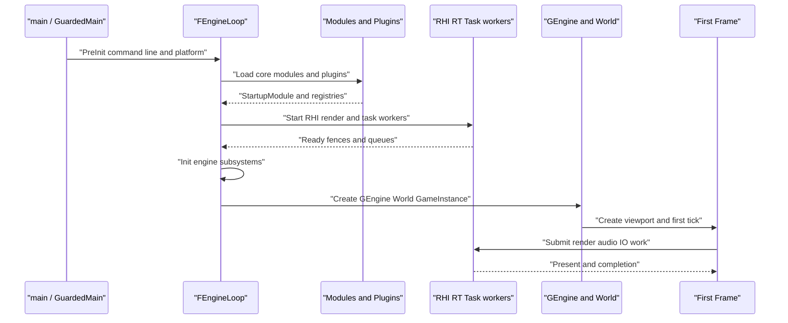
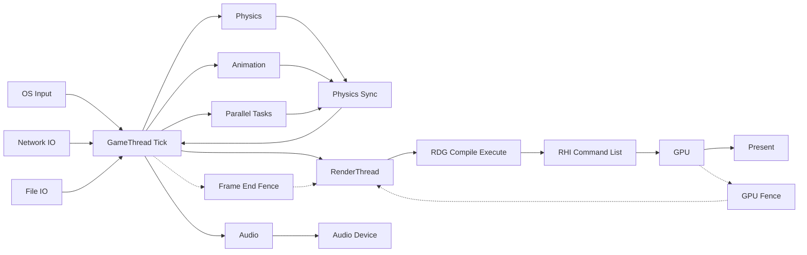

# UE 5.8.3 详细设计导航

> 本 README 只引用本目录中已存在的文件；章节行数按磁盘 `wc -l` 结果生成。

## 使用说明

- **源码基线**：Unreal Engine 5.8.3 release，源码根为 `/home/timeshift/opensource/game_engine/unreal/UnrealEngine-5.8.3-release`，引擎目录为 `$UE/Engine`；分析基线与统计生成时间以 `PROGRESS.md` 和 `00_概要设计.md` 为准。
- **证据等级**：A 为源码路径/行号，B 为 `appendix/` 抽取与索引，C 为 `design/01~32` 的交叉审计。接口原型和符号详情以 API 附录为准，章节负责架构、调用关系和线程边界。
- **覆盖率边界**：覆盖抽取器定义内的源码可见头文件、C#、Shader、CVar、Build/Target/Project/ini/uplugin；第三方 SDK、平台闭源实现、宏展开派生内容、项目私有代码、运行时下载内容、本地不存在的 `.uasset` 与机器配置不在可见范围。不能声称绝对无遗漏。
- **按问题查找**：先读 `00_概要设计.md` 定位分层和主流程，再读对应专题章；需要调用细节时进入详细章节，最后按 Tier/模块查 `appendix/api`，用 `appendix/index` 精确跳转，再查 `appendix/dictionary`、CSharp、Shaders、`index` 和 coverage 报告。
- **规范与事实**：章节结构、Mermaid 约束和限制写法见 [`tools/CHAPTER_SPEC.md`](tools/CHAPTER_SPEC.md)；进度事实见 [`PROGRESS.md`](PROGRESS.md)。

## 01~32 全量导航

| 章 | 标题 | 实际文件（行数） | 主题 | 关键图表/接口域 |
|---:|---|---|---|---|
| 01 | Core 基础库 | [`01_core_foundation.md`](design/01_core_foundation.md)（1065 行） | 类型、容器、内存、数学、字符串、委托与模块基础 | FMemory、TArray、FDelegate、IModuleInterface |
| 02 | HAL、线程、任务系统与同步原语 | [`02_core_hal_threading.md`](design/02_core_hal_threading.md)（1002 行） | 平台抽象、线程、TaskGraph/UE Tasks、锁、事件与内存模型 | FPlatformProcess、FTaskGraphInterface、UE::Tasks、FEvent |
| 03 | CoreUObject | [`03_coreuobject.md`](design/03_coreuobject.md)（947 行） | UObject、反射、GC、序列化与 Package | UObject、UClass、FGCObject、UPROPERTY |
| 04 | Engine 核心框架 | [`04_engine_framework.md`](design/04_engine_framework.md)（1085 行） | UEngine、UWorld、Actor、组件、Tick 与 GameFramework | UEngine、UWorld、AActor、UActorComponent |
| 05 | 世界分区与流式 | [`05_world_partition_streaming.md`](design/05_world_partition_streaming.md)（1062 行） | World Partition、关卡实例、流式和大世界 | UWorldPartition、ULevelStreaming、DataLayer |
| 06 | RHI | [`06_rhi.md`](design/06_rhi.md)（1133 行） | 渲染硬件接口与图形后端 | FRHICommandList、FRHIResource、IRHICommandContext |
| 07 | RenderCore/RDG/RenderThread | [`07_rendercore_rdg_renderthread.md`](design/07_rendercore_rdg_renderthread.md)（844 行）；[`07_rendercore_rdg_renderthread_part2.md`](design/07_rendercore_rdg_renderthread_part2.md)（458 行） | 渲染资源、RDG、着色器框架与 RT | FRDGBuilder、ENQUEUE_RENDER_COMMAND、FRenderResource |
| 08 | Renderer | [`08_renderer_deferred_nanite_lumen.md`](design/08_renderer_deferred_nanite_lumen.md)（1051 行） | 延迟渲染、Nanite、Lumen、VSM 与后处理 | FScene、FDeferredShadingSceneRenderer、Nanite、Lumen |
| 09 | 材质、着色器编译管线、DDC 与 TargetPlatform | [`09_shader_material_ddc.md`](design/09_shader_material_ddc.md)（903 行） | 材质编译、Shader 编译、派生数据与平台目标 | UMaterial、FShaderCompilingManager、DerivedDataCache |
| 10 | 应用框架、输入、Slate、UMG 与 UI | [`10_slate_umg_input.md`](design/10_slate_umg_input.md)（977 行） | OS 消息泵、输入路由、Slate/UMG、文本与焦点 | FSlateApplication、SWidget、UUserWidget、IInputInterface |
| 11 | 网络与复制 | [`11_networking_replication.md`](design/11_networking_replication.md)（1151 行） | NetDriver、Sockets、Iris、复制、预测与可靠性 | UNetDriver、ISocketSubsystem、UReplicationSystem、PacketHandler |
| 12 | Chaos 物理 | [`12_physics_chaos.md`](design/12_physics_chaos.md)（935 行）；[`12_physics_chaos_part2.md`](design/12_physics_chaos_part2.md)（182 行） | PhysicsCore、Chaos、碰撞、车辆与破碎 | FPhysicsSolver、FPBDRigidsSolver、Chaos、FBodyInstance |
| 13 | 动画 | [`13_animation.md`](design/13_animation.md)（1113 行） | AnimInstance、AnimGraph、骨骼网格、ControlRig/RigVM | UAnimInstance、FAnimNode_Base、URigVM |
| 14 | 音频 | [`14_audio.md`](design/14_audio.md)（1006 行） | AudioDevice、Mixer、MetaSound 与音频线程 | FAudioDevice、FAudioThread、FMixerDevice、UMetaSoundSource |
| 15 | AI、导航与玩法框架 | [`15_ai_gameplay_mass.md`](design/15_ai_gameplay_mass.md)（961 行）；[`15_ai_gameplay_mass_part2.md`](design/15_ai_gameplay_mass_part2.md)（364 行） | AI、导航、Mass、StateTree、GAS、GameplayTags 与 GameFeatures | AAIController、UNavigationSystemV1、UMassEntitySubsystem、UAbilitySystemComponent |
| 16 | 特效与程序化 | [`16_fx_niagara_geometry_pcg.md`](design/16_fx_niagara_geometry_pcg.md)（1085 行） | Niagara、VectorVM、GeometryCore、PCG、Water 与 Hair | UNiagaraSystem、FNiagaraSystemInstance、UPCGComponent、FNiagaraDataInterface |
| 17 | Sequencer/媒体/XR/虚拟制片 | [`17_sequencer_media_xr_vp.md`](design/17_sequencer_media_xr_vp.md)（953 行） | 时序、媒体、XR、LiveLink 与虚拟制片 | UMovieScene、UMediaPlayer、IXRTrackingSystem、ILiveLinkClient |
| 18 | 启动与主循环 | [`18_launch_engine_loop_modules.md`](design/18_launch_engine_loop_modules.md)（1233 行） | Launch、FEngineLoop、模块加载与插件启动 | GuardedMain、FEngineLoop、FModuleManager、FPluginManager |
| 19 | 构建与工具链 | [`19_build_system_uht_uat.md`](design/19_build_system_uht_uat.md)（907 行）；[`19_build_system_uht_uat_part2.md`](design/19_build_system_uht_uat_part2.md)（415 行） | UBT、UHT、UAT、BuildGraph、Horde、UBA、UGS | RulesAssembly、UHT、AutomationTool、BuildGraph |
| 20 | 资产与打包 | [`20_assets_cook_package_io.md`](design/20_assets_cook_package_io.md)（1330 行） | AssetRegistry、Cook、Pak、IoStore、Zen、Interchange 与 Virtualization | IAssetRegistry、UCookOnTheFlyServer、FIoDispatcher、FPackageStore |
| 21 | 蓝图与脚本 | [`21_blueprint_kismet_script.md`](design/21_blueprint_kismet_script.md)（1246 行） | Blueprint VM、Kismet 编译器、Python 与 Verse | UBlueprint、FKismetCompilerContext、FFrame、IPythonScriptPlugin |
| 22 | 编辑器核心 | [`22_editor_core.md`](design/22_editor_core.md)（997 行） | UnrealEd、LevelEditor、ContentBrowser、PropertyEditor、PIE 与事务 | UUnrealEdEngine、FLevelEditorModule、FAssetEditorToolkit、UTransactor |
| 23 | 诊断与质量 | [`23_diagnostics_tracing_testing.md`](design/23_diagnostics_tracing_testing.md)（1019 行） | Trace/Insights、Stats/CSV、日志、崩溃与自动化测试 | UE::Trace、FStatsThread、FOutputDevice、FAutomationTestFramework |
| 24 | 插件体系与运行时插件目录 | [`24_plugins_catalog_runtime.md`](design/24_plugins_catalog_runtime.md)（891 行）；[`24_plugins_catalog_runtime_part2.md`](design/24_plugins_catalog_runtime_part2.md)（185 行）；[`24_plugins_catalog_runtime_part3.md`](design/24_plugins_catalog_runtime_part3.md)（183 行）；[`24_plugins_catalog_runtime_part4.md`](design/24_plugins_catalog_runtime_part4.md)（1090 行） | 运行时插件发现、模块依赖、加载相位与目录 | FPluginManager、IPlugin、IModuleInterface、FModuleManager |
| 25 | 插件目录：Experimental/Editor/Developer 等 | [`25_plugins_catalog_experimental_editor.md`](design/25_plugins_catalog_experimental_editor.md)（1187 行）；[`25_plugins_catalog_experimental_editor_part2.md`](design/25_plugins_catalog_experimental_editor_part2.md)（366 行）；[`25_plugins_catalog_experimental_editor_part3.md`](design/25_plugins_catalog_experimental_editor_part3.md)（1049 行） | 分类插件全量目录与模块依赖 | FPluginManager、FPluginDescriptor、IPlugin、模块 Type/LoadingPhase |
| 26 | 全引擎线程、消息传递、互斥模型与同步点 | [`26_threading_concurrency_overall.md`](design/26_threading_concurrency_overall.md)（353 行） | 线程创建、队列、锁、任务、fence 与并行帧 | FTaskGraphInterface、UE::Tasks、TQueue、FRenderCommandFence |
| 27 | 网络收发线程、消息管线与 IO 调度 | [`27_network_io_threads.md`](design/27_network_io_threads.md)（449 行） | Socket、HTTP、Messaging、Iris、IoDispatcher 的线程链路 | FSocket、FReceiveThreadRunnable、FHttpThread、FIoDispatcher |
| 28 | UI、输入采集线程与事件路由 | [`28_ui_input_threads.md`](design/28_ui_input_threads.md)（400 行） | OS 消息泵、Slate、IME、触摸、手柄与输入延迟 | FSlateApplication、FWindowsApplication、ITextInputMethodSystem、GInputLatency |
| 29 | 渲染线程、RHI 线程与 GPU 提交横切 | [`29_render_thread_deep.md`](design/29_render_thread_deep.md)（388 行） | RT/RHI/GPU 提交、后端线程、PSO 与 Shader 编译 | FRHICommandList、FRDGBuilder、FRHICommandListExecutor、FGPUFence |
| 30 | 诊断工具接入方式、数据通道与架构 | [`30_diagnostics_interfaces.md`](design/30_diagnostics_interfaces.md)（549 行） | Trace、Insights、Profiler、崩溃、远程控制与调试器 | UE::Trace、FTraceAuxiliary、FRemoteControlModule、FMessageEndpoint |
| 31 | 消息、事件、委托、回调与执行入口 | [`31_message_event_mechanisms.md`](design/31_message_event_mechanisms.md)（479 行） | 委托、Message Bus、FieldNotification、Exec 与回调线程 | TDelegate、FCoreDelegates、IMessageBus、UFieldNotificationLibrary |
| 32 | 横切文档缺口审计 | [`32_gap_audit.md`](design/32_gap_audit.md)（385 行） | 逐章复核结构、证据、统计、限制与全局风险 | coverage.json、appendix/COVERAGE.md、X.10/X.11 审计 |

说明：第 24、25 章的分篇文件名、以及 07、12、15、19 的 `_partN` 文件，均为扫描结果；未把不存在的合并文件写入导航。

## 附录导航

### API 与索引

| 区域 | 实际统计 | 入口文件/目录 |
|---|---:|---|
| API `Runtime` | 296 个 Markdown 文件 | `appendix/api/Runtime/`；示例 [`AIModule.md`](appendix/api/Runtime/AIModule.md) |
| API `Developer` | 147 个 Markdown 文件 | `appendix/api/Developer/`；示例 [`AITestSuite.md`](appendix/api/Developer/AITestSuite.md) |
| API `Editor` | 144 个 Markdown 文件 | `appendix/api/Editor/`；示例 [`AIGraph.md`](appendix/api/Editor/AIGraph.md) |
| API `Programs` | 76 个 Markdown 文件 | `appendix/api/Programs/`；示例 [`ASDTool.md`](appendix/api/Programs/ASDTool.md) |
| API `Plugins` | 1706 个 Markdown 文件 | `appendix/api/Plugins/`；示例 [`ACLPlugin.md`](appendix/api/Plugins/ACLPlugin.md) |
| API `Platforms` | 4 个 Markdown 文件 | `appendix/api/Platforms/`；示例 [`OXRVisionOS.md`](appendix/api/Platforms/OXRVisionOS.md) |
| API `NoModule` | 19 个 Markdown 文件 | `appendix/api/NoModule/`；示例 [`_nomodule__Developer__Source__Developer__TextureFormatOodle__Sdks.md`](appendix/api/NoModule/_nomodule__Developer__Source__Developer__TextureFormatOodle__Sdks.md) |
| API `CSharp` | 123 个 Markdown 文件 | `appendix/api/CSharp/`；示例 [`Agent.md`](appendix/api/CSharp/Agent.md) |
| API `Shaders` | 129 个 Markdown 文件 | `appendix/api/Shaders/`；示例 [`Plugins__Animation__DeformerGraph__Shaders__Private.md`](appendix/api/Shaders/Plugins__Animation__DeformerGraph__Shaders__Private.md) |
| 符号索引 `appendix/index` | 2,506 个 `.tsv.gz` | [`appendix/index/`](appendix/index/)（目录中含 CSharp、各 Tier 与 `shaders.tsv.gz`） |
| C++ 总量 | 46,255 个头文件，1,448,920 个符号 | [`appendix/modules.json`](appendix/modules.json) |
| C# | 5,719 个文件，89,219 个符号；123 个 API Markdown | [`appendix/csharp_summary.json`](appendix/csharp_summary.json)、[`appendix/api/CSharp/`](appendix/api/CSharp/) |
| Shader | 1,693 个文件，55,388 条记录；129 个 API Markdown | [`appendix/shaders_summary.json`](appendix/shaders_summary.json)、[`appendix/api/Shaders/`](appendix/api/Shaders/) |

### Dictionary、coverage 与工具

- 数据字典实际文件：[`modules.md`](appendix/dictionary/modules.md)、[`modules.tsv`](appendix/dictionary/modules.tsv)、[`plugins.md`](appendix/dictionary/plugins.md)、[`plugins.tsv`](appendix/dictionary/plugins.tsv)、[`plugin_modules.tsv`](appendix/dictionary/plugin_modules.tsv)、[`plugin_deps.tsv`](appendix/dictionary/plugin_deps.tsv)、[`targets.md`](appendix/dictionary/targets.md)、[`targets.tsv`](appendix/dictionary/targets.tsv)、[`projects.md`](appendix/dictionary/projects.md)、[`projects.tsv`](appendix/dictionary/projects.tsv)、[`config.md`](appendix/dictionary/config.md)、[`config.tsv`](appendix/dictionary/config.tsv)、[`config_keys.tsv`](appendix/dictionary/config_keys.tsv)、[`uclass_config.md`](appendix/dictionary/uclass_config.md)、[`uclass_config.tsv`](appendix/dictionary/uclass_config.tsv)、[`cvars.md`](appendix/dictionary/cvars.md)、[`cvars.tsv`](appendix/dictionary/cvars.tsv)、[`cvars_ini.tsv`](appendix/dictionary/cvars_ini.tsv)。
- 统计报告：[`appendix/COVERAGE.md`](appendix/COVERAGE.md)、[`appendix/coverage.json`](appendix/coverage.json)、[`appendix/csharp_summary.json`](appendix/csharp_summary.json)、[`appendix/shaders_summary.json`](appendix/shaders_summary.json)。
- 工具脚本实际为 6 个：[`tools/extract_api.py`](tools/extract_api.py)、[`tools/extract_cs.py`](tools/extract_cs.py)、[`tools/extract_shaders.py`](tools/extract_shaders.py)、[`tools/extract_cvars.py`](tools/extract_cvars.py)、[`tools/gen_catalog.py`](tools/gen_catalog.py)、[`tools/coverage_check.py`](tools/coverage_check.py)。

## 跨章节关系

| 关系域 | 主路径 | 章节交叉引用 |
|---|---|---|
| 线程与任务 | OS/Launch → GT/UI；TaskGraph/UE Tasks → physics、animation、audio、IO、RT；fence 回收结果 | 02、14、18、26、29 |
| 网络与 IO | Socket/HTTP/Messaging → PacketHandler/NetDriver/Iris → GT；IoDispatcher/AsyncFileHandle → Package/Streaming | 11、20、27 |
| 输入与 UI | OS 消息泵 → ApplicationCore → Slate/UMG/PlayerInput → GameFramework；IME/触摸/手柄同一事件边界 | 04、10、28、31 |
| 渲染 | GT 场景代理/命令 → RT/RDG → RHI command list → GPU/Present；资源以引用和 fence 交接 | 06、07、08、09、26、29 |
| 物理/动画/音频 | GT 发布输入 → worker/solver/mixer 并行 → 快照、命令或 AudioFence 回 GT/设备 | 12、13、14、26 |
| 消息与事件 | 委托、Message Bus、FieldNotification、Gameplay Message、Exec 与控制台命令连接模块边界 | 23、30、31 |
| 诊断 | Trace/Stats/日志/CSV/LLM/崩溃旁路采集 → 文件/网络传输 → Insights/调试器 | 23、30、32 |
| 启动与扩展 | main/GuardedMain → FEngineLoop → modules/plugins → GEngine/World；Build/Cook/插件目录为离线支撑 | 18、19、20、24、25 |

## 三张跨章节总图

### 全引擎线程模型

```mermaid
flowchart LR
  OS["OS and Platform"] --> GT["GT UI"]
  GT --> TG["TaskGraph UE Tasks"]
  TG --> PH["Physics Workers"]
  TG --> AN["Animation Workers"]
  TG --> AT["Audio Thread"]
  GT --> NET["Network IO"]
  NET --> GT
  GT --> IO["File IO"]
  IO --> GT
  GT --> RT["RenderThread"]
  RT --> RHI["RHI Thread"]
  RHI --> GPU["GPU"]
  GPU --> RHI
  GT --> TR["Trace Stats"]
  RT --> TR
  NET --> TR
  AT --> TR
  PH --> GT
  AN --> GT
  RT --> F["Render Fences"]
  F --> GT
```

队列/消息关系由 GT→Task workers、GT→RT 命令队列、Network/File IO completion、Audio command queue、Physics marshaling 和 Trace event transport 表达；26~31 章给出源码创建点与消费者。

### 启动总时序

### 运行时一帧总流程

实线表示数据/命令流，虚线表示同步边界；物理、动画、音频、任务和 RT 可与 GT 的不同阶段并行，具体可见性由 Physics Sync、Frame End Fence、GPU Fence 和 Audio 设备回调定义。

## 缺口与验收状态

- **审计范围**：已引用第 01~32 章；第 32 章记录 40 个章节文件、32,993 行、425 张 Mermaid 图，以及 55 个可操作缺口和 286 个原始未确认项。两种缺口统计口径不同，均保留。
- **覆盖率原样摘录**：C++ 头文件 46235/46255（99.96%）；有声明头文件→索引符号 43987/44011（99.95%）；反射宏 151580/152246（99.56%）；C++ 类型抽样 1997/2000（99.85%）；C++ 函数抽样 2968/3000（98.93%）；函数声明文本抽样 2991/3000（99.70%）；C# 文件 5719/5719（100.00%）；C# 类型抽样 1000/1000（100.00%）；Shader 文件 1693/1693（100.00%）；Shader include 5193/5193（100.00%）；Shader define 9208/9208（100.00%）；Shader numthreads 1044/1046（99.81%）；Shader struct 1051/1052（99.90%）；Shader 顶层函数 12546/12587（99.67%）；CVar 字面量名称 12392/12392（100.00%）；ini CVar 行 1575/1575（100.00%）；`.uplugin`/Build.cs/Target.cs/uproject/Engine ini 为 922/922、2747/2747、160/160、49/49、348/348（均 100.00%）。
- **限制**：C++ 抽取器的无分号宏、`UPARAM`、`TEnumAsByte<enum E>`、实验性前缀、花括号初始化和模板模块重名等缺陷按报告保留；Shader 有 37 条原文记录；CVar 有 184 个运行时表达式名称、381 个默认值无法解析；另有第三方、项目和平台闭源边界。
- **验收状态**：路径和文件名来自本次磁盘扫描；章节文件、附录入口、工具脚本和统计报告均可追溯。README 不把覆盖率数字改写成绝对完整性结论，后续复核项应以 `appendix/COVERAGE.md`、第 32 章和各章 X.10/X.11 为准。
