# 01 Core 基础库(类型/容器/内存/数学/字符串/委托/模块)

> 源码基线:UE 5.8.3 release(`$UE/Engine`)。本章覆盖 `Engine/Source/Runtime/Core` 中除 HAL 线程设施(`RunnableThread.h`、`ThreadingBase.h`、`Event.h`、`PlatformMutex.h`、`FThreadManager` 等,见线程章节)与 `Tasks/`、`Async/`(见异步章节)之外的全部子目录,以及独立模块 CorePreciseFP、MathCore、OodleDataCompression、Json、JsonUtilities、Cbor、XmlParser、Serialization、TraceLog、ImageCore、ImageWrapper。所有结论均出自对本仓源码的逐文件阅读;行号以本仓为准。

## 1.1 职责、边界与模块清单

### 1.1.1 Build 模块级清单(12 个)

| 模块 | 路径(相对 `$E/Source`) | Build.cs 依赖(Public/Private) | 职责一句话 |
|---|---|---|---|
| Core | Runtime/Core | Pub:TraceLog、GuidelinesSupportLibrary、AtomicQueue;Priv:BuildSettings、AtomicQueue、AutoRTFM、BLAKE3、OodleDataCompression、xxhash(另有平台相关 mimalloc/libpas/TBB/zlib 等,见 `Core.Build.cs`) | 引擎全部运行时模块的公共底座:类型、容器、分配器、字符串、委托、模块管理、序列化、配置、日志、数学、杂项 |
| CorePreciseFP | Runtime/CorePreciseFP | Pub:Core;`FPSemantics = Precise`、NoPCH | 必须以精确浮点语义编译的代码(VerseVM `VVMFloat.h` 与 `Internal/Math/PreciseFP.h`) |
| MathCore | Runtime/MathCore | Pub:Core | 独立图论数学工具(`UE::MathCore::Graph::DirectedGraphAlgo`,拓扑排序) |
| OodleDataCompression | Runtime/OodleDataCompression | External 模块,仅封装 `Sdks/2.9.16` 的 `oo2core_*` 静态库 | Oodle 数据压缩 SDK 的库封装(接口包装在 Core 的 `Compression/OodleDataCompression.h`) |
| Json | Runtime/Json | Pub:Core、RapidJSON;Priv:TraceLog | JSON DOM(`FJsonObject`/`FJsonValue`)与序列化器(`TJsonSerializer`/`TJsonReader`/`TJsonWriter`) |
| JsonUtilities | Runtime/JsonUtilities | Pub:Core、CoreUObject、Json | UObject/结构体与 JSON 互转(`FJsonObjectConverter`、`JsonObjectStructInterface`、`FJsonDomBuilder`) |
| Cbor | Runtime/Cbor | Pub:Core | RFC 7049 CBOR 编解码(`FCborWriter`/`FCborReader`/`ECborCode`) |
| XmlParser | Runtime/XmlParser | Priv:Core;NoPCH | XML DOM 解析(`FXmlFile`/`FXmlNode`)与 SAX 式 `FFastXml` |
| Serialization | Runtime/Serialization | Pub:Core、Json、Cbor;Priv:CoreUObject | 反射驱动结构体序列化:`FStructSerializer`/`FStructDeserializer` + Json/Cbor 后端 |
| TraceLog | Runtime/TraceLog | Pub include Core;`bRequiresImplementModule=false` | UE Trace(后称 Trace)底层:无锁日志事件写入、Channel/LogScope、传输 |
| ImageCore | Runtime/ImageCore | Pub:Core;Priv:CoreUObject、stb_image_resize2 | 基础图像结构 `FImage`/`FImageView`、`ERGBFormat`、DDS 读写 |
| ImageWrapper | Runtime/ImageWrapper | Pub:LibTiff、ImageCore;Priv:Core、zlib、UElibPNG、OodleDataCompression、UEJpegComp(第三方私有静态库) | 编解码插件接口 `IImageWrapperModule`(PNG/JPEG/TIFF/EXR/BCn) |

### 1.1.2 Core 内部子目录清单(不遗漏表,均为 Core.Build.cs 单模块内的目录)

| 子目录(Public/) | 职责一句话 |
|---|---|
| Containers | 全部容器与容器分配器策略(Array/Map/Set/SparseArray/BitArray/Queue/StringBuilder…) |
| Templates | 通用模板(MoveTemp/Forward/Invoke/TIsPODType/UniquePtr/FunctionRef…) |
| Traits | 类型萃取(`TIsContiguousContainer`、`IsTriviallyRelocatable`、`FunctionReturnType`) |
| Concepts | C++20 concept 库(`CContiguousRange`、`CCharType`、`CDerivedFrom`、`CIterable` 等约 50 个) |
| Algo | 算法库头文件命名空间 `Algo`(Accumulate/AllOf/BinarySearch/ForEach/Heap/Sort/Unique…) |
| Math | 数值类型与运算(FVector/FRotator/FTransform/FMatrix/FColor/FMath/LWC 双精度体系) |
| Memory | 内存工具(`FMemoryArena`、`LinearAllocator`、`FCompositeBuffer`、`FSharedBuffer`、`FMemoryView`) |
| String | 字符串工具头(`String/Numeric.h`、`Find.h`、`Split.h`、`LexFromString.h`…) |
| Utf8 | UTF-8 工具(`FUtf8Iterator`) |
| Delegates | 委托体系(TDelegate/TMulticastDelegate/IDelegateInstance/DECLARE_* 宏) |
| Logging | 日志类别、抑制系统(ELogVerbosity、FOutputDevice 接口、结构化日志) |
| Modules | 模块系统(IModuleInterface、FModuleManager、FModuleManifest、IModularFeatures) |
| Misc | 杂项大杂烩(FCommandLine/FParse/FConfigCacheIni/FPaths/FGuid/FDateTime/FEndian…) |
| Internationalization | 本地化(FInternationalization、FCulture、FTextLocalizationResource、StringTable) |
| Serialization | FArchive 体系、StructuredArchive、CompactBinary、MemoryReader/Writer、CustomVersion |
| Hash | 哈希函数包装(CityHash、BLAKE3、xxhash、Fnv、BuzHash、ShaderHash) |
| Compression | 压缩工具(Oodle 包装、CompressedBuffer、LZ4) |
| ColorManagement | 色彩空间定义(`FColorSpace`、传输函数、`sRGB`/ACES 转换) |
| IO | IoStore 相关公共类型(FIoChunkId、FIoDispatcher 接口、FIoBuffer、PackageStore) |
| GenericPlatform | 平台无关层接口(FPlatformMath/Memory/Time/Process/File/Misc/String…) |
| ProfilingDebugging | 剖析与调试(CsvProfiler、LoadTimeTracker、CpuProfilerTrace、StallDetector、DiagnosticTable) |
| Stats | 统计系统(DECLARE_CYCLE_STAT、FScopeCycleCounter、FThreadStats、StatsFile) |
| UObject(Core 内部分) | Core 侧 UObject 基础:NameTypes(FName)、ObjectVersion 系列、WeakObjectPtrTemplates |
| Features | 模块化特性(IModularFeatures) |
| FileCache | 目录监视缓存工具(FFileCache) |
| Virtualization | 虚拟化系统接口(IVirtualizationSystem) |
| Experimental | 实验设施(ConcurrentLinearAllocator、新增容器/IO 试验) |
| Analysis / Sanitizer / Audio / MemPro / FramePro / Instrumentation | 静态分析标注、RaceDetector、简易 WAV 读写、MemPro/FramePro profiler 对接、插桩 |
| AutoRTFM | AutoRTFM 事务内存支持头(实现模块在 Runtime/AutoRTFM) |
| Windows/Linux/Mac/Android/Apple/IOS/Unix/PosixOS/Microsoft/MSVC/Clang/IntelICX | 平台覆盖层,实现 GenericPlatform 接口 |

### 1.1.3 边界说明

- HAL 中与线程直接相关的头(`HAL/Runnable.h`、`RunnableThread.h`、`Thread.h`、`Event.h`、`PlatformMutex.h`、`PThreadEvent.h`、`ThreadSingleton.h`、`UESemaphore.h` 等)与 `Tasks/`、`Async/` 归属线程/异步章节,本章不展开;但 HAL 中的 `UnrealMemory.h`(FMemory)、`MemoryBase.h`(FMalloc)、`PlatformTime.h`、`PlatformProcess.h`、`PlatformFile.h`、`PlatformString.h` 属于本章范围。
- `Core/Public/UObject` 只含 FName、版本号、弱指针模板等"Core 侧 UObject 基础";UObject/GC/反射本体在 CoreUObject 及后续章节。
- 引擎第三方的 Oodle SDK 二进制在 `OodleDataCompression/Sdks/2.9.16`,本章只描述 `Core/Public/Compression/OodleDataCompression.h` 包装接口。

## 1.2 总体架构

Core 是静态链接进每个引擎二进制的最底层模块(无循环依赖),其余模块均 `PublicDependencyModuleNames = ["Core", ...]`。其内部层次自上而下:

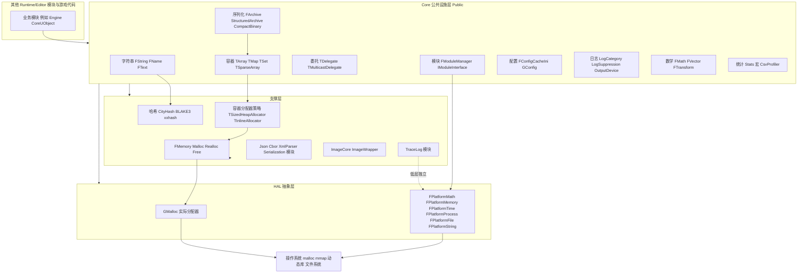

要点:

- 容器只依赖"分配器策略"模板,不直接触碰 GMalloc;策略类最终经 `FMemory::Realloc`(`HAL/UnrealMemory.h:212`)落到 `GMalloc`。
- `FName` 的存储(Entry 池)与哈希(`CityHash64`)全部在 Core 内自管理,不依赖 CoreUObject。
- 模块系统是引擎其余模块的装载器,自身只依赖 `FPlatformProcess` 的动态库接口;TraceLog 不需要 `IMPLEMENT_MODULE` 入口(`bRequiresImplementModule = false`,TraceLog.Build.cs),OodleDataCompression 则是纯 External 库封装模块(Type = ModuleType.External)。
- Json/Cbor/XmlParser/Serialization/ImageWrapper 都是"仅依赖 Core"的叶子模块,可被编辑器与运行时复用。

## 1.3 类图

### 1.3.1 容器与分配器策略

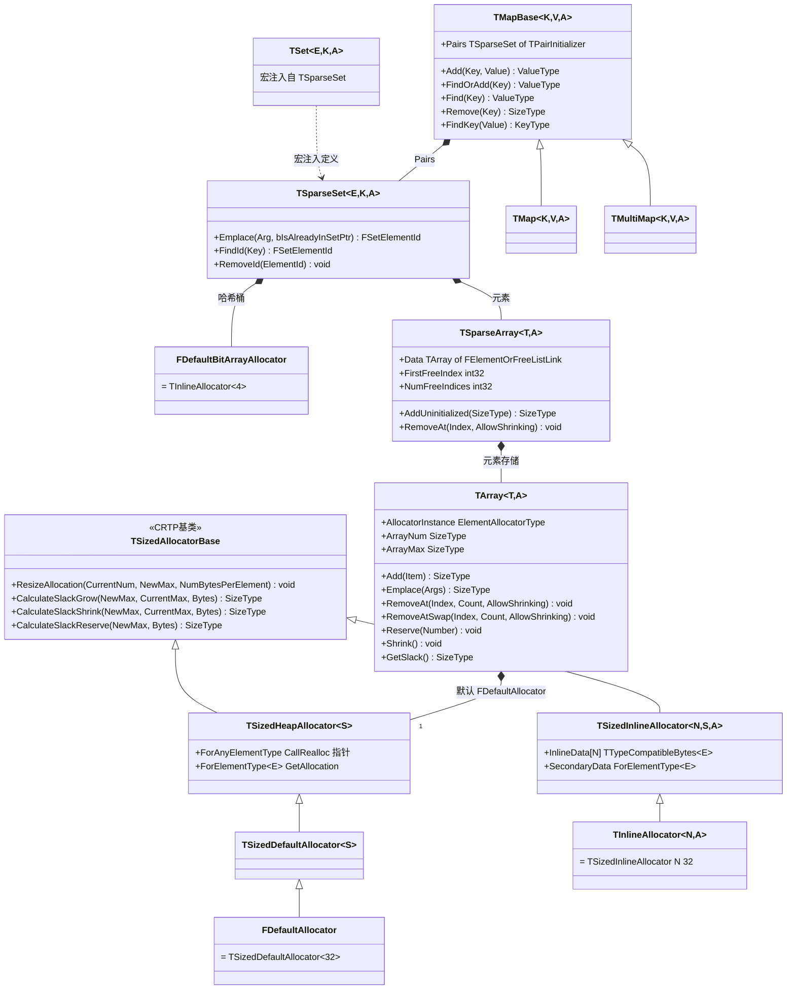

- `TArray` 声明于 `Containers/Array.h:767`,成员 `AllocatorInstance/ArrayNum/ArrayMax` 在 `Array.h:3810-3812`。
- 5.8 中 `TSet` 不再是独立类:`Containers/Set.h:31` 通过 `#define UE_TSPARSE_SET TSet` + `#include "SparseSet.h.inl"` 注入定义(Compact 分支在第 20 行,`UE_TCOMPACT_SET TSet`);`UE_USE_COMPACT_SET_AS_DEFAULT` 缺省 0(`ContainerAllocationPolicies.h:1911-1912`),因此默认 `TSet = TSparseSet`(稀疏数组 + 位图哈希);若打开则换成 `TCompactSet`。
- `FDefaultSetAllocator = TSparseSetAllocator<>`(`ContainerAllocationPolicies.h:1924`),其桶数公式 `GetNumberOfHashBuckets` 见 `ContainerAllocationPolicies.h:1793`:`RoundUpToPowerOfTwo(NumHashedElements / AverageNumberOfElementsPerHashBucket + BaseNumberOfHashBuckets)`。
- `TMapBase/TMap/TMultiMap` 经 `Map.h` 的 `TMAPBASE/TMAP` 宏由 `Map.h.inl:28/1179` 生成;`FScriptMap : TScriptMap<FDefaultSetAllocator, FScriptMap>`(`Map.h:433`)是反射/蓝图侧无类型视图。

### 1.3.2 FMalloc 家族与 FMemory

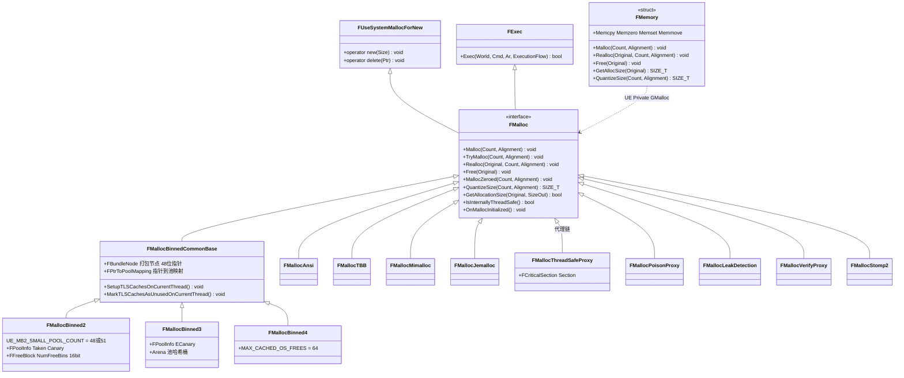

- `FMalloc` 接口在 `HAL/MemoryBase.h:96`,纯虚 `Malloc/Realloc/Free` 见 `MemoryBase.h:104/115/127`;全局指针 `GMalloc` 同文件 38/47 行(TSAN 原子包装)。
- `FMallocBinned2 : TMallocBinnedCommon<FMallocBinned2, UE_MB2_SMALL_POOL_COUNT, UE_MB2_MAX_SMALL_POOL_SIZE>`(`HAL/MallocBinned2.h:66`);Binned3 在 `HAL/MallocBinned3.h:86`,Binned4 在 `HAL/MallocBinned4.h:45`。公共 TLS 打包结构 `FBundleNode`(48 位指针 + 8 位计数)在 `HAL/MallocBinnedCommon.h:187`。
- 代理栈的包装顺序见 `Private/HAL/UnrealMemory.cpp:347-414`:BaseAllocator → (TraceMalloc) → (Stomp2) → 必要时 `FMallocThreadSafeProxy` → (VerifyProxy) → (LeakDetection) → (PoisonProxy) → (DoubleFreeFinder/FrameProfiler)。
- `FMemory` 是 `HAL/UnrealMemory.h:92` 的静态结构,内联转发到 `FMEMORY_INLINE_GMalloc`(`HAL/Memory.h:5-18`;`PLATFORM_USES_FIXED_GMalloc_CLASS` 时直接内联 `FMallocBinned2::MallocBinned2`/`FMallocBinned3::MallocBinned3` 静态单例)。

### 1.3.3 字符串体系

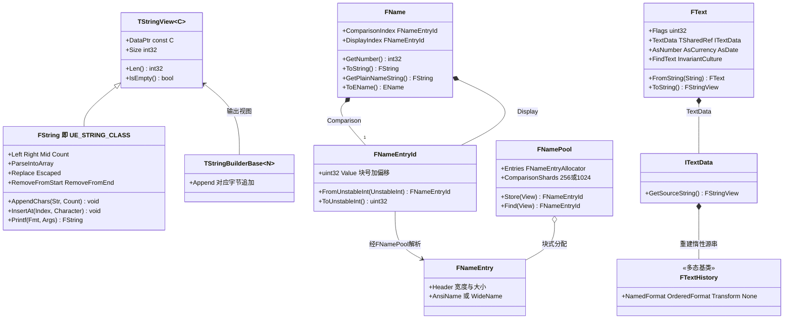

- `FString` 由 `Containers/UnrealString.h:19-29` 用宏 `UE_STRING_CLASS/UE_STRING_CHARTYPE` 实例化 `Containers/UnrealString.h.inl:58` 的同一套模板(`FUtf8String`/`FAnsiString` 同机制,见 `Utf8String.h`/`AnsiString.h`);`Printf` 是 `UnrealString.h.inl:1376` 的静态函数。
- `FNameEntryId` 编码:`UnrealNames.cpp:252-256`,`FNameMaxBlockBits=13`、`FNameBlockOffsetBits=16`,即 `Id = Block<<16 | Offset`,块内按 `alignof(FNameEntry)` 步进(`UnrealNames.cpp:581-593`)。
- `FNamePool` 分片:非大小写保留时 `FNamePoolShardBits=8`(256 片),`WITH_CASE_PRESERVING_NAME` 时 10(1024 片);哈希 `CityHash64`(`UnrealNames.cpp:923-931`),分片号取 `Hash>>32 % Shards`。
- `FText` 是句柄型值类(`Internationalization/Text.h:406`),真实数据在 `ITextData` + `FTextHistory`(`ITextData.h`),支持 `AsNumber/AsCurrency/AsPercent/AsDate` 等本地化格式化(`Text.h:428-443`)。

### 1.3.4 委托体系

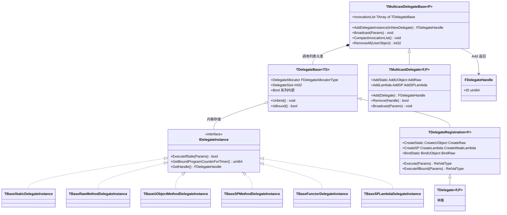

- 声明宏全部在 `Delegates/DelegateCombinations.h`(0~9 参的 `DECLARE_DELEGATE*`、`DECLARE_MULTICAST_DELEGATE*`、`DECLARE_EVENT*`、`DECLARE_TS_MULTICAST_DELEGATE*`),展开为 `Delegates/Delegate.h:205/209/215` 的 `typedef TDelegate<FuncType> Name;` / `typedef TMulticastDelegate<FuncType> Name;`。
- 用户策略:`FDefaultDelegateUserPolicy`(非线程安全,dev 构建带 `UE_DETECT_DELEGATES_RACE_CONDITIONS` 竞态检测)与 `FDefaultTSDelegateUserPolicy`(线程安全,`FThreadSafeDelegateMode`),见 `Delegates/DelegateBase.h:39-86`。
- 委托体(单播调用数据)内联存储在 `TDelegateBase` 的 `FDelegateAllocatorType` 分配区(`DelegateBase.h:98-102`),不经 UObject。
- `TMulticastDelegateBase::Broadcast` 自后向前遍历调用列表,调用后按需压缩(`MulticastDelegateBase.h:288-320`),列表元素是无锁非线程安全的内部单播(`MulticastDelegateBase.h:60`)。
- 动态委托(`DECLARE_DYNAMIC_*`)的展开在 `UObject/ScriptDelegates.h` 与 `UObject/ObjectMacros.h`(属 Core 头文件),实例派生自 `TBaseDynamicDelegate`,可反射/序列化,本章不展开。

### 1.3.5 模块系统

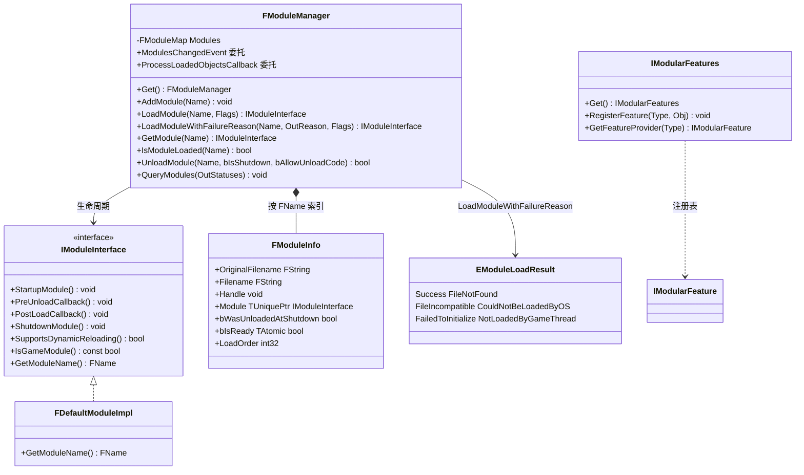

- `IModuleInterface` 在 `Modules/ModuleInterface.h:30`,`StartupModule/PreUnloadCallback/PostLoadCallback/ShutdownModule` 分别在 49/59/68/79 行,`SupportsDynamicReloading` 88 行,`IsGameModule` 108 行;缺省实现 `FDefaultModuleImpl`(`ModuleManager.h:884`,空类)与 `FDefaultGameModuleImpl`(893,`IsGameModule` 返回 true)。
- `FModuleManager` 在 `Modules/ModuleManager.h`(Load/Get/Unload 的原型见 1.5);单例入口 `FModuleManager::Get()`(`ModuleManager.h` 156 行附近 `GetModuleManagerSingleton`)。
- `FModuleInfo` 字段见 `ModuleManager.h:616-655`;静态 `CurrentLoadOrder` 初值 1(`Private/Modules/ModuleManager.cpp:155`)。
- 动态库路径解析基于 `FModuleManifest`(`Modules/ModuleManifest.h`,UBT 生成的 `.modules` 清单)。

### 1.3.6 FArchive 体系

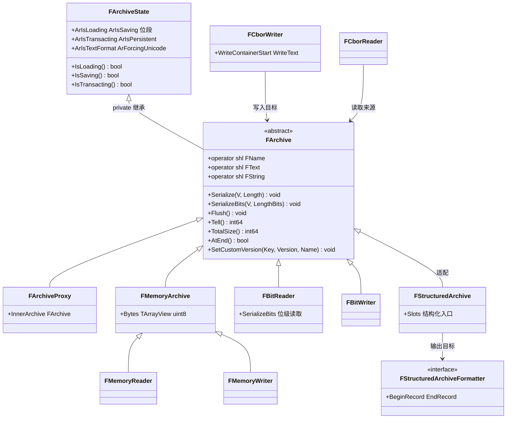

- `FArchiveState`(`Serialization/Archive.h:98`)承载全部 `Ar*` 状态位(`Archive.h:842-957`:`ArIsLoading:1`、`ArIsSaving:1`、`ArIsTransacting:1`、`ArIsTextFormat:1`、`ArIsPersistent:1`、`ArSerializingDefaults` 等);`FArchive : private FArchiveState`(`Archive.h:1216`)。
- 基类 `Serialize` 为空实现(`Archive.h:1698`),派生类必须覆写;`operator<<(FText&)`/`operator<<(FArchive&, FString&)` 在 `Archive.h:1251/1706`。
- 常用派生:`FMemoryReader/FMemoryWriter`(`MemoryReader.h`/`MemoryWriter.h`)、`FBufferArchive`(内存 + TArray,`BufferArchive.h:47`)、`FBitReader/FBitWriter`(`BitReader.h`/`BitWriter.h`)、`FArchiveProxy`(`ArchiveProxy.h:18`)、压缩代理(`ArchiveLoadCompressedProxy.h:19`/`ArchiveSaveCompressedProxy.h:19`)、大内存 `FLargeMemoryReader/Writer`。
- `FStructuredArchive`(`StructuredArchive.h:56`)+ 格式器(二进制 `Serialization/Formatters/BinaryArchiveFormatter.h`;Json 格式器在 Json 模块)提供命名槽序列化,`CompactBinary*`(`CompactBinary.h`、`CompactBinaryWriter.h`)为 ZenStorage 的自有二进制格式。

## 1.4 数据字典

### 1.4.1 容器/分配器

| 字段/成员 | 类型 | 含义 | 取值/约束 | 源码位置 |
|---|---|---|---|---|
| `TArray::AllocatorInstance` | `ElementAllocatorType` | 元素存储分配器实例 | 由 `AllocatorType::NeedsElementType` 选择 `ForElementType<T>` 或 `ForAnyElementType` | Containers/Array.h:781,3810 |
| `TArray::ArrayNum` / `ArrayMax` | `SizeType`(int32 或 int64) | 已用元素数 / 容量 | 静态断言必须有符号(`Array.h:787`);`ArrayMax>=ArrayNum` | Containers/Array.h:3811-3812 |
| `UE_CONTAINER_SLACK_GROWTH_FACTOR_NUMERATOR/DENOMINATOR` | 宏 | 扩容比例 | 默认 3/8;`AGGRESSIVE_MEMORY_SAVING` 时 1/4 | Containers/ContainerAllocationPolicies.h:121-131 |
| `DefaultCalculateSlackGrow` 首次/常量增量 | 常量 | `FirstGrow=4`、`ConstantGrow=16`(省内存时 1/0) | 扩容 `NewMax + 3*NewMax/8 + 16` | ContainerAllocationPolicies.h:170-221 |
| `DefaultCalculateSlackShrink` 阈值 | 常量 | slack 字节≥16384 或 3*NewMax<2*CurrentMax 且 slack 元素>64 才收缩 | 否则保持 CurrentMax | ContainerAllocationPolicies.h:140-167 |
| `TSizedInlineAllocator` 参数 | `NumInlineElements, IndexSize=32, Secondary` | 前 N 个元素内联,溢出走二级分配器 | `TInlineAllocator`/`TInlineAllocator64` 别名 | ContainerAllocationPolicies.h:1080,1328,1331 |
| `FDefaultBitArrayAllocator` | `TInlineAllocator<4>` | BitArray 默认内联 4 个 DWORD | — | ContainerAllocationPolicies.h:1908 |
| `TSparseSetAllocator` 桶参数 | `AverageNumberOfElementsPerHashBucket` 等 | 哈希桶数=RoundUpToPow2(元素数/桶均+基数) | DEFAULT_* 常量缺省 | ContainerAllocationPolicies.h:1781-1805 |
| `TSparseArray::FirstFreeIndex/NumFreeIndices` | int32 | 空闲链表头/空闲数 | 初始 -1/0 | Containers/SparseArray.h:74-91 |

### 1.4.2 内存分配器

| 字段/成员 | 类型 | 含义 | 取值/约束 | 源码位置 |
|---|---|---|---|---|
| `UE_MBC_MAX_LISTED_SMALL_POOL_SIZE` | 28672 | 列表式小池上限字节 | Binned3 沿用 | HAL/MallocBinnedCommon.h:10 |
| `UE_MBC_NUM_LISTED_SMALL_POOLS` | 52 | 列表式小池数量 | — | HAL/MallocBinnedCommon.h:13 |
| `UE_MBC_MIN/MAX_SMALL_POOL_ALIGNMENT` | 8 / 256 | 小池对齐范围 | — | HAL/MallocBinnedCommon.h:14-15 |
| `UE_DEFAULT_GMallocBinnedBundleSize` | 65536(省内存 8192) | Bundle(打包)字节数 | TLS 缓存搬运粒度 | HAL/MallocBinnedCommon.h:24-28 |
| `UE_DEFAULT_GMallocBinnedBundleCount` | 64 | 每 Bundle 节点数 | `FBundleNode.Count` 8 位足够 | MallocBinnedCommon.h:31 |
| `UE_DEFAULT_GMallocBinnedMaxBundlesBeforeRecycle` | 8 | 回收前最大 Bundle 数 | — | MallocBinnedCommon.h:32 |
| `UE_MB2_SMALL_POOL_COUNT` | 48(64 位平台 51) | Binned2 小池数 | `#define` 于平台分支 | HAL/MallocBinned2.h:27-31 |
| `UE_MB2_MAX_SMALL_POOL_SIZE` | 13104(或 32768-16) | Binned2 最大小池字节 | — | HAL/MallocBinned2.h:27-31 |
| `FPoolInfo::Taken/Canary/AllocSize/FirstFreeBlock` | uint16/ECanary/uint32/FFreeBlock* | 池占用计数/金丝雀/OS 分配字节/空闲链 | ECanary:0x3941/0x17ea/0xf317 | HAL/MallocBinned2.h:73-106 |
| `FFreeBlock` 位域 | `NumFreeBins:16`、`NextFreeBlock:48` | 连续空闲 bin 数与下一块指针 | 64KB 页内最多 4095 bin | HAL/MallocBinned2.h:113-158 |
| `FBundleNode` 位域 | `NextNodeInCurrentBundle:48`、`Count:8`、`Reserved:8` | TLS 缓存节点 | 须能塞进最小 bin | HAL/MallocBinnedCommon.h:187-200 |
| `EMemoryAllocatorToUse` | enum | Ansi/Binned/Binned2/Binned3/Binned4/TBB/Mimalloc/Jemalloc/LibPas | 平台代码选择 | Private/Unix/UnixPlatformMemory.cpp:160-224 等 |
| `GMallocBinnedPerThreadCaches` | int32(默认 1) | 运行时开关 TLS 缓存 | `UE_MBC_SUPPORT_RUNTIME_TLC_TOGGLE=1` | MallocBinnedCommon.h:76-78 |

### 1.4.3 字符串/名字

| 字段/成员 | 类型 | 含义 | 取值/约束 | 源码位置 |
|---|---|---|---|---|
| `FNameEntryId::Value` | uint32 | `Block<<16|Offset` | 块 13 位、偏移 16 位 | UObject/NameTypes.h:68-123;UnrealNames.cpp:252-256 |
| `FName::ComparisonIndex/DisplayIndex` | FNameEntryId | 比较/显示条目 | `WITH_CASE_PRESERVING_NAME` 才有独立显示索引 | UObject/NameTypes.h:292-384 |
| `FName` 内部编号 | int32(`NAME_NO_NUMBER_INTERNAL`) | `xxx_2` 的数字后缀 | `UE_FNAME_OUTLINE_NUMBER` 时为查询表外置 | NameTypes.h:303 |
| `FNamePoolShards` | 256(大小写保留 1024) | 分片数 | `UE_FNAME_POOL_SHARD_COUNT_OVERRIDE` 可覆盖 | UnrealNames.cpp:899-911 |
| `FNamePoolInitialSlotBits` | 8(256 槽/分片起步) | 初始槽数 | — | UnrealNames.cpp:914-916 |
| `FNameHash` | 结构 | shard/slot/probe hash | `CityHash64`,`AlgorithmId=0xC1640000` | UnrealNames.cpp:922-960 |
| `FText::Flags` | uint32 位域 | `InitializedFromString` 等 | Internationalization/Text.h:48 | Text.h:45-70 |
| `ELogVerbosity` | enum | Fatal/Error/Warning/Display/Log/Verbose/VeryVerbose | `All=VeryVerbose`;SetColor=0x40 非级别 | Logging/LogVerbosity.h:22-56 |

### 1.4.4 模块/配置/杂项

| 字段/成员 | 类型 | 含义 | 取值/约束 | 源码位置 |
|---|---|---|---|---|
| `FModuleInfo::bIsReady` | `TAtomic<bool>` | 模块完成 StartupModule 后才 true | 其他线程 Get 依赖该标志 | Modules/ModuleManager.h:638 |
| `FModuleInfo::LoadOrder` | int32 | 加载序号,关闭时逆序 | `CurrentLoadOrder++` | ModuleManager.h:641;ModuleManager.cpp:1107 |
| `FConfigLayer` | `{Name, Pattern, Flags}` | ini 层描述 | 顺序即合并顺序,见 1.6.3 | Misc/ConfigHierarchy.h:9-46 |
| `FConfigValue` | `TMultiMap` 值 | 每键可多值 | Combined/ArrayCombined 等 EValueType | Misc/ConfigCacheIni.h:152-211 |
| `FConfigSection` | `TMultiMap<FName,FConfigValue>` | 节=键值多重映射 | — | Misc/ConfigCacheIni.h:409-412 |
| `FConfigFile` | `FConfigFileMap` 私有继承 | 文件=节映射 + 层级来源 | `SourceIniHierarchy` 记录来源 | Misc/ConfigCacheIni.h:574,1031 |
| `GEngineIni/GGameIni/GEditorIni` | FString 全局 | 已知配置键名 | `CoreGlobals.h:423-434` | Misc/CoreGlobals.h |
| `FGuid` | 4×uint32(A-D) | 128 位 GUID | `NewGuid()` 用 `FPlatformMisc::CreateGuid` | Misc/Guid.h:109,366 |
| `FDateTime` tick | `ETimespan::TicksPerSecond`(100ns/tick,.NET 式) | Unix 换算以 1970.1.1 纪元差除以 TicksPerSecond | `DateTime.h:560,571` | Misc/DateTime.h |
| `FDelegateHandle::ID` | uint64 | 组播委托移除凭证 | 非零有效 | Delegates/IDelegateInstance.h:71(类定义 15 行) |
| `FImageInfo::SizeX/SizeY` | int32 | 图像尺寸 | ImageCore.h:138-144 | ImageCore/Public/ImageCore.h |
| `ERGBFormat` | enum | Invalid/RGBA/BGRA/Gray | ImageCore.h(枚举) | ImageCore/Public/ImageCore.h |
| `FIoChunkId` | 12 字节数组 | IoStore 内容块 ID | `IO_MAX_CHUNKID_SIZE=12` | IO/IoChunkId.h:63 |

## 1.5 接口清单

> 原型逐字摘自头文件(省略 `*_API` 导出宏与纯属性装饰),`路径:行号` 相对 `$E/Source/Runtime`。线程约束栏:GT=仅游戏线程,MT=任意线程(内部已同步),ST=单线程假定(外部自备同步)。

### 1.5.1 FMemory / FMalloc

| 原型 | 功能 | 参数/返回 | 线程 | 位置 |
|---|---|---|---|---|
| `static FORCENOINLINE void* Malloc(SIZE_T Count, uint32 Alignment = DEFAULT_ALIGNMENT)` | 分配(带注解的分配函数) | 返回非空或告警退出 | MT(GMalloc 决定) | Core/HAL/UnrealMemory.h:211 |
| `static FORCENOINLINE void* Realloc(void* Original, SIZE_T Count, uint32 Alignment = DEFAULT_ALIGNMENT)` | 重分配 | 返回新指针 | MT | Core/HAL/UnrealMemory.h:212 |
| `static FORCENOINLINE void Free(void* Original)` | 释放 | — | MT | Core/HAL/UnrealMemory.h:213 |
| `static FORCENOINLINE SIZE_T GetAllocSize(void* Original)` | 实际分配大小 | ≥请求大小 | MT | Core/HAL/UnrealMemory.h:214 |
| `static FORCENOINLINE void* MallocZeroed(SIZE_T Count, uint32 Alignment = DEFAULT_ALIGNMENT)` | 零初始化分配 | — | MT | Core/HAL/UnrealMemory.h:216 |
| `static FORCENOINLINE SIZE_T QuantizeSize(SIZE_T Count, uint32 Alignment = DEFAULT_ALIGNMENT)` | 分配器量化尺寸 | 容器 slack 计算用 | MT | Core/HAL/UnrealMemory.h:224 |
| `static void* Memcpy(void* Dest, const void* Src, SIZE_T Count)` 等 Memset/Memzero/Memmove/Memcmp/BigBlockMemcpy/StreamingMemcpy | 平台内存操作转发 FPlatformMemory | 返回 Dest | MT | Core/HAL/UnrealMemory.h:108-189 |
| `static void* MallocExternal(SIZE_T Count, uint32 Alignment = DEFAULT_ALIGNMENT)`(及 ReallocExternal/FreeExternal/QuantizeSizeExternal) | 非内联慢路径(供模块外链接) | — | MT | Core/HAL/UnrealMemory.h:275-280 |
| `virtual void* Malloc( SIZE_T Count, uint32 Alignment=DEFAULT_ALIGNMENT ) = 0` | FMalloc 纯虚分配 | — | 由实现定 | Core/HAL/MemoryBase.h:104 |
| `virtual void* Realloc( void* Original, SIZE_T Count, uint32 Alignment=DEFAULT_ALIGNMENT ) = 0` | FMalloc 纯虚重分配 | — | 由实现定 | Core/HAL/MemoryBase.h:115 |
| `virtual void Free( void* Original ) = 0` | FMalloc 纯虚释放 | — | 由实现定 | Core/HAL/MemoryBase.h:127 |
| `virtual SIZE_T QuantizeSize(SIZE_T Count, uint32 Alignment)` | 量化(默认返回 Count) | 恒 ≥Count | MT | Core/HAL/MemoryBase.h:146 |

### 1.5.2 TArray / TMap / TSet(代表 API)

| 原型 | 功能 | 参数/返回 | 线程 | 位置 |
|---|---|---|---|---|
| `SizeType Add(const ElementType& Item)` / `SizeType Add(ElementType&& Item)` | 尾部追加,必要时扩容 | 返回新元素下标 | ST | Core/Containers/Array.h:2948,2961 |
| `SizeType Emplace(ArgsType&&... Args)` | 原地构造追加 | 返回下标 | ST | Core/Containers/Array.h:2813 |
| `SizeType AddUninitialized(SizeType Count)`(无参版 1903 行) | 预留未构造空间 | 返回起始下标 | ST | Core/Containers/Array.h:1950 |
| `void RemoveAt(SizeType Index, SizeType Count, EAllowShrinking AllowShrinking = UE::Core::Private::AllowShrinkingByDefault&lt;AllocatorType&gt;())` | 保序移除并析构 | 移动后续元素 | ST | Core/Containers/Array.h:2347 |
| `void RemoveAtSwap(SizeType Index, EAllowShrinking AllowShrinking = UE::Core::Private::AllowShrinkingByDefault&lt;AllocatorType&gt;())` | 交换移除 O(1) | 末尾元素补位 | ST | Core/Containers/Array.h:2416(三参版本 2444) |
| `void Reserve(SizeType Number)` | 预留容量 | slack 经 QuantizeSize 量化 | ST | Core/Containers/Array.h:3268 |
| `void Shrink()` / `SizeType GetSlack() const` | 收缩 slack / 剩余容量 | — | ST | Core/Containers/Array.h:1517,1313 |
| `TPair<FSetElementId, bool> Emplace(EInPlace, uint32 KeyHash, ArgTypes&&... InArgs)` | TSet 原地构造+查重 | 返回 Id 与是否新增 | ST | Core/Containers/SparseSet.h.inl:817 |
| `FSetElementId FindId(KeyInitType Key)` | TSet 按键查 Id | 无效 Id 表未命中 | ST | Core/Containers/SparseSet.h.inl:1005 |
| `UE_FORCEINLINE_HINT ValueType& Add(const KeyType& InKey, const ValueType& InValue)` | TMap 添加/替换 | 返回值引用 | ST | Core/Containers/Map.h.inl:323 |
| `UE_FORCEINLINE_HINT ValueType& FindOrAdd(const KeyType& Key)` | 查找否则构造默认值 | 返回值引用 | ST | Core/Containers/Map.h.inl:603 |
| `inline int32 Remove(KeyInitType InKey)` | TMap 移除(留洞待压缩) | 返回移除数 | ST | Core/Containers/Map.h.inl:409 |
| `[[nodiscard]] ValueType* Find(KeyInitType Key)` / `[[nodiscard]] const KeyType* FindKey(ValueInitType Value) const` | 正/反向查找 | 未命中 nullptr | ST | Core/Containers/Map.h.inl:489,448 |
| `int32 Remove(KeyInitType InKey, ValueInitType InValue)` | TMultiMap 精确移除单对(允许重复键) | — | ST | Core/Containers/Map.h.inl:1604 |

### 1.5.3 FString / FName / FText

| 原型 | 功能 | 参数/返回 | 线程 | 位置 |
|---|---|---|---|---|
| `static FString Printf(TCheckedFormatString<FmtCharType, Types...> Fmt, Types... Args)` | 格式化构造 | 编译期格式校验 | MT | Core/Containers/UnrealString.h.inl:1376 |
| `void AppendChars(const ANSICHAR* Str, int32 Count)` 等 5 种字符重载 | 追加跨编码字符 | — | ST | Core/Containers/UnrealString.h.inl:392-396 |
| `FString Mid(int32 Start, int32 Count) const` / `FString Left/Right(int32 Count)` | 子串截取 | — | ST | Core/Containers/UnrealString.h.inl:950-1030 |
| `CORE_API FName(const ANSICHAR* Name)` / `(const WIDECHAR* Name)` / `(const UTF8CHAR* Name)` | 从窄/宽/UTF8 字符串构造(查找或添加) | — | MT(池分片) | Core/UObject/NameTypes.h:1079-1085 |
| `CORE_API FString ToString() const` | 展开 `Base_数字` 形式 | — | MT | Core/UObject/NameTypes.h:697 |
| `CORE_API FString GetPlainNameString() const` | 不带编号的基名 | — | MT | Core/UObject/NameTypes.h:675 |
| `[[nodiscard]] static FText AsNumber(double Val, const FNumberFormattingOptions* const Options = NULL, const FCulturePtr& TargetCulture = NULL)`(及 int/uint 各宽度重载) | 本地化数字 | — | GT(读文化上下文;ICU 非线程安全) | Core/Internationalization/Text.h:428-438 |
| `[[nodiscard]] CORE_API const FString& ToString() const`(FText) | 解析为源字符串(必要时重建) | 返回内部缓存引用 | GT | Core/Internationalization/Text.h:589 |

### 1.5.4 委托宏与执行

| 原型/宏 | 功能 | 参数/返回 | 线程 | 位置 |
|---|---|---|---|---|
| `#define DECLARE_DELEGATE(DelegateName)` …(0~9 参 × RetVal 变体) | 声明单播委托类型 | 展开为 typedef | — | Core/Delegates/DelegateCombinations.h:20 起 |
| `#define DECLARE_MULTICAST_DELEGATE(DelegateName)` … | 声明组播委托类型 | 同上 | — | Core/Delegates/DelegateCombinations.h:23 起 |
| `#define DECLARE_TS_MULTICAST_DELEGATE(DelegateName)` | 线程安全组播 | `FDefaultTSDelegateUserPolicy` | 多线程绑定/广播 | Core/Delegates/Delegate.h:215 |
| `#define DECLARE_EVENT(OwningType, EventName)` | 事件(已不推荐) | 派生类形式 | — | Core/Delegates/Delegate.h:221 |
| `FDelegateHandle Add(FDelegate&& InNewDelegate)` | 组播添加绑定 | 返回句柄 | 按策略 | Core/Delegates/DelegateSignatureImpl.inl:784 |
| `void Broadcast(ParamTypes... Params) const` | 逆序广播全部绑定 | 广播后压缩失效项 | 按策略 | Core/Delegates/MulticastDelegateBase.h:288 |
| `inline RetValType Execute(ParamTypes... Params) const` / `ExecuteIfBound(...)` | 单播执行(未绑定则断言/跳过) | — | ST | Core/Delegates/DelegateSignatureImpl.inl:618 |
| `int32 RemoveAll(FDelegateUserObjectConst InUserObject)` | 按对象清绑定 | 返回移除数 | 按策略 | Core/Delegates/MulticastDelegateBase.h:173 |

### 1.5.5 模块系统

| 原型 | 功能 | 参数/返回 | 线程 | 位置 |
|---|---|---|---|---|
| `IModuleInterface* LoadModuleWithFailureReason( const FName InModuleName, EModuleLoadResult& OutFailureReason, ELoadModuleFlags InLoadModuleFlags = ELoadModuleFlags::None)` | 加载并启动模块,失败原因外抛 | 成功返回模块接口 | GT(见 1.8) | Core/Modules/ModuleManager.h:274 |
| `IModuleInterface* LoadModule( const FName InModuleName, ELoadModuleFlags InLoadModuleFlags = ELoadModuleFlags::None)` | 加载(经 `GetOrLoadModule`:先查已加载;非 GT 返回 `EModuleLoadResult::NotLoadedByGameThread`) | — | GT | Core/Modules/ModuleManager.h:242(实现 ModuleManager.cpp:924-941) |
| `IModuleInterface* GetModule( const FName InModuleName )` | 取已加载模块(非 GT 需 bIsReady) | 未就绪返回 nullptr 并告警 | MT | Core/Modules/ModuleManager.h:212(实现 ModuleManager.cpp:1498-1523) |
| `bool IsModuleLoaded( const FName InModuleName ) const` | 是否已加载 | — | MT | Core/Modules/ModuleManager.h:231 |
| `void AddModule( const FName InModuleName )` | 仅登记不加载(静态链接模块) | — | GT | Core/Modules/ModuleManager.h:199 |
| `bool UnloadModule( const FName InModuleName, bool bIsShutdown = false, bool bAllowUnloadCode = true)` | 卸载(ShutdownModule + FreeLibrary) | — | GT | Core/Modules/ModuleManager.h:306 |
| `bool QueryModule( const FName InModuleName, FModuleStatus& OutModuleStatus ) const` / `void QueryModules( TArray<FModuleStatus>& )` | 查询模块状态清单 | — | MT | Core/Modules/ModuleManager.h:284,292 |
| `virtual void StartupModule()` | 模块启动回调(可加载依赖) | — | GT | Core/Modules/ModuleInterface.h:49 |
| `virtual void ShutdownModule()` / `PreUnloadCallback()` / `PostLoadCallback()` | 关闭/预卸载/后加载回调 | — | GT | Core/Modules/ModuleInterface.h:79,59,68 |
| `virtual bool SupportsDynamicReloading()` | 是否支持热重载 | 缺省 true | — | Core/Modules/ModuleInterface.h:88 |

### 1.5.6 FArchive 体系

| 原型 | 功能 | 参数/返回 | 线程 | 位置 |
|---|---|---|---|---|
| `virtual void Serialize(void* V, int64 Length)` | 基类空实现,派生类覆写 | 读写字节 | ST | Core/Serialization/Archive.h:1698 |
| `virtual void SerializeBits(void* V, int64 LengthBits)` | 位级读写(不足 8 位加载时掩码) | — | ST | Core/Serialization/Archive.h:1720 |
| `CORE_API virtual FArchive& operator<<(FText& Value)` / `virtual FArchive& operator<<(FName& Value)` | 文本/名字序列化钩子 | — | ST | Core/Serialization/Archive.h:1251,1235 |
| `friend CORE_API FArchive& operator<<(FArchive& Ar, FString& Value)` | 字符串序列化(长度前缀+字节) | — | ST | Core/Serialization/Archive.h:1706 |
| `UE_FORCEINLINE_HINT bool IsLoading() const` / `IsSaving()` | 读 ArIsLoading/ArIsSaving 位 | — | ST | Core/Serialization/Archive.h:272,284 |
| `CORE_API void SetCustomVersion(const struct FGuid& Key, int32 Version, FName FriendlyName)` | 写自定义版本记录 | 保存前调用 | ST | Core/Serialization/Archive.h:574 |
| `SERIALIZATION_API static void Serialize( const void* Struct, UStruct& TypeInfo, IStructSerializerBackend& Backend, const FStructSerializerPolicies& Policies )` | 反射结构体 → 后端(Json/Cbor) | — | GT(需反射) | Serialization/Public/StructSerializer.h:108 |
| `SERIALIZATION_API static bool Deserialize( void* OutStruct, UStruct& TypeInfo, IStructDeserializerBackend& Backend, const FStructDeserializerPolicies& Policies )` | 后端 → 反射结构体 | 返回成败 | GT | Serialization/Public/StructDeserializer.h:88 |

### 1.5.7 杂项(Misc)

| 原型 | 功能 | 参数/返回 | 线程 | 位置 |
|---|---|---|---|---|
| `static const TCHAR* Get()` / `static bool Set(const TCHAR* NewCommandLine)`(FCommandLine) | 读/设全局命令行 | Set 仅早期一次 | GT(读 MT) | Core/Misc/CommandLine.h:58,88 |
| `static void Parse(const TCHAR* CmdLine, TArray<FString>& Tokens, TArray<FString>& Switches)` | 命令行分词 | — | MT | Core/Misc/CommandLine.h:136 |
| `static bool Value(const TCHAR* Stream, const TCHAR* Match, FString& Value, bool bShouldStopOnSeparator =true, const TCHAR** OptStreamGotTo = nullptr)`(FParse,另有 30+ 重载覆盖数值/FGuid/FName/uint8..uint64) | 提取 `-Key=Value` | 命中返回 true | MT | Core/Misc/Parse.h:71 等 |
| `static CORE_API bool Param( const TCHAR* Stream, const TCHAR* Param )` | 是否存在开关 | — | MT | Core/Misc/Parse.h:127 |
| `static CORE_API FString EngineDir()` / `ProjectDir()` / `ProjectContentDir()` / `ProjectConfigDir()` / `ProjectSavedDir()` / `ProjectLogDir()` / `GameSourceDir()`(FPaths) | 标准目录 | 尾带 `/` | MT | Core/Misc/Paths.h:67,262,276,283,389,479 |
| `static CORE_API FString GetExtension(const FString& InPath, UE::Paths::EFlags Flags = UE::Paths::EFlags::None)` / `ChangeExtension` / `SetExtension` | 扩展名操作 | — | MT | Core/Misc/Paths.h:515,545,548 |
| `static CORE_API bool LoadLocalIniFile(FConfigFile& ConfigFile, const TCHAR* IniName, bool bIsBaseIniName, const TCHAR* Platform=NULL, bool bForceReload=false)` | 按 GConfigLayers 逐层合并加载 ini 到独立 FConfigFile | — | GT | Core/Misc/ConfigCacheIni.h:1857 |
| `static CORE_API FGuid NewGuid()`(FGuid) | 平台随机 GUID | — | MT | Core/Misc/Guid.h:366 |
| `static CORE_API FDateTime UtcNow()` / `static FDateTime FromUnixTimestamp(int64 UnixTime)` / `int64 ToUnixTimestamp() const`(FDateTime) | UTC 时间/Unix 互转 | 100ns tick | MT | Core/Misc/DateTime.h:756,614,558 |

### 1.5.8 外围模块代表接口

| 原型 | 功能 | 参数/返回 | 线程 | 位置 |
|---|---|---|---|---|
| `int64 Compress(void * OutCompressedData, int64 CompressedBufferSize, const void * InUncompressedData, int64 UncompressedSize, ECompressor Compressor, ECompressionLevel Level, bool CompressIndependentChunks = false, int64 DictionaryBackup = 0)` | Oodle 单线程压缩 | 返回压缩字节数,0 失败 | MT(无状态) | Core/Compression/OodleDataCompression.h:180 |
| `bool Decompress(void * OutUncompressedData, int64 UncompressedSize, const void * InCompressedData, int64 CompressedSize)`(及 `DecompressParallel`,286 行) | Oodle 解压 | — | MT | Core/Compression/OodleDataCompression.h:264,286 |
| `static bool Deserialize(const TSharedRef<TJsonReader<CharType>>& Reader, typename Policy::FValue& OutValue, EFlags InOptions = EFlags::None)`(TJsonSerializer) | 流式 JSON → DOM | — | MT | Json/Public/Serialization/JsonSerializer.h:301 |
| `class FJsonObject`(Dom/JsonObject.h:322,含 `GetStringField/GetNumberField/SetField` 等) | JSON 对象 DOM | — | ST | Json/Public/Dom/JsonObject.h |
| `FCborWriter(FArchive* InStream, ECborEndianness InWriterEndianness = ECborEndianness::Platform)` / `void WriteContainerStart(ECborCode ContainerType, int64 NbItem)` | CBOR 编码写入 | — | ST | Cbor/Public/CborWriter.h:28,40 |
| `class FXmlFile`(XmlFile.h:25)+ `const FXmlNode* GetNextNode() const`(XmlNode.h:57) | XML DOM 解析/遍历 | — | ST | XmlParser/Public/XmlFile.h,XmlNode.h |
| `virtual bool CompressImage(TArray64<uint8> & OutData, EImageFormat ToFormat, const FImageView & InImage, int32 Quality = 0) = 0` | 编码(PNG/JPEG/…) | — | MT | ImageWrapper/Public/IImageWrapperModule.h:67 |
| `virtual bool DecompressImage(const void* InCompressedData, int64 InCompressedSize, FImage & OutImage) = 0` | 解码到 FImage | — | MT | ImageWrapper/Public/IImageWrapperModule.h:77 |
| `struct FImage : public FImageInfo`(ImageCore.h:415)与 `FImageView`(263) | 图像数据与视图 | — | ST | ImageCore/Public/ImageCore.h |
| `class FChannel`(Trace/Detail/Channel.h:32)/`class FLogScope`(LogScope.h:19) | Trace 通道与作用域开关 | 宏 `UE_TRACE_CHANNEL_DEFINE` | MT(原子) | TraceLog/Public/Trace/Detail/*.h |
| `MATHCORE_API bool DepthFirstTopologicalSort(TArrayView<const int32> InUniqueVertices, TArrayView<const FDirectedEdge> InUniqueEdges, TArray<int32>& OutVertexOrder)`(及 `KahnTopologicalSort`,128 行) | 有向图拓扑排序 | 返回是否存在环 | MT | MathCore/Public/Graph/DirectedGraphUtils.h:118,128 |

### 1.5.9 其余子系统一览(定位表)

| 子系统 | 核心符号 | 位置 |
|---|---|---|
| Algo | `Algo::AllOf/AnyOf/Accumulate/BinarySearch/Contains/Copy/Count/Find/FindLast/ForEach/Heap/MaxElement/MinElement/NoneOf/QuickSelect/RandomShuffle/RemoveAt/RemoveIf/Reverse/Rotate/Sort/StableSort/Transform/Unique/Union` | Core/Public/Algo/*.h |
| Templates | `MoveTemp/Forward/Invoke/TEnableIf/TIsPODType/TIsTriviallyCopyConstructible/TUniquePtr/TSharedPtr/TFunction/TFunctionRef/TOptional/TCopyQualifiersFromTo/TAtomic`(部分在 HAL) | Core/Public/Templates/*.h |
| Traits/Concepts | `TIsContiguousContainer/TIsCharType/IsTriviallyRelocatable/FunctionReturnType`;concepts `CContiguousRange/CCharType/CDerivedFrom` 等 | Core/Public/Traits、Concepts |
| Hash | `CityHash64(const char*, uint32)`(Hash/CityHash.h:76)、`FBlake3`(Hash/Blake3.h:83)、`Fnv`/`BuzHash`/`xxhash`/`ShaderHash` | Core/Public/Hash |
| 数学 | `TVector<T>`(Math/Vector.h:50)、`TRotator<T>`(Rotator.h:36)、`UE::Math::TTransform<double>` → `using FTransform = UE::Math::TTransform<double>`(MathFwd.h:53)、`TQuat/TMatrix/TPlane/TSphere/TBox`、`FColor`(Color.h:542)/`FLinearColor`(47)、`FMath::Clamp`(UnrealMathUtility.h:592)/`FMath::Lerp`(1123)、`FRandomStream`(RandomStream.h:19)、`FIntPoint/FIntVector/IntRect`、`TBox/TSphere/OrientedBox`、八叉树 `TOctree`(GenericOctree.h) | Core/Public/Math |
| 日志 | `ELogVerbosity`(LogVerbosity.h:22-56)、`FLogCategoryBase`(LogCategory.h)、`FOutputDevice::Serialize`(Misc/OutputDevice.h:150)、`DECLARE_LOG_CATEGORY_EXTERN/DEFINE_LOG_CATEGORY`(LogCategory.h:110-118)、`UE_LOG/UE_LOGFMT`(LogMacros.h) | Core/Public/Logging、Misc |
| 国际化 | `FInternationalization::Get()`(Internationalization.h:28)、`FCulture`、`FTextLocalizationManager`(TextLocalizationManager.h:41)、`FTextLocalizationResource`(TextLocalizationResource.h:55)、`FStringTableRegistry`(StringTableCore.h) | Core/Public/Internationalization |
| 统计 | `DECLARE_CYCLE_STAT`(Stats/Stats.h:130)、`DECLARE_STATS_GROUP`(Stats.h:209)、`FThreadStats`(StatsSystemTypes.h:1140)、`FScopeCycleCounter`(StatsSystemTypes.h)、`CSV_SCOPED_TIMING_STAT`(CsvProfiler.h) | Core/Public/Stats、ProfilingDebugging |
| 剖析 | `FScopedBootTiming/TRACE_LOADTIME_REQUEST_GROUP_SCOPE`(LoadTimeTracker.h)、`CpuProfilerTrace.h` 的 `UE_TRACE_LOG_SCOPED_T`、`FStallDetector`(StallDetector.h) | Core/Public/ProfilingDebugging |
| 色彩 | `FColorSpace`(ColorManagement/ColorSpace.h:97,构造自原色坐标或 `UE::Color::EColorSpace`)、`TransferFunctions.h` | Core/Public/ColorManagement |
| IO | `FIoChunkId`(IO/IoChunkId.h:63)、`FIoDispatcher final`(IoDispatcher.h:296)、`FIoBuffer`、`FIoContainerId/FPackageId`、`IRecipePackageStore` | Core/Public/IO |
| 内存工具 | `FMemoryArena`(Memory/MemoryArena.h)、`LinearAllocator/VirtualLinearAllocator`、`FCompositeBuffer`(CompositeBuffer.h)、`FSharedBuffer`(SharedBuffer.h)、`FMemoryView` | Core/Public/Memory |
| 内存镜像 | `FMemoryImageWriter/FMemoryImage`(Serialization/MemoryImage.h:284)与 `TMemoryImagePtr`,cook 出可整块映射的常量数据 | Core/Public/Serialization |
| 压缩缓冲 | `FCompressedBuffer`(Compression/CompressedBuffer.h)基于 Oodle 的分块压缩容器 | Core/Public/Compression |
| Utf8 | `FUtf8Iterator`(Utf8/Utf8Iterator.h) | Core/Public/Utf8 |
| AutoRTFM | `AutoRTFM::Open/Close/Transact`(AutoRTFM 公共头,实现模块独立) | Core/Public/AutoRTFM |

## 1.6 关键流程

### 1.6.1 GMalloc 创建链(首次分配触发)

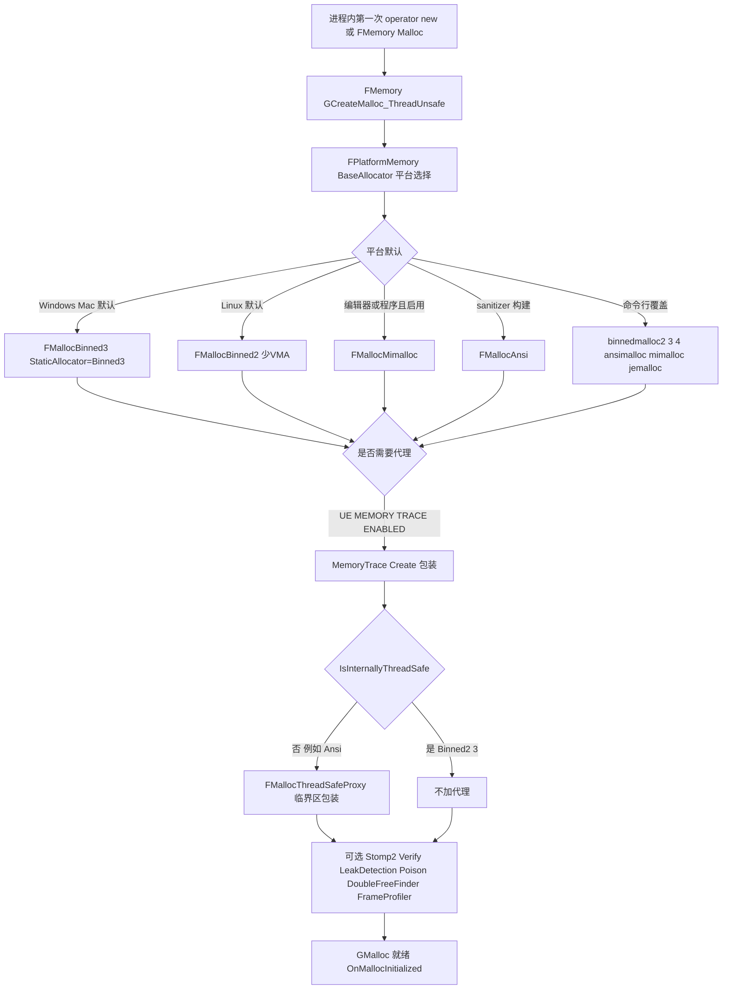

- 触发函数 `FMemory_GCreateMalloc_ThreadUnsafe`(`Private/HAL/UnrealMemory.cpp:347`)在首次分配时经静态初始化调用;`BaseAllocator` 缺省 `new FMallocAnsi()`(`Private/GenericPlatform/GenericPlatformMemory.cpp:307`),由平台覆盖:Windows 在 `Private/Windows/WindowsPlatformMemory.cpp:130` 先判 `FORCE_ANSI_ALLOCATOR` → 编辑器/程序选 Mimalloc/TBB → `USE_MALLOC_BINNED3` → Binned2 → Binned;Unix 在 `Private/Unix/UnixPlatformMemory.cpp:136` 依 `USE_MALLOC_BINNED2/3` 并在 `/proc/self/cmdline` 中扫描 `-ansimalloc/-binnedmalloc/-binnedmalloc2/3/4/-mimalloc/-jemalloc` 覆盖。
- UBT 通过 `StaticAllocator`(TargetRules)生成 `USE_MALLOC_BINNED2/3` 宏定义(`Source/Programs/UnrealBuildTool/Configuration/UEBuildTarget.cs:6728-6742`);平台缺省:Windows `Binned3`(UEBuildWindows.cs:1495-1497)、Linux `Binned2`(UEBuildLinux.cs:339-342,注释:更少 VMA)、Mac `Binned3`(UEBuildMac.cs:294-296);Linux 开 ASan/TSan/MSan 强制 `Ansi`(UEBuildLinux.cs:344-347)。
- 代理包装顺序:`UnrealMemory.cpp:369-413`(Trace → Stomp2 → ThreadSafeProxy(若需要)→ VerifyProxy → LeakDetection → PoisonProxy → DoubleFreeFinder → FrameProfiler);`PLATFORM_USES_FIXED_GMalloc_CLASS` 构建跳过代理并要求内建线程安全(359-366)。

### 1.6.2 模块加载主路径

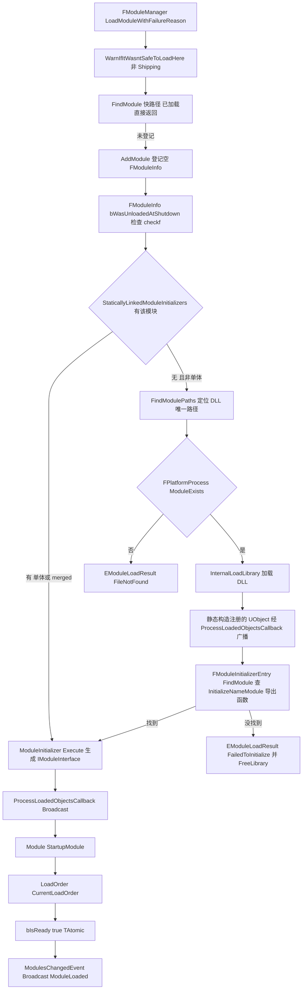

- 依据 `Private/Modules/ModuleManager.cpp:981-1315`:静态初始化器路径 1077-1133;DLL 路径 1159-1311;`StartupModule` 调用 1103/1252;`bIsReady=true` 在 1110/1259;失败码枚举 `EModuleLoadResult`(Success/FileNotFound/CouldNotBeLoadedByOS/FailedToInitialize,`ModuleManager.h:43`)。
- 关键顺序约束:AddModule 必须先于初始化完成,保证 `StartupModule` 内部再 Find/Load 本模块拿到同一指针(`ModuleManager.cpp:1058-1062` 注释)。

### 1.6.3 ini 层级合并(GConfig)

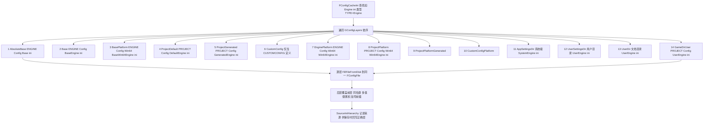

- 层表定义:`Misc/ConfigHierarchy.h:9-46`(GConfigLayers)与插件层 `GPluginLayers`(52-71)、插件改动层 `GPluginModificationLayers`(76-82);受限目录扩展 `GConfigExpansions`(90-148,NotForLicensees/NoRedist/LimitedAccess)。
- 磁盘解析:`FillFileFromBuffer/FillFileFromDisk`(`Private/Misc/ConfigCacheIni.cpp:1903/2173`),支持 `+Key`/`-Key`/`.Key` 修饰与 `!Section` 删除节。
- `LoadLocalIniFile`(`Misc/ConfigCacheIni.h:1857`)对非全局缓存文件走 `FConfigContext::ReadIntoLocalFile`(cpp:6931);全局缓存路径走 `ReadIntoConfigSystem`(cpp:7253 等)。

### 1.6.4 TArray 扩容路径(Add → GMalloc)

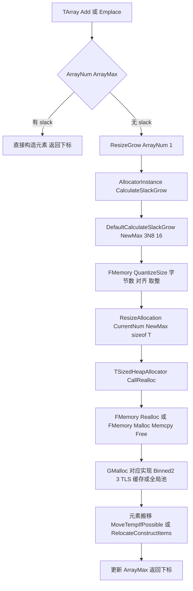

- 扩容策略源码见 `ContainerAllocationPolicies.h:170-221`;量化经 `FMemory::QuantizeSize`(`UnrealMemory.h:224`)→ 分配器 `QuantizeSize`,Binned 系返回对齐到 bin 的字节,从而 `ArrayMax` 反推为 bin 能容纳的元素数。
- 搬移使用 `RelocateConstructItems`(`Templates/MemoryOps.h:201`)按位拷贝 POD 或移动构造非 POD。

## 1.7 时序图

### 1.7.1 TArray 扩容调用链

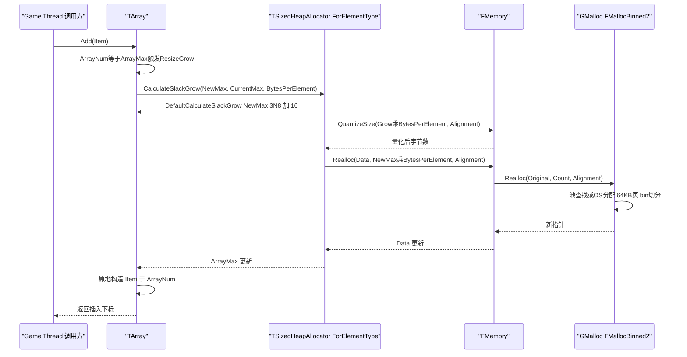

### 1.7.2 模块加载(含 DLL 与静态两条支路)

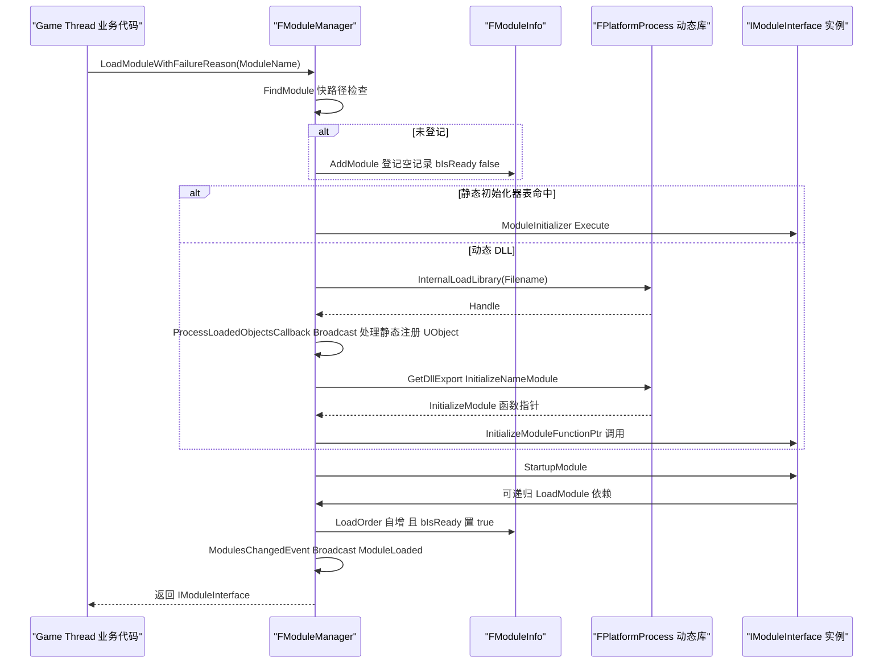

### 1.7.3 FName 构造(跨线程安全路径)

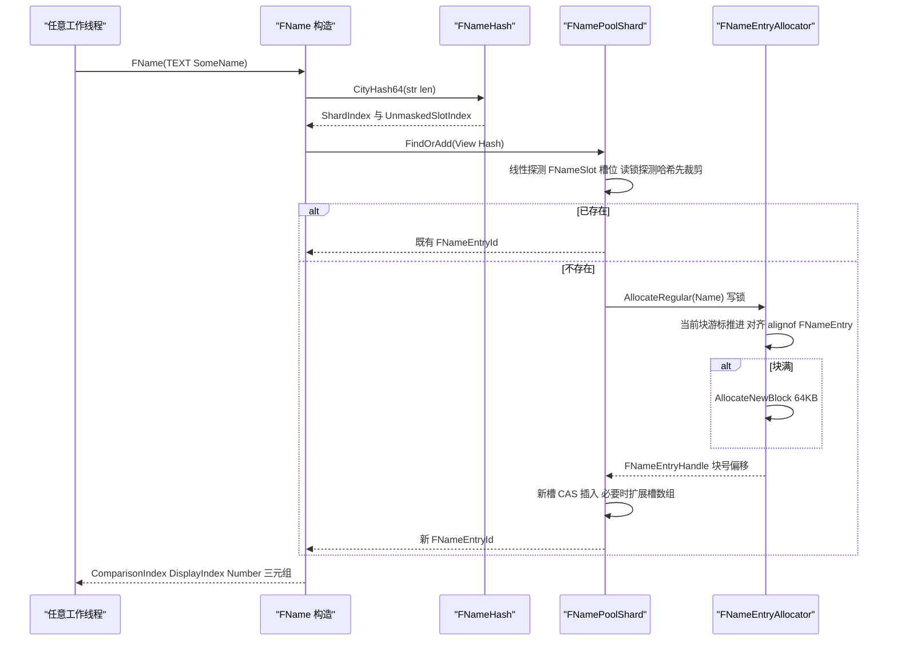

- 分片/槽探测实现依据 `Private/UObject/UnrealNames.cpp:922-1276`(FNameHash/FNameSlot/FNamePoolShard)与 `UnrealNames.cpp:515-610`(FNameEntryAllocator 块分配);比较池与显示池分离(`FNamePool` 定义在 `UnrealNames.cpp:1727`)。

### 1.7.4 GConfig 首次读取 Engine 配置

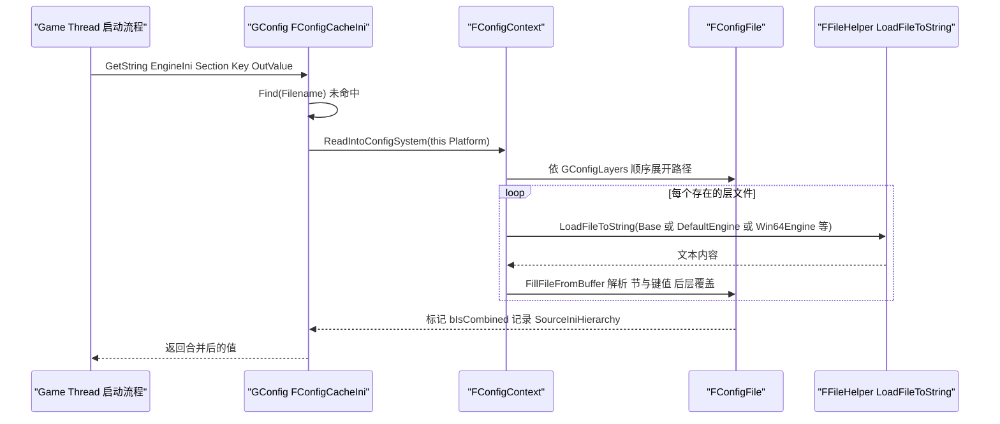

- 展开与合并入口:`FConfigContext::Read*` 家族(`Private/Misc/ConfigContext.cpp`);层表见 1.6.3。

## 1.8 线程模型与同步

| 子系统 | 线程约束 | 同步原语 | 依据 |
|---|---|---|---|
| GMalloc(Binned2/3/4) | 任意线程,内建线程安全 | per-thread TLS free-list(`SetupTLSCachesOnCurrentThread`,`MallocBinnedCommon.h:774`)、`FBundleNode` 批量搬运、全局池锁/原子 | `FMalloc::IsInternallyThreadSafe()` 为 true,故 `UnrealMemory.cpp:383-386` 不再包 `FMallocThreadSafeProxy` |
| FMallocAnsi/部分第三方分配器 | 非线程安全 | 由 `FMallocThreadSafeProxy`(`FCriticalSection`,HAL/MallocThreadSafeProxy.h)串行化 | `UnrealMemory.cpp:382-386` |
| FMemory 接口 | 任意线程 | 转发至 GMalloc;`PLATFORM_USES_FIXED_GMalloc_CLASS` 时直接内联 Binned2/3 静态单例(`HAL/Memory.h:5-18`) | — |
| FName/FNamePool | 任意线程构造/查询 | 分片分锁(256/1024 分片,`UnrealNames.cpp:899-911`)、槽内 `ProbeHash` 无锁探测、块分配写锁;条目一经写入不再移动 | `UnrealNames.cpp:515,1279` |
| FString/FStringBuilder | 单线程假定;跨线程传递需外部同步(值拷贝或 shared) | 无内部锁 | 惯例;头文件无同步设施 |
| FText | 主要 GameThread(文化/ICU 非线程安全);只读源串可跨线程 | — | Text.h 使用约定(未在源码中强制断言) |
| 单播委托 TDelegate | 绑定/执行需同线程或外部同步;默认策略非线程安全 | `FNotThreadSafeDelegateMode`+dev 竞态检测(`UE_DETECT_DELEGATES_RACE_CONDITIONS`) | DelegateBase.h:39-74 |
| 组播 TMulticastDelegate(默认) | Add/Remove/Broadcast 非线程安全;`DECLARE_TS_*`(FDefaultTSDelegateUserPolicy)为读写锁版 | `FThreadSafeDelegateMode`(FScopeLock 读写域,`DelegateBase.h:77-86`) | DelegateBase.h、MulticastDelegateBase.h |
| FModuleManager Load/Unload | 仅 GameThread;非 GT 的 `LoadModule` 重定向为 `GetModule` | `Modules` 为 TMap(非原子);其他线程经 `GetModule` 读 `FModuleInfo::bIsReady`(TAtomic,load acquire),未就绪告警并返回 nullptr(GameThread 查询允许未就绪) | ModuleManager.cpp:986-1032 注释;1498-1523 |
| GConfig | GameThread 读写;其他线程只读已加载文件风险自担 | 收缩计时 `GConfigShrinkTime` 仅 GT 累计(`ConfigCacheIni.cpp:1588-1607`) | ConfigCacheIni.cpp |
| FArchive 系 | 单 Archive 实例单线程;`FLinkerLoad` 等自管理并发 | 无锁(状态位非原子) | Archive.h |
| TraceLog | 任意线程写入事件,双缓冲换页由后台 flush | 原子序号与 thread-local 缓冲(`Trace/Detail/Atomic.h`) | TraceLog/Public/Trace/Detail |
| FIoDispatcher | 任意线程发起读请求;回调在调用线程 | 内部队列(见 Zen/IO 章节) | IO/IoDispatcher.h |
| Stats | 任意线程打点,汇聚到 `FThreadStats`(每线程) | 无锁聚合 + 定期 flush 到 GameThread | StatsSystemTypes.h:1140 |

跨线程数据所有权约定(来自源码注释):模块接口在 `bIsReady=true` 前对其他线程不可见(`ModuleManager.cpp:1058-1062`);`FName` 条目写入后只读共享;委托调用列表在广播期间允许回调内 Add/Remove(逆序遍历 + 压缩,`MulticastDelegateBase.h:288-320`)。

## 1.9 配置与扩展点

- **模块扩展点**:`IMPLEMENT_MODULE(ModuleClass, ModuleName)` 生成 `InitializeModuleNameModule` 导出;`IModuleInterface` 的 `StartupModule/ShutdownModule/PostLoadCallback/SupportsDynamicReloading` 是主要生命周期钩子;`FModuleManager` 暴露线程安全组播 `TTSMulticastDelegate<void(FName ModuleName, EModuleChangeReason ChangeReason)> ModulesChangedEvent`(`ModuleManager.h:771`,经 `OnModulesChanged()` 取用,533 行)供外部观测装载/卸载;`IModularFeatures::RegisterModularFeature` 提供跨模块特性注册。
- **分配器选择**:编译期 `TargetRules.StaticAllocator`(UBT 定义 `USE_MALLOC_BINNED2/3`);运行期命令行 `-binnedmalloc2/-binnedmalloc3/-binnedmalloc4/-ansimalloc/-mimalloc/-jemalloc`(UnixPlatformMemory.cpp:186-231、WindowsPlatformMemory.cpp:174-180 起的对应解析);CVar 风格全局变量 `GMallocBinnedPerThreadCaches`(`MallocBinnedCommon.h:76`)可在 ini/控制台调整(`UE_MBC_SUPPORT_RUNTIME_TLC_TOGGLE` 构建开启时)。
- **ini 扩展点**:`GConfigLayers` 层顺序、`GConfigExpansions` 受限目录、`+/-/.` 键修饰与 `!节` 删除;`GConfigBranchesToNeverUnload`(`ConfigCacheIni.cpp:96`)控制哪些分支配置常驻不卸载;命令行可附加 `-CUSTOMCONFIG=Name` 激活 CustomConfig 层。
- **委托扩展**:自定义 `UserPolicy` 结构(实现 `FDelegateInstanceExtras/FDelegateExtras/FMulticastDelegateExtras`,`DelegateBase.h:39-74` 注释约定)可注入线程安全模式或额外数据。
- **Trace 开关**:命令行 `-trace=channels` 与 `UE_TRACE_CHANNEL_DEFINE`/`UE_TRACE_EVENT_DEFINE` 宏家族(TraceLog/Public/Trace/Trace.h);`UE_TRACE_SUPPRESS_ASSERT` 等模块级定义见 TraceLog.Build.cs。
- **CVar 管理设施**在 `HAL/IConsoleManager.h`(IConsoleManager/FConsoleVariableDelegate),供上层模块注册;Core 自身仅少量内置(如 `GConfigBranchesToNeverUnload` 读取的 ini 键)。
- **序列化扩展**:自定义 `FArchive` 派生 + `FArchiveProxy`;StructuredArchive 通过实现 `FStructuredArchiveFormatter` 接入新文本/二进制格式;Serialization 模块通过实现 `IStructSerializerBackend/IStructDeserializerBackend` 支持新编码(Json/Cbor 为内置两套)。

## 1.10 已知限制/未确认项

- `FMallocBinned3`/`Binned4` 内部(arena 布局、`FPoolInfoSmall` 位布局、哈希桶锁粒度)只核读了头文件公共常量与类声明,`MallocBinned3.cpp` 的池哈希与回收细节未逐行展开;`MallocBinned4` 处于演进中(仅常量级描述)。
- `WITH_CASE_PRESERVING_NAME` 关闭时(编辑器常规构建)FName 的显示池(`DisplayShards`)不存在,本文以开启态描述三字段;两态差异的序列化细节未逐一验证。
- `FText`/`FTextLocalizationManager` 的 LocRes 二进制格式、ICU 文化缓存细节未展开(仅到类/职责级)。
- `Stats/StatsSystem.h` 的完整统计汇聚管线(事件队列、`FStatsThread`)与 `CsvProfiler` 的分类汇总算法未逐行阅读,只覆盖宏入口与线程归属。
- `ImageWrapper` 各编解码器(`FImageWrapperPng/Jpeg/Tiff/Exr`)的实现文件未逐一列出,仅核对了 `IImageWrapperModule` 接口与构建依赖。
- `IO/` 的 `FIoDispatcher` 实现主体在 `Private/IO/`,本章仅覆盖类型与职责,时序留待 IO/IoStore 章节。
- `Core/Public/Microsoft/MSVC/Clang/IntelICX` 等编译器覆盖目录、`AutoRTFM` 事务内存语义、`Virtualization` 接口仅按目录职责纳入清单,未深读实现。
- 附录(Core.part01-03)符号量 5 万+,未逐个与正文核对;若正文与附录冲突,以源码为准。
- `UE_FNAME_OUTLINE_NUMBER`(编号外置)在 5.8 的默认开关值未在所读文件中确认,两种形态的内存布局差异未验证。

## 1.11 附录索引

| 模块 | 附录文件(相对 `docs/ue5.8.3/`) | 符号数 |
|---|---|---|
| Core | `appendix/api/Runtime/Core.part01.md`、`Core.part02.md`、`Core.part03.md` | 54933 |
| CorePreciseFP | `appendix/api/Runtime/CorePreciseFP.md` | 28 |
| MathCore | `appendix/api/Runtime/MathCore.md` | 20 |
| OodleDataCompression | `appendix/api/Runtime/OodleDataCompression.md` | 762 |
| Json | `appendix/api/Runtime/Json.md` | 862 |
| JsonUtilities | `appendix/api/Runtime/JsonUtilities.md` | 186 |
| Cbor | `appendix/api/Runtime/Cbor.md` | 129 |
| XmlParser | `appendix/api/Runtime/XmlParser.md` | 69 |
| Serialization | `appendix/api/Runtime/Serialization.md` | 159 |
| TraceLog | `appendix/api/Runtime/TraceLog.md` | 1422 |
| ImageCore | `appendix/api/Runtime/ImageCore.md` | 321 |
| ImageWrapper | `appendix/api/Runtime/ImageWrapper.md` | 390 |

模块总表:`appendix/modules.json`。

