# 02 HAL、线程、任务系统与同步原语

本章覆盖 Core 模块的硬件抽象层(HAL)、线程基础设施、三套任务系统(TaskGraph 兼容前端 / UE::Tasks / LowLevelTasks)、线程池、同步原语、无锁与并发容器,并给出引擎全部常驻线程的创建位置、优先级与线程间通信原语。一个贯穿全章的关键事实:UE 5.6 起旧 TaskGraph 后端已被移除(`Async/TaskGraphDefinitions.h:9-10` 定义 `TASKGRAPH_NEW_FRONTEND 1`,并标注 "The old task graph interface was removed in UE 5.6"),5.8.3 中 `FTaskGraphInterface` 的唯一实现是 `FTaskGraphCompatibilityImplementation`(Runtime/Core/Private/Async/TaskGraph.cpp:1247),命名线程之外的执行全部收敛到 LowLevelTasks 调度器。

源码根约定:`$E/Source/Runtime/Core` 下路径简写为 `Core/...`;其余模块写全相对 `$E/Source` 的路径。所有行号基于 5.8.3-release 源码逐一核对。

## 2.1 职责、边界与模块清单

Core 模块自身依赖(`Core/Core.Build.cs`):PublicDependencyModuleNames = `GuidelinesSupportLibrary`、`TraceLog`、`AtomicQueue`;PrivateDependencyModuleNames 含 `BuildSettings`、`AutoRTFM`(及按平台条件加入的 GoogleGameSDK、VKQuality、libGPUCounters 等);DynamicallyLoadedModuleNames = `DerivedDataCache`、`DirectoryWatcher`、`Virtualization`。下表为本章范围内各子系统(均属 Runtime/Core,除最后两行):

| 子系统 | 路径($E/Source/Runtime 下) | 依赖 | 职责一句话 |
|---|---|---|---|
| 线程基础设施 | Core/Public/HAL/Runnable.h、RunnableThread.h、Thread.h、ThreadManager.h;Core/Private/HAL/ThreadingBase.cpp | Core 自身 | FRunnable/FRunnableThread/FThread/FThreadManager 线程生命周期与注册 |
| 平台线程 HAL | Core/Public/HAL/PlatformProcess.h、PlatformTLS.h、PlatformAtomics.h、PlatformAffinity.h 及 GenericPlatform/GenericPlatformProcess.h 等 | 同上 | 平台线程创建、优先级/亲和性、TLS 槽、原子操作 |
| 平台杂项 HAL | Core/Public/HAL/PlatformMisc.h(GenericPlatform/GenericPlatformMisc.h) | 同上 | NumberOfWorkerThreadsToSpawn 等工作线程数公式、处理器组 |
| 内存 HAL | Core/Public/HAL/PlatformMemory.h、UnrealMemory.h、MallocBinned*.h 等 | 同上 | 分配器选择(GMalloc)与平台内存操作,线程安全代理见 MallocThreadSafeProxy.h |
| 文件 HAL | Core/Public/GenericPlatform/GenericPlatformFile.h、HAL/PlatformFileManager.h、HAL/IPlatformFileModule.h | 同上 | IPlatformFile 包装栈( PakFile/StreamingFile/LogWrapper 等逐层 GetLowerLevel 链)与异步读 |
| 同步原语 | Core/Public/HAL/Event.h、CriticalSection.h、PlatformMutex.h、PooledSyncEvent.h、UESemaphore.h;Core/Public/Async/ 下 Mutex/WordMutex/SharedMutex/RecursiveMutex/EventCount/ParkingLot 等 | 同上 | FEvent 及事件池、FCriticalSection/FRWLock(平台互斥别名)、FEventCount/ParkingLot |
| Misc 线程工具 | Core/Public/HAL/ThreadSafeCounter.h、ThreadSafeCounter64.h、ThreadSafeBool.h、ThreadSingleton.h、TlsAutoCleanup.h;Core/Public/Misc/ScopeLock.h、ScopedEvent.h | 同上 | 原子计数、线程单例(TLS)、RAII 锁 |
| 线程池 | Core/Public/Misc/IQueuedWork.h、QueuedThreadPool.h、QueuedThreadPoolWrapper.h;实现于 Core/Private/HAL/ThreadingBase.cpp | 同上 | FQueuedThreadPool 体系:传统 FQueuedThread 池、并发限制 Wrapper、LowLevelTasks 桥接池 |
| TaskGraph 前端 | Core/Public/Async/TaskGraphInterfaces.h、TaskGraphFwd.h、TaskTrace.h;Core/Private/Async/TaskGraph.cpp | 同上 | ENamedThreads 编码、TGraphTask/FGraphEvent 兼容 API、FNamedTaskThread 命名线程执行器 |
| UE::Tasks | Core/Public/Tasks/Task.h、TaskPrivate.h、Pipe.h、TaskConcurrencyLimiter.h;Core/Private/Tasks/*.cpp | 同上 | 新任务 API:Launch/TTask/FTaskEvent/FPipe、优先级与扩展优先级、取消、嵌套 |
| LowLevelTasks | Core/Public/Async/Fundamental/{Scheduler,Task,LocalQueue,WaitingQueue,TaskShared,TaskDelegate,Oversubscription}.h;Core/Private/Async/Fundamental/*.cpp | 同上 | FScheduler 单例、前台/后台/待命 worker、本地+全局队列、等待队列与超发(oversubscription) |
| 高层异步工具 | Core/Public/Async/{Async,Future,AsyncResult,ParallelFor,AsyncWork}.h;Core/Private/Async/Async.cpp、ParallelFor.cpp | 同上 | Async()/AsyncTask()/AsyncPool/AsyncThread、TFuture/TPromise、ParallelFor、FAsyncTask/FAutoDeleteAsyncTask |
| 无锁容器 | Core/Public/Containers/{LockFreeList,LockFreeFixedSizeAllocator,MpscQueue,SpscQueue,ClosableMpscQueue,DepletableMpscQueue,ConsumeAllMpmcQueue}.h | 同上 | Treiber 无锁链表/栈(含 FStallingTaskQueue)、无锁定长分配器、MPSC/SPSC/MPMC 队列 |
| Experimental 并发容器 | Core/Public/Experimental/Containers/*.h、Experimental/ConcurrentLinearAllocator.h、Experimental/Async/*.h | 同上 | FAAArrayQueue、HazardPointer、GrowOnlyLockFreeHash、RobinHood/SherwoodHashTable、TwoWayMap、并发线性分配器 |
| 事务内存互斥 | Core/Public/Async/TransactionallySafe{Mutex,RecursiveMutex,SharedMutex,SharedRecursiveMutex,MutexPool}.h | 同上 | AutoRTFM 事务内可用的互斥封装(锁记录进事务日志) |
| AutoRTFM 模块 | Runtime/AutoRTFM(Public/AutoRTFM.h、AutoRTFM/Task.h 等) | 独立模块,被 Core 私有依赖 | 事务内存运行时与 C API,配合编译器做 open/closed 事务、回滚与提交 |
| 承载具名线程的相邻模块 | Launch/Private/LaunchEngineLoop.cpp、RenderCore/Private/RenderingThread.cpp、CoreUObject/Private/Serialization/AsyncLoading2.cpp、Engine/Private/AudioThread.cpp、Core/Private/Stats/StatsSystemTypes.cpp、Core/Private/IO/IoDispatcher.cpp、Core/Private/Misc/OutputDeviceRedirector.cpp | — | 全局线程池初始化与 RT/RHI/AsyncLoading/音频/统计/IO/日志线程的创建点(见 2.8) |

## 2.2 总体架构

分层结构(自上而下):引擎具名线程与用户代码 → 三套任务 API(TaskGraph 兼容前端 / UE::Tasks / FQueuedThreadPool 线程池)→ LowLevelTasks 调度器 → 平台 HAL 线程与同步原语。三套 API 的汇聚关系是 5.8 的核心变化:`TGraphTask` 与 `UE::Tasks::Launch` 的任务对象最终都是 `UE::Tasks::Private::FTaskBase`(`FBaseGraphTask : UE::Tasks::Private::FTaskBase`,TaskGraphInterfaces.h:468);`GThreadPool` 默认是 `FQueuedLowLevelThreadPool`,把 `IQueuedWork` 包成 `LowLevelTasks::FTask` 再投给同一个 `FScheduler`。

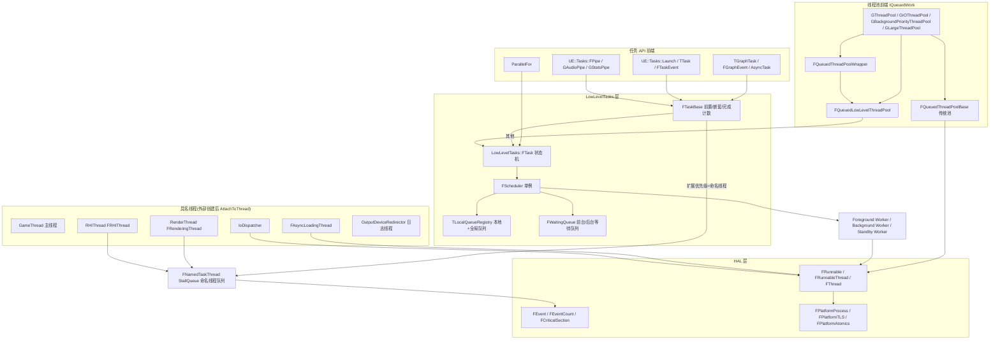

说明:
- 命名线程(RT/RHI/GT)不经过 FScheduler,任务进入 `FNamedTaskThread` 的 `FStallingTaskQueue`(每线程 2 个优先级桶,TaskGraph.cpp:911),由线程自身的 `ProcessThreadUntilRequestReturn/ProcessThreadUntilIdle` 泵驱动。
- worker 全部由 `FScheduler::CreateWorker` 创建(内部即 `FThread`),前台 worker 执行 High/Normal 优先级,后台 worker 兼容 Background* 优先级,待命(Standby)worker 只在超发期间临时工作。
- 传统池 `FQueuedThreadPoolBase` 仍是独立的 FRunnableThread 池(仅 GBackgroundPriorityThreadPool、GIOThreadPool 使用);`FQueuedLowLevelThreadPool` 与 `FQueuedThreadPoolWrapper` 都把工作转回 LowLevelTasks。

## 2.3 类图

### 2.3.1 线程基础设施(HAL)

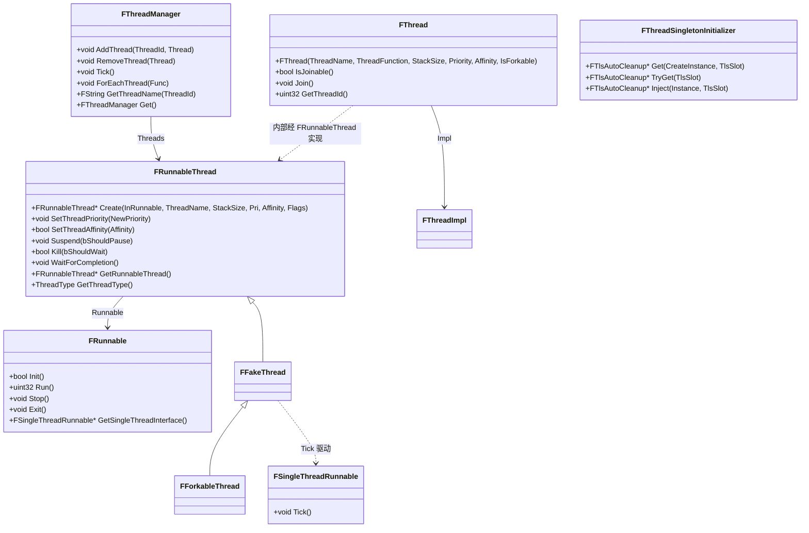

- `FRunnable`(Core/Public/HAL/Runnable.h:19):线程体接口,Init→Run→Exit 调用序列;`GetSingleThreadInterface`(Runnable.h:69)在单线程模式下由 `FFakeThread::Tick` 驱动(ThreadingBase.cpp:407)。
- `FRunnableThread`(RunnableThread.h:19):线程句柄;工厂 `Create`(RunnableThread.h:44)按 `FPlatformProcess::SupportsMultithreading()` 决定真线程/假线程(实现 ThreadingBase.cpp:900-930);`RunnableTlsSlot` TLS 使 `GetRunnableThread()` 可在自身线程取回句柄(RunnableThread.h:145)。
- `FFakeThread`(ThreadingBase.cpp:370):单线程环境的"假线程",线程 ID 用最高位 `FakeIdReservedBit`(ThreadingBase.cpp:386)标记;`FForkableThread`(ThreadingBase.cpp:1616)fork 前按 fake tick、fork 后 `OnPostFork` 建真线程。
- `FThread`(Thread.h:23):轻量系统线程 RAII 封装(必须 Join 后析构);实现类 `FThreadImpl`(Core/Private/HAL/Thread.cpp),LowLevelTasks worker 即用它创建。
- `FThreadManager`(ThreadManager.h:20):全局线程注册表(`TMap<uint32,FRunnableThread*>`),提供 `Tick()` 单线程驱动(ThreadingBase.cpp:572)、`OnThreadEvent` 增删广播(ThreadManager.h:72)与全线程栈回溯。

### 2.3.2 线程池体系

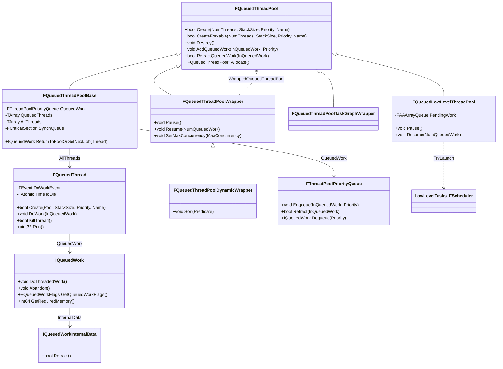

- `IQueuedWork`(Core/Public/Misc/IQueuedWork.h:61):池化工作接口;`EQueuedWorkFlags::DoNotRunInsideBusyWait`(IQueuedWork.h:21)防止忙等互相等待的任务成环;`InternalData`(IQueuedWork.h:110-111)保存可撤销状态。
- `FQueuedThreadPoolBase`(ThreadingBase.cpp:1222):传统池,`AddQueuedWork` 从 `QueuedThreads` 尾部取空闲线程直接 `DoWork`,否则进入 `FThreadPoolPriorityQueue`(ThreadingBase.cpp:1373-1416);`FQueuedThread::Run`(ThreadingBase.cpp:1464-1513)在 `DoWorkEvent` 上阻塞等活。
- `FQueuedThreadPoolWrapper`(Core/Public/Misc/QueuedThreadPoolWrapper.h:43):并发上限 + 优先级映射的包装池;编辑器下 `GThreadPool = new FQueuedThreadPoolWrapper(GLargeThreadPool, N)`(LaunchEngineLoop.cpp:2630)。
- `FQueuedLowLevelThreadPool`(QueuedThreadPoolWrapper.h:381):把 `IQueuedWork` 包进 `FQueuedWorkInternalData::Task`(LowLevelTasks::FTask,行 384-392)后 `Scheduler->TryLaunch`(行 503);优先级映射表在行 490(Blocking/Highest→High,High→BackgroundHigh,Normal→BackgroundNormal,Low/Lowest→BackgroundLow)。
- `FQueuedThreadPoolTaskGraphWrapper`(行 273):已标 `UE_DEPRECATED(5.8)`。

### 2.3.3 TaskGraph 前端与 UE::Tasks / LowLevelTasks

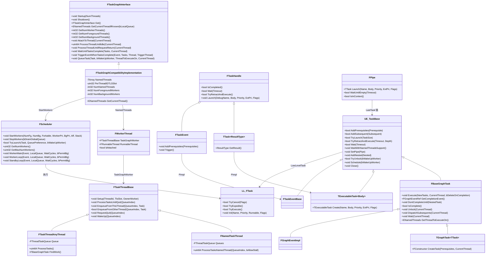

- `FTaskGraphInterface`(TaskGraphInterfaces.h:264)为抽象接口;唯一实现 `FTaskGraphCompatibilityImplementation`(TaskGraph.cpp:1247)持有 `NamedThreads`(FWorkerThread 数组,长度 = `ENamedThreads::ActualRenderingThread+1`,即 RHIThread/GameThread/ActualRenderingThread 三个槽,TaskGraph.cpp:1289/1300-1310)。
- 命名线程执行器 `FNamedTaskThread`(TaskGraph.cpp:681)每线程有 MainQueue/LocalQueue 两个 `FThreadTaskQueue`(内含 `FStallingTaskQueue<FBaseGraphTask,PLATFORM_CACHE_LINE_SIZE,2>` 双优先级队列 + `StallRestartEvent`,TaskGraph.cpp:909-938);`FTaskThreadAnyThread`(TaskGraph.cpp:958)在 5.8 中已不创建 worker(仅作兼容,`FindWork` 直接 `check(false)`,TaskGraph.cpp:1711-1715)。
- `FBaseGraphTask`(TaskGraphInterfaces.h:468)直接继承 `UE::Tasks::Private::FTaskBase` —— 这就是"TaskGraph 与 UE::Tasks 桥接"的类型基础:`FGraphEvent` 即 `FBaseGraphTask` 别名,`FGraphEventRef = TRefCountPtr<FBaseGraphTask>`(Core/Public/Async/TaskGraphFwd.h:14-17)。
- `UE_TaskBase`/`LL_FTask` 分别代表 `UE::Tasks::Private::FTaskBase`(Tasks/TaskPrivate.h:125)与 `LowLevelTasks::FTask`(Async/Fundamental/Task.h:320);高层任务把执行体包成 lambda 存入底层任务的 `TTaskDelegate`(Fundamental/Task.h:305,TaskPrivate.h:177-189)。
- `FPipe`(Tasks/Pipe.h:28)以 `LastTask` 原子指针把任务串成链,实现同管道串行执行(Pipe.h:136);引擎级管道实例:`GAudioPipe`(ThreadingBase.cpp:245)、`GStatsPipe`(StatsSystemTypes.cpp:50)。

### 2.3.4 同步原语与线程工具

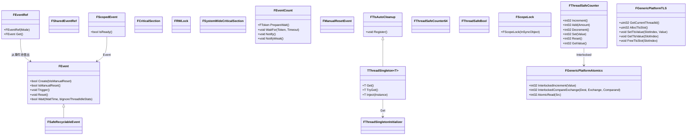

- `FCriticalSection = UE::FPlatformRecursiveMutex`、`FRWLock = UE::FPlatformRWLock`、`FSystemWideCriticalSection = UE::FPlatformSystemWideMutex`(Core/Public/HAL/CriticalSection.h:53-59);平台互斥实现在 Core/Public/HAL/PlatformMutex.h 与 Async/Mutex.h、WordMutex.h、SharedMutex.h 等新式互斥族。
- 事件一律走池:`FPlatformProcess::GetSynchEventFromPool/ReturnSynchEventToPool`(GenericPlatformProcess.h:786/799),RAII 包装 `FEventRef/FSharedEventRef`(Event.h:136/165)与 `FScopedEvent`(Misc/ScopedEvent.h,池实现 Core/Private/Misc/EventPool.h:71 `TEventPool`)。
- `FEventCount`(Core/Public/Async/EventCount.h)是 futex 风格的等待原语,是 UE::Tasks `FTaskBase::StateChangeEvent` 与 `FManualResetEvent` 的底层;LowLevelTasks 等待队列的 `FWaitEvent` 则用 `FEventRef{ManualReset}`(WaitingQueue.h:33-40)。
- `TThreadSingleton`(HAL/ThreadSingleton.h:43)按线程惰性创建并登记到 `thread_local FTlsContainer` 反序销毁(ThreadingBase.cpp:1588-1604)。

## 2.4 数据字典

### 2.4.1 ENamedThreads::Type 位编码(int32,TaskGraphInterfaces.h:54-108)

| 字段/枚举 | 类型/值 | 含义 | 约束/备注 | 源码位置 |
|---|---|---|---|---|
| RHIThread | 0 | 命名线程索引 0 | | TaskGraphInterfaces.h:60 |
| GameThread | 1 | 命名线程索引 1 | | TaskGraphInterfaces.h:61 |
| ActualRenderingThread | GameThread+1 = 2 | 渲染线程索引(须为最后一个命名线程) | `NumNamedThreads = ActualRenderingThread+1`(TaskGraph.cpp:1289) | TaskGraphInterfaces.h:63 |
| AnyThread | 0xff | 未知线程/任意未命名线程 | 不是线程索引 | TaskGraphInterfaces.h:67 |
| MainQueue / LocalQueue | 0x000 / 0x100 | 队列选择位(QueueIndexMask 0x100,QueueIndexShift 8) | 命名线程双队列;LocalQueue 用于低延迟渲染路径 | TaskGraphInterfaces.h:71-72 |
| NormalTaskPriority / HighTaskPriority | 0x000 / 0x200 | 任务优先级位(TaskPriorityShift 9) | | TaskGraphInterfaces.h:81-82 |
| NormalThreadPriority / HighThreadPriority / BackgroundThreadPriority | 0x000 / 0x400 / 0x800 | 线程优先级位(ThreadPriorityMask 0xC00,shift 10) | 共 3 档 NumThreadPriorities | TaskGraphInterfaces.h:88-90 |
| AnyHiPriThreadHiPriTask 等 | AnyThread\|HighThreadPriority\|HighTaskPriority 等组合 | "任意线程+优先级"请求 | 例:AnyBackgroundThreadNormalTask=0xff\|0x800 | TaskGraphInterfaces.h:100-107 |
| FRenderThreadStatics::RenderThread | TAtomic&lt;Type&gt; | 当前渲染线程映射,默认 GameThread,由 RT 自设/复位 | RenderingThread.cpp:233/274 设置 | TaskGraphInterfaces.h:110-121 |
| bHasBackgroundThreads / bHasHighPriorityThreads | int32 | 是否有后台/高优先级任务线程 | 编辑器/客户端默认 1(CREATE_* 宏,TaskGraph.cpp:50-67) | TaskGraphInterfaces.h:145-146 |

### 2.4.2 线程与任务优先级枚举

| 枚举 | 取值 | 含义 | 源码位置 |
|---|---|---|---|
| EThreadPriority | TPri_Normal=0, TPri_AboveNormal, TPri_BelowNormal, TPri_Highest, TPri_Lowest, TPri_SlightlyBelowNormal, TPri_TimeCritical | 平台线程优先级(7 档) | Core/Public/GenericPlatform/GenericPlatformAffinity.h:28-37 |
| LowLevelTasks::ETaskPriority | High=0, Normal=1(Default), ForegroundCount=2, BackgroundHigh=2, BackgroundNormal=3, BackgroundLow=4, Count=5, Inherit | 任务优先级;≥ForegroundCount 即后台任务(`IsBackgroundTask`,Fundamental/Task.h:643) | Core/Public/Async/Fundamental/Task.h:20-33 |
| UE::Tasks::EExtendedTaskPriority | None=0, Inline, TaskEvent, GameThreadNormalPri/HiPri/NormalPriLocalQueue/HiPriLocalQueue, RenderThread…×4, RHIThread…×4 | 扩展优先级:内联执行、事件、或定向到某命名线程(±高任务优先级/本地队列);≥GameThreadNormalPri 即命名线程任务(`IsNamedThreadTask`,TaskPrivate.h:211-214) | Core/Public/Tasks/TaskPrivate.h:59-83 |
| LowLevelTasks::ETaskFlags | AllowNothing=0, AllowBusyWaiting=1&lt;&lt;0, AllowCancellation=1&lt;&lt;1, AllowEverything, DefaultFlags=AllowEverything | 底层任务能力位 | Core/Public/Async/Fundamental/Task.h:99-107 |
| UE::Tasks::ETaskFlags | None, DoNotRunInsideBusyWait | 高层任务标志 | Core/Public/Tasks/TaskPrivate.h:88-92 |
| EQueuedWorkPriority | Blocking=0, Highest, High, Normal, Low, Lowest, Count | 线程池工作优先级(数值小者先出队) | Core/Public/Misc/QueuedThreadPool.h:13-22 |
| EQueuedWorkFlags | None, DoNotRunInsideBusyWait=1&lt;&lt;0 | 池工作标志,映射到 LowLevelTasks::ETaskFlags::AllowBusyWaiting 的清除(QueuedThreadPoolWrapper.h:492) | Core/Public/Misc/IQueuedWork.h:9-24 |
| EAsyncExecution | TaskGraph, TaskGraphMainThread, TaskGraphMainTick, Thread, ThreadIfForkSafe, ThreadPool, (WITH_EDITOR) LargeThreadPool | Async() 执行通道 | Core/Public/Async/Async.h:27-54 |
| EParallelForFlags | None=0, ForceSingleThread=1, Unbalanced=2, PumpRenderingThread=4, BackgroundPriority=8 | ParallelFor 行为开关 | Core/Public/Async/ParallelFor.h:52-68 |
| ETaskTag | EStaticInit=1&lt;&lt;0, EGameThread=1&lt;&lt;1, ESlateThread=1&lt;&lt;2, ERenderingThread=1&lt;&lt;4, ERhiThread=1&lt;&lt;5, EAsyncLoadingThread=1&lt;&lt;6, EEventThread=1&lt;&lt;7, EParallelThread=1&lt;&lt;30, EWorkerThread=1&lt;&lt;29\|EParallelThread, EParallelRenderingThread 等 | thread_local 执行上下文标签,IsInGameThread/IsInRenderingThread 等的判定基础;EAudioThread 位已移除(音频改走管道) | Core/Public/CoreGlobals.h:625-644 |
| EQueuePreference | GlobalQueuePreference=0, LocalQueuePreference=1(DefaultPreference) | LowLevelTasks 入队偏好 | Core/Public/Async/Fundamental/Scheduler.h:33-38 |

### 2.4.3 LowLevelTasks::ETaskState 状态机(位标志,Fundamental/Task.h:131-153)

| 状态 | 值(组合) | 含义 |
|---|---|---|
| Ready | ReadyState=0 | 已初始化待发射 |
| CanceledAndReady | Ready\|CanceledFlag | 已取消但仍需发射(执行体将被跳过) |
| Scheduled | Ready\|ScheduledFlag | 已入队待 worker 执行 |
| Canceled | CanceledAndReady\|ScheduledFlag | 已取消且已入队 |
| Running | Scheduled\|RunningFlag | 正在执行 runnable 与 continuation |
| CanceledAndRunning | Canceled\|RunningFlag | runnable 已取消,continuation 执行中 |
| Expediting / Expedited | Running\|ExpeditingFlag / 再\|ExpeditedFlag | 被等待线程"抢跑"(TryExpedite)相关中间态 |
| Completed | Running\|CompletedFlag | 执行完成 |
| ExpeditedAndCompleted / CanceledAndCompleted | 组合 | 抢跑/取消路径的完成态 |

状态打包进单个指针位域 `FPackedData`:State 6 bit、DebugName 53 bit、Priority 3 bit、Flags 2 bit(Fundamental/Task.h:205-214);任务对象尺寸恒为一条缓存行 `LOWLEVEL_TASK_SIZE = PLATFORM_CACHE_LINE_SIZE`(Fundamental/Task.h:12)。

### 2.4.4 关键结构成员

| 结构 | 字段 | 类型 | 含义 | 源码位置 |
|---|---|---|---|---|
| FWorkerThread | TaskGraphWorker / RunnableThread / bAttached | FTaskThreadBase* / FRunnableThread* / bool | 命名线程槽:执行器指针(外部线程时 RunnableThread 为空)与附着标志 | TaskGraph.cpp:1224-1232 |
| FNamedTaskThread::FThreadTaskQueue | StallQueue / RecursionGuard / QuitForReturn / QuitForShutdown / StallRestartEvent | FStallingTaskQueue&lt;FBaseGraphTask,…,2&gt; / uint32 / bool / bool / FEvent* | 命名线程队列:双优先级无锁队列、防重入计数、两种退出标志、等待事件 | TaskGraph.cpp:909-938 |
| UE::Tasks::Private::FTaskBase | RefCount / NumLocks / Pipe / StateChangeEvent / ExtendedPriority / ExecutingThreadId / Prerequisites / Subsequents / LowLevelTask | std::atomic&lt;uint32&gt; 等 | 侵入式引用计数;NumLocks 高位 ExecutionFlag(0x80000000)区分"执行前置锁数/完成嵌套锁数"(TaskPrivate.h:132/687-688);FSubsequents 关闭即任务完成 | Tasks/TaskPrivate.h:159/690-751 |
| LowLevelTasks::FTask | Runnable / UserData / PackedData / ActiveTask(thread_local) | TTaskDelegate / void* / FPackedDataAtomic / FTask* | 执行体、用户数据(管道/父任务继承,Fundamental/Task.h:449-468)、状态打包、当前线程正在执行的任务 | Fundamental/Task.h:305-308/325 |
| FScheduler | WaitingQueue[2] / QueueRegistry / WorkerThreads / WorkerLocalQueues / WorkerEvents / GameThreadLocalQueue / ActiveWorkers / NextWorkerId / WorkerPriority / BackgroundPriority | 见左 | 两条等待队列(前台/后台)、本地+全局队列注册表、worker 槽位数组、GT 专属本地队列、活跃 worker 数、worker/后台线程优先级 | Scheduler.h:162-179 |
| FSchedulerTls::FTlsValues | ActiveScheduler / LocalQueue / WorkerType / bPendingWakeUp / bIsStandbyWorker | 见左 | 每 worker 的 TLS:所属调度器、本地队列指针、None/Background/Foreground 类型、待唤醒标志、待命标志 | Scheduler.h:55-80 |
| FWaitingQueue | ThreadCount / MaxThreadCount / CreateThread / Oversubscription / State / StandbyState / NodesArray | 见左 | 等待队列:常规线程数、超发上限、动态建线程回调、超发计数、EventCount 式状态字、FWaitEvent 数组 | WaitingQueue.h:42-52 |
| Private::FWaitEvent | Next / Epoch / State / Event / bIsStandby | 见左 | 单个等待节点(ManualReset FEventRef),bIsStandby 区分待命 worker | WaitingQueue.h:33-40 |
| FPipe | LastTask / TaskCount / EmptyEventRef | std::atomic&lt;FTaskBase*&gt; / std::atomic&lt;uint64&gt; / TSharedRef&lt;FEventCount&gt; | 管道尾任务指针、未完成任务计数、排空通知 | Tasks/Pipe.h:136-138 |
| FQueuedThread | DoWorkEvent / TimeToDie / QueuedWork / OwningThreadPool / Thread | FEvent* / TAtomic&lt;bool&gt; / IQueuedWork* / FQueuedThreadPoolBase* / FRunnableThread* | 传统池线程:等活事件、退出标志、当前工作、所属池、线程句柄 | ThreadingBase.cpp:1098-1111 |

## 2.5 接口清单

以下原型逐字摘自头文件(去掉 `*_API` 宏)。路径相对 `$E/Source`。"线程约束"给出判定依据(函数内 `check(IsInGameThread())`、TLS 查询、调用方上下文等)。

### 2.5.1 线程创建与管理

| 原型 | 功能 | 参数/返回 | 线程/重入约束 | 位置 |
|---|---|---|---|---|
| `static FRunnableThread* Create(class FRunnable* InRunnable, const TCHAR* ThreadName, uint32 InStackSize = 0, EThreadPriority InThreadPri = TPri_Normal, uint64 InThreadAffinityMask = FPlatformAffinity::GetNoAffinityMask(), EThreadCreateFlags InCreateFlags = EThreadCreateFlags::None)` | 创建线程(工厂) | runnable+名字+栈大小+优先级+亲和性+创建标志;失败返回 nullptr | 任意线程;单线程环境退化为 FFakeThread(ThreadingBase.cpp:908-922) | Core/Public/HAL/RunnableThread.h:44-50 |
| `virtual bool Kill( bool bShouldWait = true )` | 请求线程退出(内部调 Runnable 的 Stop),可选择等待 | 返回恒 true | 调用方持线程句柄 | RunnableThread.h:86 |
| `virtual void WaitForCompletion()` | 阻塞等待线程结束 | — | 任意线程 | RunnableThread.h:89 |
| `static FRunnableThread* GetRunnableThread()` | 从自身线程 TLS 取回 FRunnableThread* | 非 FRunnable 线程(如 GT)返回 nullptr | 仅在目标线程自身调用 | RunnableThread.h:145-149 |
| `virtual uint32 Run() = 0`(FRunnable) | 线程主体 | 返回退出码 | 在新线程上下文执行,仅当 Init() 成功 | Core/Public/HAL/Runnable.h:45 |
| `virtual class FSingleThreadRunnable* GetSingleThreadInterface( )` | 单线程模式的 tick 接口 | 未实现则单线程下不被 tick | — | Runnable.h:69-72 |
| `FThread(TCHAR const* ThreadName, TUniqueFunction<void()>&& ThreadFunction, uint32 StackSize = 0, EThreadPriority ThreadPriority = TPri_Normal, FThreadAffinity ThreadAffinity = FThreadAffinity(), EForkable IsForkable = NonForkable)` | 直接以函数对象创建系统线程 | — | 析构前必须 Join(Thread.h:78-80 断言) | Core/Public/HAL/Thread.h:45-52 |
| `CORE_API void Join()` | 阻塞等待并同步 | — | 多线程并发 Join 同一对象是数据竞争 | Thread.h:91-97 |
| `CORE_API void AddThread(uint32 ThreadId, FRunnableThread* Thread)` / `RemoveThread(FRunnableThread* Thread)` | 线程注册/注销(由 FRunnableThread 构造/析构调用) | — | 须在目标线程自身调用(ThreadingBase.cpp:519 注释) | Core/Public/HAL/ThreadManager.h:46/54 |
| `CORE_API void Tick()` | 单线程环境 tick 所有 fake/forkable 线程 | — | 主循环调用;`SupportsMultithreading()==false` 时才有效(ThreadingBase.cpp:572-590) | ThreadManager.h:79 |
| `static FRunnableThread* CreateRunnableThread()`(FPlatformProcess) | 创建平台实现(FRunnableThreadWin64/FRunnableThreadPThread 等) | — | 任意线程 | Core/Public/GenericPlatform/GenericPlatformProcess.h:806 |
| `static CORE_API void SetThreadPriority( EThreadPriority NewPriority )`(FPlatformProcess) | 设置当前线程优先级 | — | 仅当前线程 | GenericPlatformProcess.h:370 |
| `static CORE_API class FEvent* GetSynchEventFromPool(bool bIsManualReset = false)` / `static CORE_API void ReturnSynchEventToPool(FEvent* Event)` | 事件池借还 | — | 任意线程;配对使用 | GenericPlatformProcess.h:786/799 |
| `static CORE_API void Sleep( float Seconds )`(FPlatformProcess) | 睡眠当前线程 | — | 当前线程 | GenericPlatformProcess.h:749 |
| `static CORE_API bool SupportsMultithreading()` | 平台是否支持多线程 | — | 线程系统模式选择的总开关(RunnableThread.h 的 Create、FTaskGraphInterface::IsMultithread 等) | GenericPlatformProcess.h:879 |
| `static UE_FORCEINLINE_HINT uint32 GetCurrentThreadId(void)`(FPlatformTLS) | 当前线程 ID | — | 任意线程 | Core/Public/GenericPlatform/GenericPlatformTLS.h:29 |
| `static UE_FORCEINLINE_HINT uint32 AllocTlsSlot(void)` / `SetTlsValue` / `GetTlsValue` / `FreeTlsSlot` | TLS 槽管理 | — | Alloc/Free 建议仅主线程(见 FRunnableThread::GetTlsSlot 的 check,ThreadingBase.cpp:875-881) | GenericPlatformTLS.h:36-64 |
| `static FORCEINLINE int32 InterlockedIncrement(volatile int32* Value)` 等(FGenericPlatformAtomics) | 原子自增/自减/加/交换/CAS/And/Or/Xor/AtomicRead(int8~int64、128 位) | 旧值或新值 | 任意线程;头文件标注 "DEPRECATED … Use std::atomic&lt;T&gt;"(GenericPlatformAtomics.h:16) | Core/Public/GenericPlatform/GenericPlatformAtomics.h:32-280 |

### 2.5.2 同步原语

| 原型 | 功能 | 参数/返回 | 线程/重入约束 | 位置 |
|---|---|---|---|---|
| `virtual void Trigger()` / `virtual void Reset()`(FEvent) | 触发/复位事件 | — | 任意线程 | Core/Public/HAL/Event.h:52/59 |
| `virtual bool Wait( uint32 WaitTime, const bool bIgnoreThreadIdleStats = false )` | 限时等待(毫秒,MAX_uint32=无限) | 超时返回 false | 任意线程 | Event.h:70 |
| `explicit FEventRef(EEventMode Mode = EEventMode::AutoReset)`(FEventRef) | RAII 池化事件 | EEventMode::AutoReset/ManualReset | 不可拷贝/移动 | Event.h:139 |
| `class FCriticalSection = UE::FPlatformRecursiveMutex` | 递归互斥(可重入、不保证公平) | — | 任意线程 | CriticalSection.h:53 |
| `class FRWLock = UE::FPlatformRWLock` | 读写锁(不可递归) | ReadLock/WriteLock 族 | 任意线程 | CriticalSection.h:56、Core/Public/Misc/ScopeRWLock.h |
| `[[nodiscard]] explicit FScopeLock(TNotNull<FCriticalSection*> InSyncObject)` | RAII 临界区守卫 | — | 任意线程;可递归嵌套 | Core/Public/Misc/ScopeLock.h:148 |
| `int32 Increment()` / `int32 Decrement()` / `int32 Add( int32 Amount )` / `int32 Set( int32 Value )` / `int32 GetValue() const`(FThreadSafeCounter) | 原子计数(标注 DEPRECATED,建议 std::atomic) | Increment/Decrement 返回新值,Add/Set 返回旧值 | 任意线程 | Core/Public/HAL/ThreadSafeCounter.h:52-123 |
| `static T& Get()`(TThreadSingleton&lt;T&gt;) | 当前线程单例(惰性建) | — | 任意线程;实例在 TLS 销毁时反序清理 | Core/Public/HAL/ThreadSingleton.h:101-104 |
| `static FTlsAutoCleanup* Get( TFunctionRef<FTlsAutoCleanup*()> CreateInstance, uint32& TlsSlot )`(FThreadSingletonInitializer) | 单例底层:CAS 惰性分配 TLS 槽 | — | 任意线程(AutoRTFM 下以 UE_AUTORTFM_OPEN_NO_SANITIZE 开放执行,ThreadingBase.cpp:1529) | Core/Public/HAL/ThreadSingleton.h:22 |
| `void Push(T *NewItem)` / `[[nodiscard]] T* Pop()` / `void PopAll(ContainerType& Output)` / `[[nodiscard]] bool IsEmpty() const`(TLockFreePointerListLIFO,LockFreeList.h:899;Unordered 行 905、FIFO 行 911) | Treiber 式无锁指针栈/无序/先进先出变体(PopAll 整链摘下到输出容器) | — | 任意线程;FNamedTaskThread 的 StallQueue 即 FStallingTaskQueue(行 690)构建其上 | Core/Public/Containers/LockFreeList.h:851-899/905/911 |

### 2.5.3 线程池

| 原型 | 功能 | 参数/返回 | 线程/重入约束 | 位置 |
|---|---|---|---|---|
| `virtual bool Create(uint32 InNumQueuedThreads, uint32 StackSize = (32 * 1024), EThreadPriority ThreadPriority = TPri_Normal, const TCHAR* Name = TEXT("UnknownThreadPool"))` | 建池(创建 FQueuedThread×N) | — | 引擎初始化时(GT)调用 | Core/Public/Misc/QueuedThreadPool.h:116 |
| `virtual void AddQueuedWork( IQueuedWork* InQueuedWork, EQueuedWorkPriority InQueuedWorkPriority = EQueuedWorkPriority::Normal)` | 投递工作:有空闲线程立即派发,否则入优先级队列 | — | 任意线程 | QueuedThreadPool.h:145 |
| `virtual bool RetractQueuedWork(IQueuedWork* InQueuedWork)` | 撤回排队中的工作 | 已被取出执行则 false | 任意线程 | QueuedThreadPool.h:154 |
| `virtual void DoThreadedWork()` / `virtual void Abandon()`(IQueuedWork) | 执行/放弃 | Abandon 要求对象自删除 | 池线程上下文 | Core/Public/Misc/IQueuedWork.h:68/76 |
| `FQueuedThreadPoolWrapper(FQueuedThreadPool* InWrappedQueuedThreadPool, int32 InMaxConcurrency = -1, TFunction<EQueuedWorkPriority(EQueuedWorkPriority)> InPriorityMapper = DefaultQueuedWorkPriorityWrapper)` | 并发受限包装池 | MaxConcurrency=-1 表示受底层池线程数限制 | Pause/Resume/SetMaxConcurrency 供 GT 调节 | Core/Public/Misc/QueuedThreadPoolWrapper.h:51 |
| `FQueuedLowLevelThreadPool(TFunction<EQueuedWorkPriority(EQueuedWorkPriority)> InPriorityMapper = DefaultQueuedWorkPriorityWrapper, LowLevelTasks::FScheduler* InScheduler = &LowLevelTasks::FScheduler::Get())` | 桥接池:IQueuedWork→LowLevelTasks::FTask | 优先级映射见 2.3.2 | Create() 为空操作,不建线程 | QueuedThreadPoolWrapper.h:397-400 |
| `extern CORE_API FQueuedThreadPool* GThreadPool / *GIOThreadPool / *GBackgroundPriorityThreadPool / *GLargeThreadPool(WITH_EDITOR)` | 全局池单例 | — | 见 2.8 创建时序 | Core/Public/Misc/QueuedThreadPool.h:185-192 |

### 2.5.4 TaskGraph 前端

| 原型 | 功能 | 参数/返回 | 线程/重入约束 | 位置 |
|---|---|---|---|---|
| `static CORE_API void Startup(int32 NumThreads)` | 启动任务图:创建 FTaskGraphCompatibilityImplementation 并启动 LowLevelTasks worker | NumThreads=worker 总数(不含命名线程);内部再算前后台分配 | GT;LaunchEngineLoop.cpp:2592 以 `FPlatformMisc::NumberOfWorkerThreadsToSpawn()` 调用 | TaskGraphInterfaces.h:287,实现 TaskGraph.cpp:1776-1797 |
| `static CORE_API FTaskGraphInterface& Get()` | 单例 | — | 须先 Startup | TaskGraphInterfaces.h:300 |
| `virtual void AttachToThread(ENamedThreads::Type CurrentThread)=0` | 把外部线程登记为命名线程(设 TLS) | — | 必须在目标命名线程自身调用(TaskGraph.cpp:1433-1439 的 check) | TaskGraphInterfaces.h:341 |
| `virtual uint64 ProcessThreadUntilIdle(ENamedThreads::Type CurrentThread)=0` | 泵当前命名线程队列直至空闲 | 返回处理任务数 | 命名线程自身;GT/RT 每帧/每次循环调用 | TaskGraphInterfaces.h:347 |
| `virtual void ProcessThreadUntilRequestReturn(ENamedThreads::Type CurrentThread)=0` | 泵直到收到 FReturnGraphTask | — | 命名线程自身(RT/RHI 主循环) | TaskGraphInterfaces.h:353 |
| `virtual void WaitUntilTasksComplete(const FGraphEventArray& Tasks, ENamedThreads::Type CurrentThreadIfKnown = ENamedThreads::AnyThread)=0` | 等一组任务:先逐个 TryRetractAndExecute 再回落命名线程等待 | — | 任意线程;命名线程等待时会泵本线程队列 | TaskGraphInterfaces.h:366,实现 TaskGraph.cpp:1467-1539 |
| `virtual void TriggerEventWhenTasksComplete(FEvent* InEvent, const FGraphEventArray& Tasks, ENamedThreads::Type CurrentThreadIfKnown = ENamedThreads::AnyThread, ENamedThreads::Type TriggerThread = ENamedThreads::AnyHiPriThreadHiPriTask)=0` | 任务完成后触发事件(实现为 UE::Tasks::Launch + EExtendedTaskPriority::Inline 的内联任务,TaskGraph.cpp:1685-1694) | — | 任意线程 | TaskGraphInterfaces.h:407 |
| `virtual ENamedThreads::Type GetCurrentThreadIfKnown(bool bLocalQueue = false) = 0` | 识别当前线程(先查命名线程 TLS,再以 LowLevelTasks::FTask::GetActiveTask() 推导 worker 优先级,TaskGraph.cpp:1725-1750) | — | 任意线程 | TaskGraphInterfaces.h:309 |
| `static FConstructor CreateTask(const FGraphEventArray* Prerequisites = nullptr, ENamedThreads::Type CurrentThreadIfKnown = ENamedThreads::AnyThread)`(TGraphTask&lt;TTask&gt;) | 任务工厂 | 返回 FConstructor 以 ConstructAndDispatchWhenReady/ConstructAndHold | 任意线程 | TaskGraphInterfaces.h:671-674 |
| `inline FGraphEventRef ConstructAndDispatchWhenReady(T&&... Args)`(FConstructor) | 构造任务体并发射,返回完成事件 | — | 任意线程;任务可能在返回前已执行完 | TaskGraphInterfaces.h:605-610 |
| `static FGraphEventRef CreateGraphEvent()`(FBaseGraphTask) | 建空 FGraphEvent(即 FGraphEventImpl,EExtendedTaskPriority::TaskEvent) | — | 任意线程;须 Unlock/DispatchSubsequents 后才入系统 | TaskGraphInterfaces.h:533,实现 750-754 |
| `void DontCompleteUntil(FGraphEventRef NestedTask)`(FBaseGraphTask) | 声明嵌套任务:本任务完成被推迟到嵌套完成 | — | 仅可在任务执行体内调用(checkSlow(GetCurrentTask()==this),行 521) | TaskGraphInterfaces.h:508-524 |
| `void Wait(ENamedThreads::Type CurrentThreadIfKnown = ENamedThreads::AnyThread)`(FBaseGraphTask) | 等待完成;LocalQueue 情形走 FTaskGraphInterface::WaitUntilTaskCompletes,否则 FTaskBase::WaitWithNamedThreadsSupport | — | 任意线程;不得在任务自身执行线程等待(IsAwaitable 检查,TaskPrivate.h:206-209) | TaskGraphInterfaces.h:568-577 |
| `virtual FBaseGraphTask* FindWork(ENamedThreads::Type ThreadInNeed)` | 5.8 兼容壳:实现直接 `check(false)` 返回空(worker 找活已下沉 FScheduler) | — | 不应调用 | TaskGraphInterfaces.h:437,实现 TaskGraph.cpp:1711-1715 |
| `CORE_API void AsyncTask(ENamedThreads::Type Thread, TUniqueFunction<void()> Function)` | 把函数派到指定命名线程(TGraphTask&lt;FAsyncGraphTask&gt; 糖衣) | — | 任意线程 | Core/Public/Async/Async.h:463,实现 Core/Private/Async/Async.cpp:54-58 |

### 2.5.5 UE::Tasks

| 原型 | 功能 | 参数/返回 | 线程/重入约束 | 位置 |
|---|---|---|---|---|
| `template<typename TaskBodyType> TTask<TInvokeResult_T<TaskBodyType>> Launch(const TCHAR* DebugName, TaskBodyType&& TaskBody, ETaskPriority Priority = ETaskPriority::Normal, EExtendedTaskPriority ExtendedPriority = EExtendedTaskPriority::None, ETaskFlags Flags = ETaskFlags::None)` | 发射任务(无/有前置两个重载,行 323-336) | 返回可移动句柄;DebugName 在 test/shipping 编译剔除 | 任意线程;任务可能同步完成(EExtendedTaskPriority::Inline) | Core/Public/Tasks/Task.h:298-310 |
| `template<typename... TaskTypes> TStaticArray<Private::FTaskBase*, sizeof...(TaskTypes)> Prerequisites(TaskTypes&... Tasks)` | 打包前置集合 | — | 调用 Launch 前 | Task.h:366-374 |
| `template<typename TaskCollectionType> bool Wait(const TaskCollectionType& Tasks, FTimespan InTimeout)` | 等一组:实现为发射一个 Inline "Waiting Task" 再 Wait(Task.h:398-404) | 超时 false | 任意线程(非被等任务自身) | Task.h:392-405 |
| `template<typename TaskCollectionType> int32 WaitAny(const TaskCollectionType& Tasks, FTimespan Timeout = FTimespan::MaxValue())` | 等任一完成 | 返回首个完成索引或 INDEX_NONE | 任意线程 | Task.h:417-464 |
| `template<typename TaskCollectionType> FTask Any(const TaskCollectionType& Tasks)` | 返回"任一完成即完成"的任务(事件) | — | 任意线程 | Task.h:467-516 |
| `template<typename TaskType> void AddNested(const TaskType& Nested)` | 把子任务登记为当前任务的嵌套(父任务完成被推迟,worker 不阻塞) | — | 必须在任务体内(check Parent!=nullptr,Task.h:526-527) | Task.h:523-529 |
| `template<typename ResultType, typename... ArgTypes> TTask<ResultType> MakeCompletedTask(ArgTypes&&... Args)` | 构造已完成的任务(Inline) | — | 任意线程 | Task.h:531-540 |
| `ResultType& GetResult()`(TTask&lt;ResultType&gt;) | 等待并取结果 | — | 任意线程 | Task.h:220-226 |
| `bool IsCompleted() const` / `bool Wait(FTimespan Timeout) const` / `bool TryRetractAndExecute()`(FTaskHandle) | 状态查询/限时等待/收回执行 | — | 任意线程;Wait 在任务自身线程会 Fatal("Deadlock detected",TaskPrivate.cpp:80) | Task.h:50/60/86 |
| `explicit FTaskEvent(const TCHAR* DebugName)` + `void Trigger()` | 手动触发的事件型任务(推荐替代 FEvent 的任务间信号) | 可多次 Trigger(幂等) | 任意线程;析构前须触发 | Task.h:264-287 |
| `template<typename TaskBodyType> TTask<TInvokeResult_T<TaskBodyType>> Launch(const TCHAR* InDebugName, TaskBodyType&& TaskBody, ETaskPriority Priority = ETaskPriority::Default, EExtendedTaskPriority ExtendedPriority = EExtendedTaskPriority::None, ETaskFlags Flags = ETaskFlags::None)`(FPipe) | 管道内发射(同管道任务串行、FIFO) | — | 任意线程;管道须存活到最后一个任务完成(析构 check !HasWork) | Core/Public/Tasks/Pipe.h:62-80 |
| `CORE_API bool WaitUntilEmpty(FTimespan Timeout = FTimespan::MaxValue())` / `CORE_API bool IsInContext() const`(FPipe) | 等排空/判断当前是否在管道任务内 | — | 任意线程 / 任意线程 | Pipe.h:53/117 |
| `CORE_API bool FTaskBase::TryRetractAndExecute(FTimeout Timeout, uint32 RecursionDepth = 0)` | 深度收回:递归收回前置→本线程执行→收回嵌套 | 返回 true 仅表示已执行且无未决依赖,仍需确认 IsCompleted | 命名线程任务只允许在同名命名线程收回(TaskPrivate.cpp:84-108);递归上限 200(行 111) | TaskPrivate.h:440,实现 TaskPrivate.cpp:69-195 |
| `CORE_API bool FTaskBase::Wait(FTimeout Timeout)` / `CORE_API void Wait()` / `CORE_API void WaitWithNamedThreadsSupport()` | 等待实现:先收回,再自旋 40 次 Yield,再 FEventCount 睡眠(TaskPrivate.cpp:246-284);命名线程版会泵本线程队列(行 223-244) | — | 任意线程 | TaskPrivate.h:475/479/483 |
| `CORE_API void FTaskBase::Close()` | 关闭任务:解锁后续、清管道、通知等待者;递归深度>128 时转迭代工作表(TaskPrivate.cpp:309-391) | — | 由完成任务路径调用 | TaskPrivate.h:549 |
| `CORE_API void TranslatePriority(ENamedThreads::Type ThreadType, ETaskPriority& OutPriority, EExtendedTaskPriority& OutExtendedPriority)` / `CORE_API ENamedThreads::Type TranslatePriority(ETaskPriority Priority, EExtendedTaskPriority ExtendedPriority)` | 新旧优先级互转(桥接核心) | 命名线程索引→ExtendedTaskPriority;worker 优先级→ETaskPriority | 任意线程 | TaskPrivate.h:109-110,实现 TaskPrivate.cpp:558-653 |

### 2.5.6 LowLevelTasks

| 原型 | 功能 | 参数/返回 | 线程/重入约束 | 位置 |
|---|---|---|---|---|
| `CORE_API void StartWorkers(uint32 NumForegroundWorkers = 0, uint32 NumBackgroundWorkers = 0, FThread::EForkable IsForkable = FThread::NonForkable, EThreadPriority InWorkerPriority = EThreadPriority::TPri_Normal, EThreadPriority InBackgroundPriority = EThreadPriority::TPri_BelowNormal, uint64 InWorkerAffinity = 0, uint64 InBackgroundAffinity = 0, uint32 InWorkersStackSize = 0)`(FScheduler) | 启动 worker:两参数均 0 时取默认(Max(1,Min(2,NumberOfWorkerThreadsToSpawn()-1)) 前台、其余后台,Scheduler.cpp:243-247);按超发比例预留 Max 槽位;动态建线程关闭时全量预建(Scheduler.cpp:349-360) | — | 仅 GT(check(IsInGameThread()),Scheduler.cpp:231) | Core/Public/Async/Fundamental/Scheduler.h:116 |
| `CORE_API void StopWorkers(bool DrainGlobalQueue = true)` | 停止并 Join 所有 worker;可排空全局队列逐个执行残留任务(Scheduler.cpp:473-486) | — | 仅 GT(Scheduler.cpp:442) | Scheduler.h:117 |
| `inline bool TryLaunch(FTask& Task, EQueuePreference QueuePreference = EQueuePreference::DefaultPreference, bool bWakeUpWorker = true)` | 入队并按需唤醒 worker;若 worker 未启动(ActiveWorkers==0)则在当前线程直接执行(Scheduler.cpp:622-632) | 返回 false 表示任务未处于 Ready | 任意线程;后台任务从非后台线程投递时强制全局队列+唤醒(Scheduler.cpp:546-553) | Scheduler.h:121,LaunchInternal Scheduler.cpp:531-633 |
| `inline uint32 GetNumWorkers() const` / `inline uint32 GetMaxNumWorkers() const` | 活跃 worker 数 / 最大(含待命)worker 数 | — | 任意线程(读取原子量/数组长度) | Scheduler.h:124/127 |
| `CORE_API bool IsOversubscriptionLimitReached(ETaskPriority TaskPriority) const` | 该优先级是否已无可用 worker(前台任务需两条等待队列都到限) | — | 任意线程 | Scheduler.h:136,实现 Scheduler.cpp:371-387 |
| `CORE_API FOversubscriptionLimitReached& GetOversubscriptionLimitReachedEvent()` | 超发上限达到事件(线程安全多播) | — | 监听者任意线程 | Scheduler.h:142 |
| `template<typename TRunnable> inline void Init(const TCHAR* InDebugName, ETaskPriority InPriority, TRunnable&& InRunnable, ETaskFlags Flags = ETaskFlags::DefaultFlags)`(LowLevelTasks::FTask) | 初始化任务:包装执行体(返回 FTask* 时启用对称切换),继承父任务优先级与 UserData(Fundamental/Task.h:449-468) | — | 任务复用前提是 IsCompleted | Fundamental/Task.h:470-502 |
| `inline bool TryCancel(ECancellationFlags CancellationFlags = ECancellationFlags::DefaultFlags)` | CAS 到取消态;带 TryLaunchOnSuccess 时立即发射以走完成路径 | — | 任意线程;仅 AllowCancellation 任务可取消 | Fundamental/Task.h:368,实现 520-539 |
| `inline bool TryExpedite(FTask*& Continuation)` / `inline bool TryExecute(FTask*& Continuation)` | 抢跑:把 Scheduled 任务直接在当前线程执行(调度器仍持引用,用 TryFinish 收尾) | — | 任意等待线程 | Fundamental/Task.h:382-390,实现 593-612 |
| `CORE_API static const FTask* GetActiveTask()`(LowLevelTasks::FTask) | 当前线程正在执行的底层任务(thread_local ActiveTask) | — | 任意线程;用于无 TLS 命名线程身份时反推优先级(TaskGraph.cpp:1741-1747) | Fundamental/Task.h:357-365 |
| `bool IsWorkerThread() const`(FSchedulerTls) | 当前线程是否为本调度器 worker | — | 任意线程;IsInWorkerThread() 全局函数即转发此调用(ThreadingBase.cpp:222-225) | Scheduler.h:94,实现 Scheduler.cpp:668-672 |

### 2.5.7 高层异步(Async/Future/ParallelFor/AsyncWork)

| 原型 | 功能 | 参数/返回 | 线程/重入约束 | 位置 |
|---|---|---|---|---|
| `template<typename CallableType> auto Async(EAsyncExecution Execution, CallableType&& Callable, TUniqueFunction<void()> CompletionCallback = nullptr) -> TFuture<decltype(Forward<CallableType>(Callable)())>` | 按 EAsyncExecution 通道异步执行:TaskGraph/TaskGraphMainThread 走 TGraphTask;TaskGraphMainTick 走 FTSTicker;Thread/ThreadIfForkSafe 建 TAsyncRunnable 专用线程;ThreadPool/LargeThreadPool 投 GThreadPool/GLargeThreadPool | 返回 TFuture | 任意线程;线程名 "TAsync N"/"TAsyncThread N"(Async.h:330/442) | Core/Public/Async/Async.h:298-395 |
| `template<typename CallableType> auto AsyncPool(FQueuedThreadPool& ThreadPool, CallableType&& Callable, TUniqueFunction<void()> CompletionCallback = nullptr, EQueuedWorkPriority InQueuedWorkPriority = EQueuedWorkPriority::Normal) -> TFuture<…>` | 投指定池 | — | 任意线程 | Async.h:406-417 |
| `template<typename CallableType> auto AsyncThread(CallableType&& Callable, uint32 StackSize = 0, EThreadPriority ThreadPri = TPri_Normal, TUniqueFunction<void()> CompletionCallback = nullptr) -> TFuture<…>` | 一次性线程执行(可指定栈/优先级) | — | 任意线程 | Async.h:429-455 |
| `inline void ParallelFor(int32 Num, TFunctionRef<void(int32)> Body, EParallelForFlags Flags = EParallelForFlags::None)`(及 DebugName/MinBatchSize 重载) | 并行 for:切批后发射 LowLevelTasks::FTask(直接 TryLaunch,不走 TaskGraph);调用线程自身也参与(最后一个批留给 master 省一次事件);批切分策略 Div=6..1(ParallelFor.h:163-178);优先级按调用方 ETaskTag 继承 High/BackgroundNormal(行 186-200) | — | 任意线程;AutoRTFM 事务内强制单线程(行 126-129);PumpRenderingThread 标志下 RT 等待时泵渲染队列(行 444-450) | Core/Public/Async/ParallelFor.h:481/526/543 |
| `bool IsReady() const` / `ConstResultType Get() const` / `void Wait() const`(TFuture&lt;ResultType&gt;) | future 状态/取值(取值即等待) | — | 任意线程 | Core/Public/Async/Future.h:243/507(FutureState 行 226-267) |
| `TFuture<ResultType> GetFuture()` / `inline void SetValue(const SetType& Result)`(TPromise&lt;ResultType&gt;) | 取 future / 满足 promise(void 特化 SetValue() 无参) | SetValue 只能一次 | 任意线程 | Future.h:574/590-600 |
| `void Start(bool bForceSynchronous, FQueuedThreadPool* InQueuedPool, EQueuedWorkPriority InPriority = EQueuedWorkPriority::Normal)`(FAutoDeleteAsyncTask&lt;TTask&gt;,FAsyncTask&lt;TTask&gt; 的 Start 为同签名扩展版 AsyncWork.h:245) | FAsyncTask/FAutoDeleteAsyncTask 的启动入口:有池则 AddQueuedWork,否则当前线程直接 DoWork | 公有包装 StartBackgroundTask/StartSynchronousTask | 任意线程 | Core/Public/Async/AsyncWork.h:70 |

### 2.5.8 文件 HAL(与线程相关部分)

| 原型 | 功能 | 参数/返回 | 线程/重入约束 | 位置 |
|---|---|---|---|---|
| `virtual IPlatformFile* GetLowerLevel() = 0`(IPlatformFile) | 包装栈下层文件系统 | — | 任意线程(只读链) | Core/Public/GenericPlatform/GenericPlatformFile.h:429 |
| `virtual const TCHAR* GetName() const = 0` / `virtual bool FileExists(const TCHAR* Filename) = 0` | 名字/存在性 | — | 任意线程 | GenericPlatformFile.h:433/435 |
| `virtual IFileHandle* OpenRead(const TCHAR* Filename, bool bAllowWrite = false) = 0` | 同步读打开 | — | 任意线程 | GenericPlatformFile.h:535 |
| `CORE_API virtual IAsyncReadFileHandle* OpenAsyncRead(const TCHAR* Filename, bool bAllowWrite = false)` | 异步读打开:默认实现回落到同步 OpenRead;真正异步由 `FGenericAsyncReadFileHandle` 承载,读请求作为后台任务投 GIOThreadPool(Private/GenericPlatform/GenericPlatformFile.cpp:235、59) | — | 任意线程 | GenericPlatformFile.h:791 |
| `class IPlatformFile* GetPlatformFile( const TCHAR* Name )`(FPlatformFileManager) | 按名字取包装层 | — | 任意线程 | Core/Public/HAL/PlatformFileManager.h:65 |
| `class IPlatformFileModule : public IModuleInterface`(HAL/IPlatformFileModule.h:12) | 文件系统插件扩展点(CreatePlatformFile) | — | 模块加载期 | Core/Public/HAL/IPlatformFileModule.h:12 |

## 2.6 关键流程

### 2.6.1 引擎启动:线程系统初始化(FEngineLoop::PreInit)

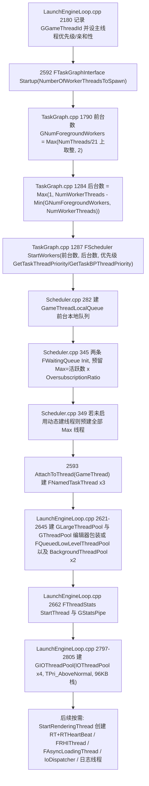

数值依据:`FGenericPlatformMisc::NumberOfWorkerThreadsToSpawn()`(Core/Private/GenericPlatform/GenericPlatformMisc.cpp:1975-1986):游戏/专用服务器/客户端 `MaxGameThreads=4`,非游戏(编辑器)取 `INT32_MAX`;结果 = `Max(Min(NumberOfCores-1, 上限), 2)`。`NumberOfIOWorkerThreadsToSpawn()` 恒 4(GenericPlatformMisc.cpp:1987-1990)。

### 2.6.2 任务发射与执行(TGraphTask 与 UE::Tasks::Launch 共用路径)

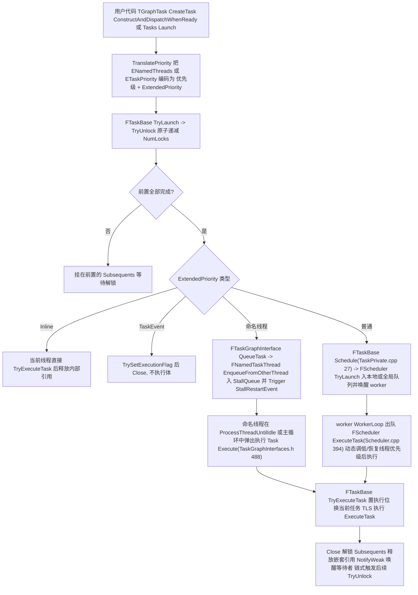

关键分支依据:TryUnlock(TaskPrivate.h:556-649)——Inline 分支行 602-610、TaskEvent 分支行 611-624、命名线程与普通任务统一走 `Schedule(bWakeUpWorker)`;`FTaskBase::Schedule`(TaskPrivate.cpp:27-45)先判 `IsNamedThreadTask()`(行 31-35)转 `FTaskGraphInterface::QueueTask`,否则 `FScheduler::TryLaunch`(行 42)。

### 2.6.3 LowLevelTasks worker 主循环与忙等/超发策略

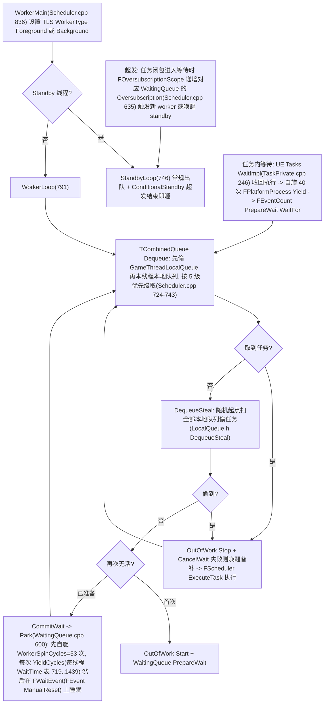

忙等待策略三要素:①worker 空闲时的两级自旋(`WorkerSpinCycles=53`,Scheduler.h:105;`WaitTimes[8]={719,991,1361,1237,1597,953,587,1439}` 按 WorkerId 取模,Scheduler.cpp:183-184);②UE::Tasks 高层等待的"收回执行 + 40 次 Yield 自旋 + FEventCount 睡眠"(TaskPrivate.cpp:246-284);③超发期间任务闭包等待会 `FOversubscriptionScope` 请求临时线程(Oversubscription.h;GTaskGraphOversubscriptionRatio 默认 2.0,上限 = ceil(活跃数×比例),Scheduler.cpp:276-279)。

### 2.6.4 传统线程池执行路径(FQueuedThreadPoolBase)

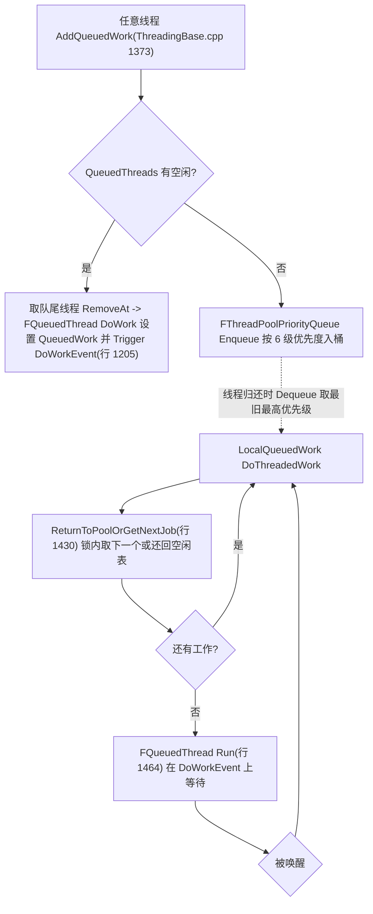

## 2.7 时序图

### 2.7.1 AsyncTask 派发到 GameThread 并在帧内执行

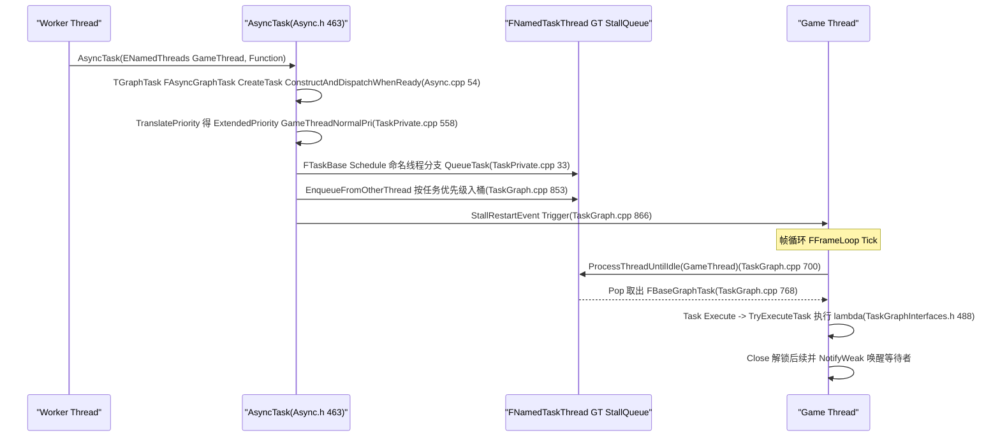

### 2.7.2 UE::Tasks 命名线程任务 + 前置依赖 + 命名线程等待

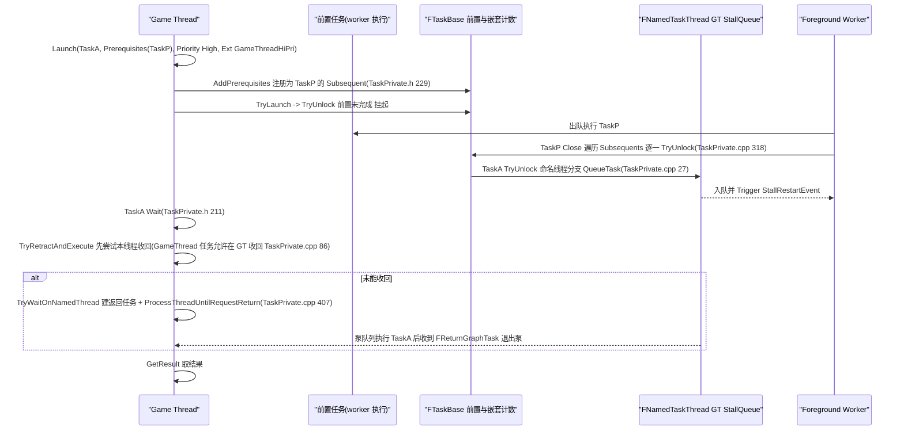

### 2.7.3 GThreadPool:从 IQueuedWork 到 LowLevelTasks worker

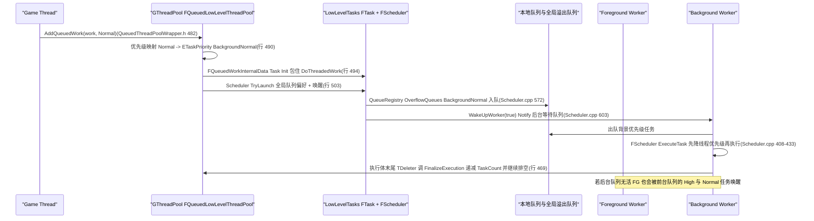

### 2.7.4 渲染线程与 RHI 线程的启动和任务图绑定

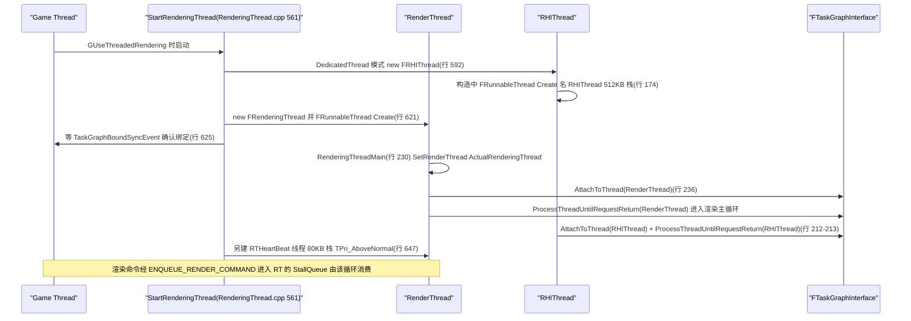

## 2.8 线程模型与同步

### 2.8.1 引擎完整线程清单

以下为 5.8.3 源码中可逐一定位创建点的全部常驻/半常驻线程(用户 `FRunnableThread::Create` 的业务线程不计入)。"优先级"未注明处为 `TPri_Normal`。

| 线程 | 创建位置(file:line) | 数量 | 优先级 / 栈 / 亲和性 | 主循环与消费队列 | 唤醒/通信原语 |
|---|---|---|---|---|---|
| GameThread(主线程) | Launch/Private/LaunchEngineLoop.cpp:2180 记录 `GGameThreadId`;2593 `AttachToThread(GameThread)` | 1 | `FPlatformAffinity::GetGameThreadPriority()` + `GetMainGameMask()`(LaunchEngineLoop.cpp:2183-2184) | FEngineLoop::Tick;帧中 `ProcessThreadUntilIdle(GameThread_Local)` 泵 GT StallQueue 主/本地队列 | 被投任务时 `StallRestartEvent->Trigger`(TaskGraph.cpp:866);ENQUEUE_RENDER_COMMAND 命令队列(渲染章) |
| RenderThread | RenderCore/Private/RenderingThread.cpp:621 `FRunnableThread::Create(GRenderingThreadRunnable, BuildRenderingThreadName(ThreadCount), 0, GetRenderingThreadPriority(), GetRenderingThreadMask(), GetRenderingThreadFlags())` | 1 | GetRenderingThreadPriority()(默认 TPri_Normal,GenericPlatformAffinity.h:120) | `RenderingThreadMain`(RenderingThread.cpp:230)→ `ProcessThreadUntilRequestReturn(ActualRenderingThread)`;消费 GRHICommandList + GT 的 RT StallQueue 主/本地队列 | `StallRestartEvent`(渲染队列轮询期 `GRenderThreadPollPeriodMs`,TaskGraph.cpp:766-784);TaskGraphFence/渲染 Fence |
| RTHeartBeat | RenderingThread.cpp:647 `FRunnableThread::Create(..., TEXT("RTHeartBeat %d"), 80*1024, TPri_AboveNormal, GetRTHeartBeatMask())` | 1 | TPri_AboveNormal / 80KB | FRenderingThreadTickHeartbeat(行 444)驱动渲染线程心跳看门狗 | 事件(实现见 RenderingThread.cpp:444-540) |
| RHIThread | RenderingThread.cpp:592 `new FRHIThread()`,构造内 行 174 `FRunnableThread::Create(this, TEXT("RHIThread"), 512*1024, GetRHIThreadPriority(), GetRHIThreadMask(), GetRHIThreadFlags())` | 1(ERHIThreadMode::DedicatedThread 时) | GetRHIThreadPriority()(默认 TPri_Normal)/ 512KB | `FRHIThread::Run`(行 199-220):`AttachToThread(RHIThread)` + `ProcessThreadUntilRequestReturn(RHIThread)` | RHIThread StallQueue + StallRestartEvent;RHI 命令由 RT 提交 |
| Foreground Task Worker(`Foreground Worker #N`) | TaskGraph.cpp:1287 `StartWorkers` → Scheduler.cpp:292-337 CreateThread → Scheduler.cpp:181 `CreateWorker` → FThread(名 "Foreground Worker #N"/"(Standby #N)",行 304-312) | `NumForegroundWorkers`,见 2.6.1 公式(游戏默认 ≥2;总 worker=NumberOfWorkerThreadsToSpawn) | `FPlatformAffinity::GetTaskThreadPriority()`(默认 TPri_SlightlyBelowNormal,GenericPlatformAffinity.h:145),可被 TaskGraph.TaskThreadPriority 命令改;亲和性 GetTaskGraphThreadMask(),worker 编号 +2 错开 GT/RT/RHI 占用的核(Scheduler.cpp:201) | `WorkerLoop`(Scheduler.cpp:791):本地队列(按 ETaskPriority 5 桶)→ 全局溢出队列 → 偷其他本地队列;只跑 High/Normal 前台优先级 | FWaitEvent(ManualReset FEventRef)+ FWaitingQueue Notify;外部线程投递时置 `bPendingWakeUp` TLS 标志(Scheduler.cpp:590) |
| Background Task Worker(`Background Worker #N`) | 同上,`EWorkerType::Background`,名 "Background Worker #N"(Scheduler.cpp:342) | `NumBackgroundWorkers` = 总数−前台 | `GetTaskBPThreadPriority()`(默认 TPri_BelowNormal,GenericPlatformAffinity.h:150);动态优先级开启时与前台同优先级、按任务临时降/升(Scheduler.cpp:280、408-433);亲和性 GetTaskGraphBackgroundTaskMask() | 同 WorkerLoop,`bPermitBackgroundWork=true`,可额外取 Background* 优先级 | 同上(独立的后台 FWaitingQueue,WaitingQueue[1]) |
| Standby Worker(待命) | Scheduler.cpp:303 `bIsStandbyWorker = LocalCreationIndex >= NumWorkers`,名字带 "(Standby #k)" | Max−活跃数(超发余量,`GTaskGraphOversubscriptionRatio`×活跃数,Scheduler.cpp:276-279);`TaskGraph.UseDynamicThreadCreation=1`(桌面默认)时按需创建 | 同所在组 | `StandbyLoop`(Scheduler.cpp:746):只取全局/偷来任务,超发结束即 ConditionalStandby 睡回 | PrepareStandby/CommitStandby(WaitingQueue.h:65-70) |
| GThreadPool 池线程 | 非编辑器:LaunchEngineLoop.cpp:2634 `GThreadPool = new FQueuedLowLevelThreadPool()`(不建专属线程,复用上表 worker);编辑器:2630 `GThreadPool = new FQueuedThreadPoolWrapper(GLargeThreadPool, N)`,2621 `GLargeThreadPool = new FQueuedLowLevelThreadPool()` | — | — | FQueuedWorkInternalData::Task 由 worker 执行 | FAAArrayQueue PendingWork + UE::FManualResetEvent Finished(销毁时) |
| GBackgroundPriorityThreadPool(`BackgroundThreadPool #N`) | LaunchEngineLoop.cpp:2638-2645 `FQueuedThreadPool::Allocate()` + `Create(2或1, StackSize, TPri_Lowest, TEXT("BackgroundThreadPool"))` | 2(专用服务器 1) | TPri_Lowest;栈 = GetDefaultPoolThreadStackSize()(编辑器 1MB,行 2607-2611);FPlatformAffinity::GetPoolThreadMask() | FQueuedThread::Run(ThreadingBase.cpp:1464)事件驱动 | DoWorkEvent(FEvent)+ FCriticalSection SynchQueue + FThreadPoolPriorityQueue |
| GIOThreadPool(`IOThreadPool #N`) | LaunchEngineLoop.cpp:2798-2804 `Allocate()` + `Create(NumberOfIOWorkerThreadsToSpawn()=4 或服务器 2, 96*1024, TPri_AboveNormal, TEXT("IOThreadPool"))` | 4(服务器 2) | TPri_AboveNormal / 96KB | 同上(供 IAsyncReadFileHandle 等异步读) | 同上 |
| FAsyncLoadingThread | CoreUObject/Private/Serialization/AsyncLoading2.cpp:11342 `FRunnableThread::Create(this, TEXT("FAsyncLoadingThread"), 0, TPri_Normal)`(bAsyncLoadingThreadEnabled 时) | 1 | TPri_Normal | `FAsyncLoadingThread2::Run`(行 11351 起,FTaskTagScope(EAsyncLoadingThread));EDL/package 加载请求队列 + EventQueue | FEvent(MainThreadWakeEvent 等,行 11334-11336)、原子计数 PackagesWithRemainingWorkCounter |
| IoDispatcher | Core/Private/IO/IoDispatcher.cpp:862-866 `FIoDispatcherImpl::StartThread` → `FRunnableThread::Create(this, TEXT("IoDispatcher"), 0, TPri_AboveNormal, GetIoDispatcherThreadMask())` | 1 | TPri_AboveNormal | FIoDispatcherImpl 处理 IoStore 批量读请求/完成回调 | IoDispatcher 内部请求队列与完成事件(细节属 IO 章节) |
| 日志线程(OutputDeviceRedirector) | Core/Private/Misc/OutputDeviceRedirector.cpp:471 `Thread = FThread(TEXT("OutputDeviceRedirector"), [this]{ ThreadLoop(); })`(由 LaunchEngineLoop.cpp:2789-2791 `GLog->TryStartDedicatedPrimaryThread()` 触发,可被 `-NoLogThread` 禁用) | 1 | FThread 默认 TPri_Normal | `ThreadLoop` 串行化 BufferedItems 到各输出设备 | TConsumeAllMpmcQueue 式队列 + ThreadWakeEvent(Notify,行 876-878) |
| Audio"线程"(GAudioPipe,虚线程) | Core/Private/HAL/ThreadingBase.cpp:245 `UE::Tasks::FPipe GAudioPipe{TEXT("AudioPipe")}`;Engine/Private/AudioThread.cpp:629 `FAudioThread::StartAudioThread` 置 `GIsAudioThreadRunning` | 无专属线程(跑在任务 worker 上) | 随 worker | 音频命令批量经 `GAudioPipe.Launch`(AudioThread.cpp:426/439/510)串行执行;GT 方向命令由 `FGameThreadAudioCommandQueue`(FTickFunction,TG_PrePhysics)泵 | UE::Tasks::FTaskEvent(ResumeEvent)、FAudioCommandFence(Fence.Wait,AudioThread.cpp:668-678);平台混音回调线程属 AudioMixer(另章) |
| Stats"线程"(GStatsPipe,虚线程) | Core/Private/Stats/StatsSystemTypes.cpp:50 `UE::Tasks::FPipe GStatsPipe{UE_SOURCE_LOCATION}`;`FThreadStats::StartThread`(行 1278)仅初始化 TLS/池并打日志 "Stats thread started"(行 1306) | 无专属线程 | 随 worker | 统计报文 `GStatsPipe.Launch`(行 1086);stat 命令亦在管道内执行(StatsCommand.cpp:2451) | FEventCount/管道排空等待 `while(GStatsPipe.HasWork())`(行 1329-1331) |
| TAsync/TAsyncThread(临时) | Core/Public/Async/Async.h:331/443 `FRunnableThread::Create(Runnable, TEXT("TAsync %d")/…)` | 按调用 | 调用方指定(AsyncThread 可传栈与优先级) | TAsyncRunnable::Run(行 469-481)执行后把删除工作再抛回 TaskGraph | TPromise/TFuture |

补充:`FRunnableThread::Create` 的平台分发实现在 ThreadingBase.cpp:900-930(真线程→`FPlatformProcess::CreateRunnableThread()`,否则有 SingleThread 接口则 `FFakeThread`);fork 场景走 `FForkProcessHelper::CreateForkableThread`(ThreadingBase.cpp:1768)。TaskGraph worker 在 fork 出的进程中数量被压到 `TaskGraph.ForkedProcessMaxWorkerThreads`(默认 2,TaskGraph.cpp:95-100、1273)。

### 2.8.2 线程-队列拓扑

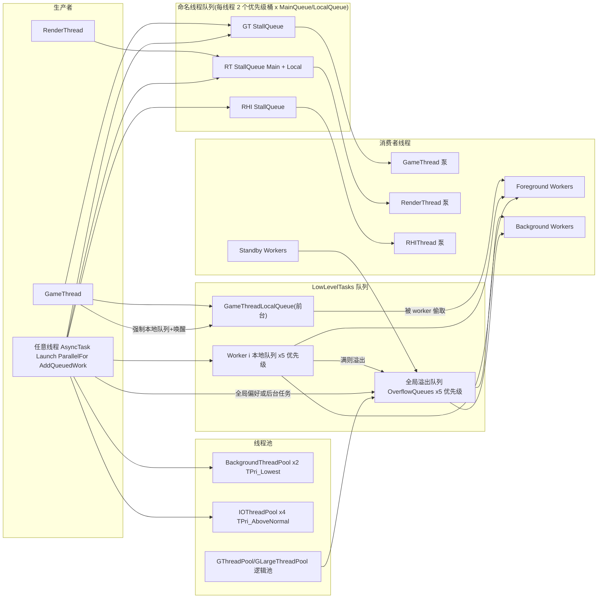

要点(依据 LocalQueue.h:163-450、Scheduler.cpp:531-633):入队优先选调用线程本地队列(`EQueuePreference::DefaultPreference=LocalQueuePreference`);从 GameThread 发射总是强制本地队列并唤醒(Scheduler.cpp:559-564,GT 不泵本地队列);后台任务从前台/外部线程发射时强制全局队列;出队顺序=本地→全局溢出→随机偷其他本地队列;前台 worker 不得取 Background* 优先级(`bPermitBackgroundWork=false` 时上限 ForegroundCount,TCombinedQueue::Dequeue,Scheduler.cpp:726)。

### 2.8.3 线程身份判定与 TLS

| TLS/全局 | 写入者 | 用途 |
|---|---|---|
| `GGameThreadId` / `GRenderThreadId` / `GSlateLoadingThreadId`(CoreGlobals) | LaunchEngineLoop.cpp:2180、RenderingThread.cpp:344/353 | 老式线程 ID 比对(现在主要用于 ensure 校验) |
| `FTaskTagScope::ActiveTaskTag`(thread_local,ETaskTag) | 各命名线程入口的 FTaskTagScope、任务执行路径 | `IsInGameThread/IsInRenderingThread/IsInRHIThread/IsInAudioThread` 等的权威实现(ThreadingBase.cpp:190-358) |
| `FRunnableThread::RunnableTlsSlot` | FRunnableThread::SetTls(ThreadingBase.cpp:958) | `FRunnableThread::GetRunnableThread()`;FScheduler 动态调优先级时取句柄(Scheduler.cpp:415) |
| `FTaskGraphCompatibilityImplementation::PerThreadIDTLSSlot` | FTaskThreadBase::InitializeForCurrentThread(TaskGraph.cpp:540) | 命名线程身份(GetCurrentThread,TaskGraph.cpp:1725) |
| `LowLevelTasks::FTask::ActiveTask`(thread_local) | FScheduler::ExecuteTask(Scheduler.cpp:396) | worker 当前任务、优先级继承(InheritParentData,Fundamental/Task.h:449)与 GetCurrentThreadIfKnown 的反推(TaskGraph.cpp:1741) |
| `UE::Tasks::Private::CurrentTask`(thread_local) | ExchangeCurrentTask(TaskPrivate.cpp:400) | AddNested/DontCompleteUntil 校验父任务 |
| `FSchedulerTls::TlsValuesHolder`(LocalQueue/WorkerType/bPendingWakeUp) | WorkerMain(Scheduler.cpp:838-850) | 队列选择与唤醒协议 |

### 2.8.4 跨线程数据所有权约定

- 任务体与结果:`TExecutableTask` 自侵入引用计数管理(初始 2 引用:外部句柄+系统内部,TaskPrivate.h:852-855);完成前外部句柄持有强引用,`Close()` 后 Subsequents 逐个 `TryUnlock`。
- 前置/嵌套列表:加锁时段由 `FPrerequisites::Mutex`(UE::FMutex,构造即锁)与 `FSubsequents::Mutex` 保护(TaskPrivate.h:712-796);线程安全的关键在于"注册为 subsequent 的线性化点"(AddSubsequent 的 PushIfNotClosed)。
- 命名线程队列:`FStallingTaskQueue` 无锁双优先级(LockFreeList.h:690);Pop 失败且允许停等时阻塞于 `StallRestartEvent`。
- 队列对象内存:任务侧大对象走 `TConcurrentLinearObject`/`TLockFreeFixedSizeAllocator_TLSCache`(TExecutableTask ≤256B 用 SmallTaskAllocator,TaskPrivate.h:893-895;FGraphEventImpl 专用分配器,TaskGraphInterfaces.h:737-738)。
- 事件对象一律池化(GetSynchEventFromPool/TEventPool),禁止直接 new FEvent(UE_DEPRECATED 5.0,Event.h:36-37)。
- 原子与屏障:新代码用 `std::atomic` + 明确 memory_order(FTaskBase 中大量标注);`FPlatformMisc::AsymmetricThreadFenceLight/Heavy` 用于 `bPendingWakeUp` 唤醒协议(Scheduler.cpp:496-515)。

## 2.9 配置与扩展点

### 2.9.1 控制台变量(TaskGraph.cpp 除注明外)

| CVar | 默认 | 标志 | 作用 | 位置 |
|---|---|---|---|---|
| TaskGraph.UseDynamicPrioritization | 1 | ECVF_ReadOnly | 按任务动态调整 worker 线程优先级(后台任务执行期降级) | TaskGraph.cpp:104-110,生效 Scheduler.cpp:408-433 |
| TaskGraph.OversubscriptionRatio | 2.0f | ECVF_ReadOnly | 超发线程上限比例(1.0 即关闭) | TaskGraph.cpp:112-121,生效 Scheduler.cpp:276-279 |
| TaskGraph.UseDynamicThreadCreation | PLATFORM_DESKTOP | ECVF_ReadOnly | 待命/全部 worker 按需创建或初始化即全建 | TaskGraph.cpp:123-129,生效 Scheduler.cpp:345-360 |
| TaskGraph.NumForegroundWorkers | 2 | — | 前台 worker 基数(需重启调度器生效;Startup 中被重算覆盖) | TaskGraph.cpp:131-136、1788-1793 |
| TaskGraph.ThreadStackSize | 0 | — | worker 栈大小(0=平台默认) | TaskGraph.cpp:138-143 |
| TaskGraph.UseBackgroundThreads / TaskGraph.UseHiPriThreads | 1/1 | ECVF_Cheat | 运行时关闭后台/高优先级任务线程(回落普通优先级) | TaskGraph.cpp:182-198 |
| TaskGraph.EnableForkedMultithreading | 1 | — | fork 进程是否允许任务图多线程 | TaskGraph.cpp:88-93 |
| TaskGraph.ForkedProcessMaxWorkerThreads | 2 | — | fork 进程 worker 上限 | TaskGraph.cpp:95-100 |
| TaskGraph.AlwaysWaitWithNamedThreadSupport | 0 | ECVF_ReadOnly | 命名线程等待一律泵本线程队列防死锁 | TaskPrivate.cpp:8-14,生效 行 211-221 |
| TaskGraph.WorkStealingQueue.RetryLimit | -1 | — | 工作窃取槽位竞争重试上限(超过则 YieldThread) | TaskGraph.cpp:145-152;LocalQueue.h:106-123 |
| TaskGraph.PrintBroadcastWarnings | 0 | — | BroadcastSlow 慢广播告警 | TaskGraph.cpp:1830-1837 |
| TaskGraph.IgnoreThreadToDoGatherOn | 0 | — | 已废弃 | TaskGraph.cpp:74-79 |
| TaskGraph.TestDontCompleteUntilForAlreadyComplete | 1 | — | 收集任务前先查完成态以省任务 | TaskGraph.cpp:81-86 |
| DoPooledThreadWaitTimeouts | false | — | 传统池线程 10ms 周期唤醒(旧行为) | ThreadingBase.cpp:40-46,生效 行 1490 |
| GParallelForBackgroundYieldingTimeoutMs / GParallelForDisableOversubscription | (见 ParallelFor.cpp) | — | 后台 ParallelFor 让出前时限 / 等待期禁超发 | 声明 ParallelFor.h:46-47 |
| AudioThread.SuspendAudioThread、AudioThread.AboveNormalPriority、AudioThread.EnableBatchProcessing、AudioThread.BatchAsyncBatchSize、AudioCommand.FenceWaitTimeMs | — | — | 音频管道行为(Engine 侧) | Engine/Private/AudioThread.cpp:25-50 |

命令行(非 CVar):`-foregroundworkers=N`(TaskGraph.cpp:1793)、`-oversubscriptionratio=F`(行 1794)、`TaskGraphUseDynamicPrioritization=0/1` 与 `TaskGraphUseDynamicThreadCreation=0/1`(Scheduler.cpp:233-241)、`-NoLogThread`(LaunchEngineLoop.cpp:2789)、cookcommandlet/run=cook 保持默认前台数(行 1787-1791)、`UE_TASKGRAPH_THREAD_LIMIT` 编译期上限(行 1779-1781)。ECVF_ReadOnly 项只能写在启动早期读取的 ini 中。

控制台命令:`TaskGraph.TaskThreadPriority [belownormal|normal|abovenormal]`(TaskGraph.cpp:2045-2070,重建 worker 线程优先级)、`TaskGraph.NumWorkerThreadsToIgnore`(行 2011-2043)、`TaskGraph.ABTestThreads`(行 154-178)、`TaskGraph.Randomize`(行 374-397,测试用随机延迟)。

### 2.9.2 委托与事件

| 委托 | 触发时机 | 位置 |
|---|---|---|
| `FThreadManager::FThreadEvent OnThreadEvent`(TS 多播) | 任何 FRunnableThread 添加/移除 | ThreadManager.h:57-73 |
| `FOversubscriptionLimitReached`(TS 多播) | 调度器超发上限达到(全部线程在等) | Scheduler.h:139-142(声明 Fundamental/Oversubscription.h) |
| `FTaskGraphInterface::AddShutdownCallback` | 任务图析构前 | TaskGraphInterfaces.h:445,实现 TaskGraph.cpp:1697-1700 |
| `FAutoConsoleTaskPriority`(如 TaskGraph 优先级 CVars)/ `UE::Tasks::FTaskPriorityCVar` | 字符串形式调任务优先级("bnh"/"BackgroundHigh TaskEvent" 等) | TaskGraphInterfaces.h:212-243、Task.h:548-574 |
| `FCoreDelegates::PostRenderingThreadCreated / PreRenderingThreadDestroyed / OnParentPreFork` | RT 生命周期 / fork 前 | RenderingThread.cpp:249/273,ThreadManager 构造 ThreadingBase.cpp:466-474 |

### 2.9.3 模块/接口扩展点

- 文件栈:`IPlatformFileModule`(HAL/IPlatformFileModule.h:12)供插件注入自定义文件系统层;`FPlatformFileManager::GetPlatformFile(Name)` 检索;启动时由 Launch 按 pak/streaming 参数搭链(细节属文件系统章节)。
- 线程池:自定义池继承 `FQueuedThreadPool`(如引擎内 FExecutedFQueuedThreadPoolWrapper 等派生),`FQueuedThreadPoolWrapper` 提供 Pause/Resume/SetMaxConcurrency/OnScheduled/OnUnscheduled 钩子(QueuedThreadPoolWrapper.h:57-216)。
- AutoRTFM:Core 的 `UE_AUTORTFM_*` 宏(AutoRTFM.h)与 `TransactionallySafe*` 互斥族(Async/TransactionallySafeMutex.h 等)允许引擎代码在事务内同步;任务系统侧的适配如 `FThreadSingletonInitializer::Get` 的 `UE_AUTORTFM_OPEN_NO_SANITIZE`(ThreadingBase.cpp:1529)、`ParallelFor` 在事务内强制单线程(ParallelFor.h:126-129)。

## 2.10 已知限制/未确认项

1. `LowLevelTasks::ETaskFlags::AllowBusyWaiting` 在 5.8.3 的 Core/Private 与各 Runtime 模块中未检索到消费点(仅 QueuedThreadPoolWrapper.h:492 由 `EQueuedWorkFlags::DoNotRunInsideBusyWait` 映射清除该位);其"忙等期间允许选任务执行"的语义在本版本是否仍有运行时效果未在源码中确认。
2. 各平台 `FPlatformAffinity` 覆盖(Windows/Unix/Android/主机)与 `FRunnableThread` 平台子类(WindowsRunnableThread、PThreadRunnableThread 等)仅确认存在(appendix/Core.part01.md:3411/4791/5245),未逐一核对掩码与优先级数值;文中引用的是 GenericPlatform 默认值。
3. `NumberOfWorkerThreadsToSpawn` 的平台覆盖:仅在 GenericPlatform 实现核对公式(GenericPlatformMisc.cpp:1975-1986);grep 未发现 Runtime/Windows、Runtime/Android、Runtime/Linux 下同名覆盖(视为沿用基类),如有遗漏平台目录未穷尽。
4. `CREATE_HIPRI_TASK_THREADS/CREATE_BACKGROUND_TASK_THREADS` 宏(TaskGraph.cpp:50-56)依赖 `PLATFORM_USE_FULL_TASK_GRAPH && !IS_PROGRAM && WITH_ENGINE && !UE_SERVER`,5.8 中 bHasHighPriorityThreads/bHasBackgroundThreads 在多线程路径下被无条件置 1(TaskGraph.cpp:1290-1291),旧语义(独立高优先级线程组)已不存在——本文按现状描述。
5. 音频"线程"与统计"线程"在 5.8 已是任务管道(GAudioPipe/GStatsPipe),不是系统线程;平台混音回调线程(XAudio2/AudioUnit 等)与 FAudioMixerThread 属 AudioMixer 模块,不在本章源码核对范围,仅交叉引用。
6. `ENQUEUE_RENDER_COMMAND`/FRHICommandList 的完整链路属于渲染章节;本章时序图 2.7.4 只覆盖线程创建与任务图绑定。
7. `FPlatformMemory`/分配器族(GMalloc、MallocBinned2/3/4 等)与 IoDispatcher 内部队列仅登记职责与线程创建点,内部数据结构未展开。
8. 附录 Core 三部分共约 9 万行,仅用于符号定位(2.11),未逐条比对;文中所有行号以直接阅读的源码为准。
9. `FForkableThread`/`-PostForkThreading` 路径仅静态阅读,未在 fork 环境实测;`FOutputDeviceRedirectorState` 的队列结构(TConsumeAllMpmcQueue 等)未逐行核对。

## 2.11 附录索引

| 本章覆盖模块 | 附录文件(相对 docs/ue5.8.3/appendix/api/) |
|---|---|
| Runtime/Core(HAL、Async、Tasks、Containers、Experimental、Misc、Stats、IO、Logging 等全部) | `Runtime/Core.part01.md`、`Runtime/Core.part02.md`、`Runtime/Core.part03.md` |
| Runtime/AutoRTFM | `Runtime/AutoRTFM.md` |
| Runtime/Launch(线程池/任务图启动点) | `Runtime/Launch.md` |
| Runtime/RenderCore(RenderingThread/RHIThread) | `Runtime/RenderCore.md` |
| Runtime/CoreUObject(FAsyncLoadingThread) | `Runtime/CoreUObject.part01.md`、`Runtime/CoreUObject.part02.md` |
| Runtime/Engine(FAudioThread/GAudioPipe 使用方) | `Runtime/Engine.part01.md` … `Engine.part06.md` |

定位示例:TaskGraphInterfaces.h 在 Core.part01.md:12951 起;Fundamental/Scheduler.h 在 Core.part01.md:11624 起;Async/Async.h 在 Core.part01.md:11124 起;HAL/RunnableThread.h 在 Core.part02.md:3253 起;HAL/ThreadManager.h 在 Core.part02.md:3509 起;Misc/QueuedThreadPoolWrapper.h 在 Core.part03.md:1815 起;Tasks/Task.h 在 Core.part03.md:14244 起、Tasks/Pipe.h 在 14213 起。完整符号穷举以附录为准,正文仅收录核心公共入口。

