# 03 CoreUObject:对象系统、反射、GC、序列化与包

> 源码基线:UE 5.8.3 release(`$E` = `Engine/`)。本章覆盖 `Engine/Source/Runtime/CoreUObject` 单一 Build 模块的全部子目录(UObject/Serialization/AssetRegistry/Cooker/StructUtils/VerseVM/Blueprint/Misc/Internationalization/Concepts/Templates/Internal),以及 UHT 生成物中与运行时反射注册相关的接口(`Z_Construct_UClass_*`、`StaticClass`、`IMPLEMENT_CLASS`、`GENERATED_BODY` 展开、`DeferredRegistration`)。所有结论均出自对本仓源码的逐文件阅读;`路径:行号` 相对 `$E/Source/Runtime/CoreUObject/`(跨模块引用时给出完整相对路径)。本模块默认 `UE_WITH_CONSTINIT_UOBJECT = 0`(`Public/UObject/ObjectMacros.h:55`),即**非 constinit 注册路径**,下文所有启动序列均按该配置描述。

## 3.1 职责、边界与模块清单

### 3.1.1 Build 模块级清单(1 个)

| 模块 | 路径(相对 `$E/Source`) | Build.cs 中的 Public/Private 依赖 | 职责一句话 |
|---|---|---|---|
| CoreUObject | Runtime/CoreUObject | Pub:Core、TraceLog、CorePreciseFP、Json;Priv:AutoRTFM、Projects、libpas(仅 `UE_WITH_REMOTE_OBJECT_HANDLE=1`)、DerivedDataCache(仅编辑器桌面);PrivInclude:TargetPlatform、ApplicationCore(`CoreUObject.Build.cs:26-71`) | 引擎对象系统底座:UObject 生命周期与全局对象表、反射类型系统(UClass/FProperty)、实时 GC、包序列化与 EDL/Zen 异步加载、StructUtils 运行时结构工具、VerseVM(Vers 脚本 VM)、资产注册表数据结构与 Cooker 接口 |

补充定义:`bMinimizeGeneratedIncludes = true`、PrivatePCH=`Private/CoreUObjectPrivatePCH.h`、`WITH_VERSE_COMPILER` 按目标类型定义(`CoreUObject.Build.cs:46-59`);为 VerseVM 字节码注册自定义头生成器 `VerseVMBytecodeGenerator`(`CoreUObject.Build.cs:11`)。

### 3.1.2 模块内子目录清单(不遗漏表)

| 子目录(Public/) | 职责一句话 |
|---|---|
| UObject | 对象模型核心:UObjectBase/Object、Class/UnrealType/Field 反射、UObjectArray/Allocator、GC、Linker/PackageFileSummary、软/弱/强指针、CoreRedirects、RemoteObject、Script 执行栈 |
| Serialization | 归档与加载:ArchiveUObject、AsyncLoading2(EDL/Zen)、AsyncPackageLoader、LinkerLoad/LinkerSave 配套、BulkData 家族、PackageStore/PackageTrailer、DerivedData、Formatters(Json/StructuredArchive) |
| AssetRegistry | 资产注册表只读数据结构:FAssetData、ARFilter、AssetBundleData、AssetDataTagMap(注册表本体在 AssetRegistry 模块) |
| Cooker | Cooker 供 Runtime/Editor 共享的接口与数据:ICookSandbox、CookDependency、CookEvents、CookArtifact、MPCollector |
| StructUtils | 反射驱动的运行时结构工具:FInstancedStruct、FStructView/FSharedStruct、FInstancedPropertyBag、StructTypeBitSet、UserDefinedStruct |
| VerseVM | Verse 语言 VM(`WITH_VERSE_VM`):VCell 对象模型、VContext、字节码分发、Verse 类/函数与 Verse GC(FrankenGC 与 UObject GC 互操作) |
| Blueprint | 蓝图桥接最小接口:BlueprintSupport(蓝图类标记接口)、BlueprintExceptionInfo |
| Misc | 包名/路径、MountPoint、RedirectCollector、PackageName/PackagePath、AssetReadLogger、HotReloadInterface、事务注解接口等 |
| Internationalization | 包本地化缓存与管理:PackageLocalizationManager、TextPackageNamespaceUtil |
| Concepts | 概念约束:BaseStructureProvider、StructSerializableWithDefaults |
| Templates | 模板工具:Casts、IsTObjectPtr、SubclassOf、NonNullSubclassOf |
| Internal | 内部头:ZenPackageHeader、PackageStoreInternal、UnversionedPropertySerializationInternal、CoreRedirects 内部等 |

Private/ 与 Public/ 结构一一对应(`Private/UObject`、`Private/Serialization`、`Private/AssetRegistry`、`Private/Cooker`、`Private/StructUtils`、`Private/VerseVM` 等),Tests/ 为自动化测试。

### 3.1.3 边界与相邻模块

- 依赖下层:`Core`(容器/字符串/任务系统/FName/FArchive)、`Json`、`TraceLog`、`CorePreciseFP`(VerseVM 浮点语义)。
- 上层依赖 CoreUObject(不在本章):`Engine`(UWorld/AActor)、`AssetRegistry` 模块(`IAssetRegistry` 注册表服务,本章只覆盖其数据结构)、`CoreUObject` 被 `JsonUtilities`/`Serialization` 模块引用。
- UHT 生成物(`*.generated.h`、`*.gen.cpp`)不属于本模块源码,但其中的 `Z_Construct_UClass_*`、`StaticClass()`、`IMPLEMENT_CLASS`、`FCompiledInDefer*` 全部由本模块的 `RegisterCompiledInInfo` 家族与 `GetPrivateStaticClassBody` 消费(`ObjectMacros.h:2289-2405`、`Class.cpp:7484`)。

## 3.2 总体架构

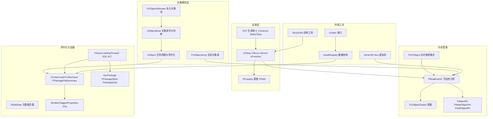

分层说明(自底向上):

1. **对象模型层**:`UObjectBase` 只持 Class/Name/Outer/Flags/InternalIndex 五个字(`UObjectBase.h:397-464`),构造即经 `AddObject` 进入 `GUObjectArray` 与名字哈希(`UObjectBase.cpp:251-273`);`UObject` 在其上补齐生命周期(PostLoad/BeginDestroy/FinishDestroy)与序列化(`Object.h:98-389`)。`FUObjectArray` 用 `FChunkedFixedUObjectArray` 分块存放全部对象指针,并提供 disregard-for-GC 永久池(`UObjectArray.h:1478-1521`)。
2. **反射层**:`FField`/`FProperty` 是非 UObject 的字段系统;`UStruct→UClass/UFunction/UScriptStruct` 描述类型布局与脚本函数;UHT 生成 `Z_Construct_UClass_*` 延迟构造函数与 `IMPLEMENT_CLASS` 注册器,经 `FRegisterCompiledInInfo` 静态对象在启动时挂入延迟注册表。
3. **内存管理**:标记-清除实时 GC(`FRealtimeGC::PerformReachabilityAnalysis`),聚簇把整组对象合并为单标记单元;`FGCObject`+`UGCObjectReferencer` 为非 UObject 持有者提供根;`TObjectPtr`/`TWeakObjectPtr`/`FSoftObjectPtr` 分别覆盖强引用(随 GC token 流遍历)、弱引用(索引+序列号)与软引用(字符串路径)。
4. **序列化与加载**:编辑器/松散文件走 `FLinkerLoad` 状态机(legacy TPS 头部格式);cooked(Zen/IoStore)走 `FAsyncLoadingThread2` 事件驱动加载(EDL),二者共用 `SerializeTaggedProperties` 属性序列化与 `FBulkData` 大负载流送。
5. **外围工具**:StructUtils 基于反射的值类型容器;VerseVM 自带分代 GC 并与 UObject GC 互操作(`GarbageCollection.cpp` 中 `StartVerseGC`/`GReachableNativeStructs`);AssetRegistry 数据结构在包加载后由 `FAssetData` 汇总;Cooker 接口供 Editor 端 CookCoordinator 调用。

## 3.3 类图

### 3.3.1 UObject 继承体系与 GC 根

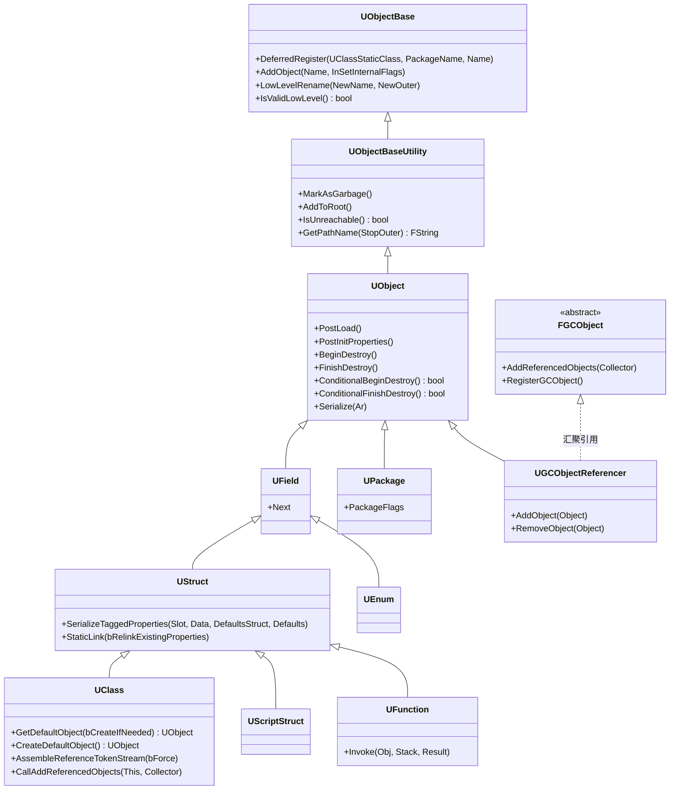

每类职责(行号 = 类声明位置):

| 类 | 职责 | 位置 |
|---|---|---|
| UObjectBase | 最低层对象身份:Class/Name/Outer/Flags/InternalIndex 与对象表登记 | `Public/UObject/UObjectBase.h:66` |
| UObjectBaseUtility | 在 Base 之上提供名字/路径/GC 标记/根集合等常用查询与标记 | `Public/UObject/UObjectBaseUtility.h:44` |
| UObject | 完整生命周期(PostLoad/BeginDestroy/FinishDestroy)与属性序列化 | `Public/UObject/Object.h:98` |
| UField | 反射字段链节点(Children/Next) | `Public/UObject/Class.h:171` |
| UStruct | 带属性布局的类型基类:PropertiesSize/PropertyLink/超类链 | `Public/UObject/Class.h:495` |
| UClass | 类元数据:ClassConstructor 指针、CDO、类标志与接口表 | `Public/UObject/Class.h:3893` |
| UScriptStruct | 原生/蓝图结构体类型,提供 StructOps(ICppStructOps) | `Public/UObject/Class.h:1774` |
| UFunction | 脚本/网络函数:参数布局、Func 指针、FunctionFlags | `Public/UObject/Class.h:2562` |
| UEnum | 枚举类型:名字-值对表 | `Public/UObject/Class.h:2877` |
| UPackage | 顶层包对象:PackageFlags、脏状态、包内 Linker 关联 | `Public/UObject/Package.h:216` |
| FGCObject | 非 UObject 类注册 GC 引用的抽象基类 | `Public/UObject/GCObject.h:127` |
| UGCObjectReferencer | 桥接 UObject:汇总所有 FGCObject 的 AddReferencedObjects | `Public/UObject/GCObject.h:28` |

### 3.3.2 FField/FProperty 反射属性家族

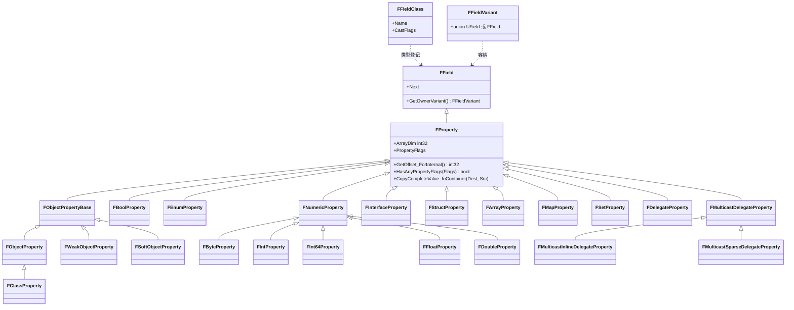

职责速览(全部位于 `Public/UObject/UnrealType.h`,枚举属性在 `Public/UObject/EnumProperty.h`):FProperty(:173)是所有反射属性基类,持有 `ArrayDim/PropertyFlags/Offset_Internal` 与 `PropertyLinkNext/NextRef/DestructorLinkNext/PostConstructLinkNext` 四条内存期链表(:207-238);FNumericProperty(:1785)数值基类(其下 Byte/Int8/16/32/64/UInt16/32/64/Float/Double 具体类);FBoolProperty(:2589)按位/字节布尔;FObjectPropertyBase(:2773)对象引用基类,派生 FObjectProperty(:3135,`TObjectPtr<UObject>`)、FWeakObjectProperty(:3252,`FWeakObjectPtr`)、FSoftObjectProperty(:3383,`FSoftObjectPtr`);FClassProperty(:3465)/FSoftClassProperty(:3550)类引用;FInterfaceProperty(:3631)接口;FStructProperty(:6387)内嵌结构体;FArrayProperty(:3776)/FMapProperty(:3920)/FSetProperty(:4110)容器(配套 FScriptArrayHelper/FScriptMapHelper/FScriptSetHelper,:4262/4759/5763);FDelegateProperty(:6487)/FMulticastDelegateProperty(:6558)委托(Inline/Sparse 派生,:6693/6748)。FField/FFieldClass/FFieldVariant 在 `Public/UObject/Field.h:602/66/399`。

### 3.3.3 指针与引用类型

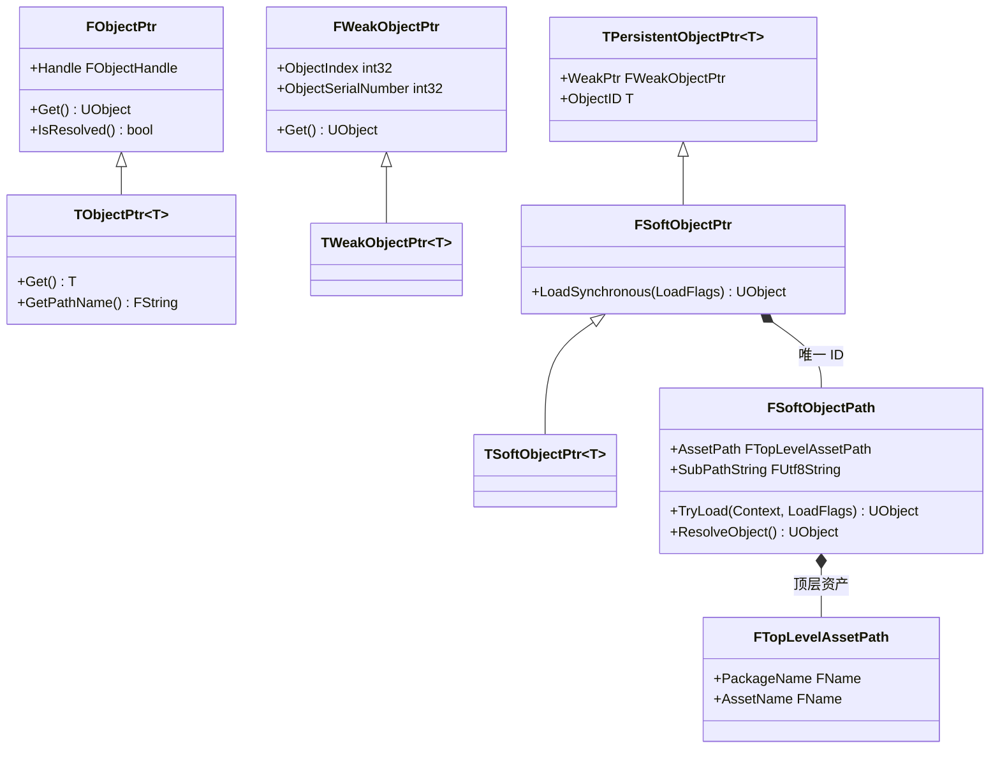

职责(位置):FObjectPtr 是 64 位对象句柄包装,编辑器构建可携带"未加载对象"的句柄索引(`Public/UObject/ObjectPtr.h:48-331`);TObjectPtr(:519)是成员属性用强引用,GC 通过 token 流直接遍历其地址;FWeakObjectPtr(`Public/UObject/WeakObjectPtr.h:40`,成员 :570-571)以"对象索引+序列号"做弱引用,不阻止回收;TPersistentObjectPtr(`Public/UObject/PersistentObjectPtr.h:18`)把弱缓存与持久 ID 组合;FSoftObjectPtr/TSoftObjectPtr(`Public/UObject/SoftObjectPtr.h:44/428 起`)是字符串路径软引用,`LoadSynchronous` 同步装载;FSoftObjectPath(`Public/UObject/SoftObjectPath.h:55`)内部为 `FTopLevelAssetPath + 子对象 UTF8 路径`(:51 注释)。

### 3.3.4 加载与序列化核心类

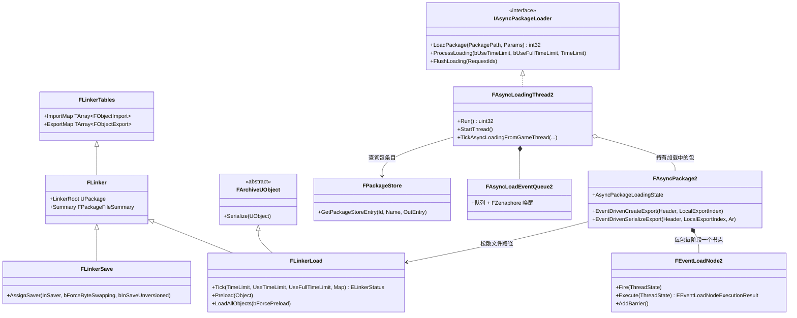

职责(位置):FLinkerTables(`Public/UObject/Linker.h:64`)集中 ImportMap/ExportMap/NameMap;FLinker(:397)是包 IO 上下文基类;FLinkerLoad(`Public/UObject/LinkerLoad.h:119`)松散文件加载状态机(`Tick` :1251 返回 `LINKER_Loaded/TimedOut/Failed`);FLinkerSave(`Public/UObject/LinkerSave.h:47`)保存端写入器;FArchiveUObject(`Public/Serialization/ArchiveUObject.h`)对象感知归档基类;IAsyncPackageLoader(`Public/Serialization/AsyncPackageLoader.h:89`)加载器接口,FAsyncLoadingThread2(`Private/Serialization/AsyncLoading2.cpp:4730`)是其唯一实现(`MakeAsyncPackageLoader2` 于 :13499,`InitAsyncThread` 无条件选用它,`AsyncPackageLoader.cpp:220`);FAsyncPackage2(:4118)单包加载状态机;FEventLoadNode2(:6404)EDL 事件节点(barrier 计数);FAsyncLoadEventQueue2(:3562)+ FZenaphore(`Private/Serialization/Zenaphore.h:37`)事件队列与唤醒;FPackageStore(`Public/Serialization/PackageStore.h:230`)包存储(cooked 时由 IoDispatcher 后端实现,编辑器由文件系统后端模拟)。

## 3.4 数据字典

### 3.4.1 UObjectBase(UObject 对象头)

| 字段 | 类型 | 含义 | 取值/约束 | 源码位置 |
|---|---|---|---|---|
| ObjectFlags | EObjectFlags | 对象标志(原子读写) | 32 位,`GetFlagsInternal` 用 `std::atomic` relaxed 读 | UObjectBase.h:399 |
| InternalIndex | int32 | 在 GUObjectArray 中的索引 | 仅 FUObjectArray 可写 | UObjectBase.h:402 |
| ClassPrivate | TNonAccessTrackedObjectPtr&lt;UClass&gt; | 所属类 | 构造后不变 | UObjectBase.h:405 |
| NamePrivate | FNameAndObjectHashIndex(union) | 对象名(与 constinit 的 UTF8 指针共用存储) | FName 非零 | UObjectBase.h:437-443 |
| OuterPrivate | TNonAccessTrackedObjectPtr&lt;UObject&gt; | 外层对象 | 顶层包为空 | UObjectBase.h:464 |

### 3.4.2 FUObjectItem(全局对象表条目,UObjectArray.h:41)

| 字段 | 类型 | 含义 | 取值/约束 | 源码位置 |
|---|---|---|---|---|
| FlagsAndRefCount | int64(union) | 高 32 位内部标志 + 低 32 位强引用计数,可无锁读写 | InterlockedInc/Dec | UObjectArray.h:53-60 |
| Object/ObjectPtrLow | UObjectBase*(union) | 对象指针(可打包低 32 位) | UE_ENABLE_FUOBJECT_ITEM_PACKING | UObjectArray.h:62-78 |
| SerialNumber | int32 | 弱指针序列号,对象销毁后失效 | 从 START_SERIAL_NUMBER=1000 起 | UObjectArray.h:92、946-949 |
| ClusterRootIndex | int32 | 聚簇根索引或所属簇索引(负数编码簇成员) | SetClusterIndex = -Index-1 | UObjectArray.h:94、164-180 |

### 3.4.3 FUObjectArray 关键成员(UObjectArray.h:931)

| 字段 | 类型 | 含义 | 源码位置 |
|---|---|---|---|
| ObjObjects | FChunkedFixedUObjectArray | 全部对象条目分块数组 | UObjectArray.h:1483 |
| ObjFirstGCIndex | int32 | GC 扫描起始索引(永久池之后) | UObjectArray.h:1485 |
| ObjLastNonGCIndex | int32 | disregard-for-GC 池上界 | UObjectArray.h:1487 |
| MaxObjectsNotConsideredByGC | int32 | 永久池容量(ini `gc.MaxObjectsNotConsideredByGC`) | UObjectArray.h:1489 |
| ObjObjectsCritical | FTransactionallySafeCriticalSection | 对象表锁(增删索引时) | UObjectArray.h:1494 |
| ObjAvailableList | TArray&lt;int32&gt; | 空闲索引复用表 | UObjectArray.h:1496 |
| UObjectCreateListeners / UObjectDeleteListeners | TArray | 对象创建/删除监听器(如 ALT、Trace) | UObjectArray.h:1503-1512 |

### 3.4.4 UClass 关键字段(Class.h:3893)

| 字段 | 类型 | 含义 | 源码位置 |
|---|---|---|---|
| ClassConstructor | ClassConstructorType | `void(*)(const FObjectInitializer&)` 构造入口 | Class.h:3903-3907 |
| ClassVTableHelperCtorCaller | ClassVTableHelperCtorCallerType | 热重载 vtable 重建构造器 | Class.h:3908 |
| CppClassStaticFunctions | FUObjectCppClassStaticFunctions | StaticClass/StaticCast/AddReferencedObjects 函数组 | Class.h:3909 |
| ClassDefaultObject | TObjectPtr&lt;UObject&gt; | CDO(5.6 起 deprecated 直接访问) | Class.h:4047 |
| ClassFlags / ClassCastFlags | EClassFlags / EClassCastFlags | 类标志与加速 Cast 位图 | Class.h:3939-3942 |
| ClassWithin | TObjectPtr&lt;UClass&gt; | 实例允许的 Outer 类型 | Class.h:3946 |
| ClassConfigName | FName(union) | 配置 ini 名 | Class.h:3972 |
| PropertiesStartOffset | int32 | 属性区相对对象地址偏移(partials 为负) | Class.h:3933 |

### 3.4.5 FProperty 关键字段(UnrealType.h:173)

| 字段 | 类型 | 含义 | 源码位置 |
|---|---|---|---|
| ArrayDim | int32 | 数组维度(非数组为 1) | UnrealType.h:178 |
| PropertyFlags | EPropertyFlags | CPF_* 属性标志(64 位) | UnrealType.h:182 |
| Offset_Internal | int32 | 属性在宿主对象/结构体内的字节偏移(Link() 生成) | UnrealType.h:207 |
| PropertyLinkNext | FProperty* | 全属性链(最派生→基类) | UnrealType.h:211 |
| NextRef | FProperty* | 对象引用属性链(GC 用) | UnrealType.h:216 |
| DestructorLinkNext | FProperty* | 需析构属性链 | UnrealType.h:228 |
| PostConstructLinkNext | FProperty* | 需构造后初始化属性链(CPF_Config 等) | UnrealType.h:238 |

### 3.4.6 FPropertyTag(TPS 属性标记,PropertyTag.h:37)

| 字段 | 类型 | 含义 | 源码位置 |
|---|---|---|---|
| Type / Name | FName | 属性类型名与属性名 | PropertyTag.h:44-45 |
| Size | int32 | 序列化尺寸 | PropertyTag.h:46 |
| ArrayIndex | int32 | 数组元素索引,非数组 INDEX_NONE | PropertyTag.h:47 |
| SizeOffset | int64 | 尺寸字段在流中的位置(回写) | PropertyTag.h:48 |
| PropertyGuid | FGuid | 蓝图类属性重定向 GUID | PropertyTag.h:49-50 |
| BoolVal | uint8 | 布尔值内联 | PropertyTag.h:51 |
| SerializeType | EPropertyTagSerializeType | 内联/分离序列化方式 | PropertyTag.h:52 |

### 3.4.7 FPackageFileSummary(传统包摘要,PackageFileSummary.h:56)

关键字段:Tag(:61,等于 `PACKAGE_FILE_TAG`)、FileVersionUE(:65)、CustomVersionContainer(:69)、PackageFlags(:74)、TotalHeaderSize(:81)、PackageName(:86)、NameCount/NameOffset(:91-96)、SoftObjectPathsCount/Offset(:102-107)、ExportCount/ExportOffset(:133-138)、ImportCount/ImportOffset(:143-148)、DependsOffset(:173)。 cooked Zen 包对应结构为 FZenPackageSummary(`Public/Serialization/AsyncLoading2.h:302`):HeaderSize、Name、PackageFlags、ImportMapOffset、ExportMapOffset、ExportBundleEntriesOffset、DependencyBundleHeadersOffset/EntriesOffset、ImportedPackageNamesOffset(:304-315);导出条目 FExportMapEntry(:377):CookedSerialOffset/Size、ObjectName、OuterIndex、ClassIndex、SuperIndex、TemplateIndex、PublicExportHash、ObjectFlags、FilterFlags。

### 3.4.8 FUObjectCluster(聚簇,UObjectArray.h:1567)

| 字段 | 类型 | 含义 | 源码位置 |
|---|---|---|---|
| RootIndex | int32 | 簇根对象索引 | UObjectArray.h:1575 |
| Objects | TArray&lt;int32&gt; | 簇内对象(整体存活/死亡) | UObjectArray.h:1577 |
| ReferencedClusters | TArray&lt;int32&gt; | 引用的其他簇 | UObjectArray.h:1579 |
| MutableObjects | TArray&lt;int32&gt; | 不能入簇但需引用的对象 | UObjectArray.h:1581 |
| ReferencedByClusters | TArray&lt;int32&gt; | 反向引用(溶解用) | UObjectArray.h:1583 |
| bNeedsDissolving | bool | 待溶解标记 | UObjectArray.h:1590 |

### 3.4.9 关键枚举

| 枚举 | 取值摘要 | 位置 |
|---|---|---|
| EInternalObjectFlags | ReachableInCluster、ClusterRoot、Native、Async、AsyncLoading、AsyncLoadingPhase1、Unreachable、Garbage、PendingConstruction、RootSet、LoaderImport 等 | `Public/UObject/ObjectMacros.h`(EInternalObjectFlags_MinFlagBitIndex 见 UObjectArray.h:86 引用) |
| EAsyncPackageState::Type | TimeOut=0、PendingImports、Complete | `Public/UObject/UObjectGlobals.h:1160-1171` |
| EAsyncPackageLoadingState2 | NewPackage→WaitingForIo→ProcessPackageSummary→ProcessDependencies→WaitingForDependencies→DependenciesReady→CreateExports→WaitingForImportDependencies→ResolveImports→PreloadExports→WaitingForExternalReads→ExportsDone→PostLoad→DeferredPostLoad(Done)→Finalize→PostLoadInstances→CreateClusters→Complete→DeferredClearImportedPackages→DeferredDelete | `Private/Serialization/AsyncLoading2.cpp:3408-3431` |
| EEventLoadNode2 | Package_ProcessSummary、Package_ProcessDependencies、Package_DependenciesReady、Package_CreateExports、Package_ResolveImports、Package_PreloadExports、Package_ExportsSerialized、Package_PostLoad、Package_DeferredPostLoad | `Private/Serialization/AsyncLoading2.cpp:3791-3803` |
| EBulkDataFlags | BULKDATA_PayloadAtEndOfFile(1&lt;&lt;0)、SerializeCompressedZLIB(1&lt;&lt;1)、ForceInlinePayload(1&lt;&lt;6)、PayloadInSeparateFile(1&lt;&lt;8)、OptionalPayload(1&lt;&lt;11)、MemoryMappedPayload(1&lt;&lt;12)、Size64Bit(1&lt;&lt;13)、DuplicateNonOptionalPayload(1&lt;&lt;14)、UsesIoDispatcher(1u&lt;&lt;31)、DataIsMemoryMapped(1&lt;&lt;30) | `Public/Serialization/BulkData.h:101-169` |
| EPackageLoader | Unknown=0x0、LinkerLoad=0x1、Zen=0x2 | `Public/Serialization/PackageStore.h:27-33` |
| ELinkerStatus | LINKER_Failed=0、LINKER_Loaded=1、LINKER_TimedOut=2 | `Public/UObject/LinkerLoad.h:134-142` |

### 3.4.10 软/弱引用与 FAssetData

| 类型 | 字段(摘要) | 含义 | 位置 |
|---|---|---|---|
| FSoftObjectPath | AssetPath(FTopLevelAssetPath)+ SubPathString(FUtf8String) | `/包路径.资产名:子对象` 字符串软引用 | SoftObjectPath.h:55 |
| FWeakObjectPtr | ObjectIndex、ObjectSerialNumber | 弱引用(索引+序列号,复用索引靠序列号失效) | WeakObjectPtr.h:570-571 |
| FObjectPtr/TObjectPtr | Handle(FObjectHandle,64 位) | 成员强引用;编辑器构建可指向未加载句柄 | ObjectPtr.h:331 |
| FAssetData | PackageName、PackagePath、AssetClass、TagsAndValues(FAssetDataTagMapSharedView)、AssetBundleData、PackageFlags | 资产注册表条目(包加载完成后生成) | AssetData.h:163-193 |
| FInstancedStruct | StructMemory(UniquePtr)、ScriptStruct | 拥有型反射结构实例 | StructUtils/InstancedStruct.h:31 |
| FSharedStruct | StructMemory(SharedRef)、StructPtr | 共享型反射结构实例 | StructUtils/SharedStruct.h:154 |
| FStructView | StructMemory、StructPtr | 只读视图(不拥有) | StructUtils/StructView.h:23 |
| FInstancedPropertyBag | ID、PropertyBagStruct(TObjectPtr) | 运行时动态属性包(基于 UStruct 生成) | StructUtils/PropertyBag.h:439 |

## 3.5 接口清单

> 线程约束缩写:GT=GameThread(判定依据 `IsInGameThread()`/`check(IsInGameThread())`);ALT=异步加载线程(`IsInAsyncLoadingThread()`、`ETaskTag::EAsyncLoadingThread`);Task=TaskGraph/UE::Tasks 工作线程;Any=任意线程。原型逐字抄自头文件(仅去掉 `*_API` 宏)。

### 3.5.1 对象构造与销毁

| 原型 | 功能 | 线程/重入 | 位置 |
|---|---|---|---|
| `UObject* StaticConstructObject_Internal(const FStaticConstructObjectParameters& Params);` | 对象构造总入口:分配+调用 ClassConstructor+收尾 | Any(ALT 构造导出时带 GC 保护;编辑器保存包中禁止) | Public/UObject/UObjectGlobals.h:624,实现在 Private/UObject/UObjectGlobals.cpp:4803 |
| `UObject* StaticAllocateObject(const UClass* Class, UObject* InOuter, FName Name, EObjectFlags SetFlags, EInternalObjectFlags InternalSetFlags = EInternalObjectFlags::None, bool bCanReuseSubobjects = false, bool* bOutReusedSubobject = nullptr, UPackage* ExternalPackage = nullptr, int32 SerialNumber = 0, FRemoteObjectId RemoteId = FRemoteObjectId(), class FGCReconstructionGuard* GCGuard = nullptr);` | 分配内存/复用同名对象/写对象表;不调构造函数 | Any;GC 锁定期禁止(实现内 `checkf(!IsGarbageCollectingAndLockingUObjectHashTables())`,cpp:3484) | Public/UObject/UObjectGlobals.h:1297,实现 cpp:3431 |
| `FObjectInitializer(UObject* InObj, const FStaticConstructObjectParameters& StaticConstructParams);` | 构造期上下文:持有原型、子对象覆盖表、延迟回调 | 构造线程,压入 FUObjectThreadContext 栈 | Public/UObject/UObjectGlobals.h:1331 |
| `void PostConstructInit();`(FObjectInitializer 成员) | 构造收尾:InitProperties→子对象实例化→PostInitProperties | 同上 | Public/UObject/UObjectGlobals.h:1630,实现 cpp:4134 |
| `static void InitProperties(UObject* Obj, UClass* DefaultsClass, UObject* DefaultData, bool bCopyTransientsFromClassDefaults);` | 从原型/CDO 复制属性(PropertyLink 或 PostConstructLink 快慢路径) | 同上 | Public/UObject/UObjectGlobals.h:1598,实现 cpp:4450 |
| `bool ConditionalBeginDestroy();` / `bool ConditionalFinishDestroy();` | 两阶段销毁入口(置 Unreachable 后由 GC 调用) | GT(IncrementalPurgeGarbage 在 GT 调) | Public/UObject/Object.h:1164/1167 |
| `virtual void BeginDestroy();` / `virtual bool IsReadyForFinishDestroy();` / `virtual void FinishDestroy();` | 用户可重写销毁钩子;IsReady 轮询异步释放完成 | GT | Public/UObject/Object.h:361/368/382 |
| `inline void MarkAsGarbage();` | 显式标记待回收(镜像 Garbage 内部标志) | Any(原子) | Public/UObject/UObjectBaseUtility.h:207 |
| `virtual void PostLoad();` / `virtual void PostInitProperties();` / `virtual void Serialize(FArchive& Ar);` | 加载后/构造后/序列化虚函数 | PostLoad:GT(ALT DeferredPostLoad 除外);Serialize:加载线程 | Public/UObject/Object.h:346/226/388 |

### 3.5.2 反射注册与启动(UHT 对接)

| 原型 | 功能 | 线程 | 位置 |
|---|---|---|---|
| `void Register(class UClass* (*StaticClassFn)(), const TCHAR* PackageName, const TCHAR* InName);` | 类静态初始化期登记待注册对象(FPendingRegistrant 链) | 静态初始化线程(CRT) | Public/UObject/UObjectBase.h:162,实现 cpp:566 |
| `void UObjectForceRegistration(UObjectBase* Object, bool bCheckForModuleRelease = true);` | 强制单个待注册对象立即 DeferredRegister | GT | Public/UObject/UObjectBase.h:507,实现 cpp:665 |
| `virtual void DeferredRegister(UClass* UClassStaticClass, const TCHAR* PackageName, const TCHAR* InName);` | 补 Class/Outer、CreatePackage、AddObject 入表、清 PendingConstruction | GT | Public/UObject/UObjectBase.h:170,实现 cpp:205 |
| `void AddObject(FName Name, EInternalObjectFlags InSetInternalFlags, int32 InInternalIndex = -1, int32 InSerialNumber = 0, FRemoteObjectId InRemoteId = FRemoteObjectId());` | 分配对象索引+写入名字哈希(HashObject) | Any(非 GT 自动加 Async 标志) | Public/UObject/UObjectBase.h:185,实现 cpp:251 |
| `void RegisterCompiledInInfo(const TCHAR *PackageName, const FClassRegisterCompiledInInfo *ClassInfo, size_t NumClassInfo, const FStructRegisterCompiledInInfo *StructInfo, size_t NumStructInfo, const FEnumRegisterCompiledInInfo *EnumInfo, size_t NumEnumInfo, const FPartialRegisterCompiledInInfo *PartialsInfo, size_t NumPartialsInfo);` | `IMPLEMENT_CLASS`/`.gen.cpp` 的批量登记入口(静态对象 `FRegisterCompiledInInfo AutoInitialize_*`) | 静态初始化(CRT) | Public/UObject/UObjectBase.h:673 |
| `void GetPrivateStaticClassBody(const TCHAR* PackageName, const TCHAR* Name, UClass*& ReturnClass, void(*RegisterNativeFunc)(), uint32 InSize, uint32 InAlignment, EClassFlags InClassFlags, EClassCastFlags InClassCastFlags, const TCHAR* InConfigName, UClass::ClassConstructorType InClassConstructor, UClass::ClassVTableHelperCtorCallerType InClassVTableHelperCtorCaller, FUObjectCppClassStaticFunctions&& InCppClassStaticFunctions, UClass::StaticClassFunctionType InSuperClassFn, UClass::StaticClassFunctionType InWithinClassFn);` | `Z_Construct_UClass_X_Inner` 的实际类体构造(ConstructUClassNoInitHelper) | GT(构造期触发) | Public/UObject/Class.h:5021,实现 Private/UObject/Class.cpp:7484 |
| `void InitializePrivateStaticClass(class UClass* (*TClass_StaticClassFn)(), class UClass* TClass_Super_StaticClass, class UClass* TClass_PrivateStaticClass, class UClass* TClass_WithinClass_StaticClass, const TCHAR* PackageName, const TCHAR* Name);` | intrinsic 类(如 UClass 本身)的骨架初始化 | GT(注册期) | Public/UObject/Class.h:4994,实现在 Class.cpp:129 |
| `void UObjectBaseInit();` | 启动期:读 GC 配置→AllocateObjectPool→InitGarbageElimination→InitAsyncThread→UObjectProcessRegistrants | GT(引擎启动) | Public/UObject/UObjectBase.h:701,实现 cpp:1357 |
| `void ProcessNewlyLoadedUObjects(FName InModuleName = NAME_None, bool bCanProcessNewlyLoadedObjects = true);` | 模块加载后:处理延迟注册表→UClassRegisterAllCompiledInClasses→UObjectProcessRegistrants→CDO 构建→AssembleReferenceTokenStream | GT | Public/UObject/UObjectBase.h:682,实现 cpp:1073 |
| `void UObjectProcessRegistrants();` | 逐个 UObjectForceRegistration 清空 pending 链 | GT | Private/UObject/UObjectBase.cpp:643 |
| 宏 `IMPLEMENT_CLASS(TClass, TClassCrc)` | 生成 `Z_Construct_UClass##TClass##_Inner` + `FRegisterCompiledInInfo AutoInitialize_##TClass` 静态登记 | — | Public/UObject/ObjectMacros.h:2326-2332 |
| 宏 `IMPLEMENT_INTRINSIC_CLASS(TClass, TRequiredAPI, TSuperClass, TSuperRequiredAPI, TPackage, InitCode)` | intrinsic 类:Construct 时先构造父类、UObjectForceRegistration、IntrinsicClassInit、StaticLink | — | Public/UObject/ObjectMacros.h:2336-2367 |
| 宏 `GENERATED_BODY(...)` | 展开为 `<文件ID>_<行号>_GENERATED_BODY`,由 UHT 生成的 .generated.h 内定义(友元 `Z_Construct_UClass_*_Statics`) | — | Public/UObject/ObjectMacros.h:799-805 |

启动链补充:`.gen.cpp` 的 `FClassRegisterCompiledInInfo` 记录 `UClass* (*Register)(ETypeConstructPhase)` 与 `FClassRegistrationInfo`(Inner/OuterSingleton 双阶段构造,`UObjectBase.h:543-549`);`GetStaticStruct`/`GetStaticEnum`(`UObjectBase.h:611/647`)是 struct/enum 的对应包装。

### 3.5.3 查找与命名

| 原型 | 功能 | 线程 | 位置 |
|---|---|---|---|
| `UObject* StaticFindObject( UClass* Class, UObject* InOuter, FStringView Name, EFindObjectFlags Flags = EFindObjectFlags::None );` | 按全名查找对象(另有 FTopLevelAssetPath 重载 :390、Safe 变体 :407 不在保存包/GC 期断言) | Any(哈希读);GC 锁定期用 Safe 变体 | Public/UObject/UObjectGlobals.h:373 |
| `UObject* StaticFindObjectFast(UClass* Class, UObject* InOuter, FName InName, EFindObjectFlags Flags = EFindObjectFlags::None, EObjectFlags ExclusiveFlags = RF_NoFlags, EInternalObjectFlags ExclusiveInternalFlags = EInternalObjectFlags::None);` | 按 Outer+短名快速查找 | Any | Public/UObject/UObjectGlobals.h:333 |
| `FName MakeUniqueObjectName( UObject* Outer, const UClass* Class, FName BaseName = NAME_None, EUniqueObjectNameOptions Options = EUniqueObjectNameOptions::None);` | 生成 `Class_N` 唯一名 | Any | Public/UObject/UObjectGlobals.h:1062 |
| `UPackage* CreatePackage(const TCHAR* PackageName);` | 查找或创建顶层包 | GT | Public/UObject/UObjectGlobals.h:1225 |
| `UPackage* FindPackage(UObject* InOuter, const TCHAR* PackageName);` | 按名找包 | Any | Public/UObject/UObjectGlobals.h:1204 |

### 3.5.4 UClass 与 CDO

| 原型 | 功能 | 线程 | 位置 |
|---|---|---|---|
| `UObject* GetDefaultObject(bool bCreateIfNeeded = true) const;` | 取 CDO,可惰性创建 | GT(创建走 CreateDefaultObject) | Public/UObject/Class.h:4519 |
| `virtual UObject* CreateDefaultObject();` | 创建 CDO:先保证父类 CDO→StaticAllocateObject(RF_Public\|RF_ClassDefaultObject\|RF_ArchetypeObject)→ClassConstructor→PostCDOContruct | GT | Public/UObject/Class.h:4899,实现 Private/UObject/Class.cpp:5044 |
| `void PostLoadDefaultObject(UObject* Object);` | 类加载后对 CDO 的补装 | GT | Private/UObject/Class.cpp:5770 |
| `void AssembleReferenceTokenStream(bool bForce = false);` | 生成该类实例的 GC 引用 token 流(启动期由 ProcessNewlyLoadedUObjects 统一批量触发,`AssembleReferenceTokenStreams` 静态版在 cpp:7116) | GT(也可加载线程对新 BP 类) | Public/UObject/Class.h:4709 |
| `void SetDefaultObject(UObject* InClassDefaultObject);` | 替换 CDO(重编译/热重载用) | GT | Public/UObject/Class.h:4551 |
| `inline void CallAddReferencedObjects(UObject* This, FReferenceCollector& Collector) const;` | 调用本类的静态 AddReferencedObjects(GC 回调入口) | GC 工作线程 | Public/UObject/Class.h:4009 |

### 3.5.5 GC 入口与同步

| 原型 | 功能 | 线程 | 位置 |
|---|---|---|---|
| `void CollectGarbage(EObjectFlags KeepFlags, bool bPerformFullPurge = true);` | 手动全量 GC 入口(引擎 Tick 走 `UE::GC` 内部定时) | GT(内部 `check(!IsLoading())`) | Public/UObject/UObjectGlobals.h:952,实现 Private/UObject/GarbageCollection.cpp:6366 |
| `void SetIncrementalReachabilityAnalysisEnabled(bool bEnabled);` / `bool GetIncrementalReachabilityAnalysisEnabled();` / `void SetReachabilityAnalysisTimeLimit(float TimeLimitSeconds);` / `float GetReachabilityAnalysisTimeLimit();` | 增量可达性分析开关与时间片 | GT | Public/UObject/ReachabilityAnalysis.h:19-38 |
| `bool IsIncrementalReachabilityAnalysisPending();` / `void PerformIncrementalReachabilityAnalysis(double TimeLimit);` / `void FinalizeIncrementalReachabilityAnalysis();` | 引擎 Tick 推进/收尾增量 GC | GT | Public/UObject/UObjectGlobals.h:1000-1012 |
| `void IncrementalPurgeGarbage(bool bUseTimeLimit, double TimeLimit);` | 增量清除:Unhash→BeginDestroy→FinishDestroy→析构 | GT | Private/UObject/GarbageCollection.cpp:4768 |
| `bool UnhashUnreachableObjects(bool bUseTimeLimit, double TimeLimit);` | 摘除不可达对象的名字哈希 | GT | Private/UObject/GarbageCollection.cpp:6255 |
| `FGCObject()` 构造 / `void RegisterGCObject();` / `void UnregisterGCObject();` / `virtual void AddReferencedObjects( FReferenceCollector& Collector ) = 0;` | 非 UObject 类型向 GC 声明引用(全局 GGCObjectReferencer 汇总) | 注册:GT 或构造线程;AddReferencedObjects:GC 工作线程 | Public/UObject/GCObject.h:143-195 |
| `UE_FORCEINLINE_HINT void AddToRoot();` / `UE_FORCEINLINE_HINT void RemoveFromRoot();` | 根集合加减(置/清 EInternalObjectFlags::RootSet) | Any(原子) | Public/UObject/UObjectBaseUtility.h:231/237 |
| `virtual void AddStableReference(TObjectPtr<UObject>* Object);` 等 FReferenceCollector 家族 | GC 收集器接口(AddStableReference/Array/Set/Map) | GC 工作线程 | Public/UObject/UObjectGlobals.h:2531-2590 |
| FGCCSyncObject:`LockAsync()` / `TryLockAsync()` / `GCLock()` / `GCUnlock()` | GC 与异步线程互斥(AsyncCounter/GCCounter/GCWantsToRunCounter + FEvent) | ALT 用 LockAsync;GT 用 GCLock | Private/UObject/GCScopeLock.h:25-98 |
| `UObjectBase* AllocateUObject(int32 Size, int32 Alignment, bool bAllowPermanent, int32 OffsetToObject = 0);` / `void FreeUObject(UObjectBase *Object, int32 OffsetToObject = 0) const;` | 对象内存分配(永久池/空闲表) | Any(静态分配器) | Public/UObject/UObjectAllocator.h:33-41 |
| `void AllocateUObjectIndex(class UObjectBase* Object, EInternalObjectFlags InitialFlags, int32 AlreadyAllocatedIndex = -1, int32 SerialNumber = 0, FRemoteObjectId RemoteId = FRemoteObjectId());` / `void FreeUObjectIndex(class UObjectBase* Object);` | 全局对象表索引管理 | Any(ObjObjectsCritical) | Public/UObject/UObjectArray.h:1055-1062 |

### 3.5.6 包加载(同步/异步)

| 原型 | 功能 | 线程 | 位置 |
|---|---|---|---|
| `UPackage* LoadPackage( UPackage* InOuter, const TCHAR* InLongPackageName, uint32 LoadFlags, FArchive* InReaderOverride = nullptr, const FLinkerInstancingContext* InstancingContext = nullptr);` | 同步加载包(FPackagePath 重载 :708);内部 LoadPackageInternal→EndLoad 收尾 | GT | Public/UObject/UObjectGlobals.h:693,实现 cpp:1787/1851 |
| `void BeginLoad(FUObjectSerializeContext* LoadContext, const TCHAR* DebugContext = nullptr);` / `void EndLoad(FUObjectSerializeContext* LoadContext);` | 同步加载域:压入 SerializeContext,EndLoad 里 Preload 全部 GObjLoaded 并 PostLoad | GT | Public/UObject/UObjectGlobals.h:1194-1195,实现 cpp:1890/1951/2237 |
| `int32 LoadPackageAsync(const FPackagePath& InPackagePath, FLoadPackageAsyncOptionalParams InOptionalParams);` / `int32 LoadPackageAsync(const FPackagePath& InPackagePath, FName InPackageNameToCreate = NAME_None, FLoadPackageAsyncDelegate InCompletionDelegate = FLoadPackageAsyncDelegate(), EPackageFlags InPackageFlags = PKG_None, int32 InPIEInstanceID = INDEX_NONE, TAsyncLoadPriority InPackagePriority = 0, const FLinkerInstancingContext* InstancingContext = nullptr, uint32 LoadFlags = LOAD_None);` | 异步加载包,返回 RequestID(完成委托在 GT 执行) | 调用:GT;处理:ALT | Public/UObject/UObjectGlobals.h:837/854 |
| `void FlushAsyncLoading(int32 PackageID = INDEX_NONE);` / `void FlushAsyncLoading(TConstArrayView<int32> RequestIds);` | 阻塞等待异步请求完成(GT 上泵事件) | GT | Public/UObject/UObjectGlobals.h:1129-1136 |
| `EAsyncPackageState::Type ProcessAsyncLoading( bool bUseTimeLimit, bool bUseFullTimeLimit, double TimeLimit);` | GT 每帧泵 ALT(单线程模式下直接驱动) | GT | Public/UObject/UObjectGlobals.h:1182,实现 AsyncPackageLoader.cpp:321(转发 FAsyncLoadingThread2::ProcessLoadingFromGameThread,AsyncLoading2.cpp:12774) |
| `UObject* StaticLoadObject( UClass* Class, UObject* InOuter, FStringView Name, FStringView Filename = {}, uint32 LoadFlags = LOAD_None, UPackageMap* Sandbox = nullptr, bool bAllowObjectReconciliation = true, const FLinkerInstancingContext* InstancingContext = nullptr);` | 同步加载单个对象(LoadObject 泛型版底层) | GT | Public/UObject/UObjectGlobals.h:598 |
| `UObject* TryLoad(FUObjectSerializeContext* InLoadContext = nullptr, ELoadFlags LoadFlags = LOAD_None) const;`(FSoftObjectPath) | 软引用同步装载(包已在则只解析导出) | GT | Public/UObject/SoftObjectPath.h:308 |
| `[[nodiscard]] UObject* ResolveObject() const;`(FSoftObjectPath) | 只解析已加载对象,不触发 IO | Any(读哈希) | Public/UObject/SoftObjectPath.h:326 |
| `UObject* LoadSynchronous(ELoadFlags LoadFlags = LOAD_None) const;`(FSoftObjectPtr) | Get 为空则 TryLoad 后再 Get | GT | Public/UObject/SoftObjectPtr.h:82 |
| `static FLinkerLoad* CreateLinker(FUObjectSerializeContext* LoadContext, UPackage* Parent, const FPackagePath& PackagePath, uint32 LoadFlags, FArchive* InLoader = nullptr, const FLinkerInstancingContext* InstancingContext = nullptr);` / `static FLinkerLoad* CreateLinkerAsync(...)` | 创建传统包 Linker | CreateLinker:GT;Async:ALT | Public/UObject/LinkerLoad.h:649/1236,实现 cpp:559/889 |
| `ELinkerStatus Tick( float InTimeLimit, bool bInUseTimeLimit, bool bInUseFullTimeLimit, TMap<TPair<FName, FPackageIndex>, FPackageIndex>* ObjectNameWithOuterToExportMap);`(FLinkerLoad) | Linker 状态机步进(摘要→名字表→Import/Export 表→MetaData 等 ELinkerStatus 子步) | ALT 或 GT | Public/UObject/LinkerLoad.h:1251 |
| `void Preload( UObject* Object );` / `void LoadAllObjects(bool bForcePreload);`(FLinkerLoad) | 单对象/整包序列化(UObject::Serialize←SerializeTaggedProperties) | 同步:GT;异步:ALT | Public/UObject/LinkerLoad.h,实现 cpp:5396/5255 |

### 3.5.7 IAsyncPackageLoader(加载器接口,AsyncPackageLoader.h:89)

| 原型 | 功能 | 线程 | 位置 |
|---|---|---|---|
| `virtual int32 LoadPackage(const FPackagePath& PackagePath, FName CustomPackageName, FLoadPackageAsyncDelegate InCompletionDelegate, EPackageFlags InPackageFlags, int32 InPIEInstanceID, int32 InPackagePriority, const FLinkerInstancingContext* InInstancingContext, uint32 InLoadFlags) = 0;` | 提交加载请求 | Any(入队线程安全) | AsyncPackageLoader.h:122 |
| `virtual EAsyncPackageState::Type ProcessLoading(bool bUseTimeLimit, bool bUseFullTimeLimit, double TimeLimit) = 0;` | 驱动加载(GT 调用) | GT | AsyncPackageLoader.h:152 |
| `virtual void CancelLoading() = 0;` / `virtual void SuspendLoading() = 0;` / `virtual void ResumeLoading() = 0;` / `virtual void FlushLoading(TConstArrayView<int32> RequestIds) = 0;` | 取消/挂起/恢复/冲刷 | GT(注释明示) | AsyncPackageLoader.h:167-188 |
| `virtual void NotifyConstructedDuringAsyncLoading(UObject* Object, bool bSubObject) = 0;` | ALT 上新建对象登记(加 AsyncLoading 标志、可见性过滤) | ALT | AsyncPackageLoader.h:231,调用点 UObjectGlobals.cpp:3815 |
| `virtual void NotifyUnreachableObjects(const TArrayView<FUObjectItem*>& UnreachableObjects) = 0;` | GC 通知不可达对象(ALT 缓存待删) | GT(GC 中) | AsyncPackageLoader.h:233 |
| `virtual void NotifyRegistrationEvent(FName PackageName, FName Name, ENotifyRegistrationType NotifyRegistrationType, ENotifyRegistrationPhase NotifyRegistrationPhase, FTypeConstructFunc* InRegister, bool InbDynamic, UObject* FinishedObject) = 0;` | 编译内置类/CDO 完成登记到 GlobalImportStore(供 cooked 包按名导入) | GT | AsyncPackageLoader.h:235,实现 AsyncLoading2.cpp:11979 |
| `virtual bool IsMultithreaded() = 0;` / `virtual bool IsAsyncLoadingPackages() = 0;` / `virtual bool IsInAsyncLoadThread() = 0;` | 线程状态查询 | Any | AsyncPackageLoader.h:215-229 |
| `IAsyncPackageLoader* MakeAsyncPackageLoader2(FIoDispatcher& InIoDispatcher);` | 工厂:唯一实现 FAsyncLoadingThread2 | GT | Public/Serialization/AsyncLoading2.h:436,实现 cpp:13499 |

### 3.5.8 属性序列化

| 原型 | 功能 | 线程 | 位置 |
|---|---|---|---|
| `virtual void SerializeTaggedProperties(FArchive& Ar, TNotNull<uint8*> Data, const UStruct* DefaultsStruct, const uint8* Defaults, const UObject* BreakRecursionIfFullyLoad = nullptr) const final;` | TPS 入口(FArchive 重载转发到结构化版本) | 加载/保存线程 | Public/UObject/Class.h:733 |
| `virtual void SerializeTaggedProperties(FStructuredArchive::FSlot Slot, TNotNull<uint8*> Data, const UStruct* DefaultsStruct, const uint8* Defaults, const UObject* BreakRecursionIfFullyLoad = nullptr) const;` | 按 Archive 状态分派:未版本化走 SerializeUnversionedProperties,否则 SerializeVersionedTaggedProperties | 同上 | Public/UObject/Class.h:739,实现 Private/UObject/Class.cpp:1476 |
| `void SerializeVersionedTaggedProperties(FStructuredArchive::FSlot Slot, TNotNull<uint8*> Data, const UStruct* DefaultsStruct, const uint8* Defaults, const UObject* BreakRecursionIfFullyLoad) const;` | 版本化 TPS 主循环:读 FPropertyTag→按名在 PropertyLink 链上匹配(含 GUID 重定向与 CoreRedirects)→Property->SerializeItem | 同上 | Private/UObject/Class.cpp:1577 |
| `void SerializeBin(FStructuredArchive::FSlot Slot, TNotNull<void*> Data) const;` / `void SerializeBinEx( FStructuredArchive::FSlot Slot, TNotNull<void*> Data, void const* DefaultData, UStruct* DefaultStruct) const;` | 二进制(无标记)属性序列化 | 同上 | Private/UObject/Class.cpp:1212/1279 |
| `virtual void Serialize(FArchive& Ar);` / `virtual void Serialize(FStructuredArchive::FRecord Record);`(UObject) | 对象序列化总入口:Super 链 + 类的 SerializeTaggedProperties(Obj.cpp:2094 调用) | 同上 | Public/UObject/Object.h:388-389 |
| `virtual FArchive& operator<<(FObjectPtr& Value) override` 及同族 `operator<<(FSoftObjectPtr&)`/`operator<<(FWeakObjectPtr&)`/`operator<<(FSoftObjectPath&)`(FArchiveUObject) | 归档侧对象引用读写(经 FObjectImport/FObjectExport 索引) | 同上 | Public/Serialization/ArchiveUObject.h:29-33 |

### 3.5.9 StructUtils / VerseVM / AssetRegistry / Cooker(公共入口选摘)

| 原型/类型 | 功能 | 线程 | 位置 |
|---|---|---|---|
| `FInstancedStruct(const UScriptStruct* InScriptStruct);` 等家族(`InitializeAs/Get/Mutate`) | 拥有型反射结构实例(USTRUCT 值语义) | Any(非 GC 参与,内含 UObject 属性时按 FProperty 拷贝) | Public/StructUtils/InstancedStruct.h:31 |
| `FStructView` / `FConstStructView` / `FSharedStruct` / `FConstSharedStruct` | 只读视图与共享实例(避免双指针间接) | Any | Public/StructUtils/StructView.h:23、SharedStruct.h:154 |
| `FInstancedPropertyBag`(USTRUCT) | 动态属性包:按 FPropertyBagPropertyDesc 生成 UScriptStruct | GT(编辑/运行时改包) | Public/StructUtils/PropertyBag.h:439 |
| `Verse::FRunningContext` / `Verse::VCell` / `Verse::VPackage` / `Verse::VVerseClass` | Verse VM 核心:线程运行上下文、GC 单元(cell)、Verse 包、Verse 类 | Verse 线程(与 GT 交互处经 AutoRTFM/锁) | Public/VerseVM/VVMContext.h:620、VVMCell.h、VVMPackage.h、VVMVerseClass.h |
| `struct FAssetData` / `struct FARFilter` | 资产注册表条目与查询过滤(注册表服务在 AssetRegistry 模块) | GT 为主(加载完成时生成) | Public/AssetRegistry/AssetData.h:163、ARFilter.h:22 |
| `class ICookSandbox` | Cooker 沙箱接口(供 Editor 端 CookOnTheFly 等) | Editor | Public/Cooker/ICookSandbox.h:19 |
| `struct FCookDependency` + `UE::Cook` 命名空间 | Cook 依赖描述(构建结果依赖图) | Editor/Cook 线程 | Public/Cooker/CookDependency.h |
| `class UCookInfo : public ICookInfo` | 运行时侧对 Cook 信息的查询接口 | Any(查询) | Public/Cooker/ICookInfo.h |
| `struct FScriptObjectEntry` | cooked 脚本对象导入条目(Zen 全局导入表) | ALT | Public/Serialization/AsyncLoading2.h:356 |

## 3.6 关键流程

### 3.6.1 引擎启动:UObject 系统初始化与编译内置类注册

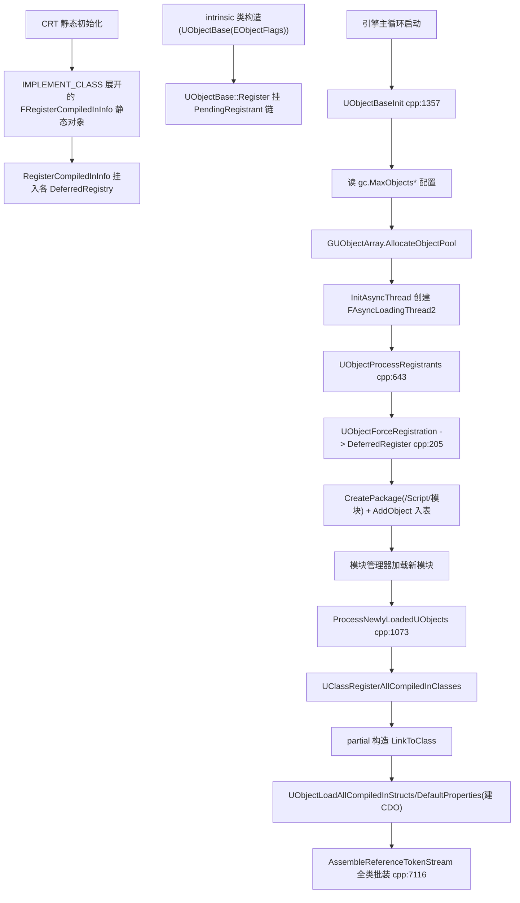

### 3.6.2 StaticConstructObject_Internal 主路径(cpp:4803)

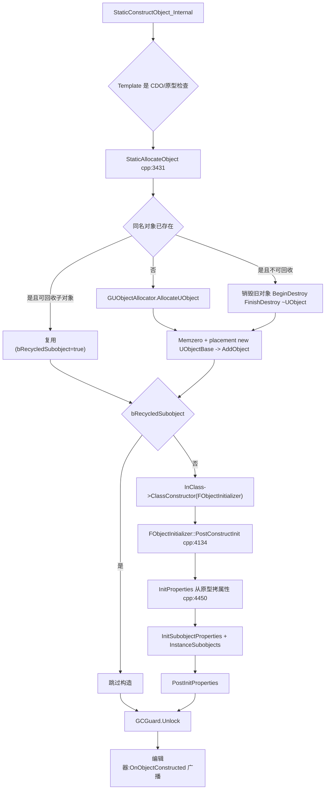

要点:CDO 场景在 StaticAllocateObject 内改名为 `GetDefaultObjectName()` 并清除 RF_NeedPostLoad(cpp:3487-3494);`Name == NAME_None` 时 `MakeUniqueObjectName`(cpp:3497-3512);构造期间 `FGCReconstructionGuard` 在必要时锁 GC(cpp:3627-3645);异步加载线程上的构造会加 `EInternalObjectFlags::AsyncLoadingPhase1` 并调 `NotifyConstructedDuringAsyncLoading`(cpp:3747-3817)。

### 3.6.3 GC 单轮流程(标记-清除)

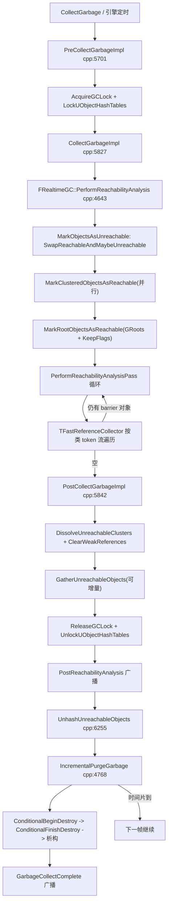

线程判定:`CollectGarbage` 全程 GT(`check(!IsLoading())`,cpp:5719);`MarkClusteredObjectsAsReachable`/`MarkRootObjectsAsReachable`/`ResetReachabilityFlags`/引用遍历在 `ParallelFor` + `UE::Tasks::Launch("CollectReferences")` 工作线程上并行(`gc.AllowParallelGC`,cpp:4717-4724;`ProcessAsync` cpp:7408-7447,worker 数 = `GetNumCollectReferenceWorkers()` = clamp(TaskGraph 工作线程数, 1, UE::GC::MaxWorkers),cpp:7493-7497);清除阶段(Unhash/Purge)回 GT。

### 3.6.4 EDL 异步加载状态机(FAsyncPackage2,EAsyncPackageLoadingState2)

阶段与事件节点一一对应(`EEventLoadNode2`,cpp:3791;EventSpecs 注册见 cpp:11191-11199):ProcessSummary/PreloadExports 标记 `EExecutionType::Parallel` 可在并行加载线程执行,其余 Normal 在 ALT 执行;`FEventLoadNode2` 之间用 `DependsOn`+`AddBarrier` 构成 DAG,`FAsyncLoadEventQueue2` 按 barrier 计数触发 `Fire→Execute`(cpp:6404-6600)。PostLoad 之后阶段由游戏线程 `ProcessLoadedPackagesFromGameThread` 驱动(cpp:11143)。

### 3.6.5 对象销毁路径

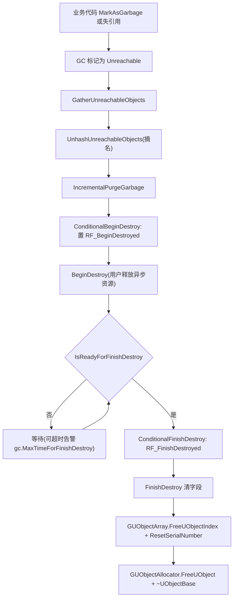

## 3.7 时序图

### 3.7.1 编译内置类注册与 CDO 构建(启动序列)

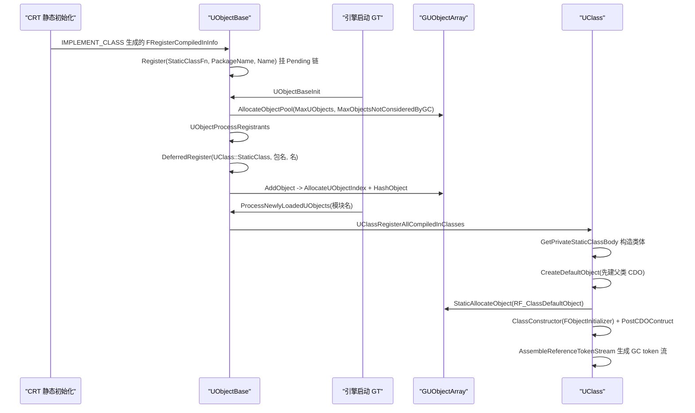

说明:`Z_Construct_UClass_X_Inner` 在 `GetPrivateStaticClassBody` 内创建/复用 `Z_Registration_Info_UClass_X.InnerSingleton`(`ObjectMacros.h:2289-2322`);外层 OuterSingleton 由 `Z_Construct_UClass_X(ETypeConstructPhase::Outer)` 经 intrinsic 版 Construct 先建父类再 `StaticLink`(`ObjectMacros.h:2337-2367`);`UClass::CreateDefaultObject` 见 `Class.cpp:5044-5127`(CDO 名 = `GetDefaultObjectName()`,即 `Default__ClassName`)。

### 3.7.2 NewObject → 构造 → 属性初始化

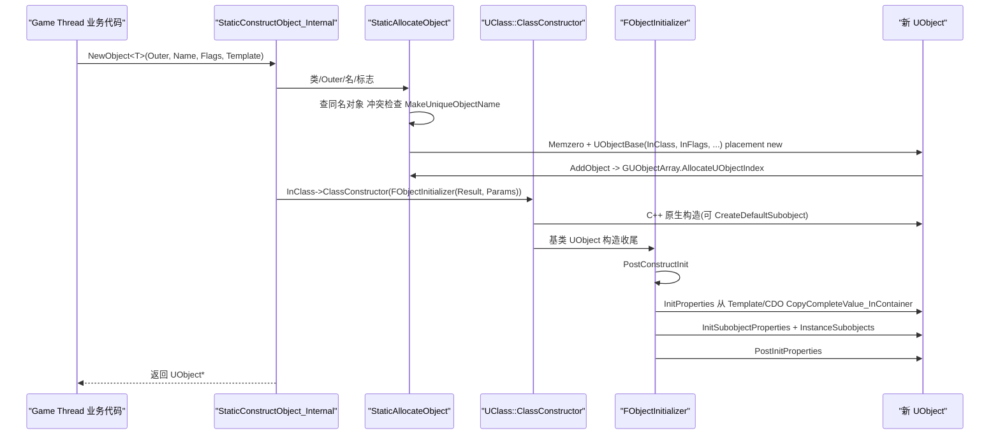

线程:GT 典型;ALT 在导出构造时同样走该链(`EventDrivenCreateExport` → `StaticConstructObject_Internal`,`AsyncLoading2.cpp:9547-9553`),由 `FObjectInitializer` 的线程局部栈(`FUObjectThreadContext::InitializerStack`)保证重入安全。

### 3.7.3 异步加载全链路(LoadPackageAsync → 完成)

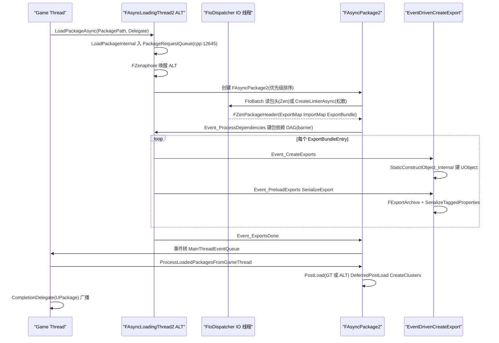

关键实现点:请求经 `TMpscQueue<FPackageRequest> PackageRequestQueue` 跨线程传递(cpp:4945 附近成员);Zen 包用 `FIoBatch`/`FExportArchive`,松散文件用 `FLinkerLoad::CreateLinkerAsync`(cpp:7515);`EventDrivenCreateExport` 解析 ClassIndex/OuterIndex/TemplateIndex 后调 `StaticConstructObject_Internal`(cpp:9399-9553);PostLoad 在 `Event_PreloadExports` 尾部逐导出调 `ConditionalPostLoad`(cpp:10314-10327),多线程时仅当 `s.AsyncPostLoadEnabled`(cooked 默认开、编辑器默认关,`AsyncPackageLoader.cpp:150-156`)且 `CanPostLoadOnAsyncLoadingThread(Object)` 才在 ALT 执行,其余经 MainThreadEventQueue 由 GT 的 DeferredPostLoad 阶段处理。

### 3.7.4 软引用解析(FSoftObjectPath::TryLoad)

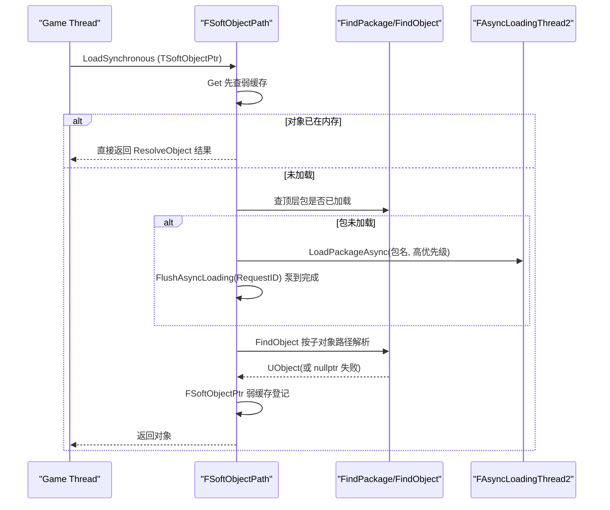

线程:全 GT(`TryLoad` 内部走同步 `LoadPackage`/`LoadPackageAsync+FlushAsyncLoading` 组合,`SoftObjectPath.cpp`);包内软引用列表在传统包摘要 `SoftObjectPathsCount/Offset` 记录(`PackageFileSummary.h:102-107`),供按需加载与 cooker 依赖分析。

### 3.7.5 GC 可达性分析(并行标记)

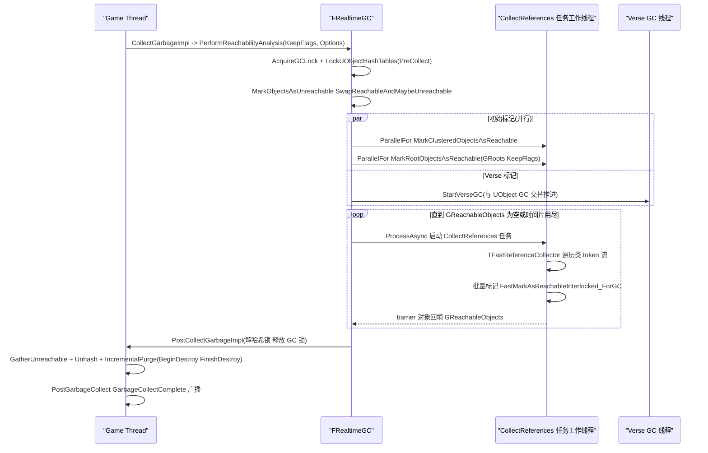

增量模式:`gc.IncrementalReachabilityTimeLimit`(默认 0.005s)超时后 `GReachabilityState.IsSuspended()`,本帧挂起、后续帧 `PerformReachabilityAnalysisPass` 续跑(`FReachabilityAnalysisState`,cpp:6132);GC barrier 指异步加载线程把新可达对象塞进 `GReachableObjects` 供下轮增量处理(cpp:4592-4599)。

## 3.8 线程模型与同步

| 参与者 | 谁在跑 | 关键同步原语 | 判定依据 |
|---|---|---|---|
| GT(主线程) | 所有对象创建/销毁入口、CDO 构建、PostLoad(默认)、GC 全流程调度 | `FUObjectThreadContext`(TThreadSingleton,`UObjectThreadContext.h:38`) | `check(IsInGameThread())`(如 `TickAsyncLoadingFromGameThread`,AsyncLoading2.cpp:11113) |
| ALT(异步加载线程) | 包头解析、Import 解析、导出构造/序列化、(可选)PostLoad | `FZenaphore`(信号量+事件混合)、`TMpscQueue` 请求队列、`FAsyncLoadEventQueue2` 双队列(ALT 本地 + MainThreadEventQueue) | 线程名 `FAsyncLoadingThread`、`TPri_Normal`、`FPlatformAffinity::GetAsyncLoadingThreadMask()`、`ETaskTag::EAsyncLoadingThread`(cpp:11342、11356-11368) |
| 并行加载线程 | `EExecutionType::Parallel` 的 Event(ProcessSummary/PreloadExports) | FEventLoadNode2 barrier 计数 + FSerializationMutex | `FEventLoadNode2::ParallelLoadingWork`(cpp:6505) |
| IO 线程(FIoDispatcher) | Zen 包数据读取 | FIoBatch/FIoRequest 完成回调 | `FIoDispatcher`(IoDispatcher 模块) |
| GC 工作线程 | 引用遍历(TFastReferenceCollector) | `FWorkCoordinator`(原子工作窃取,cpp:7133)、`FContextPoolScope` 上下文池复用、`UE::GC::FWorkerContext`(FastReferenceCollector.h:332,cache line 对齐) | `Tasks::Launch("CollectReferences")`(cpp:7426) |
| Verse GC 线程 | Verse 堆标记 | `GReachableObjects`/`GReachableClusters`/`GReachableNativeStructs` 无锁栈与 UObject GC 互通 | GarbageCollection.cpp:4592-4618 |
| 任意线程 | UObjectBase 构造(ALT/Task)、弱指针读、GUObjectArray 索引分配 | `ObjObjectsCritical`(FTransactionallySafeCriticalSection)、对象标志 `std::atomic` relaxed/seq_cst(`UObjectBase.h:366-395`)、`FUObjectItem::FlagsAndRefCount` 单 64 位原子 | `THREADSAFE_UOBJECTS` 宏、`UE::FRecursiveMutex Mutex`(LinkerLoad.h:172) |

所有权与不变量:

- **GC 锁定窗口**:可达性分析期间 `GIsGarbageCollectingAndLockingUObjectHashTables = true` 且哈希表写锁被持有,期间禁止 `StaticAllocateObject`(cpp:3484 的 check)与一般查找断言变体;窗口结束即释放(`PostCollectGarbageImpl`,cpp:5892-5898)。
- **ALT 与 GC 互斥**:ALT 循环每轮持 `FGCScopeGuard`;GC 想跑时 `IsGarbageCollectionWaiting()` 使 ALT 进入 Suspended(cpp:11429-11435);反向地,ALT 持锁期间 GC 阻塞在 `FGCCSyncObject::GCUnlockedEvent`(`GCScopeLock.h:52-77`)。
- **对象可见性**:ALT 上新建对象默认加 `EInternalObjectFlags::AsyncLoadingPhase1`,GT 在 `TickAsyncLoadingFromGameThread` 用 `AsyncVisibilityFilter` 限制只看见 Phase2 以上对象(cpp:11117),防止 GT 触碰半构造对象。
- **FUObjectItem 的 64 位 FlagsAndRefCount**:强引用计数(`TStrongObjectPtr`/AddRef)与内部标志在同一 64 位字内原子增减,GC 可无锁判断"RootSet 或引用数>0"(`UObjectArray.h:47-60`)。

## 3.9 配置与扩展点

### 3.9.1 控制台变量(节选,均在 Private/UObject/GarbageCollection.cpp)

| CVar | 默认 | 含义 | 位置 |
|---|---|---|---|
| `gc.AllowParallelGC` | 1 | 并行 GC 开关(关闭或单核强制单线程) | cpp:4717-4724 |
| `gc.AllowIncrementalReachability` | 0 | 增量可达性分析(实验) | cpp:302-308 |
| `gc.IncrementalReachabilityTimeLimit` | 0.005 | 增量标记时间片(秒) | cpp:310-317 |
| `gc.AllowIncrementalGather` / `gc.IncrementalGatherTimeLimit` | 0 / 0.0 | 增量收集不可达对象 | cpp:319-336 |
| `gc.CreateGCClusters` | 1 | 聚簇创建开关(关则启动时溶解全部) | Private/UObject/UObjectClusters.cpp:27-31 |
| `gc.FlushStreamingOnGC` | — | GC 前冲刷异步加载 | cpp:5275 |
| `gc.MaxTimeForFinishDestroy` 等 | — | FinishDestroy 卡顿阈值告警 | cpp:4898-4912 |

### 3.9.2 ini 配置

| 文件/节 | 键 | 含义 | 读取处 |
|---|---|---|---|
| `[/Script/Engine.GarbageCollectionSettings]` | `gc.MaxObjectsInGame`(cooked)/`gc.MaxObjectsInEditor`/`gc.MaxObjectsInProgram` | 对象表容量上限(默认 2M/编辑器 2M/程序 100K) | UObjectBase.cpp:1362-1402 |
| 同上 | `gc.MaxObjectsNotConsideredByGC` | 永久池大小(仅 cooked) | UObjectBase.cpp:1379 |
| 同上 | `gc.PreAllocateUObjectArray` | 是否预分配对象表 | UObjectBase.cpp:1390 |
| `[/Script/Engine.StreamingSettings]`(cooked)/`EditorStreamingSettings`(编辑) | `s.AsyncLoadingThreadEnabled` | ALT 启用(命令行 `-AsyncLoadingThread/-NoAsyncLoadingThread` 覆盖) | AsyncPackageLoader.cpp:131-147 |
| 同上 | `s.AsyncPostLoadEnabled` | PostLoad 留在 ALT | AsyncPackageLoader.cpp:151-156 |
| 同上 | `s.LooseFileLoadingEnabled` | 编辑器优先从磁盘松散文件加载 | AsyncPackageLoader.cpp:158-162 |

### 3.9.3 委托与扩展接口

- GC 生命周期委托(`FCoreUObjectDelegates`,`Public/UObject/UObjectGlobals.h:3477-3508`):`GetPreGarbageCollectDelegate()`(取锁前)、`GetGarbageCollectStartedDelegate()`(持锁后)、`PostReachabilityAnalysis`、`GetPostGarbageCollect()`、`GetPostPurgeGarbageDelegate()`、`PreGarbageCollectConditionalBeginDestroy`/`PostGarbageCollectConditionalBeginDestroy`、`GarbageCollectComplete`。
- 注册通知:`CompiledInUObjectsRegisteredDelegate`(模块加载后,分 PreCDO/PostCDO 两拍,cpp:1134/1139)。
- 对象创建/删除监听:`FUObjectArray::FUObjectCreateListener`/`FUObjectDeleteListener`(`UObjectArray.h:954-1000`),ALT/Trace 等以此感知对象。
- 非 UObject 根:`FGCObject`/`UGCObjectReferencer`(见 3.5.5)。
- 加载事件:`FCoreDelegates::GetOnAsyncLoadPackage()`、`OnAsyncLoadingFlushUpdate`(cpp:11170)、`FCoreUObjectDelegates::OnEndLoadPackage`(:3385)。
- Cooker/资产注册表:`FCoreUObjectDelegates::ShouldCookPackageForPlatform`(:3523)、`GetPrimaryAssetIdForObject`(:3519)、`ICookSandbox`、`FCookDependency`、`UCookInfo`。
- 外部持久化后端:`IPackageStoreBackend`(`PackageStore.h:190`)、`IPackageWriter`/`BasePackageWriter`(`BasePackageWriter.h`)、`FBulkDataRegistry`(`BulkDataRegistry.h`)。

## 3.10 已知限制/未确认项

1. **`EInternalObjectFlags` 完整位定义**(`Public/UObject/ObjectMacros.h:658` 起)未逐位摘录,本章只列出与 GC/加载行为直接相关的位;完整位表见附录 part01。
2. **`UStruct::Link/StaticLink` 的属性偏移计算细节**(重定位、跨平台对齐)只引用了入口(`Class.cpp:729/854`),未展开算法。
3. **保存路径(SavePackage/FLinkerSave → IPackageWriter)** 的调用链主体在 Editor 端 `UnrealEd/SavePackage` 命令let 与 `EditorDomain`,本章仅覆盖 CoreUObject 内的 `FLinkerSave` 与 `FSavePackageContext` 数据面,未画保存时序图。
4. **VerseVM**(151 个头文件)按"对象模型 + 与 UObject GC 互操作"的最小面描述;字节码分发、Verse 类/函数加载、Verse 持久化(VVMPersistence)未展开,需单列章节。
5. **AutoRTFM 事务包装**(`UE_AUTORTFM_OPEN`、`FGCTransitionScope`)在 5.8 是实验特性,本章仅在对象标志原子性与 loader 包装(`MakeTransactionallySafeAsyncPackageLoader`,`AsyncPackageLoader.cpp:225`)处提及,未深入。
6. `UE_WITH_CONSTINIT_UOBJECT` 为 0 是本仓默认;若目标改开 constinit 路径(`UObjectBase.h:104-115` 的 consteval 构造 + `ConstructCompiledInObjects`),启动序列与 3.7.1 不同,本章未覆盖。
7. **RemoteObject/DSTM**(`UE_WITH_REMOTE_OBJECT_HANDLE`)默认关闭,涉及代码已标注但未展开分析。
8. `FLinkerLoad::Tick` 的子步(ELinkerStatus 各阶段)只在接口表列出方法名,状态机内部(压缩块、MetaData、SoftObjectPathList 顺序)未逐步展开。

## 3.11 附录索引

| 模块 | 附录文件(相对 `docs/ue5.8.3/`) | 规模 |
|---|---|---|
| Runtime/CoreUObject | `appendix/api/Runtime/CoreUObject.part01.md` | 头文件 550、符号 26809(class 522、struct 1195、enum 439、function 7125…) |
| Runtime/CoreUObject | `appendix/api/Runtime/CoreUObject.part02.md` | 续 part01(自 `Public/UObject/UnrealType.h` 起) |

> 完整符号清单(每个头文件每个类/函数/枚举)以附录两个 part 文件为准;本章 X.5 接口清单是从中选出的运行时公共入口子集,并全部经源码核对。

