# 04 Engine 核心框架:UEngine/UWorld/AActor/UActorComponent/Tick/GameFramework

> 源码基线:UnrealEngine 5.8.3 release。`$UE=/home/timeshift/opensource/game_engine/unreal/UnrealEngine-5.8.3-release`,`$E=$UE/Engine`。
> 本文所有路径相对 `$E` 标注,行号均来自本次对 5.8.3 源码的实际阅读(grep/Read),非记忆性内容。
> 本章节覆盖 Runtime/Engine 模块的核心框架层:Engine 类族(UEngine/UGameEngine/UGameInstance/UGameViewportClient/ULocalPlayer)、World/Level 体系(UWorld/ULevel/ULevelStreaming/FWorldContext)、GameFramework 类族(AActor/APawn/ACharacter/AController/APlayerController/AGameModeBase/AGameMode/AGameStateBase/APlayerState/UMovementComponent/UCharacterMovementComponent/UInputComponent)、组件框架(UActorComponent/USceneComponent/UPrimitiveComponent)、Tick 体系(FTickFunction/FTickTaskManager/ETickingGroup)、Subsystem 体系与 TypedElement 桥接;并涉及帧循环入口 FEngineLoop::Tick(Runtime/Launch)与渲染场景注册边界 FScene::AddPrimitive(Runtime/Renderer)。

## 4.1 职责、边界与模块清单

| 模块/子域 | 路径(相对 $E) | Build.cs 依赖(Public/Private) | 职责一句话 |
|---|---|---|---|
| Engine 引擎类族 | Source/Runtime/Engine/Classes/Engine/ | 见下行 | UEngine/UGameEngine 引擎对象与 Tick 主循环,GameInstance/Viewport/LocalPlayer 生命周期,World/Level/Streaming 数据模型 |
| GameFramework 类族 | Source/Runtime/Engine/Classes/GameFramework/ | 同属 Engine 模块 | AActor 及其玩法类族(Pawn/Controller/PlayerController/GameMode/GameState/PlayerState/Movement)的规则与生命周期 |
| 组件框架 | Source/Runtime/Engine/Classes/Components/ | 同属 Engine 模块 | UActorComponent 注册/初始化/RenderState 脏标记管线,USceneComponent 变换层级,UPrimitiveComponent 场景代理入口 |
| Tick 体系 | Source/Runtime/Engine/Classes/Engine/EngineBaseTypes.h、Public/TickTaskManagerInterface.h、Private/TickTaskManager.cpp | 同属 Engine 模块 | FTickFunction 定义、ETickingGroup 分组、FTickTaskManagerInterface/FTickTaskManager/FTickTaskSequencer/FTickTaskLevel 的并行调度 |
| World/Level 实现 | Source/Runtime/Engine/Private/World.cpp、LevelTick.cpp、LevelActor.cpp | 同属 Engine 模块 | UWorld::Tick/InitWorld/LoadMap 协作/SpawnActor/DestroyActor/SeamlessTravel 的具体实现 |
| Actor/组件实现 | Source/Runtime/Engine/Private/Actor.cpp、Components/ActorComponent.cpp、GameModeBase.cpp、GameEngine.cpp、UnrealEngine.cpp | 同属 Engine 模块 | Actor 生命周期路由、组件注册与渲染状态创建、GameMode 登录流程、引擎 Tick 与 Browse/LoadMap/Travel |
| Subsystem 体系 | Source/Runtime/Engine/Public/Subsystems/ | 同属 Engine 模块 | USubsystem 五级生命周期基类(Engine/GameInstance/World/LocalPlayer/Editor)与集合 |
| TypedElement 桥接 | Source/Runtime/Engine/Public/Elements/、Private/Elements/ | 同属 Engine 模块(运行时依赖模块 TypedElementFramework/TypedElementRuntime) | 把 Actor/Component/Object/SMInstance 包装成 TypedElement 句柄,供选择/层级/资产数据等接口消费 |
| 其它关键实现文件 | Private/LocalPlayer.cpp、GameInstance.cpp、GameViewportClient.cpp、GameModeBase.cpp、PlayerController.cpp、LevelStreaming.cpp、NetConnection.cpp | 同属 Engine 模块 | 本地玩家 PC 生成/替换、GameInstance 生命周期、视口初始化、登录流程、客户端 travel、流送状态机实现、客户端 PC 复制接管 |
| 帧循环入口(Launch) | Source/Runtime/Launch/Private/LaunchEngineLoop.cpp | 独立模块 Launch | FEngineLoop::Tick:帧计时、RHI BeginFrame、消息泵、Slate 输入、调用 GEngine->Tick |
| 渲染场景边界(Renderer) | Source/Runtime/Renderer/Private/RendererScene.cpp | 独立模块 Renderer | FScene::AddPrimitive/BatchAddPrimitivesInternal:GameThread 创建 SceneProxy 后以 ENQUEUE_RENDER_COMMAND 提交渲染线程 |

Engine 模块 Build.cs 关键 Public 依赖(节选自 Source/Runtime/Engine/Engine.Build.cs:79 起):Core、CoreUObject、NetCore、Slate、SlateCore、InputCore、RenderCore、RHI、PhysicsCore、EngineSettings、GameplayTags 等;Private 另含大量渲染/物理/音频模块。本文只引用与框架相关的部分。

## 4.2 总体架构

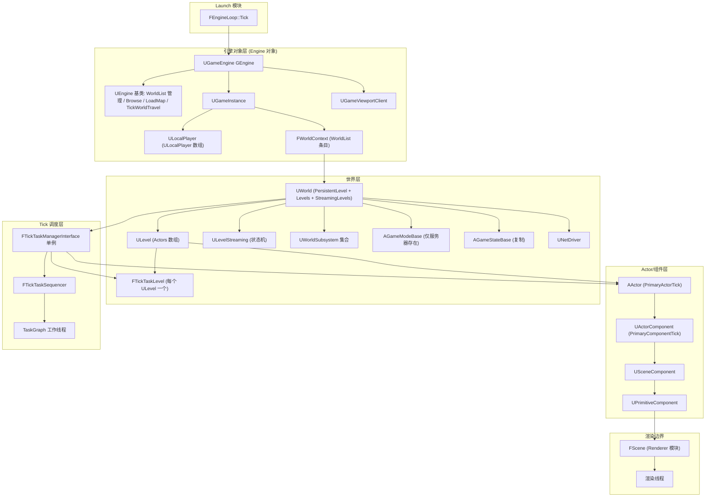

要点(依据源码):
- `GEngine->Tick(FApp::GetDeltaTime(), bIdleMode)` 是每帧对引擎对象的唯一入口,由 `FEngineLoop::Tick` 调用(Source/Runtime/Launch/Private/LaunchEngineLoop.cpp:5859)。
- `UGameEngine::Tick` 遍历 `UEngine::WorldList`(TIndirectArray<FWorldContext>),对每个 World 先 `TickWorldTravel` 再 `World->Tick(LEVELTICK_All, DeltaSeconds)`(Source/Runtime/Engine/Private/GameEngine.cpp:1893、1901)。
- `UWorld` 持有 `PersistentLevel`、`NetDriver`、`AuthorityGameMode`、`GameState`(Source/Runtime/Engine/Classes/Engine/World.h:953、957、1425、1429);`ULevel` 持有 `Actors` 数组与每关一个的 `TickTaskLevel`(Source/Runtime/Engine/Classes/Engine/Level.h:429、530)。
- 渲染侧通过 `UPrimitiveComponent` 进入 `FScene`,`FScene::AddPrimitive` 在游戏线程创建 `FPrimitiveSceneProxy` 后 `ENQUEUE_RENDER_COMMAND(AddPrimitiveCommand)` 提交渲染线程(Source/Runtime/Renderer/Private/RendererScene.cpp:1455、1507)。

## 4.3 类图

### 4.3.1 引擎对象与世界

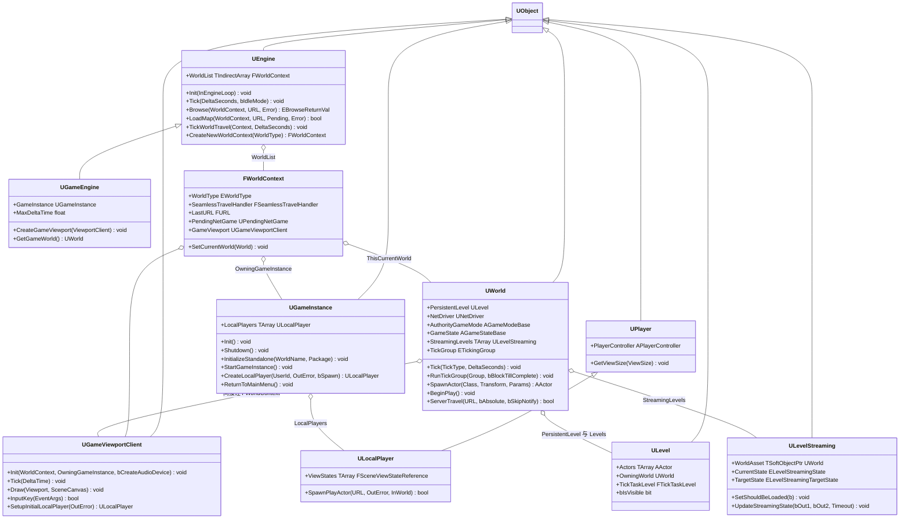

类职责说明:
- `UEngine`:引擎抽象基类,`UCLASS(abstract, config=Engine, defaultconfig, transient)`(Source/Runtime/Engine/Classes/Engine/Engine.h:725),持有 WorldList、字体/时间步进/网络委托,定义 Browse/LoadMap/TickWorldTravel 等 travel 原语(Engine.h:3507-3513)。
- `UGameEngine`:游戏运行时引擎实现,持有唯一 `GameInstance`(GameEngine.h:38)与游戏窗口/GameViewport Widget(GameEngine.h:43-47)。
- `UGameInstance`:进程(或 PIE 实例)级高层管理器,`UCLASS(config=Game, transient)`(GameInstance.h:150),跨关卡存续,持有 `LocalPlayers`(GameInstance.h:173)。
- `UGameViewportClient`:`UCLASS(Within=Engine, transient, config=Engine)`(GameViewportClient.h:70-71),游戏视口:输入路由、Draw/PostRender、初始本地玩家创建。
- `ULocalPlayer`:本地玩家(视口 ViewState、SpawnPlayActor 入口),`class ULocalPlayer : public UPlayer`(LocalPlayer.h:169)。
- `FWorldContext`:UEngine 内部的"世界轨道"结构(Engine.h:328-504),连接 World/GameViewport/GameInstance/PendingNetGame/SeamlessTravelHandler。
- `UWorld`:`class UWorld final : public UObject, public FNetworkNotify`(World.h:930-931);一帧中由 `Tick` 驱动全部玩法、`RunTickGroup` 驱动 tick 分组。
- `ULevel`:Actor 容器(Level.h:419,Actors:429);`OwningWorld`(Level.h:457)与 `bIsVisible`(Level.h:600)、`TickTaskLevel`(Level.h:530)。
- `ULevelStreaming`:流送关卡控制对象,`UCLASS(abstract, Within=World)`(LevelStreaming.h:137-138),内部维护 `CurrentState/TargetState` 状态机(LevelStreaming.h:286、289)。

### 4.3.2 GameFramework:Actor 与组件

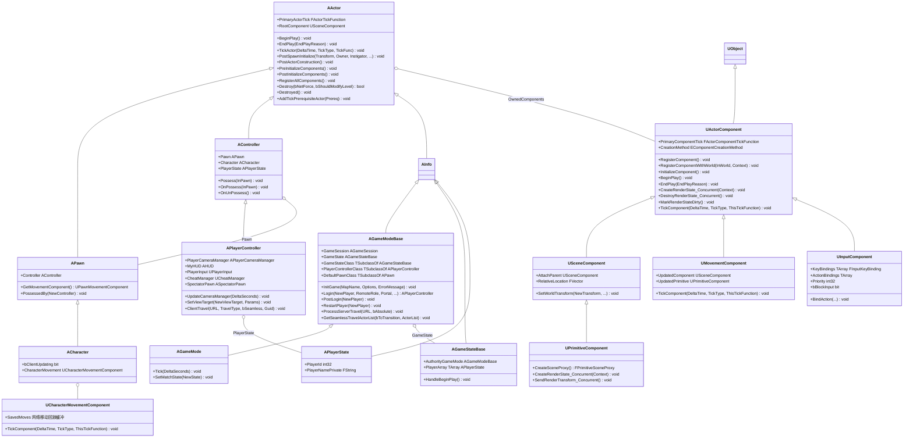

类职责说明:
- `AActor`:`class AActor : public UObject`(Actor.h:282),玩法对象基类;`PrimaryActorTick`(Actor.h:318)是它接入 Tick 体系的句柄。
- `APawn`:`class APawn : public AActor, public INavAgentInterface`(Pawn.h:42-43),可被 Controller 附身并接收输入。
- `ACharacter`:`class ACharacter : public APawn`(Character.h:337-338),胶囊+骨骼网格+CharacterMovement 的标准人形。
- `AController`:`UCLASS(abstract...)`、`class AController : public AActor, public INavAgentInterface`(Controller.h:39-40),持有 `PlayerState`(replicatedUsing=OnRep_PlayerState,Controller.h:49-51)、`Pawn/Character/TransformComponent`(Controller.h:70-87 区域);`Possess` 为 virtual final,应改写 `OnPossess`(Controller.h:284、299)。
- `APlayerController`:玩家控制器,持有 `MyHUD`(PlayerController.h:280)、`PlayerCameraManager`(:287)、`CheatManager`(:359)、`PlayerInput`(:370)、`InactiveStateInputComponent`(:1716)、`SpectatorPawn`(:2219)。
- `AGameModeBase`:`class AGameModeBase : public AInfo`(GameModeBase.h:46-47),只在服务器(Standalone/Listen/Dedicated)存在;类配置(PlayerControllerClass:96、GameStateClass:92、DefaultPawnClass:108、SpectatorClass:112)与登录(Login:323/PostLogin:326/PreLogin:293)、重生成(RestartPlayer:435)。
- `AGameMode`:`class AGameMode : public AGameModeBase`(GameMode.h:34-35),加 MatchState 状态机与 Tick(GameMode.h:216)。
- `AGameStateBase`:`class AGameStateBase : public AInfo`(GameStateBase.h:31-32),向所有客户端复制的游戏状态(含 PlayerArray);`AGameState`(GameState.h:15-16)在其上加 MatchState。
- `APlayerState`:`class APlayerState : public AInfo`(PlayerState.h:40-41),玩家身份/分数的复制载体。
- `UActorComponent`:`class UActorComponent : public UObject, public IInterface_AssetUserData, public IAsyncPhysicsStateProcessor`(ActorComponent.h:160);`USceneComponent`(SceneComponent.h:88)、`UPrimitiveComponent`(PrimitiveComponent.h:307,多接口继承)。
- `UMovementComponent`:`class UMovementComponent : public UActorComponent`(MovementComponent.h:70),驱动 `UpdatedComponent`(:80)。
- `UCharacterMovementComponent`:`class UCharacterMovementComponent : public UPawnMovementComponent, public IRVOAvoidanceInterface, public INetworkPredictionInterface`(CharacterMovementComponent.h:136),帧内 `TickComponent`(:1312)执行移动与网络预测。
- `UInputComponent`:`class UInputComponent : public UActorComponent`(InputComponent.h:747-748),绑定 Key/Touch/Axis/Action(InputComponent.h:755-775),由 PlayerController 的输入栈处理。

### 4.3.3 Tick 体系

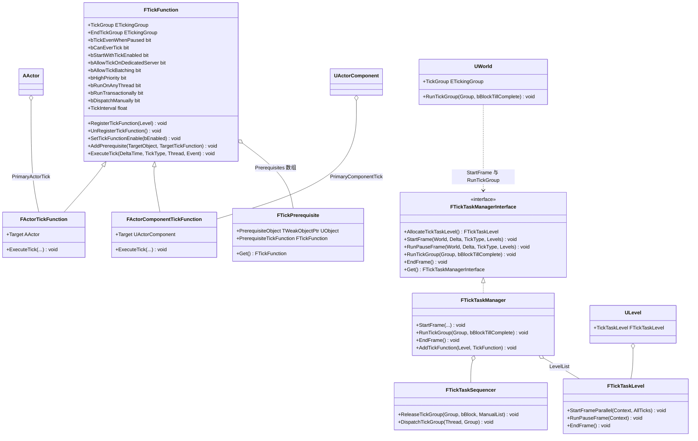

说明:`FTickFunction` 定义于 Source/Runtime/Engine/Classes/Engine/EngineBaseTypes.h:182;`FTickTaskManagerInterface` 是纯接口(Public/TickTaskManagerInterface.h:20),其唯一实现 `FTickTaskManager` 与调度器 `FTickTaskSequencer`、层级 `FTickTaskLevel` 都在 Private/TickTaskManager.cpp(类声明分别位于 :1970、:460、:1210),对外仅通过 `FTickTaskManagerInterface::Get()`(:66)访问。

### 4.3.4 Subsystem 体系

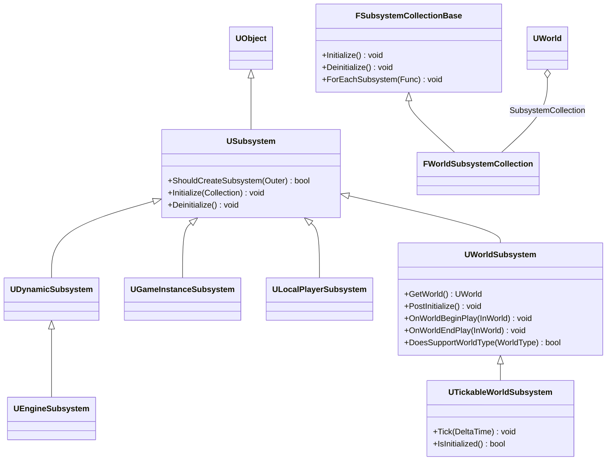

说明:`USubsystem`/`UDynamicSubsystem` 定义于 Public/Subsystems/Subsystem.h:43-82;`UWorldSubsystem`/`UTickableWorldSubsystem` 于 Public/Subsystems/WorldSubsystem.h:15-106;`UEngineSubsystem`(Public/Subsystems/EngineSubsystem.h)、`UGameInstanceSubsystem`(GameInstanceSubsystem.h)、`ULocalPlayerSubsystem`(LocalPlayerSubsystem.h)为对应 Outer 的单例化基类(Subsystem.h:11-29 注释列出五级生命周期);`FWorldSubsystemCollection : FObjectSubsystemCollection<UWorldSubsystem>` 在 World.h:906,UWorld::InitWorld 经 InitializeSubsystems(World.cpp:2447)建立,UWorld::BeginPlay/EndPlay 逐个回调 OnWorldBeginPlay/OnWorldEndPlay(World.cpp:6165-6169、6208-6211)。

## 4.4 数据字典

### 4.4.1 Tick 相关枚举与结构(EngineBaseTypes.h)

| 字段/类型 | 类型 | 含义 | 取值/约束 | 源码位置 |
|---|---|---|---|---|
| ETickingGroup | enum int | tick 分组,决定帧内相对顺序 | TG_PrePhysics、TG_StartPhysics、TG_DuringPhysics、TG_EndPhysics、TG_PostPhysics、TG_PostUpdateWork、TG_LastDemotable(可被依赖降级的最晚组)、TG_NewlySpawned(帧内新生物反复补跑,非普通组)、TG_MAX | Classes/Engine/EngineBaseTypes.h:83-110 |
| ELevelTick | enum | 本帧 tick 级别 | LEVELTICK_TimeOnly=0、LEVELTICK_ViewportsOnly=1、LEVELTICK_All=2、LEVELTICK_PauseTick=3(DeltaTime=0,组件不 tick) | Classes/Engine/EngineBaseTypes.h:69-79 |
| FTickFunction.TickGroup | TEnumAsByte<ETickingGroup> | 首个可执行组;有前置可被推迟 | 默认 TG_PrePhysics(构造于 Private/TickTaskManager.cpp:2362) | Classes/Engine/EngineBaseTypes.h:196 |
| FTickFunction.EndTickGroup | TEnumAsByte<ETickingGroup> | 必须完成于该组内,游戏线程在该组末尾等待 | 默认 TG_PrePhysics | Classes/Engine/EngineBaseTypes.h:204 |
| FTickFunction.bTickEvenWhenPaused | uint8:1 | 暂停时也执行(pause tick 能力受限) | EditDefaultsOnly | Classes/Engine/EngineBaseTypes.h:209 |
| FTickFunction.bCanEverTick | uint8:1 | false 则永不注册/永不 tick | 仅可在默认值设置 | Classes/Engine/EngineBaseTypes.h:213 |
| FTickFunction.bStartWithTickEnabled | uint8:1 | 初始是否启用 | | Classes/Engine/EngineBaseTypes.h:217 |
| FTickFunction.bAllowTickOnDedicatedServer | uint8:1 | 专用服务器上是否 tick | 默认 true | Classes/Engine/EngineBaseTypes.h:221、TickTaskManager.cpp:2367 |
| FTickFunction.bAllowTickBatching | uint8:1 | 允许合并进单个 tick 任务 | 默认 false | Classes/Engine/EngineBaseTypes.h:224、TickTaskManager.cpp:2368 |
| FTickFunction.bHighPriority | uint8:1 | 组内先执行(用于提前启动异步任务) | | Classes/Engine/EngineBaseTypes.h:227 |
| FTickFunction.bRunOnAnyThread | uint8:1 | true 时可并行于游戏线程执行 | | Classes/Engine/EngineBaseTypes.h:230 |
| FTickFunction.bRunTransactionally | uint8:1 | 实验性:事务化执行(AutoRTFM) | | Classes/Engine/EngineBaseTypes.h:233 |
| FTickFunction.bDispatchManually | uint8:1 | 不随组开始自动派发,需手动 DispatchManually | | Classes/Engine/EngineBaseTypes.h:236 |
| FTickFunction.TickInterval | float | 执行间隔秒;<=0 每帧 | | Classes/Engine/EngineBaseTypes.h:258 |
| FTickFunction.Prerequisites | TArray<FTickPrerequisite> | 前置 tick 列表,仅游戏线程修改 | 私有,经 Add/RemovePrerequisite 维护 | Classes/Engine/EngineBaseTypes.h:262、426、433 |
| FTickFunction.InternalData.FInternalData | TUniquePtr<FInternalData> | 注册态数据:bRegistered、ETickTaskState{NotQueued,Pending,HasTask,HasCompletionEvent}、ActualStart/EndTickGroup、TickTaskLevel 回指针、冷却链表 Next | 惰性分配;TickVisited/TickQueuedGFrameCounter 为 std::atomic<uint32> | Classes/Engine/EngineBaseTypes.h:265-326 |
| FActorTickFunction.Target | AActor* | tick 目标 Actor | ExecuteTick 中 IsValid(Target) 校验 | Classes/Engine/EngineBaseTypes.h:570-575、Private/Actor.cpp:372-390 |
| FActorComponentTickFunction.Target | UActorComponent* | tick 目标组件 | 执行时调用 Target->TickComponent | Classes/Engine/EngineBaseTypes.h:612-630、Private/Components/ActorComponent.cpp:1695 |

### 4.4.2 网络与 Travel(EngineBaseTypes.h)

| 字段/类型 | 类型 | 含义 | 取值/约束 | 源码位置 |
|---|---|---|---|---|
| ENetMode | enum int | 网络模式 | NM_Standalone、NM_DedicatedServer、NM_ListenServer、NM_Client(<NM_Client 均为服务器) | Classes/Engine/EngineBaseTypes.h:978-996 |
| ETravelType | enum | travel URL 解析方式 | TRAVEL_Absolute、TRAVEL_Partial、TRAVEL_Relative | Classes/Engine/EngineBaseTypes.h:767-776 |
| ETravelFailure::Type | enum namespace | travel 失败类型 | NoLevel、LoadMapFailure、InvalidURL、PackageMissing、PackageVersion、NoDownload、TravelFailure、CheatCommands、PendingNetGameCreateFailure、CloudSaveFailure、ServerTravelFailure、ClientTravelFailure | Classes/Engine/EngineBaseTypes.h:699-727 |
| FURL | USTRUCT | travel 地址:Protocol/Host/Port/Map/RedirectURL/Op 数组/Portal | 默认 Map 为 "Entry";IsInternal/IsLocalInternal 判定本地或网络 | Classes/Engine/EngineBaseTypes.h:840-972 |

### 4.4.3 FWorldContext(Engine.h:350-504)

| 字段 | 类型 | 含义 | 源码位置 |
|---|---|---|---|
| WorldType | TEnumAsByte<EWorldType::Type> | 世界类型(Game/PIE/Editor/EditorPreview/Inactive/GameRPC...) | Engine.h:357 |
| SeamlessTravelHandler | FSeamlessTravelHandler | 无缝切换状态机(实现于 Private/World.cpp:8274 起) | Engine.h:359 |
| TravelURL / TravelType | FString / uint8 | 待执行的客户端 travel | Engine.h:364-367 |
| LastURL / LastRemoteURL | FURL | 最近一次 travel 的 URL(重连用) | Engine.h:371-375 |
| PendingNetGame | TObjectPtr<UPendingNetGame> | 客户端连接中的"待定游戏" | Engine.h:378 |
| PackagesToFullyLoad | TArray<FFullyLoadedPackagesInfo> | LoadMap 时需整包加载的 DLC 包 | Engine.h:382 |
| LevelsToLoadForPendingMapChange / LoadedLevelsForPendingMapChange / bShouldCommitPendingMapChange | TArray<FName>/TArray<ULevel*>/uint32:1 | GamePlay 静态分帧关卡切换(CommitMapChange)状态 | Engine.h:388-398 |
| GameViewport / OwningGameInstance | TObjectPtr | 归属视口与 GameInstance | Engine.h:408、411 |
| ActiveNetDrivers | TArray<FNamedNetDriver> | 该上下文的命名 NetDriver 列表 | Engine.h:415 |
| PIEInstance / PIEPrefix / RunAsDedicated | int32/FString/bool | PIE 标识 | Engine.h:418-427 |
| ThisCurrentWorld | TObjectPtr<UWorld>(私有) | 当前世界;SetCurrentWorld 同步 ExternalReferences | Engine.h:473、503 |

### 4.4.4 UWorld 关键字段(World.h)

| 字段 | 类型 | 含义 | 源码位置 |
|---|---|---|---|
| PersistentLevel | TObjectPtr<ULevel> | 常驻关卡 | World.h:953 |
| NetDriver | TObjectPtr<UNetDriver> | NAME_GameNetDriver 游戏连接 | World.h:957 |
| NetworkManager | TObjectPtr<AGameNetworkManager> | 网络策略(在 GameModeBase::PreInitializeComponents 中生成) | World.h:976、Private/GameModeBase.cpp:141 |
| StreamingLevels | TArray<TObjectPtr<ULevelStreaming>> | 流送关卡对象列表(按 FName 引用避免序列化引用) | World.h:1001 |
| StreamingLevelsToConsider | FStreamingLevelsToConsider | 当前参与状态决策的子集 | World.h:1005 |
| MakingVisibleLevels / MakingInvisibleLevels + PendingVisibilityLock | TArray<ULevel*> + FTransactionallySafeRWLock | 正在显/隐的关卡队列与多线程访问锁 | World.h:1189-1197 |
| TickGroup | TEnumAsByte<ETickingGroup> | 当前推进到的 tick 组(RunTickGroup 每组后 +1) | World.h:1246、Private/LevelTick.cpp:791 |
| WorldType | TEnumAsByte<EWorldType::Type> | 世界类型 | World.h:1249 |
| AuthorityGameMode / GameState | TObjectPtr | 服务器权威 GameMode 与复制 GameState | World.h:1425、1429 |
| NextURL / NextTravelType / NextSwitchCountdown | FString/ETravelType/float | 服务器 travel 待定状态(TickWorldTravel 消费) | Private/UnrealEngine.cpp:15943-15977 |
| ComponentsThatNeedEndOfFrameUpdate(含 _OnGameThread/_AsyncTick 变体) | TArray<TObjectPtr<UActorComponent>> | 帧末渲染更新队列 | Private/LevelTick.cpp:1139-1207 |

### 4.4.5 ULevelStreaming(LevelStreaming.h)

| 字段 | 类型 | 含义 | 源码位置 |
|---|---|---|---|
| ELevelStreamingState | enum class uint8 | Removed、Unloaded、FailedToLoad、Loading、LoadedNotVisible、MakingVisible、LoadedVisible、MakingInvisible | LevelStreaming.h:110-120 |
| ELevelStreamingTargetState | enum class uint8 | Unloaded、UnloadedAndRemoved、LoadedNotVisible、LoadedVisible | LevelStreaming.h:123-129 |
| WorldAsset | TSoftObjectPtr<UWorld> | 要加载的世界资产 | LevelStreaming.h:203 |
| StreamingPriority | int32 | 决策优先级(影响下次被选中评估的顺序) | LevelStreaming.h:207 |
| LevelTransform | FTransform | 加载后施加给 Actor 的变换 | LevelStreaming.h:227 |
| bShouldBeLoaded / bShouldBeVisible | uint8:1 | 期望加载/可见(BlueprintSetter 可设) | LevelStreaming.h:262、267 |
| CurrentState / TargetState + CurrentStateLock | 枚举 + FTransactionallySafeRWLock | 当前与目标状态;异步任务读时走锁 | LevelStreaming.h:283-289 |
| bShouldBlockOnLoad / bShouldBlockOnUnload | uint8:1 | 强制阻塞加载/卸载 | LevelStreaming.h:306、310 |
| MinTimeBetweenVolumeUnloadRequests / LastVolumeUnloadRequestTime | float | 体积触发卸载的防抖 | LevelStreaming.h:342、345 |
| AsyncRequestIDs | TArray<int32> | 底层异步加载请求 ID(FlushAsyncLevelRequests 用) | LevelStreaming.h:279、Private/World.cpp:4990-5022 |

### 4.4.6 UActorComponent 渲染/注册状态(ActorComponent.h)

| 字段 | 类型 | 含义 | 源码位置 |
|---|---|---|---|
| bRegistered | uint8:1 | 是否已注册(OnRegister 置位) | ActorComponent.h:234 |
| bRenderStateCreated / bRenderStateRecreating | uint8:1 | 渲染态存在 / 正在重建 | ActorComponent.h:237、245 |
| bRenderStateDirty / bRenderTransformDirty / bRenderDynamicDataDirty / bRenderInstancesDirty | uint8:1 | 四类脏标记,帧末分别触发 Recreate/SendTransform/SendDynamicData/SendInstanceData | ActorComponent.h:270-279、Private/Components/ActorComponent.cpp:2645-2692 |
| bAutoRegister | uint8:1 | 随 Owner 自动注册 | ActorComponent.h:286 |
| bAllowConcurrentTick | uint8:1 | 组件 tick 是否可并发(与 bRunOnAnyThread 配合) | ActorComponent.h:300 |
| bWantsInitializeComponent | uint8:1 | 是否路由 InitializeComponent | ActorComponent.h:340 |
| CreationMethod | EComponentCreationMethod | Native/Instance/SimpleConstructionScript/UserConstructionScript/InstanceDeferredDecision | ActorComponent.h:431 |
| MarkedForEndOfFrameUpdateArrayIndex / MarkedForEndOfFrameUpdateState | int32:28 / uint8:2 | 世界帧末队列中的快速移除索引与状态(Unmarked/Marked/MarkedForGameThread) | ActorComponent.h:197-200、Private/LevelTick.cpp:845-853 |
| PrimaryComponentTick | FActorComponentTickFunction | 组件主 tick 函数 | ActorComponent.h:177 |

### 4.4.7 FActorSpawnParameters(World.h:419-512)

| 字段 | 类型 | 含义 | 源码位置 |
|---|---|---|---|
| Template / Name / NameMode | AActor* / FName / ESpawnActorNameMode{Required_Fatal,Required_ErrorAndReturnNull,Required_ReturnNull,Requested} | 模板对象/指定名与冲突策略 | World.h:495-512 |
| Owner / Instigator / OverrideLevel / OverrideParentComponent | AActor*(World.h:431)/APawn*/ULevel*(World.h:436 注释)/UChildActorComponent* | 外部归属 | World.h:431-445 区域 |
| ObjectFlags / OverridePackage / bCreateActorPackage | EObjectFlags(:515)/UPackage*(:441)/uint16:1(:492) | 对象标志与 External Actor 包 | World.h:441、492、515;Private/LevelActor.cpp:548-567 |
| SpawnCollisionHandlingOverride | ESpawnActorCollisionHandlingMethod | Undefined/AlwaysSpawn/AdjustIfPossibleButAlwaysSpawn/AdjustIfPossibleButDontSpawnIfColliding/DontSpawnIfColliding | World.h:454、Private/LevelActor.cpp:624-643 |
| bDeferConstruction | uint8:1 | 延迟构造(SpawnActorDeferred,等待 FinishSpawning) | World.h:476、Private/Actor.cpp:4358-4367 |
| bNoFail / bAllowDuringConstructionScript | bool | 失败升级策略/构造脚本中允许 | Private/LevelActor.cpp:499-508 |
| TransformScaleMethod | ESpawnActorScaleMethod{MultiplyWithRoot,OverrideRootScale,SelectDefaultAtRuntime} | 缩放合成方式 | World.h:457、Private/Actor.cpp:4314-4323 |

## 4.5 接口清单

> 原型逐字摘自头文件(略去 `ENGINE_API`/`UE_API` 导出宏)。线程判定依据:函数体内 `check(IsInGameThread())`/`ENamedThreads::GameThread`/注释声明/调用点所在调用链。

### 4.5.1 UEngine / UGameEngine

| 原型 | 功能 | 参数/返回 | 线程/重入 | 位置 |
|---|---|---|---|---|
| `virtual void Init(IEngineLoop* InEngineLoop);` | 引擎初始化(基类通用部分) | 无返回 | GameThread(启动期一次) | Classes/Engine/Engine.h:2420;实现 Private/UnrealEngine.cpp:2354 |
| `virtual void Tick( float DeltaSeconds, bool bIdleMode ) PURE_VIRTUAL(UEngine::Tick,);` | 帧更新抽象入口 | DeltaSeconds 帧时长;bIdleMode 空闲模式跳过 | GameThread(由 FEngineLoop::Tick:5859 调用) | Engine.h:2542;UGameEngine 实现见 Private/GameEngine.cpp:1768 |
| `virtual void UpdateTimeAndHandleMaxTickRate();` | 更新 FApp::CurrentTime/DeltaTime 并按最大帧率等待 | 无返回 | GameThread | Engine.h:2547;FEngineLoop 调用 LaunchEngineLoop.cpp:5701 |
| `virtual EBrowseReturnVal::Type Browse( FWorldContext& WorldContext, FURL URL, FString& Error );` | 切换到 URL(本地 map→LoadMap,远程→PendingNetGame) | 返回 Success/Pending/Failure | GameThread;禁止在 NetDriver tick 中调用(实现首检 WorldContext.World()->GetNetDriver()->IsInTick(),Private/UnrealEngine.cpp:15661-15669) | Engine.h:3507;实现 UnrealEngine.cpp:15654 |
| `virtual bool LoadMap( FWorldContext& WorldContext, FURL URL, class UPendingNetGame* Pending, FString& Error );` | 卸载旧世界、加载新包、InitWorld→SetGameMode→InitializeActorsForPlay→BeginPlay | 返回是否成功 | GameThread(阻塞,配合 LoadingMovie) | Engine.h:3513;实现 UnrealEngine.cpp:16078 |
| `virtual void TickWorldTravel(FWorldContext& WorldContext, float DeltaSeconds);` | 推进 seamless/server/client travel 与 PendingNetGame | 无返回 | GameThread(UGameEngine::Tick 内每 World 一次,GameEngine.cpp:1893) | Engine.h:3509;实现 UnrealEngine.cpp:15925 |
| `ENGINE_API void BrowseToDefaultMap( FWorldContext& WorldContext );` | 失败兜底:加载 GameDefaultMap | 无返回 | GameThread | Engine.h:3511;实现 UnrealEngine.cpp:15898 |
| `ENGINE_API FWorldContext& CreateNewWorldContext(EWorldType::Type WorldType);` | 新建 WorldContext 轨道 | 返回引用 | GameThread | Engine.h:3626 |
| `ENGINE_API void SetClientTravel( UWorld *InWorld, const TCHAR* NextURL, ETravelType InTravelType );`(私有重载族) | 设置客户端 travel 意图(TravelURL/TravelType),TickWorldTravel 消费 | 无返回 | GameThread | 实现 UnrealEngine.cpp:15609-15652(声明于 Engine.h 私有段) |
| `virtual float GetMaxTickRate(float DeltaTime, bool bAllowFrameRateSmoothing = true) const;` | 最大帧率(平滑/t.MaxFPS) | 返回帧率 | GameThread | Engine.h:2591;UGameEngine 覆写 GameEngine.h:144 |
| `ENGINE_API virtual void RedrawViewports( bool bShouldPresent = true );` | 重绘所有视口 | 无返回 | GameThread(UGameEngine::Tick 末尾调用,GameEngine.cpp:2034) | GameEngine.h:121 |
| `void UGameEngine::CreateGameViewport( UGameViewportClient* GameViewportClient );` | 创建游戏视口 | 无返回 | GameThread | Classes/Engine/GameEngine.h:62 |
| `ENGINE_API UWorld* GetGameWorld();` | 全局单世界便捷查询(游戏代码勿用) | 返回世界 | GameThread | GameEngine.h:181 |
| `ENGINE_API void SpawnServerActors(UWorld *World);` | 服务器上按 ini [Engine.ServerActors] 生成 Actor | 无返回 | GameThread(LoadMap 内 Listen/Dedicated 时,UnrealEngine.cpp:16028... 实际调用见 World.cpp:6026-6029) | 实现于 UnrealEngine.cpp:15342 |

UGameEngine::Init 启动序(Private/GameEngine.cpp:1221-1331):`UEngine::Init` → GameUserSettings 应用(:1249-1250)→ 从 `UGameMapsSettings::GameInstanceClass` 加载类并 `NewObject<UGameInstance>`(:1256-1265)→ `GameInstance->InitializeStandalone()`(:1267,创建 Entry 世界)→ GIsClient 时创建 `UGameViewportClient` 并 `Init`(:1290-1294)→ `CreateGameWindow/CreateGameViewport`(:1307-1310)→ `ViewportClient->SetupInitialLocalPlayer(Error)`(:1318)。`UGameEngine::Start` 只调 `GameInstance->StartGameInstance()`(GameEngine.cpp:1333-1339)。

### 4.5.2 UGameInstance / UGameViewportClient / ULocalPlayer

| 原型 | 功能 | 参数/返回 | 线程/重入 | 位置 |
|---|---|---|---|---|
| `ENGINE_API virtual void Init();` / `ENGINE_API virtual void Shutdown();` | GameInstance 初始化/清理钩子(蓝图 ReceiveInit/ReceiveShutdown) | 无返回 | GameThread | Classes/Engine/GameInstance.h:217、224 |
| `ENGINE_API void InitializeStandalone(const FName InWorldName = NAME_None, UPackage* InWorldPackage = nullptr);` | 为 Standalone 初始化(创建 Entry 世界 WorldContext) | 无返回 | GameThread | GameInstance.h:271 |
| `ENGINE_API virtual void StartGameInstance();` | 启动默认游戏(处理命令行 URL) | 无返回 | GameThread | GameInstance.h:301 |
| `ENGINE_API ULocalPlayer* CreateLocalPlayer(int32 ControllerId, FString& OutError, bool bSpawnPlayerController);` | 创建/复用本地玩家 | 返回玩家 | GameThread | GameInstance.h:335(平台 UserId 重载 :344) |
| `ENGINE_API virtual bool RemoveLocalPlayer(ULocalPlayer * ExistingPlayer);` | 移除本地玩家 | 返回成功 | GameThread | GameInstance.h:359 |
| `ENGINE_API virtual void ReturnToMainMenu();` | 回主菜单(内部 SetClientTravel 默认图) | 无返回 | GameThread | GameInstance.h:637;实现 Private/GameInstance.cpp:1492 |
| `ENGINE_API virtual void Init(struct FWorldContext& WorldContext, UGameInstance* OwningGameInstance, bool bCreateNewAudioDevice = true);` | 视口初始化(含音频设备) | 无返回 | GameThread | Classes/Engine/GameViewportClient.h:167 |
| `ENGINE_API virtual void Tick( float DeltaTime );` | 视口帧更新(引擎 Tick 内) | 无返回 | GameThread(GameEngine.cpp:2003 调用) | GameViewportClient.h:320 |
| `ENGINE_API virtual void Draw(FViewport* Viewport,FCanvas* SceneCanvas);` | 视口绘制(引擎调用,渲染前) | 无返回 | GameThread | GameViewportClient.h:186 |
| `ENGINE_API virtual bool InputKey(const FInputKeyEventArgs& EventArgs);` / `InputAxis(...)` | 键鼠/轴输入路由到 PlayerController | 返回是否消费 | GameThread(输入泵) | GameViewportClient.h:177-178 |
| `ULocalPlayer* UGameViewportClient::SetupInitialLocalPlayer(FString& OutError);` | 启动时创建首个本地玩家 | 返回玩家 | GameThread | 实现 Private/GameViewportClient.cpp:2801(UGameEngine::Init:1318 调用) |
| `bool ULocalPlayer::SpawnPlayActor(const FString& URL,FString& OutError, UWorld* InWorld);` | 服务器/单机:生成真实 PC;客户端:生成占位 PC(等待服务器复制替换) | 返回成功 | GameThread(LoadMap :16647 调用) | 实现于 Private/LocalPlayer.cpp:291;注释明确客户端占位替换链路见 UNetConnection::HandleClientPlayer |

### 4.5.3 UWorld(核心)

| 原型 | 功能 | 参数/返回 | 线程/重入 | 位置 |
|---|---|---|---|---|
| `UE_API void Tick( ELevelTick TickType, float DeltaSeconds );` | 世界帧更新:net 收包→时间→tick 组推进→相机→流送→net 发包(详见 4.6.1) | 无返回 | GameThread(UGameEngine::Tick:1901) | Classes/Engine/World.h:3418;实现 Private/LevelTick.cpp:1502 |
| `UE_API void RunTickGroup(ETickingGroup Group, bool bBlockTillComplete);` | 运行一个 tick 组并推进 World->TickGroup | 无返回;内部要求 `check(TickGroup == Group)` | GameThread(LevelTick.cpp:785) | World.h:3430;实现 LevelTick.cpp:783-792 |
| `UE_API void InitWorld(const FWorldInitializationValues IVS = FWorldInitializationValues());` | 世界初始化:子系统、物理场景、FScene、导航、默认物理体积 | 无返回 | GameThread | World.h:3346;实现 World.cpp:2414(InitializeSubsystems:2447、AllocateScene:2472) |
| `static UE_API UWorld* CreateWorld( const EWorldType::Type InWorldType, bool bInformEngineOfWorld, FName WorldName = NAME_None, UPackage* InWorldPackage = NULL, bool bAddToRoot = true, ERHIFeatureLevel::Type InFeatureLevel = ERHIFeatureLevel::Num, const InitializationValues* InIVS = nullptr, bool bInSkipInitWorld = false);` | 创建空世界 | 返回世界 | GameThread | World.h:3375 |
| `UE_API void CleanupWorld(bool bSessionEnded = true, bool bCleanupResources = true, UWorld* NewWorld = nullptr);` | 世界清理(EndPlay 之外的资源侧) | 无返回 | GameThread | World.h:3189;实现 World.cpp:6223 |
| `UE_API bool SetGameMode(const FURL& InURL);` | 非 Client 且无 GameMode 时经 GameInstance->CreateGameModeForURL 生成 | 返回成功 | GameThread(LoadMap:16549 调用) | World.h:3951;实现 World.cpp:5927 |
| `UE_API AActor* SpawnActor( UClass* InClass, FVector const* Location=NULL, FRotator const* Rotation=NULL, const FActorSpawnParameters& SpawnParameters = FActorSpawnParameters() );`(另有 FTransform 重载与模板版本) | 生成 Actor(完整生命周期见 4.6.2) | 返回 Actor(失败 NULL) | GameThread(禁止构造脚本中,除非 bAllowDuringConstructionScript) | World.h:3765、3775;实现 Private/LevelActor.cpp:439-800 |
| `UE_API bool DestroyActor( AActor* Actor, bool bNetForce=false, bool bShouldModifyLevel=true );` | 销毁 Actor(路由 Destroyed/RouteEndPlay,移出关卡,交给 GC) | 返回成功 | GameThread(可重入保护) | World.h:3744;实现 LevelActor.cpp:839 |
| `UE_API APlayerController* SpawnPlayActor(class UPlayer* Player, ENetRole RemoteRole, const FURL& InURL, const FUniqueNetIdRepl& UniqueId, FString& Error, uint8 InNetPlayerIndex = 0, int32 InLocalPlayerIdentifier = 0);` | 服务器侧为 UPlayer 生成 PC:GameMode->Login→SetPlayer→PostLogin | 返回 PC | GameThread | World.h:3932;实现 LevelActor.cpp:1072-1117 |
| `UE_API void BeginPlay();` | 世界开始游戏:WorldSubsystem.OnWorldBeginPlay→GameMode->StartPlay→OnWorldBeginPlay 委托→物理 | 无返回 | GameThread(LoadMap:16661 调用) | World.h:3971;实现 World.cpp:6153-6187 |
| `UE_API bool ServerTravel(const FString& InURL, bool bAbsolute = false, bool bShouldSkipGameNotify = false);` | 设置服务器 travel 意图(NextURL/NextTravelType),通知 GameMode | 返回是否接受 | GameThread | World.h:4231;实现 World.cpp:9525-9558 |
| `void UWorld::SeamlessTravel(const FString& SeamlessTravelURL, bool bAbsolute);`(声明位于 World.h 私有段) | 启动无缝切换(FSeamlessTravelHandler::StartTravel) | 无返回 | GameThread | 实现 World.cpp:9135-9159 |
| `UE_API void UpdateLevelStreaming(const TOptional<const UE::FTimeout>& ExternalTimeout = TOptional<const UE::FTimeout>());` | 推进流送状态机直到稳定(可限时) | 无返回;重入 Fatal | GameThread(UGameEngine::Tick 服务器 :1955、客户端渲染后 :2078) | World.h:3270;实现 World.cpp:5024 |
| `UE_API void SendAllEndOfFrameUpdates();` / `StartAsyncSendAllEndOfFrameUpdates();` / `FinishAsyncSendAllEndOfFrameUpdates();` | 帧末把脏组件更新推给渲染线程(立即/异步启动/等待完成三种形态) | 无返回 | 启动 GameThread;组件更新本体可并发(TaskGraph/UE::Tasks,见 4.8) | World.h:3474、3479、3484;实现 LevelTick.cpp:1371、1322、1332 |
| `UE_API void MarkActorComponentForNeededEndOfFrameUpdate(UActorComponent* Component, bool bForceGameThread);` | 将组件加入帧末更新队列 | 无返回 | GameThread(组件脏标记路径) | World.h:3444 |
| `UE_API void TickNetClient( float DeltaSeconds );` | 客户端 net driver 帧处理 | 无返回 | GameThread(UWorld::Tick:1579) | World.h:3492;实现 LevelTick.cpp:422 |

### 4.5.4 AActor / UActorComponent

| 原型 | 功能 | 参数/返回 | 线程/重入 | 位置 |
|---|---|---|---|---|
| `ENGINE_API void PostSpawnInitialize(FTransform const& SpawnTransform, AActor* InOwner, APawn* InInstigator, bool bRemoteOwned, bool bNoFail, bool bDeferConstruction, ESpawnActorScaleMethod TransformScaleMethod = ESpawnActorScaleMethod::MultiplyWithRoot);` | Spawn 后初始化:角色交换、Owner/Instigator、Root 变换、OnComponentCreated、RegisterAllComponents、PostActorCreated | 无返回 | GameThread | Classes/GameFramework/Actor.h:3114;实现 Private/Actor.cpp:4276-4368 |
| `void AActor::FinishSpawning(const FTransform& UserTransform, bool bIsDefaultTransform, const FComponentInstanceDataCache* InstanceDataCache, ESpawnActorScaleMethod TransformScaleMethod);` | 完成延迟生成:ExecuteConstruction(构造脚本)→PostActorConstruction | 无返回;ensure(!bHasFinishedSpawning) 防重 | GameThread | 实现 Actor.cpp:4374-4428 |
| `ENGINE_API void PostActorConstruction();` | PreInitializeComponents→InitializeComponents→碰撞处理→PostInitializeComponents→(可选)DispatchBeginPlay | 无返回 | GameThread | Actor.h:3120;实现 Actor.cpp:4430-4543 |
| `ENGINE_API virtual void PreInitializeComponents();` / `ENGINE_API virtual void PostInitializeComponents();` | 组件初始化前/后钩子;PostInitializeComponents 未调 Super 会 Fatal(Actor.cpp:4506) | 无返回 | GameThread | Actor.h:3124、3127 |
| `ENGINE_API virtual void RegisterAllComponents();` / `ENGINE_API virtual void UnregisterAllComponents(bool bForReregister = false);` | 注册/反注册全部组件(见 4.6.3) | 无返回 | GameThread | Actor.h:3229、3250;实现 Actor.cpp:5996、5954 |
| `ENGINE_API virtual void BeginPlay();` | Actor BeginPlay:SetLifeSpan、注册 tick、逐组件 BeginPlay、ReceiveBeginPlay | 无返回 | GameThread(由 DispatchBeginPlay 驱动) | Actor.h:2125;实现 Actor.cpp:4808 |
| `ENGINE_API void DispatchBeginPlay(bool bFromLevelStreaming = false);` | BeginPlay 状态机(EActorBeginPlayState)+StartReplicatingActor+UpdateInitialOverlaps | 无返回 | GameThread | Actor.h:2136;实现 Actor.cpp:4738-4806 |
| `ENGINE_API virtual void EndPlay(const EEndPlayReason::Type EndPlayReason);` | EndPlay:停止复制、ReceiveEndPlay、逐组件 EndPlay | 无返回;确保 Super 被调(ensureMsgf) | GameThread | Actor.h:2132;实现 Actor.cpp:3259-3286 |
| `ENGINE_API bool Destroy(bool bNetForce = false, bool bShouldModifyLevel = true );` | 销毁入口(转 UWorld::DestroyActor) | 返回 IsPendingKillPending | GameThread | Actor.h:2327;实现 Actor.cpp:5343-5360 |
| `ENGINE_API virtual void Destroyed();` | 销毁通知:RouteEndPlay(Destroyed)+ReceiveDestroyed+OnDestroyed | 无返回 | GameThread | Actor.h:3569;实现 Actor.cpp:3311-3317 |
| `ENGINE_API virtual void TickActor( float DeltaTime, enum ELevelTick TickType, FActorTickFunction& ThisTickFunction );` | FActorTickFunction 的目标:调 Tick(DeltaTime*CustomTimeDilation) | 无返回 | 调用线程随 tick 函数(bRunOnAnyThread 可为工作线程) | Actor.h:2921;实现 Actor.cpp:1997-2004;FActorTickFunction::ExecuteTick Actor.cpp:372 |
| `ENGINE_API virtual void AddTickPrerequisiteActor(AActor* PrerequisiteActor);`(AActor)/ `void UActorComponent::AddTickPrerequisiteActor(AActor*)`、`void UActorComponent::AddTickPrerequisiteComponent(UActorComponent*)`、`RemoveTickPrerequisite*` | 建立/解除 tick 前置依赖(组件级挂在 PrimaryComponentTick 上) | 无返回 | GameThread;仅影响后续帧 | Actor.h:2093;实现 Private/Actor.cpp 与 Private/Components/ActorComponent.cpp:2613-2643 |
| `void UActorComponent::RegisterComponentWithWorld(UWorld* InWorld, FRegisterComponentContext* Context = nullptr);` | 注册到世界:OnComponentCreated→ExecuteRegisterEvents(OnRegister+CreateRenderState_Concurrent+CreatePhysicsState)→tick 注册策略 | 无返回 | GameThread(名字带 _Concurrent 表示可在注册上下文批量/并发执行) | Classes/Components/ActorComponent.h:1050;实现 Private/Components/ActorComponent.cpp:1967-2077 |
| `ENGINE_API void RegisterComponent();` / `ENGINE_API void UnregisterComponent();` | 用 Owner 世界注册/反注册 | 无返回 | GameThread | ActorComponent.h:1322、1325;实现 ActorComponent.cpp:2079、2124 |
| `ENGINE_API virtual void InitializeComponent();` / `ENGINE_API virtual void BeginPlay();` / `ENGINE_API virtual void EndPlay(const EEndPlayReason::Type EndPlayReason);` | 组件初始化/开始/结束 | 无返回 | GameThread | ActorComponent.h:919、936、949 |
| `ENGINE_API virtual void CreateRenderState_Concurrent(FRegisterComponentContext* Context);` / `ENGINE_API virtual void SendRenderTransform_Concurrent();` / `ENGINE_API virtual void DestroyRenderState_Concurrent();` | 渲染态创建/变换同步/销毁(基类只置标志) | 无返回 | GameThread 或并发注册上下文(名字后缀 _Concurrent) | ActorComponent.h:850、856、868;实现 ActorComponent.cpp:2243、2264、2294 |
| `ENGINE_API void MarkRenderStateDirty();` | 整体重建脏标记→MarkForNeededEndOfFrameRecreate(重建按约定走 GameThread,RequiresGameThreadEndOfFrameRecreate 默认 true) | 无返回 | GameThread 调用 | ActorComponent.h:1128;实现 ActorComponent.cpp:2695-2710、2805-2808 |
| `ENGINE_API void MarkForNeededEndOfFrameUpdate(bool bReadyForEarlyUpdate = false);` | 加入世界帧末更新队列 | 无返回 | GameThread | ActorComponent.h:1140;实现 ActorComponent.cpp:2743-2770 |
| `ENGINE_API virtual void SetComponentTickEnabled(bool bEnabled);` / `ENGINE_API virtual void SetComponentTickEnabledAsync(bool bEnabled);` | 启停组件 tick(同步/起任务) | 无返回 | GameThread | ActorComponent.h:1002、1005 |
| `virtual FPrimitiveSceneProxy* CreateSceneProxy()`(UPrimitiveComponent) | 创建渲染代理(默认 NULL) | 返回代理 | GameThread(FScene::AddPrimitive 调用,RendererScene.cpp:1455) | Classes/Components/PrimitiveComponent.h:2395 |
| `void UPrimitiveComponent::CreateRenderState_Concurrent(FRegisterComponentContext* Context)`(覆写) | Super 后 UpdateBounds,然后 `GetWorld()->Scene->AddPrimitive(this)`(或批量 Context->AddPrimitive) | 无返回 | GameThread/并发 | 实现 Private/Components/PrimitiveComponent.cpp:620-653 |

### 4.5.5 AGameModeBase / APlayerController

| 原型 | 功能 | 参数/返回 | 线程/重入 | 位置 |
|---|---|---|---|---|
| `ENGINE_API virtual void InitGame(const FString& MapName, const FString& Options, FString& ErrorMessage);` | GameMode 最先调用的初始化:生成 GameSession、广播 GameModeInitializedEvent | 无返回(ErrorMessage 非空即失败) | GameThread(所有 Actor PreInitializeComponents 之前,World.cpp:6034) | Classes/GameFramework/GameModeBase.h:62;实现 Private/GameModeBase.cpp:82-105 |
| `ENGINE_API virtual void InitGameState();` | 设置 GameState 的 GameModeClass/SpectatorClass | 无返回 | GameThread(PreInitializeComponents 内调用,GameModeBase.cpp:143) | GameModeBase.h:69;实现 GameModeBase.cpp:107-114 |
| `void AGameModeBase::PreInitializeComponents();`(非接口,override) | 生成 GameState→World->SetGameState→生成 NetworkManager→InitGameState | 无返回 | GameThread | 实现 GameModeBase.cpp:116-144(GameState spawn :132) |
| `ENGINE_API virtual void StartPlay();` | 开始游戏:GameState->HandleBeginPlay(进而 World BeginPlay 链) | 无返回 | GameThread(UWorld::BeginPlay:6174 调用) | GameModeBase.h:159;实现 GameModeBase.cpp:204-207 |
| `ENGINE_API virtual void PreLogin(const FString& Options, const FString& Address, const FUniqueNetIdRepl& UniqueId, FString& ErrorMessage);` | 登录预检(拒绝则 ErrorMessage 非空) | 无返回 | GameThread | GameModeBase.h:293 |
| `ENGINE_API virtual APlayerController* Login(UPlayer* NewPlayer, ENetRole InRemoteRole, const FString& Portal, const FString& Options, const FUniqueNetIdRepl& UniqueId, FString& ErrorMessage);` | 登录:ApproveLogin→SpawnPlayerController→InitNewPlayer | 返回 PC | GameThread(UWorld::SpawnPlayActor:1087 调用) | GameModeBase.h:323;实现 GameModeBase.cpp:707-739 |
| `ENGINE_API virtual void PostLogin(APlayerController* NewPlayer);` | 登录完成(首个可安全 RPC 处) | 无返回 | GameThread(SpawnPlayActor:1111) | GameModeBase.h:326 |
| `ENGINE_API virtual APlayerController* SpawnPlayerController(ENetRole InRemoteRole, const FString& Options);` | 按 Options 选择 PC 类(SpectatorOnly→ReplaySpectator 类) | 返回 PC | GameThread | GameModeBase.h:357;实现 GameModeBase.cpp:741-749;公共路径 SpawnPlayerControllerCommon:751-770(bDeferConstruction + SetAsLocalPlayerController + FinishSpawningActor) |
| `ENGINE_API virtual void RestartPlayer(AController* NewPlayer);` | 找 PlayerStart→RestartPlayerAtPlayerStart | 无返回 | GameThread | GameModeBase.h:435;实现 GameModeBase.cpp:1241-1262 |
| `ENGINE_API virtual APawn* SpawnDefaultPawnFor(AController* NewPlayer, AActor* StartSpot);`(BlueprintNativeEvent) | 以 StartSpot 变换 SpawnActor DefaultPawnClass | 返回 Pawn | GameThread | GameModeBase.h:452;实现 GameModeBase.cpp:1214-1237 |
| `ENGINE_API virtual bool CanServerTravel(const FString& URL, bool bAbsolute);` / `ENGINE_API virtual void ProcessServerTravel(const FString& URL, bool bAbsolute = false);` | 服务器 travel 许可与执行(通知客户端、决定 seamless、设 NextURL) | 无返回/void | GameThread | GameModeBase.h:223、226;实现 GameModeBase.cpp:477-537 |
| `ENGINE_API virtual void GetSeamlessTravelActorList(bool bToTransition, TArray<AActor*>& ActorList);` | 无缝切换要保留的 Actor(PlayerArray 全保留;去 transition 时再加 GameMode/GameState/GameSession) | 无返回 | GameThread(FSeamlessTravelHandler::Tick:8689) | GameModeBase.h:239;实现 GameModeBase.cpp:539-559 |
| `ENGINE_API virtual void HandleSeamlessTravelPlayer(AController*& C);` | 无缝切换后重新初始化留存的 Controller | 无返回 | GameThread | GameModeBase.h:262;实现 GameModeBase.cpp:607 |
| `ENGINE_API virtual void StartToLeaveMap();` | 离开当前地图通知(客户端调 PreClientTravel) | 无返回 | GameThread | GameModeBase.h:271 |
| `void APlayerController::ClientTravel(const FString& URL, ETravelType TravelType, bool bSeamless, FGuid MapPackageGuid);`(服务器 RPC) | 通知客户端 travel;内部转 ClientTravelInternal RPC | 无返回 | GameThread(服务器侧调用) | 实现 Private/PlayerController.cpp:5721-5731 |
| `void APlayerController::ClientTravelInternal_Implementation(const FString& URL, ETravelType TravelType, bool bSeamless, FGuid MapPackageGuid);` | 客户端执行:PreClientTravel→SeamlessTravel 或 GEngine->SetClientTravel | 无返回 | GameThread(客户端 RPC 执行) | 实现 PlayerController.cpp:5735-5755 |
| `ENGINE_API virtual void UpdateCameraManager(float DeltaSeconds);` | 帧末更新相机管理器 | 无返回 | GameThread(UWorld::Tick 相机段 :1847) | Classes/GameFramework/PlayerController.h:2116 |
| `ENGINE_API virtual void SetViewTarget(class AActor* NewViewTarget, FViewTargetTransitionParams TransitionParams = FViewTargetTransitionParams());` | 设置视角目标 | 无返回 | GameThread | PlayerController.h:2154 |
| `void UNetConnection::HandleClientPlayer( APlayerController *PC, UNetConnection* NetConnection );` | 客户端收到服务器 PC 复制:销毁占位 PC、绑定 LocalPlayer、SetRole(AutonomousProxy)、SetPlayer | 无返回 | GameThread | 实现 Private/NetConnection.cpp:5213-5273 |

### 4.5.6 FTickFunction / FTickTaskManagerInterface

| 原型 | 功能 | 参数/返回 | 线程/重入 | 位置 |
|---|---|---|---|---|
| `ENGINE_API void RegisterTickFunction(class ULevel* Level);` / `ENGINE_API void UnRegisterTickFunction();` | 向关卡级 tick 列表注册/注销 | 无返回 | GameThread(头文件注释:非线程安全,注册期内不可销毁) | Classes/Engine/EngineBaseTypes.h:341、349 |
| `ENGINE_API void SetTickFunctionEnable(bool bInEnabled);` / `ENGINE_API void UpdateTickIntervalAndCoolDown(float NewTickInterval);` | 启停/改间隔(冷却链表重排) | 无返回 | GameThread | EngineBaseTypes.h:364、375 |
| `ENGINE_API void AddPrerequisite(UObject* TargetObject, struct FTickFunction& TargetTickFunction);` / `RemovePrerequisite(...)` | 添加/移除前置 tick(仅影响后续帧) | 无返回 | GameThread | EngineBaseTypes.h:426、433 |
| `ENGINE_API FGraphEventRef GetCompletionHandle() const;` | 取本帧完成事件(可与其它异步任务组合) | 返回事件引用 | StartFrame 后至完成前有效;返回句柄可跨线程安全等待 | EngineBaseTypes.h:389 |
| `virtual void ExecuteTick(float DeltaTime, ELevelTick TickType, ENamedThreads::Type CurrentThread, const FGraphEventRef& MyCompletionGraphEvent) PURE_VIRTUAL(,);` | 派发实现(FActorTickFunction→AActor::TickActor;FActorComponentTickFunction→UActorComponent::TickComponent) | 无返回 | 随调度(bRunOnAnyThread 时任意 TaskGraph 线程) | EngineBaseTypes.h:524;实现 Actor.cpp:372、Components/ActorComponent.cpp:1695 |
| `virtual void StartFrame(UWorld* InWorld, float DeltaSeconds, ELevelTick TickType, const TArray<ULevel*>& LevelsToTick) = 0;` | 帧开始:构建关卡列表、排队全部 tick(含并发排队模式) | 无返回 | GameThread(由 UWorld::Tick:1742 调用) | Public/TickTaskManagerInterface.h:38;实现 Private/TickTaskManager.cpp:2005-2089 |
| `virtual void RunTickGroup(ETickingGroup Group, bool bBlockTillComplete ) = 0;` | 释放某组任务并按需阻塞;处理 TG_NewlySpawned 补跑(最多 101 轮,防失控) | 无返回 | GameThread | TickTaskManagerInterface.h:54;实现 TickTaskManager.cpp:2120-2172 |
| `virtual void RunPauseFrame(UWorld* InWorld, float DeltaSeconds, ELevelTick TickType, const TArray<ULevel*>& LevelsToTick) = 0;` | 暂停帧:仅 bTickEvenWhenPaused 同步执行 | 无返回 | GameThread(UWorld::Tick:1784) | TickTaskManagerInterface.h:47;实现 TickTaskManager.cpp:2098-2114 |
| `virtual void EndFrame() = 0;` | 帧收尾:清理任务与冷却 | 无返回 | GameThread(UWorld::Tick:1886) | TickTaskManagerInterface.h:57;实现 TickTaskManager.cpp:2175-2192 |
| `static ENGINE_API FTickTaskManagerInterface& Get();` | 取全局单例(FTickTaskManager,Private/TickTaskManager.cpp:1970) | 返回接口引用 | 任意(GameThread 使用) | TickTaskManagerInterface.h:66 |

### 4.5.7 Subsystem 与 TypedElement

| 原型 | 功能 | 参数/返回 | 线程/重入 | 位置 |
|---|---|---|---|---|
| `virtual bool ShouldCreateSubsystem(UObject* Outer) const` | 是否创建该子系统(在 CDO 上调用) | 返回 bool | GameThread(集合初始化期) | Public/Subsystems/Subsystem.h:56 |
| `virtual void Initialize(FSubsystemCollectionBase& Collection)` / `virtual void Deinitialize()` | 子系统初始化/反初始化 | 无返回 | GameThread | Subsystem.h:59、62 |
| `ENGINE_API virtual void OnWorldBeginPlay(UWorld& InWorld);` | 世界 BeginPlay 前回调(UWorld::BeginPlay:6165-6169) | 无返回 | GameThread | Public/Subsystems/WorldSubsystem.h:43 |
| `ENGINE_API virtual void PostInitialize();` | 所有世界子系统 Initialize 完成后回调 | 无返回 | GameThread | WorldSubsystem.h:37 |
| `ENGINE_API virtual bool DoesSupportWorldType(const EWorldType::Type WorldType) const;` | 世界类型过滤(默认支持 Game/PIE/Editor,不含 Preview) | 返回 bool | GameThread | WorldSubsystem.h:66 |
| `ENGINE_API virtual void Tick(float DeltaTime) override;`(UTickableWorldSubsystem) | 随 FTickableGameObject::TickObjects 每帧执行 | 无返回 | GameThread(TickObjects 上下文) | WorldSubsystem.h:91 |
| `void RegisterEngineElements();` | 注册引擎层 TypedElement:NAME_Object/NAME_Actor/NAME_Components/NAME_SMInstance 及各自接口实现 | 无返回 | GameThread(先 LoadModule TypedElementFramework/TypedElementRuntime) | Public/Elements/Framework/EngineElements.h:8;实现 Private/Elements/Framework/EngineElements.cpp:86-98 |
| `ENGINE_API AActor* GetActorFromHandle(const FTypedElementHandle& InHandle, const bool bSilent = false);`(ActorElementDataUtil) | 从 TypedElement 句柄取 Actor(FActorElementData.ActorWeak) | 返回 Actor | 接口数据访问 | Public/Elements/Actor/ActorElementData.h:42 |

## 4.6 关键流程

### 4.6.1 完整帧循环(FEngineLoop::Tick → 渲染提交)

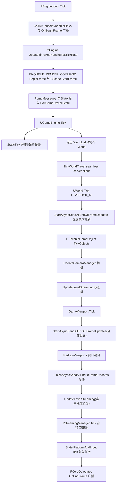

逐条依据:
- FEngineLoop::Tick:Source/Runtime/Launch/Private/LaunchEngineLoop.cpp;OnBeginFrame(:5682)、UpdateTimeAndHandleMaxTickRate(:5701)、ENQUEUE_RENDER_COMMAND(BeginFrame)(:5714-5723)、PumpMessages(:5784)、Slate 输入(:5837-5853)、`GEngine->Tick(FApp::GetDeltaTime(), bIdleMode)`(:5859)、Slate PlatformAndInput(:5921)、并发 Slate/网络任务(:5928-5969)、OnEndFrame(:6127)、TickRenderingTickables(:5612)。
- UGameEngine::Tick(Private/GameEngine.cpp:1768-2104):StaticTick(:1854,除非 GUseUnifiedTimeBudgetForStreaming)、每 World:TickWorldTravel(:1893)→`Context.World()->Tick( LEVELTICK_All, DeltaSeconds )`(:1901)→天空/反射捕获(:1909-1921)→ConditionalCommitMapChange(:1960);随后 FTickableGameObject::TickObjects(:1973)→ 全部世界 StartAsyncSendAllEndOfFrameUpdates(:1994)→ GameViewport->Tick(:2003)→ RedrawViewports(:2034)→ FinishAsyncSendAllEndOfFrameUpdates(:2041)→ 客户端 UpdateLevelStreaming(:2078)→ IStreamingManager::Get().Tick(:2088)→ 音频(:2096)→ ENQUEUE_RENDER_COMMAND(TickPoolElements)(:2099)。
- UWorld::Tick(Private/LevelTick.cpp:1502-1971):OnWorldTickStart 广播(:1522)→ BroadcastTickDispatch/BroadcastPostTickDispatch 收包(:1574-1575)→ 客户端 TickNetClient(:1577-1580)→ 时间累积与稀释(Info->GetEffectiveTimeDilation、FixupDeltaSeconds,:1584-1611)→ 高优先级异步加载(:1619-1629)→ NavigationSystem->Tick(:1647)→ 对每个 LevelCollection:FScopedLevelCollectionContextSwitch(:1734)→ `FTickTaskManagerInterface::Get().StartFrame(...)`(:1742)→ RunTickGroup(TG_PrePhysics)(:1750)→ EnsureCollisionTreeIsBuilt(:1753)→ TG_StartPhysics(:1759)→ TG_DuringPhysics(不阻塞,:1765)→ TG_EndPhysics(:1772)→ TG_PostPhysics(:1778);随后首个集合:LatentActionManager(:1797)、TimerManager(:1816)、FTickableGameObject::TickObjects(:1821)、StartAsyncSendAllEndOfFrameUpdates(:1826)、UpdateCameraManager(:1847)、InternalUpdateStreamingState(:1865);再 TG_PostUpdateWork(:1877)→ TG_LastDemotable(:1883)→ EndFrame(:1886);最后 FinishAsyncTrace(:1914)、BroadcastTickFlush 网络发送(:1928-1936)、FXSystem->Tick(:1951)、ConditionalCollectGarbage(:1970)。暂停时走 RunPauseFrame(:1784)。
- RunTickGroup(LevelTick.cpp:783-792):`check(TickGroup == Group)` → FTickTaskManagerInterface::Get().RunTickGroup → ProcessPendingGroupMoves → `TickGroup = TickGroup+1`。
- 渲染提交:UGameViewportClient::Draw 由 RedrawViewports 链路调用(GameViewportClient.h:186);SendAllEndOfFrameUpdatesInternal 中以 ParallelFor/UE::Tasks 执行组件更新并以 FRenderCommandList 提交(LevelTick.cpp:1238-1317)。

### 4.6.2 Actor 生命周期(SpawnActor → BeginPlay → EndPlay → Destroy)

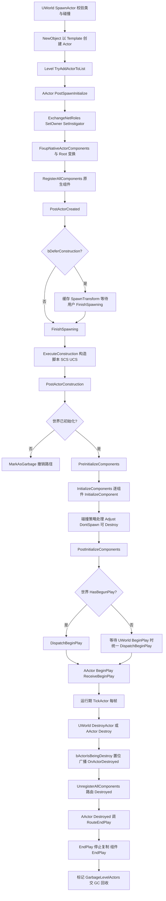

依据:SpawnActor 主流程 Private/LevelActor.cpp:456-800(校验 :469-531、命名 :569-599、NewObject :672、TryAddActorToList :739、PostSpawnInitialize :755、OnActorSpawned :774、AddNetworkActor :796);PostSpawnInitialize Actor.cpp:4276-4368(ExchangeNetRoles :4296、RegisterAllComponents :4336、PostActorCreated :4354、bDeferConstruction 分支 :4358-4367);FinishSpawning Actor.cpp:4374-4428(ExecuteConstruction :4415、PostActorConstruction :4420、World->OnActorFinishedSpawning :4425);PostActorConstruction Actor.cpp:4430-4543(PreInitializeComponents :4440、InitializeComponents :4449、碰撞处理 :4452-4497、PostInitializeComponents :4501、BeginPlay 判定 :4509-4529、延迟复制的动态 Actor bDeferBeginPlayAndUpdateOverlaps :4444);DispatchBeginPlay Actor.cpp:4738-4806(bActorIsPendingPostNetInit 直接返回 :4741-4747、StartReplicatingActor :4768、UpdateInitialOverlaps :4801);AActor::BeginPlay Actor.cpp:4808(SetLifeSpan/RegisterAllActorTickFunctions :4813-4814、组件循环 :4816-4833、ReceiveBeginPlay :4846);Destroy Actor.cpp:5343;DestroyActor LevelActor.cpp:839;Destroyed→RouteEndPlay(EndPlayReason::Destroyed)Actor.cpp:3311-3317;RouteEndPlay Actor.cpp:3221-3257;EndPlay Actor.cpp:3259-3286;UWorld::BeginPlay 对尚未 BeginPlay 的 Actor 在 World 开始时统一触发(World.cpp:6153,经 GameMode->StartPlay→GameState->HandleBeginPlay 链)。

### 4.6.3 组件注册与 RenderState 创建(线程边界)

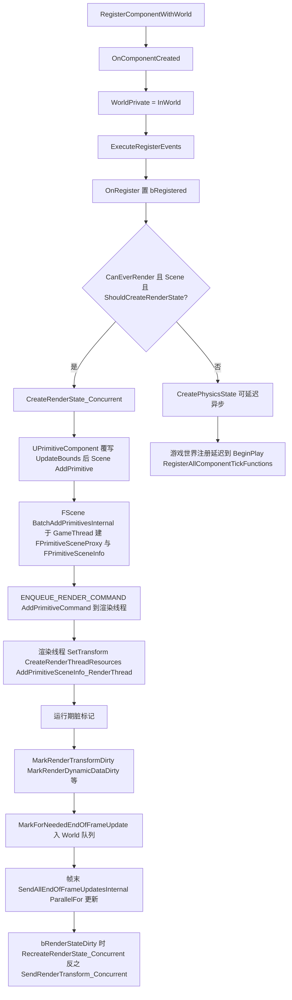

依据:RegisterComponentWithWorld(Private/Components/ActorComponent.cpp:1967-2077:OnComponentCreated :2028、WorldPrivate :2031、ExecuteRegisterEvents :2033、非游戏世界立即注册 tick :2036-2039、游戏世界延迟到 BeginPlay/Owner 处理 :2040-2052);ExecuteRegisterEvents(:2510-2531:OnRegister→CreateRenderState_Concurrent→CreatePhysicsState(bAllowDeferral=true));UPrimitiveComponent::CreateRenderState_Concurrent(Private/Components/PrimitiveComponent.cpp:620-653:`GetWorld()->Scene->AddPrimitive(this)` :648 或批量 Context->AddPrimitive :644);FScene::AddPrimitive(Source/Runtime/Renderer/Private/RendererScene.cpp:1341-1349)→BatchAddPrimitivesInternal(:1382-1520:CreateSceneProxy :1455、new FPrimitiveSceneInfo :1471、AttachmentCounter.Increment :1501、`ENQUEUE_RENDER_COMMAND(AddPrimitiveCommand)` :1507-1518,渲染线程执行 SetTransform/CreateRenderThreadResources/AddPrimitiveSceneInfo_RenderThread)。运行期脏标记:MarkRenderStateDirty(ActorComponent.cpp:2695)、MarkRenderTransformDirty(:2713)、MarkRenderDynamicDataDirty(:2732)、MarkRenderInstancesDirty(:2722)→MarkForNeededEndOfFrameUpdate(:2743);帧末统一 DoDeferredRenderUpdates_Concurrent(:2645-2692:bRenderStateDirty→RecreateRenderState_Concurrent :2568,否则 SendTransform/DynamicData/InstanceData)。重建按约定在 GameThread(注释"recreates are always done on the gamethread",:2790-2792;RequiresGameThreadEndOfFrameRecreate 默认 true :2805)。

### 4.6.4 LoadMap(Browse 硬切换)

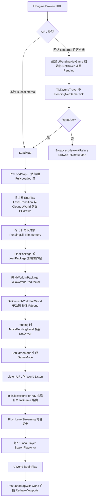

依据:UEngine::Browse(Private/UnrealEngine.cpp:15654-15842:URL 校验 :15694、failed/closed 回默认图 :15701-15768、本地 map→LoadMap :15789-15793、网络 URL→PendingNetGame :15794-15828);UEngine::LoadMap(:16078-16712:PreLoadMap 广播 :16108-16109、旧世界卸载 :16179-16303 含 EndPlay(EEndPlayReason::LevelTransition) :16259、CleanupWorld :16262、SetCurrentWorld(nullptr) :16302、加载包 :16403-16445、SetGameInstance/SetCurrentWorld/InitWorld :16504-16531、MovePendingLevel :16539-16543、SetGameMode :16549、Listen :16564-16570、FlushLevelStreaming :16599、InitializeActorsForPlay :16620、SpawnPlayActor :16641-16652、BeginPlay :16661、PostLoadMapWithWorld :16665);InitializeActorsForPlay(Private/World.cpp:5946-6035+:UpdateWorldComponents :5988、InitializeNetworkActors :6016、bActorsInitialized :6021、SpawnServerActors :6026-6029、InitGame 路由 :6032-6035)。

### 4.6.5 LevelStreaming 状态机

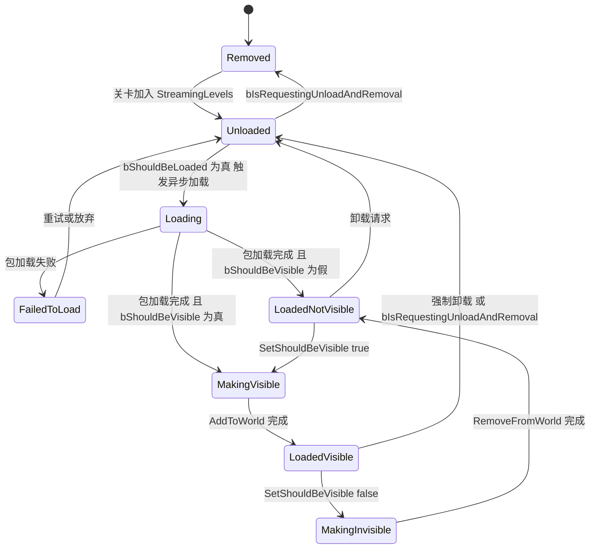

依据:ELevelStreamingState/取值(Classes/Engine/LevelStreaming.h:110-120);状态推进由 `UpdateStreamingState(bool& bOutUpdateAgain, bool& bOutRedetermineTarget, const TOptional<const UE::FTimeout>& InExternalTimeout)`(LevelStreaming.h:407)在 `UWorld::UpdateLevelStreaming`(Private/World.cpp:5024)内驱动;目标态由 `DetermineTargetState()`(LevelStreaming.h:401)按 bShouldBeLoaded/bShouldBeVisible/bIsRequestingUnloadAndRemoval 计算(ELevelStreamingTargetState,LevelStreaming.h:123-129);状态切换经 `SetCurrentState(ELevelStreamingState NewState)`(LevelStreaming.h:375)。显/隐事务:客户端可等待服务器确认(`ShouldWaitForServerAckBeforeChangingVisibilityState`,LevelStreaming.h:396)。世界侧 MakingVisibleLevels/MakingInvisibleLevels 队列由 World 维护(World.h:1191-1197),每帧 AddToWorld/RemoveFromWorld 限额由 GAdaptiveAddToWorld 控制(World.cpp:5047-5052)。体积流送入口 `UWorld::ProcessLevelStreamingVolumes`(World.h:3500),由 `InternalUpdateStreamingState`(World.cpp:4862-4897)在 UWorld::Tick(:1865)与 UpdateLevelStreaming 中调用,并叠加 WorldComposition 与实现了 UStreamingWorldSubsystemInterface 的 WorldSubsystem 的需求(:4887-4896)。

## 4.7 时序图

### 4.7.1 帧内 Tick 并行调度

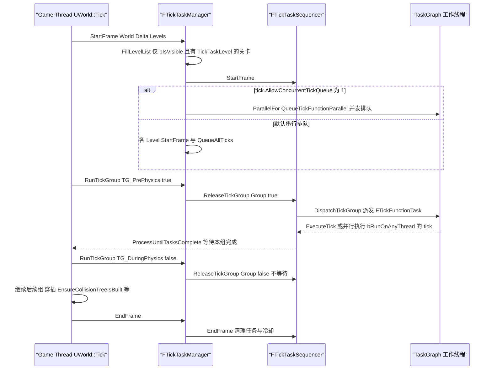

依据:StartFrame(Private/TickTaskManager.cpp:2005-2089:Context.Thread=ENamedThreads::GameThread :2026、bConcurrentQueue 判定 :2036-2040、串行路径 StartFrame/QueueAllTicks/FinishBatchedTicks :2042-2057、并发路径 StartFrameParallel+ParallelFor :2062-2082);RunTickGroup(:2120-2172:ReleaseTickGroup :2133、TG_NewlySpawned 补跑循环 :2139-2157);ReleaseTickGroup(:938-1059:单线程或 tick.AllowAsyncTickDispatch=0 时 GameThread 直接 DispatchTickGroup :948-951,否则用 TGraphTask FDipatchTickGroupTask 在其它线程派发 :953-957;阻塞等待 WaitUntilTasksComplete/ProcessUntilTasksComplete :1040-1046;tick.AllowAsyncTickCleanup 控制异步清理 :1048-1056);FTickFunctionTask::DoTask(:281-346:调用 Target->ExecuteTick 并 ClearTaskInformation)。

### 4.7.2 组件注册到渲染线程(跨线程数据所有权移交)

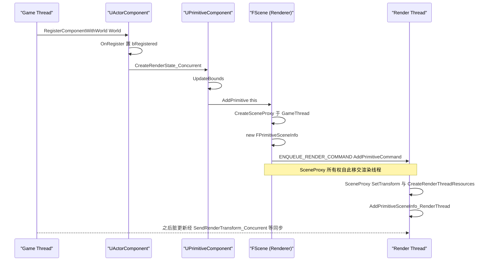

依据:ActorComponent.cpp:2510-2531(ExecuteRegisterEvents)、PrimitiveComponent.cpp:620-653、RendererScene.cpp:1382-1520(注释:"Must enqueue RT commands to ensure SetTransform & CreateRenderThreadResources are executed in-order",:1506;AttachmentCounter.Increment :1501)。

### 4.7.3 PlayerController 创建:Standalone/ListenServer vs DedicatedServer vs Client

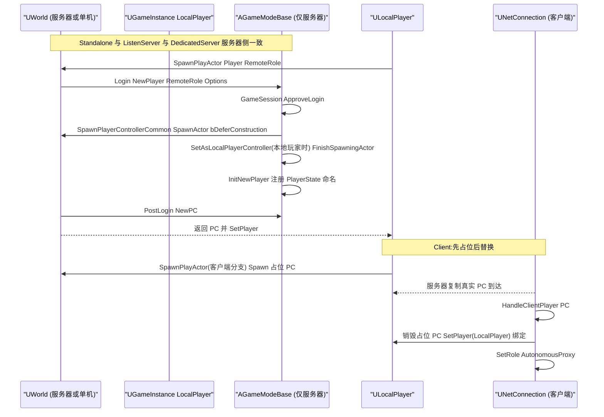

依据:服务器侧 UWorld::SpawnPlayActor(Private/LevelActor.cpp:1072-1117:GetAuthGameMode→Login :1084-1087、SetReplicates/SetAutonomousProxy/SetPlayer :1102-1110、PostLogin :1111);AGameModeBase::Login(GameModeBase.cpp:707-739:ApproveLogin :715、SpawnPlayerController :721、InitNewPlayer :731);SpawnPlayerControllerCommon(:751-770:`SpawnInfo.bDeferConstruction = true` :756、`RemoteRole==ROLE_SimulatedProxy 时 SetAsLocalPlayerController` :760-763、UGameplayStatics::FinishSpawningActor :766);Standalone/ListenServer 本地玩家入口 `ULocalPlayer::SpawnPlayActor` 服务器分支(Private/LocalPlayer.cpp:291-316:`InWorld->SpawnPlayActor(this, ROLE_SimulatedProxy, ...)`)——即本地玩家在服务器上以 SimulatedProxy 角色登录,再由 SpawnPlayerControllerCommon 标记为本地 PC;远程客户端 Login 时 RemoteRole=ROLE_AutonomousProxy(由 UNetConnection 登录路径决定,SpawnPlayActor :1106-1109 相应 SetAutonomousProxy)。客户端分支(LocalPlayer.cpp:317-335:生成占位 PC,注释指明由 `APlayerController::OnActorChannelOpen + UNetConnection::HandleClientPlayer` 替换);HandleClientPlayer(Private/NetConnection.cpp:5213-5273:销毁旧占位 PC :5233-5239、`PC->SetRole(ROLE_AutonomousProxy)` :5256、`PC->SetPlayer(LocalPlayer)` :5258)。

### 4.7.4 Travel:ServerTravel / ClientTravel / Browse

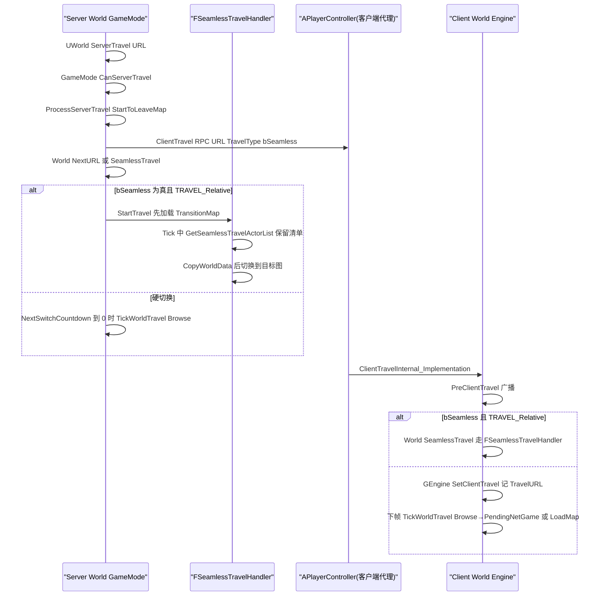

依据:UWorld::ServerTravel(Private/World.cpp:9525-9558:CanServerTravel :9529、NextTravelType :9535、ProcessServerTravel :9548);AGameModeBase::ProcessServerTravel(GameModeBase.cpp:477-537:bUseSeamlessTravel 且 TimeSeconds<172800 :488、URL 参数 SeamlessTravel/NoSeamlessTravel 覆盖 :494-501、PIE 默认禁用 seamless :503-511、ProcessClientTravel 通知 :515、SeamlessTravel :520-524、非网络立即切换 NextSwitchCountdown=0 :528-531);APlayerController::ClientTravel(PlayerController.cpp:5721-5731)与 ClientTravelInternal_Implementation(:5735-5755:PreClientTravel :5740、SeamlessTravel :5744、SetClientTravel :5753);服务器侧 countdown 消费(UEngine::TickWorldTravel,UnrealEngine.cpp:15943-15977:StartToLeaveMap :15949-15951、Browse :15955);客户端 travel 消费(:15981-16004)与 PendingNetGame 推进(:16012-16068:LoadMap→LoadMapCompleted→TravelCompleted);FSeamlessTravelHandler::StartTravel(World.cpp:8274-8388:TransitionMap 加载 :8330-8382、已在过渡图则直达 :8334-8348)与 Tick(:8614-8759+:GetSeamlessTravelActorList :8689、KeepAnnotation :8684、CopyWorldData :8526)。

## 4.8 线程模型与同步

| 数据/机制 | 归属线程 | 同步手段 | 依据 |
|---|---|---|---|
| FTickFunction 注册/启停/前置修改 | 仅 GameThread | 头文件注释"not threadsafe and must be called from the game thread"(EngineBaseTypes.h:339-340、362-363、373-374);tick 管理器持有裸指针,帧内不可销毁注册的 tick 函数(EngineBaseTypes.h:179-181) | EngineBaseTypes.h |
| tick 执行 | GameThread + TaskGraph 工作线程(bRunOnAnyThread=1 且 tick.AllowAsyncComponentTicks=1) | 完成 TickCompletionEvents[组] 数组,游戏线程 ProcessUntilTasksComplete/WaitUntilTasksComplete(TickTaskManager.cpp:970-1046);FInternalData.TickVisitedGFrameCounter/TickQueuedGFrameCounter 为 std::atomic<uint32>(EngineBaseTypes.h:298-301) | TickTaskManager.cpp:938-1059 |
| tick 组派发/清理 | GameThread 或任务线程 | tick.AllowAsyncTickDispatch(默认 0)/tick.AllowAsyncTickCleanup(默认 0),用 TGraphTask FDipatchTickGroupTask、FResetTickGroupTask 派发/清理(TickTaskManager.cpp:80-90、948-957、1048-1056) | TickTaskManager.cpp |
| 帧末组件渲染更新 | GameThread 启动,UE::Tasks::Launch(ETaskPriority::High)+ParallelFor(EParallelForFlags::Unbalanced) 执行(模式 2),或 GameThread+ParallelFor(模式 1) | EndOfFrameUpdateContexts/EndOfFrameUpdateTasks;FinishAsyncSendAllEndOfFrameUpdates 中 UE::Tasks::Wait(LevelTick.cpp:1279-1285、1332-1366);模式由 CVar AllowAsyncRenderThreadUpdates(0/1/2,默认 1)与编辑器变体决定(LevelTick.cpp:794-843) | LevelTick.cpp:794-1405 |
| 渲染代理 | GameThread 创建,RenderThread 消费 | ENQUEUE_RENDER_COMMAND(AddPrimitiveCommand)(RendererScene.cpp:1507);FPrimitiveSceneProxy 生命周期即跨线程所有权边界;AttachmentCounter 计数保证顺序 | RendererScene.cpp:1382-1520 |
| ULevelStreaming.CurrentState | GameThread 为主,异步加载完成回调线程读 | `mutable FTransactionallySafeRWLock CurrentStateLock`(LevelStreaming.h:282-286) | LevelStreaming.h |
| UWorld.MakingVisibleLevels/MakingInvisibleLevels | 流送多线程访问 | `mutable FTransactionallySafeRWLock PendingVisibilityLock`(World.h:1188-1189) | World.h:1189 |
| 组件帧末队列 | GameThread 标记;MarkedForEndOfFrameUpdateState 2bit + 数组索引支持并发/快速移除 | EComponentMarkedForEndOfFrameUpdateState{Unmarked,Marked,MarkedForGameThread}(LevelTick.cpp:845-853) | LevelTick.cpp:845-885 |
| SendAllEndOfFrameUpdatesInternal 的 PreEndOfFrameSync | 混合 | TSet 拷贝排空循环,防 OnPreEndOfFrameSync 中任务泵入的新标记(LevelTick.cpp:1158-1197 注释) | LevelTick.cpp |
| RenderCommand 记录 | 帧末更新用 FRenderCommandList::FRecordScope(CloseOnSubmit/Submit/Close)包裹,任务内录制、统一 Submit | LevelTick.cpp:1245-1287 | LevelTick.cpp |
| RHI 帧 | GameThread 入队 ENQUEUE_RENDER_COMMAND(BeginFrame) | LaunchEngineLoop.cpp:5708-5731 | LaunchEngineLoop.cpp |

线程判定补充:UWorld::Tick 全程在 GameThread(其内部 UWorld::bInTick 状态位与 RunTickGroup 的 check);FActorTickFunction::ExecuteTick / FActorComponentTickFunction::ExecuteTick 的 CurrentThread 参数即实际执行线程(EngineBaseTypes.h:524 注释),bRunOnAnyThread=false 时恒为 GameThread。

## 4.9 配置与扩展点

### 4.9.1 CVar(均在 Private/TickTaskManager.cpp 与 LevelTick.cpp)

| CVar | 默认 | 作用 | 位置 |
|---|---|---|---|
| tick.AllowAsyncComponentTicks | 1 | bRunOnAnyThread 的 tick 是否真的并行 | TickTaskManager.cpp:54-57 |
| tick.AllowBatchedTicks / tick.AllowBatchedTicksUnordered | 0/0 | bAllowTickBatching 合并为单任务/乱序 | TickTaskManager.cpp:59-67 |
| tick.AllowOptimizedPrerequisites | 1 | 忽略组顺序已保证的前置 | TickTaskManager.cpp:69-73 |
| tick.AllowConcurrentTickQueue | 0(5.5 起默认关) | 多线程并发排队 | TickTaskManager.cpp:75-78 |
| tick.AllowAsyncTickDispatch / tick.AllowAsyncTickCleanup | 0/0 | 任务线程派发/清理 | TickTaskManager.cpp:80-88 |
| tick.LogTicks / tick.ShowPrerequistes | 0/1 | tick 日志 | TickTaskManager.cpp:44-52 |
| CriticalPathStall.TickStartFrame | 0.0 | 关键路径分析注 sleep(ms) | TickTaskManager.cpp:39-42 |
| AllowAsyncRenderThreadUpdates | 1(0=GT,1=GT+ParallelFor,2=异步任务) | 帧末更新执行模式 | LevelTick.cpp:794-800 |
| AllowAsyncRenderThreadUpdatesEditorGameWorld / AllowAsyncRenderThreadUpdatesEditor | 0/0 | 编辑器世界变体 | LevelTick.cpp:802-810 |

### 4.9.2 ini / 配置对象

- `[/Script/Engine.Engine]`:UEngine 为 `config=Engine, defaultconfig`(Engine.h:725);GameViewportClient 类、GameEngine 类等由 UEngine 配置属性决定(UGameEngine::Init 用 `GameViewportClientClass` 创建视口,GameEngine.cpp:1290)。
- `UGameMapsSettings`(Source/Runtime/EngineSettings/Classes/GameMapsSettings.h):`GameDefaultMap`(:209,失败兜底图)、`TransitionMap`(:172,无缝切换过渡图,World.cpp:8330)、`GameInstanceClass`(:203,GameEngine.cpp:1256)、`GlobalDefaultGameMode`(:217)、`LocalMapOptions`(:168)。
- `UGameModeBase` 为 `config=Game`(GameModeBase.h:46):DefaultPawnClass/PlayerControllerClass/GameStateClass/PlayerStateClass/SpectatorClass/HUDClass 等在 Game.ini 按 GameMode 子节配置。
- `UGameEngine.MaxDeltaTime/ServerFlushLogInterval`(GameEngine.h:30-35,config=Engine)。

### 4.9.3 委托/事件(节选)

- `FWorldDelegates::OnWorldTickStart`(UWorld::Tick:1522)、`OnWorldPreActorTick/OnWorldPostActorTick`(:1675、1906)、`OnWorldBeginTearDown`(World.cpp:6150)、`OnPreWorldInitialization`(World.cpp:2449)。
- `FCoreUObjectDelegates::PreLoadMap(WithContext)/PostLoadMapWithWorld`(LoadMap:16108-16109、16665)。
- `UEngine::OnTravelFailure/OnNetworkFailure`(Engine.h:2381、2390,BroadcastNetworkFailure :2392)。
- `UWorld::OnActorSpawned/OnActorPreSpawnInitialization`(LevelActor.cpp:753、774)。
- `UGameInstance::OnPawnControllerChanged`(GameInstance.h:190-191,BlueprintAssignable)。
- `UWorld::OnWorldBeginPlay`(FOnBeginPlay,World.h:1330-1332;Broadcast 于 World.cpp:6181)。
- `FGameModeEvents::GameModeInitializedEvent`(GameModeBase.cpp:95)。

### 4.9.4 扩展点

- Subsystem:继承 `UEngineSubsystem/UGameInstanceSubsystem/UWorldSubsystem(或 UTickableWorldSubsystem)/ULocalPlayerSubsystem`(Subsystem.h:11-29 列出五级);WorldSubsystem 可覆写 `DoesSupportWorldType`(WorldSubsystem.h:66);实现 `UStreamingWorldSubsystemInterface` 可参与流送决策(World.cpp:4893-4896)。
- GameInstance:覆写 `UGameInstance::Init/Shutdown/StartGameInstance/CreateGameModeForURL` 等(GameInstance.h:217-301 区域)。
- GameMode:覆写 Login/PostLogin/RestartPlayer/GetSeamlessTravelActorList 等(见 4.5.5)。
- TypedElement:`RegisterEngineElements` 之后经 `OnRegisterEngineElementsDelegate`(EngineElements.cpp:36、97)追加自定义 Element 类型/接口;数据侧 `FActorElementData/FComponentElementData/FSMInstanceElementData`。
- WorldContext 之外的挂接:`UEngine::OnOverrideBrowseURL/OnOverridePendingNetGameUpdate`(Engine.h:708-709 委托类型,Browse :15784、TickWorldTravel :16007 ExecuteIfBound)。

## 4.10 已知限制/未确认项

- WorldPartition / External Actors / OFPA 与 HLOD 仅在框架边界处提及(`ULevel::GetWorldPartitionRuntimeCell`、`bUseExternalActors`、SpawnActor 的 ExternalPackage 分支 LevelActor.cpp:548-567),完整机制属 World Partition 专章,本文未展开。
- 网络复制细节(Iris FReplicationSystemUtil、ActorChannel、属性复制)只在生命周期交汇点引用(如 StartReplicatingActor、HandleClientPlayer),未展开;属网络专章。
- `FTickTaskSequencer` 内部结构(手动派发 ManualDispatchTicks、批量 tick FBatchTickFunctionTask、FDipatchTickGroupTask——源码即此拼写)只读了主路径(ReleaseTickGroup/DispatchTickGroup),空闲工作/死锁检测分支(GIdleTaskWorkMS)未逐行验证语义。
- `FScene::BatchAddPrimitivesInternal` 只读到命令入队(:1504-1519),渲染线程侧 AddPrimitiveSceneInfo_RenderThread 的内部未展开(属 Renderer 章)。
- UCharacterMovementComponent 的网络移动预测(FSavedMove_Character/FSimulatedMove 等)仅类声明层面覆盖(CharacterMovementComponent.h:29-118、TickComponent :1312),其预测/回滚流程未读实现,属移动专章。
- 未确认项:ULocalPlayer 服务器分支 `ROLE_SimulatedProxy` 语义源自 LocalPlayer.cpp:315 与 SpawnPlayerControllerCommon 的 `InRemoteRole == ROLE_SimulatedProxy` 判定(GameModeBase.cpp:760),但 ROLE 数值在 CoreUObject NetEnums,本文未引用具体枚举值;`UGameViewportClient::Draw` 内部 Canvas 流水线未读(GameViewportClient.cpp 实现体),只引用头文件声明。
- 附录符号清单为工具生成,本文行号引用以源码 grep 为准;若与附录不一致,以源码为准。

## 4.11 附录索引

本章覆盖模块与对应附录(相对 `docs/ue5.8.3/appendix/api/`):

| 模块 | 附录文件 |
|---|---|
| Runtime/Engine(本文主体:Engine/GameFramework/Components/Subsystems/Elements/Tick) | Runtime/Engine.part01.md ~ Runtime/Engine.part06.md(6 个分片,共约 15.5 万行) |
| Runtime/EngineSettings(GameMapsSettings) | Runtime/EngineSettings.md |
| Runtime/Launch(FEngineLoop) | Runtime/Launch.md |
| Runtime/Renderer(FScene 注册边界) | Runtime/Renderer.md |
| Runtime/TypedElementFramework / TypedElementRuntime | Runtime/TypedElementFramework.md、Runtime/TypedElementRuntime.md |

模块总表:`appendix/modules.json`。

