# 05 世界分区、关卡实例、流式与大世界

> 源码根 `$UE = /home/timeshift/opensource/game_engine/unreal/UnrealEngine-5.8.3-release`,`$E = $UE/Engine`。
> 本文所有路径均相对 `$E`。所有结论均来自对 5.8.3 源码的亲自阅读,引用格式为 `路径:行号`。

## 5.1 职责、边界与模块清单

本章覆盖 Runtime 侧的大世界体系:世界分区(World Partition)、关卡实例(Level Instance / Packed Level Actor)、运行时流式哈希与单元、DataLayer、HLOD 运行时、分区 Actor(APartitionActor 家族)、ISM 实例化与实例放置、地形/植被的流式化,以及纹理与网格的渲染资产流式。编辑器侧 UI(WorldPartitionEditor)、HLOD 构建器实现(HierarchicalLODUtilities,Editor 模块)与地图转换 Commandlet 只在流程上提及,不做类级展开。

| 模块 | 路径(相对 `$E`) | Build.cs 依赖(Public/Private) | 职责一句话 |
|---|---|---|---|
| Engine/WorldPartition | Source/Runtime/Engine/Public/WorldPartition/(74 头 + 子目录)、Private/WorldPartition/ | Public: Core、CoreUObject、RenderCore、RHI、NetCore、AssetRegistry 等;Private: Analytics、Landscape、Foliage、DerivedDataCache 等(见 appendix/api/Runtime/Engine.part01.md 模块头) | 世界分区本体:ActorDesc 容器、RuntimeHash、流式单元、流式策略、流式生成与烹饪 |
| Engine/LevelInstance | Source/Runtime/Engine/Public/LevelInstance/、Public/WorldPartition/LevelInstance/ | 同 Engine | 关卡实例 Actor/子系统/LevelStreaming,把子关卡按 Partitioned 或独立 LevelStreaming 方式装载 |
| Engine/PackedLevelActor | Source/Runtime/Engine/Public/PackedLevelActor/、Public/WorldPartition/PackedLevelActor/ | 同 Engine | 把关卡实例内容打包成 ISM 组件化的 APackedLevelActor(烘焙期) |
| Engine/DataLayer | Source/Runtime/Engine/Public/WorldPartition/DataLayer/ | 同 Engine | UDataLayerAsset/UDataLayerInstance/UExternalDataLayerAsset 与 UDataLayerManager,运行时分层可见/加载状态机与复制 |
| Engine/HLOD | Source/Runtime/Engine/Public/WorldPartition/HLOD/ | 同 Engine | UHLODLayer 定义、AWorldPartitionHLOD 与运行时 HLOD 可见性/预热子系统 |
| Engine/ActorPartition+ISMPartition+Instances | Source/Runtime/Engine/Public/ActorPartition/、Public/ISMPartition/、Public/Instances/ | 同 Engine | 网格化分区 Actor(APartitionActor/AISMPartitionActor/AInstancedPlacementPartitionActor)与 ISM 实例批处理 |
| Engine/InstancedStaticMesh | Source/Runtime/Engine/Classes/Components/InstancedStaticMeshComponent.h 等 | 同 Engine | UInstancedStaticMeshComponent 家族,实例化静态网格渲染/物理载体 |
| Engine/Streaming(渲染资产) | Source/Runtime/Engine/Public/Streaming/、Private/Streaming/、Classes/Engine/StreamableRenderAsset.h | 同 Engine | FRenderAssetStreamingManager:纹理/静态网格 mip 流式的预算、优先级与异步计算 |
| ISMPool | Source/Runtime/Experimental/ISMPool/ | Public: Core、CoreUObject、Engine(编辑器加 UnrealEd) | UISMPoolComponent/UISMPoolSubSystem,跨 Actor 池化共享 ISM 组件 |
| Landscape | Source/Runtime/Landscape/ | Private: Core、CoreUObject、ApplicationCore、Engine、RenderCore、RHI、Renderer、Foliage、GeometryCore 等(Landscape.Build.cs:18-33) | ALandscape/ALandscapeStreamingProxy/ULandscapeComponent/ULandscapeSubsystem:地形流式代理、LOD 与草地 |
| Foliage | Source/Runtime/Foliage/ | Private: Core、CoreUObject、Engine、RenderCore、RHI(Foliage.Build.cs:9-17) | UFoliageType 家族与 AInstancedFoliageActor,植被实例数据与 ISM 组件 |
| FastGeoStreaming(插件,Experimental) | Plugins/Experimental/FastGeoStreaming/Source/FastGeoStreaming/ | Private: Core、CoreUObject、Engine、NavigationSystem、Chaos、PhysicsCore、RenderCore、RHI、TraceLog;另含 PrivateIncludePaths 指向 Source/Runtime/Engine/Internal | UFastGeoWorldPartitionRuntimeCellTransformer:烹饪期把 Cell 内容变换为 FastGeo 实例 |
| LevelStreamingPersistence(插件) | Plugins/Runtime/LevelStreamingPersistence/Source/LevelStreamingPersistence/ | Public: Core、CoreUObject、Engine;Private: PropertyPath、DeveloperSettings | ULevelStreamingPersistenceManager:关卡流出入间持久化属性值与重生 |
| InstancedActors(插件) | Plugins/Runtime/InstancedActors/Source/InstancedActors/ | Public: Core、CoreUObject、Engine、GameplayTags 等;编辑器加 UnrealEd | UInstancedActorsSubsystem/AInstancedActorsManager:把同型 Actor 合并为实例批次并支持 Mass 式扩展 |

## 5.2 总体架构

大世界体系分四层:帧驱动层(GameThread 的 World Tick / Engine Tick)、世界分区决策层(RuntimeHash + StreamingPolicy)、执行层(LevelStreaming 动态关卡 + ActorDesc 装载)、以及与之并行的渲染资产流式层。世界分区不直接加载 Actor,而是把"哪些 Cell 需要加载/激活"的决策结果交给 `UWorldPartitionLevelStreamingPolicy`,后者通过 `UWorldPartitionLevelStreamingDynamic`(每个 Cell 一个)驱动 `ULevelStreaming` 状态机完成异步加载/可见性切换。

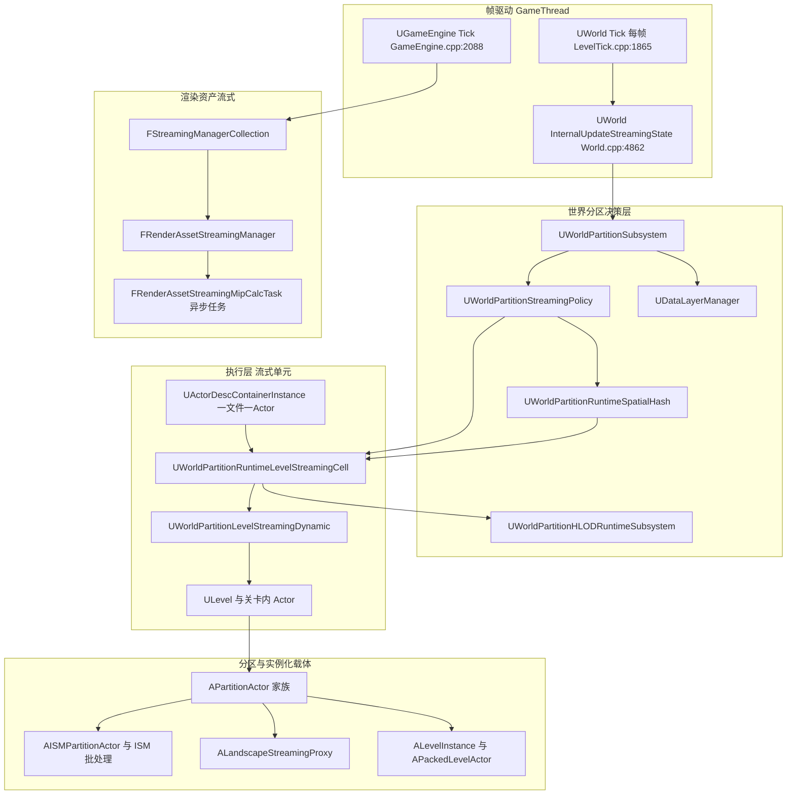

要点:
- 决策与执行分离:`UWorldPartitionRuntimeHash` 只回答"给定流式源,哪些 Cell 被命中、目标状态是什么"(`ForEachStreamingCellsSources`),状态的迁移由 `UWorldPartitionStreamingPolicy` 统一执行。
- DataLayer 不是独立加载器,而是叠加在 Cell 之上的状态过滤:Cell 的 DataLayer 有效运行时状态(`GetCellEffectiveWantedState`)决定它进入 Activate 集合、Load 集合还是被忽略(Private/WorldPartition/WorldPartitionRuntimeSpatialHash.cpp:443-463)。
- Actor 级"一文件一 Actor"(One File Per Actor)由 `UActorDescContainer`/`UActorDescContainerInstance` 以 AssetRegistry 元数据描述,只在编辑器/PIE 路径实时构建;烹饪后的游戏运行时直接消费生成的 Cell 关卡包。

## 5.3 类图

### 5.3.1 世界分区核心

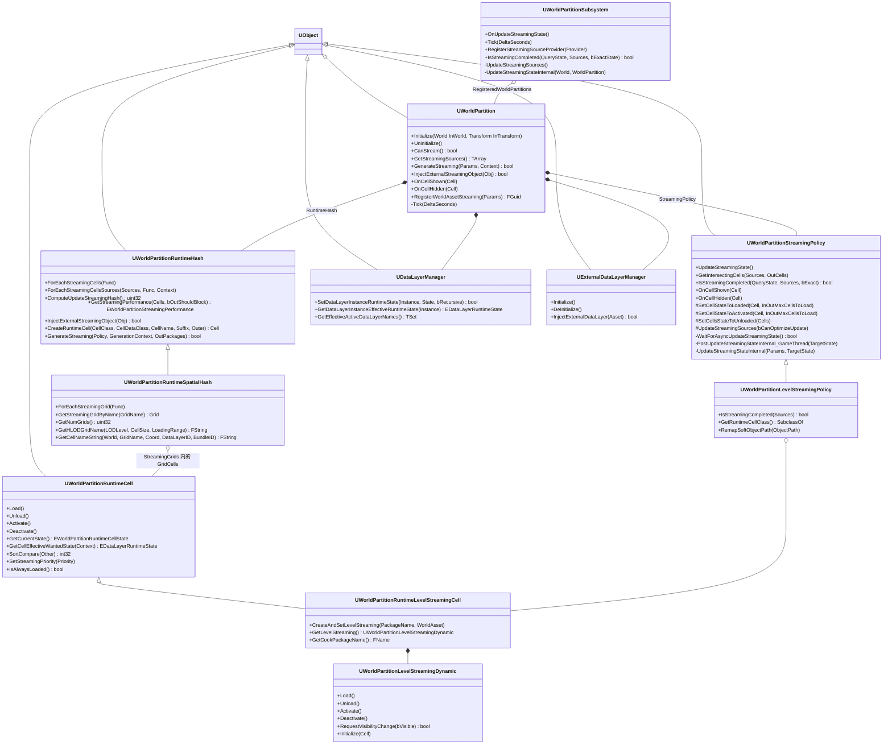

- `UWorldPartition`(Source/Runtime/Engine/Public/WorldPartition/WorldPartition.h:152):世界分区对象,挂在 World 外层,聚合 RuntimeHash、StreamingPolicy、DataLayerManager、ExternalDataLayerManager。
- `UWorldPartitionSubsystem`(Public/WorldPartition/WorldPartitionSubsystem.h:63):每 World 的 `UTickableWorldSubsystem`,同时实现 `IStreamingWorldSubsystemInterface`(Public/Streaming/StreamingWorldSubsystemInterface.h:19)接受帧驱动。
- `UWorldPartitionStreamingPolicy`(Public/WorldPartition/WorldPartitionStreamingPolicy.h:98):决策执行基类;`UWorldPartitionLevelStreamingPolicy`(Public/WorldPartition/WorldPartitionLevelStreamingPolicy.h:23)以动态流式关卡实现。
- `UWorldPartitionRuntimeHash`(Public/WorldPartition/WorldPartitionRuntimeHash.h:209)/`UWorldPartitionRuntimeSpatialHash`(Public/WorldPartition/WorldPartitionRuntimeSpatialHash.h:306):运行时空间哈希与网格。
- `UWorldPartitionRuntimeCell`(Public/WorldPartition/WorldPartitionRuntimeCell.h:236)与 `UWorldPartitionRuntimeLevelStreamingCell`(Public/WorldPartition/WorldPartitionRuntimeLevelStreamingCell.h:16):流式单元抽象与"每 Cell 一个关卡"实现。
- `UWorldPartitionLevelStreamingDynamic`(Public/WorldPartition/WorldPartitionLevelStreamingDynamic.h:25):每 Cell 的 `ULevelStreamingDynamic`。

### 5.3.2 ActorDesc 与编辑器数据通路

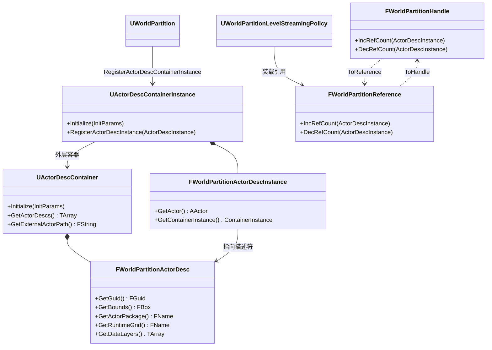

- `UActorDescContainer`(Public/WorldPartition/ActorDescContainer.h:39):以 AssetRegistry 同步扫描外部 Actor 包路径建立描述符表(Private/WorldPartition/ActorDescContainer.cpp:75-77 `ScanSynchronous`)。
- `FWorldPartitionHandle`/`FWorldPartitionReference`(Public/WorldPartition/WorldPartitionHandle.h:435-442):软/硬引用计数句柄,硬引用归零即卸载 Actor(WorldPartitionHandle.h:423-433 注释)。

### 5.3.3 DataLayer 体系

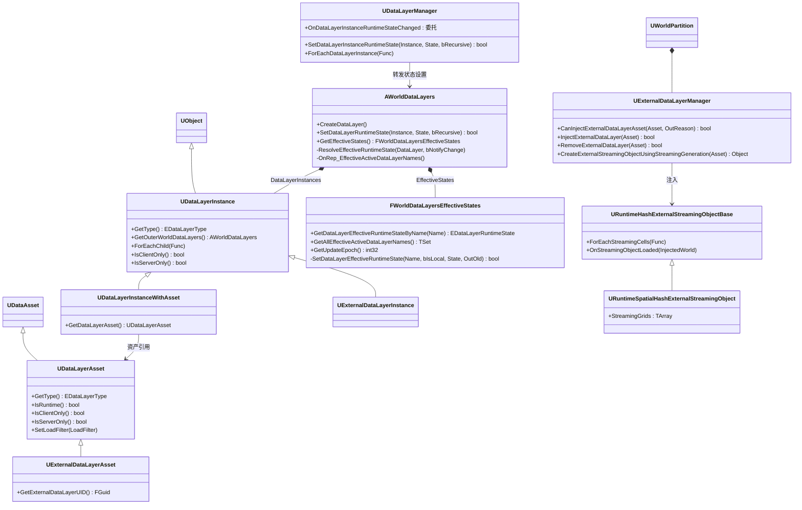

- `UDataLayerAsset`(Public/WorldPartition/DataLayer/DataLayerAsset.h:29)是资产化的 DataLayer 定义,`LoadFilter`(EDataLayerLoadFilter,None/ClientOnly/ServerOnly,DataLayerAsset.h:18-23)决定状态权威方;`UExternalDataLayerAsset`(ExternalDataLayerAsset.h:15)为外部 DataLayer 资产,带 UID。
- `AWorldDataLayers`(Public/WorldPartition/DataLayer/WorldDataLayers.h:81):每个分区世界一个,持有全部 `UDataLayerInstance`,负责运行时状态的权威写入与复制。
- `FWorldDataLayersEffectiveStates`(WorldDataLayers.h:47):合并复制集与本地集(ClientOnly/ServerOnly 层)后的有效状态表,`UpdateEpoch` 供流式更新做变化检测。
- `URuntimeHashExternalStreamingObjectBase`(Public/WorldPartition/WorldPartitionRuntimeHash.h:61):外部 DataLayer 的流式内容载体,可运行时注入/移除(`UWorldPartition::InjectExternalStreamingObject`,WorldPartition.h:488)。

### 5.3.4 分区 Actor 与实例化载体

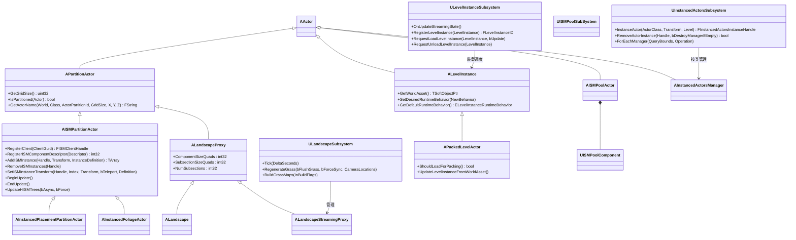

- `APartitionActor`(Public/ActorPartition/PartitionActor.h:16):按网格分区的容器 Actor 基类,配套 `UActorPartitionSubsystem`(Public/ActorPartition/ActorPartitionSubsystem.h:87)负责编辑期按格子创建/取名。
- `AISMPartitionActor`(Public/ISMPartition/ISMPartitionActor.h:20):多客户端共享一个格子上的 ISM 组件,`FISMClientHandle` 区分使用者(植被、实例放置、客户端实例 Actor 各为一个 client)。
- `ALandscapeProxy`(Source/Runtime/Landscape/Classes/LandscapeProxy.h:450)继承 `APartitionActor`:地形本身就是一个分区 Actor;启用世界分区后由 `ALandscape`(Landscape.h:276)拆为每 Cell 一个 `ALandscapeStreamingProxy`(LandscapeStreamingProxy.h:20)。
- `ALevelInstance`(Public/LevelInstance/LevelInstanceActor.h:18):默认运行时行为 `ELevelInstanceRuntimeBehavior::Partitioned`(LevelInstanceActor.h:74-75),即内容被并入父世界分区网格;`APackedLevelActor`(Public/PackedLevelActor/PackedLevelActor.h:25)则是把内容烘焙为 ISM 的特化。
- ISM 池化(`AISMPoolActor`/`UISMPoolComponent`,Source/Runtime/Experimental/ISMPool/Public/ISMPool/)与 `AInstancedActorsManager`(Plugins/Runtime/InstancedActors)是两条"减少组件数"的补充路线。

### 5.3.5 HLOD 运行时与渲染资产流式

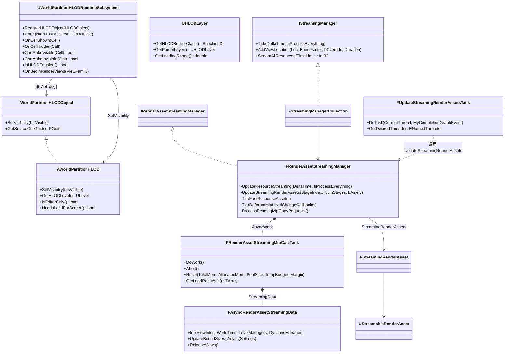

- HLOD 层定义 `UHLODLayer`(Public/WorldPartition/HLOD/HLODLayer.h:53)是编辑期配置(构建在 HierarchicalLODUtilities 编辑器模块);运行时只有可见性切换与预热,由 `UWorldPartitionHLODRuntimeSubsystem`(Public/WorldPartition/HLOD/HLODRuntimeSubsystem.h:34)完成。
- 渲染资产流式:`IStreamingManager::Tick`(Public/ContentStreaming.h)每帧由 `UGameEngine::Tick` 驱动(Private/GameEngine.cpp:2088),落到 `FRenderAssetStreamingManager`(Private/Streaming/StreamingManagerTexture.h:31)。

## 5.4 数据字典

### 5.4.1 流式源与网格

| 字段/类型 | 类型 | 含义 | 取值/约束 | 源码位置 |
|---|---|---|---|---|
| `FWorldPartitionStreamingSource::Name` | FName | 流式源唯一名 | 用于速度跟踪与调试着色 | Source/Runtime/Engine/Public/WorldPartition/WorldPartitionStreamingSource.h:401 |
| `FWorldPartitionStreamingSource::Location/Rotation` | FVector / FRotator | 源位姿,参与 Cell 优先级(朝向因子) | — | 同上:404-407 |
| `FWorldPartitionStreamingSource::TargetState` | EStreamingSourceTargetState | 源要求的目标状态 | Loaded / Activated(同文件:218-222) | 同上:410 |
| `FWorldPartitionStreamingSource::Priority` | EStreamingSourcePriority | 源优先级 | Highest=0、High=64、Normal=128、Low=192、Lowest=255(同文件:327-336) | 同上:416 |
| `FWorldPartitionStreamingSource::Velocity` | FVector | 源速度,由 `FStreamingSourceVelocity` 按位置历史平均得出 | 影响 Cell 排序(可开关 bUseVelocityContributionToCellsSorting) | 同上:419-422 |
| `FWorldPartitionStreamingSource::TargetBehavior/TargetGrids` | EStreamingSourceTargetBehavior / TSet&lt;FName&gt; | 源作用于哪些网格 | Include:空集=全部;Exclude:排除集合(同文件:156-161) | 同上:428-431 |
| `FWorldPartitionStreamingSource::Shapes` | TArray&lt;FStreamingSourceShape&gt; | 自定义形状;为空则回退为以 LoadingRange 为半径的球 | — | 同上:434 |
| `FWorldPartitionStreamingSource::Hash2D/Hash3D` | uint32 | 变化检测哈希(量化后计算) | 量化粒度由 CVar 控制(见 5.9) | 同上:486-491 |
| `FStreamingSourceShape::bUseGridLoadingRange/LoadingRangeScale/Radius` | bool/float/float | 半径绑定网格加载范围并按比例缩放,或使用自定义半径 | 默认 bUseGridLoadingRange=true、Scale=1、Radius=10000 | 同上:99-127 |
| `FSphericalSector` | Center/Radius/Axis/Angle | 球扇形查询形状,2D 投影时只用 Yaw | Angle ∈ [0,360],360 即球 | 同上:11-92 |
| `FSpatialHashRuntimeGrid::CellSize` | int32 | 网格基础 Cell 尺寸(cm) | 编辑器默认 12800 | Source/Runtime/Engine/Public/WorldPartition/WorldPartitionRuntimeSpatialHash.h:230-237 |
| `FSpatialHashRuntimeGrid::LoadingRange` | float | 网格加载范围 | 默认 25600(2×CellSize) | 同上:233-236 |
| `FSpatialHashRuntimeGrid::bBlockOnSlowStreaming` | bool | 网格慢速时是否阻塞 | — | 同上:239-242 |
| `FSpatialHashRuntimeGrid::Origin/Priority/DebugColor/bClientOnlyVisible/HLODLayer` | FVector2D/int32/FLinearColor/bool/UHLODLayer* | 网格原点、优先级、调试色、仅客户端可见、绑定 HLOD 层 | — | 同上:244-267 |
| `FSpatialHashStreamingGrid::GridLevels` | TArray&lt;FSpatialHashStreamingGridLevel&gt; | 运行时层级(每层 CellSize 翻倍、GridSize 减半),顶层 (0,0) 为常驻 Cell | 层数 = FloorLog2_64(GridSize)+1,Private/WorldPartition/RuntimeSpatialHash/RuntimeSpatialHashGridHelper.cpp:58-79 | RuntimeSpatialHash.h:140-146 |
| `FGridCellCoord` | FInt64Vector3 | Cell 坐标,Z 分量为层号 | typedef(RuntimeSpatialHash.h:18) | 同上:18 |

### 5.4.2 Cell、DataLayer 与 HLOD

| 字段/类型 | 类型 | 含义 | 取值/约束 | 源码位置 |
|---|---|---|---|---|
| `EWorldPartitionRuntimeCellState` | enum | Cell 当前状态 | Unloaded / Loaded / Activated | Source/Runtime/Engine/Public/WorldPartition/WorldPartitionRuntimeCell.h:202-207 |
| `UWorldPartitionRuntimeCellDataSpatialHash::Position/Extent` | FVector/float | Cell 中心与半径,供排序、绘制与命中 | UPROPERTY 序列化 | Source/Runtime/Engine/Public/WorldPartition/WorldPartitionRuntimeCellDataSpatialHash.h:34-39 |
| `CachedSourceSortingDistance` 等缓存 | double/数组 | 异步更新时缓存的源加权距离、优先级权重、交叠形状 | mutable,允许任务线程写(见 5.8) | 同上:46-60 |
| `EDataLayerRuntimeState` | enum | DataLayer 运行时状态 | Unloaded / Loaded / Activated | Source/Runtime/Engine/Public/WorldPartition/DataLayer/DataLayerInstance.h:23-30 |
| `EDataLayerLoadFilter` | enum | DataLayer 加载过滤(状态权威方) | None(客户端复制)/ ClientOnly / ServerOnly | Source/Runtime/Engine/Public/WorldPartition/DataLayer/DataLayerAsset.h:18-23 |
| `EWorldPartitionDataLayersLogicOperator` | enum | 多 DataLayer 求值逻辑 | Or / And | Source/Runtime/Engine/Public/WorldPartition/WorldPartition.h:88-93 |
| `FWorldDataLayersEffectiveStates::Replicated/Local Effective{Active,Loaded}DataLayerNames` | TSet&lt;FName&gt; ×4 | 复制集(权威)与本地集(ClientOnly/ServerOnly)分离 | 合并结果带 Epoch 缓存 | Source/Runtime/Engine/Public/WorldPartition/DataLayer/WorldDataLayers.h:47-80 |
| `FWorldDataLayersEffectiveStates::UpdateEpoch` | int32 | 有效状态版本号 | 流式哈希据此跳过重复更新 | 同上:76 |
| `EWorldPartitionStreamingPerformance` | enum | 流式性能判定 | Good / Slow / Critical / Immediate | Source/Runtime/Engine/Public/WorldPartition/WorldPartitionRuntimeHash.h:38-45 |
| `FWorldPartitionUpdateStreamingTargetState` | struct | 一次更新的目标集 | ToLoadCells/ToActivateCells/ToDeactivateCells/ToUnloadCells + StreamingPerformance + bBlockOnSlowStreaming | Source/Runtime/Engine/Public/WorldPartition/WorldPartitionStreamingPolicy.h:49-77 |
| `EHLODLayerType` | enum | HLOD 构建类型 | Instancing / MeshMerge / MeshSimplify / MeshApproximate / Custom / CustomHLODActor | Source/Runtime/Engine/Public/WorldPartition/HLOD/HLODLayer.h:31-39 |
| `EHLODLayerEditorLoadingBehavior` | enum | 编辑器中 HLOD 层装载行为 | Default / ForceLoaded / ForceNotLoaded | 同上:42-50 |
| `UHLODLayer::LoadingRange` | double | HLOD 层生效范围 | 非空间层返回 WORLD_MAX(HLODLayer.h:89) | 同上:89 |
| `EWorldPartitionServerStreamingMode` | enum | 服务器流式开关(每世界) | ProjectDefault / Disabled / Enabled / EnabledInPIE | Source/Runtime/Engine/Public/WorldPartition/WorldPartition.h:71-78 |
| `EWorldPartitionServerStreamingOutMode` | enum | 服务器流出开关 | ProjectDefault / Disabled / Enabled | 同上:80-86 |

### 5.4.3 地形与渲染资产

| 字段/类型 | 类型 | 含义 | 取值/约束 | 源码位置 |
|---|---|---|---|---|
| `ULandscapeComponent::ComponentSizeQuads` | int32 | 组件四边形边长(quad 数) | — | Source/Runtime/Landscape/Classes/LandscapeComponent.h:445 |
| `ULandscapeComponent::SubsectionSizeQuads` | int32 | 子节四边形边长 | SubsectionSizeQuads+1 必须为 2 的幂(注释) | 同上:447-449 |
| `ULandscapeComponent::NumSubsections` | int32 | 每组件子节数(一维) | — | 同上:453 |
| `FirstLOD/LastLOD/MinStreamedLOD` | int32 | 地形渲染 LOD 区间;`MinStreamedLOD = HeightmapTexture->GetNumMips() - GetNumResidentMips()`,即 LOD 受高度图纹理已流驻留 mip 数约束 | `LastLOD = Max(线程内最小流驻 LOD, LastLOD)` | Source/Runtime/Landscape/Private/LandscapeRender.cpp:1571-1576 |
| `FRenderAssetStreamingManager::EffectiveStreamingPoolSize` | int64 | 可用流式池大小(扣除常驻与 Margin) | — | Source/Runtime/Engine/Private/Streaming/StreamingManagerTexture.h:428-432 |
| `FRenderAssetStreamingManager::ProcessingStage / NumRenderAssetProcessingStages` | int32 | 分帧分阶段更新游标 | 前 N-1 阶段收集,末阶段等待异步任务并提交 | 同上:412-415 |
| `FRenderAssetStreamingManager::AsyncWork` | FAsyncTask&lt;FRenderAssetStreamingMipCalcTask&gt;* | mip 需求异步计算任务 | — | 同上:351 |
| `GParallelRenderAssetsNumWorkgroups` | int32 | 每个工作线程的并行工作组数 | 默认 2,Private/Streaming/StreamingManagerTexture.cpp:67 | 同上:67 |
| `UStreamableRenderAsset` | UObject 基类 | 纹理/静态网格流式资产公共基类 | 派生 UTexture2D、UStaticMesh | Source/Runtime/Engine/Classes/Engine/StreamableRenderAsset.h |

## 5.5 接口清单(核心公共入口)

原型逐字摘自头文件(仅去掉 `*_API` 宏);"线程"列的判定依据见 5.8。

### 5.5.1 UWorldPartition(世界分区本体)

| 原型 | 功能 | 参数/返回 | 线程 | 位置 |
|---|---|---|---|---|
| `void Initialize(UWorld* World, const FTransform& InTransform)` | 初始化分区:注册委托、建 ActorDescContainerInstance、建 DataLayer/ExternalDataLayer 管理器、编辑器下建 EditorHash 与装载适配器 | — | GameThread(World 生命周期内) | Source/Runtime/Engine/Public/WorldPartition/WorldPartition.h:465;实现 Private/WorldPartition/WorldPartition.cpp:704 |
| `void Uninitialize()` | 反初始化:先强制一次流式更新卸载 Cell,再销毁管理器与容器 | — | GameThread | WorldPartition.h:467;WorldPartition.cpp:920 |
| `bool IsInitialized() const` | InitState 是否为 Initialized | InitState∈{Uninitialized,Initializing,Initialized,Uninitializing}(WorldPartition.h:63-69) | 任意(只读) | WorldPartition.h:466 |
| `bool CanStream() const` | 世界是否允许流式(IsGameWorld 或编辑器开启等) | — | GameThread | WorldPartition.h:471;WorldPartition.cpp:1051 |
| `const TArray<FWorldPartitionStreamingSource>& GetStreamingSources() const` | 当前帧策略使用的流式源快照 | — | GameThread | WorldPartition.h:491;WorldPartition.cpp:1363 |
| `bool IsStreamingCompleted(const TArray<FWorldPartitionStreamingSource>* InStreamingSources) const` | 给定源是否全部到位 | — | GameThread | WorldPartition.h:483 |
| `bool GenerateStreaming(const FGenerateStreamingParams& InParams, FGenerateStreamingContext& InContext)` | 编辑/PIE/烹饪入口:生成 RuntimeHash Cell 与流式关卡包 | 返回是否成功;PackagesToGenerate 输出生成的包名 | GameThread(WITH_EDITOR 编译) | WorldPartition.h:292;Private/WorldPartition/WorldPartitionStreamingGeneration.cpp:2458 |
| `bool InjectExternalStreamingObject(URuntimeHashExternalStreamingObjectBase* ExternalStreamingObject)` | 运行时注入外部 DataLayer 流式对象 | — | GameThread | WorldPartition.h:488 |
| `FGuid RegisterWorldAssetStreaming(const FRegisterWorldAssetStreamingParams& InParams)` | 向目标网格动态注册一个世界资产作为流式 Cell(实验) | — | GameThread | WorldPartition.h:807 |
| `void OnCellShown(const UWorldPartitionRuntimeCell* InCell)` / `void OnCellHidden(const UWorldPartitionRuntimeCell* InCell)` | Cell 可见性回调,转发 HLOD 子系统 | — | GameThread | WorldPartition.h:498-499 |
| `void Tick(float DeltaSeconds)`(private) | 编辑器哈希、脏 Actor 追踪与编辑器刷新 | — | GameThread(FTickableWorldSubsystem 驱动) | WorldPartition.h:724;WorldPartition.cpp:1857 |
| `int32 GetStreamingStateEpoch() const` | 流式状态版本号(服务器/哈希跳更新用) | — | GameThread | WorldPartition.h:462 |
| `bool GatherPackagesToCook(IWorldPartitionCookPackageContext& CookContext)` | 烹饪收集:内部调用 GenerateStreaming(WITH_EDITOR) | — | GameThread(烹饪线程模型见 5.8) | Public/WorldPartition/Cook/WorldPartitionCookPackageGenerator.h:18;Private/WorldPartition/Cook/WorldPartitionCook.cpp:31 |

### 5.5.2 UWorldPartitionSubsystem(帧驱动中枢)

| 原型 | 功能 | 参数/返回 | 线程 | 位置 |
|---|---|---|---|---|
| `virtual void OnUpdateStreamingState() override` | `IStreamingWorldSubsystemInterface` 回调,每帧被 `UWorld::InternalUpdateStreamingState` 调用 | — | GameThread | Source/Runtime/Engine/Public/WorldPartition/WorldPartitionSubsystem.h:81;Private/WorldPartition/WorldPartitionSubsystem.cpp(UWorld::InternalUpdateStreamingState 见 Private/World.cpp:4895) |
| `virtual void Tick(float DeltaSeconds) override` | 驱动各 `UWorldPartition::Tick` 与调试绘制 | — | GameThread(FTickableGameObject) | WorldPartitionSubsystem.h:85 |
| `void RegisterStreamingSourceProvider(IWorldPartitionStreamingSourceProvider* StreamingSource)` / `bool UnregisterStreamingSourceProvider(...)` | 注册/注销流式源提供者(玩家相机、回放、Volume 等) | — | GameThread | WorldPartitionSubsystem.h:108-110 |
| `bool IsStreamingCompleted(EWorldPartitionRuntimeCellState QueryState, const TArray<FWorldPartitionStreamingQuerySource>& QuerySources, bool bExactState) const` | 查询流式是否完成(BlueprintCallable) | — | GameThread | WorldPartitionSubsystem.h:91-92 |
| `static void UpdateStreamingStateInternal(const UWorld* InWorld, UWorldPartition* InWorldPartition = nullptr)`(private) | 聚合流式源、服务器可见关卡,再逐分区调用策略更新 | — | GameThread | WorldPartitionSubsystem.h:178 |
| `TSet<IWorldPartitionStreamingSourceProvider*> GetStreamingSourceProviders() const` | 枚举当前源 | — | GameThread | WorldPartitionSubsystem.h:107 |
| `FWorldPartitionStreamingStateUpdated& OnStreamingStateUpdated()` | 流式状态更新完成广播(策略据此派发异步任务) | — | GameThread | WorldPartitionSubsystem.h:116 |
| `void GetStreamingSources(const UWorldPartition* InWorldPartition, TArray<FWorldPartitionStreamingSource>& OutStreamingSources) const`(private) | 拉取某分区的源并更新速度 | — | GameThread | WorldPartitionSubsystem.h:158-159 |

### 5.5.3 UWorldPartitionStreamingPolicy / UWorldPartitionLevelStreamingPolicy

| 原型 | 功能 | 参数/返回 | 线程 | 位置 |
|---|---|---|---|---|
| `virtual void UpdateStreamingState()` | 每帧决策入口:哈希跳更新、收源、同步/异步计算目标集、提交 | — | GameThread | Source/Runtime/Engine/Public/WorldPartition/WorldPartitionStreamingPolicy.h:104;Private/WorldPartition/WorldPartitionStreamingPolicy.cpp:271 |
| `virtual bool GetIntersectingCells(const TArray<FWorldPartitionStreamingQuerySource>& InSources, TArray<const IWorldPartitionCell*>& OutCells) const` | 查询相交 Cell | — | GameThread | WorldPartitionStreamingPolicy.h:103 |
| `virtual bool IsStreamingCompleted(const TArray<FWorldPartitionStreamingSource>* InStreamingSources) const` | 是否完成 | — | GameThread | WorldPartitionStreamingPolicy.h:110 |
| `virtual void OnCellShown(const UWorldPartitionRuntimeCell* InCell)` / `OnCellHidden(...)` | Cell 显隐回调 | — | GameThread | WorldPartitionStreamingPolicy.h:113-114 |
| `virtual bool InjectExternalStreamingObject(URuntimeHashExternalStreamingObjectBase* ExternalStreamingObject)` | 注入外部流式对象(经 RuntimeHash) | — | GameThread | WorldPartitionStreamingPolicy.h:142 |
| `static bool IsUpdateStreamingOptimEnabled()` | 更新优化是否可用(CVar 与量化配置共同决定) | — | GameThread | WorldPartitionStreamingPolicy.h:140;cpp:152 |
| `protected virtual void SetCellStateToLoaded(const UWorldPartitionRuntimeCell* InCell, int32& InOutMaxCellsToLoad)` | 把 Cell 置为 Loaded(必要时先 Deactivate),受 `wp.Runtime.MaxLoadingStreamingCells` 限制 | — | GameThread(`check(IsInGameThread())`,cpp:983) | WorldPartitionStreamingPolicy.h:148;cpp:981 |
| `protected virtual void SetCellStateToActivated(const UWorldPartitionRuntimeCell* InCell, int32& InOutMaxCellsToLoad)` | 置为 Activated | — | GameThread | WorldPartitionStreamingPolicy.h:149;cpp:1013 |
| `protected virtual void SetCellsStateToUnloaded(const TArray<TObjectPtr<const UWorldPartitionRuntimeCell>>& ToUnloadCells)` | 批量卸载 | — | GameThread | WorldPartitionStreamingPolicy.h:150;cpp:1046 |
| `protected virtual void UpdateStreamingSources(bool bCanOptimizeUpdate)` | 按哈希增量拉取源(含源速度更新) | — | GameThread(`check(IsInGameThread())`,cpp:107) | WorldPartitionStreamingPolicy.h:153;cpp:105 |
| `private bool WaitForAsyncUpdateStreamingState()` | 等待异步任务结束(阻塞式 Wait) | 返回上一帧是否有异步任务 | GameThread | WorldPartitionStreamingPolicy.h:212;cpp:754 |
| `private void PostUpdateStreamingStateInternal_GameThread(FWorldPartitionUpdateStreamingTargetState& InOutTargetState)` | 提交目标集:卸载、服务器去激活、性能评估 | — | GameThread(`check(IsInGameThread())`,cpp:698) | WorldPartitionStreamingPolicy.h:213;cpp:694 |
| `private static void UpdateStreamingStateInternal(const FUpdateStreamingStateParams& InParams, FWorldPartitionUpdateStreamingTargetState& OutTargetState)` | 纯计算:遍历 RuntimeHash 命中 Cell,产出四类目标集 | — | GameThread 或 UE::Tasks 工作线程(异步模式,cpp:806-813) | WorldPartitionStreamingPolicy.h:215;cpp:390 |
| `virtual bool ConvertEditorPathToRuntimePath(const FSoftObjectPath& InPath, FSoftObjectPath& OutPath) const`(UWorldPartitionLevelStreamingPolicy) | 编辑器路径 ↔ 运行时 Cell 包路径 | — | GameThread | Source/Runtime/Engine/Public/WorldPartition/WorldPartitionLevelStreamingPolicy.h:51 |

### 5.5.4 UWorldPartitionRuntimeHash / UWorldPartitionRuntimeSpatialHash

| 原型 | 功能 | 参数/返回 | 线程 | 位置 |
|---|---|---|---|---|
| `virtual void ForEachStreamingCells(TFunctionRef<bool(const UWorldPartitionRuntimeCell*)> Func) const` | 遍历全部 Cell | — | 调用方线程(异步更新时为任务线程) | Source/Runtime/Engine/Public/WorldPartition/WorldPartitionRuntimeHash.h:268 |
| `virtual void ForEachStreamingCellsQuery(const FWorldPartitionStreamingQuerySource& QuerySource, TFunctionRef<bool(const UWorldPartitionRuntimeCell*)> Func, FWorldPartitionQueryCache* QueryCache = nullptr) const` | 按查询源相交遍历 | — | 同上 | WorldPartitionRuntimeHash.h:269 |
| `virtual void ForEachStreamingCellsSources(const TArray<FWorldPartitionStreamingSource>& Sources, TFunctionRef<bool(const UWorldPartitionRuntimeCell*, EStreamingSourceTargetState)> Func, const FWorldPartitionStreamingContext& Context = FWorldPartitionStreamingContext()) const` | 核心:按流式源求 Activate/Load 命中集 | SpatialHash 实现:Private/WorldPartition/WorldPartitionRuntimeSpatialHash.cpp:1870 | GameThread 或任务线程 | WorldPartitionRuntimeHash.h:270 |
| `virtual uint32 ComputeUpdateStreamingHash() const` | 哈希自身依赖(网格 LoadingRange 等)供跳更新 | — | 同上 | WorldPartitionRuntimeHash.h:272 |
| `EWorldPartitionStreamingPerformance GetStreamingPerformance(const TSet<const UWorldPartitionRuntimeCell*>& CellsToActivate, bool& bOutShouldBlock) const` | 由待激活 Cell 距离比评估性能档 | 判定用 `DistanceToCell/LoadingRange` 与 GSlowStreamingRatio(Private/WorldPartition/WorldPartitionRuntimeHash.cpp:30-45) | 同上 | WorldPartitionRuntimeHash.h:276 |
| `UWorldPartitionRuntimeCell* CreateRuntimeCell(UClass* CellClass, UClass* CellDataClass, const FString& CellName, const FString& CellInstanceSuffix, UObject* InOuter = nullptr)` | 工厂:创建 Cell(含 Data) | — | GameThread(生成期) | WorldPartitionRuntimeHash.h:291 |
| `virtual bool GenerateStreaming(class UWorldPartitionStreamingPolicy* StreamingPolicy, const IStreamingGenerationContext* StreamingGenerationContext, TArray<FString>* OutPackagesToGenerate)`(WITH_EDITOR) | 生成运行时哈希内容 | SpatialHash 见 cpp:1405 | GameThread(生成期) | WorldPartitionRuntimeHash.h:221 |
| `uint32 GetNumGrids() const` / `void ForEachStreamingGrid(TFunctionRef<void(const FSpatialHashStreamingGrid&)> Func) const` / `const FSpatialHashStreamingGrid* GetStreamingGridByName(FName InGridName) const` | 网格枚举/查找 | — | GameThread 为主 | Source/Runtime/Engine/Public/WorldPartition/WorldPartitionRuntimeSpatialHash.h:376-385 |
| `static FString GetCellNameString(UWorld* InOuterWorld, FName InGridName, const FGridCellCoord& InCellGlobalCoord, const FDataLayersID& InDataLayerID, const FGuid& InContentBundleID, FString* OutInstanceSuffix = nullptr)` | Cell 命名(世界/网格/坐标/DataLayer/内容包) | — | 任意(纯字符串) | WorldPartitionRuntimeSpatialHash.h:351 |
| `static FGuid GetCellGuid(FName InGridName, int32 InCellSize, const FGridCellCoord& InCellGlobalCoord, const FDataLayersID& InDataLayerID, const FGuid& InContentBundleID)` | Cell 稳定 GUID | — | 任意(纯计算) | WorldPartitionRuntimeSpatialHash.h:352 |
| `static FString GetHLODGridName(uint32 InLODLevel, int32 InCellSize, double InLoadingRange)` | HLOD 网格命名 | — | 任意 | WorldPartitionRuntimeSpatialHash.h:348 |
| `int64 FSpatialHashStreamingGrid::GetCellSize(int32 Level) const` | 指定层 Cell 尺寸 | 层内常量,来自 GridHelper(Private/WorldPartition/WorldPartitionRuntimeSpatialHash.cpp:202) | 任意(只读) | WorldPartitionRuntimeSpatialHash.h:172 |
| `void FSpatialHashStreamingGrid::GetCells(const TArray<FWorldPartitionStreamingSource>& Sources, UWorldPartitionRuntimeHash::FStreamingSourceCells& OutActivateCells, UWorldPartitionRuntimeHash::FStreamingSourceCells& OutLoadCells, bool bEnableZCulling, const FWorldPartitionStreamingContext& Context, float LoadingRangeScale = 1.f) const` | 命中计算主体(形状 2D 投影 + Z 裁剪 + DataLayer 有效状态分派) | 见 cpp:386-470 | GameThread 或任务线程 | WorldPartitionRuntimeSpatialHash.h:173 |

### 5.5.5 Cell 与动态关卡

| 原型 | 功能 | 参数/返回 | 线程 | 位置 |
|---|---|---|---|---|
| `virtual void Load() const` / `virtual void Unload() const` / `virtual void Activate() const` / `virtual void Deactivate() const`(UWorldPartitionRuntimeCell,纯虚) | Cell 状态迁移动作 | — | GameThread | Source/Runtime/Engine/Public/WorldPartition/WorldPartitionRuntimeCell.h:258-262 |
| `virtual bool CanUnload() const` | 是否允许卸载(可见性事务未决时禁止) | — | GameThread | WorldPartitionRuntimeCell.h:263 |
| `virtual EWorldPartitionRuntimeCellState GetCurrentState() const` | 查询当前状态 | — | GameThread | WorldPartitionRuntimeCell.h:266 |
| `EDataLayerRuntimeState GetCellEffectiveWantedState(const FWorldPartitionStreamingContext& Context) const` | 解析并缓存 Cell 的 DataLayer 有效期望状态 | 头文件注释:Thread-safe resolve and cache(WorldPartitionRuntimeCell.h:292) | 任意线程(带缓存写,见 5.8) | WorldPartitionRuntimeCell.h:293 |
| `ENGINE_API int32 SortCompare(const UWorldPartitionRuntimeCell* Other) const` | Cell 流式优先级比较(源优先级、距离、角度因子) | — | 调用方线程 | WorldPartitionRuntimeCell.h:431 |
| `virtual bool IsVisible() const` | Cell 关卡是否已加入世界并渲染(头文件注释:Thread-safe) | — | 任意线程 | WorldPartitionRuntimeCell.h:268 |
| `void CreateAndSetLevelStreaming(const FString& InPackageName, const FSoftObjectPath& InWorldAsset = FSoftObjectPath())`(UWorldPartitionRuntimeLevelStreamingCell) | 创建并绑定每 Cell 的动态流式关卡 | — | GameThread | Source/Runtime/Engine/Public/WorldPartition/WorldPartitionRuntimeLevelStreamingCell.h:44 |
| `class UWorldPartitionLevelStreamingDynamic* GetLevelStreaming() const` | 取绑定的流式关卡 | — | GameThread | WorldPartitionRuntimeLevelStreamingCell.h:39 |
| `void UWorldPartitionLevelStreamingDynamic::Load()` / `Unload()` / `Activate()` / `Deactivate()` | 驱动 ULevelStreaming 状态机(异步加载/可见性) | — | GameThread | Source/Runtime/Engine/Public/WorldPartition/WorldPartitionLevelStreamingDynamic.h:28-31 |
| `virtual bool RequestVisibilityChange(bool bVisible) override` | 请求可见性切换(MakingVisible/MakingInvisible 事务) | — | GameThread | WorldPartitionLevelStreamingDynamic.h:39 |
| `virtual bool ShouldBlockOnUnload() const override` | 卸载是否阻塞(常驻 Cell 等) | — | GameThread | WorldPartitionLevelStreamingDynamic.h:36 |

### 5.5.6 流式源接口

| 原型 | 功能 | 参数/返回 | 线程 | 位置 |
|---|---|---|---|---|
| `virtual bool GetStreamingSource(FWorldPartitionStreamingSource& StreamingSource) const` | 提供单个流式源(IWorldPartitionStreamingSourceProvider 默认实现返回 false) | — | GameThread(收源阶段) | Source/Runtime/Engine/Public/WorldPartition/WorldPartitionStreamingSource.h:534 |
| `virtual bool GetStreamingSources(TArray<FWorldPartitionStreamingSource>& StreamingSources) const` | 提供多个流式源(默认包装单源) | — | GameThread | WorldPartitionStreamingSource.h:539 |
| `virtual const UObject* GetStreamingSourceOwner() const` | 源属主(调试) | — | GameThread | WorldPartitionStreamingSource.h:550 |
| `void FWorldPartitionStreamingSource::UpdateHash()` | 重算量化哈希(位置/朝向量化由 CVar 控制) | — | GameThread | WorldPartitionStreamingSource.h:397 |

### 5.5.7 DataLayer

| 原型 | 功能 | 参数/返回 | 线程 | 位置 |
|---|---|---|---|---|
| `bool SetDataLayerInstanceRuntimeState(const UDataLayerInstance* InDataLayerInstance, EDataLayerRuntimeState InState, bool bInIsRecursive = false)`(UDataLayerManager) | 设置运行时状态,转发 AWorldDataLayers | 权限规则见头文件注释(ClientOnly 须客户端改、ServerOnly/权威层须服务器改) | GameThread | Source/Runtime/Engine/Public/WorldPartition/DataLayer/DataLayerManager.h:91;Private/WorldPartition/DataLayer/DataLayerManager.cpp:306 |
| `bool SetDataLayerRuntimeState(const UDataLayerAsset* InDataLayerAsset, EDataLayerRuntimeState InState, bool bInIsRecursive = false)` | 按资产查找实例后设置 | — | GameThread | DataLayerManager.h:106 |
| `EDataLayerRuntimeState GetDataLayerInstanceEffectiveRuntimeState(const UDataLayerInstance* InDataLayerInstance) const` | 查有效状态(合并父层) | — | GameThread | DataLayerManager.h:115 |
| `bool IsAnyDataLayerInEffectiveRuntimeState(TArrayView<const FName> InDataLayerNames, EDataLayerRuntimeState InState) const` | 批量判定 | — | GameThread | DataLayerManager.h:148 |
| `FOnDataLayerInstanceRuntimeStateChanged OnDataLayerInstanceRuntimeStateChanged`(BlueprintAssignable 委托) | 状态变化广播 | — | GameThread 广播 | DataLayerManager.h:26-27 |
| `EDataLayerRuntimeState FWorldDataLayersEffectiveStates::GetDataLayerEffectiveRuntimeStateByName(FName InDataLayerName) const` | 有效状态查询(带 Epoch 缓存) | — | GameThread | Source/Runtime/Engine/Public/WorldPartition/DataLayer/WorldDataLayers.h:52 |
| `bool AWorldDataLayers::SetDataLayerRuntimeState(const UDataLayerInstance* InDataLayerInstance, EDataLayerRuntimeState InState, bool bInIsRecursive = false)`(private 段) | 权威写入本地/复制集并 ResolveEffectiveRuntimeState | 拒绝场景:NotRuntime/ClientOnlyFromServer/ServerOnlyFromClient/AuthoritativeFromClient(WorldDataLayers.h:191-197 枚举) | GameThread | Source/Runtime/Engine/Public/WorldPartition/DataLayer/WorldDataLayers.h:165;Private/WorldPartition/DataLayer/WorldDataLayers.cpp:208 |
| `void UExternalDataLayerManager::Initialize()`(private) | 订阅外部 DataLayer 资产注册状态,按需注入 | — | GameThread | Source/Runtime/Engine/Public/WorldPartition/DataLayer/ExternalDataLayerManager.h;Private/WorldPartition/DataLayer/ExternalDataLayerManager.cpp:52 |
| `bool UDataLayerAsset::IsRuntime() const` / `IsClientOnly()` / `IsServerOnly()` | 类型判定 | IsRuntime 要求非私有且 DataLayerType==Runtime | 任意(只读) | Source/Runtime/Engine/Public/WorldPartition/DataLayer/DataLayerAsset.h:65-70 |

### 5.5.8 HLOD 运行时

| 原型 | 功能 | 参数/返回 | 线程 | 位置 |
|---|---|---|---|---|
| `void RegisterHLODObject(IWorldPartitionHLODObject* InWorldPartitionHLOD)` / `void UnregisterHLODObject(...)` | 登记 HLOD 对象(按源 Cell 索引) | — | GameThread | Source/Runtime/Engine/Public/WorldPartition/HLOD/HLODRuntimeSubsystem.h:50-51 |
| `void OnCellShown(const UWorldPartitionRuntimeCell* InCell)` / `void OnCellHidden(const UWorldPartitionRuntimeCell* InCell)` | Cell 显隐时切 HLOD 可见性 | — | GameThread | HLODRuntimeSubsystem.h:53-54 |
| `bool CanMakeVisible(const UWorldPartitionRuntimeCell* InCell)` / `bool CanMakeInvisible(...)` | 可见性切换门槛(预热未完成时禁止) | — | GameThread | HLODRuntimeSubsystem.h:56-57 |
| `static bool IsHLODEnabled()` | `wp.Runtime.HLOD` 开关状态 | — | GameThread | HLODRuntimeSubsystem.h:61;Private/WorldPartition/HLOD/HLODRuntimeSubsystem.cpp:149-150 |
| `void OnBeginRenderViews(const FSceneViewFamily& InViewFamily)` | 渲染帧开始回调,执行资产预热判定 | — | GameThread | HLODRuntimeSubsystem.h:154 |
| `virtual void SetVisibility(bool bIsVisible) override`(AWorldPartitionHLOD) | HLOD 显隐 | — | GameThread | Source/Runtime/Engine/Public/WorldPartition/HLOD/HLODActor.h:89 |
| `virtual bool IsEditorOnly() const override` / `virtual bool NeedsLoadForServer() const override` | HLOD Actor 不进服务器 | NeedsLoadForServer 返回 false(HLODActor.h:165) | — | HLODActor.h:164-165 |
| `void UWorldPartition::SetupHLODActors(const FSetupHLODActorsParams& Params)`(WITH_EDITOR) | 编辑/命令let 构建 HLOD 入口(实现在编辑器模块) | — | GameThread | Source/Runtime/Engine/Public/WorldPartition/WorldPartition.h:370 |
| `const TSubclassOf<UHLODBuilder> GetHLODBuilderClass() const`(UHLODLayer) | 取构建器类 | — | 任意(只读) | Source/Runtime/Engine/Public/WorldPartition/HLOD/HLODLayer.h:67 |

### 5.5.9 关卡实例与分区 Actor

| 原型 | 功能 | 参数/返回 | 线程 | 位置 |
|---|---|---|---|---|
| `virtual void OnUpdateStreamingState() override`(ULevelInstanceSubsystem) | 每帧随 World Tick 检查实例加载需求 | — | GameThread | Source/Runtime/Engine/Public/LevelInstance/LevelInstanceSubsystem.h:74 |
| `FLevelInstanceID RegisterLevelInstance(ILevelInstanceInterface* LevelInstance)` | 注册实例并分配 ID | — | GameThread | LevelInstanceSubsystem.h:79 |
| `void RequestLoadLevelInstance(ILevelInstanceInterface* LevelInstance, bool bUpdate)` / `void RequestUnloadLevelInstance(...)` | 请求装载/卸载实例关卡 | — | GameThread | LevelInstanceSubsystem.h:82-83 |
| `static bool CheckForLoop(const ILevelInstanceInterface* LevelInstance, TSoftObjectPtr<UWorld> WorldAsset, TArray<TPair<FText, TSoftObjectPtr<UWorld>>>* LoopInfo = nullptr, const ILevelInstanceInterface** LoopStart = nullptr)` | 防止实例嵌套成环 | — | GameThread | LevelInstanceSubsystem.h:101 |
| `virtual const TSoftObjectPtr<UWorld>& GetWorldAsset() const override`(ALevelInstance) | 实例引用的世界 | — | GameThread | Source/Runtime/Engine/Public/LevelInstance/LevelInstanceActor.h:50 |
| `void SetDesiredRuntimeBehavior(ELevelInstanceRuntimeBehavior NewBehavior) override` | 设置运行时行为(Partitioned/LevelStreaming 等) | 默认 Partitioned(LevelInstanceActor.h:74-75) | GameThread | LevelInstanceActor.h:78 |
| `bool FPackedLevelActorBuilder::PackActor(APackedLevelActor* InPackedLevelActor, ILevelInstanceInterface* InLevelInstanceToPack)` | 把实例关卡内容打包为 ISM 组件 | — | GameThread(编辑期) | Source/Runtime/Engine/Public/PackedLevelActor/PackedLevelActorBuilder.h:35 |
| `FISMClientHandle RegisterClient(const FGuid& ClientGuid)`(AISMPartitionActor) | 注册 ISM 客户端(植被/实例放置等) | — | GameThread | Source/Runtime/Engine/Public/ISMPartition/ISMPartitionActor.h:31 |
| `int32 RegisterISMComponentDescriptor(const FISMComponentDescriptor& Descriptor)` | 注册组件描述符(网格/材质组合) | — | GameThread | ISMPartitionActor.h:37 |
| `TArray<FSMInstanceId> AddISMInstance(const FISMClientHandle& Handle, const FTransform& InstanceTransform, const TSortedMap<int32, TArray<FTransform>>& InstanceDefinition)` | 批量添加实例 | — | GameThread | ISMPartitionActor.h:40 |
| `void BeginUpdate()` / `void EndUpdate()` / `void UpdateHISMTrees(bool bAsync, bool bForce)` | 批量更新边界与 HISM 树 | — | GameThread | ISMPartitionActor.h:50-52 |
| `static bool APartitionActor::IsPartitioned(const APartitionActor* Actor)` | 判定是否分区 Actor | — | GameThread | Source/Runtime/Engine/Public/ActorPartition/PartitionActor.h:56 |

### 5.5.10 地形 / 植被 / 插件扩展点

| 原型 | 功能 | 参数/返回 | 线程 | 位置 |
|---|---|---|---|---|
| `virtual void Tick(float DeltaTime) override`(ULandscapeSubsystem) | 每帧驱动草地构建器等 | — | GameThread | Source/Runtime/Landscape/Public/LandscapeSubsystem.h:99 |
| `void RegenerateGrass(bool bInFlushGrass, bool bInForceSync, TOptional<TArrayView<FVector>> InOptionalCameraLocations = TOptional<TArrayView<FVector>>())` | 重建/刷新草地 ISM | — | GameThread | LandscapeSubsystem.h:120 |
| `class AInstancedFoliageActor : public AISMPartitionActor` | 每分区格子的植被容器,内部 FFoliageInfo 按类型聚合实例 | — | — | Source/Runtime/Foliage/Public/InstancedFoliageActor.h:28 |
| `class UFoliageType : public UObject`(abstract, editinlinenew) | 植被类型定义(UFoliageType_InstancedStaticMesh 等派生) | — | — | Source/Runtime/Foliage/Public/FoliageType.h:104-105 |
| `virtual void Transform(ULevel* InLevel) override final`(UFastGeoWorldPartitionRuntimeCellTransformer) | 烹饪期把 Cell 关卡内容变换为 FastGeo 实例 | — | GameThread(烹饪) | Plugins/Experimental/FastGeoStreaming/Source/FastGeoStreaming/Public/FastGeoWorldPartitionRuntimeCellTransformer.h:185 |
| `bool SaveLevelPersistentPropertyValues(const ULevel* InLevel)`(ULevelStreamingPersistenceManager,private) | 保存关卡持久属性 | — | GameThread | Plugins/Runtime/LevelStreamingPersistence/Source/LevelStreamingPersistence/Public/LevelStreamingPersistenceManager.h:282 |
| `void OnLevelBeginMakingInvisible(UWorld* World, const ULevelStreaming* StreamingLevel, ULevel* LoadedLevel)` / `OnLevelBeginMakingVisible(...)` | 关卡流出入时机挂钩(保存/恢复) | — | GameThread | LevelStreamingPersistenceManager.h:252-253 |
| `FInstancedActorsInstanceHandle InstanceActor(TSubclassOf<AActor> ActorClass, FTransform InstanceTransform, ULevel* Level ...)`(UInstancedActorsSubsystem) | 以实例方式生成 Actor(进 AInstancedActorsManager) | — | GameThread | Plugins/Runtime/InstancedActors/Source/InstancedActors/Public/InstancedActorsSubsystem.h:53 |
| `bool RemoveActorInstance(const FInstancedActorsInstanceHandle& InstanceHandle, bool bDestroyManagerIfEmpty = true)` | 移除实例 | — | GameThread | InstancedActorsSubsystem.h:77 |
| `void ForEachManager(const FBox& QueryBounds, TFunctionRef<bool(AInstancedActorsManager&)> InOperation)` | 按包围盒枚举管理器 | — | GameThread | InstancedActorsSubsystem.h:80 |

### 5.5.11 渲染资产流式

| 原型 | 功能 | 参数/返回 | 线程 | 位置 |
|---|---|---|---|---|
| `void IStreamingManager::Tick(float DeltaTime, bool bProcessEverything = false)` | 每帧入口,内部调 UpdateResourceStreaming | 由 UGameEngine::Tick 调用(Private/GameEngine.cpp:2088) | GameThread | Source/Runtime/Engine/Public/ContentStreaming.h;Private/ContentStreaming.cpp:685 |
| `void FRenderAssetStreamingManager::UpdateResourceStreaming(float DeltaTime, bool bProcessEverything = false)`(private) | 加锁(CriticalSection)、推进 ProcessingStage、管理异步任务 | — | GameThread(内部分发到任务线程) | Source/Runtime/Engine/Private/Streaming/StreamingManagerTexture.h:31;Private/Streaming/StreamingManagerTexture.cpp:1975 |
| `void FRenderAssetStreamingManager::UpdateStreamingRenderAssets(int32 StageIndex, int32 NumStages, bool bAsync = false)`(private) | 分阶段更新资产元数据/需求 | — | GameThread 或任务线程(异步阶段) | StreamingManagerTexture.h:228;cpp 并行分发见 StreamingManagerTexture.cpp:1548 |
| `void FRenderAssetStreamingMipCalcTask::DoWork()` | 异步主体:视信息/实例包围盒更新、预算内求 LoadRequests/CancelationRequests | — | 任务线程(FAsyncTask 工作线程) | Source/Runtime/Engine/Private/Streaming/AsyncTextureStreaming.h:174 |
| `void FRenderAssetStreamingMipCalcTask::Abort()` | 请求中止(bAbort 原子标记) | — | GameThread 调用,任务线程检测 | AsyncTextureStreaming.h:161 |
| `void FAsyncRenderAssetStreamingData::Init(TArray<FStreamingViewInfo> InViewInfos, float InWorldTime, TArray<FLevelRenderAssetManager*>& LevelStaticInstanceManagers, FDynamicRenderAssetInstanceManager& DynamicComponentManager)` | 游戏线程做最少工作,拷贝任务输入 | 头文件注释:called from the game thread | GameThread | AsyncTextureStreaming.h:22-26 |
| `void FAsyncRenderAssetStreamingData::UpdateBoundSizes_Async(const FRenderAssetStreamingSettings& Settings)` | 更新理想 mip 需求(异步侧) | — | 任务线程 | AsyncTextureStreaming.h:32 |
| `void FRenderAssetStreamingManager::TickDeferredMipLevelChangeCallbacks()`(private) | mip 变化回调只能游戏线程执行,异步更新后补发 | — | GameThread | StreamingManagerTexture.h:339 |
| `static void IStreamingManager::AddViewLocation(const FVector& InLoc, float BoostFactor = 1.f, bool bOverrideLocation = false, float OverrideDuration = -1.f)` | 注册流式视点(相机之外可加) | — | GameThread | Public/ContentStreaming.h;Private/UnrealEngine.cpp:12449 |

## 5.6 关键流程

### 5.6.1 UWorldPartition::Initialize(初始化)

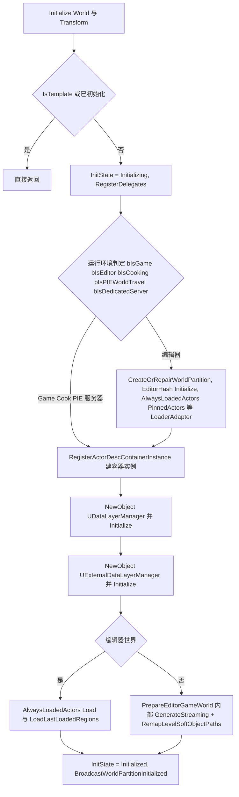

依据:Private/WorldPartition/WorldPartition.cpp:704-909(环境判定变量 742-746;DataLayerManager 773-778;容器实例 814-824;编辑器分支 780-809;PIE/Game 分支 894-906)。`PrepareEditorGameWorld` 中生成流式并生成 `/Memory/` 前缀的临时关卡包(WorldPartition.cpp:474-505)。

### 5.6.2 每帧流式更新(UpdateStreamingState 决策路径)

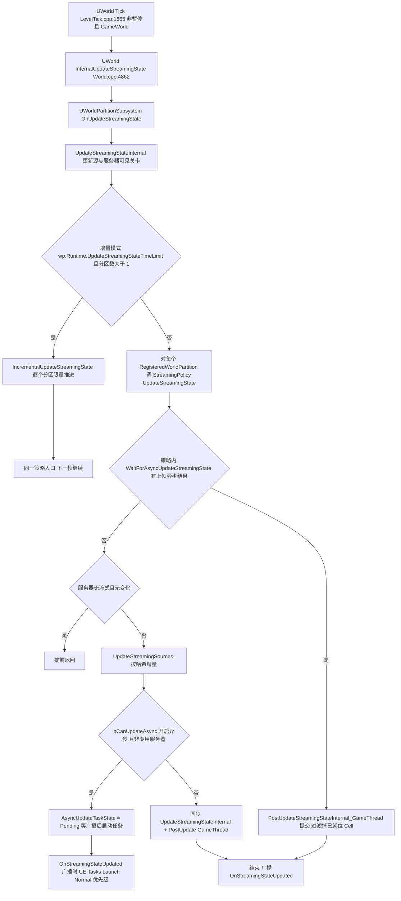

依据:LevelTick.cpp:1862-1866;World.cpp:4862-4896;Private/WorldPartition/WorldPartitionStreamingPolicy.cpp:271-388(哈希跳过 361-369;异步条件 356-358;任务派发 771-817)。跳更新哈希要求连续 2 次一致(异步快照语义,cpp:363-365)。

### 5.6.3 流式生成(PIE / 烹饪 GenerateStreaming)

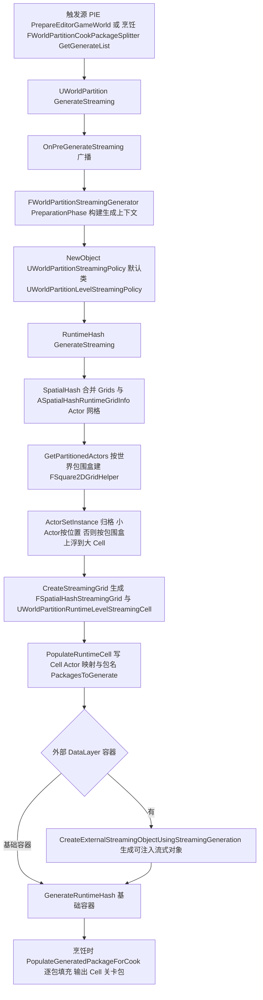

依据:WorldPartitionStreamingGeneration.cpp:2458-2610(策略创建 2564,外部容器循环 2588-2609);WorldPartitionRuntimeSpatialHash.cpp:1405-1483(网格合并 1425-1447,GetPartitionedActors 1477-1479);RuntimeSpatialHashGridHelper.cpp:38-84(层级构造)、152-235(归格与上浮);烹饪入口 Private/WorldPartition/WorldPartitionCookPackageSplitter.cpp:17-43 与 Cook/WorldPartitionCook.cpp:31-47。

### 5.6.4 Cell 状态机与 DataLayer 状态机

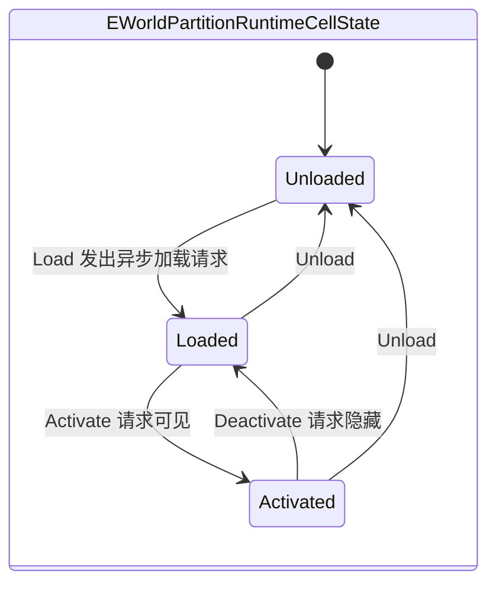

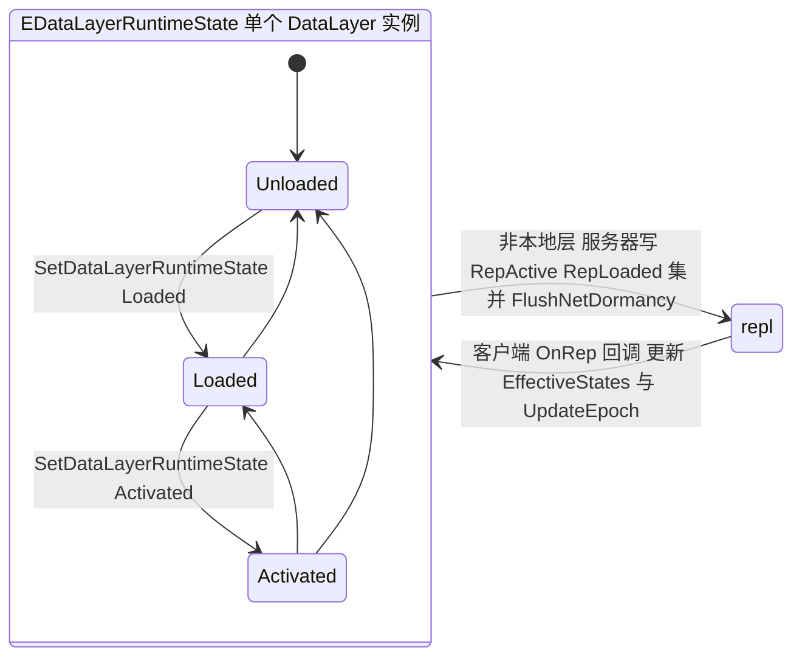

要点:
- Cell 状态迁移动作由策略在 GameThread 上调用(`UWorldPartitionRuntimeLevelStreamingCell::Load/Activate` → `UWorldPartitionLevelStreamingDynamic::Load/Activate`,见 5.5.5);加载为异步,可见性切换经 `RequestVisibilityChange` 走 MakingVisible/MakingInvisible 事务。
- DataLayer 写入在 `AWorldDataLayers::SetDataLayerRuntimeState`(WorldDataLayers.cpp:208):本地层(ClientOnly/ServerOnly)写 Local 集,其余写复制集;随后 `ResolveEffectiveRuntimeState` 递归传播父层,并 `++DataLayersStateEpoch`;消费侧经 `FWorldPartitionStreamingContext` 把 `FWorldDataLayersEffectiveStates` 传入 Cell 求值(EffectiveWantedState),决定 Cell 进 Activate/Load/忽略(WorldPartitionRuntimeSpatialHash.cpp:443-463)。

## 5.7 时序图

### 5.7.1 帧流式更新(含异步任务)

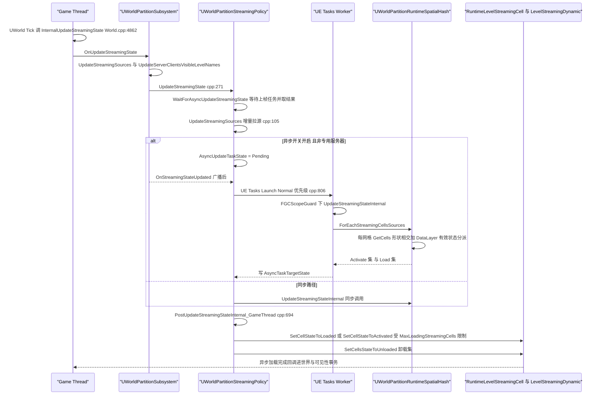

### 5.7.2 烹饪期 GenerateStreaming

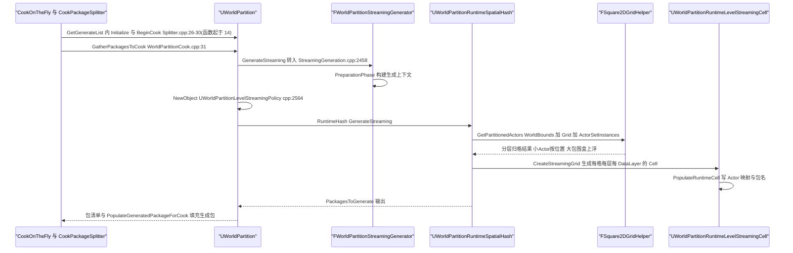

### 5.7.3 DataLayer 运行时状态切换到流式生效

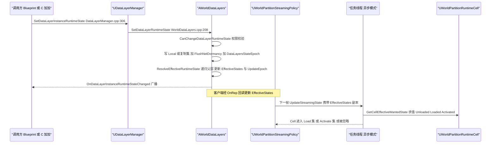

### 5.7.4 纹理与网格渲染资产流式更新

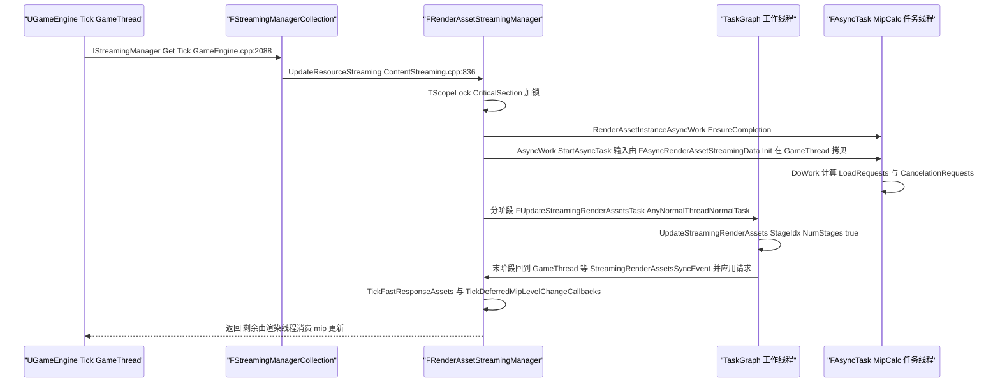

## 5.8 线程模型与同步

### 5.8.1 世界分区侧

| 执行体 | 线程 | 证据与说明 |
|---|---|---|
| `UWorldPartitionSubsystem::OnUpdateStreamingState` / `Tick` | GameThread | 由 `UWorld::Tick`(Private/LevelTick.cpp:1862-1866,条件 `!bIsPaused && IsGameWorld()`)→ `UWorld::InternalUpdateStreamingState`(Private/World.cpp:4862)→ 子系统接口循环(World.cpp:4893-4896)驱动,每帧一次 |
| `UWorldPartitionStreamingPolicy::UpdateStreamingSources` | GameThread | `check(IsInGameThread())`,Private/WorldPartition/WorldPartitionStreamingPolicy.cpp:107 |
| `PostUpdateStreamingStateInternal_GameThread` | GameThread | `check(IsInGameThread())`,cpp:698 |
| `SetCellStateToLoaded/Activated` | GameThread | `check(IsInGameThread())`,cpp:983/1015 |
| 异步 `UpdateStreamingStateInternal` | UE::Tasks 工作线程,`ETaskPriority::Normal` | `UE::Tasks::Launch(UE_SOURCE_LOCATION, ..., UE::Tasks::ETaskPriority::Normal)`,cpp:806-813;任务体内 `FGCScopeGuard GCGuard`(cpp:810)。默认关闭(CVar `wp.Runtime.UpdateStreaming.EnableAsyncUpdate`=false,cpp:68-73),且专用服务器强制同步(cpp:357-358) |
| 异步任务输入/输出所有权 | 输入 `FUpdateStreamingStateParams` 按值快照:WorldDataLayersEffectiveStates 以拷贝传入(`SetRequiredWorldDataLayersEffectiveStatesCopy(true)`,cpp:805);输出写入 `AsyncTaskTargetState`;`FrameActivateCells/FrameLoadCells/FrameAnalysePerformanceCells` 为策略成员,注释明确允许任务线程读写(cpp:781-783) |
| Cell 缓存的跨线程写 | `UWorldPartitionRuntimeCell::GetCellEffectiveWantedState` 注释"Thread-safe resolve and cache"(Public/WorldPartition/WorldPartitionRuntimeCell.h:292);`IsVisible()` 注释"Thread-safe"(同文件:268)。cpp:771-793 注释列出任务线程会写 Cell 缓存的四个调用(ResetStreamingSourceInfo/AppendStreamingSourceInfo/MergeStreamingSourceInfo 等) |
| 任务同步点 | ① 策略下一帧入口 `WaitForAsyncUpdateStreamingState` 阻塞等待(cpp:754-769);② 任何修改流式内容的调用需先 `OnPreChangeStreamingContent`(cpp:749-752);③ 异步任务只在子系统 `OnStreamingStateUpdated` 广播后才启动,确保子系统已结束对 Cell 的排序使用(cpp:773-779) |
| 增量更新 | `wp.Runtime.UpdateStreamingStateTimeLimit`(默认 0 关闭,WorldPartitionSubsystem.cpp:208-214)限制每帧更新预算,多分区时逐帧轮转(`IncrementalUpdateStreamingState`);高压加载、未开赛、无缝旅行为强制全量(WorldPartitionSubsystem.cpp UpdateStreamingStateInternal 中 `bForceDisableIncrementalUpdate` 判定) |
| 关卡装载异步 | `UWorldPartitionLevelStreamingDynamic::Load/Activate` 走 `ULevelStreaming` 异步加载与可见性事务;`UWorld::CanAddLoadedLevelToWorld` 会询问 Cell(Public 侧 World.cpp:4908+) |

### 5.8.2 渲染资产流式侧

| 执行体 | 线程 | 证据与说明 |
|---|---|---|
| `FRenderAssetStreamingManager::UpdateResourceStreaming` | GameThread 入口 | `UGameEngine::Tick` → `IStreamingManager::Get().Tick`(Private/GameEngine.cpp:2087-2088)→ `FStreamingManagerCollection::UpdateResourceStreaming`(Private/ContentStreaming.cpp:836);入口即 `UE::TScopeLock ScopeLock(CriticalSection)`(Private/Streaming/StreamingManagerTexture.cpp:1976) |
| `FUpdateStreamingRenderAssetsTask` | TaskGraph,`ENamedThreads::AnyNormalThreadNormalTask` | `GetDesiredThread()` 返回值,StreamingManagerTexture.cpp:1960-1963;`DoTask` 内 `FTaskTagScope Scope(ETaskTag::EParallelGameThread)`(cpp:1970) |
| 阶段并行度 | `NumThreadTasks = Min(Max(1, NumWorkerThreads) * GParallelRenderAssetsNumWorkgroups, Num-1)`,默认 workgroup 系数 2 | cpp:1548、67 |
| `FRenderAssetStreamingMipCalcTask` | FAsyncTask 专用任务线程(非 TaskGraph) | `FAsyncTask<FRenderAssetStreamingMipCalcTask>* AsyncWork`(StreamingManagerTexture.h:351);任务输入在 GameThread 由 `FAsyncRenderAssetStreamingData::Init` 最小化拷贝(AsyncTextureStreaming.h:22-26,注释"called from the game thread"),计算在任务侧(`UpdateBoundSizes_Async`/`UpdatePerfectWantedMips_Async`) |
| 回 GameThread 的栅栏 | `StreamingRenderAssetsSyncEvent->Wait(ENamedThreads::GameThread)`(cpp:262/276/1803);mip 变化回调只能游戏线程执行 → `TickDeferredMipLevelChangeCallbacks`(h:335-341 注释) |
| 视图数据 | `IStreamingManager::CurrentViewInfos/PendingViewInfos`(Private/ContentStreaming.cpp:44-53)由渲染侧填充,流式管理器在 GameThread 消费 |

### 5.8.3 HLOD / 地形 / 实例化

- `UWorldPartitionHLODRuntimeSubsystem` 全部为 GameThread(头文件无并发注释,`OnBeginRenderViews` 由渲染视图族构建调用);HLOD 预热(`wp.Runtime.HLOD.WarmupEnabled` 等)通过延迟 Cell 卸载若干帧实现(HLODRuntimeSubsystem.cpp:33-63 的 CVar 组)。
- 地形草地 `ULandscapeSubsystem::Tick`(GameThread)驱动 `FLandscapeGrassMapsBuilder` 同步/异步构建,`RegenerateGrass(bInFlushGrass, bInForceSync, ...)` 允许强制同步(LandscapeSubsystem.h:120)。
- `AISMPartitionActor::UpdateHISMTrees(bool bAsync, bool bForce)` 提供异步 HISM 树更新(ISMPartitionActor.h:52)。

## 5.9 配置与扩展点

### 5.9.1 CVar(全部在源码中逐字核对)

| CVar | 默认 | 含义 | 位置 |
|---|---|---|---|
| `wp.Runtime.EnableServerStreaming` | — | 服务器流式总开关(ProjectDefault 的取值来源) | Private/WorldPartition/WorldPartition.cpp:130 |
| `wp.Runtime.EnableServerStreamingOut` | — | 服务器允许流出 | WorldPartition.cpp:138 |
| `wp.Runtime.UseMakingVisibleTransactionRequests` / `wp.Runtime.UseMakingInvisibleTransactionRequests` | — | 可见性事务开关 | WorldPartition.cpp:146/155 |
| `wp.Runtime.UpdateStreaming.EnableOptimization` | 1 | 哈希跳更新开关 | Private/WorldPartition/WorldPartitionStreamingPolicy.cpp:53-59 |
| `wp.Runtime.UpdateStreaming.EnableAsyncUpdate` | 0 | 异步 UpdateStreamingState | 同上:68-73 |
| `wp.Runtime.UpdateStreaming.ForceUpdateFrameCount` | 0 | 每 N 帧强制一次全量更新 | 同上:61-66 |
| `wp.Runtime.UpdateStreamingStateTimeLimit` | 0(ms) | 每帧更新时间预算(增量模式) | Private/WorldPartition/WorldPartitionSubsystem.cpp:207-214 |
| `wp.Runtime.MaxLoadingStreamingCells` | 4 | 并发加载 Cell 上限 | WorldPartitionSubsystem.cpp:197-203 |
| `wp.Runtime.SlowStreamingRatio` / `wp.Runtime.SlowStreamingWarningFactor` | 0.25 / 2 | 慢速判定比与预警倍数 | Private/WorldPartition/WorldPartitionRuntimeHash.cpp:30-39 |
| `wp.Runtime.BlockOnSlowStreamingRatio` / `wp.Runtime.BlockOnSlowStreamingWarningFactor` | 0.25 / 2 | 阻塞判定比与预警倍数 | 同上:42-51 |
| `wp.Runtime.ServerDisallowStreamingOutDataLayers` | 空 | 服务器禁止流出的 DataLayer 名单(ECVF_ReadOnly) | WorldPartitionStreamingPolicy.cpp:46-51 |
| `wp.Runtime.DisplayStreamingPerformanceForNonBlockingStreaming` | — | 非阻塞时也显示性能提示 | 同上:40-43 |
| `wp.Runtime.HLOD` | — | 运行时启用/禁用 HLOD 控制台命令 | Private/WorldPartition/HLOD/HLODRuntimeSubsystem.cpp:149-150 |
| `wp.Runtime.HLOD.WarmupEnabled` / `.WarmupVT` / `.WarmupNanite` / `.WarmupNumFrames` / `.WarmupDebugDraw` / `.WarmupVTScaleFactor` / `.WarmupVTSizeClamp` | — | HLOD 资产预热组 | 同上:33-63 |
| `wp.Runtime.ServerStreamingSourceMinimumExtraRadius` / `...ExtraAngle` | — | 服务器源外扩半径/角度 | Private/WorldPartition/WorldPartitionSubsystem.cpp:65-79 |
| `wp.Runtime.SetDataLayerRuntimeState` | — | 控制台命令设置 DataLayer 状态(客户端会转发服务器执行) | Private/WorldPartition/DataLayer/DataLayerManager.cpp:126-164 |
| `wp.Runtime.DrawRuntimeHash2D` 等绘制命令 | — | 调试绘制族 | WorldPartitionSubsystem.cpp:81-140 |
| 流式源量化(影响跳更新哈希) | — | `FWorldPartitionStreamingSource` 的 Location/Rotation Quantization CVar 组 | Public/WorldPartition/WorldPartitionStreamingSource.h:477-480 |

### 5.9.2 ini / 配置对象

- `UWorldPartitionRuntimeHash` 为 `UCLASS(Config=Engine)`(WorldPartitionRuntimeHash.h:208),`UWorldPartitionRuntimeSpatialHash` 的 `Grids`(编辑期网格表)、`bEnableZCulling`、`UseAlignedGridLevels` 等为 `Config` 属性(WorldPartitionRuntimeSpatialHash.h:426-443),可写 DefaultEngine.ini `[/Script/Engine.WorldPartitionRuntimeSpatialHash]`。运行时亦可用 `ASpatialHashRuntimeGridInfo` Actor 追加网格(Private/WorldPartition/WorldPartitionRuntimeSpatialHash.cpp:1425-1447)。
- `UWorldPartition` 每世界属性:`bEnableStreaming`、`ServerStreamingMode`、`ServerStreamingOutMode`、`DataLayersLogicOperator`、`DefaultHLODLayer`、`RuntimeCellsTransformerStack`、`bHasStandaloneHLOD`/`bExternalizeHLODAssets`/`bDisableContentBundles`(WorldPartition.h:558-612)。
- `UDataLayerInstance` 为 `UCLASS(Config=Engine, PerObjectConfig)`(DataLayerInstance.h:57)。
- `UWorldPartitionSettings`(Public/WorldPartition/WorldPartitionSettings.h)提供项目级设置(含 EDL 烹饪行为,见 WorldPartitionCookPackageSplitter.cpp:109-111 的 `ShouldCookEDLGenerator`)。

### 5.9.3 委托与扩展点

| 扩展点 | 说明 | 位置 |
|---|---|---|
| `IWorldPartitionStreamingSourceProvider` | 注册进 `UWorldPartitionSubsystem` 即可注入自定义流式源(形状/优先级/目标网格可控) | Public/WorldPartition/WorldPartitionStreamingSource.h:532;WorldPartitionSubsystem.h:108 |
| `FWorldPartitionStreamingStateUpdated OnStreamingStateUpdated` | 每次流式更新完成广播(也是异步任务派发时机) | WorldPartitionSubsystem.h:115-116 |
| `FOnDataLayerInstanceRuntimeStateChanged OnDataLayerInstanceRuntimeStateChanged` | DataLayer 状态变化(BlueprintAssignable) | Public/WorldPartition/DataLayer/DataLayerManager.h:26-27 |
| `UWorldPartition::OnPreGenerateStreaming` / `OnGenerateStreamingActorDescsMutatePhase` | 生成前钩子与 ActorDesc 变异阶段(实验) | WorldPartition.h:303-310 |
| `UWorldPartition::OnBeginCook` / `OnEndCook` | 烹饪钩子 | WorldPartition.h:321-322 |
| `RuntimeCellsTransformerStack`(FRuntimeCellTransformerInstance) | Cell 变换器栈:烹饪期对 Cell 关卡与 Cell 本体做变换(FastGeo、ISM 合并即此实现) | WorldPartition.h:601-604;Public/WorldPartition/WorldPartitionRuntimeCellTransformer.h:28 |
| `UWorldPartitionRuntimeCellTransformerISM` | 内置变换器:把 Cell 内同类静态网格合并为 ISM | Public/WorldPartition/WorldPartitionRuntimeCellTransformerISM.h:11 |
| `UWorldPartitionRuntimeHash::RegisterWorldPartitionRuntimeHashConverter(SrcClass, DstClass, Func)` | 注册哈希类型转换器(地图升级) | WorldPartitionRuntimeHash.h:339 |
| `UDataLayerLoadingPolicy`(Within=DataLayerManager) | 定制编辑器中 DataLayer 装载策略 | Public/WorldPartition/DataLayer/DataLayerLoadingPolicy.h:16 |
| `UHLODLayer` + `UHLODBuilder`/`UHLODModifier` 子类 | 自定义 HLOD 构建(EHLODLayerType::Custom) | Public/WorldPartition/HLOD/HLODLayer.h:31-39 |
| `UWorldPartition::RegisterWorldAssetStreaming(FRegisterWorldAssetStreamingParams)` | 运行时向网格注入"世界资产流式"Cell(实验,支持一层 HLOD) | WorldPartition.h:766-809 |
| `URuntimeHashExternalStreamingObjectBase` 注入/移除 | 外部 DataLayer 流式内容运行时注入 | WorldPartition.h:487-489;WorldPartitionRuntimeHash.h:61 |
| `FWorldCookPackageSplitter::RegisterCookPackageSubSplitterFactory` | 世界分区注册为烹饪包拆分器(烹饪入口) | Private/WorldPartition/WorldPartition.cpp:418-420 |
| `ULevelInstanceSubsystem` 的 `ELevelInstanceRuntimeBehavior` | 实例运行时行为(Partitioned / LevelStreaming 等,定义于 LevelInstanceTypes.h) | Public/LevelInstance/LevelInstanceActor.h:71-75 |
| `ULevelStreamingPersistenceManager` 控制台命令族 | SaveToFile/LoadFromFile/DumpContent/SetPropertyValue/GetPropertyValue | Plugins/Runtime/LevelStreamingPersistence/.../LevelStreamingPersistenceManager.h:312-316 |
| `AISMPartitionActor` 的 client 机制 | `RegisterClient/RegisterClientInstanceManager(Provider)` 允许多系统共享格子 ISM | Public/ISMPartition/ISMPartitionActor.h:31-36 |

## 5.10 已知限制/未确认项

诚实列出本章未覆盖或未能完全确认的内容:

1. **WorldPartition 74 个头文件未逐个展开**:重点覆盖核心链路(初始化、哈希、策略、源、DataLayer、HLOD、烹饪、流式执行)。`ContentBundle`、`MiniMap`、`StaticLightingData`、`NavigationData`、`LoaderAdapter`、`ErrorHandling`、`RuntimeHashSet`(实验性第二种哈希)、`WorldPartitionConverter`/`WorldPartitionReplay` 等子目录只在模块清单层面提及,类级细节未展开。
2. **编辑器侧生成器内部未逐行核对**:`FWorldPartitionStreamingGenerator` 的 PreparationPhase 内部(ActorSet 聚类、引用链分析、错误处理)只读了入口与调用关系(WorldPartitionStreamingGeneration.cpp:2458-2610),未展开其数千行内部算法。
3. **HLOD 构建管线**:`UWorldPartition::SetupHLODActors` 的实际构建逻辑在 Editor 模块(HierarchicalLODUtilities/WorldPartitionEditor),本章只覆盖运行时可见性与预热。
4. **地形渲染 LOD 细节**:仅确认 LOD 区间与高度图驻留 mip 的关系(Source/Runtime/Landscape/Private/LandscapeRender.cpp:1571-1576)与每 Cell 的 `ALandscapeStreamingProxy` 拆分方式;`ULandscapeComponentSceneProxy` 内部的 LOD 选择、Nanite 地形与草地剔除的渲染线程细节未展开。
5. **植被编辑器数据结构**:`FFoliageInfo`/`FFoliageImpl` 的实例存储与撤销细节未深入(Source/Runtime/Foliage/Public/InstancedFoliage.h 只读了结构声明)。
6. **InstancedActors 的 Mass/修饰器体系**:`UInstancedActorsData`、Trait/Processor、服务端-客户端实例生成协议(`ClientInstancedActorsSpawnerSubsystem`)未展开。
7. **ISMPool 渲染代理**:`UISMPoolComponent` 的组件池化与场景代理共享细节未展开(仅覆盖类与子系统职责)。
8. **FastGeo**:插件标记 Experimental,其 Build.cs 以 `PrivateIncludePaths` 引用 `Source/Runtime/Engine/Internal`(FastGeoStreaming.Build.cs 注释),说明其部分耦合引擎内部头;实例压缩/存储模式枚举已记录,变换算法未逐行核对。
9. **纹理流式的 RHI 侧**:mip 数据的异步 IO 与上传(渲染线程/RHI 线程)在 RHI 与 Renderer 模块内部,本章只覆盖到 `FRenderAssetStreamingManager` 的请求生成与线程栅栏;`StreamingRenderAssetsSyncEvent` 的完整等待点未逐一列举。
10. **网络复制细节**:DataLayer 复制只确认了 `RepActiveDataLayerNames`/`RepLoadedDataLayerNames` 与三个 OnRep 回调(WorldDataLayers.h:289-302、182-188),`UNetConnection::UpdateLevelVisibilityInternal` 对服务器流式 Cell 的客户端可见性影响只在注释中提及(WorldPartitionStreamingPolicy.cpp:713-718)。
11. **未验证运行时行为**:本章全部结论来自静态源码阅读,未运行引擎验证(如异步更新在实测下的帧分布)。

## 5.11 附录索引

全量符号清单(每个头文件每个符号)由工具生成于 `appendix/api/<Tier>/<Module>.md`,本章覆盖范围对应以下附录文件(相对 `docs/ue5.8.3/`):

| 本章范围 | 附录文件 |
|---|---|
| Engine(WorldPartition/LevelInstance/PackedLevelActor/DataLayer/HLOD/ActorPartition/ISMPartition/Instances/InstancedStaticMesh/Streaming 等,模块共 2390 头) | appendix/api/Runtime/Engine.part01.md ~ Engine.part06.md |
| ISMPool | appendix/api/Runtime/ISMPool.md |
| Landscape | appendix/api/Runtime/Landscape.md |
| Foliage | appendix/api/Runtime/Foliage.md |
| FastGeoStreaming(Plugins) | appendix/api/Plugins/FastGeoStreaming.md |
| FastGeoStreamingEditor(Plugins,编辑器侧,未展开) | appendix/api/Plugins/FastGeoStreamingEditor.md |
| LevelStreamingPersistence(Plugins) | appendix/api/Plugins/LevelStreamingPersistence.md |
| InstancedActors(Plugins) | appendix/api/Plugins/InstancedActors.md |
| InstancedActorsEditor(Plugins,编辑器侧,未展开) | appendix/api/Plugins/InstancedActorsEditor.md |

检索建议:在附录中定位本章符号,例如
`grep -n "class UWorldPartitionStreamingPolicy" appendix/api/Runtime/Engine.part*.md`、
`grep -n "FSpatialHashStreamingGrid" appendix/api/Runtime/Engine.part*.md`、
`grep -n "class UInstancedActorsSubsystem" appendix/api/Plugins/InstancedActors.md`。
相关但不在本章范围:编辑器模块 WorldPartitionEditor(appendix/api/Editor/WorldPartitionEditor.md)、HierarchicalLODUtilities(appendix/api/Developer/HierarchicalLODUtilities.md)、DataLayerEditor(appendix/api/Editor/DataLayerEditor.md)。

