# 06 RHI:渲染硬件接口层与各图形后端

## 6.1 职责、边界与模块清单

RHI(Render Hardware Interface)是 UE 渲染栈中"与具体图形 API 无关"的抽象层:向上(Renderer/RenderCore/RDG)暴露统一的资源、状态、管线、命令列表接口,向下由各平台后端(D3D12/Vulkan/Metal/OpenGL/Null)实现。选择哪个后端在运行期由 `RHIInit()` → `PlatformCreateDynamicRHI()` 动态决定(`DynamicRHI.cpp:291-312`)。

范围内模块清单(路径相对 `$UE/Engine/Source`,Build.cs 依赖按 Public/Private 列出,均摘自对应 `*.Build.cs`):

| 模块名 | 路径 | Build.cs 依赖(Public/Private) | 职责一句话 |
|---|---|---|---|
| RHI | Runtime/RHI | Priv: Core, TraceLog, ApplicationCore, Cbor, BuildSettings, WindowsD3D(Windows);动态加载 D3D11RHI/D3D12RHI/NullDrv/OpenGLDrv/VulkanRHI | 定义 FDynamicRHI 抽象接口、RHI 资源类型、命令列表录制/回放、能力位、ShaderPlatform/FeatureLevel、GPU 面包屑与 RHI 校验层 |
| RHICore | Runtime/RHICore | Pub: RHI, RenderCore;Priv: Core;三方: NVAftermath, IntelExtensionsFramework | RHI 公共重实现:瞬态资源分配器(FTransientResourceAllocator 系)、池分配器、描述符分配器、诊断缓冲、Aftermath/Intel GPU 崩溃采集 |
| D3D12RHI | Runtime/D3D12RHI | Pub: Core, RHI, WindowsD3D(Win);Priv: CoreUObject, Engine, RHICore, RenderCore, TraceLog;三方: DX12, AMD_AGS, NVAPI, NVAftermath, IntelExtensionsFramework | D3D12 后端:Adapter/Device/Queue/Payload 提交管线、增强/传统屏障、描述符堆、驻留管理、PSO 缓存与异步编译 |
| VulkanRHI | Runtime/VulkanRHI | PubInclude: Vulkan;Priv: Core, CoreUObject, ApplicationCore, Engine, RHI, RHICore, RenderCore, HeadMountedDisplay, PreLoadScreen, BuildSettings, TraceLog;三方: Vulkan, AMD_AGS, NVAftermath | Vulkan 后端:Instance/Device/三类队列、命令缓冲上下文、SyncPoint/时间线信号量、Swapchain、SPIR-V 管线缓存 |
| OpenGLDrv | Runtime/OpenGLDrv | Pub: Core, RHI;Priv: CoreUObject, ApplicationCore, Engine, RHICore, ImageWrapper 等 | OpenGL/GL ES 后端:FOpenGLDynamicRHI + 状态机(FOpenGLContext)、GLSL 反射、程序二进制缓存 |
| NullDrv | Runtime/NullDrv | Priv: Core, RHI, RenderCore | 空实现后端(commandlet/无渲染场景),FNullDynamicRHI 全部返回哑对象 |
| MetalRHI | Runtime/Apple/MetalRHI(注意:在 Source/Runtime/Apple 下,不在 Platforms 下) | Priv: Core, ApplicationCore, Engine, RHI, RHICore, RenderCore, Projects 等 | Apple 平台 Metal 后端:FMetalDynamicRHI、命令缓冲/编码器、BARS 瞬态堆等 |
| ShaderFormatOpenGL | Developer/ShaderFormatOpenGL | Priv: Core, RenderCore, ShaderCompilerCommon, ShaderPreprocessor, RHI;三方: OpenGL | 把 HLSL(经 ShaderConductor)编译为 GLSL 4.x/ES 3.1 目标码,产出 FShaderCompilerOutput |
| VulkanShaderFormat | Developer/VulkanShaderFormat | PubInclude: VulkanRHI;Priv: Core, RenderCore, ShaderCompilerCommon, ShaderPreprocessor, RHI;三方: SPIRVReflect, Vulkan | HLSL→SPIR-V 编译(CompileVulkanShader,经 DXC/ShaderConductor),反射 SRT/资源使用标志 |
| ShaderCompilerCommon | Developer/ShaderCompilerCommon | Pub: HlslParser, FileUtilities 等 | 编译器公共库:资源表构建、反射结果落地、DXC/ShaderConductor 封装、SPIR-V 反射/反汇编、Shader Minifier/SDCE |
| (边界参考)Engine/Platforms | Engine/Platforms/{Android,IOS,VisionOS,Windows} | — | 仅存放平台扩展模块(VisionOSRuntimeSettings 等),本版本没有独立 RHI 模块;MetalRHI 实际位于 Runtime/Apple |

与本章边界相关但**不在范围内**的模块:D3D11RHI(旧后端)、WindowsD3D(DXGI 公共封装)、ShaderFormatD3D、MetalShaderFormat、ShaderPreprocessor、RenderCore(RenderingThread/渲染命令队列所在,本章只在线程模型一节引用其 `RenderingThread.cpp`)。

## 6.2 总体架构

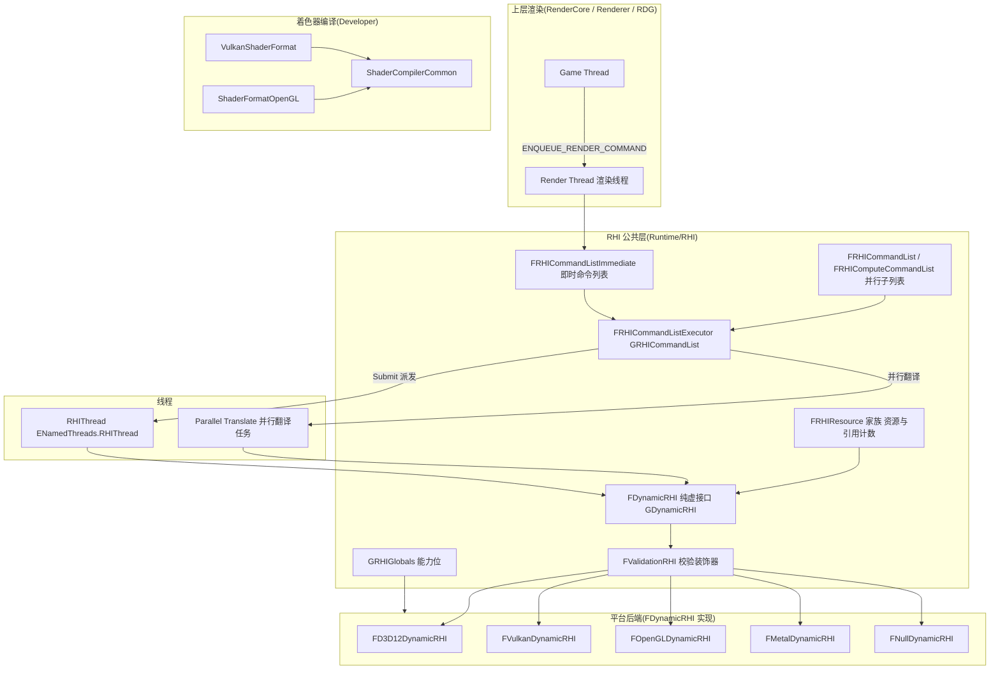

要点:

- **命令录制与翻译分离**。渲染线程在 `FRHICommandListImmediate`(或并行任务的 `FRHICommandList`)上用 `ALLOC_COMMAND` 把命令挂进侵入式链表;`FRHICommandListExecutor::Submit()`(`RHICommandList.h:5053`)按 Dispatch→Translate→Submit 三段 TaskGraph 管线把命令重放到平台上下文,最后调用 `FDynamicRHI::RHISubmitCommandLists()`(`DynamicRHI.h:881`)交给 GPU。
- **Bypass 模式**:`r.RHICmdBypass=1` 且无独立 RHI 线程时(`RHICommandList.cpp:1880` LatchBypass),`Bypass()` 为真,所有 RHI 调用直接执行不录制。
- **能力位**:`GRHIGlobals`(`RHIGlobals.h:805`)是所有后端 Init 时填充的单一能力表,历史宏 `GRHISupports*`/`GSupports*` 全部 `#define` 到该结构字段(`RHIGlobals.h:810-976`)。
- **着色器编译**在 Editor/Cooker 进程内完成:ShaderFormat 模块产出平台字节码,运行期 RHI 只按 `EShaderPlatform` 选择加载路径。

## 6.3 类图

### 6.3.1 动态 RHI 与命令上下文

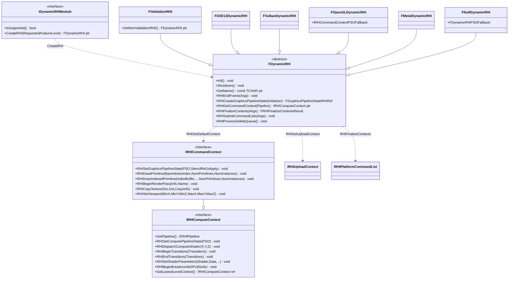

- `FDynamicRHI`:`DynamicRHI.h:198`,后端唯一入口;`Init/Shutdown/GetName/RHIEndFrame` 等为纯虚。
- `FValidationRHI`:`RHIValidation.h:43`,装饰器模式,包住真实后端做资源状态/访问校验,`GetNonValidationRHI()` 可取回内层(`DynamicRHI.h:218`)。
- `IRHIComputeContext`:`RHIContext.h:254`,计算/通用管线命令;`IRHICommandContext`:`RHIContext.h:686`,叠加图形命令;`IRHIUploadContext`:`RHIContext.h:570`,上传专用空标记接口。
- 后端实现:Vulkan 为 `FVulkanCommandListContext : FVulkanContextCommon, IRHICommandContext`(`VulkanContext.h:245`)、`FVulkanUploadContext`(`VulkanContext.h:454`);D3D12 为 `FD3D12CommandContext : FD3D12ContextCommon, FD3D12CommandContextBase(:IRHICommandContext)`(`D3D12CommandContext.h:496,528`),另有 `FD3D12CommandContextRedirector`(`D3D12CommandContext.h:892`)用于并行 RenderPass 时的转发;OpenGL/Null 走 `IRHICommandContextPSOFallback`(`RHIContext.h:877`)以分离状态(无真实 PSO)。

### 6.3.2 命令列表层次

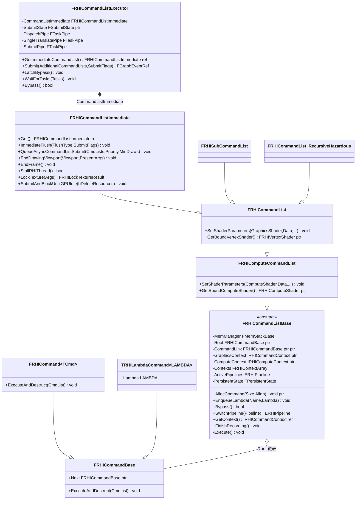

- 命令节点:`FRHICommandBase`(`RHICommandList.h:347`)只有 `Next` 与 `ExecuteAndDestruct` 两个成员;`FRHICommand<TCmd>`(`RHICommandList.h:1403`)与 `TRHILambdaCommand`(`RHICommandList.h:354`)是两种生成方式,`FRHICOMMAND_MACRO`(`RHICommandList.h:1432`)批量定义具体命令结构。
- 录制:`ALLOC_COMMAND`(`RHICommandList.h:413`)= `new (AllocCommand(...)) T`,在命令列表私有 `FMemStackBase MemManager` 上分配并把节点链入 `*CommandLink`(`RHICommandList.h:566-575`)。
- 回放:`FRHICommandListBase::Execute()`(`RHICommandList.cpp:517`)用 `FRHICommandListIterator` 逐个 `Cmd->ExecuteAndDestruct(*this)`。
- 三层子类不新增任何成员(`RHICommandList.h:4788-4790` 的 static_assert),只是按"允许的命令集合"收窄接口;`FRHISubCommandList`(`RHICommandList.h:5035`)绑定 `FRHIParallelRenderPassInfo` 用于并行渲染。`FRHICommandList_RecursiveHazardous`(`RHICommandList.h:4923`)供后端在翻译过程中临时再录制命令。
- 全局执行器 `GRHICommandList`(`RHICommandList.h:5295`)。

### 6.3.3 资源类型

```mermaid
classDiagram
    class FRHIResource {
        <<abstract>>
        -AtomicFlags FAtomicFlags
        +AddRef() uint32
        +Release() uint32
        +IsValid() bool
        +GetType() ERHIResourceType
        -MarkForDelete() void
        +DeleteResources(Resources)$
    }
    class FRHISamplerState
    class FRHIBlendState
    class FRHIVertexDeclaration
    class FRHIShader {
        #Frequency EShaderFrequency
        +GetHash() FShaderHash ref
        +GetFrequency() EShaderFrequency
    }
    class FRHIGraphicsShader
    class FRHIVertexShader
    class FRHIPixelShader
    class FRHIComputeShader
    class FRHIRayTracingShader
    class FRHIGraphicsPipelineState {
        +GetSortKey() uint64
        +GetShader(Frequency) FRHIGraphicsShader ptr
    }
    class FRHIComputePipelineState {
        -ComputeShader TRefCountPtr FRHIComputeShader
        +MarkUsed() void
    }
    class FRHIRayTracingPipelineState
    class FRHIUniformBuffer {
        -Layout TRefCountPtr FRHIUniformBufferLayout
        -ResourceTable TArray TRefCountPtr FRHIResource
        +GetSize() uint32
        +GetBindlessHandle() FRHIDescriptorHandle
    }
    class FRHIUniformBufferLayout {
        +ConstantBufferSize uint32
        +ResourceMap TArray FRHIUniformBufferResource
        +StaticSlot FUniformBufferStaticSlot
    }
    class FRHIViewableResource {
        #TrackedAccess FRHITrackedAccess
        +GetTrackedAccess_Unsafe() ERHIAccess
        +GetName() FName
    }
    class FRHIBuffer {
        -Desc FRHIBufferDesc
        +GetDesc() FRHIBufferDesc ref
        +GetSize() uint32
        +GetStride() uint32
        +GetUsage() EBufferUsageFlags
    }
    class FRHITexture {
        -TextureDesc FRHITextureDesc
        +GetDesc() FRHITextureDesc ref
        +GetNativeResource() void ptr
        +GetSizeXYZ() FIntVector
        +IsMultisampled() bool
    }
    class FRHIGPUFence {
        +Clear() void
        +Poll() bool
    }
    class FRHIRenderQuery
    class FRHIViewport {
        +GetNativeSwapChain() void ptr
        +SetCustomPresent(Present) void
        +WaitForFrameEventCompletion() void
    }
    class FRHIView {
        +GetViewInfo() FRHIViewDesc const
    }
    class FRHIShaderResourceView
    class FRHIUnorderedAccessView
    class FRHIStagingBuffer

    FRHISamplerState --|> FRHIResource
    FRHIBlendState --|> FRHIResource
    FRHIVertexDeclaration --|> FRHIResource
    FRHIShader --|> FRHIResource
    FRHIGraphicsShader --|> FRHIShader
    FRHIVertexShader --|> FRHIGraphicsShader
    FRHIPixelShader --|> FRHIGraphicsShader
    FRHIComputeShader --|> FRHIShader
    FRHIRayTracingShader --|> FRHIShader
    FRHIGraphicsPipelineState --|> FRHIResource
    FRHIComputePipelineState --|> FRHIResource
    FRHIRayTracingPipelineState --|> FRHIResource
    FRHIUniformBuffer --|> FRHIResource
    FRHIUniformBufferLayout --|> FRHIResource
    FRHIViewableResource --|> FRHIResource
    FRHIBuffer --|> FRHIViewableResource
    FRHITexture --|> FRHIViewableResource
    FRHIGPUFence --|> FRHIResource
    FRHIRenderQuery --|> FRHIResource
    FRHIViewport --|> FRHIResource
    FRHIView --|> FRHIResource
    FRHIShaderResourceView --|> FRHIView
    FRHIUnorderedAccessView --|> FRHIView
    FRHIStagingBuffer --|> FRHIResource
    FRHIUniformBuffer o-- FRHIUniformBufferLayout
```

(各类行号见 6.5 接口清单与 6.10;`FRHIShader` 见 `RHIResources.h:842`,`FRHIGraphicsPipelineState` 见 `RHIResources.h:1091`,`FRHIUniformBuffer` 见 `RHIResources.h:1262`,`FRHIBuffer` 见 `RHIResources.h:1627`,`FRHITexture` 见 `RHIResources.h:2167`,`FRHIViewport` 见 `RHIResources.h:2544`。)

### 6.3.4 D3D12 后端对象模型

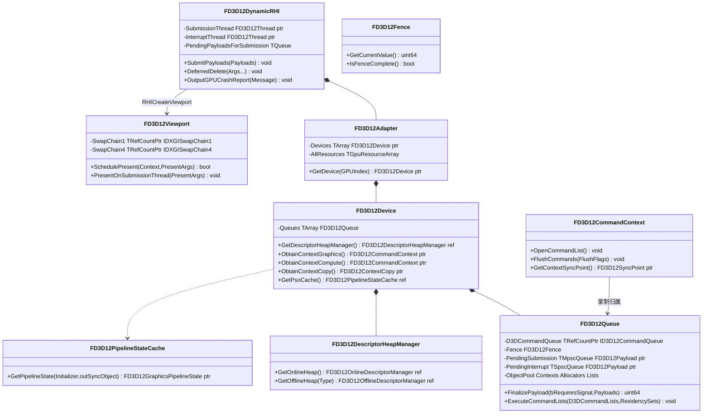

- `FD3D12Adapter`(`D3D12Adapter.h:147`)持有物理适配器与全部逻辑设备;`FD3D12Device`(`D3D12Device.h:153`)每 GPU 一个,内含 `FD3D12Queue`(`D3D12Device.h:85`)数组,队列类型 `ED3D12QueueType{Direct,Copy,Async}`(`D3D12Queue.h:10`,`ERHIPipeline::Graphics→Direct、AsyncCompute→Async`,`D3D12Queue.h:19-27`)。
- 提交模型:渲染/翻译线程把命令录进 `FD3D12CommandContext`,合批为 `FD3D12Payload` 入 `PendingSubmission`(MPSC),提交线程 `FD3D12DynamicRHI::SubmitPayloads` → `FD3D12Queue::ExecuteCommandLists`(带 ResidencySet);中断线程处理 `PendingInterrupt`(SPSC)回收与 GPU 崩溃诊断(`D3D12RHIPrivate.h:220-259`)。
- 驻留:基于 D3DX12 Residency 库(`D3D12Residency.h:46 FD3D12ResidencyHandle : D3DX12Residency::ManagedObject`,及 `Open/Close/Insert` 内联封装),`ENABLE_RESIDENCY_MANAGEMENT` 开启。

### 6.3.5 Vulkan 后端对象模型

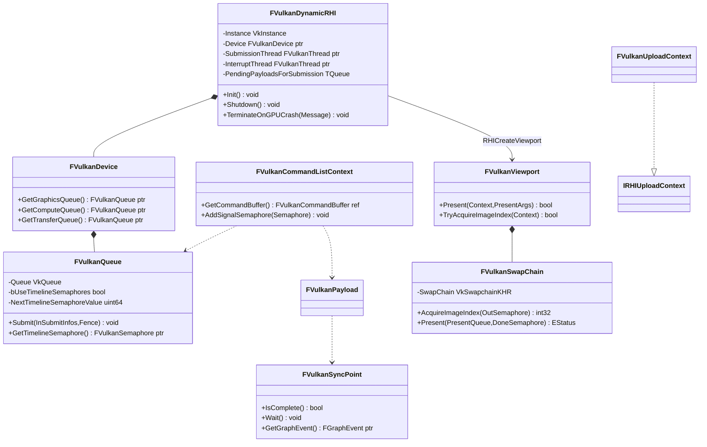

- 队列类型 `EVulkanQueueType{Graphics,AsyncCompute,Transfer}`(`VulkanQueue.h:26-33`);`FVulkanQueue`(`VulkanQueue.h:52`)在支持时间线信号量时用单调递增 `NextTimelineSemaphoreValue` 做全队同步。
- 5.8 没有 `FVulkanCommandBufferManager` 这个旧类名;命令缓冲由 `FVulkanContextCommon`(`VulkanContext.h:58`)家族管理,`FVulkanCommandListContext`(`VulkanContext.h:245`)即 `IRHICommandContext` 实现,`RHIGetCommandContext(Pipeline)` 按管线返回 gfx/async 上下文(`VulkanDynamicRHI.h:230`)。
- `FVulkanPlatformCommandList : IRHIPlatformCommandList, TArray<FVulkanPayload*>`(`VulkanSubmission.h:208`)是 `RHIFinalizeContexts` 的产物,`RHISubmitCommandLists` 消费它。

## 6.4 数据字典

### 6.4.1 枚举与基础类型

| 类型 | 字段/枚举值 | 含义 | 取值/约束 | 源码位置 |
|---|---|---|---|---|
| `ERHIPipeline` | Graphics=1<<0, AsyncCompute=1<<1, None=0, All | RHI 管线(队列)掩码 | 可按位组合;`IsSingleRHIPipeline` 要求 2 的幂 | RHIPipeline.h:9-24 |
| `ERHIAccess` | Unknown=0;CPURead、Present、IndirectArgs、VertexOrIndexBuffer、SRVCompute、SRVGraphicsPixel、SRVGraphicsNonPixel、CopySrc、ResolveSrc、DSVRead(读);UAVCompute、UAVGraphics、RTV、CopyDest、ResolveDst、DSVWrite(读写);BVHRead/BVHWrite、Discard、ShadingRateSource | 资源访问状态(屏障目标) | 位掩码;合成掩码 SRVMask/UAVMask/ReadOnlyMask 等;`IsInvalidAccess()` 判非法组合 | RHIAccess.h:10-86 |
| `ERHIFeatureLevel::Type` | ES2_REMOVED, ES3_1, SM4_REMOVED, SM5, SM6, Num | 硬件能力档位 | ES3_1/SM5/SM6 有效;GMaxRHIFeatureLevel 运行期设定 | RHIFeatureLevel.h:19-45 |
| `EShaderPlatform : uint16` | SP_PCD3D_SM5=0 … SP_METAL_ES3_1_IOS=11 … SP_VULKAN_SM5=20 … SP_PCD3D_SM6 / SP_VULKAN_SM6 / SP_METAL_SM6(SP_StaticPlatform_Last+2/4/5)… SP_NumPlatforms | 着色器编译目标 | 16bit;数据驱动平台从 32 起 | RHIShaderPlatform.h:10-54 |
| `ERHIThreadMode` | None, DedicatedThread, Tasks | RHI 线程模式 | `r.RHIThread.Enable` 0/1/2 | RHICommandList.h:98-103 |
| `ERHISubmitFlags` | SubmitToGPU, DeleteResources, FlushRHIThread, EndFrame, ProfileNextFrame, EnableBypass/DisableBypass, EnableDrawEvents/DisableDrawEvents | 一次提交的附加语义 | ENUM_CLASS_FLAGS | RHICommandList.h:4353-4384 |
| `EImmediateFlushType::Type` | WaitForOutstandingTasksOnly=0, DispatchToRHIThread=1, FlushRHIThread=2, FlushRHIThreadFlushResources=3 | ImmediateFlush 的等待/派发级别 | — | RHICommandList.h:4330-4339 |
| `FRHIBufferDesc` | Size, Stride, Usage(EBufferUsageFlags), GPUMask | 缓冲描述 | Size==0 需 NullResource 标记 | RHIResources.h:1370-1415 |
| `FRHITextureDesc` | Dimension, Flags(ETextureCreateFlags), Format(EPixelFormat), ClearValue, Extent, Depth, ArraySize, NumMips, NumSamples, ExtData | 纹理描述 | 由 FRHITextureCreateDesc 派生(加 DebugName/InitialState/BulkData) | RHIResources.h:1716-1965 |
| `FRHIBreadcrumbData` | StaticName, EOL, Format字符串与参数 | 面包屑显示内容 | 字符串上限 128 TCHAR(FRHIBreadcrumbNode::MaxLength) | RHIBreadcrumbs.h:136-246 |
| `FRHIGPUFence` | `+Clear() void`、`+Poll() bool`(纯虚,非阻塞轮询)、FenceName | GPU 栅栏 | RHIResources.h:2397-2417 |
| `ERenderQueryType` | RQT_Occlusion, RQT_AbsoluteTime | GPU 查询类型 | RHIDefinitions.h:250 |
| `ED3D12QueueType` | Direct=0, Copy, Async | D3D12 队列类型 | Graphics→Direct, AsyncCompute→Async | D3D12Queue.h:10-16 |
| `EVulkanQueueType` | Graphics=0, AsyncCompute, Transfer | Vulkan 队列类型 | — | VulkanQueue.h:26-33 |

### 6.4.2 FRHIGlobals 能力位(GRHI 能力位表)

`FRHIGlobals`(`RHIGlobals.h:87-803`,实例 `GRHIGlobals`,`RHIGlobals.h:805`)。下表按域分组列出主要字段(全部为运行期由后端 Init 填充;默认值为头文件初值):

| 域 | 字段(宏别名) | 类型 | 默认 | 含义 |
|---|---|---|---|---|
| 基础 | IsRHIInitialized(GIsRHIInitialized) | bool | false | RHI 是否已初始化 |
| 基础 | MaxTextureMipCount / MaxTextureDimensions / MaxVolumeTextureDimensions / MaxCubeTextureDimensions / MaxTextureArrayLayers / MaxTextureSamplers | int32 | MAX_TEXTURE_MIP_COUNT / 2048 / 2048 / 2048 / 256 / 16 | 资源尺寸上限 |
| 基础 | MaxConstantBufferByteSize / MaxComputeSharedMemory / MaxComputeDispatchDimension / MaxWorkGroupInvocations / MaxSimultaneousUAVs | TRHIGlobal | 1<<27 / 1<<15 / 65535 / 1024 / 8 | 着色与绑定上限(MinGuaranteedSimultaneousUAVs=8) |
| GPU 信息 | GpuInfo(AdapterName/VendorId/DeviceId/DedicatedVideoMemory/AdapterDriverOnDenyList 等) | FGpuInfo | — | 适配器与驱动信息(宏 GRHIAdapterName、GRHIVendorId 等) |
| 几何/绘制 | SupportsDrawIndirect(GRHISupportsDrawIndirect)、SupportsMultiDrawIndirect、SupportsQuadTopology、SupportsRectTopology、SupportsPrimitiveShaders | bool | true/false/… | 绘制能力 |
| UAV/SRV | SupportsPixelShaderUAVs、SupportsVertexShaderUAVs、SupportsUAVFormatAliasing、SupportsRawViewsForAnyBuffer、SupportsRWTextureBuffers、SupportsDepthUAV、SupportsRasterOrderViews | bool | true/false… | 视图能力 |
| 线程 | SupportsMultithreading(GRHISupportsMultithreading)、SupportsAsyncGetRenderQueryResult、SupportsParallelOcclusionQueries、SupportsMultithreadedResources、SupportsMultithreadedShaderCreation | bool | — | 后端线程安全性 |
| RHI 线程 | SupportsRHIThread(GRHISupportsRHIThread)、SupportsRHIOnTaskThread、SupportsParallelRHIExecute、SupportsConcurrentTranslateAndSubmit、RHIThreadNeedsKicking | bool | false… | RHI 线程/并行翻译能力,决定 StartRenderingThread 的模式 |
| 并行 Pass | ParallelRenderPasses.{Supported,UsesCustomContexts,ParentWaitForChildTranslate,ChildWaitForParentBegin} | bool | false | 并行 RenderPass 翻译约束 |
| 异步计算 | SupportsEfficientAsyncCompute(GSupportsEfficientAsyncCompute)、SupportsAsyncComputeTransientAliasing | bool | false | AsyncCompute 队列效率 |
| 光线追踪 | RayTracing.{Supported,SupportsShaders,SupportsPSOAdditions,SupportsDispatchIndirect,SupportsAsyncBuildAccelerationStructure,SupportsInlineRayTracing,SupportsAMDHitToken,AccelerationStructureAlignment,ScratchBufferAlignment,ShaderTableAlignment,InstanceDescriptorSize…} | bool/uint32 | false/0 | RT 能力(宏 GRHISupportsRayTracing 等) |
| 网格/WorkGraph | SupportsMeshShadersTier0/Tier1、SupportsShaderWorkGraphsTier1/Tier1_1、ShaderBundles.{SupportsDispatch,SupportsWorkGraphDispatch,SupportsParallel,RequiresSharedBindlessParameters} | bool | false | SM6.5+ 能力 |
| 波前 | SupportsWaveOperations、MinimumWaveSize、MaximumWaveSize、SupportsNative16BitOps | bool/int32 | false/0/0 | wave/intrinsics |
| VRS | VariableRateShading.{SupportsPipeline,SupportsAttachment,SupportsComplexCombinerOps,SupportsLargerSizes,ImageTileMax/Min,ImageFormat,ImageOffsets…} | bool/int | — | 可变速率着色 |
| HDR/显示 | IsHDREnabled、SupportsHDROutput、HDRDisplayOutputFormat、PresentCounter | bool/EPixelFormat/uint64 | — | 输出与呈现 |
| 内存 | DeviceIsIntegrated、DeviceIsUMASeparateVA、DeviceIsCacheCoherentUMA、DeviceSupportsGPUUploadHeaps、ReservedResources.{Supported,SupportsVolumeTextures,TileSizeInBytes=65536,TextureArrayMinimumMipDimension} | bool | — | 内存/驻留属性 |
| 纹理 | SupportsAsyncTextureCreation(GRHISupportsAsyncTextureCreation)、SupportsTextureStreaming、SupportsTextureViews、SupportsRenderTargetFormat_PF_G8/PF_FloatRGBA、SupportsDepthStencilResolve、SupportsMSAAShaderResolve、SupportsMSAADepthSampleAccess、SupportsBindingTexArrayPerSlice、SupportsLossyFramebufferCompression | bool | — | 纹理能力 |
| 屏障 | NeedsExtraTransitions、NeedsTransientDiscardStateTracking、NeedsTransientDiscardOnGraphicsWorkaround、SupportsSplitBarriers、SupportsDedicatedSRVGraphicsNonPixelAccess、NeedsSRVGraphicsNonPixelWorkaround、GRHIMergeableAccessMask/GRHIMultiPipelineMergeableAccessMask(RHIAccess.h:126-132) | bool/ERHIAccess | — | 状态跟踪与合并策略 |
| Bindless | bSupportsBindless、bSupportsDescriptorRange、DescriptorTypeGroups | bool/数组 | false | 动态资源能力 |
| 其他 | SupportsRayTracing 相关宏、SupportsPSOPrecaching(GRHISupportsPSOPrecaching)、SupportsPipelineFileCache、SupportsAsyncPipelinePrecompile、SupportsLazyShaderCodeLoading、LazyShaderCodeLoading、SupportsBaseVertexIndex、SupportsFirstInstance、SupportsDynamicResolution、SupportsTimestampRenderQueries、SupportsGPUUsage、UsingNullRHI(GUsingNullRHI)、TexturePoolSize(GTexturePoolSize)、MaxShadowDepthBufferSizeX/Y、ShaderPlatformForFeatureLevel[ERHIFeatureLevel::Num] | — | — | PSO 预取/流送/其他 |

历史宏(如 `GRHISupportsRayTracing`、`GMaxTextureDimensions`、`GRHISupportsRHIThread`)全部通过 `RHIGlobals.h:810-976` 的 `#define` 映射到上表字段。

### 6.4.3 引用计数与延迟删除

| 成员 | 类型 | 含义 | 位置 |
|---|---|---|---|
| `FAtomicFlags::Packed` | std::atomic_uint | 打包:bit30=MarkedForDelete、bit31=Deleting、低 30 位=NumRefs | RHIResources.h:141-221 |
| `AddRef()/Release()` | uint32 | 原子加减;Release 归零时 `MarkForDelete()` 入删除队列 | RHIResources.h:73-91 |
| `PendingDeletes` / `PendingDeletesWithLifetimeExtension` | UE::TConsumeAllMpmcQueue<FRHIResource*> | 全局无锁删除队列;`MarkForDelete()` Produce(`RHIResources.cpp:46-59`),`GatherResourcesToDelete()` ConsumeAllLifo(`RHIResources.cpp:102-118`),`DeleteResources()` 只删 NumRefs==0 者(`RHIResources.cpp:61-76`) | RHIResources.cpp:12-13 |
| `bAllowExtendLifetime` | uint8:1 | 允许进入延寿队列(配合 `RHIResourceLifetimeAddRef/ReleaseRef`,`RHIResources.cpp:80-95`) | RHIResources.h:224 |
| `GRHIResourceLifetimeRefCount` | int32 | 延寿引用计数,归零时触发 `ImmediateFlush(DispatchToRHIThread, DeleteResources)` | RHIResources.cpp:79-95 |

删除队列的消费时机由 `ERHISubmitFlags::DeleteResources`/`FlushRHIThreadFlushResources` 控制(在 Executor 的 Submit 流程内调用 `FRHIResource::GatherResourcesToDelete/DeleteResources`,随后 `GDynamicRHI->RHIProcessDeleteQueue()`,`DynamicRHI.h:887`),保证 GPU 仍在使用的资源不被释放。

## 6.5 接口清单

### 6.5.1 FDynamicRHI 全部接口(逐项)

来源:`Source/Runtime/RHI/Public/DynamicRHI.h`(下表"位置"即该文件行号)。所有函数均为 `virtual`;"纯虚"表示 `= 0`;"FlushType" 注释为源码注释中的线程约束。全局入口 `GDynamicRHI`(`DynamicRHI.h:1000`)。

**A. 生命周期与全局**

| 原型(去 RHI_API) | 功能 | 参数/返回 | 线程/重入约束 | 位置 |
|---|---|---|---|---|
| `void Init() = 0` | 初始化 RHI(GDynamicRHI 已设置) | — | GameThread,RHIInit 内调用 | :207 |
| `void PostInit()` | RHI 初始化后、渲染线程启动前回调(默认空) | — | GameThread | :210 |
| `void Shutdown() = 0` | 析构前释放所有平台资源 | — | GameThread(RHIExit) | :213 |
| `const TCHAR* GetName() = 0` | RHI 名(如 "Vulkan") | 返回静态串 | 任意 | :215 |
| `ERHIInterfaceType GetInterfaceType() const` | 接口类型(默认 Hidden) | — | 任意 | :217 |
| `FDynamicRHI* GetNonValidationRHI()` | 剥离 FValidationRHI 包装 | — | 任意 | :218 |
| `void InitPixelFormatInfo(const TArray<uint32>& PixelFormatBlockBytesIn)` | 填充像素格式块大小表 | — | RHIPostInit(DynamicRHI.cpp:436-447) | :221 |
| `void RHIEndFrame_RenderThread(FRHICommandListImmediate& RHICmdList)` | 帧尾默认实现(RHI_API 有实现) | — | RenderThread | :228 |
| `void RHIEndFrame(const FRHIEndFrameArgs& Args) = 0` | 平台帧尾处理(FRHIBreadcrumbs、统计) | Args:FrameNumber、GPUBreadcrumbs、bProfileNextFrame | RHI 线程 | :229 |

**B. 状态对象与着色器**

| 原型 | 功能 | 参数/返回 | 线程约束(源码 FlushType) | 位置 |
|---|---|---|---|---|
| `FSamplerStateRHIRef RHICreateSamplerState(const FSamplerStateInitializerRHI& Initializer) = 0` | 采样器状态 | — | Thread safe | :232 |
| `FRasterizerStateRHIRef RHICreateRasterizerState(const FRasterizerStateInitializerRHI& Initializer) = 0` | 光栅化状态 | — | Thread safe | :235 |
| `FDepthStencilStateRHIRef RHICreateDepthStencilState(const FDepthStencilStateInitializerRHI& Initializer) = 0` | 深度模板状态 | — | Thread safe | :238 |
| `FBlendStateRHIRef RHICreateBlendState(const FBlendStateInitializerRHI& Initializer) = 0` | 混合状态 | — | Thread safe | :241 |
| `FVertexDeclarationRHIRef RHICreateVertexDeclaration(const FVertexDeclarationElementList& Elements) = 0` | 顶点声明 | — | Wait RHI Thread | :244 |
| `FPixelShaderRHIRef RHICreatePixelShader(const FRHICreateShaderDesc& CreateShaderDesc) = 0` | 像素着色器 | FRHICreateShaderDesc 携带字节码/hash | Wait RHI Thread | :247 |
| `FVertexShaderRHIRef RHICreateVertexShader(const FRHICreateShaderDesc& CreateShaderDesc) = 0` | 顶点着色器 | — | Wait RHI Thread | :250 |
| `FGeometryShaderRHIRef RHICreateGeometryShader(const FRHICreateShaderDesc& CreateShaderDesc) = 0` | 几何着色器 | — | Wait RHI Thread | :253 |
| `FMeshShaderRHIRef RHICreateMeshShader(const FRHICreateShaderDesc& CreateShaderDesc)` | 网格着色器(默认返回空引用) | — | Wait RHI Thread | :256 |
| `FAmplificationShaderRHIRef RHICreateAmplificationShader(const FRHICreateShaderDesc& CreateShaderDesc)` | 放大着色器(默认空) | — | Wait RHI Thread | :262 |
| `void FlushPendingLogs()` | 冲刷平台错误日志(崩溃诊断用) | — | 崩溃处理线程 | :268 |
| `FComputeShaderRHIRef RHICreateComputeShader(const FRHICreateShaderDesc& CreateShaderDesc) = 0` | 计算着色器 | — | Wait RHI Thread | :271 |
| `FWorkGraphShaderRHIRef RHICreateWorkGraphShader(const FRHICreateShaderDesc& CreateShaderDesc, EShaderFrequency ShaderFrequency)` | WorkGraph 着色器(默认空) | — | Wait RHI Thread | :274 |
| `FRHIShaderLibraryRef RHICreateShaderLibrary(EShaderPlatform Platform, FString const& FilePath, FString const& Name)` | 打开平台着色器库 | 返回空表示不支持 | Must be Thread-Safe | :287 |
| `FGPUFenceRHIRef RHICreateGPUFence(const FName &Name) = 0` | GPU fence | — | — | :292 |
| `void RHIWriteGPUFence_TopOfPipe(FRHICommandListBase& RHICmdList, FRHIGPUFence* FenceRHI)` | 顶层写 fence(默认录制命令调 RHIWriteGPUFence) | — | 录制线程 | :299 |

**C. 管线状态(PSO)/BoundShaderState/UniformBuffer**

| 原型 | 功能 | 线程约束 | 位置 |
|---|---|---|---|
| `FBoundShaderStateRHIRef RHICreateBoundShaderState(FRHIVertexDeclaration* VertexDeclaration, FRHIVertexShader* VertexShader, FRHIPixelShader* PixelShader, FRHIGeometryShader* GeometryShader) = 0` | 传统 BSS(MeshShader 版本仅在 `PLATFORM_SUPPORTS_MESH_SHADERS && PLATFORM_USE_FALLBACK_PSO` 下为纯虚,:382) | Thread safe, but varies depending on the RHI(仅渲染/RHI 线程) | :370 |
| `FGraphicsPipelineStateRHIRef RHICreateGraphicsPipelineState(const FGraphicsPipelineStateInitializer& Initializer) = 0` | 创建图形 PSO(昂贵;失败可能 Fatal) | 同上 | :395 |
| `FComputePipelineStateRHIRef RHICreateComputePipelineState(const FComputePipelineStateInitializer& Initializer) = 0` | 创建计算 PSO | Thread safe | :398 |
| `FWorkGraphPipelineStateRHIRef RHICreateWorkGraphPipelineState(const FWorkGraphPipelineStateInitializer& Initializer)` | WorkGraph PSO(默认 checkNoEntry) | — | :400 |
| `FUniformBufferRHIRef RHICreateUniformBuffer(const void* Contents, const FRHIUniformBufferLayout* Layout, EUniformBufferUsage Usage, EUniformBufferValidation Validation) = 0` | 创建常量缓冲(内容即刻拷贝) | Thread safe, but varies | :414 |
| `void RHIUpdateUniformBuffer(FRHICommandListBase& RHICmdList, FRHIUniformBuffer* UniformBufferRHI, const void* Contents) = 0` | 更新(动态)UB | 渲染线程录制 | :416 |
| `void RHIReplaceResources(FRHICommandListBase& RHICmdList, TArray<FRHIResourceReplaceInfo>&& ReplaceInfos) = 0` | 资源底层替换(重缩放等) | 渲染线程 | :423 |

**D. 缓冲与纹理**

| 原型 | 功能 | 线程约束 | 位置 |
|---|---|---|---|
| `FRHIBufferInitializer RHICreateBufferInitializer(FRHICommandListBase& RHICmdList, const FRHIBufferCreateDesc& CreateDesc) = 0`(nodiscard) | 创建缓冲初始化器(统一入口) | 录制线程 | :425 |
| `void* RHILockBuffer(FRHICommandListBase& RHICmdList, FRHIBuffer* Buffer, uint32 Offset, uint32 Size, EResourceLockMode LockMode)` | 锁缓冲(RHI_API 默认转 LockBuffer_BottomOfPipe) | 顶层或 Bypass | :427 |
| `void* RHILockBufferMGPU(...同上+ uint32 GPUIndex)` | 多 GPU 分卡锁 | 同上 | :428 |
| `void RHIUnlockBuffer(FRHICommandListBase& RHICmdList, FRHIBuffer* Buffer)` / `void RHIUnlockBufferMGPU(..., uint32 GPUIndex)` | 解锁 | Flush RHI Thread | :431-433 |
| `void RHIUpdateTextureReference(FRHICommandListBase& RHICmdList, FRHITextureReference* TextureRef, FRHITexture* NewTexture)` | 更新纹理引用 | — | :434 |
| `FRHICalcTextureSizeResult RHICalcTexturePlatformSize(FRHITextureDesc const& Desc, uint32 FirstMipIndex) = 0` | 计算平台纹理占用(Size+Align) | Thread safe | :449 |
| `uint64 RHIGetMinimumAlignmentForBufferBackedSRV(EPixelFormat Format)` | SRV 最小对齐 | Thread safe | :456 |
| `void RHIGetTextureMemoryStats(FTextureMemoryStats& OutStats) = 0` | 纹理内存统计 | Thread safe(主线程可调) | :463 |
| `bool RHIGetTextureMemoryVisualizeData(FColor* TextureData, int32 SizeX, int32 SizeY, int32 Pitch, int32 PixelSize) = 0` | 池可视化数据 | Flush Immediate | :477 |
| `FRHITextureInitializer RHICreateTextureInitializer(FRHICommandListBase& RHICmdList, const FRHITextureCreateDesc& CreateDesc) = 0`(nodiscard) | 纹理创建统一入口 | 录制线程 | :481 |
| `FTextureRHIRef RHIAsyncCreateTexture2D(uint32 SizeX, uint32 SizeY, uint8 Format, uint32 NumMips, ETextureCreateFlags Flags, ERHIAccess InResourceState, void** InitialMipData, uint32 NumInitialMips, const TCHAR* DebugName, FGraphEventRef& OutCompletionEvent) = 0` | 渲染线程外异步建纹理(需 GRHISupportsAsyncTextureCreation) | Thread safe | :498 |
| `FTextureReferenceRHIRef RHICreateTextureReference(FRHICommandListBase& RHICmdList, FRHITexture* InReferencedTexture)` | 纹理引用 | — | :503 |
| `uint32 RHIComputeMemorySize(FRHITexture* TextureRHI) = 0` | 计算已建纹理大小 | Thread safe | :534 |
| `void RHIGetMemoryStats(FRHIMemoryStats& OutStats)` | 平台显存统计(默认空) | — | :536 |
| `FRHILockTextureResult RHILockTexture(FRHICommandListImmediate& RHICmdList, const FRHILockTextureArgs& Arguments) = 0` / `void RHIUnlockTexture(FRHICommandListImmediate& RHICmdList, const FRHILockTextureArgs& Arguments) = 0` | 纹理 CPU 锁/解锁 | 渲染线程(Immediate) | :538-539 |
| `void RHIUpdateTexture2D(FRHICommandListBase& RHICmdList, FRHITexture* Texture, uint32 MipIndex, const struct FUpdateTextureRegion2D& UpdateRegion, uint32 SourcePitch, const uint8* SourceData) = 0` | 2D 局部更新 | 录制线程 | :549 |
| `void RHIUpdateFromBufferTexture2D(FRHICommandListBase& RHICmdList, FRHITexture* Texture, uint32 MipIndex, const struct FUpdateTextureRegion2D& UpdateRegion, uint32 SourcePitch, FRHIBuffer* Buffer, uint32 BufferOffset)` | 从 GPU Buffer 更新(默认 checkNoEntry) | — | :559 |
| `void RHIUpdateTexture3D(FRHICommandListBase& RHICmdList, FRHITexture* Texture, uint32 MipIndex, const struct FUpdateTextureRegion3D& UpdateRegion, uint32 SourceRowPitch, uint32 SourceDepthPitch, const uint8* SourceData) = 0` | 3D 更新 | 录制线程 | :573 |
| `void RHIBindDebugLabelName(FRHICommandListBase& RHICmdList, FRHITexture* Texture, const TCHAR* Name)`(及 Buffer/UAV 重载) | 调试命名 | — | :575-577 |
| `void RHIAliasTextureResources(FTextureRHIRef& DestTexture, FTextureRHIRef& SrcTexture)` / `FTextureRHIRef RHICreateAliasedTexture(FTextureRHIRef& SourceTexture)` | 瞬态别名 | — | :647-656 |

**E. 回读(Read/Map)与查询**

| 原型 | 功能 | 线程约束 | 位置 |
|---|---|---|---|
| `void RHIReadSurfaceData(FRHITexture* Texture, FIntRect Rect, TArray<FColor>& OutData, FReadSurfaceDataFlags InFlags) = 0`(FLinearColor 版默认实现 :587) | 回读为 8bit 颜色 | Flush Immediate | :584 |
| `void RHIMapStagingSurface(FRHITexture* Texture, FRHIGPUFence* Fence, void*& OutData, int32& OutWidth, int32& OutHeight, uint32 GPUIndex = 0) = 0` / `void RHIUnmapStagingSurface(FRHITexture* Texture, uint32 GPUIndex = 0) = 0` | 暂存面映射 | Flush Immediate | :591-595 |
| `void RHIReadSurfaceFloatData(FRHITexture* Texture, FIntRect Rect, TArray<FFloat16Color>& OutData, ECubeFace CubeFace, int32 ArrayIndex, int32 MipIndex) = 0`(FReadSurfaceDataFlags 版 :601) | 浮点回读 | Flush Immediate | :598 |
| `void RHIRead3DSurfaceFloatData(FRHITexture* Texture, FIntRect Rect, FIntPoint ZMinMax, TArray<FFloat16Color>& OutData) = 0`(Flags 版 :607) | 3D 回读 | Flush Immediate | :604 |
| `FRenderQueryRHIRef RHICreateRenderQuery(ERenderQueryType QueryType) = 0` | 创建 GPU 查询 | Wait RHI Thread | :610 |
| `void RHIBeginRenderQueryBatch_TopOfPipe(FRHICommandListBase& RHICmdList, ERenderQueryType QueryType)` / `RHIEndRenderQueryBatch_TopOfPipe(...)` | 批量查询顶/底层钩子(默认空) | 录制线程 | :612-613 |
| `void RHIBeginRenderQuery_TopOfPipe(FRHICommandListBase& RHICmdList, FRHIRenderQuery* RenderQuery)` / `RHIEndRenderQuery_TopOfPipe(...)` | 顶层 begin/end(RHI_API 录制命令) | 录制线程 | :615-616 |
| `bool RHIGetRenderQueryResult(FRHIRenderQuery* RenderQuery, uint64& OutResult, bool bWait, uint32 GPUIndex = INDEX_NONE) = 0` | 取查询结果 | Thread safe, but varies by RHI(仅渲染线程) | :620 |

**F. 视图(Descriptor/Bindless)与资源集合**

| 原型 | 功能 | 线程约束 | 位置 |
|---|---|---|---|
| `FShaderResourceViewRHIRef RHICreateShaderResourceView(class FRHICommandListBase& RHICmdList, FRHIViewableResource* Resource, FRHIViewDesc const& ViewDesc) = 0` | 创建 SRV | 录制线程 | :506 |
| `FUnorderedAccessViewRHIRef RHICreateUnorderedAccessView(class FRHICommandListBase& RHICmdList, FRHIViewableResource* Resource, FRHIViewDesc const& ViewDesc) = 0` | 创建 UAV | 录制线程 | :507 |
| `FRHIResourceCollectionRef RHICreateResourceCollection(FRHICommandListBase& RHICmdList, TConstArrayView<FRHIResourceCollectionMember> InMembers)` | Bindless 资源集合(默认空) | — | :509 |
| `void RHIUpdateResourceCollection(FRHICommandListBase& RHICmdList, FRHIResourceCollection* InResourceCollection, uint32 InStartIndex, TConstArrayView<FRHIResourceCollectionMember> InMemberUpdates)` | 更新集合(默认空) | — | :514 |
| `FDescriptorRangeRHIRef RHICreateDescriptorRange(FRHICommandListBase& RHICmdList, const FRHIDescriptorRangeDesc& Desc, TConstArrayView<FRHIDescriptorResource> InitialResources)` | 描述符区间(默认空) | — | :518 |
| `void RHIUpdateDescriptorRange(FRHICommandListBase& RHICmdList, FRHIDescriptorRange* DescriptorRange, uint32 FirstResourceIndex, TConstArrayView<FRHIDescriptorResource> NewResources)` | 更新区间(默认空) | — | :523 |
| `void RHIWriteResourceGPUAddresses(FRHICommandListBase& RHICmdList, uint32 GPUIndex, TConstArrayView<FRHIResource*> Resources, uint64* AddressesPtr)` | 写 GPU 地址表(默认 checkNoEntry) | — | :989 |

**G. 过渡(Transition)与瞬态资源**

| 原型 | 功能 | 线程约束 | 位置 |
|---|---|---|---|
| `void RHICreateTransition(FRHITransition* Transition, const FRHITransitionCreateInfo& CreateInfo)` | 创建平台过渡对象(默认空) | 渲染线程 | :301 |
| `void RHIReleaseTransition(FRHITransition* Transition)` | 释放(默认空) | 渲染线程 | :305 |
| `IRHITransientResourceAllocator* RHICreateTransientResourceAllocator()` | 创建瞬态分配器(默认 null) | 渲染线程 | :312 |
| `FStagingBufferRHIRef RHICreateStagingBuffer()` | 暂存缓冲(默认 FGenericRHIStagingBuffer) | Thread safe | :319 |
| `void* RHILockStagingBuffer(FRHIStagingBuffer* StagingBuffer, FRHIGPUFence* Fence, uint32 Offset, uint32 SizeRHI)` / `void RHIUnlockStagingBuffer(FRHIStagingBuffer* StagingBuffer)` | 暂存缓冲锁(要求 CopyToStagingBuffer+fence 已信号) | — | :333/:339 |
| `void* LockStagingBuffer_RenderThread(class FRHICommandListImmediate& RHICmdList, FRHIStagingBuffer* StagingBuffer, FRHIGPUFence* Fence, uint32 Offset, uint32 SizeRHI)` / `UnlockStagingBuffer_RenderThread(...)` | 渲染线程版 | 渲染线程 | :351/:358 |

**H. 视口/呈现/平台杂项**

| 原型 | 功能 | 线程约束 | 位置 |
|---|---|---|---|
| `FViewportRHIRef RHICreateViewport(void* WindowHandle, uint32 SizeX, uint32 SizeY, bool bIsFullscreen, EPixelFormat PixelFormat) = 0` | 创建视口(交换链) | must be called from the main thread;Thread safe | :680 |
| `void RHIResizeViewport(FRHIViewport* Viewport, uint32 SizeX, uint32 SizeY, bool bIsFullscreen, EPixelFormat PixelFormat) = 0` | 调整视口/重建交换链 | 主线程 | :684 |
| `void RHIEndDrawingViewport(FRHICommandListImmediate& RHICmdList, FRHIViewport* Viewport, FRHIPresentArgs const& PresentArgs) = 0` | 呈现并推进到下一个 backbuffer | 渲染线程(内部可 EnqueueLambda) | :687 |
| `void RHIHandleDisplayChange()` | 显示变更(默认空) | — | :689 |
| `void RHITick(float DeltaTime) = 0` | 平台帧心跳 | must be called from the main thread;Thread safe | :693 |
| `void RHIBlockUntilGPUIdle() = 0` | 阻塞至 GPU 空闲 | Flush Immediate | :697 |
| `void RHIBeginSuspendRendering()` / `void RHISuspendRendering()` / `void RHIResumeRendering()` / `bool RHIIsRenderingSuspended()` | 挂起/恢复(移动端后台) | Thread safe / Flush Immediate | :700-710 |
| `bool RHIGetAvailableResolutions(FScreenResolutionArray& Resolutions, bool bIgnoreRefreshRate) = 0` | 可用分辨率 | Thread safe | :721 |
| `bool RHIGetAvailableResolutionsForDisplay(FScreenResolutionArray& Resolutions, bool bIgnoreRefreshRate, void* NativeMonitorHandle)` | 指定显示器分辨率(默认转上面) | Thread safe | :733 |
| `void RHIGetSupportedResolution(uint32& Width, uint32& Height) = 0` | 就近支持分辨率 | Thread safe | :744 |
| `FTextureRHIRef RHIGetViewportBackBuffer(FRHIViewport* Viewport) = 0` | 当前 backbuffer(渲染线程视角) | Thread safe | :630 |
| `FTextureRHIRef RHIGetViewportBackBufferAtLayerIndex(FRHIViewport* Viewport, uint32 DrawLayerIndex)` | 分层 backbuffer(Metal NativeLayer) | — | :632 |
| `uint32 RHIGetViewportNextPresentGPUIndex(FRHIViewport* Viewport)` | 下次 Present 的 GPU(MGPU) | Thread safe | :623 |
| `uint32 RHIGetHTilePlatformConfig(uint32 DepthWidth, uint32 DepthHeight) const` / `uint32 RHIGetHTilePlatformConfig(const FRHITextureDesc& DepthDesc) const` | HTile 元数据布局 | — | :637-642 |
| `void RHIGetDisplaysInformation(FDisplayInformationArray& OutDisplayInformation)` | 显示器信息(默认空) | — | :658 |
| `void* RHIGetNativeDevice() = 0` / `void* RHIGetNativePhysicalDevice()` / `void* RHIGetNativeGraphicsQueue()` / `void* RHIGetNativeComputeQueue()` | 原生句柄(插件用) | Flush RHI Thread | :767-795 |
| `void RHIAcquireThreadOwnership()` / `void RHIReleaseThreadOwnership()` | 渲染上下文线程所有权(仅 OpenGL 需要) | — | :675-676 |
| `uint64 RHIComputeStatePrecachePSOHash(const FGraphicsPipelineStateInitializer& Initializer)` / `uint64 RHIComputePrecachePSOHash(...)` / `bool RHIMatchPrecachePSOInitializers(const FGraphicsPipelineStateInitializer& LHS, const FGraphicsPipelineStateInitializer& RHS)` | PSO 预取哈希/比较(RHI_API 默认实现) | — | :663-669 |
| `FRHIFlipDetails RHIWaitForFlip(double TimeoutInSeconds)` / `void RHISignalFlipEvent()` | 翻转等待/通知(默认空) | — | :916-917 |
| `uint16 RHIGetPlatformTextureMaxSampleCount()` | 最大 MSAA 采样(默认 8) | — | :920 |
| `void RHIVirtualTextureSetFirstMipInMemory(class FRHICommandListImmediate& RHICmdList, FRHITexture* Texture, uint32 FirstMip)` / `RHIVirtualTextureSetFirstMipVisible(...)` | VT mip 驻留/可见(RHI_API 默认实现) | Wait RHI Thread | :753-761 |
| `void RHIUpdateAllocationTags(FRHICommandListBase& RHICmdList, FRHIBuffer* Buffer)` | LLM 标签(条件编译,纯虚) | — | :437 |
| `FUpdateTexture3DData RHIBeginUpdateTexture3D(...)` / `void RHIEndUpdateTexture3D(...)` / `void RHIEndMultiUpdateTexture3D(...)`(RHI_API 默认实现) | 3D 纹理分块更新 | 渲染线程 | :889-892 |
| `void RHIMapStagingSurface_RenderThread(...)` / `RHIUnmapStagingSurface_RenderThread(...)` / `RHIReadSurfaceFloatData_RenderThread(...)` ×2 | 渲染线程回读封装(RHI_API) | 渲染线程 | :894-897 |
| `void* LockBuffer_BottomOfPipe(class FRHICommandListBase& RHICmdList, FRHIBuffer* Buffer, uint32 Offset, uint32 SizeRHI, EResourceLockMode LockMode)` / `void UnlockBuffer_BottomOfPipe(...)` | 管线底部锁(与 RHILockBuffer 二选一实现;默认 checkNoEntry) | RHI/翻译线程 | :900-911 |
| `static void EnableIdealGPUCaptureOptions(bool bEnable)` | 理想 GPU 抓帧选项 | — | :914 |

**I. 上下文获取/终结/提交(命令列表翻译管线)**

| 原型 | 功能 | 线程约束 | 位置 |
|---|---|---|---|
| `IRHICommandContext* RHIGetDefaultContext() = 0` | 默认图形上下文(5.8 标记高层勿用,DynamicRHI.h:1316 弃用提示) | — | :799 |
| `IRHIComputeContext* RHIGetCommandContext(ERHIPipeline Pipeline) = 0` | 取新录制上下文(每次调用返回新平台命令列表) | Called by parallel worker threads, and the render thread. 线程安全 | :808 |
| `IRHICommandContext* RHIGetParallelCommandContext(FRHIParallelRenderPassInfo const& ParallelRenderPass)` | 并行 RenderPass 专用上下文(默认 checkNoEntry) | 并行线程 | :817 |
| `IRHIUploadContext* RHIGetUploadContext()` | 上传上下文(默认 null) | — | :823 |
| `FRHIFinalizeContextsResult RHIFinalizeContexts(FRHIFinalizeContextsArgs&& Args) = 0` | 关闭上下文→IRHIPlatformCommandList | parallel workers 与 RHI 线程,线程安全 | :848 |
| `FRHICloseTranslateChainResult RHICloseTranslateChain(FRHICloseTranslateChainArgs&& Args)` | 关闭翻译链(校验层钩子;ENABLE_RHI_VALIDATION 时为 virtual) | RHI 线程 | :864 |
| `void RHISubmitCommandLists(FRHISubmitCommandListsArgs&& Args) = 0` | 提交平台命令列表批次(保持顺序) | Called by the RHI thread | :881 |
| `void RHIProcessDeleteQueue()` | 处理平台内部删除队列(默认空) | 仅命令列表管理代码 | :887 |

**J. 光线追踪(默认全部 checkNoEntry)**

| 原型 | 位置 |
|---|---|
| `FRayTracingAccelerationStructureSize RHICalcRayTracingSceneSize(const FRayTracingSceneInitializer& Initializer)` | :922 |
| `FRayTracingAccelerationStructureSize RHICalcRayTracingGeometrySize(const FRayTracingGeometryInitializer& Initializer)` | :928 |
| `FRayTracingClusterOperationSize RHICalcRayTracingClusterOperationSize(const FRayTracingClusterOperationInitializer& Initializer)` | :934 |
| `FRayTracingAccelerationStructureOfflineMetadata RHIGetRayTracingGeometryOfflineMetadata(const FRayTracingGeometryOfflineDataHeader& OfflineDataHeader)` | :940 |
| `FRayTracingGeometryRHIRef RHICreateRayTracingGeometry(FRHICommandListBase& RHICmdList, const FRayTracingGeometryInitializer& Initializer)` | :946 |
| `FRayTracingSceneRHIRef RHICreateRayTracingScene(FRayTracingSceneInitializer Initializer)` | :952 |
| `FRayTracingShaderRHIRef RHICreateRayTracingShader(const FRHICreateShaderDesc& CreateShaderDesc, EShaderFrequency ShaderFrequency)` | :958 |
| `FRayTracingPipelineStateRHIRef RHICreateRayTracingPipelineState(const FRayTracingPipelineStateInitializer& Initializer)` | :964 |
| `FShaderBindingTableRHIRef RHICreateShaderBindingTable(FRHICommandListBase& RHICmdList, const FRayTracingShaderBindingTableInitializer& Initializer)` | :970 |
| `void RHISerializeAccelerationStructure(FRHICommandListImmediate& RHICmdList, FRHIRayTracingScene* Scene, const TCHAR* Path)`(!UE_BUILD_SHIPPING) | :977 |
| `FShaderBundleRHIRef RHICreateShaderBundle(const FShaderBundleCreateInfo& CreateInfo)` | :983 |

派生:`FDynamicRHIPSOFallback : FDynamicRHI`(`DynamicRHI.h:1003`)为无真实 PSO 的后端提供 `RHICreateGraphicsPipelineState/RHICreateComputePipelineState` 的 fallback 实现(OpenGL/Null 用)。模块接口 `IDynamicRHIModule`(`DynamicRHI.h:1466`):`IsSupported()`、`CreateRHI(RequestedFeatureLevel = ERHIFeatureLevel::Num) = 0`。

### 6.5.2 IRHIComputeContext / IRHICommandContext 关键纯虚(RHIContext.h)

| 原型(节选,均为 virtual) | 功能 | 位置 |
|---|---|---|
| `void RHISetComputePipelineState(FRHIComputePipelineState* ComputePipelineState) = 0` | 绑定计算 PSO | RHIContext.h:264 |
| `void RHIDispatchComputeShader(uint32 ThreadGroupCountX, uint32 ThreadGroupCountY, uint32 ThreadGroupCountZ) = 0` | 派发 | RHIContext.h:266 |
| `void RHIDispatchIndirectComputeShader(FRHIBuffer* ArgumentBuffer, uint32 ArgumentOffset) = 0` | 间接派发 | RHIContext.h:282 |
| `void RHIBeginTransitions(TArrayView<const FRHITransition*> Transitions) = 0` / `void RHIEndTransitions(...) = 0` | 屏障开始/结束(对) | RHIContext.h:287-289 |
| `void RHIClearUAVFloat(FRHIUnorderedAccessView* UnorderedAccessViewRHI, const FVector4f& Values) = 0` / `RHIClearUAVUint(..., const FUintVector4& Values) = 0` | UAV 清屏 | RHIContext.h:300/:311 |
| `void RHISetShaderParameters(FRHIComputeShader* ComputeShader, TConstArrayView<uint8> InParametersData, TConstArrayView<FRHIShaderParameter> InParameters, TConstArrayView<FRHIShaderParameterResource> InResourceParameters, TConstArrayView<FRHIShaderParameterResource> InBindlessParameters) = 0` | 批量参数绑定(松散参数) | RHIContext.h:341 |
| `void RHISetStaticUniformBuffers(const FUniformBufferStaticBindings& InUniformBuffers) = 0` | 静态 UB 绑定 | RHIContext.h:360 |
| `void RHIBeginBreadcrumbGPU(FRHIBreadcrumbNode* Breadcrumb) = 0` / `RHIEndBreadcrumbGPU(...) = 0` | GPU 面包屑标记 | RHIContext.h:370-371 |
| `void RHIWriteGPUFence(FRHIGPUFence* FenceRHI)` | 写 fence | RHIContext.h:390 |
| `void RHICopyToStagingBuffer(FRHIBuffer* SourceBufferRHI, FRHIStagingBuffer* DestinationStagingBufferRHI, uint32 InOffset, uint32 InNumBytes)` | 拷贝至暂存 | RHIContext.h:381 |
| `IRHIComputeContext& GetLowestLevelContext()` | 取最底层(非校验)上下文 | RHIContext.h:495 |
| `void SetExecutingCommandList(FRHICommandListBase* InCmdList)` | 回放时反向关联命令列表 | RHIContext.h:550 |
| `IRHICommandContext` 叠加:`RHISetGraphicsPipelineState(FRHIGraphicsPipelineState* GraphicsState, uint32 StencilRef, bool bApplyAdditionalState) = 0`、`RHIDrawPrimitive(uint32 BaseVertexIndex, uint32 NumPrimitives, uint32 NumInstances) = 0`、`RHIDrawIndexedPrimitive(FRHIBuffer* IndexBuffer, int32 BaseVertexIndex, uint32 FirstInstance, uint32 NumVertices, uint32 StartIndex, uint32 NumPrimitives, uint32 NumInstances) = 0`、`RHIDrawPrimitiveIndirect/RHIDrawIndexedPrimitiveIndirect/RHIMultiDrawIndexedPrimitiveIndirect`、`RHIBeginRenderPass(const FRHIRenderPassInfo& InInfo, const TCHAR* InName) = 0`、`RHIEndRenderPass() = 0`、`RHIBeginParallelRenderPass(TSharedPtr<FRHIParallelRenderPassInfo>, const TCHAR*)`、`RHICopyTexture/RHICopyBufferRegion`、`RHISetViewport/RHISetScissorRect/RHISetStreamSource/RHISetDepthBounds/RHISetBlendFactor/RHISetStencilRef/RHISetShadingRate/RHISetMultipleViewports/RHIDispatchMeshShader` | 图形管线命令 | RHIContext.h:696-854 |

### 6.5.3 FRHICommandListBase / 子类 / Executor 关键入口

| 成员 | 原型 | 功能 | 线程 | 位置 |
|---|---|---|---|---|
| 录制 | `void* AllocCommand(int32 AllocSize, int32 Alignment)` | 从 MemManager 分配并链入命令链 | 录制线程 | RHICommandList.h:566 |
| 录制 | `void AddDispatchPrerequisite(const FGraphEventRef& Prereq)` | 添加派发前置 | FinishRecording 前 | :509 |
| 录制 | `void FinishRecording()` | 结束录制允许派发(仅并行列表) | 并行任务末尾 | :519 |
| 录制 | `FGraphEventRef RHIThreadFence(bool bSetLockFence = false)` | RHI 线程栅栏 | — | :751 |
| 录制 | `ERHIPipeline SwitchPipeline(ERHIPipeline Pipeline)` | 切换活动管线 | — | :742 |
| 状态 | `bool Bypass() const`、`bool IsBottomOfPipe() const`、`bool AllowParallelTranslate() const` | 录制模式查询 | — | :719/:663/:471 |
| 资源便捷 | `FRHIBufferInitializer CreateBufferInitializer(const FRHIBufferCreateDesc&)`、`FBufferRHIRef CreateBuffer(...)`、`FRHITextureInitializer CreateTextureInitializer(...)`、`FTextureRHIRef CreateTexture(...)`、`CreateShaderResourceView/CreateUnorderedAccessView`、`LockBuffer/UnlockBuffer`、`UpdateTexture2D/3D` 等 | 转发 GDynamicRHI 并做范围检查/管道守卫 | 录制线程 | :753-994 |
| Immediate | `void ImmediateFlush(EImmediateFlushType::Type FlushType, ERHISubmitFlags SubmitFlags = ERHISubmitFlags::None)` | 派发/清空管线 | 渲染线程 | :4465 |
| Immediate | `void QueueAsyncCommandListSubmit(TArrayView<FQueuedCommandList> CommandLists, ETranslatePriority ParallelTranslatePriority = ETranslatePriority::Disabled, int32 MinDrawsPerTranslate = 0)` | 链接并行列表(@todo dev-pr : deprecate) | 渲染线程 | :4453 |
| Immediate | `bool StallRHIThread()` / `void UnStallRHIThread()` / `static bool IsStalled()` | 停/放 RHI 线程 | 渲染线程 | :4467-4469 |
| Immediate | `void InitializeImmediateContexts()` | 绑定 Contexts[Graphics/AsyncCompute] | 启动期 | :4471 |
| Immediate | `void EndDrawingViewport(FRHIViewport* Viewport, const FRHIPresentArgs& InPresentArgs)` | 见 6.7 时序 | 渲染线程 | :4425 |
| Immediate | `void EndFrame()` | RHIEndFrame_RenderThread | 渲染线程 check(IsInRenderingThread()) | :4427/:2061 |
| Immediate | `void SubmitAndBlockUntilGPUIdle(const bool bDeleteResources = false)` | 冲管+等 GPU | 渲染线程 | :4674 |
| Executor | `FGraphEventRef Submit(TConstArrayView<FRHICommandListBase*> AdditionalCommandLists, ERHISubmitFlags SubmitFlags)` | 派发+翻译+提交 | 渲染线程(RHICommandList.cpp:1470) | RHICommandList.h:5053 |
| Executor | `void LatchBypass()` | 重新锁存 Bypass/并行开关(RHICommandList.cpp:1880) | 渲染线程 | :5051 |
| Executor | `static void WaitOnRHIThreadFence(FGraphEventRef& Fence)` | 等待 RHI fence(死锁检测) | 渲染线程 | :5055 |
| Executor | `static bool AreRHITasksActive()` | 是否有 RHI 任务在跑 | 渲染线程 | :5097 |
| Executor | `bool Bypass() const` / `bool UseParallelAlgorithms() const` | 锁存查询 | — | :5073/:5082 |

Executor 内部结构:`FTranslateState`(一条翻译链:PipelineStates、TranslatePipe(FTaskPipe)、NumCommands,bParallel)与 `FSubmitState`(一次 Submit:TranslateJobs 链表、MaxCommandsPerTranslate、ResourcesToDelete、CompletionEvent)(`RHICommandList.h:5168-5259`);`FTaskPipe` 用原子 CAS 把任务串成 FIFO 管(`RHICommandList.h:5133-5163`)。

### 6.5.4 ShaderFormat / ShaderCompilerCommon(Developer 侧)

| 入口 | 原型 | 功能 | 位置 |
|---|---|---|---|
| `IShaderFormatModule` | `virtual IShaderFormat* GetShaderFormat() = 0` | 模块导出的编译器入口 | TargetPlatform/Public/Interfaces/IShaderFormatModule.h:13 |
| FShaderFormatOpenGLModule | `class FShaderFormatOpenGLModule : public IShaderFormatModule, public FShaderConductorModuleWrapper`(IMPLEMENT_MODULE) | GLSL 目标:`FShaderFormatGLSL::CompilePreprocessedShader(...) { CompileOpenGLShader(...) }` | ShaderFormatOpenGL/Private/ShaderFormatOpenGL.cpp:133 起 |
| CompileVulkanShader | `void CompileVulkanShader(const FShaderCompilerInput& Input, const FShaderPreprocessOutput& InPreprocessOutput, FShaderCompilerOutput& Output)` | HLSL→SPIR-V:单入口走 ShaderConductor(DXC),多入口(hitgroup)走 CompileShaderGroup;序列化 Header+SRT+SPIR-V 到 ShaderCode | VulkanShaderFormat/Private/VulkanShaderCompiler.cpp:273 起 |
| BuildResourceTableMapping | `bool BuildResourceTableMapping(const TMap<FString, FUniformBufferEntry>& UniformBufferMap, const FShaderCompilerEnvironment& CompilerEnvironment, const FShaderParameterMap& ParameterMap, TArray<FShaderCompilerResourceTable>& OutResourceTableMap, int32& OutParameterTableStartOffset)`(签名见头文件) | 由参数映射生成资源表(供 SRT 绑定) | ShaderCompilerCommon/Public/ShaderCompilerCommon.h:30 |
| HandleReflected* 家族 | `void HandleReflectedUniformBuffer(...)`、`void HandleReflectedShaderResource(...)`、`void HandleReflectedShaderUAV(...)`、`void HandleReflectedShaderSampler(...)` 等 | 把反射出的槽位写进 Output.ParameterMap/校验数据 | ShaderCompilerCommon.h:243-334 |
| DXC 封装 | `ShaderConductorContext.h` / `DXCWrapper.h` | HLSL 重编译管线(各 Format 共用) | Developer/ShaderCompilerCommon/Public |

运行期 RHI 与编译期的连接点:`FRHICreateShaderDesc`(字节码+`FShaderHash`)与 `RHICreateXxxShader`;`FShaderResourceTable`(RHIResources.h:717)在着色器创建时由 ShaderCode 反序列化,驱动 SRV/UAV 运行期绑定。

## 6.6 关键流程

### 6.6.1 RHI 初始化(含后端选择)

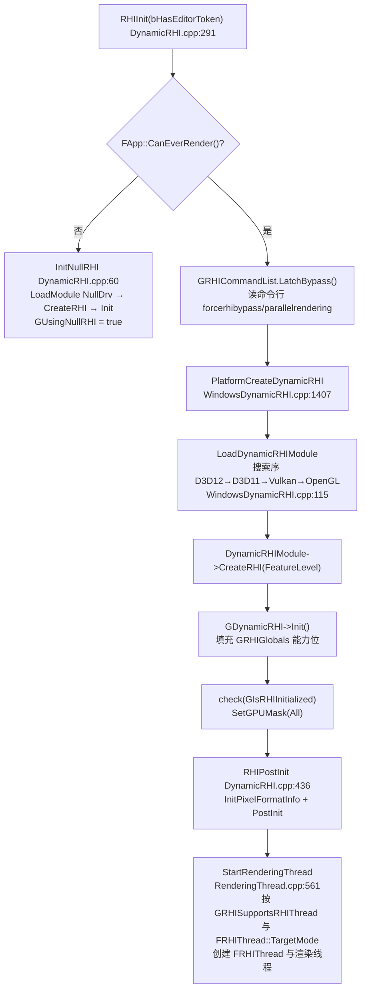

异常路径:`CreateRHI` 失败且 `PLATFORM_ALLOW_NULL_RHI` 时回落 `InitNullRHI()`(`DynamicRHI.cpp:369-375`);编辑器要求 ≥SM5,否则弹窗退出(`DynamicRHI.cpp:349-355`)。

### 6.6.2 帧内主路径(录制→翻译→提交)

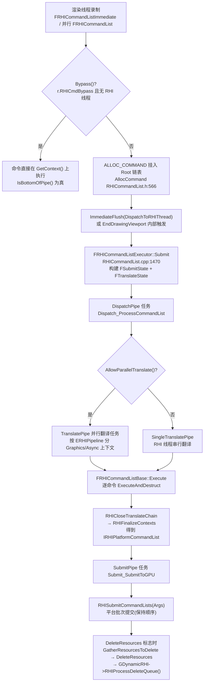

### 6.6.3 呈现(Present)路径

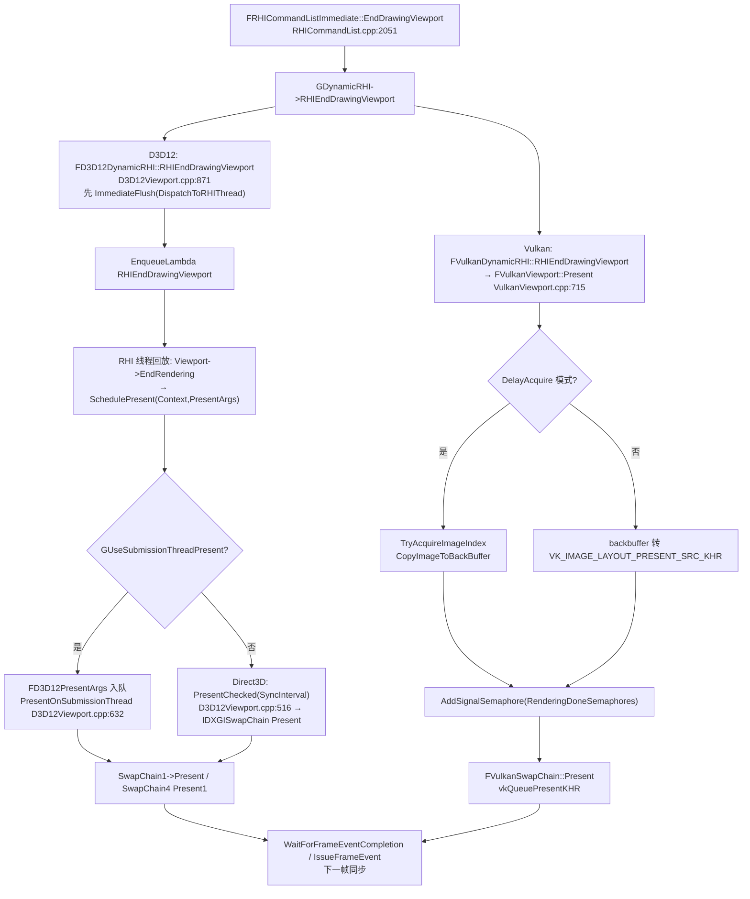

### 6.6.4 GPU 崩溃诊断路径(异常路径)

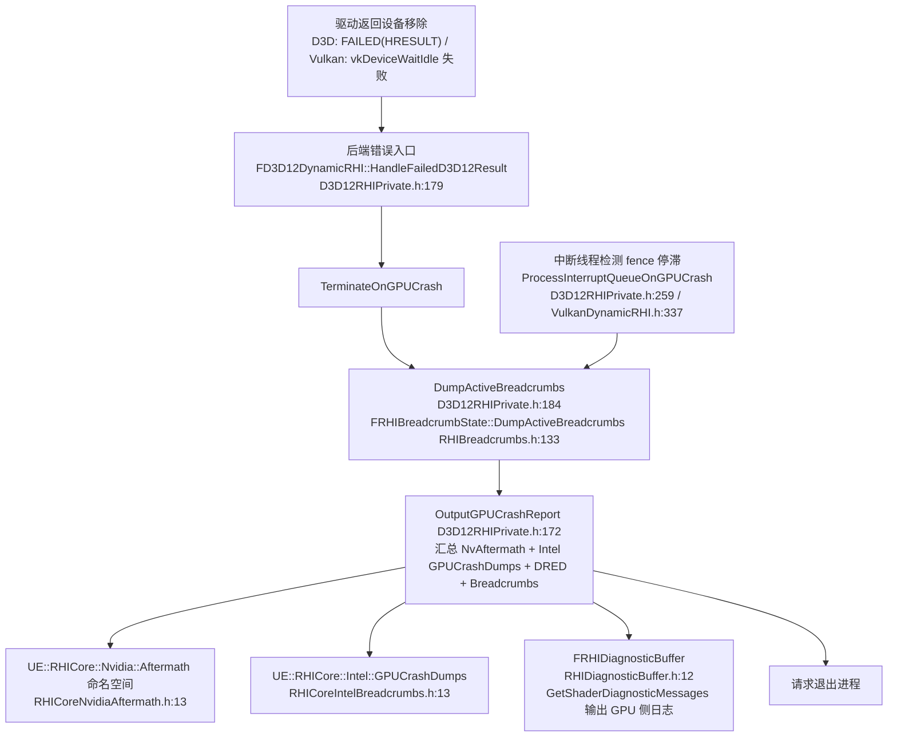

### 6.6.5 资源销毁路径

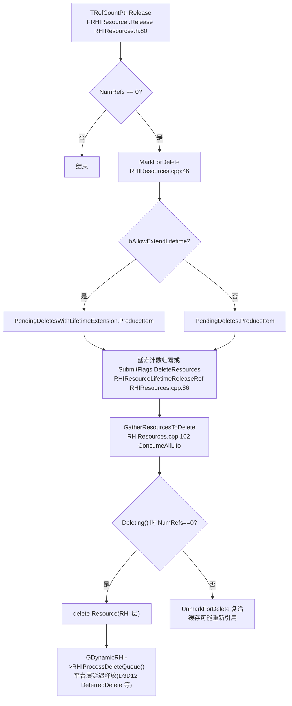

## 6.7 时序图

### 6.7.1 RHI 启动与 RHI 线程创建(GameThread 视角)

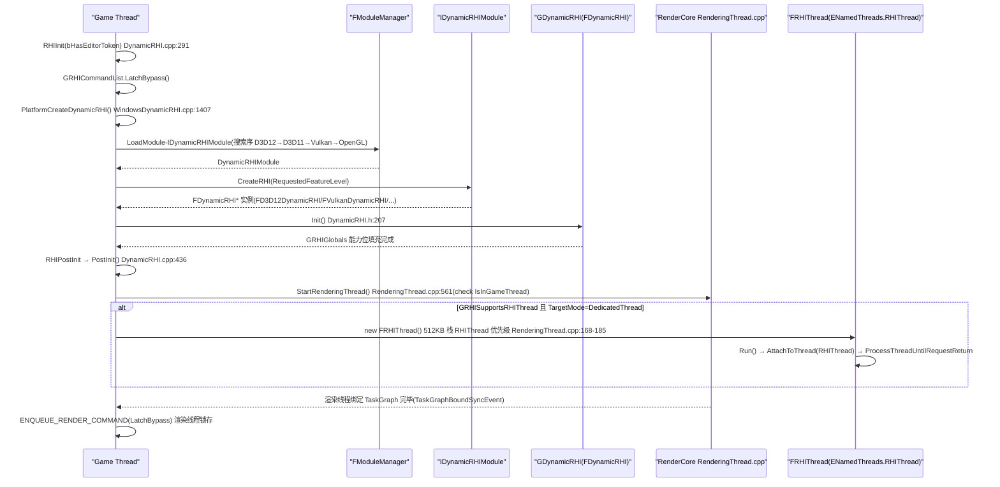

### 6.7.2 帧内命令录制到 GPU 提交(核心路径)

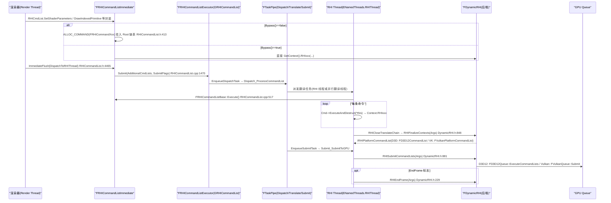

### 6.7.3 视口呈现与 backbuffer 轮转

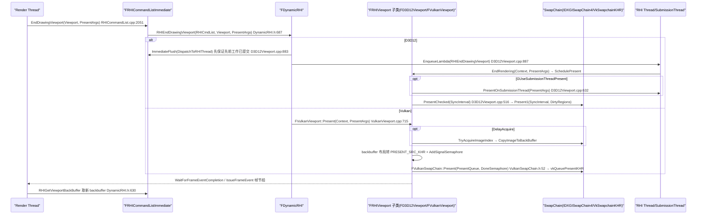

### 6.7.4 资源创建与延迟删除(引用计数生命周期)

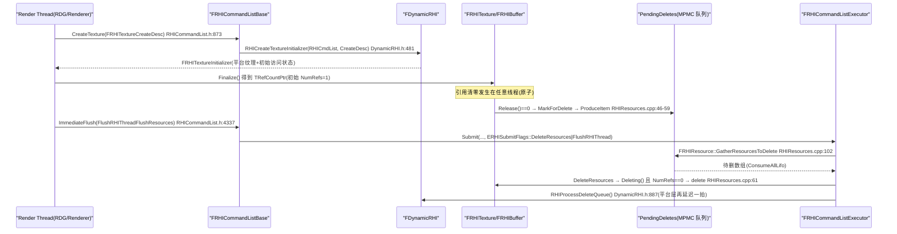

### 6.7.5 GPU 崩溃诊断(Breadcrumbs + Aftermath)

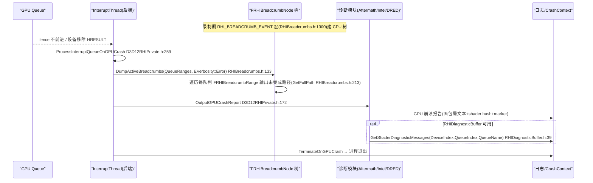

## 6.8 线程模型与同步

### 6.8.1 线程清单与判定依据

| 线程 | 创建/绑定 | 职责 | 判定依据(源码) |
|---|---|---|---|
| Game Thread | 进程主线程 | RHIInit/RHIPostInit/RHICreateViewport/RHIResizeViewport/RHITick(源码注释 "must be called from the main thread",DynamicRHI.h:678-693);ENQUEUE_RENDER_COMMAND 提交渲染命令 | `check(IsInGameThread())`(如 StartRenderingThread,RenderingThread.cpp:563) |
| Render Thread | `FRenderingThread`(FRunnable),`StartRenderingThread()` RenderingThread.cpp:561-654,栈大小 0(默认),`FPlatformAffinity::GetRenderingThreadPriority()` | 执行渲染命令任务(ENamedThreads::ActualRenderingThread),持有 FRHICommandListImmediate 的录制权 | `RenderingThreadMain` RenderingThread.cpp:227,`ENamedThreads::SetRenderThread` |
| RT Heartbeat | `FRenderingThreadTickHeartbeat`,TPri_AboveNormal,80KB RenderingThread.cpp:642-648 | 防渲染线程饿死的看门狗 | 同上 |
| RHI Thread | `class FRHIThread : FRunnable`(文件内静态类,RenderingThread.cpp:161-224);线程名 "RHIThread",512*1024 栈,`FPlatformAffinity::GetRHIThreadPriority()`;以 `ENamedThreads::RHIThread` 挂到 TaskGraph | 回放/翻译命令、执行 RHISubmitCommandLists | `AttachToThread(ENamedThreads::RHIThread)` RenderingThread.cpp:212;全局指针 `static *GRHIThread`(RenderingThread.cpp:224,5.3 之前的 `GRHIThread_InternalUseOnly` 已并入文件内静态) |
| Parallel Translate Tasks | Executor `FTranslateState::TranslatePipe` → `CPrio_SceneRenderingTask`/普通任务线程(RHICommandList.h:5187,5297) | 并行翻译并行渲染的子命令列表 | `AllowParallelTranslate()` RHICommandList.h:471;`ETranslatePriority::Normal/High` RHICommandList.h:4440 |
| 后端 Submission/Interrupt 线程 | D3D12:`FD3D12DynamicRHI::SubmissionThread/InterruptThread`(D3D12RHIPrivate.h:195-196);Vulkan:`FVulkanDynamicRHI::SubmissionThread/InterruptThread`(VulkanDynamicRHI.h:370-372) | 提交线程消费 `PendingPayloadsForSubmission`(MPSC `TQueue<..., EQueueMode::Mpsc>`);中断线程处理 fence 完成与 GPU 崩溃 | `ProcessSubmissionQueue()/ProcessInterruptQueue()`(D3D12RHIPrivate.h:231-232;VulkanDynamicRHI.h:355-357) |
| Shader 编译 worker | ShaderCompileWorker 进程(不属于本层模块) | Editor/Cooker 内跑 ShaderFormat | — |

### 6.8.2 RHI 线程开关与模式

- `r.RHIThread.Enable` 控制台命令:0=off,1=专用线程,2=任务线程(usage 输出 RenderingThread.cpp:1443);写 `GPendingRHIThreadMode`(`RHICommandList.h:106`),下一帧 `StartRenderingThread/StopRenderingThread` 生效。
- 全局状态旗标:`GIsRunningRHIInSeparateThread_InternalUseOnly`、`GIsRunningRHIInDedicatedThread_InternalUseOnly`、`GIsRunningRHIInTaskThread_InternalUseOnly`(RenderingThread.cpp:587-606 赋值);`IsRHIThreadRunning()`/`IsRunningRHIInSeparateThread()` 为公开查询。
- 无独立 RHI 线程时渲染线程 `FScopedRHIThreadOwnership ThreadOwnershipScope(!IsRunningRHIInSeparateThread())` 直接持有 RHI 上下文(RenderingThread.cpp:259);RHI 线程运行时由 RHI 线程持有(`FRHIThread::Run` 内 FScopedRHIThreadOwnership,true)。
- `FRHICommandListImmediate::StallRHIThread/UnStallRHIThread` 用 `GRHIThreadStallRequestCount` 原子计数 + `GRHIThreadOnTasksCritical` 互斥体让渲染线程从命令流"借走"平台上下文(RHICommandList.cpp:2040-2049)。

### 6.8.3 关键同步原语与所有权

| 原语 | 保护对象 | 位置 |
|---|---|---|
| `FRHICommandListBase::MemManager`(FMemStackBase) | 单条命令列表的命令内存;仅录制线程写、翻译线程读(先 FinishRecording 后移交) | RHICommandList.h:456 |
| `FRHICommandListBase::ActivePipelines/Contexts` | 活动管线与上下文;录制与回放线程都会切换(SwitchPipeline) | RHICommandList.h:1179-1191 |
| `FGraphEventRef DispatchEvent` / `FSubmitState::CompletionEvent` | 命令列表派发门槛、一次 Submit 的完成事件(渲染线程 `GetCompletionEvent()` 轮询) | RHICommandList.h:1208/:5214 |
| `FTaskPipe`(原子链表 CAS) | Dispatch/Translate/Submit 三段 FIFO 管道,同管内保序 | RHICommandList.h:5133-5163 |
| `UE::TConsumeAllMpmcQueue<FRHIResource*> PendingDeletes*` | 跨线程资源删除(任意线程 Produce,RHI 提交阶段 Consume) | RHIResources.cpp:12-13 |
| `FRHIResource::FAtomicFlags`(std::atomic_uint) | 引用计数 + 删除标记(低 30 位计数,bit30/bit31 标记) | RHIResources.h:141-221 |
| D3D12:`FD3D12Queue::Fence`(ID3D12Fence 封装)、`TMpscQueue PendingSubmission`、`TSpscQueue PendingInterrupt`、`FCriticalSection SubmissionCS/InterruptCS` | 队列完成追踪与两后端线程交接 | D3D12Device.h:98-101;D3D12RHIPrivate.h:220-232 |
| D3D12:`FD3D12DynamicRHI::ObjectsToDeleteCS + ObjectsToDelete` | 平台对象延迟删除(DeferredDelete) | D3D12RHIPrivate.h:234-249 |
| Vulkan:`FVulkanQueue` 时间线信号量(`NextTimelineSemaphoreValue`/`CompletedTimelineSemaphoreValue`,bUseTimelineSemaphores) | 队列级 GPU 进度同步 | VulkanQueue.h:91-137 |
| Vulkan:`FCriticalSection SubmissionCS/InterruptCS`、`TQueue<FVulkanPlatformCommandList*, Mpsc> PendingPayloadsForSubmission`、`FVulkanSyncPoint`(内存池化 FGraphEvent 封装) | 提交管线与 CPU/GPU 同步点 | VulkanDynamicRHI.h:369-377;VulkanSubmission.h:53-120 |
| OpenGL:上下文所有权 `RHIAcquireThreadOwnership/RHIReleaseThreadOwnership`(FScopedRHIThreadOwnership) | OpenGL 单上下文串行化 | DynamicRHI.h:675-676,1497-1519 |

跨线程数据所有权总则:资源 **创建/更新** 在渲染线程(或并行录制线程,需 `GRHISupportsMultithreadedResources`);命令 **翻译** 在 RHI 线程或并行翻译线程;**提交** 在 RHI 线程 SubmitPipe 或后端 Submission 线程;**完成/中断处理** 在后端 Interrupt 线程;**删除** 汇聚到 RHI 提交流程(DeleteResources 标志)。

## 6.9 配置与扩展点

### CVar / 命令行(源码摘录)

| 名称 | 取值 | 作用 | 位置 |
|---|---|---|---|
| `r.RHICmdBypass` | 0/1/2(2=并行翻译也开) | 锁存到 `bLatchedBypass`;`forcerhibypass`/`parallelrendering` 命令行覆盖 | RHICommandList.cpp:56,1880-1897 |
| `r.RHIThread.Enable` | 0/1/2 | RHI 线程模式(见 6.8.2) | RenderingThread.cpp:1443 附近 |
| `r.WarnOfBadDrivers` / `r.BadDriverWarningIsFatal` | 0/1 | 驱动黑名单告警/致命数 | DynamicRHI.cpp:40-58 |
| `r.IgnorePerformanceModeCheck` / `r.ForcePreferredRHISupport` | bool | 后端选择辅助 | WindowsDynamicRHI.cpp:123-135 |
| `PlatformRHI=`(命令行) | 平台名 | 导入式 RHI 配置读取 | WindowsDynamicRHI.cpp:51-61 |
| `OverrideSP=`(命令行) | ShaderPlatform 名 | 编辑器预览平台覆盖(GShaderPlatformForFeatureLevel) | DynamicRHI.cpp:387-418 |
| `r.FinishCurrentFrame` | 0/1 | Present 前是否等上一帧 | D3D12Viewport.cpp:915 |
| Vulkan:`GVulkanDelayAcquireImage`(DelayAcquire 等) | 枚举 | backbuffer 延迟获取 | VulkanViewport.cpp:744 |

### ini / 数据驱动

- `[/Script/Engine.RendererSettings]`、`[SystemSettings]` 中 `r.*` 系列最终落到上述 CVar;`[DeviceCanUpdateDriverList]`(GHardwareIni)驱动白名单(DynamicRHI.cpp:114)。
- `DataDrivenShaderPlatformInfo`:RHIInit 时 `FGenericDataDrivenShaderPlatformInfo::Initialize()`(DynamicRHI.cpp:300),每个 `EShaderPlatform` 的能力由 DataDrivenShaderPlatformInfo.ini 驱动。
- 平台选择:`GRHISearchOrder[]`(WindowsDynamicRHI.cpp:115-121)、`[/Script/WindowsTargetPlatform.WindowsTargetSettings]` 的 DefaultGraphicsRHI/PreferredRHI 等(读取见 LoadDynamicRHIModule);`ImportedRHI` 段支持外部 RHI 模块注入。

### 模块接口与委托(扩展点)

| 扩展点 | 说明 | 位置 |
|---|---|---|
| `IDynamicRHIModule`(`IsSupported()/CreateRHI()`) | 新图形后端接入点:实现模块 + `PlatformCreateDynamicRHI` 接线 | DynamicRHI.h:1466-1483 |
| `IShaderFormatModule::GetShaderFormat()` | 新着色器目标(ShaderFormat)接入点 | IShaderFormatModule.h:13 |
| `FRHIViewport::SetCustomPresent(FRHICustomPresent*)` | VR/媒体插件接管 Present | RHIResources.h:2583 |
| `FRHIViewport::CreateNativeLayer/DeleteNativeLayer/SetDefaultNativeLayer` | 平台原生分层视图(Metal/macOS NSView) | RHIResources.h:2591-2603 |
| `RHIGetNativeDevice/PhysicalDevice/GraphicsQueue/ComputeQueue` + `IVulkanDynamicRHI`(RHIGetVkInstance 等 20+ 方法) | 插件取原生对象二次开发 | DynamicRHI.h:767-795;VulkanDynamicRHI.h:79-112 |
| `FValidationRHI`(ENABLE_RHI_VALIDATION) | 校验层装饰器,`GetNonValidationRHI()` 穿透 | RHIValidation.h:43 |
| `GPUDefragAllocator`、`PipelineFileCache`(FPipelineFileCache)、`PipelineStateCache`(RenderCore 侧 GetAndOrCreateGraphicsPipelineState) | 纹理池碎片整理 / PSO 磁盘缓存 | RHI/Public/GPUDefragAllocator.h、PipelineFileCache.h、PipelineStateCache.h |
| `IRHITransientResourceAllocator` + RHICore `FRHITransientResourceHeapAllocator` | 瞬态资源(BARS/heap aliasing)扩展 | RHI/Public/RHITransientResourceAllocator.h;RHICoreTransientResourceAllocator.h:679 |
| 渲染线程启停委托 `RegisterStopRenderingThreadDelegate` | 引擎模块在渲染线程启停时挂钩 | RenderingThread.cpp:656-666 |

## 6.10 已知限制/未确认项

1. **MetalRHI 细节未逐行核对**:已确认位置 `Source/Runtime/Apple/MetalRHI`(5.8 从旧 Platforms/IOS 目录迁移合并),类名 `FMetalDynamicRHI`(MetalDynamicRHI.h:73)、命令队列/编码器文件存在(MetalCommandQueue.h/MetalCommandEncoder.h),但本章未对其做与 D3D12/Vulkan 同级别的逐文件阅读,其内部提交流程仅按接口共性描述。
2. **`GRHIThread_InternalUseOnly` 命名差异**:任务书中的 `GRHIThread_InternalUseOnly` 在 5.8.3 中为 RenderCore/RenderingThread.cpp 内的文件级静态指针 `GRHIThread`(RenderingThread.cpp:224)且导出形式为 `GIsRunningRHIInSeparateThread_InternalUseOnly` 等三旗标;`bRHIThreadEnabled` 这一变量名未在源码出现,对应物是 `GPendingRHIThreadMode`/`FRHIThread::TargetMode`。
3. **任务书中的 `FVulkanCommandBufferManager`** 在 5.8.3 已不存在(旧版类名);等价职责由 `FVulkanContextCommon`/`FVulkanCommandListContext`(VulkanContext.h:58/245)+ `FVulkanPayload`(VulkanSubmission.h:147)承担。
4. `FRHIGlobals` 字段超过 120 个,6.4.2 表按域归组列出主要项,未逐字段穷举(完整字段以 RHIGlobals.h:87-803 为准)。
5. `FDynamicRHI` 接口表中省略了仅条件编译的变体(`#if ENABLE_LOW_LEVEL_MEM_TRACKER` 的 `RHIUpdateAllocationTags` 保留,`PLATFORM_SUPPORTS_MESH_SHADERS && PLATFORM_USE_FALLBACK_PSO` 的第二 `RHICreateBoundShaderState` 重载在表 B 注明);`RHIReadSurfaceData(FLinearColor...)` 等 RHI_API 默认实现与 `SerializeAccelerationStructure` 等 !Shipping 条目均已列出但标注为"默认实现"。
6. D3D12 的 `FD3D12Adapter` 内部(多 GPU LDA/NegativeOffset、`FD3D12BarrierBatcher`/增强屏障状态)与 Vulkan 的 `FVulkanPipelineCache`/`FVulkanChunkedPipelineCache` 只在类图/清单层覆盖,未展开内部算法;`D3D12LegacyBarriers/D3D12EnhancedBarriers` 的屏障 diff 细节未逐行核对(已知:由 `ID3D12Barriers.h` 接口 + `D3D12BarriersFactory.h` 选择实现)。
7. ShaderFormatD3D、MetalShaderFormat、ShaderPreprocessor 不在本章范围;`CompileVulkanShader` 的内部多入口(hitgroup/多 entry)路径只引用未展开。
8. `Engine/Platforms` 下(5.8.3)确认没有 RHI 后端模块,只有平台扩展(如 VisionOS 的 TargetPlatform/插件);MetalRHI 实际位于 Source/Runtime/Apple(见 6.1)。
9. 时序图中 D3D12 `PresentChecked`(D3D12Viewport.cpp:516)与 `PresentOnSubmissionThread`(:632)的精确互斥条件(`GUseSubmissionThreadPresent` CVar 与平台定义)按源码注释与调用点归纳,未做运行验证。

## 6.11 附录索引

本章覆盖模块与对应附录(相对 `docs/ue5.8.3/appendix/api/`):

| 模块 | 附录文件 |
|---|---|
| Runtime/RHI | Runtime/RHI.md |
| Runtime/RHICore | Runtime/RHICore.md |
| Runtime/D3D12RHI | Runtime/D3D12RHI.md |
| Runtime/VulkanRHI | Runtime/VulkanRHI.md |
| Runtime/OpenGLDrv | Runtime/OpenGLDrv.md |
| Runtime/NullDrv | Runtime/NullDrv.md |
| Runtime/Apple/MetalRHI | Runtime/MetalRHI.md |
| Developer/ShaderFormatOpenGL | Developer/ShaderFormatOpenGL.md |
| Developer/VulkanShaderFormat | Developer/VulkanShaderFormat.md |
| Developer/ShaderCompilerCommon | Developer/ShaderCompilerCommon.md |
| (边界参考)Runtime/D3D11RHI、Runtime/WindowsD3D、Developer/ShaderFormatD3D、Developer/MetalShaderFormat、Developer/ShaderPreprocessor | Runtime/D3D11RHI.md、Runtime/WindowsD3D.md、Developer/ShaderFormatD3D.md、Developer/MetalShaderFormat.md、Developer/ShaderPreprocessor.md |
| Engine/Platforms(无 RHI 模块,仅平台扩展) | Platforms/VisionOSRuntimeSettings.md 等 |

