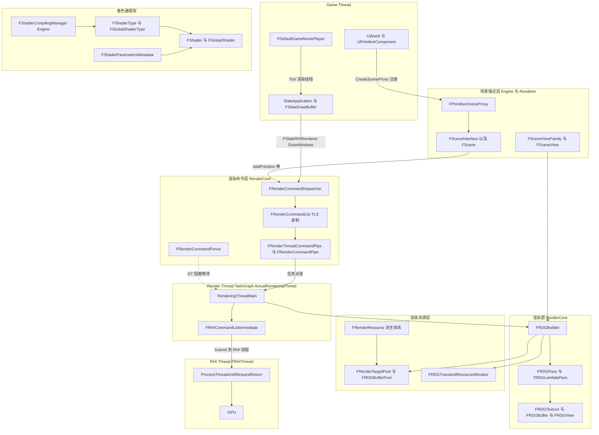
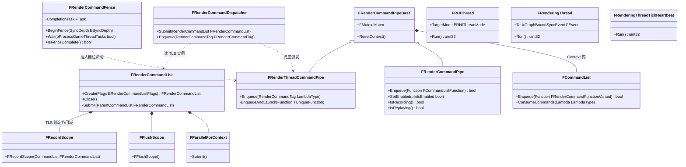
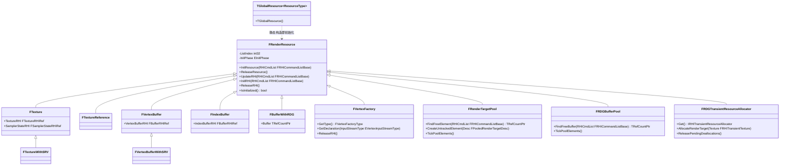
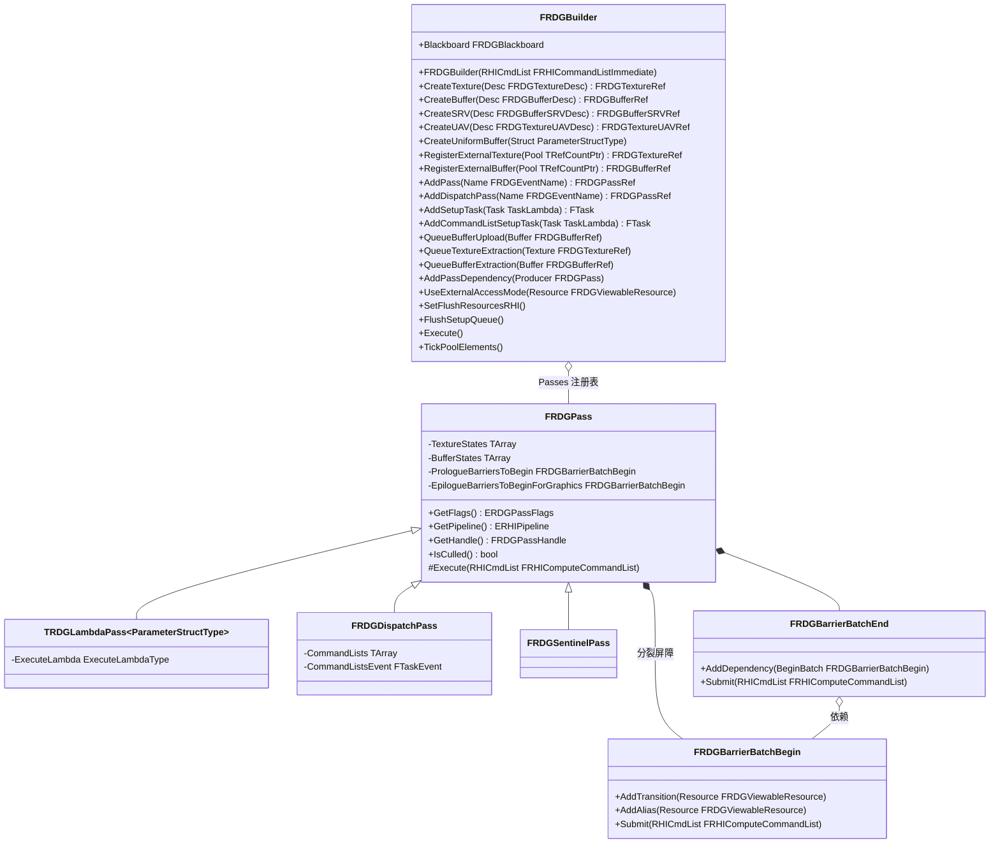
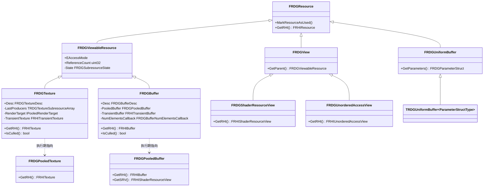
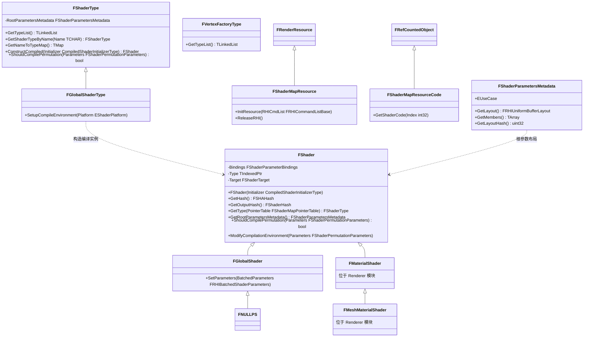
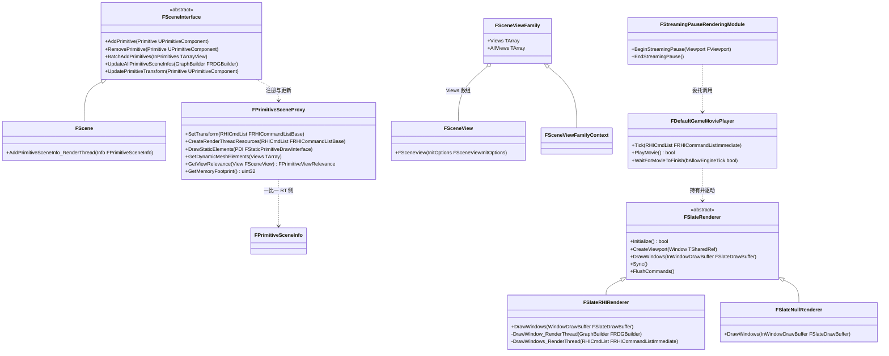

# 07 RenderCore:渲染线程、RDG、着色器框架与渲染资源

> 源码根 `$UE=/home/timeshift/opensource/game_engine/unreal/UnrealEngine-5.8.3-release`、`$E=$UE/Engine`。本章所有路径相对 `$E/Source/...` 书写,行号为 5.8.3 源码实测行号;所有结论均来自本次对源码的逐文件阅读,未凭记忆推断。

范围:Runtime/RenderCore 全部;Engine 的 SceneProxies 与 Rendering(FPrimitiveSceneProxy、FSceneInterface、FSceneViewFamily、FSceneView、FScene::AddPrimitive 的 GT→RT 命令);Renderer 模块中承载这些接口的 FScene 实现与 FMaterialShader 族;SlateRHIRenderer / SlateBaseRenderer / SlateNullRenderer;StreamingPauseRendering;MoviePlayer。重点:GameThread→RenderThread→RHIThread 三级流水线与跨线程数据所有权规则。

文件组织:本文件含 7.1~7.5(模块清单、总体架构、类图、数据字典、接口清单);`07_rendercore_rdg_renderthread_part2.md` 续篇含 7.6~7.11(关键流程、时序图、线程模型、配置与扩展点、已知限制、附录索引),见文末索引。

## 7.1 职责、边界与模块清单

| 模块 | 路径 | Build.cs 中的 Public/Private 依赖 | 职责一句话 |
|---|---|---|---|
| RenderCore | Runtime/RenderCore | Public: RHI、CoreUObject;Private: Core、Projects、ApplicationCore、TraceLog、StateStream、Json、BuildSettings(RenderCore.Build.cs) | 渲染线程/RHI 线程生命周期、渲染命令队列与管道、FRenderCommandFence、RDG 全套、着色器元数据与全局着色器、FRenderResource 体系与渲染目标池 |
| Engine(仅 SceneProxies/Rendering 部分) | Runtime/Engine | Public: Renderer、RHI、Shaders 等;PrivateIncludePath: RenderCore、Slate 等(Engine.Build.cs:20-31、94-96) | FPrimitiveSceneProxy、FSceneInterface、FSceneViewFamily、FSceneView 等 GT 侧场景描述与代理接口 |
| Renderer(仅 FScene/FMaterialShader 部分) | Runtime/Renderer | Public: RenderCore 等(Renderer.Build.cs:46) | FScene 实现 FSceneInterface(含 AddPrimitive 的 GT→RT 命令链)与 FMaterialShader/FMeshMaterialShader 着色器族 |
| SlateRHIRenderer | Runtime/SlateRHIRenderer | Public: SlateBaseRenderer;Private: Core、CoreUObject、DeveloperSettings、Slate、SlateCore、Engine、RHI、RenderCore、Renderer、ImageCore、HeadMountedDisplay | Slate 的 RHI 渲染实现:批处理/字体/纹理资源、窗口 Present,经 ENQUEUE_RENDER_COMMAND 提交渲染线程 |
| SlateBaseRenderer | Runtime/SlateBaseRenderer | Public: Core、CoreUObject、Slate、SlateCore | Slate 渲染器公共层:SlateFX 后处理缓冲接口、字体蓝图库 |
| SlateNullRenderer | Runtime/SlateNullRenderer | Private: Core、CoreUObject、SlateCore;带引擎构建时追加 Engine、RenderCore、SlateBaseRenderer、RHI | 无 RHI 的空 Slate 渲染器(服务器、commandlet) |
| StreamingPauseRendering | Runtime/StreamingPauseRendering | Public: Engine、MoviePlayer、Slate | 阻塞加载期间的"流送暂停"渲染:场景渲到离屏目标后由 FBackgroundView 贴回 Slate 视口 |
| MoviePlayer | Runtime/MoviePlayer | Public: Engine、ApplicationCore | 启动影片与加载屏幕(FDefaultGameMoviePlayer,渲染线程 Tick),在引擎完整 Tick 之外驱动 Slate 渲染 |

## 7.2 总体架构

数据流自上而下:游戏线程维护 UObject 世界与 Slate UI;注册/更新时创建不可变的场景代理(FPrimitiveSceneProxy)并通过 `FSceneInterface` 把变更翻译成渲染命令;渲染线程上,Renderer 用 `FRDGBuilder` 声明式地组织 pass 与资源,RDG 负责裁剪、屏障与资源池分配;pass lambda 通过 `FRHICommandListImmediate` 记录 RHI 命令,再由 RHI 线程翻译/提交到 GPU。着色器框架(FShader/FShaderType/FShaderParametersMetadata)在编辑器/烹饪期由 FShaderCompilingManager 编译,运行期只读。

要点(均可在源码定位):
- 渲染线程不是自由线程,而是 TaskGraph 具名线程:`RenderingThreadMain` 中 `ENamedThreads::SetRenderThread(ENamedThreads::ActualRenderingThread)` 后 `FTaskGraphInterface::Get().AttachToThread(RenderThread)`(RenderingThread.cpp:227-243)。
- RHI 线程模式由 `FRHIThread::TargetMode`(ERHIThreadMode::DedicatedThread/Tasks/None)决定,`StartRenderingThread` 按模式创建 `FRHIThread`(RenderingThread.cpp:161-224、584-607)。
- 命令入口统一为宏 `ENQUEUE_RENDER_COMMAND`(RenderingThread.h:1087-1089),5.8 起经 `FRenderCommandDispatcher` 分发到 TLS 命令列表或渲染命令管道。

## 7.3 类图

### 7.3.1 渲染命令与同步(RenderingThread.h / RenderCommandFence.h)

类职责(一行一个,均为真实类):
- `FRenderCommandDispatcher`(RenderingThread.h:979):ENQUEUE_RENDER_COMMAND 宏的静态分发入口,优先写入 TLS 中的 FRenderCommandList,否则投递到渲染线程管道。
- `FRenderCommandPipeBase`(RenderingThread.h:394):管道公共基类,持有互斥锁与可迁移的 FContext(线性分配器 + 命令链表)。
- `FRenderThreadCommandPipe`(RenderingThread.h:437):渲染线程专属管道单例;模式为 None 时回退为 `TGraphTask<TRenderCommandTask>`。
- `FRenderCommandPipe`(RenderingThread.h:561):命名异步管道(DECLARE_RENDER_COMMAND_PIPE 声明),命令可在任意任务线程回放。
- `FRenderCommandList`(RenderingThread.h:740):线程本地可录制命令列表,FRecordScope 绑定 TLS,Submit 时汇入父列表或全局管道。
- `FRenderCommandFence`(RenderCommandFence.h:14):GT→RT/RHI/交换链三级深度的栅栏,内部是 `UE::Tasks::FTask CompletionTask`。
- `FRHIThread`(RenderingThread.cpp:161):RHI 线程 Runnable,线程名 "RHIThread",512KB 栈。
- `FRenderingThread`(RenderingThread.cpp:321):渲染线程 Runnable,Run() 进入 RenderingThreadMain。
- `FRenderingThreadTickHeartbeat`(RenderingThread.cpp:444):心跳线程("RTHeartBeat N",TPri_AboveNormal),防止渲染线程饿死 Tickable。

### 7.3.2 FRenderResource 渲染资源体系(RenderResource.h / RenderTargetPool.h / RenderGraphResourcePool.h / VertexFactory.h)

类职责:
- `FRenderResource`(RenderResource.h:36):渲染线程拥有的资源基类;Init/Release 通过全局 `FRenderResourceList` 按 `EInitPhase::Pre/Default` 登记以支持设备重建(RenderResource.cpp:20-111)。
- `FTexture`/`FVertexBuffer`/`FIndexBuffer`(RenderResource.h:260/377/412):对 RHI 资源的最薄封装,ReleaseRHI 释放引用。
- `TGlobalResource<T>`(RenderResource.h:445):静态全局资源的 RAII 包装,构造时若在渲染线程直接 InitResource,否则 `BeginInitResource` 排队。
- `FRenderTargetPool`(RenderTargetPool.h:98):池化渲染目标,`FindFreeElement` 分配/复用,`TickPoolElements` 每帧回收;全局实例 `GRenderTargetPool`(RenderTargetPool.cpp:13)。
- `FRDGBufferPool`(RenderGraphResourcePool.h:15):RDG 池化缓冲,语义同上,全局实例在 RenderGraphResourcePool.cpp 中。
- `FRDGTransientResourceAllocator`(RenderGraphResourcePool.h:113):包装 `IRHITransientResourceAllocator`,全局实例 `GRDGTransientResourceAllocator`(RenderGraphResourcePool.cpp:415,Pre 阶段 TGlobalResource)。
- `FVertexFactory`(VertexFactory.h:655):顶点工厂基类,同时是 FRenderResource(持有顶点声明 FVertexDeclarationRHIRef)。

### 7.3.3 RDG 渲染图(RenderGraphBuilder.h / RenderGraphPass.h / RenderGraphResources.h)

FRDGBuilder 另有资源注册表成员 `Passes/Textures/Buffers/Views/UniformBuffers`(RenderGraphBuilder.h:533-537)与 ProloguePass/EpiloguePass 哨兵(RenderGraphBuilder.h:464-465)。资源类继承链:

类职责:
- `FRDGBuilder`(RenderGraphBuilder.h:50):一个图作用域的构建器,栈上创建、Execute 后析构;持有帧级线性分配器作用域 `FRDGAllocatorScope RootAllocatorScope`。
- `FRDGPass`(RenderGraphPass.h:217):pass 基类,记录参数结构、Pipeline、纹理/缓冲状态与 prologue/epilogue 分裂屏障批次。
- `TRDGLambdaPass<P,L>`(RenderGraphPass.h:567):lambda pass;lambda 参数类型决定任务模式(Immediate→Inline,FRDGAsyncTask 标记→Async,其余→Await)。
- `FRDGDispatchPass`(RenderGraphPass.h:715):用户自管并行命令列表的派发 pass。`FRDGSentinelPass`(RenderGraphPass.h:821):图 Prologue/Epilogue 哨兵。
- `FRDGTexture`(RenderGraphResources.h:569)/`FRDGBuffer`(:1307):图级纹理/缓冲;引用计数为 0 即被裁剪(IsCulled)。
- `FRDGPooledTexture`(:541)/`FRDGPooledBuffer`(:1194):池对象的引用计数包装,内建 SRV/UAV 视图缓存与瞬态分配栅栏。
- `FRDGUniformBuffer`(:195)/`TRDGUniformBuffer
`(:254):图级统一缓冲。

### 7.3.4 着色器框架(Shader.h / GlobalShader.h / ShaderParameterMetadata.h / ShaderCompilerJobTypes.h / Engine ShaderCompiler.h)

补充(非 RenderCore,但属本章框架链路):
- `FMaterialShader`/`FMeshMaterialShader` 定义于 Renderer/Public/MaterialShader.h:29/40 附近(FMaterialShader : FShader,FMeshMaterialShader : FMaterialShader),材质参数集合的着色器基类;其编译调度同样经过 FShaderType/FShaderCompilingManager。
- `FShaderCompilingManager`(Engine/Public/ShaderCompiler.h:934):`class FShaderCompilingManager : IAssetCompilingManager`,全局实例 `GShaderCompilingManager`(ShaderCompiler.h:1371)。它不属于 RenderCore,但 RenderCore 的 `FShaderMapCompileResults`(ShaderCompilerJobTypes.h:20)与 `FShaderCommonCompileJob` 就是为它准备的数据结构。

### 7.3.5 Engine 场景侧与 Slate/影片渲染

类职责:
- `FSceneInterface`(Engine/Public/SceneInterface.h:119):场景渲染接口的抽象根,GT 侧增删改图元的入口(纯虚 `AddPrimitive/RemovePrimitive/BatchAddPrimitives` 等)。
- `FScene`(Renderer/Private/ScenePrivate.h:1624,`class FScene : public FSceneInterface`;实现大量在 RendererScene.cpp):FSceneInterface 的游戏场景实现;`AddPrimitiveSceneInfo_RenderThread`(RendererScene.cpp:1069)在渲染线程真正入图。
- `FPrimitiveSceneProxy`(Engine/Public/PrimitiveSceneProxy.h:291):图元代理基类,由 UPrimitiveComponent 在 GT 创建、在 RT 使用/销毁(析构经 `ReleaseResources` 类延迟清理,见 7.8)。
- `FSceneView`(Engine/Public/SceneView.h:1481):单个视口的渲染视图;`FSceneViewFamily`(SceneView.h:2320)持有共享 RenderTarget/ShowFlags 的视图集合。
- `FSlateRenderer`(SlateCore/Public/Rendering/SlateRenderer.h:221):Slate 渲染器抽象接口;`FSlateRHIRenderer`(SlateRHIRenderer/Private/SlateRHIRenderer.h:40)为 RHI 实现,`FSlateNullRenderer`(SlateNullRenderer/Private/SlateNullRenderer.h:17)为空实现。
- `FDefaultGameMoviePlayer`(MoviePlayer/Private/DefaultGameMoviePlayer.h:56):`FTickableObjectRenderThread + IGameMoviePlayer`,在渲染线程 Tick 中驱动加载屏幕绘制。
- `FStreamingPauseRenderingModule`(StreamingPauseRendering/Public/StreamingPauseRendering.h:17):流送暂停模块,持有 SceneViewport/SViewport/BackgroundView 把暂停帧贴回 UI。

## 7.4 数据字典

### 7.4.1 渲染线程与命令层

| 类型/字段 | 类型 | 含义 | 取值/约束 | 源码位置 |
|---|---|---|---|---|
| `GIsThreadedRendering` | `bool` | 是否运行独立渲染线程;false 时命令立即执行 | 由 StartRenderingThread/StopRenderingThread 维护 | RenderingThread.h:63 |
| `GUseThreadedRendering` | `bool` | 是否应创建渲染线程(命令行/ToggleRenderingThread) | 默认 true | RenderingThread.h:69 |
| `GPendingUseThreadedRendering` | `TOptional<bool>` | togglerenderthread 待生效状态 | LatchRenderThreadConfiguration 消费 | RenderingThread.h:72 |
| `GRenderThreadId` | `uint32`(4.26 起废弃) | 渲染线程 OS 线程号 | FRenderingThread::Init 写入、Exit 清零 | CoreGlobals.h:563、RenderingThread.cpp:344 |
| `GRenderCommandPipeMode` | `ERenderCommandPipeMode` | 管道模式 | None=0/RenderThread=1/All=2,默认 CVar r.RenderCommandPipeMode=2 | RenderingThread.h:390、RenderingThread.cpp:138-149 |
| `GRenderCommandFenceBundling` | `bool` | 栅栏捆绑优化开关 | r.RenderCommandFenceBundling,默认 true | RenderingThread.cpp:99-107 |
| `GMainThreadBlockedOnRenderThread` | `TAtomic<bool>` | GT 是否正阻塞于渲染线程(Flush 时) | CheckNotBlockedOnRenderThread 检查 | RenderingThread.h:78 |
| `GIsRenderingThreadHealthy` | `bool`(Core) | 渲染线程是否存活 | 崩溃时置 false | RenderingThread.cpp:408 |
| `ERenderCommandPipeMode` | enum class uint8 | 管道启用范围 | None/RenderThread/All | RenderingThread.h:153-163 |
| `ERenderCommandListFlags` | enum class uint8 | 命令列表标志 | None/CloseOnSubmit | RenderingThread.h:715-721 |
| `FRenderCommandFence::ESyncDepth` | enum class | 栅栏信号深度 | RenderThread/RHIThread/Swapchain | RenderCommandFence.h:17-29 |
| `FFrameEndSync::EFlushMode` | enum class | 帧末同步模式 | EndFrame(等 N-m 帧)/Threads(全空) | RenderingThread.h:46-53 |
| `FRHIThread::TargetMode` | `ERHIThreadMode` | RHI 线程模式 | DedicatedThread(默认)/Tasks/None | RenderingThread.cpp:166 |
| `GTimeToBlockOnRenderFence` | int32 | GT 等栅栏单次等待毫秒 | g.TimeToBlockOnRenderFence,默认 1,夹紧 0..33 | RenderingThread.cpp:1081-1086 |
| `GTimeoutForBlockOnRenderFence` | int32 | GT 等栅栏总超时毫秒 | 默认 120000,超时按挂死处理 | RenderingThread.cpp:1089-1094 |
| `GRenderThreadTime/GRHIThreadTime/GSwapBufferTime` | uint32 | 三线程每帧耗时统计(周期) | FViewport::Draw 写入 | RenderingThread.cpp:152-158、1069-1079 |
| `GRunRenderingThreadHeartbeat` | `TAtomic<bool>` | 心跳线程运行标志 | StartRenderingThread 置 true | RenderingThread.cpp:425 |
| `GRenderingThreadMaxIdleTickFrequency` | float | 心跳/空闲 tick 频率上限 | 默认 40.f | RenderingThread.cpp:72 |

### 7.4.2 RDG

| 类型/字段 | 类型 | 含义 | 取值/约束 | 源码位置 |
|---|---|---|---|---|
| `ERDGPassFlags` | enum class uint16 | pass 工作负载类别 | Raster=1&lt;&lt;0、Compute=1&lt;&lt;1、AsyncCompute=1&lt;&lt;2、Copy=1&lt;&lt;3、NeverCull=1&lt;&lt;4、SkipRenderPass=1&lt;&lt;5、NeverMerge=1&lt;&lt;6、NeverParallel=1&lt;&lt;7、Readback=Copy\|NeverCull | RenderGraphDefinitions.h:129-161 |
| `ERDGBuilderFlags` | enum class | 构建器并行开关 | ParallelSetup=1、ParallelCompile=2、ParallelExecute=4、Parallel=全开 | RenderGraphDefinitions.h:111-126 |
| `ERDGPassTaskMode` | enum class uint8 | pass 执行任务模式 | Inline(仅渲染线程)/Await(任务但 Execute 末等待)/Async(任务且手动同步) | RenderGraphPass.h:173-183 |
| `ERDGSetupTaskWaitPoint` | enum class uint8 | setup 任务同步点 | Compile(默认)/Execute | RenderGraphDefinitions.h:210-219 |
| `ERDGTextureFlags` | enum class uint8 | 纹理标志 | MultiFrame/SkipTracking/ForceImmediateFirstBarrier/MaintainCompression | RenderGraphDefinitions.h:186-208 |
| `ERDGBufferFlags` | enum class uint8 | 缓冲标志 | MultiFrame/SkipTracking/ForceImmediateFirstBarrier | RenderGraphDefinitions.h:164-183 |
| `ERDGUnorderedAccessViewFlags` | enum class uint8 | UAV 标志 | None/SkipBarrier(连续使用免 UAV 屏障) | RenderGraphDefinitions.h:222-229 |
| `ERDGInitialDataFlags` | enum class uint8 | 上传数据所有权 | None(拷贝)/NoCopy(用户保活) | RenderGraphDefinitions.h:275-289 |
| `ERDGViewableResourceType` | enum class uint8 | 可视图资源类别 | Texture/Buffer | RenderGraphDefinitions.h:232-237 |
| `ERDGViewType` | enum class uint8 | 视图类别 | TextureUAV/TextureSRV/BufferUAV/BufferSRV | RenderGraphDefinitions.h:240-247 |
| `FRDGPass::PackedBits` | uint16 位域 | bSkipRenderPassBegin/End、bAsyncComputeBegin/End、bGraphicsFork/Join、bSentinel、bDispatchAfterExecute、bDispatchPass | 编译期由 CompilePassOps 等设置 | RenderGraphPass.h:396-422 |
| `FRDGPass::TextureStates/BufferStates` | TArray | pass 对每个纹理/缓冲的状态与引用计数 | SetupPassResources 构建 | RenderGraphPass.h:480-514 |
| `FRDGPass::GraphicsForkPass/GraphicsJoinPass` | FRDGPassHandle | AsyncCompute 区间的图形侧 fork/join pass | Compile 阶段推导 | RenderGraphPass.h:463-467 |
| `FRDGTexture::Desc/Flags` | const FRDGTextureDesc/ERDGTextureFlags | 描述与标志 | 构造后不变 | RenderGraphResources.h:575-576 |
| `FRDGTexture::State/FirstState/MergeState` | FRDGTextureSubresourceState | 子资源态、图首态、合并态 | 构图期更新 | RenderGraphResources.h:643-649 |
| `FRDGTexture::LastProducers` | `TRDGTextureSubresourceArray<FRDGProducerStatesByPipeline>` | 每个子资源最后生产 pass(裁剪/屏障依据) | 构图期更新 | RenderGraphResources.h:652 |
| `FRDGTexture::RenderTarget/TransientTexture` | 指针 | 执行期分配的池/瞬态对象 | 一旦赋值不复位 | RenderGraphResources.h:655-658 |
| `FRDGBuffer::PooledBuffer/TransientBuffer` | 指针 | 同上(缓冲) | 一旦赋值不复位 | RenderGraphResources.h:1379-1382 |
| `FRDGBuffer::NumElementsCallback` | `FRDGBufferNumElementsCallback*` | 延迟决定元素数的回调 | FinalizeDescs 消费 | RenderGraphResources.h:1394 |
| `FRDGBuffer::PendingCommitSize` | uint64 | 保留缓冲待提交尺寸 | QueueCommitReservedBuffer | RenderGraphResources.h:1397 |
| `FRDGViewableResource::ReferenceCount` | uint32 | 图内引用计数 | 0 = IsCulled | RenderGraphResources.h(基类成员,FRDGTexture::IsCulled 引用) |
| `FRDGBuilder::ProloguePass/EpiloguePass` | FRDGPass* | 图首尾哨兵(Epilogue 是裁剪根) | ctor 建 Prologue、Execute 建 Epilogue | RenderGraphBuilder.h:464-465、RenderGraphBuilder.cpp:598/1793 |
| `FRDGBuilder::bSupportsAsyncCompute/bSupportsRenderPassMerge` | bool | 平台能力缓存 | IsAsyncComputeSupported/IsRenderPassMergeEnabled | RenderGraphBuilder.h:467-469、RenderGraphPrivate.h:224-234 |
| `FRDGTransitionInfo` | 64 位位域结构 | 打包的屏障前/后 Access、资源句柄与类型 | AccessBefore 21bit 等 | RenderGraphPass.h:58-84 |
| `FRDGPassHandle` 等句柄 | `TRDGHandle<T,uint32>` | 注册表索引句柄,支持 ++ 比较 | kNullIndex=IndexType 最大值 | RenderGraphDefinitions.h:343-435 |

### 7.4.3 着色器框架

| 类型/字段 | 类型 | 含义 | 取值/约束 | 源码位置 |
|---|---|---|---|---|
| `FShader::Bindings` | `FShaderParameterBindings` | 参数到寄存器的绑定表 | 编译输出构建 | Shader.h:733、962 |
| `FShader::OutputHash` | `FShaderHash` | 编译产物哈希,用于资源去重 | LAYOUT_FIELD_EDITORONLY | Shader.h:973 |
| `FShader::Type/VFType` | `TIndexedPtr<FShaderType>/TIndexedPtr<FVertexFactoryType>` | 序列化友好的类型指针 | 冻结内存镜像 | Shader.h:982-984 |
| `FShader::ResourceIndex` | int32 | 在 FShaderMapResource 中的下标 | 构造时分配 | Shader.h:990 |
| `FShaderType::EShaderTypeForDynamicCast` | enum class uint32 | 动态转换用类别(SHADER_TYPE_LIST) | Global/MeshMaterial/... | Shader.h:1238-1242 |
| `FShaderType` 函数指针组 | typedef | ConstructSerialized/ConstructCompiled/ShouldCompilePermutation/ModifyCompilationEnvironment 等 | IMPLEMENT_SHADER_TYPE 注册 | Shader.h:1254-1267 |
| `FShaderParametersMetadata::EUseCase` | enum class uint8 | 参数结构用途 | ShaderParameterStruct/UniformBuffer/DataDrivenUniformBuffer | ShaderParameterMetadata.h:139-149 |
| `FShaderParametersMetadata::EUsageFlags` | enum class uint8 | 附加用法 | NoEmulatedUniformBuffer/UniformView/NeedsReflectedMembers/ManuallyBoundByPass/BindlessAccessible | ShaderParameterMetadata.h:152-170 |
| `FShaderParametersMetadata::kRootUniformBufferBindingName` | `static constexpr const TCHAR*` | 根参数 UBO 绑定名 | `"_RootShaderParameters"`,绑定索引 0 | ShaderParameterMetadata.h:173-176 |
| `FShaderParametersMetadata::FMember` | class | 单个成员:名字/类型/偏移/基类型/精度/行列/元素数/子结构 | 由 SHADER_PARAMETER 宏在静态构造期注册 | ShaderParameterMetadata.h:179-273 |
| `EShaderCompileJobStatus` | enum class uint8 | 编译作业状态机 | Unset/Ready/Skipped/Cancelled/PendingDDC/Queued/Pending/Completed/Released | ShaderCompilerJobTypes.h:86-115 |
| `EShaderCompileJobCompletionMethod` | enum class uint8 | 完成来源 | CacheHit/DdcHit/Duplicate/LocalExecution/DistributedExecution | ShaderCompilerJobTypes.h:117-127 |
| `FShaderMapCompileResults::NumPendingJobs` | `FThreadSafeCounter` | 未完成作业计数 | 多线程递减 | ShaderCompilerJobTypes.h:34 |
| `GGlobalShaderMap[SP_NumPlatforms]` | `FGlobalShaderMap*` 数组 | 每平台全局着色器表 | GetGlobalShaderMap 访问 | GlobalShader.h:274 |
| `GRequiredRecursiveShaders` | `ERecursiveShader` 位标志 | 递归 RHI 命令需要预初始化的着色器组 | Resolve/Clear/Null | GlobalShader.h:439-457 |
| `GlobalShaderMapId` | int32 常量 | 全局 shader map 在编译队列中的标识 | GlobalShader.h:41 |

### 7.4.4 FRenderResource 与资源池

| 类型/字段 | 类型 | 含义 | 取值/约束 | 源码位置 |
|---|---|---|---|---|
| `FRenderResource::EInitPhase` | enum class uint8 | 初始化阶段 | Pre(早期引擎资源)/Default | RenderResource.h:42-47 |
| `FRenderResource::ListIndex` | int32 | 全局资源表下标;INDEX_NONE=未初始化 | InitResource 写入,ReleaseResource 清 INDEX_NONE | RenderResource.h:206、RenderResource.cpp:175-220 |
| `FRenderResource::FeatureLevel` | `TEnumAsByte<ERHIFeatureLevel::Type>` | 资源适用特性级别 | ERHIFeatureLevel::Num 表示跟随 GMaxRHIFeatureLevel | RenderResource.h:207、154-156 |
| `FRenderResource::ResourceState` | `ERenderResourceState` | 生命周期状态 | Default/BatchReleased/Deleted | RenderResource.h:19-24、211 |
| `ERayTracingMode` | enum class uint8 | 光线追踪模式 | Disabled/Enabled/Dynamic | RenderResource.h:26-31 |
| `PLATFORM_NEEDS_RHIRESOURCELIST` | 平台宏 | 是否需要把资源登记进全局表 | RHI 初始化前恒登记 | RenderResource.cpp:181 |
| `FPooledRenderTarget::NumRefs` | `std::atomic_uint32_t` | 原子引用计数,0 才可复用 | Release() 中 fetch_sub | RenderTargetPool.h:79 |
| `FPooledRenderTarget::UnusedForNFrames` | uint32 | 空闲帧数(延迟释放) | TickPoolElements 递增 | RenderTargetPool.h:82 |
| `FRenderTargetPool::Mutex` | `UE::FRecursiveMutex` | 池互斥锁(可重入) | FindFreeElement 等持锁 | RenderTargetPool.h:190 |
| `GRDGTransientResourceAllocator` | `TGlobalResource<FRDGTransientResourceAllocator, Pre>` | 全局瞬态分配器包装 | r.RDG.TransientAllocator 控制 | RenderGraphResourcePool.cpp:415 |
| `IRHITransientResourceAllocator` | 抽象接口 | 平台瞬态分配器(D3D12/Vulkan 实现) | CreateTexture/CreateBuffer/DeallocateMemory/Flush | RHITransientResourceAllocator.h:535-561 |

## 7.5 接口清单

原型逐字抄自头文件(仅去掉 `RENDERCORE_API/ENGINE_API` 等导出宏);"线程"列给出判定依据。

### 7.5.1 渲染线程生命周期(RenderingThread.h / RenderingThread.cpp)

| 原型 | 功能 | 参数与返回 | 线程约束 | 位置 |
|---|---|---|---|---|
| `void InitRenderingThread();` | 引擎初始化时创建渲染线程(UE_CALL_ONCE;命令行 `norhithread` 时置 ERHIThreadMode::None) | 无参 | GameThread;内部 check UE_CALL_ONCE | RenderingThread.h:86, cpp:794-806 |
| `void ShutdownRenderingThread();` | 引擎关闭时停止渲染线程 | 无参 | 任意(UE_CALL_ONCE),实际停止逻辑要求 GT | RenderingThread.h:89, cpp:808-814 |
| `void LatchRenderThreadConfiguration();` | 每帧锁存 togglerenderthread / r.RHIThread.Enable 的待生效变更,必要时 Stop→Start 重建线程 | 无参 | GameThread(`check(IsInGameThread())`) | RenderingThread.h:92, cpp:762-792 |
| `void CheckRenderingThreadHealth();` | 检查渲染线程健康;崩溃则 Fatal 并 Pump 消息 | 无参 | 任意(等待栅栏时周期调用) | RenderingThread.h:98, cpp:816-837 |
| `bool IsRenderingThreadHealthy();` | 只读查询 | 返回 bool | 任意 | RenderingThread.h:101, cpp:839-842 |
| `void AdvanceRenderingThreadStatsGT(bool bDiscardCallstack, int64 StatsFrame, int32 DisableChangeTagStartFrame);` | GT 推进 RT 统计帧 | bDiscardCallstack 为 true 时随后 Flush | GameThread | RenderingThread.h:106, cpp:305-318 |
| `FDelegateHandle RegisterStopRenderingThreadDelegate(const FStopRenderingThread::FDelegate& InDelegate);` | 注册渲染线程停止前回调 | 返回句柄 | GameThread | RenderingThread.h:1226, cpp:658 |
| `void UnregisterStopRenderingThreadDelegate(FDelegateHandle InDelegateHandle);` | 注销上述回调 | — | GameThread | RenderingThread.h:1228, cpp:663 |
| `void FFrameEndSync::Sync(EFlushMode FlushMode);` | 帧末同步(见 7.7.1 时序) | EndFrame/Threads | GameThread(`check(IsInGameThread())`) | RenderingThread.h:56, cpp:2480-2573 |
| `class FRenderingThread : public FRunnable` 的 `uint32 Run() override` | 渲染线程入口,含 Windows SEH 崩溃捕获后进入 `RenderingThreadMain` | 返回 0 | 渲染线程本体 | RenderingThread.cpp:321-420 |
| `void RenderingThreadMain(FEvent* TaskGraphBoundSyncEvent);` | 绑定 TaskGraph 具名线程 ActualRenderingThread 并进入 `ProcessThreadUntilRequestReturn` 循环 | 事件用于通知 GT 绑定完成 | 渲染线程 | RenderingThread.cpp:227-277 |
| `class FRHIThread` 构造(私有 FRunnable) | 创建名为 "RHIThread" 的专用 RHI 线程(512KB 栈、FPlatformAffinity::GetRHIThreadPriority) | — | GameThread(`check(IsInGameThread())`) | RenderingThread.cpp:161-224 |
| `GetImmediateCommandList_ForRenderCommand()` 返回 `class FRHICommandListImmediate&` | 渲染命令 lambda 内取立即命令列表的公共出口 | — | 任意(命令执行线程) | RenderingThread.h:136, cpp:1318-1321 |

### 7.5.2 渲染命令:宏、分发器与管道

| 原型/宏 | 功能 | 参数与返回 | 线程约束 | 位置 |
|---|---|---|---|---|
| `#define ENQUEUE_RENDER_COMMAND(Type, ...)` → `DECLARE_RENDER_COMMAND_TAG(...)` + `FRenderCommandDispatcher::Enqueue<Tag>` | 生成唯一命令标签并调用分发器 | Type 为命令名,lambda 形参可为 `FRHICommandList&`/`FRHICommandListImmediate&`/`FRHICommandListBase&`/无参 | 调用方任意;立即执行条件见 `ShouldExecuteOnRenderThread()` | RenderingThread.h:1087-1093 |
| `static void FRenderCommandDispatcher::Submit(FRenderCommandList* RenderCommandList, FRenderCommandList* ParentCommandList = nullptr)` | 提交录制好的命令列表 | Parent 为空则汇入全局管道 | 录制线程 | RenderingThread.h:987-990 |
| `template <typename RenderCommandTag> static void FRenderCommandDispatcher::Enqueue(TUniqueFunction<void(FRHICommandListImmediate&)>&& Function)` | 三路分发:AutoRTFM 闭域挂起 OnCommit → TLS 命令列表 → FRenderThreadCommandPipe | — | 任意(见 7.6.2 生命周期图) | RenderingThread.h:992-1016 |
| `template <typename RenderCommandTag, typename LambdaType> static void FRenderThreadCommandPipe::Enqueue(LambdaType&& Lambda)` | 渲染线程管道入口:模式 None 时 `TGraphTask<TRenderCommandTask>::CreateTask()`,否则 `Instance.EnqueueAndLaunch`;已在渲染线程则直接执行 lambda | — | 任意线程 | RenderingThread.h:499-527 |
| `template <typename RenderCommandTag> bool FRenderCommandPipe::Enqueue(FCommandListFunction& Function)` | 命名管道录制(需 StartRecording 且管道启用),失败返回 false 走兜底 | 返回是否入队 | 任意;回放任务内重入会直接执行 | RenderingThread.h:626-645 |
| `bool FRenderCommandPipe::Enqueue(FRenderCommandList* RenderCommandList)` | 把整段命令列表并入该管道 | 返回是否入队 | 任意(内部 TScopeLock) | RenderingThread.h:609-624 |
| `static FRenderCommandList* FRenderCommandList::Create(ERenderCommandListFlags InFlags = None, EPageSize InPageSize = Small)` | 新建可录制命令列表(堆分配,引用计数自管) | 返回裸指针 | 任意 | RenderingThread.h:753-756 |
| `void FRenderCommandList::Close();` / `void FRenderCommandList::Submit(FRenderCommandList* InParentCommandList = nullptr);` | 结束录制 / 汇入父列表或全局管道 | Submit 私有,经 FRenderCommandDispatcher::Submit | 录制线程 | RenderingThread.h:800、877 |
| `FRenderCommandList::FRecordScope(FRenderCommandList* InCommandList, EStopRecordingAction StopAction = None)` | TLS 绑定命令列表的作用域(None/Close/Submit) | 析构按 StopAction 收尾 | 每线程一个 | RenderingThread.h:772-784 |
| `FRenderCommandList::FParallelForContext(FRenderCommandList* InRootCommandList, int32 NumContexts)` | ParallelFor 每任务线程一个子命令列表,析构自动 Submit | — | 任务线程 | RenderingThread.h:833-862 |
| namespace `UE::RenderCommandPipe`:`void Initialize(); void StartRecording(); FRenderCommandPipeBitArray StopRecording(); TConstArrayView<FRenderCommandPipe*> GetPipes();` | 管道系统 GT 侧全局开关 | StopRecording 返回被停管道位图 | GameThread | RenderingThread.h:186-213 |
| `#define DECLARE_RENDER_COMMAND_PIPE(Name, PrefixKeywords)` / `#define DEFINE_RENDER_COMMAND_PIPE(Name, Flags)` | 声明/定义命名异步管道,自动生成 CVar `r.RenderCommandPipe.<Name>` | — | 静态初始化 | RenderingThread.h:1066-1081 |
| `TRenderThreadStruct<StructType>(TArgs&&... Args)` | 跨多条渲染命令的 RT 生命周期对象:构造即 InitStruct 命令,析构即 DeleteStruct 命令 | StructType 须派生 FRenderThreadStructBase | GT 栈对象 | RenderingThread.h:1161-1221 |

### 7.5.3 栅栏、冲刷与帧同步

| 原型 | 功能 | 参数与返回 | 线程约束 | 位置 |
|---|---|---|---|---|
| `void FRenderCommandFence::BeginFence(ESyncDepth SyncDepth = ESyncDepth::RenderThread);` | 插入栅栏:RenderThread 深度在渲染命令流内触发事件;RHIThread 深度 `Event.AddPrerequisites(GRHICommandList.Submit({}, SubmitToGPU))`;Swapchain 深度经 `RHITriggerTaskEventOnFlip(GRHIPresentCounter - 1, ...)` | 非线程渲染时直接返回 | GameThread(`check(IsInGameThread())`) | RenderCommandFence.h:35, RenderingThread.cpp:977-1051 |
| `void FRenderCommandFence::Wait(bool bProcessGameThreadTasks = false) const;` | 阻塞 GT 等待;内部走 `GameThreadWaitForTask`(周期 CheckRenderingThreadHealth、可选处理 GT 任务,超时走挂死上报) | — | GameThread | RenderCommandFence.h:41, RenderingThread.cpp:1260-1269 |
| `bool FRenderCommandFence::IsFenceComplete() const;` | 非阻塞查询;完成时顺手释放句柄 | 返回 bool | GameThread 或 AsyncLoadingThread | RenderCommandFence.h:44, cpp:1053-1067 |
| `void FlushRenderingCommands();` | 排空渲染命令:停管道录制→插入 FlushPendingDeleteRHIResourcesCmd(两级 ImmediateFlush)→`FFrameEndSync::Sync(Threads)`→删除延迟清理对象 | 无参 | GameThread(递归告警) | RenderingThread.h:111, cpp:1274-1316 |
| `void StartRenderCommandFenceBundler();` / `void StopRenderCommandFenceBundler();` | 栅栏捆绑区间:区间内 RenderThread 深度栅栏复用同一 FTaskEvent,减少逐个 fence 开销 | 成对、可嵌套(RecursionDepth) | GameThread | RenderingThread.h:113-114, cpp:873-953 |
| `void StartBatchedRelease();` / `void EndBatchedRelease();` | 批量资源释放区间(BatchedReleaseResources 攒一批再一条命令) | 成对 | GameThread(`check(IsInGameThread())`) | RenderResource.h:245-251, RenderResource.cpp:354-364 |
| `void ReleaseResourceAndFlush(FRenderResource* Resource);` | BeginReleaseResource + 自旋等渲染线程处理完 | — | GameThread | RenderResource.h:257 |

### 7.5.4 FRDGBuilder(RenderGraphBuilder.h / RenderGraphBuilder.inl)

| 原型 | 功能 | 参数与返回 | 线程约束 | 位置 |
|---|---|---|---|---|
| `FRDGBuilder(FRHICommandListImmediate& RHICmdList, FRDGEventName Name = {}, ERDGBuilderFlags Flags = ERDGBuilderFlags::None, EShaderPlatform ShaderPlatform = GMaxRHIShaderPlatform);` | 栈上创建构建器:建 Prologue 哨兵、按平台与 Flags 决定并行 setup/compile/execute 与瞬态分配器 | RHICmdList 引用即图执行的目标命令列表 | 渲染线程(或并行 RT 任务;见 7.8) | RenderGraphBuilder.h:66, cpp:586-646 |
| `FRDGTextureRef CreateTexture(const FRDGTextureDesc& Desc, const TCHAR* Name, ERDGTextureFlags Flags = None);` | 创建图级纹理(CPU 描述整图有效,RHI 生命周期仅限声明它的 pass) | 返回句柄 | 构图线程(Renderer 主 RT 或并行 setup 任务) | RenderGraphBuilder.h:104 |
| `FRDGBufferRef CreateBuffer(const FRDGBufferDesc& Desc, const TCHAR* Name, ERDGBufferFlags Flags = None);` | 创建图级缓冲 | — | 同上 | RenderGraphBuilder.h:110 |
| `FRDGBufferRef CreateBuffer(const FRDGBufferDesc& Desc, const TCHAR* Name, FRDGBufferNumElementsCallback&& NumElementsCallback, ERDGBufferFlags Flags = None);` | 元素数延迟回调版本 | 回调在最近引用该缓冲的 pass 执行前调用 | 同上 | RenderGraphBuilder.h:116 |
| `FRDGTextureSRVRef CreateSRV(const FRDGTextureSRVDesc& Desc);` / `FRDGBufferSRVRef CreateSRV(const FRDGBufferSRVDesc& Desc);` | 图级 SRV | — | 同上 | RenderGraphBuilder.h:119-122 |
| `FRDGTextureUAVRef CreateUAV(const FRDGTextureUAVDesc& Desc, ERDGUnorderedAccessViewFlags Flags = None);` / `FRDGBufferUAVRef CreateUAV(const FRDGBufferUAVDesc& Desc, ...);` | 图级 UAV | — | 同上 | RenderGraphBuilder.h:130-143 |
| `template <typename ParameterStructType> TRDGUniformBufferRef<ParameterStructType> CreateUniformBuffer(const ParameterStructType* ParameterStruct);` | 图级统一缓冲(会批量转换其中引用的资源) | — | 同上 | RenderGraphBuilder.h:149-150 |
| `FRDGTextureRef RegisterExternalTexture(const TRefCountPtr<IPooledRenderTarget>& ExternalPooledTexture, ERDGTextureFlags Flags = None);`(含带名字与 Buffer 的重载) | 把池化外部资源登记进图(按 RHI 指针去重) | — | 同上 | RenderGraphBuilder.h:79-97 |
| `FRDGPassRef AddPass(FRDGEventName&& Name, const ParameterStructType* ParameterStruct, ERDGPassFlags Flags, ExecuteLambdaType&& ExecuteLambda);` | 标准 lambda pass;lambda 首参类型决定命令列表与任务模式 | 返回 FRDGPassRef | 同上 | RenderGraphBuilder.h:220-221 |
| `FRDGPassRef AddPass(FRDGEventName&& Name, ERDGPassFlags Flags, ExecuteLambdaType&& ExecuteLambda);` | 无参 pass(隐含 NeverCull + SkipRenderPass(若 Raster),禁 AsyncCompute) | — | 同上 | RenderGraphBuilder.h:232-233 |
| `FRDGPassRef AddDispatchPass(FRDGEventName&& Name, const ParameterStructType* ParameterStruct, ERDGPassFlags Flags, LaunchLambdaType&& LaunchLambda);` | 用户自管命令列表的派发 pass(任务内 FinishRecording) | — | 同上 | RenderGraphBuilder.h:239-240 |
| `void SetPassWorkload(FRDGPass* Pass, uint32 Workload);` | 设置 pass 工作量提示(默认 1) | — | 同上 | RenderGraphBuilder.h:246 |
| `void AddPassDependency(FRDGPass* Producer, FRDGPass* Consumer);` | 手工加依赖(强同步点,微调异步计算重叠) | — | 同上 | RenderGraphBuilder.h:249 |
| `UE::Tasks::FTask AddSetupTask(TaskLambda&& Task, bool bCondition = true, ERDGSetupTaskWaitPoint WaitPoint = Compile);`(另有带 Priority/Pipe/Prerequisites 的 4 个重载) | 并行 setup 任务;不并行则立即执行 | WaitPoint=Compile/Execute | 构图线程发起 | RenderGraphBuilder.h:255-268 |
| `UE::Tasks::FTask AddCommandListSetupTask(...)` 同上重载族 | 同 AddSetupTask,但 lambda 收到 FRHICommandList&(在线程安全命令列表上做 RHI 工作) | — | 同上 | RenderGraphBuilder.h:271-284 |
| `void QueueBufferUpload(FRDGBufferRef Buffer, const void* InitialData, uint64 InitialDataSize, ERDGInitialDataFlags InitialDataFlags = None);`(含 NoCopy/回调/填充回调版本) | 预执行期上传缓冲初始数据 | — | 同上 | RenderGraphBuilder.h:309-333 |
| `void QueueCommitReservedBuffer(FRDGBufferRef Buffer, uint64 CommitSizeInBytes);` | 保留缓冲首次使用前提交物理内存 | 只能设置一次 | 同上 | RenderGraphBuilder.h:339 |
| `void QueueTextureExtraction(FRDGTextureRef Texture, TRefCountPtr<IPooledRenderTarget>* OutPooledTexturePtr, ERDGResourceExtractionFlags Flags = None);`(含 AccessFinal 版本与 QueueBufferExtraction) | 图末提取为外部池对象并延长 GPU 生命周期 | — | 同上 | RenderGraphBuilder.h:345-353 |
| `const TRefCountPtr<IPooledRenderTarget>& ConvertToExternalTexture(FRDGTextureRef Texture);` / `ConvertToExternalBuffer` / `FRHIUniformBuffer* ConvertToExternalUniformBuffer(FRDGUniformBufferRef UniformBuffer);` | 立刻物化为外部资源(移植期辅助,增内存压力) | — | 同上 | RenderGraphBuilder.h:359-366 |
| `void UseExternalAccessMode(FRDGViewableResource* Resource, ERHIAccess ReadOnlyAccess, ERHIPipeline Pipelines = Graphics);` / `void UseInternalAccessMode(FRDGViewableResource* Resource);` | 后续 pass 允许直接读底层 RHI(仅只读态)/恢复图内跟踪 | — | 同上 | RenderGraphBuilder.h:384、398 |
| `void SetFlushResourcesRHI();` / `void SkipInitialAsyncComputeFence();` / `void AddDispatchHint();` | 资源删除冲刷 / 跳过图首 AsyncCompute→Graphics fence / 提示向 RHI 线程冲刷 | — | 同上 | RenderGraphBuilder.h:301、306、252 |
| `void FlushSetupQueue();` | 立即冲刷已排队 setup 任务 | — | 同上 | RenderGraphBuilder.h:409 |
| `void Execute();` | 编译+执行全部 pass(详见 7.6.1/7.7.4) | 无参 | 渲染线程 | RenderGraphBuilder.h:412, cpp:1766-2234 |
| `static void TickPoolElements();` / `static bool IsImmediateMode();` / `static void WaitForAsyncDeleteTask();` / `static const UE::Tasks::FTask& GetAsyncDeleteTask();` / `static void WaitForAsyncExecuteTask();` / `static const UE::Tasks::FTask& GetAsyncExecuteTask();` | 每帧池修剪 / 立即模式查询 / 异步删除与异步执行任务链同步 | — | TickPoolElements 渲染线程;其余见 7.8 | RenderGraphBuilder.h:415-430 |

### 7.5.5 RDG 资源与 pass(RenderGraphResources.h / RenderGraphPass.h)

| 原型 | 功能 | 参数与返回 | 线程约束 | 位置 |
|---|---|---|---|---|
| `FRHITexture* FRDGTexture::GetRHI() const;` | pass 执行期取底层纹理(带访问校验) | — | 仅 pass lambda 内(RDG_ALLOW_RHI_ACCESS) | RenderGraphResources.h:582-585 |
| `FRHITexture* FRDGTexture::GetRHIUnchecked() const;` | 无校验取 RHI | — | RDG 内部/校验关闭 | RenderGraphResources.h:590-593 |
| `FRDGTextureSubresourceRange FRDGTexture::GetSubresourceRangeSRV() const;` / `GetSubresourceLayout()` / `GetSubresourceCount()` | 子资源布局查询 | — | 任意(构图期即可) | RenderGraphResources.h:600-620 |
| `bool FRDGTexture::IsCulled() const;` → `return ReferenceCount == 0;` | 图内是否被裁剪 | — | 编译后 | RenderGraphResources.h:622-625 |
| `FRHIBuffer* FRDGBuffer::GetRHI() const;` / `FRHIBuffer* GetIndirectRHICallBuffer() const;` | pass 执行期取缓冲 / 间接绘制缓冲(校验 BUF_DrawIndirect) | — | 仅 pass lambda 内 | RenderGraphResources.h:1320-1330 |
| `uint32 FRDGBuffer::GetSize() const;` / `GetStride()` / `uint64 GetCommittedSize() const;` | 尺寸/步长/已提交字节 | — | 任意 | RenderGraphResources.h:1344-1357 |
| `FRDGPass::FRDGPass(FRDGEventName&& InName, FRDGParameterStruct InParameterStruct, ERDGPassFlags InFlags, ERDGPassTaskMode InTaskMode);` | pass 构造(名称、参数结构、标志、任务模式) | — | 由 AddPass 内部调用 | RenderGraphPass.h:220 |
| `virtual void FRDGPass::Execute(FRHIComputeCommandList& RHICmdList) {}`(protected) | pass 执行虚函数 | — | 渲染线程或并行执行任务 | RenderGraphPass.h:382 |
| `void TRDGLambdaPass::Execute(FRHIComputeCommandList& RHICmdList) override` | 设静态 UBO 后调用用户 lambda(按 FRDGAsyncTask 标记分流) | — | 同上 | RenderGraphPass.h:697-708 |
| `FRHIShaderResourceView* FRDGShaderResourceView::GetRHI() const;` / `FRHIUnorderedAccessView* FRDGUnorderedAccessView::GetRHI() const;` | 视图 RHI 访问 | — | 仅 pass lambda 内 | RenderGraphResources.h:701-728 |
| `void FRDGBarrierBatchBegin::AddTransition(FRDGViewableResource* Resource, FRDGTransitionInfo Info);` / `AddAlias(...)` / `CreateTransition(TConstArrayView<FRHITransitionInfo>)` / `Submit(FRHIComputeCommandList&, ERHIPipeline)` | 分裂屏障批次:登记转换/别名、物化 RHI 转换、按管线提交 | — | 渲染线程(编译/执行期) | RenderGraphPass.h:114-134 |
| `void FRDGBarrierBatchEnd::AddDependency(FRDGBarrierBatchBegin* BeginBatch);` / `Submit(...)` | 屏障结束批次依赖与提交 | — | 同上 | RenderGraphPass.h:194-196 |

### 7.5.6 着色器框架(Shader.h / GlobalShader.h / ShaderParameterMetadata.h / ShaderCompiler.h)

| 原型/宏 | 功能 | 参数与返回 | 线程约束 | 位置 |
|---|---|---|---|---|
| `FShader::FShader(const CompiledShaderInitializerType& Initializer);` | 从编译输出构造着色器(绑定表、哈希、ResourceIndex) | — | 编译完成处理(GT/编译结果处理线程) | Shader.h:837 |
| `static void FShader::ModifyCompilationEnvironment(const FShaderPermutationParameters&, FShaderCompilerEnvironment&) {}` / `static bool ShouldCompilePermutation(...) { return true; }` / `static bool ValidateCompiledResult(...)` / `static EShaderPermutationPrecacheRequest ShouldPrecachePermutation(...)` | 子类可覆写的编译期钩子 | — | 编译期(编辑器/烹饪) | Shader.h:842-861 |
| `const FSHAHash& FShader::GetHash() const;` / `const FShaderHash& GetOutputHash() const;` | 源哈希 / 产物哈希 | — | 任意 | Shader.h:864-868 |
| `static TLinkedList<FShaderType*>*& FShaderType::GetTypeList();` / `static FShaderType* GetShaderTypeByName(const TCHAR* Name);` / `static TMap<FHashedName, FShaderType*>& GetNameToTypeMap();` | 全局类型链表与名字映射 | — | 静态注册期写,运行期读 | Shader.h:1270-1277 |
| `FShader* FShaderType::ConstructCompiled(const FShader::CompiledShaderInitializerType& Initializer) const;` / `FShader* ConstructForDeserialization() const;` | 经注册的函数指针构造实例 | — | 编译/反序列化 | Shader.h:1320-1321 |
| `FShaderType` 完整构造函数(17+ 参数,含 InRootParametersMetadata) | IMPLEMENT_SHADER_TYPE 宏展开调用的注册构造 | — | 静态初始化 | Shader.h:1288-1315 |
| `class FGlobalShaderType : public FShaderType` 的 `RENDERCORE_API void SetupCompileEnvironment(EShaderPlatform Platform, int32 PermutationId, EShaderPermutationFlags Flags, FShaderCompilerEnvironment& Environment) const;`(WITH_EDITOR) | 编译前注入 define | — | 编辑器编译期 | GlobalShader.h:116 |
| `FGlobalShaderMap* GetGlobalShaderMap(EShaderPlatform Platform);`(及 `inline ... GetGlobalShaderMap(ERHIFeatureLevel::Type FeatureLevel)`) | 取平台全局着色器表 | — | 任意(首次访问触发加载) | GlobalShader.h:333-354 |
| `template<typename ShaderType> TShaderRef<ShaderType> FGlobalShaderMap::GetShader() const;`(PermutationId/PermutationVector 重载) | 取全局着色器实例 | — | 任意 | GlobalShader.h:190-215 |
| `#define DECLARE_GLOBAL_SHADER(ShaderClass)` → `DECLARE_SHADER_TYPE(ShaderClass, Global)`;`#define IMPLEMENT_GLOBAL_SHADER(ShaderClass,SourceFilename,FunctionName,Frequency)` → `IMPLEMENT_SHADER_TYPE(...)` | 全局着色器样板(IMPLEMENT 必须放 .cpp) | Frequency 为 SF_Vertex/SF_Pixel/... | 静态初始化 | GlobalShader.h:431-433 |
| `void CreateRecursiveShaders();` | 图形管线就绪后在渲染线程强制初始化递归着色器(按 GRequiredRecursiveShaders) | — | 渲染线程 | GlobalShader.h:462 |
| `FShaderParametersMetadata` 构造(ShaderParameterMetadata.h:325 起,由 `BEGIN_SHADER_PARAMETER_STRUCT` 宏生成调用) | 注册结构名、用途、成员数组,构建 `FRHIUniformBufferLayout` | — | 静态初始化 | ShaderParameterMetadata.h:135-547 |
| `const FRHIUniformBufferLayout& FShaderParametersMetadata::GetLayout() const;` / `uint32 GetLayoutHash() const;` / `const FBlake3Hash& GetLayoutSignature() const;` | UBO 布局/哈希/签名 | — | 任意 | ShaderParameterMetadata.h:376-431 |
| `TUniformBufferRef<TBufferStruct> CreateUniformBufferImmediate(const TBufferStruct& Value, EUniformBufferUsage Usage, EUniformBufferValidation Validation = ValidateResources);` | 立即创建 UBO(UniformBuffer.h) | — | 渲染线程(写资源校验) | RenderCore/Public/UniformBuffer.h:20-22 |
| `void FShaderCompilingManager::SubmitJobs(TArray<FShaderCommonCompileJobPtr>& NewJobs, const FString MaterialBasePath, FString PermutationString = FString());` | 异步提交编译作业 | — | 编辑器任意线程(内部加锁) | Engine/Public/ShaderCompiler.h:1305 |
| `void FShaderCompilingManager::FinishCompilation(const TCHAR* MaterialName, const TArray<int32>& ShaderMapIdsToFinishCompiling);` | 阻塞等指定 shader map 完成(不回填材质) | — | 调用线程阻塞 | ShaderCompiler.h:1321 |
| `void FShaderCompilingManager::FinishAllCompilation() override;` / `void Shutdown() override;` | 全部完成并回填 / 立即关停 | — | GT | ShaderCompiler.h:1327、1332 |
| `void FShaderCompilingManager::ProcessAsyncResults(float TimeSlice, bool bBlockOnGlobalShaderCompletion);` | 时间片处理已完成结果并回填材质 | — | GT(引擎 Tick) | ShaderCompiler.h:1356 |
| `extern FShaderCompilingManager* GShaderCompilingManager;` | 全局单例指针 | — | — | ShaderCompiler.h:1371 |

### 7.5.7 FRenderResource 与资源池(RenderResource.h / RenderTargetPool.h)

| 原型 | 功能 | 参数与返回 | 线程约束 | 位置 |
|---|---|---|---|---|
| `virtual void FRenderResource::InitRHI(FRHICommandListBase& RHICmdList) {}` | 创建 RHI 资源的覆写点 | — | 仅渲染线程 | RenderResource.h:83 |
| `virtual void FRenderResource::ReleaseRHI() {}` | 释放 RHI 资源的覆写点 | — | 仅渲染线程 | RenderResource.h:90 |
| `virtual void FRenderResource::InitResource(FRHICommandListBase& RHICmdList);` | 登记(必要时)进 FRenderResourceList 并调用 InitRHI;`FPlatformMisc::MemoryBarrier()` 后发布 ListIndex | — | 仅渲染线程(注释明示) | RenderResource.h:96, RenderResource.cpp:175-201 |
| `virtual void FRenderResource::ReleaseResource();` | 调 ReleaseRHI、从表中移除、ListIndex=INDEX_NONE;GIsCriticalError 时跳过 | — | 仅渲染线程 | RenderResource.h:102, RenderResource.cpp:203-220 |
| `void FRenderResource::UpdateRHI(FRHICommandListBase& RHICmdList);` | 已初始化时 ReleaseRHI→InitRHI | — | 仅渲染线程 | RenderResource.h:108, RenderResource.cpp:222-229 |
| `static void FRenderResource::ReleaseRHIForAllResources();` | 设备丢失/重建时逆序 ReleaseRHI 全部资源 | — | 渲染线程(RHI 切换时) | RenderResource.h:50, RenderResource.cpp:113-118 |
| `static void FRenderResource::InitPreRHIResources();` | RHI 就绪后初始化此前登记的资源(含 Pre 表),`PLATFORM_NEEDS_RHIRESOURCELIST` 为假时随后清表 | — | 渲染线程 | RenderResource.h:53, RenderResource.cpp:121-140 |
| `static void FRenderResource::ChangeFeatureLevel(ERHIFeatureLevel::Type NewFeatureLevel);` | ENQUEUE_RENDER_COMMAND 后逐资源按需 ReleaseRHI→改 FeatureLevel→InitRHI | — | GT 入队,RT 执行 | RenderResource.h:56, RenderResource.cpp:142-161 |
| `void BeginInitResource(FRenderResource* Resource, FRenderCommandPipe* RenderCommandPipe = nullptr);` | GT 请求初始化:已在渲染线程或非线程渲染时直接 InitResource,否则按管道入队命令 | RenderCommandPipe 指定命名管道 | GameThread(RenderResource.cpp:290-296) | RenderResource.h:218 |
| `void BeginUpdateResourceRHI(FRenderResource* Resource, FRenderCommandPipe* RenderCommandPipe = nullptr);` | GT 请求 UpdateRHI(同上分路) | — | GameThread | RenderResource.h:233 |
| `void BeginReleaseResource(FRenderResource* Resource, FRenderCommandPipe* RenderCommandPipe = nullptr);` | GT 请求释放;批量释放区间内攒批 | — | GameThread | RenderResource.h:239, RenderResource.cpp:366-377 |
| `template<class ResourceType, FRenderResource::EInitPhase InInitPhase = Default> class TGlobalResource final : public ResourceType` | 静态全局资源:构造即 InitGlobalResource(渲染线程内直接 InitResource,否则 BeginInitResource),析构 ReleaseResource | — | 静态构造线程/关闭期 | RenderResource.h:445-505 |
| `TRefCountPtr<IPooledRenderTarget> FRenderTargetPool::FindFreeElement(FRHICommandListBase& RHICmdList, FRHITextureCreateInfo Desc, const TCHAR* Name);`(及 bool Out 重载与 Desc FPooledRenderTargetDesc 转发) | 从池中找可复用目标,否则 RHI 创建 | 返回池对象 | 渲染线程(注释:render thread only) | RenderTargetPool.h:103-130 |
| `void FRenderTargetPool::CreateUntrackedElement(const FPooledRenderTargetDesc& Desc, TRefCountPtr<IPooledRenderTarget>& Out, const FSceneRenderTargetItem& Item);` | 创建不入池元素 | — | 渲染线程 | RenderTargetPool.h:132 |
| `void FRenderTargetPool::TickPoolElements();` | 每帧回收(注释:render thread only) | — | 渲染线程 | RenderTargetPool.h:140 |
| `TRefCountPtr<FRDGPooledBuffer> FRDGBufferPool::FindFreeBuffer(FRHICommandListBase& RHICmdList, const FRDGBufferDesc& Desc, const TCHAR* InDebugName, ERDGPooledBufferAlignment Alignment = Page);` | 池化缓冲分配/复用 | — | 渲染线程(或 AddCommandListSetupTask 任务) | RenderGraphResourcePool.h:22 |
| `IPooledRenderTarget` / `FPooledRenderTarget` | 池目标引用类型(IPooledRenderTarget 定义于 RenderCore/Public/PooledRenderTarget.h:433) | 引用计数原子 | — | PooledRenderTarget.h:433、RenderTargetPool.h:26-93 |

### 7.5.8 Engine 场景接口(SceneInterface.h / PrimitiveSceneProxy.h / SceneView.h / RendererScene.cpp)

| 原型 | 功能 | 参数与返回 | 线程约束 | 位置 |
|---|---|---|---|---|
| `virtual void FSceneInterface::AddPrimitive(UPrimitiveComponent* Primitive) = 0;` / `RemovePrimitive` / `ReleasePrimitive` | GT 增删图元(纯虚) | — | GameThread | Engine/Public/SceneInterface.h:131-139 |
| `virtual void FSceneInterface::BatchAddPrimitives(TArrayView<UPrimitiveComponent*> InPrimitives) = 0;` 等批量接口 | 批量增删(性能路径) | — | GameThread | SceneInterface.h:142-146 |
| `virtual void FSceneInterface::UpdateAllPrimitiveSceneInfos(FRDGBuilder& GraphBuilder, EUpdateAllPrimitiveSceneInfosAsyncOps AsyncOps = EUpdateAllPrimitiveSceneInfosAsyncOps::None) = 0;` | 帧内统一应用全部图元变更(RT 版);同文件 150 行有 `ENGINE_API void UpdateAllPrimitiveSceneInfos(FRHICommandListImmediate& RHICmdList);` 入队包装 | — | 渲染线程(149 行),入队版 GameThread(150 行) | SceneInterface.h:149-150 |
| `virtual void FSceneInterface::UpdatePrimitiveTransform(UPrimitiveComponent* Primitive) = 0;` | 变换更新 | — | GameThread | SceneInterface.h:158-161 |
| `void FScene::AddPrimitive(UPrimitiveComponent* Primitive);` | FScene 实现:直接转 `BatchAddPrimitivesInternal`(bBulkReregister 时忽略) | — | GameThread | Renderer/Private/RendererScene.cpp:1341-1349 |
| `void FScene::AddPrimitiveSceneInfo_RenderThread(FPrimitiveSceneInfo* PrimitiveSceneInfo, const TOptional<FTransform>& PreviousTransform);` | RT 真正把 PrimitiveSceneInfo 加入加速结构与渲染列表 | — | 渲染线程 | RendererScene.cpp:1069, ScenePrivate.h:2708 |
| `ENGINE_API FPrimitiveSceneProxy::FPrimitiveSceneProxy(const UPrimitiveComponent* InComponent, FName ResourceName = NAME_None);` | 代理构造(拷贝组件数据快照) | — | GameThread(组件注册时) | Engine/Public/PrimitiveSceneProxy.h:297-298 |
| `ENGINE_API virtual FPrimitiveSceneProxy::~FPrimitiveSceneProxy();` | 析构会 check 未被渲染线程引用 | — | 延迟清理线程(DeferredCleanup 后) | PrimitiveSceneProxy.h:306 |
| `ENGINE_API void FPrimitiveSceneProxy::SetTransform(FRHICommandListBase& RHICmdList, const FMatrix& InLocalToWorld, const FBoxSphereBounds& InBounds, const FBoxSphereBounds& InLocalBounds, FVector InActorPosition);` | 设置变换并缓存包围盒 | — | 渲染线程 | PrimitiveSceneProxy.h:1825 |
| `virtual void FPrimitiveSceneProxy::CreateRenderThreadResources(FRHICommandListBase& RHICmdList) {}` | RT 资源创建钩子 | — | 渲染线程 | PrimitiveSceneProxy.h:586 |
| `virtual void FPrimitiveSceneProxy::DrawStaticElements(FStaticPrimitiveDrawInterface* PDI) {}` | 静态绘制元素提交 | — | 渲染线程 | PrimitiveSceneProxy.h:439 |
| `virtual void FPrimitiveSceneProxy::GetDynamicMeshElements(const TArray<const FSceneView*>& Views, const FSceneViewFamily& ViewFamily, uint32 VisibilityMap, class FMeshElementCollector& Collector) const {}` | 动态网格收集 | — | 渲染线程(并行) | PrimitiveSceneProxy.h:504 |
| `ENGINE_API virtual FPrimitiveViewRelevance FPrimitiveSceneProxy::GetViewRelevance(const FSceneView* View) const;` | 视图相关性 | — | 渲染线程(并行) | PrimitiveSceneProxy.h:542 |
| `ENGINE_API FSceneView::FSceneView(const FSceneViewInitOptions& InitOptions);` | 视图构造 | — | 渲染线程(UGameViewportClient::CalcSceneView 于 GT 调用后传入) | Engine/Public/SceneView.h:1949 |
| `class FSceneViewFamily` 的 `ConstructionValues`(SceneView.h:2329-2410) | 视图族构建参数(RenderTarget/Scene/ShowFlags/Time 等) | — | GameThread/渲染线程 | SceneView.h:2329 |
| `class FSceneViewFamilyContext : public FSceneViewFamily`(SceneView.h:2777) | 拥有视图所有权的族 | — | 同上 | SceneView.h:2777 |

### 7.5.9 Slate 渲染与影片/流送暂停(SlateCore / SlateRHIRenderer / SlateNullRenderer / SlateBaseRenderer / MoviePlayer / StreamingPauseRendering)

| 原型 | 功能 | 参数与返回 | 线程约束 | 位置 |
|---|---|---|---|---|
| `virtual bool FSlateRenderer::Initialize() = 0;`(SlateCore 抽象) | 渲染器初始化 | — | GT/初始化期 | SlateCore/Public/Rendering/SlateRenderer.h:271 |
| `virtual void FSlateRenderer::CreateViewport(const TSharedRef<SWindow> InWindow) = 0;` | 创建窗口视口 RHI 资源 | — | GameThread | SlateRenderer.h:280 |
| `virtual void FSlateRenderer::DrawWindows(FSlateDrawBuffer& InWindowDrawBuffer) = 0;` | 提交一帧 Slate 绘制缓冲 | — | GameThread(Slate 主循环) | SlateRenderer.h:322 |
| `virtual void FSlateRenderer::Sync() const {};`(SlateCore 默认实现) | 等待渲染线程完成(帧同步) | — | GameThread | SlateCore/Public/Rendering/SlateRenderer.h:449 |
| `virtual void FSlateRHIRenderer::DrawWindows(FSlateDrawBuffer& WindowDrawBuffer) override;` | RHI 实现:构批→`ENQUEUE_RENDER_COMMAND(SlateDrawWindowsCommand)` 把 FSlateDrawWindowsCommand 投递渲染线程 | — | GameThread 入队 | SlateRHIRenderer/Private/SlateRHIRenderer.h:49, SlateRHIRenderer.cpp:1404-1407、1749 |
| `FSlateDrawWindowPassOutputs FSlateRHIRenderer::DrawWindow_RenderThread(FRDGBuilder& GraphBuilder, const FSlateDrawWindowPassInputs& Inputs);`(private) | RT 用 RDG 画一个窗口(含 HDR/后处理) | — | 渲染线程 | SlateRHIRenderer.h:115-117, cpp:1212 |
| `void FSlateRHIRenderer::DrawWindows_RenderThread(FRHICommandListImmediate& RHICmdList, TConstArrayView<FSlateDrawWindowPassInputs> Windows, TConstArrayView<FRenderThreadUpdateContext> DeferredUpdates);`(private) | RT 逐窗口执行并 Present | — | 渲染线程 | SlateRHIRenderer.h:124-126 |
| `virtual void FSlateRHIRenderer::EndFrame() const override;` | 帧末 `ENQUEUE_RENDER_COMMAND(SlateRHIEndFrame)` | — | GameThread 入队 | SlateRHIRenderer.h:103, cpp:1852 |
| `FSlateNullRenderer`(SlateNullRenderer/Private/SlateNullRenderer.h:17)同名接口 | 全部空实现,DrawWindows 丢弃 | — | — | SlateNullRenderer.cpp |
| SlateBaseRenderer:`FX/SlatePostBufferBlur.h`、`FX/SlatePostBufferProcessor.h`、`FX/SlateFXBaseSubsystem.h`、`SlateFontInfoBlueprintLibrary.h` | SlateFX 后处理缓冲/处理器接口与字体蓝图库,供 SlateRHIRenderer 与游戏 SlateFX 插件复用 | — | — | SlateBaseRenderer/Public/** |
| `MOVIEPLAYER_API void CreateMoviePlayer();` / `void DestroyMoviePlayer();` / `IGameMoviePlayer* GetMoviePlayer();` / `IGameMoviePlayer& GetMoviePlayerRef();` | 创建/销毁/取全局影片播放器 | — | GameThread | MoviePlayer/Public/MoviePlayer.h:288-296 |
| `FDefaultGameMoviePlayer` 的 `virtual void Tick(FRHICommandListImmediate& RHICmdList, float DeltaTime) override;`(FTickableObjectRenderThread) | 渲染线程每帧 Tick 加载屏幕:构造 draw buffer→SlateRenderer->DrawWindows | — | 渲染线程 | MoviePlayer/Private/DefaultGameMoviePlayer.h:112 |
| `virtual bool FDefaultGameMoviePlayer::PlayMovie() override;` / `WaitForMovieToFinish(bool bAllowEngineTick = false)` | 启动/等待影片 | — | GameThread | DefaultGameMoviePlayer.h:85-87 |
| `virtual void FStreamingPauseRenderingModule::BeginStreamingPause(class FViewport* Viewport);` / `virtual void EndStreamingPause();` | 流送暂停开始/结束:渲一帧到离屏目标,注册 FBackgroundView 贴回 | — | GameThread(经委托) | StreamingPauseRendering/Public/StreamingPauseRendering.h:22-30 |

### 7.5.10 帧内高频宏与工具

| 宏/函数 | 功能 | 位置 |
|---|---|---|
| `RDG_EVENT_NAME(...)`(RenderGraphEvent.h) | pass/图事件名(调试/追踪) | RenderCore/Public/RenderGraphEvent.h |
| `RDG_GPU_MASK_SCOPE` / `RDG_ASYNC_COMPUTE_BUDGET_SCOPE`(RenderGraphBuilder.h:1183-1190) | 多 GPU 掩码 / 异步计算预算作用域(后者已废弃) | RenderGraphBuilder.h |
| `SCOPED_NAMED_EVENT` 等(渲染命令 TRACE 通道 RenderCommandsChannel) | 命令级剖析通道 | RenderingThread.h:130 |

---

**续篇**:7.6 关键流程、7.7 时序图、7.8 线程模型与同步、7.9 配置与扩展点、7.10 已知限制/未确认项、7.11 附录索引 见 `07_rendercore_rdg_renderthread_part2.md`。

