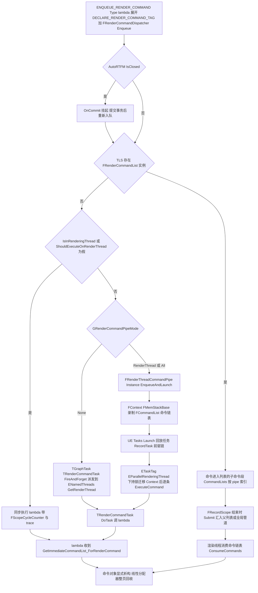
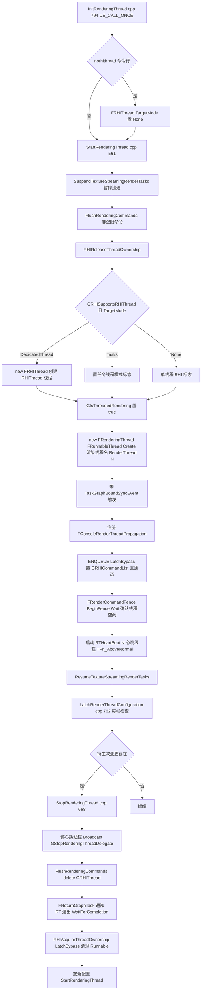
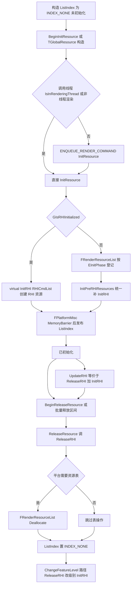
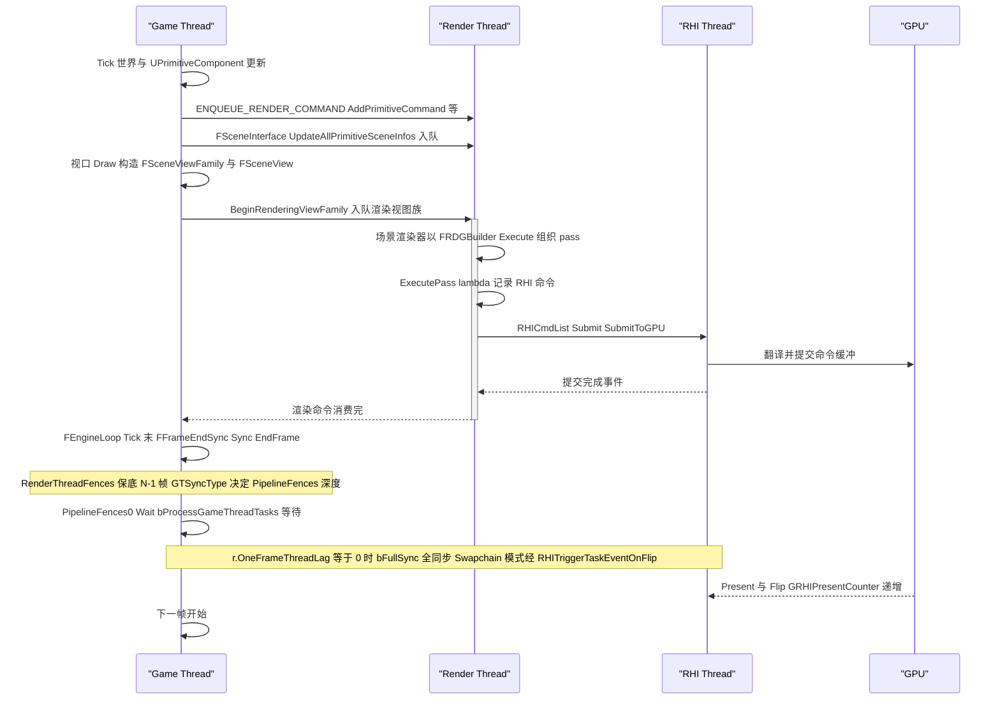
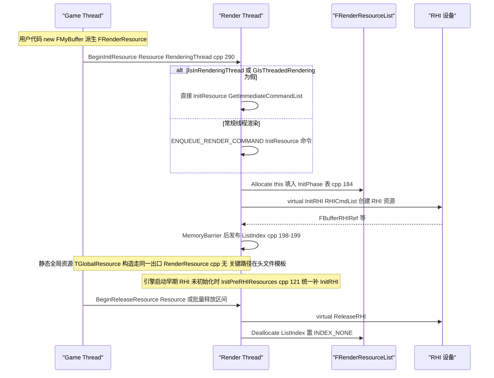
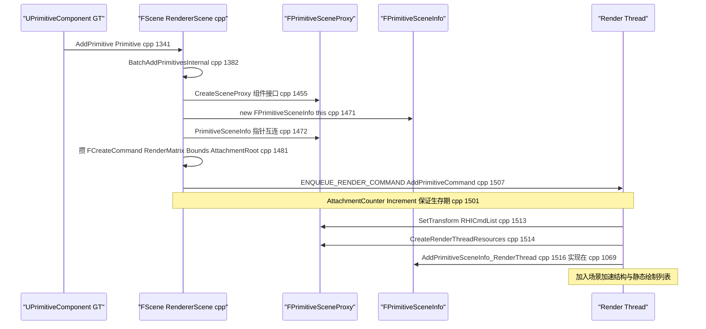
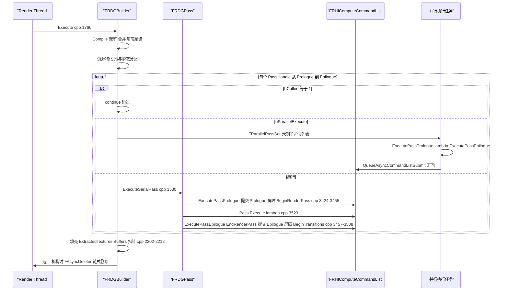
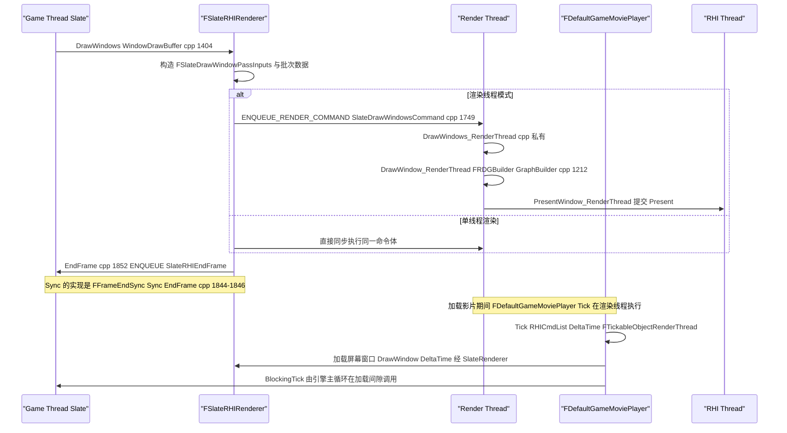
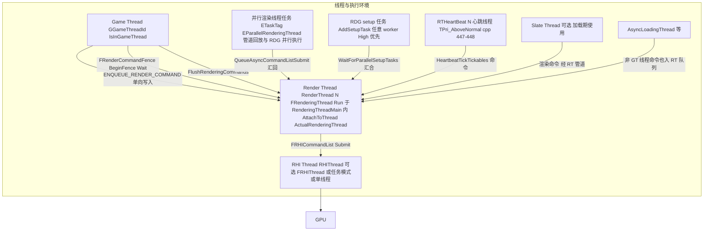

# 07 RenderCore:渲染线程、RDG、着色器框架与渲染资源(续篇)

> 本文件是 `07_rendercore_rdg_renderthread.md` 的续篇,承接 7.6~7.11。路径与行号约定同主文件(相对 `$E/Source`,5.8.3 实测)。

## 7.6 关键流程

### 7.6.1 RDG 三阶段:Setup → Compile → Execute

Setup 发生在每次 `AddPass`(构图期);Compile 与 Execute 都发生在 `FRDGBuilder::Execute()` 内部(RenderGraphBuilder.cpp:1766),两阶段以 `BeginFlushResourcesRHI/EndFlushResourcesRHI`(RenderingThread 侧为资源删除冲刷区间)为界。立即模式(r.RDG.ImmediateMode=1)跳过并行编译,资源即时分配(RenderGraphBuilder.cpp:2030-2034)。

```mermaid
flowchart TD
    A["构图期 Setup 每次 AddPass"] --> B["SetupPassInternals cpp 2534"]
    B --> C["SetupEmptyPass 或 SetupParameterPass cpp 2657 2634"]
    C --> D["SetupPassResources cpp 2384 解析 _RDG 参数"]
    D --> E["SetupPassDependencies cpp 2329 建立 producer 边与引用计数"]
    E --> F["用户继续 CreateTexture CreateBuffer AddPass"]
    F --> G["FRDGBuilder Execute cpp 1766"]
    G --> H["SetupEmptyPass 建 Epilogue 哨兵 cpp 1793"]
    H --> I["编译前等待 Compile 等待点 setup 任务 cpp 1811-1814"]
    I --> J["Compile cpp 1327"]
    J --> K["遍历 pass 补引用计数"]
    K --> L{"bCullPasses r.RDG.CullPasses"}
    L -->|是| M["深度优先从 Epilogue 与 NeverCull 根回溯标记可达 pass 未达者 bCulled=1 并扣减引用"]
    L -->|否| N["CompilePassOps 全部 pass cpp 2668"]
    M --> N
    N --> O{"bSupportsRenderPassMerge 且 RasterPassCount 大于 0"}
    O -->|是| P["合并相邻同渲染目标 raster pass 设 Prologue Epilogue BarrierPass cpp 1427-1500"]
    O -->|否| Q["跳过合并"]
    P --> R["异步 compute 区间推导 fork join"]
    Q --> R
    R --> S["编译后 CollectResources 阶段 cpp 1923-2019"]
    S --> T["CollectAllocations CollectDeallocations 按首末 pass 收集分配释放"]
    T --> U["AllocatePooledTextures Buffers 与 AllocateTransientResources cpp 3128-3300"]
    U --> V["CreateViews CreateUniformBuffers cpp 3315-3345"]
    V --> W["ExecutePasses 主循环 cpp 2104-2167"]
    W --> X{"pass bCulled"}
    X -->|是| Y["跳过"]
    X -->|否| Z{"bParallelExecute"}
    Z -->|是| AA["FParallelPassSet 任务录制命令列表 FlushParallel 时 QueueAsyncCommandListSubmit"]
    Z -->|否| AB["ExecuteSerialPass cpp 3530"]
    AB --> AC["ExecutePass cpp 3511 = Prologue 屏障 Submit + BeginRenderPass + lambda + EndRenderPass + Epilogue 屏障"]
    AA --> AD["RHICmdList ImmediateFlush DispatchToRHIThread 按 bDispatchAfterExecute"]
    AC --> AD
    AD --> AE["提取 ExtractedTextures Buffers 并填回池指针 cpp 2202-2212"]
    AE --> AF["PostExecuteCallbacks 与析构 FAsyncDeleter 链式异步删除 cpp 650-663"]
```

阶段职责小结(函数名:行号均可 grep):
- **Setup**:`AddPassInternal → SetupPassInternals(RenderGraphBuilder.cpp:2534) → SetupPassResources(:2384)/SetupPassDependencies(:2329)`,把参数结构中的 RDG 参数展开成 pass 的 TextureStates/BufferStates,并登记 producer 边。并行 setup(`ERDGBuilderFlags::ParallelSetup`)时该工作进 `AddSetupTask` 任务,由 `ProcessAsyncSetupQueue`(:1692)消费。
- **Compile**:`Compile`(:1327)做 pass 依赖回填、裁剪(`FlushCullStack` :1310 从 `CullPassStack` 深度优先)、raster pass 合并、AsyncCompute fork/join 推导;`CompilePassOps`(:2668)为每个幸存 pass 设置 bSkipRenderPassBegin/End 等位;`CompilePassBarriers/CollectPassBarriers/CreatePassBarriers`(:731-734)生成分裂屏障批次。
- **Execute**:资源物化(`AllocatePooledTextures` :3128、`AllocateTransientResources` :3217、`SubmitBufferUploads` :2691)→ pass 主循环(:2104-2167)→ 提取回调(:2202-2218)→ 图销毁延后到 `FAsyncDeleter`(:53-61)。

### 7.6.2 ENQUEUE_RENDER_COMMAND 生命周期(5.8 渲染命令管道)

关键判定(源码依据):
- `ShouldExecuteOnRenderThread()` = `LIKELY(GIsThreadedRendering || !IsInGameThread())`(RenderingThread.h:146-150);服务器上恒为 false。
- 分发顺序在 `FRenderCommandDispatcher::Enqueue`(RenderingThread.h:992-1016):AutoRTFM 闭域 → `FRenderCommandList::GetInstanceTLS()` → `FRenderThreadCommandPipe::Enqueue`。
- `FRenderThreadCommandPipe::Enqueue`(RenderingThread.h:499-527):已在渲染线程则同步执行 lambda(带 stat/trace 作用域);否则按 `GRenderCommandPipeMode` 选择 RT 管道(Instance.EnqueueAndLaunch)或 `TGraphTask<TRenderCommandTask<LambdaType>>::CreateTask().ConstructAndDispatchWhenReady(...)`(FireAndForget,目标线程 `ENamedThreads::GetRenderThread()`)。
- 管道回放任务(RenderingThread.cpp:2380-2416)以 `ETaskTag::EParallelRenderingThread` 打标,持 `UE::FMutex` 迁移 FContext 后逐条 `ExecuteCommand`;命令在线性分配器(FMemStackBase, Large 页)上构造,消费时显式析构。
- 游戏线程录制聚合:`UE::RenderCommandPipe::StartRecording/StopRecording`(cpp 内实现)由 `FlushRenderingCommands`、`StartRenderCommandFenceBundler` 等在同步点调用,确保命令次序与 fence 一致。

### 7.6.3 渲染线程与 RHI 线程启停

### 7.6.4 FRenderResource 初始化/释放状态流

规则(RenderResource.cpp:175-229):
- `InitResource`:`PLATFORM_NEEDS_RHIRESOURCELIST || !GIsRHIInitialized` 时才真正进 `FRenderResourceList`(按 `EInitPhase` 分表);RHI 已初始化则立即 `InitRHI(RHICmdList)`。`FPlatformMisc::MemoryBarrier()` 保证其他线程对 ListIndex 的读取安全。
- `ReleaseResource`:`GIsCriticalError` 时直接跳过(崩溃路径尽量不再触发新错误)。
- 表是 `TArray<FRenderResource*>` + 空洞复用(Allocate/Deallocate,RenderResource.cpp:38-108);`ReleaseRHIForAllResources` 逆序遍历。

### 7.6.5 RDG 裁剪与异步计算区间

- 裁剪根:EpiloguePass、`ERDGPassFlags::NeverCull` 的 pass、被提取/外部访问的资源生产者(`AddCullRootTexture/AddCullRootBuffer`,RenderGraphBuilder.h:973-974)。裁掉的 pass 同时扣减其对资源的引用计数(Compile,RenderGraphBuilder.cpp:1387-1424),`ReferenceCount==0` 的资源 `IsCulled()` 为真,不进分配收集。
- 用户依赖:`AddPassDependency(Producer, Consumer)`(:1160)强制顺序,常用于手工对齐异步计算边界。
- AsyncCompute 区间:`CompilePassOps` 与依赖推导为每个 AsyncCompute 区间确定 GraphicsForkPass/GraphicsJoinPass(FRDGPass.h:463-467),图首默认 `bInitialAsyncComputeFence`(构造函数体置 `GSupportsEfficientAsyncCompute`,RenderGraphBuilder.h:467)在 Execute 中插入 `RHICmdList.Transition({}, AsyncCompute, Graphics)`(cpp:2098-2102);`SkipInitialAsyncComputeFence()` 可关闭。
- 并行执行:lambda 引用非立即命令列表且构建器带 `ERDGBuilderFlags::ParallelExecute` 时,pass 归入 `FParallelPassSet`(ParallelExecute.ParallelPassSets),由任务录制到子命令列表,主循环末 `QueueAsyncCommandListSubmit(QueuedCmdLists)`(cpp:2086-2175);`FRDGAsyncTask` 标记的任务不在 Execute 末等待,而挂到 `FParallelExecute::LastAsyncExecuteTask` 链(RenderGraphDefinitions.h:65-106 注释,RenderGraphBuilder.cpp:676-690)。
- 资源别名(瞬态堆复用):当平台提供 `IRHITransientResourceAllocator` 且 `r.RDG.TransientAllocator` 开启时,图创建的纹理/缓冲走瞬态分配(`IsTransient`,RenderGraphBuilder.cpp:502-584),`AllocateTransientResources`(:3217)按首/末 pass 生命周期向瞬态堆申请;释放侧经 `FRDGBarrierBatchBegin::AddAlias` 登记别名丢弃操作(`FRHITransientAliasingInfo`,RenderGraphPass.h:116),由 `FRDGBuilder::AddAliasingTransition`(声明于 RenderGraphBuilder.h:781-785)把跨管线的分配/释放围栏(`GetAllocateFences/GetDeallocateFences`,RenderGraphBuilder.h:848-851)编进 barrier 批次;`GRDGTransientResourceAllocator` 在 `Execute()` 开头 `ReleasePendingDeallocations()`(cpp:1788)、结尾 `Flush(RHICmdList)`(cpp:2011-2018)。

## 7.7 时序图

### 7.7.1 一帧的三级流水线(GT→RT→RHIThread)与 FFrameEndSync

依据:`FEngineLoop::Tick` 每帧调用 `FFrameEndSync::Sync(EFlushMode::EndFrame)` 同步游戏与渲染/RHI 线程(Launch/Private/LaunchEngineLoop.cpp:6084);`FSlateRHIRenderer::Sync()` 的实现也是同一调用(SlateRHIRenderer.cpp:1843-1847);`UGameViewportClient::Draw` 以 `GetRendererModule().BeginRenderingViewFamily(SceneCanvas, &ViewFamily)`(Engine/Private/GameViewportClient.cpp:2071)入队渲染;RT 端 pass 经 `FRHICommandListImmediate::Submit` 把命令送往 RHI 线程;`r.OneFrameThreadLag`(cpp:2435)与 `r.GTSyncType`(cpp:2441)决定等待深度。

同步深度决策(RenderingThread.cpp:2512-2543,逐行核对):
- `bFullSync`(EFlushMode::Threads 或 `r.OneFrameThreadLag<=0`):RenderThreadFences 保留 0 条(即当帧 fence 也等待),PipelineFences 用 RHIThread 深度(若 GTSyncType>=2 且非 Threads 模式则 Swapchain),NumFramesOverlap=0。
- `GTSyncType>=2`:Swapchain 深度,重叠 1 帧;VSync 关闭时回退 RHIThread 深度(cpp:2545-2555)。
- `GTSyncType==1`:RHIThread 深度,重叠 1 帧。
- `GTSyncType<=0`:RHIThread 深度,重叠 `2 + (-GTSyncType)` 帧。

### 7.7.2 FRenderResource 初始化时序(含 TGlobalResource 静态初始化路径)

要点:BeginInitResource 的管道版本签名 `BeginInitResource(FRenderResource* Resource, FRenderCommandPipe* RenderCommandPipe = nullptr)` 支持把初始化命令录进命名管道(RenderResource.h:218);`StartBatchedRelease/EndBatchedRelease`(RenderResource.h:245-251)把一批 BeginReleaseResource 合并成一条命令(FBatchedReleaseResources,RenderResource.cpp:308-351)。

### 7.7.3 FScene::AddPrimitive 的 GT→RT 命令链

### 7.7.4 FRDGBuilder::Execute 中单个 pass 的执行

### 7.7.5 Slate 窗口绘制与影片播放的渲染线程参与

## 7.8 线程模型与同步

### 7.8.1 线程模型总图

线程判定 API(全部在 CoreGlobals.h:721-752 声明,实现于 Core):
- `IsInRenderingThread()`:RT 本体或单线程渲染时的任意线程;`IsInActualRenderingThread()`:仅真 RT;`IsInParallelRenderingThread()`:RT 或任何非 GT 线程(单线程渲染时 GT 也算);`IsInAnyRenderingThread()`;`IsRHIThreadRunning()/IsInRHIThread()/IsInParallelRHIThread()`。
- 任务打标:`FTaskTagScope Scope(ETaskTag::ERenderingThread)`(RenderingThreadMain,cpp:256)、`ETaskTag::EParallelRenderingThread`(管道回放,cpp:2395)、`ETaskTag::ERhiThread`(FRHIThread::Run,cpp:206)。
- 两种渲染线程形态:专用线程模式(`GUseThreadedRendering=true`)创建 "RenderThread N" 线程并绑定 TaskGraph 具名槽 `ActualRenderingThread`;非线程渲染模式(`GUseThreadedRendering=false`,如服务器)不建线程,`ENamedThreads::GetRenderThread()` 即 GameThread,渲染命令以 GT 任务执行(`FRenderCommandTaskBase::GetDesiredThread` 的 check 正是此约束,RenderingThread.h:442-455)。

### 7.8.2 跨线程数据所有权规则(核心)

| 数据 | 归属线程 | 传递/共享机制 | 违例后果与防护 | 源码依据 |
|---|---|---|---|---|
| UPrimitiveComponent/UActor | GameThread | 只读快照进 FPrimitiveSceneProxy | proxy 析构在延迟清理后,构造时 check | PrimitiveSceneProxy.h:291-306 |
| FPrimitiveSceneProxy | 构造于 GT,使用/销毁于 RT | `ENQUEUE_RENDER_COMMAND` 传裸指针,配 AttachmentCounter/FDeferredCleanupInterface | 渲染线程仍在用即析构会致命 | RendererScene.cpp:1471-1501 |
| FPrimitiveSceneInfo/FScene 内部结构 | RenderThread | GT 只经 FSceneInterface 入队 | — | RendererScene.cpp:1069 |
| FRenderResource 及 RHI 资源 | RenderThread | GT 调 BeginInit/BeginRelease(命令化) | Init/ReleaseResource 注释"only called by the rendering thread" | RenderResource.h:77-102 |
| 渲染命令 lambda 捕获 | 录制线程构造,RT 消费 | 值捕获/MoveTemp;跨线程数据须保活到消费点 | fence/fence bundler 保证等待 | RenderingThread.cpp:977-1051 |
| FRenderCommandFence::CompletionTask | RT 触发,GT 等待 | UE::Tasks::FTask | Wait 内周期 Pump 消息防死锁 | RenderingThread.cpp:1155-1269 |
| FRDGTexture/FRDGBuffer 等 | 单一构图线程(RT) | pass lambda 引用保证图内生存期;跨图仅经提取/注册 | 出 pass 访问 RHI 触发校验错误 | RenderGraphBuilder.h:99-110 |
| RDG 分配器内存 | 图作用域,可延至异步任务 | FAsyncDeleter 链式删除 | 用户须等 WaitForAsyncExecuteTask | RenderGraphBuilder.cpp:650-690 |
| FRenderTargetPool/FRDGBufferPool | RenderThread | `UE::FRecursiveMutex`(纹理池) | 注释 render thread only | RenderTargetPool.h:190、RenderGraphResourcePool.h:22 |
| 全局着色器表 GGlobalShaderMap | 加载后只读 | 任意线程读取 | 编辑器重编译走独占流程 | GlobalShader.h:274、333 |
| Slate 资源句柄 | GT 登记,RT 使用 | FSlateResourceHandle 原子引用计数 | ReleaseAccessedResources 延迟释放 | SlateRHIRenderer.h:67 |
| CVar 渲染线程传播 | GT 写,RT 读 | FConsoleRenderThreadPropagation 命令化写远端 | — | RenderingThread.cpp:493-552 |

### 7.8.3 队列/锁/同步原语清单

| 名称 | 类型 | 保护对象 | 位置 |
|---|---|---|---|
| `FRenderCommandPipeBase::Mutex` | `UE::FMutex` | 管道 FContext 的迁移与命令入队 | RenderingThread.h:434 |
| `FRenderCommandList::InstanceTLS` | `thread_local` | 当前线程录制的命令列表 | RenderingThread.h:746 |
| `FRenderCommandList::NumPipeRefs` | `std::atomic_int32_t` | 列表跨管道引用计数,归零自删 | RenderingThread.h:953、884-895 |
| `FRenderCommandPipe::NumInFlightCommands/NumInFlightCommandLists` | `std::atomic_int32_t` | 在途命令计数(IsEmpty 判定) | RenderingThread.h:707-708 |
| `FAsyncSetupQueue`(FRDGBuilder) | `UE::FMutex + TArray` | setup 操作队列 | RenderGraphBuilder.h:925-938 |
| `FRenderTargetPool::Mutex` | `UE::FRecursiveMutex` | 池数组 | RenderTargetPool.h:190 |
| `FRDGTransientResourceAllocator::CS` | `FCriticalSection` | 空闲/待释放列表 | RenderGraphResourcePool.h:137 附近 |
| `FPendingCleanupObjects`(Editor/Program 构建) | `FCriticalSection PendingCleanupObjectsListLock` | 延迟清理对象表 | RenderingThread.cpp:1330-1345 |
| `GMainThreadBlockedOnRenderThread` | `TAtomic<bool>` | Flush 期间重入检测 | RenderingThread.h:78 |
| `OutstandingHeartbeats/GSuspendRenderingTickables` | `FThreadSafeCounter/TAtomic<int32>` | 心跳节流与 flush 暂停 tickable | RenderingThread.cpp:427-430 |
| `FCoreRenderDelegates::OnFlushRenderingCommandsStart/End` | 多播委托 | Flush 前后通知 | RenderingThread.h:119-123 |
| `RenderThreadFences/PipelineFences`(FFrameEndSync 命名空间内静态) | `TArray<FRenderCommandFence,TInlineAllocator>` | 帧重叠节流 | RenderingThread.cpp:2458-2478 |

## 7.9 配置与扩展点

### 7.9.1 控制台变量(CVar)

| CVar | 默认 | 作用 | 位置 |
|---|---|---|---|
| `r.OneFrameThreadLag` | 1 | 允许 RT 落后一帧;0 强制全同步 | RenderingThread.cpp:2435-2439 |
| `r.GTSyncType` | 0 | GT 同步深度选择(见 7.7.1) | RenderingThread.cpp:2441-2450 |
| `r.RHIThread.Enable`(命令,非 CVar) | 1 | 0 关 RHI 线程 / 1 专用线程 / 2 任务线程,经 GPendingRHIThreadMode 生效 | RenderingThread.cpp:1422-1452 |
| `r.RenderCommandPipeMode` | 2 | 渲染命令管道模式 0/1/2;移动平台或不可渲染强制 0 | RenderingThread.cpp:138-149 |
| `r.RenderCommandFenceBundling` | 1 | 栅栏捆绑 | RenderingThread.cpp:99-107 |
| `TaskGraph.RenderThreadPollPeriodMs` | 1 | RT 任务轮询周期(负值=显式唤醒) | RenderingThread.cpp:90-96 |
| `g.TimeToBlockOnRenderFence` | 1(ms) | GT 等栅栏单步等待 | RenderingThread.cpp:1081-1086 |
| `g.TimeoutForBlockOnRenderFence` | 120000(ms) | GT 等栅栏超时(挂死上报) | RenderingThread.cpp:1089-1094 |
| `g.bEnablePendingCleanupObjectsCommandBatching` | true | 编辑器延迟清理批量删除 | RenderingThread.cpp:1323-1328 |
| `r.RDG.CullPasses` | 1 | RDG pass 裁剪 | RenderGraphPrivate.h:85 及定义处 |
| `r.RDG.MergeRenderPasses` | 1 | raster pass 合并 | RenderGraphPrivate.h:86 |
| `r.RDG.AsyncCompute` | 1(启用)/2(强制) | 异步计算支持 | RenderGraphPrivate.h:16-18 |
| `r.RDG.TransientAllocator` | 平台相关 | 瞬态资源分配器开关 | RenderGraphPrivate.h:87 |
| `r.RDG.TransientAllocator.IndirectArgumentBuffers`、`r.RDG.TransientExtractedResources`、`r.RDG.AsyncComputeTransientAliasing` | — | 瞬态细分开关 | RenderGraphPrivate.h:88-90 |
| `r.RDG.ParallelSetup`、`r.RDG.ParallelCompile`、`r.RDG.ParallelExecute`、`r.RDG.ParallelExecute.PassMin/PassMax/PassTaskModeThreshold`、`r.RDG.ParallelSetup.TaskPriorityBias`、`r.RDG.AsyncSetupQueue`、`r.RDG.ParallelDestruction` | — | RDG 并行化各开关 | RenderGraphPrivate.h:92-113 |
| `r.RDG.ImmediateMode` | 0 | 立即模式(每 pass 即时执行,调试) | RenderGraphPrivate.h:34 |
| `r.RDG.Debug.*`(FlushGPU、ExtendResourceLifetimes、DisableTransientResources、GraphFilter、PassFilter、ResourceFilter)、`r.RDG.Validation`、`r.RDG.ClobberResources`、`r.RDG.TransitionLog`、`r.RDG.OverlapUAVs`、`r.RDG.VerboseCSVStats`、`r.RDG.Events` | — | RDG 调试族 | RenderGraphPrivate.h:26-122 |
| `r.DumpGPU` 相关与 GPUDumpViewer | — | 图/资源转储(RuntimeDependencies 拷贝查看器) | RenderCore.Build.cs:48-52 |
| `r.VSync`(RHI 模块) | 0 | Swapchain 同步模式回退判据 | RenderingThread.cpp:2545-2555 |

### 7.9.2 委托与生命周期扩展点

| 名称 | 触发时机 | 位置 |
|---|---|---|
| `FCoreRenderDelegates::OnFlushRenderingCommandsStart/End` | FlushRenderingCommands 首尾 | RenderingThread.h:116-124 |
| `RegisterStopRenderingThreadDelegate(FStopRenderingThread::FDelegate)` | StopRenderingThread 中 Broadcast | RenderingThread.h:1223-1228, cpp:656-666 |
| `FCoreDelegates::PostRenderingThreadCreated / PreRenderingThreadDestroyed` | RenderingThreadMain 首尾 | RenderingThread.cpp:253、265 |
| `UE::RenderCommandPipe::GetStopRecordingDelegate()` | 管道停止录制(同步点) | RenderingThread.h:212-213 |
| `DECLARE_RENDER_COMMAND_PIPE/DEFINE_RENDER_COMMAND_PIPE` | 声明模块级异步命令管道(自动 CVar) | RenderingThread.h:1066-1081 |
| `TRenderThreadStruct<FMyStruct>` | RT 生命周期对象封装 | RenderingThread.h:1161-1221 |
| `FRDGBuilder::AddPostExecuteCallback` | 图执行完成后回调 | RenderGraphBuilder.h:197-201 |
| `IRHITransientResourceAllocator`(RHI 提供) | 平台瞬态堆(Vulkan/D3D12)注入点 | RHITransientResourceAllocator.h:535-561 |

### 7.9.3 模块接口

- `ISlateRHIRendererModule`(SlateRHIRenderer/Public/Interfaces/ISlateRHIRendererModule.h):创建/销毁 FSlateRHIRenderer 与 Slate3DRenderer。
- `ISlateNullRendererModule`(SlateNullRenderer/Public/Interfaces):空渲染器工厂。
- `IModuleInterface FStreamingPauseRenderingModule`:`BeginStreamingPause/EndStreamingPause`,游戏可注册自定义 FBeginStreamingPauseDelegate 覆盖默认行为(StreamingPauseRendering.h:22-30)。
- `IGameMoviePlayer`(MoviePlayer/Public/MoviePlayer.h):影片播放器接口;`CreateMoviePlayer/GetMoviePlayer` 全局工厂(MoviePlayer.h:288-296)。
- FShaderCompilingManager 实现 `IAssetCompilingManager`(Engine/Public/ShaderCompiler.h:934),纳入编辑器资产编译调度。

## 7.10 已知限制/未确认项

1. FMaterialShader/FMeshMaterialShader 的完整接口与 FMaterial 着色器映射属 Renderer/Engine 材质管线,本章仅收录其与 RenderCore 着色器框架的衔接(类层级),细节未展开(在 Renderer 章节覆盖)。
2. `FShaderCompilingManager` 的内部线程模型(本地/分布式编译线程 FShaderCompileThreadRunnable 等)只在接口层确认;其多线程实现细节(ShaderCompiler.h:161-460 附近)未逐行核对,未画入时序图。
3. RDG 的 `FParallelPassSet`/`FParallelCommandListSet` 详细字段在 RenderGraphBuilder.cpp 内部(SetupParallelExecute,cpp:2841-3067),本章只确认了任务派发与汇回路径,未逐字段列表。
4. `FSceneViewExtension`、场景渲染通道(SceneRenderer/FSceneRenderer)、移动端渲染器等超出本章范围,未展开。
5. Slate 的并行绘制(FSlateDrawBuffer 多窗口并发)与 Slate Thread 独立线程模式的完整状态机未在本次阅读范围内(SlateRHIRenderer.cpp 只核对了 DrawWindows→命令入队→RT 绘制链路)。
6. `r.RDG.ParallelMobile`、`r.RDG.ParallelExecuteStress` 等少量 CVar 仅确认名称存在(RenderGraphPrivate.h 系列声明),默认值未逐一摘录。
7. `Engine.partNN.md` 附录按符号切分,FPrimitiveSceneProxy/FSceneInterface/FSceneView 在多个分片出现,7.11 只列出主要分片,未做逐符号交叉验证。

## 7.11 附录索引

本章覆盖模块对应的符号总表(完整穷举见附录,本章不重复):

| 模块(Tier) | 附录文件(相对 docs/ue5.8.3/) |
|---|---|
| Runtime/RenderCore | `appendix/api/Runtime/RenderCore.md` |
| Runtime/Engine(部分:SceneInterface/PrimitiveSceneProxy/SceneView/ShaderCompiler 等) | `appendix/api/Runtime/Engine.part01.md` ~ `Engine.part06.md`(FPrimitiveSceneProxy/FSceneInterface/FSceneView 集中在 part01-part03) |
| Runtime/Renderer(部分:FScene、FMaterialShader) | `appendix/api/Runtime/Renderer.md` |
| Runtime/SlateRHIRenderer | `appendix/api/Runtime/SlateRHIRenderer.md` |
| Runtime/SlateBaseRenderer | `appendix/api/Runtime/SlateBaseRenderer.md` |
| Runtime/SlateNullRenderer | `appendix/api/Runtime/SlateNullRenderer.md` |
| Runtime/StreamingPauseRendering | `appendix/api/Runtime/StreamingPauseRendering.md` |
| Runtime/MoviePlayer | `appendix/api/Runtime/MoviePlayer.md` |

模块总表:`appendix/modules.json`。SlateCore(FSlateRenderer 抽象基类)不在本章范围清单内,但接口引用见 `appendix/api/Runtime/SlateCore.md`。

