# 08 Renderer:场景渲染器、延迟管线、Nanite/Lumen/VSM/后处理

> 模块:`Engine/Source/Runtime/Renderer`(下文路径均相对 `$E/Source/Runtime/Renderer`,特殊注明者除外)。
> 本章节所有结论均来自对 UE 5.8.3-release 源码的逐文件阅读;行号以当前源码树为准。

## 8.1 职责、边界与模块清单

**边界**:Runtime/Renderer 模块实现场景渲染的全部渲染线程逻辑——从 ViewFamily 到最终后处理输出,包含延迟/移动两条渲染路径以及 Nanite、Lumen、VSM、MegaLights、Substrate、RayTracing、HairStrands 等子系统。RHI 抽象、RDG/PSO 缓存等基础设施在 RenderCore(第 07 章),GPU 皮肤缓存在 Engine 模块(`Engine/Private/GPUSkinCache.cpp`),本模块只消费它们。

**Build.cs 依赖**(`Renderer/Renderer.Build.cs:17-58`):
- Public:`Core`、`Engine`
- Private:`CoreUObject`、`ApplicationCore`、`RenderCore`、`ImageWriteQueue`、`RHI`、`MaterialShaderQualitySettings`、`StateStream`、`TraceLog`
- Editor-only Private:`TargetPlatform`、`GeometryCore`、`NaniteUtilities`
- 动态加载:`HeadMountedDisplay`、`EyeTracker`

| # | 子系统 | 路径(Private/ 下) | 职责一句话 |
|---|--------|--------------------|-----------|
| 1 | 场景渲染核心 | SceneRendering.{h,cpp}, SceneCore.{h,cpp}, RendererScene.cpp, SceneRenderBuilder.{h,cpp}, RendererUtils.cpp | FSceneRenderer 基础设施、ViewFamily→SceneRenderer 创建与提交链路、公共工具 |
| 2 | 延迟主流程 | DeferredShadingRenderer.{h,cpp}, DeferredShadingRendererTypes.h | FDeferredShadingSceneRenderer 全帧编排(Render/InitViews/灯光/雾等) |
| 3 | 移动路径 | MobileShadingRenderer.cpp, MobileBasePass*.cpp, MobileDeferredShadingPass.*, MobileFogRendering.cpp, MobileSSR.*, MobileSeparateTranslucencyPass.*, MobileDistortionPass.*, MobileDecalRendering.cpp, MobileReflectionEnvironmentCapture.*, MobileTranslucentRendering.cpp, MobileSingleLayerWaterRendering.cpp, ShadowSetupMobile.cpp | FMobileSceneRenderer 移动端前向/延迟混合路径 |
| 4 | 可见性与剔除 | SceneVisibility.{h,cpp}, SceneVisibilityPrivate.h | InitViews:视锥/遮挡/相关性剔除任务图、GDME、MeshPassSetup |
| 5 | MeshDrawCommands | MeshDrawCommands.{h,cpp}, MeshPassProcessor.{h,cpp,.inl}(Public/), StaticMeshBatch.cpp, MeshDrawCommandStats.cpp, SimpleMeshDrawCommandPass.cpp | FMeshBatch→FMeshDrawCommand 生成、排序合并、并行 Pass、缓存命令 |
| 6 | BasePass | BasePassRendering.{h,cpp,.inl} | GBuffer 写入(含 forward 输出),FBasePassMeshProcessor |
| 7 | 深度/PrePass | DepthRendering.cpp, DepthCopy.cpp, CustomDepthRendering.cpp | EarlyZ/PrePass、深度拷贝、CustomDepth |
| 8 | 速度缓冲 | VelocityRendering.{h,cpp} | FVelocityRendering:Opaque/Translucent 速度 |
| 9 | 直接光照 | LightRendering.{h,cpp}, LightSceneInfo.{h,cpp}, LightGridInjection.cpp, ClusteredDeferredShadingPass.cpp, LightFunctionRendering.cpp, LightFunctionAtlas.cpp, StochasticLighting/, TranslucentLighting.cpp, VolumeLighting.cpp, IndirectLightRendering.cpp, IndirectLightingCache.cpp, RectLightTextureManager.cpp, IESTextureManager.cpp, AnisotropyRendering.cpp | GatherAndSortLights/RenderLights/光栅格/聚簇延迟/随机光源采样 |
| 10 | MegaLights | MegaLights/ | 逐光源采样式海量光源(MegaLights)渲染与去噪 |
| 11 | 传统阴影 | ShadowRendering.{h,cpp}, ShadowDepthRendering.cpp, ShadowSetup.cpp, CapsuleShadowRendering.cpp, DistanceFieldShadowing.cpp | PSSM/点光/聚光阴影深度、胶囊体阴影 |
| 12 | 阴影场景扩展 | Shadows/(ShadowScene, ShadowSceneRenderer, CSMSceneExtension, ScreenSpaceShadows, FirstPersonSelfShadow, bend_sss_cpu) | FShadowSceneRenderer:阴影编排与 CSM 场景扩展 |
| 13 | VSM | VirtualShadowMaps/(VirtualShadowMapArray, CacheManager, Clipmap, Projection, Shaders) | FVirtualShadowMapArray:虚拟阴影页分配/标记/投影 |
| 14 | Nanite | Nanite/(Nanite, NaniteCullRaster, NaniteShading, NaniteStreamOut, NaniteFeedback, NaniteVisibility, NaniteDrawList, NaniteComposition, NaniteMaterials, NaniteMaterialsSceneExtension, NaniteRayTracing, NaniteRayTracingASCache, NaniteTranslucency, NaniteVisualize, NaniteEditor, Voxel, TessellationTable, NaniteShared, NaniteOwnershipVisibilitySceneExtension) | Nanite 微多边形 GPU 软/硬件光栅化、流送、着色、体素、RT |
| 15 | Lumen | Lumen/(60 个文件:Lumen, LumenScene, LumenSceneRendering, LumenSceneLighting, LumenSceneDirectLighting, LumenMeshCards, LumenSceneCardCapture, LumenSurfaceCache, LumenSurfaceCacheFeedback, LumenScreenProbeGather, LumenReflections, LumenReflectionTracing, LumenRadiosity, LumenRadianceCache, LumenHardwareRayTracingCommon, LumenReSTIRGather, LumenIrradianceFieldGather, LumenTranslucencyVolumeLighting, LumenVisualize, LumenHeightfields, LumenDiffuseIndirect 等) | Lumen 全局光照:SurfaceCache/Card 捕获、屏幕探针、反射、Radiosity、HWRT |
| 16 | 后处理 | PostProcess/(PostProcessing.cpp 主编排 + TemporalAA, TemporalSuperResolution, PostProcessBokehDOF, DiaphragmDOF, PostProcessEyeAdaptation, PostProcessHistogram, PostProcessBloomSetup, PostProcessFFTBloom, PostProcessLocalExposure, PostProcessCombineLUTs, PostProcessDownsample, PostProcessLensFlares, PostProcessHMD, SubpixelMorphologicalAA, PostProcessCompositeEditorPrimitives, PostProcessVisualize* 等) | TAA/TSR、Bloom、曝光、DOF、色调映射、可视化 |
| 17 | 天空大气 | SkyAtmosphereRendering.{h,cpp}, SkyPassRendering.cpp | 大气 LUT 与天空渲染 |
| 18 | 体积雾 | VolumetricFog.{h,cpp}, VolumetricFogVoxelization.cpp, VolumetricFogLightFunction.cpp, Froxel/ | 体积雾体素化/积分;Froxel 视锥簇数据 |
| 19 | 体积云 | VolumetricCloudRendering.{h,cpp}, VolumetricRenderTarget.{h,cpp} | 体积云渲染与 VolumetricRenderTarget 重建 |
| 20 | 异构体积 | HeterogeneousVolumes/ | SparseVolumeTexture 体积介质渲染(多管线) |
| 21 | SVT 可视化 | SparseVolumeTexture/ | SVT 查看器组件渲染 |
| 22 | HairStrands | HairStrands/(25 文件)+ Public/HairStrandsInterface.h | 发丝渲染:LOD/插值、光栅化、DeepShadow、体素化、合成 |
| 23 | 光线追踪 | RayTracing/(RayTracing, RayTracingScene, RayTracingShaderBindingTable, RayTracingInstance, RayTracingInstanceCulling, RayTracingMeshDrawCommands, RayTracingLighting, RayTracingShadows, RayTracingTranslucency, RaytracingSkylight, RayTracingPrimaryRays, RayTracingDecals, RayTracingDebug, RayTracingMaterialHitShaders 等) | RT 场景/TLAS/SBT 组装、RT 阴影/半透明/天空光、调试 |
| 24 | Substrate | Substrate/(Substrate, SubstrateRoughRefraction, SubstrateVisualize, Glint) | Substrate 材质 BSDF 采样/分类/DBuffer/粗糙折射 |
| 25 | 半透明 | TranslucentRendering.{h,cpp}, TranslucencyPass.h, FrontLayerTranslucency.cpp, OIT/, DistortionRendering.{h,cpp} | 半透明分层渲染、前层 GBuffer(Lumen/MegaLights/VSM)、OIT、扭曲 |
| 26 | SceneCapture | SceneCaptureRendering.cpp, CustomRenderPassSceneCapture.h | 场景捕获与 CustomRenderPass(含 UserSceneTexture) |
| 27 | FX 接入 | FXRenderingUtils.cpp, ComputeSystemInterface.cpp | FXSystem->PreRender / RenderOpaqueFX / GPUSortManager 挂接 |
| 28 | GPUScene | GPUScene.{h,cpp} + Public/GPUSceneWriter.h | FGPUScene 实例数据上传、GPU 写回 pass、调试 |
| 29 | 实例剔除 | InstanceCuling/(InstanceCullingContext, InstanceCullingManager, InstanceCullingMergedContext, InstanceCullingLoadBalancer, InstanceCullingOcclusionQuery) | GPU 实例剔除上下文与延迟合并剔除 |
| 30 | 场景剔除 | SceneCulling/(SceneCulling, SceneCullingRenderer, HierarchicalSpatialHashGrid) | GPU 场景级空间哈希剔除(scene extension) |
| 31 | 虚拟纹理 | VT/(VirtualTextureSystem, VirtualTextureFeedback, RuntimeVirtualTexture*, AllocatedVirtualTexture, VirtualTexturePhysicalSpace, AdaptiveVirtualTexture 等 24 文件) | VT 页表/反馈/物理空间与 RVT 生成 |
| 32 | 全局距离场/DFAO | GlobalDistanceField.cpp, DistanceFieldAmbientOcclusion.cpp, DistanceFieldScreenGridLighting.cpp, DistanceFieldLightingPost.cpp, DistanceFieldObjectCulling.cpp, DistanceFieldObjectManagement.cpp, DistanceFieldStreaming.cpp, DistanceFieldVisualization.cpp, DistanceFieldLightingShared.cpp + Public/GlobalDistanceField* | GDF 更新、DFAO、距离场可视化和流送 |
| 33 | SSR/SSAO/GTAO | ScreenSpaceRayTracing.{h,cpp}, CompositionLighting/PostProcessAmbientOcclusion.cpp | 屏幕空间反射、SSAO/GTAO |
| 34 | 反射环境 | ReflectionEnvironment*.cpp, PlanarReflectionRendering.cpp | 反射捕获/实时捕获、平面反射 |
| 35 | 路径追踪 | PathTracing.cpp, PathTracingSpatialTemporalDenoising.cpp + Public/PathTracingDenoiser.h | 路径追踪与时空去噪 |
| 36 | 调试设施 | DebugViewModeRendering.cpp, DebugProbeRendering.cpp, ShaderPrint.{h,cpp}, VisualizeTexturePresent.cpp, RenderingVisualizationUtils.h, ViewDebug.cpp, IlluminanceMeter.cpp, LightMapDensityRendering.cpp, VisualizeLightShape.cpp, VisualizeVolumetricLightmap.cpp, MeshEdgesRendering.cpp, EditorPrimitivesRendering.cpp, SceneHitProxyRendering.cpp | DebugViewMode、ShaderPrint、VisualizeTexture、HitProxy、编辑器图元 |
| 37 | 水 | SingleLayerWaterRendering.{h,cpp}, WaterInfoTextureRendering.{h,cpp} | 单层水渲染与水信息纹理 |
| 38 | 雾/局部雾 | FogRendering.cpp, FogSeparateComposition.cpp, LocalFogVolumeRendering.cpp | 高度雾、分离合成雾、局部雾体积 |
| 39 | 贴花/DBuffer | DecalRenderingCommon.cpp, DecalRenderingShared.cpp, DBufferTextures.cpp | 延迟贴花与 DBuffer |
| 40 | 材质杂项 | AnisotropyRendering, ShadingEnergyConservation, SubsurfaceTiles, PhysicsFieldRendering, LightShaftRendering.cpp, HeightfieldLighting.cpp, HZB.cpp, GenerateConservativeDepthBuffer.cpp, Quantization.cpp, BlueNoise.cpp, HaltonUtilities.cpp, SceneTextureReductions.cpp, HdrCustomResolveShaders.cpp, WideCustomResolveShaders.cpp, SplineMeshSceneResources.cpp, DynamicBVH.cpp, GPUFastFourierTransform.cpp, GPUFeedbackCompaction.cpp, GPUWorkGroupLoadBalancer.cpp, GPUBenchmark.cpp, SceneOcclusion.cpp, SceneViewOcclusionHistory.h, SceneTextureParameters.cpp, SceneUniformBuffer.cpp, SystemTextures.cpp, ViewData.cpp, SceneViewState.cpp, SceneUpdateCommandQueue.h, Tests/ | 各类支撑 pass 与公共资源 |
| 41 | 皮肤/蒙皮 | Skinning/(SkinningSceneExtension, SkinningTransformProvider, AnimRuntimeTransformProvider, AnimSequenceTransformProvider, AnimBankTransformProvider, SkinnedMeshDebugView) | GPU 蒙皮场景扩展与变换源 |
| 42 | 场景扩展框架 | SceneExtensions.{h,cpp}, FirstPersonSceneExtension.cpp | FSceneExtensionsRenderers 聚合与第一人称扩展 |
| 43 | VRS | VariableRateShading/(目录) + Public/VariableRateShadingImageManager.h | 基于图像的 VRS 速率管理 |
| 44 | 材质缓存 | MaterialCache/ | MaterialCache(MaterialFunction 开发用)渲染 |
| 45 | StateStream | StateStream/ | 渲染代理序列化流支持 |

## 8.2 总体架构

游戏线程通过 `FRendererModule::BeginRenderingViewFamilies`(`Private/SceneRendering.cpp:5359`)创建场景渲染器并投递渲染命令;渲染线程在 `RenderViewFamily_RenderThread`(`SceneRendering.cpp:5215`)中调用 `ISceneRenderer::Render`,整个帧以 RDG(`FRDGBuilder`)构建、按依赖自动分派到图形/异步计算队列。

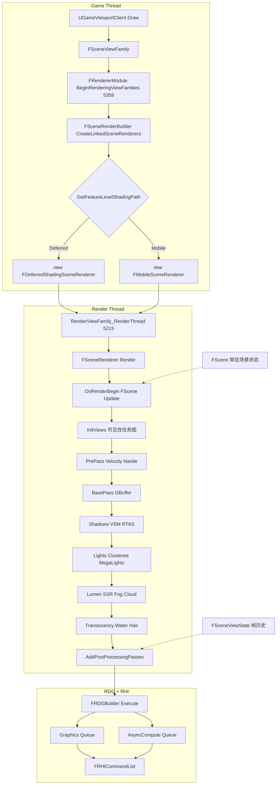

要点:
- **两条渲染路径**:`FDeferredShadingSceneRenderer`(`DeferredShadingRenderer.h:260`)与 `FMobileSceneRenderer`(`SceneRendering.h:2957`)都继承 `FSceneRenderer`(`SceneRendering.h:2218`),创建分支在 `SceneRenderBuilder.cpp:511-517`。
- **渲染器链接**:同一帧多个 ViewFamily 的渲染器通过 `FSceneRenderer::Link`(Head/Next 链表,`SceneRendering.h:2249-2254`)链接,`EnumerateLinkedViews` 跨渲染器遍历。
- **场景状态与帧历史分离**:常驻状态在 `FScene`(`ScenePrivate.h:1624`,如 `GPUScene`、`RayTracingScene`、`NaniteVisibility[ENaniteMeshPass::Num]`、`DistanceFieldSceneData`),跨帧历史在 `FSceneViewState`/`FPreviousViewInfo`(见 8.4)。
- **RDG 依赖**:帧内 pass 基本全部走 `FRDGBuilder`;跨 RDG 的外部资源同步用 `FRDGExternalAccessQueue`(Render() 内多次 `Submit`,如 2429、2893、3306)。

## 8.3 类图

### 8.3.1 场景渲染器继承体系

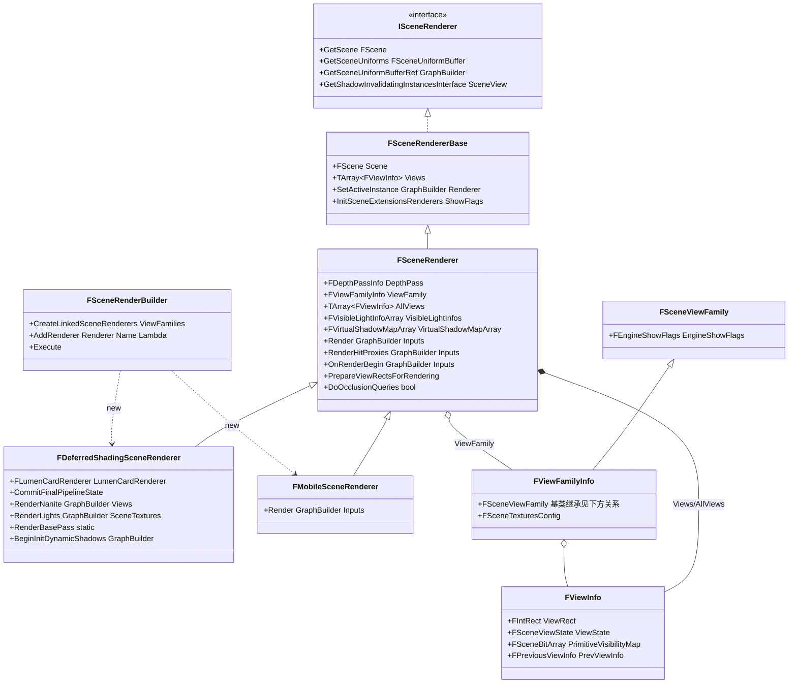

- `ISceneRenderer`(Public/SceneRendererInterface.h:51)是跨模块最小接口;`FSceneRendererBase`(SceneRendering.h:2153)挂 `FSceneUniformBuffer` 与 `FSceneExtensionsRenderers`;`FSceneRenderer`(SceneRendering.h:2218)持有 ViewFamily/Views/VisibleLightInfos/VSM 数组等帧内状态,构造于游戏线程(`SceneRendering.cpp:2855`),在渲染线程 `Render()` 返回后销毁。
- `FDeferredShadingSceneRenderer` 构造于 `DeferredShadingRenderer.cpp:527`。
### 8.3.2 可见性管线(InitViews)

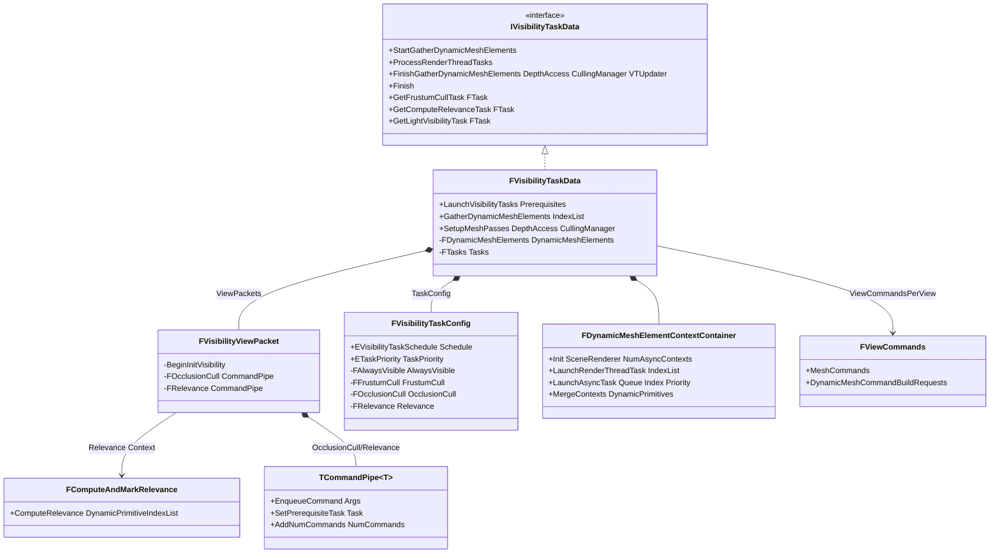

- `FVisibilityTaskData`(`SceneVisibilityPrivate.h:503`)内部 `FTasks`(`SceneVisibilityPrivate.h:588-609`)持有任务事件:`LightVisibility`、`BeginInitVisibility`、`FrustumCull`、`OcclusionCull`、`ComputeRelevance`、`DynamicMeshElementsPrerequisites`、`DynamicMeshElements`、`FinalizeRelevance`、`MeshPassSetup`。
- 任务图启动在 `FVisibilityTaskData::LaunchVisibilityTasks`(`SceneVisibility.cpp:4470`):并行模式下每视图一个 `FVisibilityViewPacket`,视图任务事件被聚合到全局事件(4486-4489);`Tasks.ComputeRelevance.AddPrerequisites(Scene.GetCacheMeshDrawCommandsTask())`(4504);GDME 前置 `Scene.GetGPUSkinUpdateTask()`(4507)。
- `TCommandPipe`(`SceneVisibilityPrivate.h:29`)是"命令管道":MPSC 队列 + `UE::Tasks::FPipe` 串行任务,空队列触发 `EmptyFunction`(用于级联下一阶段),入队时若队列从空变非空则以 `ETaskPriority::High` 启动处理任务(SceneVisibilityPrivate.h:92-116)。
- 调度模式 `EVisibilityTaskSchedule`(`SceneVisibilityPrivate.h:338`):`RenderThread`(渲染线程 + ParallelFor)或 `Parallel`(异步任务图,GDME 仍在渲染线程);由 `FVisibilityTaskConfig`(`SceneVisibilityPrivate.h:350`)决定,任务优先级默认 `ETaskPriority::High`。

### 8.3.3 MeshDrawCommands 体系

```mermaid
classDiagram
    class FMeshPassProcessor {
        <<abstract>>
        +EMeshPass MeshPassType
        +FMeshPassDrawListContext DrawListContext
        +AddMeshBatch MeshBatch Mask Proxy StaticMeshId
        +BuildMeshDrawCommands MeshBatch PassShaders ShaderElementData
        +CollectPSOInitializers Config Material VFData Params Out
    }
    class FMeshPassDrawListContext {
        <<interface>>
        +FinalizeCommand MeshDrawCommand SortKey CullingPayload Flags
    }
    class FDynamicPassMeshDrawListContext {
        +FMeshCommandOneFrameArray MeshDrawCommands
    }
    class FCachedPassMeshDrawListContext {
        +FCachedPassMeshDrawList DrawList
    }
    class FCachedPassMeshDrawListContextImmediate
    class FCachedPassMeshDrawListContextDeferred
    class FMeshDrawCommand {
        +FMeshDrawShaderBindings ShaderBindings
        +FVertexInputStreamArray VertexStreams
        +FRHIBuffer IndexBuffer
        +FGraphicsMinimalPipelineStateId CachedPipelineId
        +uint32 FirstIndex
        +uint32 NumPrimitives
        +uint32 NumInstances
        +uint8 StencilRef
        +MatchesForDynamicInstancing Rhs bool
    }
    class FVisibleMeshDrawCommand {
        +FMeshDrawCommand MeshDrawCommand
        +int32 SortKey
    }
    class FStaticMeshBatch {
        +FMeshBatch Mesh
        +FCachedMeshDrawCommandInfo CachedMeshDrawCommands
    }
    class FCachedMeshDrawCommandInfo {
        +FMeshDrawCommandSortKey SortKey
        +int32 CommandIndex
        +int32 StateBucketId
        +EMeshPass MeshPass
        +FMeshDrawCommandCullingPayload CullingPayload
    }
    class FParallelMeshDrawCommandPass {
        +DispatchPassSetup Scene View CullingContext PassType
        +BuildRenderingCommands GraphBuilder GPUScene OutParams
        +WaitForSetupTask
        +Draw RHICmdList InstanceCullingDrawParams
        +Dispatch DispatchPassBuilder InstanceCullingDrawParams
    }
    class FPassProcessorManager {
        +CreatePassProcessor PassType FeatureLevel Scene View DrawListContext
    }
    FMeshPassProcessor <|-- FBasePassMeshProcessor
    FMeshPassDrawListContext <|.. FDynamicPassMeshDrawListContext
    FMeshPassDrawListContext <|.. FCachedPassMeshDrawListContext
    FCachedPassMeshDrawListContext <|-- FCachedPassMeshDrawListContextImmediate
    FCachedPassMeshDrawListContext <|-- FCachedPassMeshDrawListContextDeferred
    FCachedPassMeshDrawListContext o-- FCachedPassMeshDrawList
    FStaticMeshBatch o-- FCachedMeshDrawCommandInfo
    FMeshDrawCommand o-- FVisibleMeshDrawCommand
    FParallelMeshDrawCommandPass o-- FMeshDrawCommand : 生成并排序
    FPassProcessorManager ..> FMeshPassProcessor : 工厂
```
- 数据流:`FPrimitiveSceneProxy::GetDynamicMeshElements`(GDME,动态)产出 `FMeshBatch`;`FMeshPassProcessor::AddMeshBatch`(Public/MeshPassProcessor.h:2284,纯虚)由各 pass 处理器实现,经 `BuildMeshDrawCommands`(MeshPassProcessor.h:2306)生成 `FMeshDrawCommand`(MeshPassProcessor.h:1281)。
- 静态网格:加场景时(`FPrimitiveSceneInfo::AddToScene`,Public/PrimitiveSceneInfo.h:377)缓存进 `FStaticMeshBatch`(Public/StaticMeshBatch.h)+ `FCachedMeshDrawCommandInfo`(MeshPassProcessor.h:1932,记录 `CommandIndex` 指向 `FScene::CachedDrawLists[EMeshPass::Num]`,`StateBucketId` 指向 `CachedMeshDrawCommandStateBuckets`)。
- `FParallelMeshDrawCommandPass`(Private/MeshDrawCommands.h:113)是所有网格 pass 的执行单元:`DispatchPassSetup`(MeshDrawCommands.h:128)派发 pass setup 任务(动态命令生成/排序/合并),`BuildRenderingCommands`(MeshDrawCommands.h:150)在实例剔除完成后生成渲染命令,`Draw`/`Dispatch`(163-165)提交 RDG pass。
- Pass 处理器注册:`FPassProcessorManager`/`FRegisterPassProcessorCreateFunction`(MeshPassProcessor.h:2409/2458)按 `EMeshPass::Type` 注册工厂。
- PSO 预缓存:`FMeshPassProcessor` 继承 `IPSOCollector`,`CollectPSOInitializers`(MeshPassProcessor.h:2287)在材质/网格加入时收集 `FPSOPrecacheData`;`AddGraphicsPipelineStateInitializer`(2322/2336)供 PSO 预编译(RenderCore PSOPrecache)。

### 8.3.4 光照与阴影

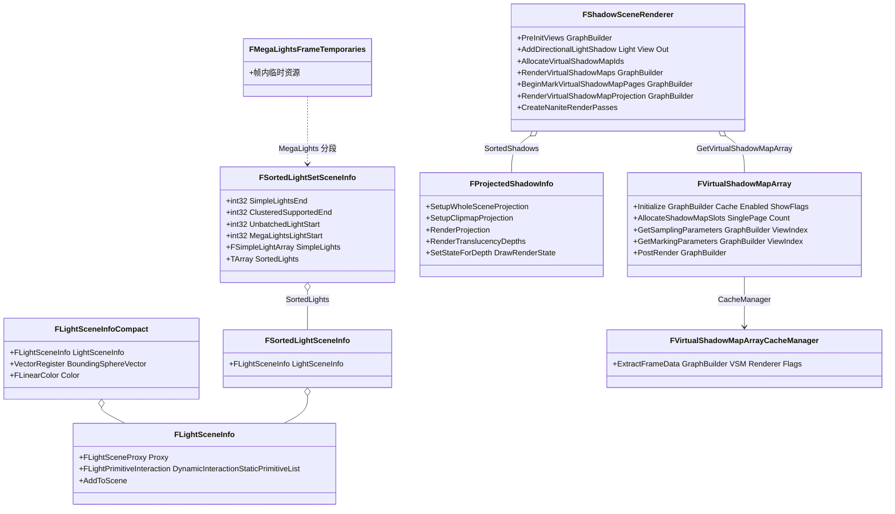

- 灯光排序:`FSceneRenderer::GatherAndSortLights`(`LightRendering.cpp:1409`)产出 `FSortedLightSetSceneInfo`(`LightSceneInfo.h:145`),把灯分为 SimpleLights(前段)、Clustered 支持段(`ClusteredSupportedEnd`)、Unbatched 段、MegaLights 段。
- 灯光渲染:`FDeferredShadingSceneRenderer::RenderLights`(`LightRendering.cpp:1627`)按段调度——聚簇延迟 `AddClusteredDeferredShadingPass`(`ClusteredDeferredShadingPass.cpp:331`)、Simple 标准延迟、逐灯 `RenderLight`(static,`LightRendering.cpp:606`);光栅格注入在 `FSceneRenderer::PrepareForwardLightData`(`LightGridInjection.cpp:1913`,返回 `FComputeLightGridOutput`,含 `CompactLinksPass` 供 HZB async compute 做 2 级前置)。
- 阴影编排移入场景扩展 `FShadowSceneRenderer`(`Shadows/ShadowSceneRenderer.h`,渲染入口 `Shadows/ShadowSceneRenderer.cpp:161` 起);传统阴影深度统一入口 `FSceneRenderer::RenderShadowDepthMaps`(`ShadowDepthRendering.cpp:1836`);VSM 页标记入口 `FShadowSceneRenderer::BeginMarkVirtualShadowMapPages`(`Shadows/ShadowSceneRenderer.cpp:866`),VSM 渲染 `RenderVirtualShadowMaps`(`Shadows/ShadowSceneRenderer.cpp:743/889`),VSM 投影 `RenderVirtualShadowMapProjection`(`Shadows/ShadowSceneRenderer.cpp:961`)。
- `FVirtualShadowMapArray`(`VirtualShadowMaps/VirtualShadowMapArray.h:293`)由 `FSceneRenderer` 持有(SceneRendering.h:2306),帧内 `Initialize`(VirtualShadowMapArray.cpp:928),`PostRender` 做 HZB/压缩后处理(VirtualShadowMapArray.cpp:1934)。
### 8.3.5 Nanite

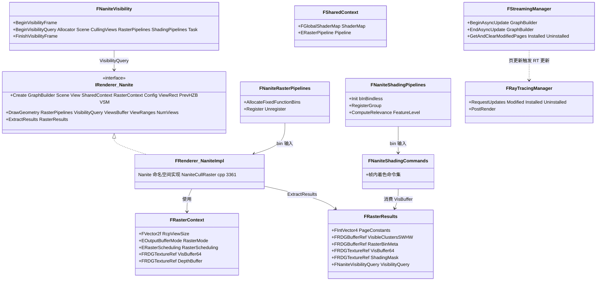

注:图中 `IRenderer_Nanite`/`FRenderer_NaniteImpl` 对应 `Nanite::IRenderer`(NaniteCullRaster.h:186)与其实现 `FRenderer`(NaniteCullRaster.cpp:3361);`FStreamingManager` 定义于 Engine 模块(`Engine/Public/Rendering/NaniteStreamingManager.h:412`,`Nanite::GStreamingManager`),`FRayTracingManager` 定义于 `Nanite/NaniteRayTracing.h:326`(`Nanite::GRayTracingManager`)。

- GPU 管线(`NaniteCullRaster.cpp` 内 RDG pass 名,按调用顺序):`PrimitiveFilter`(4379)→ `InstanceCull - GroupWork`(4733)/`InstanceCull`(4765/4776)→ `NodeAndClusterCull`(4578)→ `NodeCull_N`(4603)→ `ClusterCull`(4616)→ `RasterGroupInit`(4932)/`RasterBinCount`(5012)/`RasterGroupReserve`(5047)/`RasterGroupDepthBlock`(5074)/`RasterBinScatter`(5112)/`RasterBinFinalize`(5150)→ `HW Rasterize (Triangles)`(6207,图形队列)与 `SW Rasterize (Triangles)`(6230)/`SW Rasterize (Patches)`(6301)/`SW Rasterize (Tessellated)`(6182,计算队列)→ `PatchSplit_N`(6444);层级剔除另有 `HierarchyChunkCull`/`HierarchyCellChunkCull`(7663/7686);反馈 `NaniteFeedbackStatus`(7523)。
- 着色:`Nanite::BuildShadingCommands`(`NaniteShading.cpp:654`)把可见性结果打包成 `FNaniteShadingCommands`;`DispatchBasePass`(`NaniteShading.cpp:1670`)执行像素着色;`DispatchLumenMeshCapturePass`(`NaniteShading.cpp:3219`)执行 Lumen Card 捕获。
- 流送:`Nanite::GStreamingManager.BeginAsyncUpdate`(`DeferredShadingRenderer.cpp:2049`)/`EndAsyncUpdate`(2374)与 `GetAndClearModifiedPages`(2380)驱动页装卸;`Nanite::GRayTracingManager.RequestUpdates`(2383)。
- 可见性:`FScene::NaniteVisibility[ENaniteMeshPass::Num]`(`ScenePrivate.h:1670`),每帧 `BeginVisibilityQuery`(`DeferredShadingRenderer.cpp:1991`)以视锥数组和 `GetComputeRelevanceTask()` 为前置启动。

### 8.3.6 Lumen

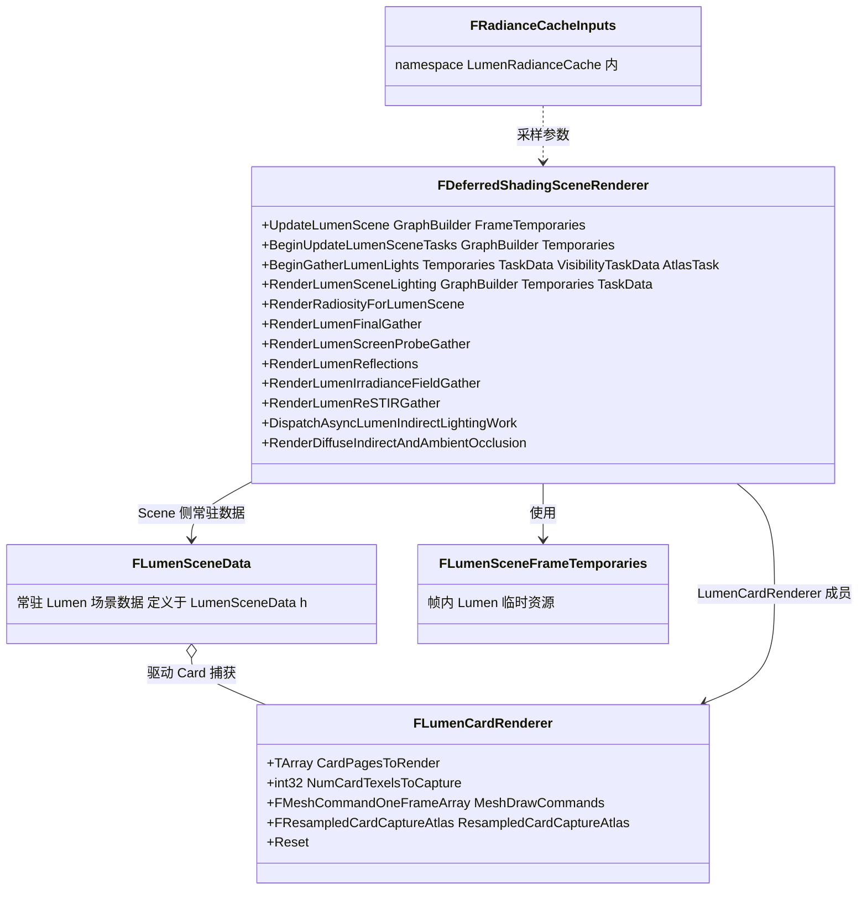
- Lumen 方法全部以 `FDeferredShadingSceneRenderer` 成员函数形式实现,入口行号:`BeginUpdateLumenSceneTasks`(`Lumen/LumenSceneRendering.cpp:2016`)、`UpdateLumenScene`(`LumenSceneRendering.cpp:2545`)、`BeginGatherLumenLights`(`Lumen/LumenSceneDirectLighting.cpp:2062`)、`RenderLumenSceneLighting`(`Lumen/LumenSceneLighting.cpp:216`)、`RenderRadiosityForLumenScene`(`Lumen/LumenRadiosity.cpp:1089`)、`RenderLumenFinalGather`(`Lumen/LumenScreenProbeGather.cpp:2093`)、`RenderLumenScreenProbeGather`(`LumenScreenProbeGather.cpp:2169`)、`RenderLumenReflections`(`Lumen/LumenReflections.cpp:1215`)、`RenderLumenIrradianceFieldGather`(`Lumen/LumenIrradianceFieldGather.cpp:390`)、`RenderLumenReSTIRGather`(`Lumen/LumenReSTIRGather.cpp:925`)、`DispatchAsyncLumenIndirectLightingWork`(`IndirectLightRendering.cpp:984`)、`RenderDiffuseIndirectAndAmbientOcclusion`(`IndirectLightRendering.cpp:1073`)。
- SurfaceCache 原语/网格卡片更新:`UpdateSurfaceCachePrimitives`/`UpdateSurfaceCacheMeshCards`(`Lumen/LumenSceneRendering.cpp:1331/1511`);Card 捕获数据结构 `FLumenCardRenderer`(`Lumen/LumenSceneCardCapture.h:129`)。
- HWRT 公共路径:`Lumen/LumenHardwareRayTracingCommon.cpp`、`LumenHardwareRayTracingMaterials.cpp`;屏幕探针 HWRT 在 `LumenScreenProbeHardwareRayTracing.cpp`。

## 8.4 数据字典

### 8.4.1 FMeshDrawCommand(Public/MeshPassProcessor.h:1281-1326)

| 字段 | 类型 | 含义 | 源码位置 |
|------|------|------|---------|
| ShaderBindings | FMeshDrawShaderBindings | 所有着色阶段资源绑定 | MeshPassProcessor.h:1288 |
| VertexStreams | FVertexInputStreamArray | 顶点流(缓冲+Stride+Offset) | MeshPassProcessor.h:1289 |
| IndexBuffer | FRHIBuffer* | 索引缓冲 | MeshPassProcessor.h:1290 |
| CachedPipelineId | FGraphicsMinimalPipelineStateId | 压缩 PSO 句柄(查 PipelineStateCache) | MeshPassProcessor.h:1295 |
| FirstIndex / NumPrimitives / NumInstances | uint32 | 绘制参数 | MeshPassProcessor.h:1300-1302 |
| VertexParams / IndirectArgs | union | 直接绘制(BaseVertexIndex/NumVertices)或间接绘制(Buffer/Offset) | MeshPassProcessor.h:1304-1317 |
| PrimitiveIdStreamIndex | int8 | PrimitiveId 顶点流索引(-1 无) | MeshPassProcessor.h:1319 |
| StencilRef | uint8 | 模板参考值 | MeshPassProcessor.h:1322 |
| PrimitiveType | EPrimitiveType : PT_NumBits | 动态合批用的冗余类型 | MeshPassProcessor.h:1325 |

### 8.4.2 FCachedMeshDrawCommandInfo(MeshPassProcessor.h:1932-1967)

| 字段 | 类型 | 含义 | 取值/约束 |
|------|------|------|----------|
| SortKey | FMeshDrawCommandSortKey | 排序键(默认 Default) | MeshPassProcessor.h:1948 |
| CommandIndex | int32 | 指向 FScene::CachedDrawLists[Pass] 的命令下标,-1 表示不缓存 | MeshPassProcessor.h:1951 |
| StateBucketId | int32 | 指向 CachedMeshDrawCommandStateBuckets 的合桶 id,-1 不合桶 | MeshPassProcessor.h:1954 |
| CullingPayload | FMeshDrawCommandCullingPayload | LOD/包围盒负载,供 GPU 剔除 | MeshPassProcessor.h:1957 |
| MeshPass | EMeshPass::Type : NumBits+1 | 所属网格 pass | MeshPassProcessor.h:1960 |
| MeshFillMode / MeshCullMode | 位域 | 视图覆盖(线框等)用 | MeshPassProcessor.h:1963-1964 |
| Flags | EFVisibleMeshDrawCommandFlags | 可见命令标志 | MeshPassProcessor.h:1966 |

### 8.4.3 FPrimitiveSceneInfo(Public/PrimitiveSceneInfo.h:269-383,节选)

| 字段 | 类型 | 含义 | 源码位置 |
|------|------|------|---------|
| Proxy | FPrimitiveSceneProxy* | 游戏侧代理 | PrimitiveSceneInfo.h:277 |
| StaticMeshCommandInfos | TArray&lt;FCachedMeshDrawCommandInfo&gt; | 静态网格缓存命令信息(与 StaticMeshes 同步) | PrimitiveSceneInfo.h:297 |
| StaticMeshRelevances | TArray&lt;FStaticMeshBatchRelevance&gt; | 静态网格相关性(InitViews 高速路径) | PrimitiveSceneInfo.h:300 |
| StaticMeshes | TArray&lt;FStaticMeshBatch&gt; | 静态网格批次 | PrimitiveSceneInfo.h:303 |
| NaniteRasterBins / NaniteShadingBins / NaniteMaterialSlots | TArray[ENaniteMeshPass::Num] | Nanite bin 注册 | PrimitiveSceneInfo.h:305-307 |
| OctreeId | FOctreeElementId2 | Scene->PrimitiveOctree 中的位置 | PrimitiveSceneInfo.h:310 |
| IndirectLightingCacheUniformBuffer | TUniformBufferRef&lt;FIndirectLightingCacheUniformParameters&gt; | ILC 分配(单帧有效) | PrimitiveSceneInfo.h:323 |
| DistanceFieldInstanceIndices | TArray&lt;int32&gt; | 实例→GDF 对象缓冲映射 | PrimitiveSceneInfo.h:336 |
| LumenPrimitiveGroupIndices | TArray&lt;int32&gt; | 实例→LumenPrimitiveGroup 映射 | PrimitiveSceneInfo.h:339 |
| LightList | FLightPrimitiveInteraction* | 影响该图元的灯链表 | PrimitiveSceneInfo.h:358 |
| Scene | FScene* | 所属场景 | PrimitiveSceneInfo.h:361 |

### 8.4.4 FScene(Private/ScenePrivate.h:1624 起,节选)

| 字段 | 类型 | 含义 | 源码位置 |
|------|------|------|---------|
| World / FXSystem | UWorld* / FFXSystemInterface* | 关联世界与 FX 系统 | ScenePrivate.h:1630/1633 |
| ViewStates | TArray&lt;FSceneViewState*&gt; | 场景上所有视图状态 | ScenePrivate.h:1636 |
| CachedMeshDrawCommandStateBuckets / CachedDrawLists | FStateBucketMap[EMeshPass::Num] / FCachedPassMeshDrawList[EMeshPass::Num] | 缓存网格命令与合桶 | ScenePrivate.h:1652-1653 |
| NaniteShadingCommands / NaniteRasterPipelines / NaniteShadingPipelines / NaniteVisibility | [ENaniteMeshPass::Num] | Nanite 各 pass 的命令/bin/可见性 | ScenePrivate.h:1664-1670 |
| Primitives | TArray&lt;FPrimitiveSceneInfo*&gt; | 紧凑图元数组(AlwaysVisible 分区偏移 PrimitivesAlwaysVisibleOffset) | ScenePrivate.h:1697-1699 |
| GPUScene | FGPUScene | GPU 实例数据场景 | ScenePrivate.h:1933 |
| RayTracingScene / HeterogeneousVolumesRayTracingScene | FRayTracingScene | TLAS 场景 | ScenePrivate.h:1937-1938 |
| RayTracingSBT | FRayTracingShaderBindingTable | RT 着色器绑定表 | ScenePrivate.h:1949 |
| DistanceFieldSceneData | FDistanceFieldSceneData(:834) | 距离场对象缓冲/流送 | ScenePrivate.h:1979 |
### 8.4.5 FViewInfo(Private/SceneRendering.h:1254 起,节选)

| 字段 | 类型 | 含义 | 源码位置 |
|------|------|------|---------|
| ViewRect / UpperBoundViewRect | FIntRect | 最终/上界视口矩形(屏幕百分比) | SceneRendering.h:1260/1263 |
| ViewState | FSceneViewState* | 视图状态(可为 null) | SceneRendering.h:1273 |
| PrimitiveVisibilityMap | FSceneBitArray | 图元可见位图 | SceneRendering.h:1281 |
| PrimitiveRayTracingVisibilityMap | FSceneBitArray | RT 可见位图 | SceneRendering.h:1284 |
| PrimitiveDefinitelyUnoccludedMap | FSceneBitArray | 已知未被遮挡位图 | SceneRendering.h:1287 |
| StaticMeshVisibilityMap / StaticMeshFadeOut(In)DitheredLODMap | FSceneBitArray | 静态网格可见/淡入淡出 | SceneRendering.h:1330-1338 |
| PrimitivesLODMask | TArray&lt;FLODMask&gt; | 相关图元 LOD | SceneRendering.h:1346 |
| NumVisibleDynamicMeshElements | int32[EMeshPass::Num] | 每 pass 动态元素数 | SceneRendering.h:1373 |
| PrevViewInfo | FPreviousViewInfo | 上帧历史(帧末释放) | (成员声明于 SceneRendering.h,Render() 4388 赋值) |

### 8.4.6 FPreviousViewInfo(帧间历史资源,Private/SceneRendering.h:1078-1216)

| 字段 | 类型 | 用途 | 源码位置 |
|------|------|------|---------|
| ViewRect / ViewMatrices | FIntRect / FViewMatrices | 重投影 | SceneRendering.h:1081-1084 |
| SceneColorPreExposure | float | 上帧预曝光 | SceneRendering.h:1087 |
| DepthBuffer / GBufferA/B/C | TRefCountPtr&lt;IPooledRenderTarget&gt; | 双边核拒绝用深度/法线 | SceneRendering.h:1092-1096 |
| HZB / NaniteHZB | IPooledRenderTarget* | 上帧 HZB(Nanite 用 NaniteHZB) | SceneRendering.h:1098-1099 |
| InstanceOcclusionQueryMask | uint32 | 实例遮挡查询位掩码 | SceneRendering.h:1105 |
| CompressedDepthViewNormal / CompressedOpaqueDepth / CompressedOpaqueShadingModel | IPooledRenderTarget* | 压缩深度/法线/着色模型(带宽友好) | SceneRendering.h:1111-1119 |
| ScreenSpaceRayTracingInput | IPooledRenderTarget* | 无渗色场景色(SSR 输入) | SceneRendering.h:1122 |
| TemporalAAHistory / TSRHistory / ThirdPartyTemporalUpscalerHistory | FTemporalAAHistory / FTSRHistory / IHistory* | TAA/TSR/第三方升采样历史 | SceneRendering.h:1126-1132 |
| SSRHistory / WaterSSRHistory / RoughRefractionHistory / FSSSHistory / HairHistory / CustomSSRInput | FTemporalAAHistory | 各子系统 TAA 历史 | SceneRendering.h:1145-1176 |
| ReflectionsHistory / AmbientOcclusionHistory / DiffuseIndirectHistory / SkyLightHistory / ReflectedSkyLightHistory / PolychromaticPenumbraHarmonicsHistory | FScreenSpaceDenoiserHistory | 屏幕空间去噪历史 | SceneRendering.h:1179-1206 |
| GTAOHistory | FGTAOTAAHistory | GTAO 时序历史 | SceneRendering.h:1189 |
| ShadowHistories | TMap&lt;FLightComponentId, TSharedPtr&lt;FScreenSpaceDenoiserHistory&gt;&gt; | 逐灯阴影去噪历史 | SceneRendering.h:1200 |
| LuminanceHistory / LuminanceViewRectHistory | IPooledRenderTarget* / FIntRect | 自动曝光历史 | SceneRendering.h:1208-1211 |

历史写入示例:`Render()` 末尾 `GraphBuilder.QueueTextureExtraction(SceneTextures.Depth.Resolve, &ViewState->PrevViewViewInfo... )`(DeferredShadingRenderer.cpp:4221-4222,写 DepthBuffer 与 ScreenSpaceRayTracingInput);`QueueSceneTextureExtractions`(4376);帧末 `Views[ViewIndex].PrevViewInfo = FPreviousViewInfo()`(4386-4389)释放引用以便 RDG 复用内存。

### 8.4.7 其余关键结构

| 结构 | 字段要点 | 源码位置 |
|------|---------|---------|
| FSortedLightSetSceneInfo | SimpleLightsEnd/ClusteredSupportedEnd/UnbatchedLightStart/MegaLightsLightStart/MegaLightsSimpleLightsEnd、bHasRectLights/bHasLightFunctions/bHasLightChannels、SimpleLights、SortedLights | LightSceneInfo.h:145-166 |
| FViewCommands | MeshCommands[EMeshPass::Num]、DynamicMeshCommandBuildRequests、DynamicMeshCommandBuildFlags | SceneVisibility.h:17-32 |
| FVisibilityTaskData::FTasks | LightVisibility、BeginInitVisibility、FrustumCull、OcclusionCull、ComputeRelevance、DynamicMeshElementsPrerequisites、DynamicMeshElements、FinalizeRelevance、MeshPassSetup | SceneVisibilityPrivate.h:588-609 |
| EMeshPass::Type | DepthPass…WaterInfoTexturePass 共 39 项(+Editor 4 项:HitProxy/HitProxyOpaqueOnly/EditorLevelInstance/EditorSelection),NumBits=6 | MeshPassProcessor.h:56-109、static_assert 166-168 |
| ERendererOutput | DepthPrepassOnly / FinalSceneColor | SceneRendering.h:2545-2549 |
| FRasterResults(Nanite) | PageConstants、MaxVisibleClusters、VisibleClustersSWHW、AssemblyTransforms/Meta、RasterBinMeta/Data/Args、RasterGroupMeta、VisBuffer64、ShadingMask、ClearTileArgs、VisibilityQuery | NaniteCullRaster.h:77-112 |
| FRasterContext | RcpViewSize、TextureSize、RasterMode(VisBuffer/DepthOnly)、RasterScheduling(HardwareOnly/HardwareThenSoftware/HardwareAndSoftwareOverlap)、DepthBuffer/VisBuffer64 | NaniteCullRaster.h:56-75、25-47 |
| FComputeLightGridOutput | CompactLinksPass(FRDGPassRef) | SceneRendering.h:2145-2148 |
| FLumenCardRenderer | CardPagesToRender、NumCardTexelsToCapture、MeshDrawCommands、MeshDrawPrimitiveIds、ResampledCardCaptureAtlas、bPropagateGlobalLightingChange、bHasAnyCardCopy | Lumen/LumenSceneCardCapture.h:129-157 |
| FDynamicPrimitiveIndex | Index:24bit / ViewMask:8bit | SceneVisibilityPrivate.h:163-174 |
| FVisibilityTaskConfig | Schedule、TaskPriority(High)、AlwaysVisible/ FrustumCull(MinWordsPerTask=32)/ OcclusionCull(MinQueriesPerTask=64)/ Relevance(Min 32 ~ Max 2048 prims/task) | SceneVisibilityPrivate.h:350-420 |

## 8.5 接口清单(Renderer 公共 API)

原型逐字摘自头文件(仅去掉 `*_API` 导出宏)。线程约束依据:游戏线程判定来自 `check(IsInGameThread())`/调用链;渲染线程来自调用链 `RenderViewFamily_RenderThread`/`ENQUEUE_RENDER_COMMAND`;任务线程来自 `UE::Tasks`/`ETaskTag::EParallelRenderingThread`。

### 8.5.1 ISceneRenderer(Public/SceneRendererInterface.h:51)

| 原型 | 功能 | 线程 | 位置 |
|------|------|------|------|
| `virtual FScene* GetScene() = 0;` | 取场景 | 任意(渲染期) | SceneRendererInterface.h:56 |
| `virtual const FSceneUniformBuffer& GetSceneUniforms() const = 0;` | 取场景 UniformBuffer | 任意 | :57 |
| `virtual TRDGUniformBufferRef<FSceneUniformParameters> GetSceneUniformBufferRef(FRDGBuilder& GraphBuilder) = 0;` | 创建/取 RDG 场景 UB | 渲染线程 | :60 |
| `virtual UE::Renderer::Private::IShadowInvalidatingInstances *GetShadowInvalidatingInstancesInterface(const FSceneView *SceneView)` | 返回标记 VSM 失效实例的接口(默认 null) | 渲染线程 | :67 |
| `TRDGUniformBufferRef<FSceneUniformParameters> GetSceneUniformBufferRef(FRDGBuilder& GraphBuilder, const FSceneView& View);` | 自由函数:按 View 取场景 UB | 渲染线程 | :70 |

### 8.5.2 FRendererModule(Private/RendererModule.h:31,实现 IRendererModule)

| 原型 | 功能 | 线程 | 位置 |
|------|------|------|------|
| `virtual void BeginRenderingViewFamily(FCanvas* Canvas,FSceneViewFamily* ViewFamily) override;` | 单 ViewFamily 渲染入口(转调 BeginRenderingViewFamilies) | 游戏线程 | RendererModule.h:40 |
| `virtual void BeginRenderingViewFamilies(FCanvas* Canvas, TConstArrayView<FSceneViewFamily*> ViewFamilies) override;` | 多 ViewFamily:创建渲染器并以 `SceneRenderBuilder.AddRenderer(...RenderViewFamily_RenderThread...)` 提交 | 游戏线程(实现 SceneRendering.cpp:5359) | RendererModule.h:154 |
| `virtual FSceneInterface* AllocateScene(UWorld* World, bool bInRequiresHitProxies, bool bCreateFXSystem, ERHIFeatureLevel::Type InFeatureLevel) override;` | 创建 FScene | 游戏线程 | RendererModule.h:42 |
| `virtual FSceneViewStateInterface* AllocateViewState(ERHIFeatureLevel::Type FeatureLevel) override;` | 创建 FSceneViewState | 游戏线程 | RendererModule.h:47 |
| `virtual void UpdateStaticDrawLists() override;` / `virtual void UpdateStaticDrawListsForMaterials(const TArray<const FMaterial*>& Materials) override;` | 重建缓存网格命令 | 渲染线程 | :45-46 |
| `virtual void DrawTileMesh(FCanvasRenderContext& RenderContext, FMeshPassProcessorRenderState& DrawRenderState, const FSceneView& View, FMeshBatch& Mesh, bool bIsHitTesting, const FHitProxyId& HitProxyId, bool bUse128bitRT = false) override;` | Slate/Canvas 单 Mesh 绘制(TranslucencyAll pass) | 渲染线程 | :57 |
| `virtual void PostRenderAllViewports() override;` | 帧号自增 + `GRayTracingGeometryManager->Tick` | 游戏线程(内部 ENQUEUE) | :97,SceneRendering.cpp:5548 |
| `virtual void ExecVisualizeTextureCmd(const FString& Cmd) override;` | `vis` 命令 | 游戏线程 | :60 |
| `virtual FDelegateHandle RegisterPostOpaqueRenderDelegate(const FPostOpaqueRenderDelegate& InPostOpaqueRenderDelegate) override;`(+ Remove/Overlay 对称组) | 不透明后/Overlay 扩展注入点 | 游戏线程注册、渲染线程广播 | :87-90 |
| `virtual FOnResolvedSceneColor& GetResolvedSceneColorCallbacks() override;` | SceneColor resolve 后回调 | 渲染线程广播 | :92 |
| `virtual TUniquePtr<ISceneRenderBuilder> CreateSceneRenderBuilder(FSceneInterface* Scene) override;` | 场景渲染构建器(SceneCapture 用) | 游戏线程 | :168 |
| `virtual void RegisterPersistentViewUniformBufferExtension(IPersistentViewUniformBufferExtension* Extension) override;` | 注册持久视图 UB 扩展(BeginFrame/PrepareView 钩子) | 游戏线程注册,渲染线程回调 | :135 |
| `virtual void RequestNanitePages(TArray<uint32>&& InRequestStream) override;` 等 Nanite/VT 一组(AllocateVirtualTexture、RegisterVirtualTextureProducer、RequestVirtualTextureTiles、PrefetchNaniteResource 等) | VT/Nanite 流送 API | 游戏线程 | :104-133 |

### 8.5.3 FSceneRendererBase / FSceneRenderer(Private/SceneRendering.h)

| 原型 | 功能 | 线程 | 位置 |
|------|------|------|------|
| `static void SetActiveInstance(FRDGBuilder& GraphBuilder, FSceneRendererBase* SceneRenderer);` / `static FSceneRendererBase* GetActiveInstance(FRDGBuilder& GraphBuilder);` | 从 GraphBuilder 取当前场景渲染器 | 渲染线程 | SceneRendering.h:2166-2167 |
| `static FIntRect GetHZBViewRect(const FViewInfo& View);` | 取 HZB 视口矩形 | 渲染线程 | :2206 |
| `virtual void Render(FRDGBuilder& GraphBuilder, const FSceneRenderUpdateInputs* SceneUpdateInputs) = 0;` | 帧渲染入口 | 渲染线程 | :2340 |
| `virtual void RenderHitProxies(FRDGBuilder& GraphBuilder, const FSceneRenderUpdateInputs* SceneUpdateInputs)` | HitProxy 渲染 | 渲染线程 | :2341 |
| `virtual bool ShouldRenderVelocities() const` / `ShouldRenderPrePass()` / `ShouldRenderNanite()` | 能力查询 | 渲染线程 | :2342-2344 |
| `void PrepareViewRectsForRendering();` | 按屏幕百分比计算 ViewRect | 任务线程(OnRenderBegin 内 PrepareSceneTexturesConfigTask,SceneRendering.cpp:4240) | :2348 |
| `bool DoOcclusionQueries() const;` | 是否做 GPU 遮挡查询 | 渲染线程 | :2365 |
| `void FenceOcclusionTests(FRDGBuilder& GraphBuilder);` / `void WaitOcclusionTests(FRHICommandListImmediate& RHICmdList);` | 遮挡查询 fence/等待 | 渲染线程 | :2367-2368 |
| `static FIntPoint GetDesiredInternalBufferSize(const FSceneViewFamily& ViewFamily);` | 内部缓冲期望尺寸 | 游戏线程或渲染线程(注释明确) | :2396 |
| `void RenderSkyAtmosphereInternal(FRDGBuilder& GraphBuilder, const FSceneTextureShaderParameters& SceneTextures, FSkyAtmosphereRenderContext& SkyRenderContext);` | 任意视点天空渲染 | 渲染线程 | :2408 |
| `void RenderVolumetricCloudsInternal(FRDGBuilder& GraphBuilder, FCloudRenderContext& CloudRC, FInstanceCullingManager& InstanceCullingManager, const FIntPoint& CloudViewportSize);` | 任意视点云渲染 | 渲染线程 | :2414 |
| `void VoxelizeFogVolumePrimitives(FRDGBuilder& GraphBuilder, const FViewInfo& View, const FVolumetricFogIntegrationParameterData& IntegrationData, FIntVector VolumetricFogGridSize, FVector GridZParams, float VolumetricFogDistance, bool bVoxelizeEmissive);` | 局部雾体素化 | 渲染线程 | :2421 |
| `void RenderLocalLightsForVolumetricFog(...TConstArrayView<const FLightSceneInfo*> LightsToInject, ... FRDGTexture*& OutLocalShadowedLightScattering);` | 体积雾局部光注入 | 渲染线程 | :2440 |
| `FGPUSceneDynamicContext& GetGPUSceneDynamicContext()` | 取 GPU-Scene 动态上下文 | 渲染线程 | :2419 |
| `IVisibilityTaskData* OnRenderBegin(FRDGBuilder& GraphBuilder, const FSceneRenderUpdateInputs* SceneUpdateInputs);` | 帧前置:场景更新+视图状态准备 | 渲染线程 | SceneRendering.cpp:4198 |
### 8.5.4 FDeferredShadingSceneRenderer(Private/DeferredShadingRenderer.h:260)

| 原型 | 功能 | 线程 | 位置 |
|------|------|------|------|
| `FDeferredShadingSceneRenderer(const FSceneViewFamily* InViewFamily, FHitProxyConsumer* HitProxyConsumer);` | 构造(游戏线程,实现 DeferredShadingRenderer.cpp:527) | 游戏线程 | DeferredShadingRenderer.h:266 |
| `void CommitFinalPipelineState();` | 计算并提交帧管线状态(DiffuseIndirect/Reflections/AO 方法等) | 渲染线程 | :269,实现 :1393 |
| `void RenderPrePassView(FRHICommandList& RHICmdList, const FViewInfo& View);` | 单视图 PrePass | 渲染线程 | :281 |
| `bool RenderPrePassViewParallel(const FViewInfo& View, FRHICommandListImmediate& ParentCmdList,TFunctionRef<void()> AfterTasksAreStarted, bool bDoPrePre);` | 并行 PrePass | 渲染线程+任务线程 | :287 |
| `static void RenderBasePass(FDeferredShadingSceneRenderer& Renderer, FRDGBuilder& GraphBuilder, TArrayView<FViewInfo> InViews, FSceneTextures& SceneTextures, FExclusiveDepthStencil::Type BasePassDepthStencilAccess, FRDGTextureRef ForwardShadowMaskTexture, FInstanceCullingManager& InstanceCullingManager, bool bNaniteEnabled, struct FNaniteShadingCommands& NaniteBasePassShadingCommands, const TArrayView<Nanite::FRasterResults>& NaniteRasterResults);` | BasePass(实现 BasePassRendering.cpp:934) | 渲染线程 | :299 |
| `static void RenderBasePassInternal(..., const FRenderTargetBindingSlots& BasePassRenderTargets, ..., bool bParallelBasePass, bool bRenderLightmapDensity, ...);` | BasePass 内部 | 渲染线程+任务线程 | :311 |
| `static void RenderAnisotropyPass(FRDGBuilder& GraphBuilder, TArrayView<FViewInfo> InViews, FSceneTextures& SceneTextures, const FScene* Scene, bool bDoParallelPass);` | 各向异性 pass | 渲染线程 | :326 |
| `FSingleLayerWaterPrePassResult* RenderSingleLayerWaterDepthPrepass(FRDGBuilder& GraphBuilder, TArrayView<FViewInfo> InViews, const FSceneTextures& SceneTextures, ESingleLayerWaterPrepassLocation Location, TConstArrayView<Nanite::FRasterResults> NaniteRasterResults);` | 单层水深度前置 | 渲染线程 | :335 |
| `void RenderOcclusion(FRDGBuilder& GraphBuilder, const FSceneTextures& SceneTextures, bool bIsOcclusionTesting, const FBuildHZBAsyncComputeParams* BuildHZBAsyncComputeParams, Froxel::FRenderer& FroxelRenderer);` | HZB+遮挡查询(实现 SceneOcclusion.cpp:1451) | 渲染线程 | :367 |
| `bool RenderHzb(FRDGBuilder& GraphBuilder, FRDGTextureRef SceneDepthTexture, const FBuildHZBAsyncComputeParams* AsyncComputeParams, Froxel::FRenderer& FroxelRenderer);` | HZB 构建(可异步计算) | 渲染线程 | :374 |
| `virtual void Render(FRDGBuilder& GraphBuilder, const FSceneRenderUpdateInputs* SceneUpdateInputs) override;` | 主入口(实现 DeferredShadingRenderer.cpp:1823) | 渲染线程 | :377 |
| `void RenderShadowDepthMaps(FRDGBuilder& GraphBuilder, FDynamicShadowsTaskData* DynamicShadowsTaskData, FInstanceCullingManager& InstanceCullingManager, FRDGExternalAccessQueue& ExternalAccessQueue);` | 阴影深度统一入口(实现 ShadowDepthRendering.cpp:1836) | 渲染线程 | SceneRendering.h:2647 |
| `void GatherAndSortLights(FSortedLightSetSceneInfo& OutSortedLights, bool bShadowedLightsInClustered = false);` | 灯光收集排序(实现 LightRendering.cpp:1409) | 任务线程(LaunchSceneRenderTask) | SceneRendering.h:2743 |
| `FComputeLightGridOutput PrepareForwardLightData(FRDGBuilder& GraphBuilder, bool bCullLightsToGrid, const FSortedLightSetSceneInfo& SortedLightSet);` | 光栅格注入(实现 LightGridInjection.cpp:1913) | 渲染线程 | SceneRendering.h(声明) |
| `void ComputeVolumetricFog(FRDGBuilder& GraphBuilder, ...);` | 体积雾(实现 VolumetricFog.cpp:1497) | 渲染线程 | — |
| `bool RenderVolumetricCloud(FRDGBuilder& GraphBuilder, ...);` | 体积云(实现 VolumetricCloudRendering.cpp:2702) | 渲染线程 | SceneRendering.h:2723 |
| `void RenderSkyAtmosphere(FRDGBuilder& GraphBuilder, const FMinimalSceneTextures& SceneTextures);` | 天空大气合成(实现 SkyAtmosphereRendering.cpp:2155) | 渲染线程 | — |
| `void RenderSkyAtmosphereLookUpTables(FRDGBuilder& GraphBuilder, class FSkyAtmospherePendingRDGResources& PendingRDGResources, FDynamicShadowsTaskData* FilterDynamicShadowTaskData);` | 大气 LUT(实现 SkyAtmosphereRendering.cpp:1478) | 渲染线程 | — |
| `void RenderVelocities(FRDGBuilder& GraphBuilder, TArrayView<FViewInfo> Views, FSceneTextures& SceneTextures, EVelocityPass::Type VelocityPass, bool bForceAllPrimitives, bool bBindRenderTarget=true, ...);` | 速度 pass(重载,实现 VelocityRendering.cpp:482/704) | 渲染线程 | — |
| `void RenderTranslucency(FDeferredShadingSceneRenderer& Renderer, FRDGBuilder& GraphBuilder, ...);` | 半透明(声明 DeferredShadingRenderer.h:849) | 渲染线程 | :849 |
| `FFrontLayerTranslucencyData RenderFrontLayerTranslucency(FRDGBuilder& GraphBuilder, TArrayView<FViewInfo> Views, const FSceneTextures& SceneTextures, TSharedPtr<FMegaLightsFrameTemporaries> MegaLightsContext, bool bMarkVSMPages);` | 前层半透明 GBuffer(实现 FrontLayerTranslucency.cpp:650) | 渲染线程 | — |

### 8.5.5 可见性接口(IVisibilityTaskData,Private/SceneVisibility.h:34)

| 原型 | 功能 | 线程 | 位置 |
|------|------|------|------|
| `virtual void StartGatherDynamicMeshElements() = 0;` | 允许尽早启动 GDME 任务 | 渲染线程 | SceneVisibility.h:40 |
| `virtual void ProcessRenderThreadTasks() = 0;` | 处理必须串行在渲染线程的可见性任务 | 渲染线程 | :43 |
| `virtual void FinishGatherDynamicMeshElements(FExclusiveDepthStencil::Type BasePassDepthStencilAccess, FInstanceCullingManager& InstanceCullingManager, FVirtualTextureUpdater* VirtualTextureUpdater) = 0;` | 完成 GDME(实现 SceneVisibility.cpp:4932) | 渲染线程 | :46 |
| `virtual void Finish() = 0;` | 等待任务图并清理(实现 :4951) | 渲染线程 | :49 |
| `virtual UE::Tasks::FTask GetFrustumCullTask() const = 0;` / `GetComputeRelevanceTask()` / `GetLightVisibilityTask()` | 阶段同步任务句柄 | 任意(等待方) | :58-64 |
| `IVisibilityTaskData* LaunchVisibilityTasks(FRHICommandListImmediate& RHICmdList, FSceneRenderer& SceneRenderer, const UE::Tasks::FTask& BeginInitVisibilityTaskPrerequisites);` | 自由函数:启动可见性任务图 | 渲染线程 | :72 |

### 8.5.6 网格绘制接口

| 原型 | 功能 | 线程 | 位置 |
|------|------|------|------|
| `void DispatchPassSetup(FScene* Scene, const FViewInfo& View, FInstanceCullingContext &&InstanceCullingContext, EMeshPass::Type PassType, FExclusiveDepthStencil::Type BasePassDepthStencilAccess, FMeshPassProcessor* MeshPassProcessor, ..., FMeshCommandOneFrameArray& InOutMeshDrawCommands, ...);` | 派发 pass setup 任务(动态命令生成/排序/合并) | 渲染线程调用,任务线程执行 | MeshDrawCommands.h:128 |
| `void BuildRenderingCommands(FRDGBuilder& GraphBuilder, const FGPUScene& GPUScene, FInstanceCullingDrawParams& OutInstanceCullingDrawParams);` | 实例剔除后生成渲染命令 | 渲染线程 | :150 |
| `void WaitForSetupTask();` | 同步 setup 任务 | 渲染线程 | :158 |
| `void Draw(FRHICommandList& RHICmdList, const FInstanceCullingDrawParams* InstanceCullingDrawParams = nullptr) const;` | 提交绘制 | 渲染线程 | :163 |
| `void Dispatch(FRDGDispatchPassBuilder& DispatchPassBuilder, const FInstanceCullingDrawParams* InstanceCullingDrawParams = nullptr, float ViewportScale = 1.0f) const;` | 以 RDG dispatch 方式提交 | 渲染线程 | :164 |
| `virtual void AddMeshBatch(const FMeshBatch& RESTRICT MeshBatch, uint64 BatchElementMask, const FPrimitiveSceneProxy* RESTRICT PrimitiveSceneProxy, int32 StaticMeshId = -1) = 0;` | pass 处理器入口(纯虚) | 渲染线程/任务线程 | MeshPassProcessor.h:2284 |
| `virtual void CollectPSOInitializers(const FSceneTexturesConfig& SceneTexturesConfig, const FMaterial& Material, const FPSOPrecacheVertexFactoryData& VertexFactoryData, const FPSOPrecacheParams& PreCacheParams, TArray<FPSOPrecacheData>& PSOInitializers) override {}` | PSO 预缓存收集 | 任意(材质编译/加场景) | :2287 |
| `template<typename PassShadersType, typename ShaderElementDataType> void BuildMeshDrawCommands(..., const FMeshPassProcessorRenderState& RESTRICT DrawRenderState, ..., FMeshDrawCommandSortKey SortKey, EMeshPassFeatures MeshPassFeatures, const ShaderElementDataType& ShaderElementData);` | 由 MeshBatch 构建 FMeshDrawCommand | 渲染线程/任务线程 | :2306 |
### 8.5.7 Nanite 接口(Private/Nanite/)

| 原型 | 功能 | 线程 | 位置 |
|------|------|------|------|
| `static TUniquePtr< IRenderer > Create(FRDGBuilder& GraphBuilder, const FScene& Scene, const FViewInfo& SceneView, FSceneUniformBuffer& SceneUniformBuffer, const FSharedContext& SharedContext, const FRasterContext& RasterContext, const FConfiguration& Configuration, const FIntRect& ViewRect, const FRDGTextureRef PrevHZB, FVirtualShadowMapArray* VirtualShadowMapArray = nullptr );` | 创建剔除/光栅化实现(工厂;返回 NaniteCullRaster.cpp:3361 的 FRenderer) | 渲染线程 | NaniteCullRaster.h:189 |
| `virtual void DrawGeometry(FNaniteRasterPipelines& RasterPipelines, const FNaniteVisibilityQuery* VisibilityQuery, FRDGBufferRef ViewsBuffer, FRDGBufferRef InViewDrawRanges, int32 NumViews, FSceneInstanceCullingQuery* OptionalSceneInstanceCullingQuery, const TConstArrayView<FInstanceDraw>* OptionalInstanceDraws, const FExplicitChunkDrawInfo* OptionalExplicitChunkDrawInfo) = 0;` | 执行 GPU 剔除+光栅化(pass 见 8.3.5) | 渲染线程(RDG pass) | NaniteCullRaster.h:205 |
| `virtual void ExtractResults( FRasterResults& RasterResults ) = 0;` | 提取结果(VisBuffer 等) | 渲染线程 | :258 |
| `FRasterContext InitRasterContext(FRDGBuilder& GraphBuilder, const FSharedContext& SharedContext, const FViewFamilyInfo& ViewFamily, const FRasterContextInitParams& InitParams);` | 光栅化上下文(VisBuffer/DepthOnly 模式、HW/SW 调度) | 渲染线程 | :144,实现 NaniteCullRaster.cpp:6561 |
| `void CollectRasterPSOInitializers(const FSceneTexturesConfig& SceneTexturesConfig, const FMaterial& Material, const FPSOPrecacheParams& PreCacheParams, EShaderPlatform ShaderPlatform, int32 PSOCollectorIndex, TArray<FPSOPrecacheData>& PSOInitializers);` | Nanite 光栅 PSO 预缓存 | 任意 | :114 |
| `void BuildShadingCommands(FRDGBuilder& GraphBuilder, FScene& Scene, ENaniteMeshPass::Type MeshPass, FNaniteShadingCommands& ShadingCommands, EBuildShadingCommandsMode Mode);` | 构建/更新着色命令(非头文件导出,定义于 cpp) | 渲染线程 | NaniteShading.cpp:654 |
| `void DispatchBasePass(...);` | Nanite BasePass 像素着色 | 渲染线程 | NaniteShading.cpp:1670 |
| `void DispatchLumenMeshCapturePass(...);` | Lumen Card 捕获着色 | 渲染线程 | NaniteShading.cpp:3219 |
| `FNaniteVisibility::BeginVisibilityQuery(Allocator, Scene, CullingViews, RasterPipelines, ShadingPipelines, Task)` / `BeginVisibilityFrame()` / `FinishVisibilityFrame()` | GPU 可见性查询生命周期 | 渲染线程启动(结果任务消费) | DeferredShadingRenderer.cpp:1988-1998、4391-4395 |

### 8.5.8 Lumen / 阴影 / MegaLights 入口(均为 FDeferredShadingSceneRenderer 或场景扩展成员)

| 原型(节选自调用点/定义) | 功能 | 位置 |
|------|------|------|
| `void FDeferredShadingSceneRenderer::BeginUpdateLumenSceneTasks(FRDGBuilder& GraphBuilder, FLumenSceneFrameTemporaries& FrameTemporaries)` | 启动 Lumen 场景更新任务 | Lumen/LumenSceneRendering.cpp:2016 |
| `void FDeferredShadingSceneRenderer::BeginGatherLumenLights(const FLumenSceneFrameTemporaries& FrameTemporaries, FLumenDirectLightingTaskData*& TaskData, IVisibilityTaskData* VisibilityTaskData, UE::Tasks::FTask UpdateLightFunctionAtlasTask)` | 启动 Lumen 直接光收集任务(以可见性任务为前置) | Lumen/LumenSceneDirectLighting.cpp:2062 |
| `void FDeferredShadingSceneRenderer::UpdateLumenScene(FRDGBuilder& GraphBuilder, FLumenSceneFrameTemporaries& FrameTemporaries)` | Lumen 场景/SurfaceCache/Card 更新 | Lumen/LumenSceneRendering.cpp:2545 |
| `void FDeferredShadingSceneRenderer::RenderLumenSceneLighting(FRDGBuilder& GraphBuilder, ...)` | Lumen 场景直接光照明(Card 页) | Lumen/LumenSceneLighting.cpp:216 |
| `void FDeferredShadingSceneRenderer::RenderRadiosityForLumenScene(...)` | Lumen Radiosity | Lumen/LumenRadiosity.cpp:1089 |
| `FSSDSignalTextures FDeferredShadingSceneRenderer::RenderLumenFinalGather(FRDGBuilder& GraphBuilder, ..., ERDGPassFlags PassFlag)` | 屏幕探针最终收集(可 AsyncCompute) | Lumen/LumenScreenProbeGather.cpp:2093(调用点 IndirectLightRendering.cpp:1039) |
| `FRDGTextureRef FDeferredShadingSceneRenderer::RenderLumenReflections(...)` | Lumen 反射 | Lumen/LumenReflections.cpp:1215 |
| `void FDeferredShadingSceneRenderer::DispatchAsyncLumenIndirectLightingWork(FRDGBuilder& GraphBuilder, FSceneTextures& SceneTextures, FInstanceCullingManager& InstanceCullingManager, FLumenSceneFrameTemporaries& LumenFrameTemporaries, FDynamicShadowsTaskData* DynamicShadowsTaskData, FRDGTextureRef LightingChannelsTexture, FAsyncLumenIndirectLightingOutputs& Outputs)` | 异步 Lumen 间接光派发 | IndirectLightRendering.cpp:984 |
| `void FDeferredShadingSceneRenderer::RenderDiffuseIndirectAndAmbientOcclusion(..., bool bCompositeRegularLumenOnly, bool bIsVisualizePass, FAsyncLumenIndirectLightingOutputs&)` | 间接光+AO 合成 | IndirectLightRendering.cpp:1073 |
| `void FShadowSceneRenderer::BeginMarkVirtualShadowMapPages(FRDGBuilder& GraphBuilder, ..., FFrontLayerTranslucencyData, Froxel::FRenderer&)` | VSM 页标记 | Shadows/ShadowSceneRenderer.cpp:866 |
| `void FShadowSceneRenderer::RenderVirtualShadowMaps(FRDGBuilder& GraphBuilder, bool bNaniteEnabled, bool bUpdateNaniteStreaming)` | VSM 渲染(含 Nanite 路径) | Shadows/ShadowSceneRenderer.cpp:743/889 |
| `void FShadowSceneRenderer::RenderVirtualShadowMapProjection(FRDGBuilder& GraphBuilder, ...)` / `ApplyVirtualShadowMapProjectionForLight(...)` | VSM 投影/逐灯应用 | Shadows/ShadowSceneRenderer.cpp:961/1011 |
| `void FVirtualShadowMapArray::Initialize(FRDGBuilder& GraphBuilder, FVirtualShadowMapArrayCacheManager* Cache, bool bAllocate, const FEngineShowFlags&)` | 帧初始化 | VirtualShadowMaps/VirtualShadowMapArray.cpp:928 |
| `TRDGUniformBufferRef<FVirtualShadowMapUniformParameters> FVirtualShadowMapArray::GetUncachedUniformBuffer(FRDGBuilder& GraphBuilder) const` | VSM 采样 UB | VirtualShadowMapArray.cpp:1177 |
| `FVirtualShadowMapSamplingParameters FVirtualShadowMapArray::GetSamplingParameters(FRDGBuilder& GraphBuilder, int32 ViewIndex) const` / `GetMarkingParameters(...)` | 采样/标记参数 | VirtualShadowMapArray.cpp:1217/1231 |
| `void FVirtualShadowMapArray::PostRender(FRDGBuilder& GraphBuilder)` | HZB/压缩后处理 | VirtualShadowMapArray.cpp:1934 |
| `void FDeferredShadingSceneRenderer::DispatchAsyncMegaLightsVolumePasses(...)` / `GenerateMegaLightsSamples(...)` / `RenderMegaLights(...)` / `RenderMegaLightsFrontLayerTranslucency(...)` / `CreateMegaLightsFrameTemporaries(...)` | MegaLights 体积/采样/着色入口 | MegaLights/MegaLights.cpp:2296/2321/2428/2485/2247 |
| `void FCompositionLighting::ProcessBeforeBasePass(FRDGBuilder& GraphBuilder, FDBufferTextures& DBufferTextures, FInstanceCullingManager& InstanceCullingManager, const FSubstrateSceneData& SubstrateSceneData)` | DBuffer 贴花 | CompositionLighting/CompositionLighting.cpp:548 |
| `void FCompositionLighting::ProcessAfterBasePass(FRDGBuilder& GraphBuilder, FInstanceCullingManager& InstanceCullingManager, EProcessAfterBasePassMode Mode, const FSubstrateSceneData& SubstrateSceneData)` | 延迟贴花+SSAO/GTAO | CompositionLighting/CompositionLighting.cpp:602 |
| `void FCompositionLighting::ProcessAfterOcclusion(FRDGBuilder& GraphBuilder)` | 遮挡后处理 | CompositionLighting/CompositionLighting.cpp:697 |

### 8.5.9 其他子系统公共入口

| 原型/入口 | 功能 | 位置 |
|------|------|------|
| `void FGPUScene::UploadDynamicPrimitiveShaderDataForView(FRDGBuilder& GraphBuilder, FViewInfo& View, bool bRayTracing = false, UE::Renderer::Private::IShadowInvalidatingInstances *ShadowInvalidatingInstances = nullptr);` | 动态图元上传(RT/VSM 失效标记) | GPUScene.h:257 |
| `void FGPUScene::Update(FRDGBuilder& GraphBuilder, FRDGExternalAccessQueue& ExternalAccessQueue, const FUpdateFromComputeCommands& UpdatesFromCompute, const UE::Tasks::FTask& UpdateTaskPrerequisites, FSceneExtensionsUpdaters& SceneExtensionsUpdaters);` | GPU-Scene 增量更新(实现 GPUScene.cpp:1782) | GPUScene.h:267 |
| `bool FGPUScene::ExecuteDeferredGPUWritePass(FRDGBuilder& GraphBuilder, ..., EGPUSceneGPUWritePass::PostOpaqueRendering)` | GPU 写回 pass 挂接 | DeferredShadingRenderer.cpp:3927(调用) |
| `virtual RayTracing::FBuildRequestHandle RequestBuildAccelerationStructure(FRayTracingGeometry* InGeometry, ERTAccelerationStructureBuildPriority InPriority, EAccelerationStructureBuildMode InBuildMode) = 0;` 等(PreRender/Update/Tick/ProcessBuildRequests) | RT 几何管理器接口(RenderCore) | RenderCore/Public/RayTracingGeometryManagerInterface.h:24-56,实例指针 GRayTracingGeometryManager:92 |
| `void AddPostProcessingPasses(FRDGBuilder& GraphBuilder, const FViewInfo& View, int32 ViewIndex, ..., FPostProcessingInputs& Inputs, ...)` | 后处理链入口 | PostProcess/PostProcessing.cpp:412 |
| `bool IsHairStrandsEnabled(EHairStrandsShaderType Type, EShaderPlatform Platform = EShaderPlatform::SP_NumPlatforms);` | 发丝能力查询 | Public/HairStrandsInterface.h:544 |
| `void RunHairStrandsBookmark(FRDGBuilder& GraphBuilder, EHairStrandsBookmark Bookmark, FHairStrandsBookmarkParameters& Parameters);` | 发丝书签调度(实现 HairStrands/HairStrandsInterface.cpp:434) | Public/HairStrandsInterface.h(EHairStrandsBookmark :577) |
| `virtual FOutputs AddPasses(FRDGBuilder& GraphBuilder, const FSceneView& View, const FInputs& Inputs) const = 0;` | 时间升采样器接口(TSR/第三方) | Public/TemporalUpscaler.h:75 |
| `static FAnyRayTracingPassEnabled& AnyRayTracingPassEnabled();` / `static FPrepareRayTracing& PrepareRayTracing();` / `static FRenderDiffuseIndirectLight& RenderDiffuseIndirectLight();` | GI 插件委托 | DeferredShadingRenderer.h:247-249 |
| `void FMobileSceneRenderer::Render(FRDGBuilder& GraphBuilder, const FSceneRenderUpdateInputs* SceneUpdateInputs)` | 移动路径主入口 | MobileShadingRenderer.cpp:1181 |
### 8.5.10 Public/ 头文件清单(模块对外可见 API 面)

`SceneRendererInterface.h`(ISceneRenderer/GetSceneUniformBufferRef)、`MeshPassProcessor.h`(.inl)(EMeshPass、FMeshDrawCommand、FMeshPassProcessor、缓存命令上下文)、`MeshPassUtils.h`(EMeshPass 名)、`MeshDrawShaderBindings.h`、`MeshMaterialShader.h`/`MaterialShader.h`(材质着色器基类)、`StaticMeshBatch.h`(FStaticMeshBatch)、`PrimitiveSceneInfo.h`(FPrimitiveSceneInfo/Compact/Octree)、`SceneUniformBuffer.h`、`SceneCaptureRendering.h`、`SceneRenderTargetParameters.h`、`ScreenPass.h`(.inl)(FScreenPassTexture/AddScreenPass)、`TemporalUpscaler.h`(ITemporalUpscaler)、`HairStrandsInterface.h`、`RayTracingMeshDrawCommands.h`、`RayTracingGeometryInstance.h`、`RayTracingInstance.h`、`RayTracingInstanceBufferUtil.h`、`RayTracingDynamicGeometryUpdateManager.h`、`RayTracingShaderBindingLayout.h`、`SimpleMeshDrawCommandPass.h`、`PathTracingDenoiser.h`、`GpuDebugRendering.h`、`GPUSceneWriter.h`、`ShaderPrintParameters.h`、`SystemTextures.h`、`TextureFallbacks.h`/`TextureFallbacksRDG.h`、`RectLightTexture.h`、`LightMapHelpers.h`、`MeshEdges.h`、`ViewDebug.h`、`VolumeRendering.h`、`TessellationTable.h`、`VariableRateShadingImageManager.h`、`GlobalDistanceFieldConstants.h`/`GlobalDistanceFieldParameters.h`/`GlobalDistanceFieldReadback.h`、`ComputeSystemInterface.h`、`FXRenderingUtils.h`、`HdrCustomResolveShaders.h`、`PostProcess/`、`InstanceCulling/`、`VT/`。

## 8.6 关键流程

### 8.6.1 FDeferredShadingSceneRenderer::Render 逐阶段真实顺序(DeferredShadingRenderer.cpp:1823-4401)

| 序 | 阶段(行号) | 关键调用 | 并行/异步 |
|---|------------|---------|----------|
| 1 | RT 资源准备(1866-1891) | `GRayTracingGeometryManager->Update/ProcessBuildRequests`、`RayTracingScene.AddView/SetViewParams` | 渲染线程 |
| 2 | OnRenderBegin(1893) | `FScene::Update`(RendererScene.cpp:5534,SceneRendering.cpp:4378)、视图扩展 PreRender* | 场景更新内部并行(AsyncOps:CreateLightPrimitiveInteractions/CacheMeshDrawCommands/CacheMaterialUniformExpressions) |
| 3 | 帧级初始化(1902-1934) | 曝光 LUT 任务、`FGPUSceneScopeBeginEndHelper`(1909)、VT `BeginUpdate`+FeedbackBegin(1917-1918)、`CommitFinalPipelineState`(1928)、`GSystemTextures.InitializeTextures`(1933) | 曝光 LUT 任务并行 |
| 4 | LightFunctionAtlas 任务(1936-1943) | `LaunchSceneRenderTask<void>(TEXT("UpdateLightFunctionAtlas"),...)` | UE::Tasks 并行 |
| 5 | GDF/Lumen/VSM/Nanite 前置(1945-2000) | `UpdateGlobalDistanceFieldViewOrigin`(1951)、`VirtualShadowMapArray.Initialize`(1963)、`BeginUpdateLumenSceneTasks`(1967)、`BeginGatherLumenLights`(1970)、`NaniteVisibility.BeginVisibilityQuery`(1991,前置 GetComputeRelevanceTask) | Lumen/Nanite 任务并行 |
| 6 | 距离场/SVT/Nanite 流送(2010-2071) | `PrepareDistanceFieldScene`(2012)、`UE::SVT::GetStreamingManager().BeginAsyncUpdate`(2043)、`Nanite::GStreamingManager.BeginAsyncUpdate`(2049) | 异步 |
| 7 | 渲染目标与视图数据(2081-2120) | Subsurface/Specular/Toon Profile 纹理、RectLight/IES Atlas、`FRendererViewDataManager`、`FInstanceCullingManager`、`FSceneTextures::InitializeViewFamily`(2119) | 渲染线程 |
| 8 | BeginInitViews(2124) | `FDeferredShadingSceneRenderer::BeginInitViews`(SceneVisibility.cpp:5918)→ `LaunchVisibilityTasks` | 可见性任务图(见 8.6.3) |
| 9 | GDME 收尾+FX(2219-2232) | `FinishGatherDynamicMeshElements`(2219)、`FXSystem->PreRender`+GPUSortManager(2227-2231) | GDME 任务并行 |
| 10 | GPUScene 上传(2234-2255) | `Scene->GPUScene.UploadDynamicPrimitiveShaderDataForView`(2243)、`UpdatePhysicsField`(2253) | 渲染线程 |
| 11 | 灯光排序任务(2301-2345) | `GatherAndSortLightsTask = LaunchSceneRenderTask<FSortedLightSetSceneInfo*>(...)`(2339),前置 FilterDynamicShadows 任务与 LightFunctionAtlas 任务 | UE::Tasks 并行 |
| 12 | EndInitViews(2395) | `FDeferredShadingSceneRenderer::EndInitViews`(SceneVisibility.cpp:6063) | 渲染线程等待任务 |
| 13 | Substrate/发丝前置(2400-2427) | `Substrate::InitialiseSubstrateFrameSceneData`(2401)、HairStrands ProcessTasks/Interpolation_PrimaryView(2411/2418) | 渲染线程 |
| 14 | 大气 LUT(BeforePrePass)(2434-2440) | `RenderSkyAtmosphereLookUpTables` | 渲染线程 |
| 15 | CustomRenderPasses(2512-2689) | 每 CRP:PrepassAndVelocity→(可选)BasePass→Decals→Translucency→`CopySceneCaptureComponentToTarget`(2626) | 渲染线程 |
| 16 | 主 PrePass+Velocity+Nanite(2693) | `RenderPrepassAndVelocity` lambda(2450-2504):ClearDepth→`RenderPrePass`(DepthRendering.cpp:523)→Velocity(2477)→`RenderNanite`(1449)→ResolveDepth | 渲染线程;RenderNanite 的 GPU pass 可 async compute |
| 17 | Nanite 着色命令(2695-2703) | `Nanite::BuildShadingCommands`(BasePass、LumenCardCapture) | 渲染线程(早跑供重叠) |
| 18 | 遮挡/HZB(2712-2733,2783/3137) | `RenderOcclusionLambda`:`RenderOcclusion`(SceneOcclusion.cpp:1451)+`RenderHzb`(561),`r.SceneDepthHZBAsyncCompute`(0/1/2;2 以 ComputeLightGrid.CompactLinks 为前置)、`CompositionLighting.ProcessAfterOcclusion` | HZB 可 AsyncCompute |
| 19 | 前向分支/早阴影(2759-2786) | `FinishInitDynamicShadows`(2764)、早遮挡查询(2783-2786) | 渲染线程 |
| 20 | 灯光数据(2800-2828) | `GatherAndSortLightsTask.Wait()`(2797)、`PrepareForwardLightData`(2808)、`LightFunctionAtlas.RenderLightFunctionAtlas`(2823)、`ComputeMegaLightsLightPowerDelta`(2825) | 等待并行任务 |
| 21 | 云/雾/大气初始化(2828-2893) | `InitVolumetricCloudsForViews`(2828)、`BeginAsyncDistanceFieldShadowProjections`(2830)、`InitLocalFogVolumesForViews`(2833)、SkyAtmosphere LUT BeforeBasePass(2847)、实时天空捕获(2868)、CustomDepth BeforeBasePass(2875)、SLW 深度前置(2889) | 渲染线程 |
| 22 | Lumen 场景更新(2895) | `UpdateLumenScene`(LumenSceneRendering.cpp:2545) | 渲染线程(内部任务) |
| 23 | 阴影图(2922-2955,3290-3294) | 前向/`r.shadow.ShadowMapsRenderEarly` 早渲染(2926/2952);否则 3292 `RenderShadowDepthMaps` | 渲染线程+阴影任务 |
| 24 | DBuffer(2962) | `CompositionLighting.ProcessBeforeBasePass` | 渲染线程 |
| 25 | RT 世界更新(2977-2993) | `DispatchRayTracingWorldUpdates`(2983)、`SetupRayTracingLightDataForViews`(2992) | AS 构建可 AsyncCompute(2980) |
| 26 | Lumen 直接光+MegaLights 前置(3019-3055) | `CreateMegaLightsFrameTemporaries`(3026)、`RenderLumenSceneLighting`(3042)、`MarkLumenRadianceCacheForTranslucencyReflections`(3045)、`DispatchAsyncMegaLightsVolumePasses`(3054) | MegaLights 体积 AsyncCompute |
| 27 | BasePass(3057-3066) | `RenderBasePass`(BasePassRendering.cpp:934)、ResolveDepth | 渲染线程+任务(并行 BasePass) |
| 28 | 曝光/法线提取/UB 重建(3095-3127) | `AddSetupExposureIlluminancePass`、`ExtractNormalsForNextFrameReprojection`(3118)、SceneTextures SetupMode|=GBuffers/Velocity | 渲染线程 |
| 29 | BasePass 后遮挡(3137-3140) | 未早跑时 `RenderOcclusionLambda()` | 同 18 |
| 30 | 发丝/HV 阴影/Substrate(3149-3191) | Hair PrePass/BasePass(3157-3158)、`RenderHeterogeneousVolumeShadows`(3164)、Substrate DBuffer/Classification/SampleMaterial(3178-3189) | 渲染线程 |
| 31 | 随机光源标记(3196-3205) | `StochasticLightingTileClassificationMark`(3204) | 可 AsyncCompute(3194) |
| 32 | LightingChannels 提取(3208-3217) | `CopyStencilToLightingChannelTexture`(3217) | 渲染线程 |
| 33 | 阴影/Lumen/雾异步块(3228-3304) | `GenerateMegaLightsSamples`(AsyncCompute 3232)、`SetupRayTracingRenderingData`(3244)、**`DispatchAsyncLumenIndirectLightingWork`(3249)**、体积云 AsyncCompute(3261-3269)、`BeginMarkVirtualShadowMapPages`(3274)、`GenerateMegaLightsSamples`(Compute 3281)、`RenderShadowDepthMaps`(3292) | Lumen/云/MegaLights AsyncCompute |
| 34 | PostTLAS 扩展(3310-3330) | `ViewExtension->PostTLASBuild_RenderThread`(3325) | 渲染线程 |
| 35 | VSM 缓存提取/CustomDepth/速度(3350-3376) | `CacheManager->ExtractFrameData`(3354)、CustomDepth AfterBasePass(3365)、Opaque Velocity(3375) | 渲染线程 |
| 36 | Pre-lighting 合成(3378-3403) | `CompositionLighting.ProcessAfterBasePass`(延迟贴花/SSAO)(3392)、清 Stencil(3402) | 渲染线程 |
| 37 | RT 场景最终同步(3405-3412) | `SetupRayTracingRenderingData`(3409) | 渲染线程 |
| 38 | 延迟光照 A(3419-3480) | `RenderSubsurfaceDiffuseInitPass`(3428)、`RenderDiffuseIndirectAndAmbientOcclusion`(3430,首段)、胶囊阴影(3442)、`RenderDFAOAsIndirectShadowing`(3445)、`RenderLights`(3468)、`RenderMegaLights`(3472)、`RenderTranslucencyLightingVolume`(3479) | 渲染线程 |
| 39 | 前层半透明(3487-3508) | `RenderFrontLayerTranslucency`(3497)、`StochasticLightingFrontLayerTranslucencyTileClassificationMark`(AsyncCompute 3501)、`RenderMegaLightsFrontLayerTranslucency`(AsyncCompute 3506) | AsyncCompute |
| 40 | 延迟光照 B(3510-3568) | `RenderDiffuseIndirectAndAmbientOcclusion`(3519,合成段)、`RenderDeferredReflectionsAndSkyLighting`(3529)、`AddSubsurfacePass`(3536)、Substrate 粗糙折射(3538)、发丝散射(3541)、RT SkyLight(3552-3553)、发丝灯光(3566-3567) | 渲染线程 |
| 41 | 早半透明速度(3571-3660) | `RenderEarlyTranslucencyVelocity`(位置 1/2/3 由 `r.Translucency.EarlyVelocityPass` 控制,默认 2) | AsyncCompute 友好 |
| 42 | 体积雾/HV/云(3661-3696) | `ComputeVolumetricFog`(3664)、`RenderHeterogeneousVolumes`(3669)、云同步路径(3686)、`ReconstructVolumetricRenderTarget`(3690) | 渲染线程 |
| 43 | TSR 反闪烁采样(3698-3717,3893-3909) | `AddTSRMeasureFlickeringLuma`(3714)、`AddTSRMeasureThinGeometryCoverage`(3906) | 渲染线程 |
| 44 | 光轴/雾/大气/云合成 lambda(3724-3864,调用 3870/3913) | LightShaftOcclusion(3730)、FogSeparateComposition(3765)、SkyAtmosphere(3785)、Fog(3823)、LocalFogVolume(3838)、云逐像素(3852)、VRT 合成(3859) | 渲染线程 |
| 45 | 单层水(3866-3888) | 水下:先雾云后水下透明(3877)、`RenderSingleLayerWater`(3881)、替换主深度(3886) | 渲染线程 |
| 46 | 曝光照度/OpaqueFX/扩展(3916-3945) | `AddCalculateExposureIlluminancePass`(3919)、`RenderOpaqueFX`(3922)、`RendererModule.RenderPostOpaqueExtensions`(3925)、GPUScene GPU 写回(3927)、发丝 BeforeTranslucent 合成(3936) | 渲染线程 |
| 47 | 透明块(3962-4056) | RT 半透明(3983)、Lumen 前层反射(3996)、OIT 排序(4005)、`RenderTranslucency`(4012)、发丝 AfterTranslucent(4017-4022)、扭曲(4026)、半透明速度(4029-4049) | 渲染线程 |
| 48 | 可视化/调试(4058-4201) | 灯形可视化、VSM Debug、ShadingEnergyConservation、LightShaftBloom(4095)、透明上采样(4101)、PathTracing(4118)、RT Debug(4130)、`RenderOverlayExtensions`(4142)、PhysicsField、DFAO 可视化、Lumen 可视化、SVT Viewer(4198)、TranslucencyVolume 可视化(4201) | 渲染线程 |
| 49 | Resolve+SceneCapture+历史提取(4204-4224) | `AddResolveSceneColorPass`(4204)、`RenderPostResolvedSceneColorExtension`(4206)、`CopySceneCaptureComponentToTarget`(4208)、`QueueTextureExtraction`(Depth/SSR 输入,4221-4222) | 渲染线程 |
| 50 | 后处理(4227-4330) | `AddDebugViewPostProcessingPasses`(4257)或 ViewExt `PrePostProcessPass_RenderThread`(4269)+`AddPostProcessingPasses`(4312,PostProcessing.cpp:412) | 渲染线程(内部 AA/DOF 可 AsyncCompute) |
| 51 | 收尾(4332-4401) | VT EndFeedback(4334)、`FinishGatheringLumenSurfaceCacheFeedback`(4338)、`QueueExtractStochasticLighting`(4340)、`RayTracingScene.PostRender`(4343)、`GetPostRenderDelegateEx().Broadcast`(4351)、MGPU 传输(4361)、`OnRenderFinish`+`AddDispatchHint`+`FlushSetupQueue`(4371-4373)、`QueueSceneTextureExtractions`(4376)、Hair/HV/NaniteRT PostRender(4378-4383)、释放 PrevViewInfo(4386-4389)、Nanite `FinishVisibilityFrame`(4393)、实例遮挡查询 `EndFrame`(4399) | 渲染线程 |
### 8.6.2 主渲染阶段流(对应上表阶段 14-50 的主干)

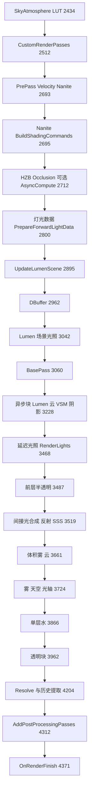

### 8.6.3 InitViews 任务图(阶段 8 内部)

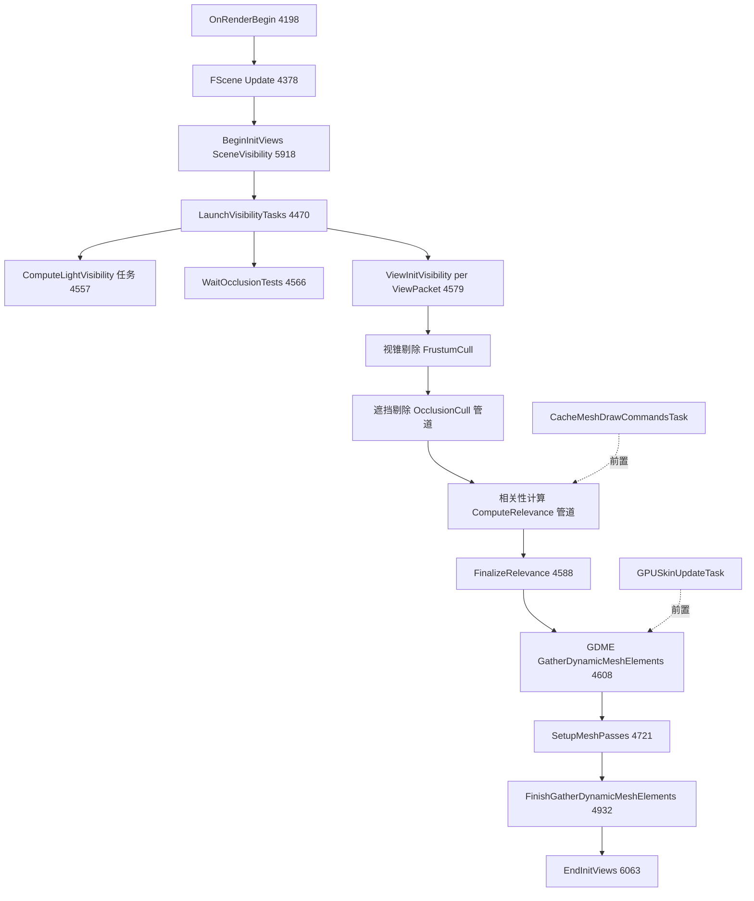

- 单视图并行模式:GDME 走 `TCommandPipe`(SceneVisibilityPrivate.h:4516-4537),相关性管道每弹出一批动态图元即串行送往渲染线程管道,实现相关性计算与 GDME 重叠;多视图用 `FDynamicPrimitiveViewMasks`(4543-4551)。
- GDME 内部再分流:支持 `SupportsParallelGDME()` 的图元进异步上下文(`LaunchAsyncTask`),其余在渲染线程上下文(`LaunchRenderThreadTask`,SceneVisibility.cpp:4645-4658)。

### 8.6.4 移动路径主流程(FMobileSceneRenderer::Render,MobileShadingRenderer.cpp:1181)

顺序(节选行号):OnRenderBegin(≈1201)→ 曝光 LUT BeginUpdate(≈1204)→ GSystemTextures(≈1257)→ ShaderPrint::BeginViews(≈1261)→ VT BeginUpdate(≈1281)→ VirtualShadowMapArray.Initialize(≈1310)→ SceneExtensions PreInitViews(≈1313)→ InitViews(≈1419)→ FXSystem->PreRender(≈1430)→ GPUScene 上传(≈1446)→ SceneExtensions UpdateViewData/UpdateSceneUniformBuffer/PreRender(≈1456-1473)→ 阴影(1472/1488/1723 RenderShadowDepthMaps)→ ComputeVolumetricFog(1739)→ BasePass(RenderMobileBasePass,2254 等)→ Translucency(2266 等)→ Occlusion(RenderOcclusion,2278 等)→ `AddMobilePostProcessingPasses`(1908)。移动路径整体更串行、RDG pass 常通过 `FMobileSceneTextureAccessor` 直接绑目标;延迟/前向由 `MobileDeferredShadingPass.cpp`/`MobileBasePassRendering.cpp` 区分。

## 8.7 时序图

### 8.7.1 一帧的线程交接(GameThread → RenderThread → RDG → RHI)

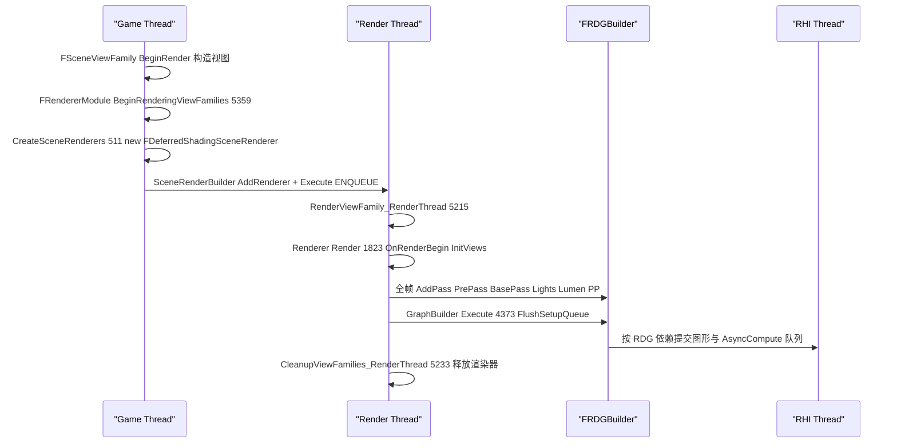

### 8.7.2 InitViews 并行可见性(RenderThread 与任务线程)

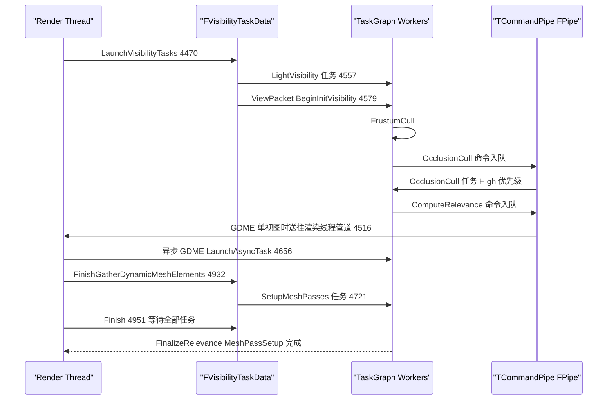

### 8.7.3 Nanite BasePass(Renderer ↔ Nanite 子系统)

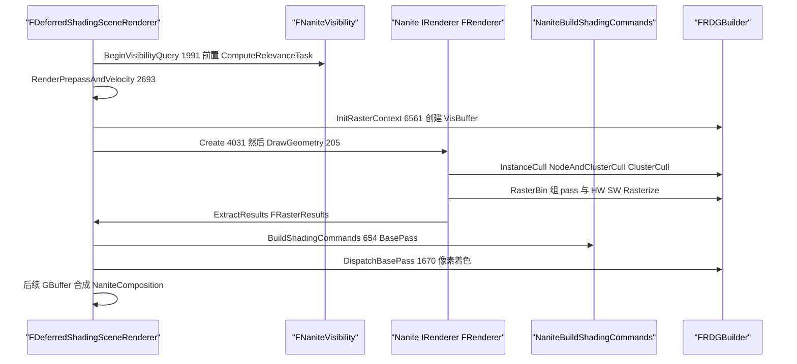

### 8.7.4 Lumen 异步间接光照(AsyncCompute 重叠)

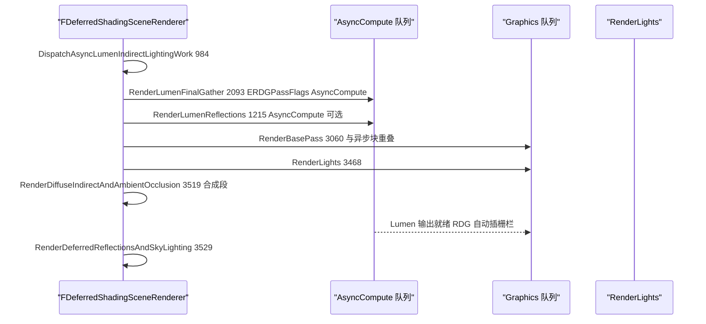

## 8.8 线程模型与同步

| 数据/阶段 | 线程 | 依据 |
|----------|------|------|
| ViewFamily/SceneRenderer 构造 | 游戏线程 | `BeginRenderingViewFamilies` 全程游戏线程(SceneRendering.cpp:5359);`check(IsInGameThread())` 见 GetAllocatedScenes(RendererModule.h:80) |
| Render/InitViews/各 pass 编排 | 渲染线程 | `RenderViewFamily_RenderThread`(SceneRendering.cpp:5215)由 `SceneRenderBuilder.AddRenderer` 的渲染命令调用 |
| 场景更新 | 渲染线程(+并行子任务) | `FScene::Update`(RendererScene.cpp:5534);`EUpdateAllPrimitiveSceneInfosAsyncOps`(SceneRendering.cpp:4211-4226)控制 LightPrimitiveInteractions/MeshDrawCommands/MaterialUniformExpressions 并行缓存 |
| 可见性各阶段 | 任务线程,`ETaskTag::EParallelRenderingThread` | SceneVisibility.cpp:4559/4581 等任务体内 `FTaskTagScope Scope(ETaskTag::EParallelRenderingThread)`;优先级 `FVisibilityTaskConfig::TaskPriority = High` |
| GDME | 渲染线程上下文 + 异步上下文 | `FDynamicMeshElementContextContainer::LaunchRenderThreadTask/LaunchAsyncTask`(SceneVisibilityPrivate.h:317-319);`SupportsParallelGDME()` 过滤(4661-4658) |
| 灯光排序/LightFunctionAtlas/曝光 LUT | UE::Tasks | `LaunchSceneRenderTask<FSortedLightSetSceneInfo*>`(DeferredShadingRenderer.cpp:2339)、UpdateLightFunctionAtlasTask(1939) |
| RDG pass 执行 | 图形或 AsyncCompute 队列 | `ERDGPassFlags::AsyncCompute`(如 RenderLumenFinalGather 调用 IndirectLightRendering.cpp:1051、StochasticLighting 3501、MegaLights 3232/3506) |
| RT 几何更新 | 渲染线程(RHI 侧异步) | `GRayTracingGeometryManager->Update/ProcessBuildRequests`(1866-1875);AS 构建 pipeline 可 Async(2980) |
| 遮挡查询 | 渲染线程发起、GPU 完成、下一帧读回 | `FenceOcclusionTests/WaitOcclusionTests`(SceneRendering.h:2367-2368);`FOcclusionSubmittedFenceState OcclusionSubmittedFence[FOcclusionQueryHelpers::MaxBufferedOcclusionFrames]`(2371,静态,防 RHI 线程未消化时回读) |
| 跨线程所有权 | 帧内数据归 SceneRenderer;跨帧历史归 FSceneViewState/FScene | Render() 末 `PrevViewInfo = FPreviousViewInfo()`(4386-4389)释放;`FScene::ViewStates`(ScenePrivate.h:1636) |
| 互斥 | `FSceneRenderer::DispatchedShadowDepthPassesMutex`(UE::FMutex,SceneRendering.h:2301)保护并行阴影 pass 列表;`FDynamicMeshElementContext`/`TCommandPipe` 内 `UE::FMutex QueueMutex` | SceneRendering.h:2301、SceneVisibilityPrivate.h:134 |
## 8.9 配置与扩展点

### 8.9.1 关键 CVar(摘自 DeferredShadingRenderer.cpp 等,含默认值)

| CVar | 默认 | 作用 | 位置 |
|------|------|------|------|
| `r.SceneDepthHZBAsyncCompute` | 0 | 0 关;1 尽早 async compute;2 在 ComputeLightGrid.CompactLinks 后 | DeferredShadingRenderer.cpp:340 |
| `r.shadow.ShadowMapsRenderEarly` | 0 | 阴影提前渲染(不兼容 VSM) | :348 |
| `r.Translucency.Velocity` | 1 | 半透明是否写深度/速度 | :354 |
| `r.Translucency.EarlyVelocityPass` | 2 | 半透明速度 pass 提前位置 0-3(1 光照后/2 云重建后/3 透明块开头) | :359 |
| `r.TranslucencyLightingVolume.AsyncComputeClear` | — | 半透明光照体积用 AsyncCompute 清理 | :252 |
| `r.Nanite.PrimeHZB` 及子项 `DrawOnlyRTFarField/RenderSizeBias/SceneDepthBias/MaxPixelsPerEdgeMultiplier/SampleNonNanite` | — | Nanite HZB 预备 | :194-230 |
| `r.RayTracing` | — | RT 总开关 | :278 |
| `r.CaptureNextDeferredShadingRendererFrame` | — | 捕获下一帧 RenderDoc | :262 |
| `r.RecreateRenderStateContext` | 命令 | 重建渲染状态 | :369(FAutoConsoleCommand) |
| Nanite/Lumen/MegaLights 内部 CVar | — | 如 `GLumenScreenProbeGatherAdaptiveProbeAllocationFraction=.5f`、`GVarLumenScreenProbeGatherOctahedronResolutionScale`(LumenScreenProbeGather.cpp:54/79)、`CVarLumenDiffuseIndirectAsyncCompute`(LumenDiffuseIndirect.cpp:153) | 各子系统文件 |

### 8.9.2 委托与扩展点

| 扩展点 | 形式 | 调用时机(行号为 DeferredShadingRenderer.cpp) |
|--------|------|------|
| `ISceneViewExtension::BeginRenderViewFamily/PostCreateSceneRenderer` | 视图扩展 | 渲染器创建前后(SceneRenderBuilder.cpp:521/526) |
| `PreRenderViewFamily_RenderThread/PreRenderView_RenderThread` | 视图扩展 | OnRenderBegin 回调(SceneRendering.cpp:4299/4303) |
| `PreRenderBasePass_RenderThread` | 视图扩展 | BasePass 前(2792) |
| `PostTLASBuild_RenderThread` | 视图扩展(需 ESceneViewExtensionFlags::SubscribesToPostTLASBuild) | TLAS 构建后(3325) |
| `PrePostProcessPass_RenderThread` | 视图扩展 | 后处理前(4269) |
| `FGlobalIlluminationPluginDelegates::AnyRayTracingPassEnabled/PrepareRayTracing/RenderDiffuseIndirectLight(/RenderDiffuseIndirectVisualizations)` | 多播委托 | RT pass 启用判定/RayGen 收集/GI 插件注入(DeferredShadingRenderer.h:240-255) |
| `FRendererModule::RegisterPostOpaqueRenderDelegate/RemovePostOpaqueRenderDelegate`、`RegisterOverlayRenderDelegate/RemoveOverlayRenderDelegate` | 委托 | 3925 `RenderPostOpaqueExtensions`、4142 `RenderOverlayExtensions` |
| `FOnResolvedSceneColorCallbacks`(GetResolvedSceneColorCallbacks) | 委托 | 4206 `RenderPostResolvedSceneColorExtension` |
| `GEngine->GetPreRenderDelegateEx()/GetPostRenderDelegateEx()` | 引擎委托 | 2364 / 4351 |
| `IPersistentViewUniformBufferExtension` | 注册式扩展 | BeginFrame/PrepareView(2137-2146)、EndFrame(CleanupViewFamilies) |
| 场景扩展 `FSceneExtensionsRenderers` | FScene 扩展 | `PreInitViews`(2008)、`UpdateViewData`(2264)、`UpdateSceneUniformBuffer`(2267)、`PreRender`(2363)、`PostRender`(4356);具体实现:FShadowSceneRenderer、FSceneCullingRenderer、SkinningSceneExtension、NaniteOwnershipVisibilitySceneExtension、NaniteMaterialsSceneExtension、FirstPersonSceneExtension、RuntimeVirtualTextureSceneExtension、MeshPaintVirtualTextureSceneExtension、RenderCurveSceneExtension |
| `ICustomCulling`(RegisterCustomCullingImpl) | 自定义剔除 | SceneRenderer 使用 GCustomCullingImpl(RendererModule.h:184) |
| `ISceneRenderBuilder`/`FSceneRenderBuilder` | 构建器接口 | SceneCapture/PlanarReflection 复用帧管线(SceneRendering.cpp:5487-5537) |

### 8.9.3 着色器资产(按功能分类,`$E/Shaders`)

- **Private 共 1124 个 usf/ush**(`Shaders/Private`,含子目录;统计于源码树):
  - 顶层 452 个:基础 pass 与公共(BasePassPixelShader.usf、DepthOnlyPixelShader.usf、VelocityCommon.ush、DeferredLightPixelShaders.usf、DeferredLightVertexShaders.usf、LightGridCommon.ush、ShadowDepthPixelShader.usf、PostProcessMaterialShaders.usf、ScreenSpaceRayTracing*.usf、GlobalDistanceField.usf 等)
  - Nanite/ 58、Lumen/ 95、RayTracing/ 64、PathTracing/ 66、HairStrands/ 79、HeterogeneousVolumes/ 35、MegaLights/ 32、Substrate/ 24、TemporalSuperResolution/ 23、ScreenSpaceDenoise/ 20、DiaphragmDOF/ 22、Bloom/ 11、MotionBlur/ 9、DistanceField/ 9、Skinning/ 8、InstanceCulling/ 7、SMAA/ 6、SSRT/ 6、StochasticLighting/ 5、Froxel/ 2、GPUScene/ 2、LightFunctionAtlas/ 2、LocalFogVolumes/ 3、MaterialCache/ 9、SceneCulling/ 3、SparseVolumeTexture/ 3、OIT/ 1、VirtualShadowMaps/、VariableRateShading/、Tools/、Landscape/ 6、PostProcessing/ 2
  - 代表性入口:`Nanite/NaniteInstanceCulling.usf`(实例剔除)、`Nanite/NaniteRasterizer.usf`(SW 光栅)、`Nanite/NaniteShadeBinning.usf`;`Lumen/LumenScreenProbeGather.usf`、`Lumen/LumenRadiosity.usf`、`Lumen/LumenReflections.usf`;`VirtualShadowMaps/VirtualShadowMapPageMarking.usf`、`VirtualShadowMaps/VirtualShadowMapProjection.usf`;`MegaLights/MegaLightsLighting.usf`;`PostProcessing/`+顶层 `TemporalAA.usf`、`PostProcessDOF.usf`、`PostProcessTonemap.usf`、`PostProcessBloom.usf`、`PostProcessEyeAdaptation.usf`、`PostProcessMotionBlur.usf`。
- **Public 共 22 个 ush**(公共包含,如 `SubstratePublic.ush`、`Platform.ush`、`IndirectVirtualTexture.ush`、`BindlessResources.ush`、`WaveBroadcastIntrinsics.ush` 等 + `Platform/` 目录)。

## 8.10 已知限制/未确认项

1. **未逐行阅读的子系统内部**:Lumen 各文件(LumenScreenProbeTracing/ImportanceSampling/Filtering、Radiosity 内部 pass、RadianceCache 细节)、Nanite StreamOut/Feedback 的 GPU 端算法、HairStrands 全部管线、PathTracing、HeterogeneousVolumes 各 pipeline、OIT 细节、Mobile 路径的完整分支——本章只核对到入口函数与调用时机,内部 pass 序列未展开。
2. **`RenderLumenFinalGather/RenderLumenReflections` 等签名的参数列表取自调用点与定义行**,未逐字比对头文件声明(声明位于 DeferredShadingRenderer.h 后段,本章未整段阅读);参数类型如 `FLumenMeshSDFGridParameters&` 等按调用点书写。
3. `FMobileSceneRenderer` 内部行号(≈1201 等)来自按行距估算的 grep 定位,精度为 ±5 行;上表仅列确证行号(1472/1488/1723/1739/1908/2254/2266/2278)。
4. `FProjectedShadowInfo`、`FLightSceneInfo` 类图方法行为示意性摘录(源码存在该类,完整方法集见附录)。
5. PostProcessing 链(TAA/TSR/DOF/Bloom/Tonemap 内部顺序)未逐 pass 展开,仅给出入口 `AddPostProcessingPasses`(PostProcessing.cpp:412);需进一步工作时建议读 PostProcessing.cpp 412-800。
6. Shaders/Public 计 22 个(含 `Platform/` 子目录内文件合并计数);Private 计 1124 个,与任务给定数量一致,未逐一分类全部文件名。
7. GPUSkinCache(`FGPUSkinCache`)实现位于 Engine 模块(`Engine/Private/GPUSkinCache.cpp`),Renderer 侧仅通过 `Scene.GetGPUSkinUpdateTask()`(SceneVisibility.cpp:4507)与 Skinning/ 场景扩展衔接,未深入其内部。
8. `r.*` CVar 清单仅收录帧编排相关;Nanite/Lumen/MegaLights 数百个调优 CVar 见各自 cpp 文件与附录。

## 8.11 附录索引

| 覆盖模块 | 附录文件(相对 `docs/ue5.8.3/appendix/api/`) | 说明 |
|----------|----------------------------------------------|------|
| Runtime/Renderer(本章主体) | `Runtime/Renderer.md`(26282 行) | 全量符号:含 Nanite/Lumen/MegaLights/Shadows/VSM/PostProcess 等 |
| Runtime/RenderCore(依赖:RDG/PSO/RT 管理器) | `Runtime/RenderCore.md` | FRDGBuilder、PipelineStateCache、IRayTracingGeometryManager |
| Runtime/RHI(依赖) | `Runtime/RHI.md` | FRHICommandList、ERDGPassFlags 底层 |
| Runtime/Engine(FSceneInterface/GPUSkinCache/FXSystem) | `Runtime/Engine.part01.md`、`Runtime/Engine.part02.md` | 接口侧定义 |
| Runtime/RendererModule 定义 | `Runtime/Renderer.md` 中 FRendererModule/IRendererModule 条目 | IRendererModule 声明在 RenderCore/Public/RendererInterface.h |

(模块总表:`appendix/modules.json`。)
