# 09 材质、着色器编译管线、DDC 与 TargetPlatform

本章覆盖 Unreal Engine 5.8.3 中"从材质资产修改到 GPU 可用着色器"的完整链路:材质 UObject 家族与 FMaterial/FMaterialResource 编译入口、FMaterialCompiler(HLSL 旧翻译器与 MaterialIR 新翻译器)、FShaderCompilingManager 编排、ShaderCompileWorker(SCW)进程通信协议、IShaderFormat 后端(GLSL/Vulkan/SPIR-V/VectorVM)、TargetPlatform/DeviceProfile、DerivedDataCache(FCache/IBuild 流水线与 Zen/FileSystem/Memory/Pak 后端)、纹理/网格/音频构建 worker,以及 ComputeFramework/DeformerGraph 概述。源码根 `$UE=/home/timeshift/opensource/game_engine/unreal/UnrealEngine-5.8.3-release`,`$E=$UE/Engine`;下文路径均相对 `$E/Source`。

## 9.1 职责、边界与模块清单

| 模块名 | 路径 | Build.cs 关键依赖(Public/Private) | 职责一句话 |
|---|---|---|---|
| Engine(Materials 运行时部分) | Runtime/Engine(Public/Materials 308 头 + Private/Materials 57 文件) | P: Core, CoreUObject, RenderCore, SlateCore, TargetPlatform 等;编辑器条件依赖含 TextureCompressor(Engine.Build.cs:79-100,430) | UMaterial/UMaterialInstance/UMaterialExpression* 资产与 FMaterial/FMaterialResource/FMaterialRenderProxy 渲染代理、材质图求值 |
| Engine(ShaderCompiler 私有) | Runtime/Engine/Private/ShaderCompiler | (Engine 模块内) | FShaderCompilingManager/FShaderCompileThreadRunnable/FShaderJobCache:异步编排、SCW 进程管理、分布式派发、job DDC |
| RenderCore(编译协议支撑) | Runtime/RenderCore(Public/ShaderCompilerCore.h, ShaderCore.h, ShaderCompilerJobTypes.h, Internal/ShaderCompileWorkerUtil.h) | P: Core | FShaderCompilerInput/Output、FShaderCompileJob/FShaderPipelineCompileJob、SCW .in/.out 文件序列化与进程内直编译 |
| ShaderCompilerCommon | Developer/ShaderCompilerCommon | P: Core, ShaderPreprocessor | FBaseShaderFormat 预处理/调试输出公共实现与 uniform buffer 反射校验 |
| ShaderPreprocessor | Developer/ShaderPreprocessor | P: Core | 引擎内 HLSL 预处理(提交 job 时在 UE::Tasks 上执行) |
| HlslParser | Developer/HlslParser | P: Core | HLSL 词法/AST 解析库(HlslLexer/HlslAST/HlslParser),供预处理与工具使用 |
| ShaderFormatOpenGL | Developer/ShaderFormatOpenGL | P: ShaderCompilerCommon | GLSL_150_ES3_1/GLSL_ES3_1_ANDROID 格式,基于 ShaderConductor |
| VulkanShaderFormat | Developer/VulkanShaderFormat | P: ShaderCompilerCommon | SPIR-V 输出(VulkanBackend + ShaderConductor),SF_VULKAN_* 系列 |
| ShaderFormatVectorVM | Developer/ShaderFormatVectorVM | P: Core | VectorVM 字节码格式(Niagara compute) |
| ShaderPlatformConfigEditor | Developer/ShaderPlatformConfigEditor | P: Core, DeveloperSettings | UShaderPlatformConfigSettings:按平台着色器配置(bindless 等)编辑器设置 |
| TargetPlatform | Developer/TargetPlatform | P: Core, Json | ITargetPlatform/ITargetPlatformSettings/ITargetPlatformControls、ITargetPlatformManagerModule:平台发现、ShaderFormat/TextureFormat/AudioFormat 注册 |
| TargetDeviceServices | Developer/TargetDeviceServices | P: Core, Messaging | ITargetDeviceService/ITargetDeviceProxy:目标设备发现与远程控制消息 |
| DerivedDataCache | Developer/DerivedDataCache | P: Core, Serialization | FDerivedDataCacheInterface 与 UE::DerivedData ICache/IBuild、层级缓存后端与构建调度 |
| Zen | Developer/Zen | P: Core | Zen 存储服务客户端/自动启动(FScopeZenService,端口 8558)、构建服务接口 |
| ZenPluggableTransport | Developer/ZenPluggableTransport | (SDK 无 .Build.cs,transportplugin.h) | Zen 服务器可插拔传输 C++ SDK(kTransportApiVersion=1) |
| Horde | Developer/Horde | P: Core | Horde 服务器客户端(存储/构建编排,配合 UbaCoordinatorHorde) |
| DistributedBuildInterface | Developer/DistributedBuildInterface | P: Core | IDistributedBuildController 模块特性接口(XGE/UBA/FASTBuild 抽象) |
| TextureBuild | Developer/TextureBuild | P: DerivedDataCache, TextureFormat | FTextureBuildFunction:基于 IBuildFunction 的纹理构建/贴图/解码函数 |
| TextureBuildUtilities | Developer/TextureBuildUtilities | P: Core | FTextureBuildMetadata 等构建辅助类型 |
| TextureCompressor | Developer/TextureCompressor | P: Core, ImageWrapper | ITextureCompressorModule::BuildTexture(源 mip→压缩纹理) |
| TextureFormat | Developer/TextureFormat | P: Core | ITextureFormat/ITextureFormatManagerModule 抽象与 ChildTextureFormat |
| TextureFormatDXT | Developer/TextureFormatDXT | P: Core | BC1-BC7(DXT)编码 |
| TextureFormatASTC | Developer/TextureFormatASTC | P: Core | ASTC(LDR/HDR)编码 |
| TextureFormatETC2 | Developer/TextureFormatETC2 | P: Core | ETC2/EAC 编码 |
| TextureFormatOodle | Developer/TextureFormatOodle | P: Core | Oodle Texture BC 编码 |
| TextureFormatIntelISPCTexComp | Developer/TextureFormatIntelISPCTexComp | P: Core | Intel ISPC BC 编码后端 |
| TextureFormatUncompressed | Developer/TextureFormatUncompressed | P: Core | 未压缩/颜色空间处理路径 |
| MeshBuilder | Developer/MeshBuilder | P: Core | IMeshBuilderModule:静态/骨骼网格 RenderData 构建(DDC) |
| MeshUtilities | Developer/MeshUtilities | P: Core | IMeshUtilities:网格处理(法线/UV/碰撞数据)工具 |
| NaniteBuilder | Developer/NaniteBuilder | P: Core | Nanite::IBuilderModule:Nanite 数据(集群/层级)构建(NaniteBuilder.h:65-141) |
| MeshReductionInterface | Developer/MeshReductionInterface | P: Core | IMeshReduction/IMeshSimplification 网格简化接口(LOD) |
| AudioFormatADPCM | Developer/AudioFormatADPCM | P: Core | ADPCM 音频编码(IAudioFormat 特性) |
| AudioFormatOgg | Developer/AudioFormatOgg | P: Core | Vorbis 编码 |
| AudioFormatOpus | Developer/AudioFormatOpus | P: Core | Opus 编码(UE_AUDIO_OPUS_VER=13) |
| AudioFormatBink | Developer/AudioFormatBink | P: Core | Bink 音频编码 |
| AudioFormatRad | Developer/AudioFormatRad | P: Core | RAD 音频编码 |
| ShaderCompileWorker(程序) | Programs/ShaderCompileWorker | (Target: ShaderCompileWorker) | 独立编译进程:读 WorkerInputOnly.in、调 IShaderFormat、写 WorkerOutputOnly.out |
| DerivedDataBuildWorker(程序) | Programs/DerivedDataBuildWorker | (Target: DerivedDataBuildWorker) | DDC 构建函数远程执行 worker(IBuildInputResolver 实现) |
| DerivedDataTool(程序) | Programs/DerivedDataTool | (Target: DerivedDataTool) | DDC 数据复制/审查/worker 命令行工具 |
| XGEController(插件) | Plugins/XGEController | (Program context) | IDistributedBuildController: IncrediBuild XGE(intercept/xml) |
| UbaController(插件) | Plugins/UbaController | (Program context) | IDistributedBuildController: Unreal Build Accelerator |
| FastbuildController(插件) | Plugins/FastBuildController | (Program context) | IDistributedBuildController: FASTBuild |
| DerivedDataBuildController(插件) | Plugins/DerivedDataBuildController | (Program context) | 把 SCW 批次封装为 DDC 远程 Build(FCompileShaderJobsBuildFunction) |
| ComputeFramework(插件) | Plugins/Runtime/ComputeFramework | (Runtime) | UComputeGraph/UComputeKernel:计算图→compute shader 编译与执行 |
| DeformerGraph(插件) | Plugins/Animation/DeformerGraph(OptimusCore 等) | (Runtime/Editor) | Optimus 形变图编辑与执行(基于 ComputeFramework 内核) |

注:TextureFormatDXT/ASTC/ETC2/IntelISPCTexComp/Uncompressed 与 AudioFormatBink/Rad 的 Build.cs 依赖以源码目录为准(附录未生成对应条目,见 9.11)。RenderCore 属本链路支撑,虽不在任务范围清单中,为完整闭环一并纳入。

## 9.2 总体架构

整条链路分为六层:资产层(UObject 材质图)、翻译层(材质图→HLSL 环境)、编排层(FShaderCompilingManager + FShaderJobCache)、执行层(SCW 进程 / 分布式控制器 / DDC 远程 Build)、后端层(IShaderFormat 各格式)、缓存与运行时层(DDC/Zen → FMaterialShaderMap → PSO 预缓存)。编辑器与 cook 命令行均走同一编排层;cooked 运行时只读取序列化 shader map,不再编译(FMaterialShaderMap::Compile 在 `FPlatformProperties::RequiresCookedData()` 时直接 Fatal,MaterialShader.cpp:2782-2786)。

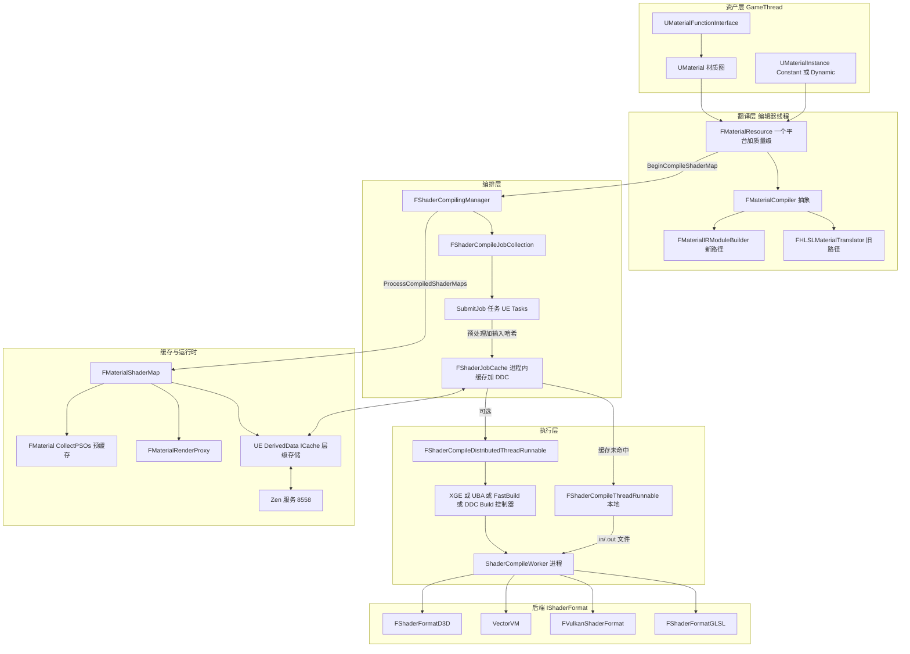

要点:① 翻译产物不是文件而是 `FSharedShaderCompilerEnvironment` + 虚拟路径 `/Engine/Generated/Material.ush`(MaterialShared.cpp:3681);② 每个 shader 以 FShaderCommonCompileJob 为单位,输入哈希(FShaderCompilerInputHash)是 job 级 DDC 与去重键;③ shader map 整图另有一把 DDC 键(GetMaterialShaderMapKeyString,MaterialShader.cpp:207,内部追加 GetMaterialShaderMapDDCGuid);④ 执行有四条等价通道:本地 SCW、分布式控制器、DDC 远程 Build(DerivedDataBuildController)、进程内直编译(CompileDirectlyThroughDll,SCW 崩溃后的回退)。

## 9.3 类图

### 9.3.1 材质 UObject 家族与渲染代理

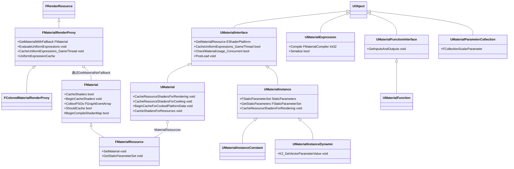

- `UMaterialInterface`(Public/Materials/MaterialInterface.h:134 起)是材质资产公共基类,渲染代理经虚函数 `GetRenderProxy()`(MaterialInterface.h:725)取得;`GetMaterialResource(EShaderPlatform, EMaterialQualityLevel)`(MaterialInterface.h:841)返回对应 FMaterialResource。
- `UMaterial`(Public/Materials/Material.h)持 `LoadedMaterialResources`(内联序列化,PostLoad 处理,Material.h:1256)、`MaterialResources`(渲染用资源指针,Material.h:1264)与 `CachedMaterialResourcesForCooking`(TMap<ITargetPlatform*, TArray<FMaterialResourceForCooking>>,见 Material.cpp:5003-5006 使用)。
- `UMaterialInstance`(MaterialInstance.h:610/622)以 `FStaticParameterSet StaticParameters` 生成静态排列 shader map;`bHasStaticPermutationResource`(MaterialInstance.h:681)标记是否存在静态排列资源。
- `FMaterialRenderProxy`(MaterialRenderProxy.h:103)是渲染线程句柄,内含 `FUniformExpressionCacheContainer UniformExpressionCache`(编辑器按 FeatureLevel 分桶,MaterialRenderProxy.h:69-85)。
- `FMaterialResource : FMaterial`(MaterialShared.h:3211)实现 FMaterial 的全部材质属性虚函数(约 120 个 override,MaterialShared.h:3252-3360)。

### 9.3.2 翻译器与材质 IR

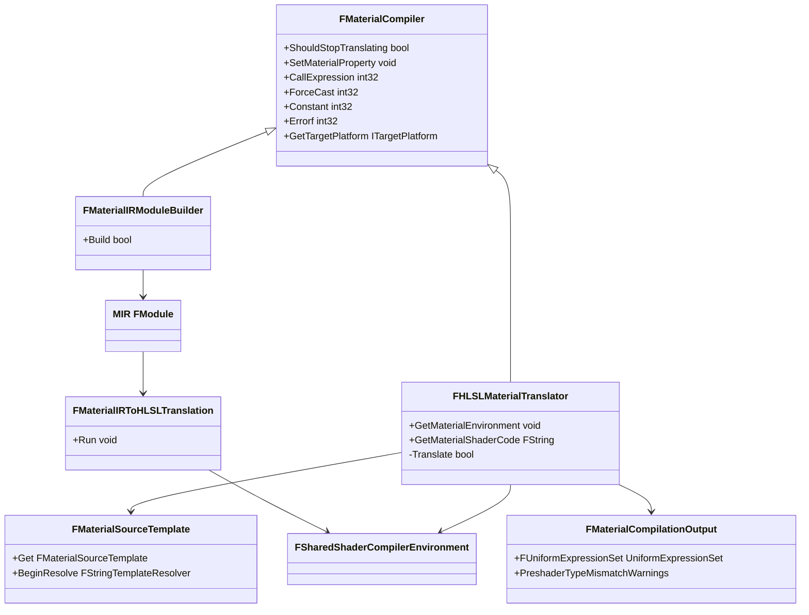

- `FMaterialCompiler`(Public/MaterialCompiler.h:145)定义材质表达式回调接口;每个 `UMaterialExpression::Compile(FMaterialCompiler*)` 通过它返回代码块索引。
- `FHLSLMaterialTranslator : FMaterialCompiler`(Private/Materials/HLSLMaterialTranslator.h:233)是旧翻译器,直接生成 `Material.ush` 字符串模板参数(Private/Materials/MaterialSourceTemplate.h)。
- 新翻译器(Translate_New,MaterialShared.cpp:3610)先用 `FMaterialIRModuleBuilder` 建模为 IR(Public/Materials/MaterialIRModuleBuilder.h),再 `FMaterialIRToHLSLTranslator`(Public/Materials/MaterialIRToHLSLTranslator.h)输出字符串参数,经 `FStringTemplateResolver` 与模板插值成最终 HLSL(MaterialShared.cpp:3662-3678)。
- 选择开关:`FMaterialShaderMapId::bUsingNewHLSLGenerator`(MaterialShared.h:1385)+ `bEnableRestrictiveMaterialMode` 分流(MaterialShared.cpp:3694-3700)。

### 9.3.3 Shader 编排与作业对象

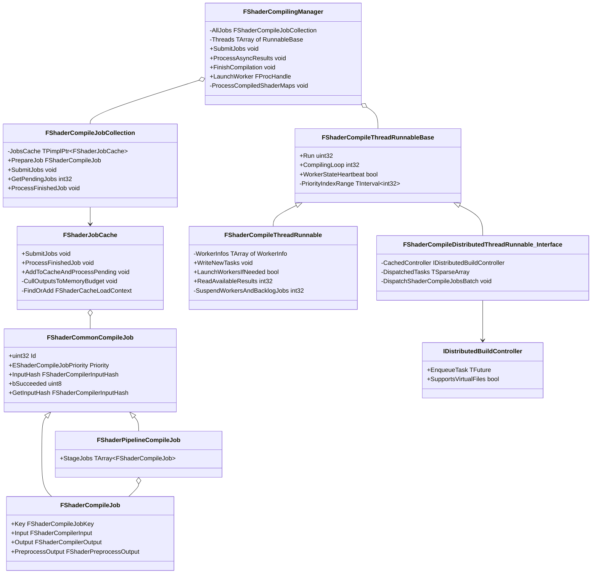

- `FShaderCompilingManager : IAssetCompilingManager`(Public/ShaderCompiler.h:934)是全局单例(`GShaderCompilingManager`,ShaderCompiler.h:1371);`FShaderCompileJobCollection`(ShaderCompiler.h:70)是它对 FShaderJobCache 的包装。
- `FShaderCommonCompileJob`(RenderCore/Public/ShaderCompilerJobTypes.h:199)自 intrusive 双向链表 + `FThreadSafeCounter NumRefs` 引用计数;`TPimplPtr<UE::DerivedData::FRequestOwner> RequestOwner`(ShaderCompilerJobTypes.h:228)挂在 job 上用于 job 级 DDC 异步请求。
- 优先级 `EShaderCompileJobPriority`(RenderCore/Public/ShaderCore.h:820):`Low=0/Normal/High/ExtraHigh/ForceLocal/Num`,None=0xff;全局 shader 至少 High。

### 9.3.4 DDC 新旧两代接口与后端

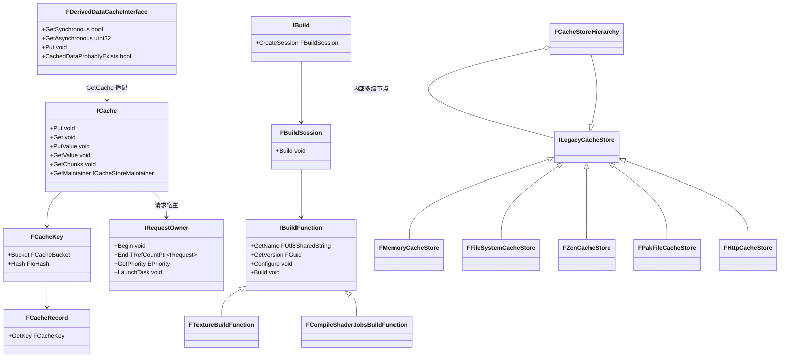

- 新代 API 在 `UE::DerivedData` 命名空间:入口 `GetCache()` / `TryGetCache()`(Developer/DerivedDataCache/Public/DerivedDataCache.h:379-382);记录型 `Put/Get` 与值型 `PutValue/GetValue`、块级 `GetChunks` 三套。ICache/IBuild/IBuildFunction/IRequestOwner/ILegacyCacheStore 均为纯虚接口类。
- `FCacheKey = FCacheBucket + FIoHash`(DerivedDataCacheKey.h:92-121);Bucket 名限制 63 个字母数字字符(DerivedDataCacheKey.h:27-39)。shader map 用 Bucket `MATERIALSHADERMAP`、shader job 用 `FShaderJobCacheShaders`(ShaderCompilerJobCache.cpp:136)。
- 旧代 `FDerivedDataCacheInterface`(DerivedDataCacheInterface.h:24)仍供插件式 FDerivedDataPluginInterface 用户使用,内部经 `FLegacyCacheStore`/`FCacheStoreProxy` 转换。
- 后端实现是 `ILegacyCacheStore`(Private/DerivedDataBackendInterface.h),由 `FCacheStoreHierarchy`(DerivedDataCacheStoreHierarchy.cpp:45)按 ini 图配置组合成读写层级(Read/Write/Async 通道)。

## 9.4 数据字典

### 9.4.1 FMaterialShaderMapId(Public/MaterialShared.h:1304-1401)

| 字段 | 类型 | 含义 | 取值/约束 | 位置 |
|---|---|---|---|---|
| BaseMaterialId | FGuid | 基材质状态 Id,任何改变 UMaterial 状态的操作都会更新 | 编辑器 only | MaterialShared.h:1315 |
| QualityLevel | EMaterialQualityLevel::Type | 编译质量级 | Num 表示无关 | MaterialShared.h:1322 |
| FeatureLevel | ERHIFeatureLevel::Type | 特性级 | 默认 SM5 | MaterialShared.h:1325 |
| Usage / UsageCustomOutput | EMaterialShaderMapUsage::Type / FString | shader map 用途(默认/导出自定义输出) | 编辑器 only | MaterialShared.h:1333,1338 |
| StaticSwitchParameters 等 4 项 | TArray(静态参数) | 静态开关/分量掩码/地形层权重/层栈 Id | 编辑器 only | MaterialShared.h:1345-1348 |
| ReferencedFunctions | TArray&lt;FGuid&gt; | 依赖的材质函数 Guid | — | MaterialShared.h:1351 |
| ReferencedParameterCollections | TArray&lt;FGuid&gt; | 依赖的参数集合 Guid | — | MaterialShared.h:1354 |
| ShaderTypeDependencies / ShaderPipelineTypeDependencies / VertexFactoryTypeDependencies | TArray(F*Dependency) | shader 类型/管线/VF 依赖(含源码哈希) | DDC 内联 shader 依据 | MaterialShared.h:1357-1363 |
| TextureReferencesHash / ExpressionIncludesHash / BasePropertyOverridesHash / ExternalCodeReferencesHash / BaseMaterialPathHash | uint64 | 各类内容哈希,任一变化即换 DDC 键 | — | MaterialShared.h:1370-1382 |
| bUsingNewHLSLGenerator | bool | 是否用 MaterialIR 新翻译器 | — | MaterialShared.h:1385 |
| SubstrateCompilationConfig | FSubstrateCompilationConfig | Substrate 简化配置 | 编辑器 only | MaterialShared.h:1394 |
| LayoutParams | FPlatformTypeLayoutParameters | 内存镜像类型布局参数(平台字长等) | — | MaterialShared.h:1401 |

### 9.4.2 FShaderCompilerInput(Runtime/RenderCore/Public/ShaderCompilerCore.h:212-280)

| 字段 | 类型 | 含义 | 取值/约束 | 位置 |
|---|---|---|---|---|
| Target | FShaderTarget | 频率+平台(SF_*/SP_*) | — | ShaderCompilerCore.h:214 |
| ShaderFormat / CompressionFormat / ShaderPlatformName / PreferredShaderCodeFormat | FName | 目标格式/压缩(如 NAME_Oodle)/平台名/偏好码格式 | — | ShaderCompilerCore.h:216-220 |
| VirtualSourceFilePath / EntryPointName / ShaderName | FString | 虚拟 USF 路径、入口、名称 | — | ShaderCompilerCore.h:222-224 |
| UsedOutputs | TArray&lt;FString&gt; | 管线裁剪用输出列表 | 仅 pipeline | ShaderCompilerCore.h:231 |
| DumpDebugInfoRootPath / DumpDebugInfoPath / DebugGroupName / DebugDescription | FString | r.DumpShaderDebugInfo 相关调试信息 | — | ShaderCompilerCore.h:243-252 |
| Hash | FShaderCompilerInputHash | 全部输入哈希(job 缓存键) | 提交时由 UpdateInputHash 填 | ShaderCompilerCore.h:261 |
| Environment / SharedEnvironment | FShaderCompilerEnvironment / TRefCountPtr | 编译环境 defines/flags/包含映射;材质级共享环境 | — | ShaderCompilerCore.h:264-265 |
| RootParametersStructure | const FShaderParametersMetadata* | 根参数结构(uniform buffer 布局来源) | — | ShaderCompilerCore.h:269 |
| OodleCompressor / OodleLevel | FOodleDataCompression 枚举 | Oodle 压缩算法与级别 | CompressionFormat=NAME_Oodle 时 | ShaderCompilerCore.h:275-277 |
| bCompilingForShaderPipeline / bIncludeUsedOutputs / bBindlessEnabled | bool | 管线裁剪/含 UsedOutputs/bindless 内部标记 | — | ShaderCompilerCore.h:281-286 |

### 9.4.3 FShaderCommonCompileJob(Runtime/RenderCore/Public/ShaderCompilerJobTypes.h:199-375)

| 字段 | 类型 | 含义 | 位置 |
|---|---|---|---|
| NextLink / PrevLink | FShaderCommonCompileJob* / FShaderCommonCompileJob** | 无锁插入双向链表(等待队列实现) | ShaderCompilerJobTypes.h:203-204 |
| PendingShaderMap | FPendingShaderMapCompileResultsPtr | 所属 shader map 的 pending 结果计数 | :206 |
| NumRefs / JobIndex / Hash / Id | FThreadSafeCounter / int32 / uint32 / uint32 | 引用计数/批内索引/键哈希/shader map CompilingId | :208-213 |
| Type / Priority / PendingPriority | EShaderCompileJobType / EShaderCompileJobPriority ×2 | 作业类型/请求优先级/队列分桶优先级 | :215-224 |
| CurrentWorker | EShaderCompilerWorkerType | 当前执行者(LocalThread/Distributed) | :226 |
| RequestOwner | TPimplPtr&lt;UE::DerivedData::FRequestOwner&gt; | job 级 DDC 请求宿主 | :228 |
| bBypassCache / bTransferred | uint8 位域 | 预览或非持久材质绕过缓存/已转移标记 | :239-241 |
| InputHash | FShaderCompilerInputHash | 输入哈希(缓存键) | :248 |
| TimeAddedToPendingQueue / TimeAssignedToExecution / TimeExecutionCompleted | double | 统计三时间戳 | :251-255 |
| JobCacheRef | FShaderJobCacheRef | job cache 条目引用 | :257 |

### 9.4.4 SCW 协议常量(Runtime/RenderCore/Public/ShaderCompilerCore.h:35-41 与 FSCWErrorCode)

| 常量/枚举 | 值 | 含义 | 位置 |
|---|---|---|---|
| ShaderCompileWorkerInputVersion | 33 | .in 协议版本(仅协议,不作为 DDC 键) | ShaderCompilerCore.h:35 |
| ShaderCompileWorkerOutputVersion | 31 | .out 协议版本 | ShaderCompilerCore.h:37 |
| ShaderCompileWorkerSingleJobHeader | 'S' | 单 shader 批头标记 | ShaderCompilerCore.h:39 |
| ShaderCompileWorkerPipelineJobHeader | 'P' | 管线批头标记 | ShaderCompilerCore.h:41 |
| UE_SHADER_CACHE_VERSION | FGuid | shader 输出结构版本(改 FShaderCompilerOutput 时 bump,使 job 级 DDC 失效) | ShaderCompilerCore.h:46 |
| FSCWErrorCode::ECode | NotSet=-1,Success=0,GeneralCrash,BadShaderFormatVersion,BadInputVersion,BadSingleJobHeader,BadPipelineJobHeader,CantDeleteInputFile,CantSaveOutputFile,NoTargetShaderFormatsFound,CantCompileForSpecificFormat,CrashInsidePlatformCompiler,BadInputFile,MissingVirtualInputFile,OutOfMemory | SCW 侧错误码,写入 .out 头并在引擎侧转换诊断 | RenderCore/Internal/ShaderCompileWorkerUtil.h:13-30 |
| GRegularWorkerTimeToLive / GBuildWorkerTimeToLive | 20.0f / 600.0f(秒,可被 DevOptions.Shaders WorkerTimeToLive/BuildWorkerTimeToLive 覆盖) | SCW 空闲退出与构建机 TTL | ShaderCompiler.cpp:303-304 |
| EShaderCompileJobStatus | Unset,Ready,Skipped,Cancelled,PendingDDC,Queued,Pending,Completed,Released | job 状态机(std::atomic 挂在 FShaderCompileJobStatus) | ShaderCompilerJobTypes.h:77-108 |
| EShaderCompileJobCompletionMethod | Unset,CacheHit,DdcHit,Duplicate,LocalExecution,DistributedExecution | 完成来源标记(统计用) | ShaderCompilerJobTypes.h:110-121 |

### 9.4.5 DDC 与构建

| 字段/类型 | 类型 | 含义 | 位置 |
|---|---|---|---|
| FCacheBucket | 类(名字前缀长度字节) | 记录分组名,字母数字,≤63 | DerivedDataCacheKey.h:27-87 |
| FCacheKey::Bucket/Hash | FCacheBucket / FIoHash | 记录唯一键 | DerivedDataCacheKey.h:92-121 |
| FCachePutRequest | Name/Record/Policy/UserData | Put 请求(Record 含键) | DerivedDataCache.h:138-154 |
| FCacheGetRequest | Name/Key/Policy/UserData | Get 请求 | DerivedDataCache.h:184 |
| FRequestOwner | 类(EPriority 构造) | 请求宿主:Begin/End/Barrier/KeepAlive/Cancel | DerivedDataRequestOwner.h:47-106 |
| FTaskCommandData | Command/WorkingDirectory/InputFileName/OutputFileName/ExtraCommandArgs/Description/DispatcherPID/InputFileData/SourceData/AdditionalOutputFolders/OutputValidator | 分布式任务描述(位置参数在前,控制器只能追加 flag) | DistributedBuildControllerInterface.h:30-47 |
| FDistributedBuildTaskResult | ReturnCode/bCompleted/OutputData | 远程结果(虚拟文件控制器直接回传字节) | DistributedBuildControllerInterface.h:16-22 |
| FBuildSession / FBuildDefinition / FBuildPolicy | UE::DerivedData | 一次构建会话/定义(函数+输入)/策略(BuildLocal/BuildRemote 等) | DerivedDataBuildSession.h |
| ShaderJobCacheDDCBucket | FCacheBucket("FShaderJobCacheShaders"/显示名 "Shader") | job 级 DDC 桶(静态) | ShaderCompilerJobCache.cpp:135-137 |
| EPriority | UE::DerivedData::EPriority | 请求优先级(FRequestOwner 构造参数,如 Normal/Low/Background) | DerivedDataRequestTypes.h |

### 9.4.6 其它关键类型

| 类型 | 字段(节选) | 含义 | 位置 |
|---|---|---|---|
| UDeviceProfile | DeviceType,BaseProfileName,Parent,CVars,FragmentIncludes,MatchingRules | 设备档案:类型/父档案/CVar 列表/片段/匹配规则(config=DeviceProfiles, perObjectConfig) | Runtime/Engine/Classes/DeviceProfiles/DeviceProfile.h:23-77 |
| FCollectionScalarParameter | ParameterName,Id,DefaultValue | 参数集合标量项(Id 由 FPlatformMisc::CreateGuid 生成) | Public/Materials/MaterialParameterCollection.h:20-49 |
| FUniformExpressionCache | UniformBuffer,UniformBufferVS,AllocatedVTs,ParameterCollections,CachedUniformExpressionShaderMap | 渲染线程 uniform 表达式求值缓存(编辑器按 FeatureLevel 分桶) | Public/Materials/MaterialRenderProxy.h:48-67 |
| FODSCRequestPayload | ShaderPlatform,FeatureLevel,QualityLevel,MaterialName,VertexFactoryName,PipelineName,ShaderTypeNames,PermutationId,RequestHash | 按需 shader 编译(ODSC)单请求 | Public/ShaderCompiler.h:1480-1530 |
| FShaderRecompileData | PlatformName,CommandType(ODSCRecompileCommand),ShadersToRecompile,GlobalShaderMap,MeshMaterialMaps | 远程/ODSC 重编译载荷 | Public/ShaderCompiler.h:1544-1597 |
| FTextureBuildSettings | FormatConfigOverride,ColorAdjustment,bDoScaleMipsForAlphaCoverage,bUseNewMipFilter,MipSharpening,MaxTextureResolution,TextureFormatName,MipGenSettings,bCubemap 等 | 纹理源→编码设置(DDC2 build 时格式配置以 FCbObjectView 随定义传给 worker,代替 ini/命令行) | Developer/TextureCompressor/Public/TextureCompressorModule.h:98-138 |
| FEncodedTextureDescription / ITextureFormat | GetEncoderName/GetVersion/GetDerivedDataKeyString/GetSupportedFormats/ProcessMipLevel | 纹理编码抽象(Build 函数化后核心为 ProcessMipLevel) | Developer/TextureFormat/Public/Interfaces/ITextureFormat.h:487-590 |
| FWorkerMemoryUsage | WorkerIndex,VirtualMemory,PhysicalMemory | 单 SCW 进程内存采样 | Public/ShaderCompiler.h:240-250 |
| FUniformExpressionSet | FillUniformBuffer,GetGameThreadTextureValue,VTStacks 等 | 材质 uniform 表达式集合(preshader/纹理/VT 栈),驱动材质 uniform buffer 布局 | Public/MaterialShared.h:694-760 |
| FMaterialCacheTagStack / FMaterialCacheTag | Layers(TArray~FMaterialCacheLayer~),StackIndex | 运行时 Material Cache(材质标签栈)在 ShaderMapId/翻译器中的载体 | Public/MaterialShared.h:450-477;Private/Materials/HLSLMaterialTranslator.h:275-282 |
| FShaderCompilerCounters | JobsAssigned/JobsCompleted/AccumulatedPendingTime/ShaderMapDDCMisses/TotalCacheDDCHits/CacheMemUsed 等 | 编译器统计(USTRUCT 可序列化) | Public/ShaderCompiler.h:472-656 |

## 9.5 接口清单(核心公共入口)

### 9.5.1 材质资产与 FMaterial

| 原型 | 功能 | 参数/返回 | 线程/重入 | 位置 |
|---|---|---|---|---|
| `virtual FMaterialResource* GetMaterialResource(EShaderPlatform InShaderPlatform, EMaterialQualityLevel::Type QualityLevel = EMaterialQualityLevel::Num)` | 取平台+质量级的资源 | 返回可为 NULL | GameThread(随资产) | Materials/MaterialInterface.h:841 |
| `ENGINE_API bool CheckMaterialUsage_Concurrent(EMaterialUsage Usage) const` | 并发安全的用法检查(可能自旋等编译) | true=允许 | 任意线程(编辑器可能阻塞) | Materials/MaterialInterface.h:827 |
| `ENGINE_API virtual void PostLoad() override` / `ENGINE_API virtual void BeginCacheForCookedPlatformData(const ITargetPlatform *TargetPlatform) override` | 加载后建立内联 shader map / cook 前缓存 | — | GameThread | Materials/MaterialInterface.h:1414,1419 |
| `ENGINE_API bool CacheShaders(EMaterialShaderPrecompileMode PrecompileMode = EMaterialShaderPrecompileMode::Default, const ITargetPlatform* TargetPlatform = nullptr)` | 同步缓存 shader(内含 DDC 查询) | 返回编译成功 | GameThread | Public/MaterialShared.h:2267 |
| `ENGINE_API void BeginCacheShaders(const FMaterialShaderMapId& ShaderMapId, EMaterialShaderPrecompileMode PrecompileMode = EMaterialShaderPrecompileMode::Default, const ITargetPlatform* TargetPlatform = nullptr, TUniqueFunction<void(bool bSuccess)>&& CompletionCallback = nullptr)` | 异步缓存,完成后回调 | — | GameThread 发起,回调 GameThread | Public/MaterialShared.h:2293 |
| `ENGINE_API FGraphEventArray CollectPSOs(const FPSOPrecacheVertexFactoryDataList& VertexFactoryDataList, const FPSOPrecacheParams& PreCacheParams, EPSOPrecachePriority Priority, TArray<FMaterialPSOPrecacheRequestID>& OutMaterialPSORequestIDs)` | 收集并预缓存 PSO 请求 | 返回任务图事件 | GameThread(内部 PrecacheMaterialPSOs 派发) | Public/MaterialShared.h:2324;实现 MaterialShared.cpp:3315 |
| `ENGINE_API const FMaterial& GetMaterialWithFallback(ERHIFeatureLevel::Type InFeatureLevel, const FMaterialRenderProxy*& OutFallbackMaterialRenderProxy) const` | 取带兜底的完整 FMaterial | Out 兜底代理 | 仅渲染线程 | Materials/MaterialRenderProxy.h:158 |
| `ENGINE_API void CacheUniformExpressions_GameThread(bool bRecreateUniformBuffer)` | 入渲染命令缓存 uniform 表达式 | bRecreateUniformBuffer=重编译后需重建 | GameThread(ENQUEUE_RENDER_COMMAND) | Materials/MaterialRenderProxy.h:137 |
| `static ENGINE_API void UpdateDeferredCachedUniformExpressions()` | 刷新延迟的 uniform 缓存请求 | — | 渲染线程 | Materials/MaterialRenderProxy.h:252-253 |

### 9.5.2 编译器/翻译器

| 原型 | 功能 | 参数/返回 | 线程/重入 | 位置 |
|---|---|---|---|---|
| `virtual int32 CallExpression(FMaterialExpressionKey ExpressionKey, FMaterialCompiler* InCompiler) = 0` | 表达式回调入口 | 返回代码块索引 | 调用方线程(编辑器编译期) | Public/MaterialCompiler.h:180 |
| `virtual int32 ForceCast(int32 Code, EMaterialValueType DestType, uint32 ForceCastFlags = 0) = 0` | 强制类型转换/复制分量 | — | 同上 | Public/MaterialCompiler.h:238 |
| `virtual int32 AccessCollectionParameter(UMaterialParameterCollection* ParameterCollection, int32 ParameterIndex, int32 ComponentIndex) = 0` | 访问参数集合 | — | 同上 | Public/MaterialCompiler.h:253 |
| `void GetMaterialEnvironment(EShaderPlatform InPlatform, FShaderCompilerEnvironment& OutEnvironment)` | 输出材质级环境 defines | — | 编译期(HLSLMaterialTranslator) | Private/Materials/HLSLMaterialTranslator.h:560 |
| `FString GetMaterialShaderCode()` | 生成 Material.ush 全文 | — | 同上 | HLSLMaterialTranslator.h:567 |
| `bool Translate(const FMaterialShaderMapId& InShaderMapId, const FStaticParameterSet& InStaticParameters, const ITargetPlatform* InTargetPlatform, FMaterialCompilationOutput& OutCompilationOutput, TRefCountPtr<FSharedShaderCompilerEnvironment>& OutMaterialEnvironment)` | 翻译分发(新/旧) | 成功与否 | GameThread(BeginCompileShaderMap 内) | MaterialShared.h:3169;实现 MaterialShared.cpp:3683 |
| `bool BeginCompileShaderMap(const FMaterialShaderMapId& ShaderMapId, const FStaticParameterSet &StaticParameterSet, EMaterialShaderPrecompileMode PrecompileMode, const ITargetPlatform* TargetPlatform = nullptr)` | 翻译+建 FMaterialShaderMap+提交编译 | — | GameThread,WITH_EDITOR | MaterialShared.h:3151;实现 MaterialShared.cpp:3714 |
| `void SetupMaterialEnvironment(TConstArrayView<FShaderParametersMetadata*> InUniformBufferStructs, const FUniformExpressionSet& InUniformExpressionSet, FShaderCompilerEnvironment& OutEnvironment) const` | 材质 uniform buffer 结构写入环境 | — | GameThread | MaterialShared.cpp:2704 |
| `void FMaterialShaderType::BeginCompileShader(EShaderCompileJobPriority Priority, uint32 ShaderMapJobId, int32 PermutationId, const FMaterial* Material, const FMaterialCompilationOutput& CompilationOutput, FSharedShaderCompilerEnvironment* MaterialEnvironment, EShaderPlatform Platform, EShaderPermutationFlags PermutationFlags, TArray<FShaderCommonCompileJobPtr>& NewJobs, const FString& DebugGroupName, const TCHAR* DebugDescription, const TCHAR* DebugExtension) const` | 造单 shader job 并填 Input(实现在 Private/Materials/MaterialShader.cpp:1919) | — | 编译提交方(GameThread) | MaterialShader.cpp:1919 |

### 9.5.3 FShaderCompilingManager 与作业

| 原型 | 功能 | 参数/返回 | 线程/重入 | 位置 |
|---|---|---|---|---|
| `ENGINE_API FShaderCompileJob* PrepareShaderCompileJob(uint32 Id, const FShaderCompileJobKey& Key, EShaderCompileJobPriority Priority)` | 预备 job(存在同键则提优先级并返回 nullptr) | — | GameThread(FMaterialShaderMap::SubmitCompileJobs) | Public/ShaderCompiler.h:1295;实现 ShaderCompiler.cpp:1606 |
| `ENGINE_API void SubmitJobs(TArray<FShaderCommonCompileJobPtr>& NewJobs, const FString MaterialBasePath, FString PermutationString = FString())` | 提交批(job 进入 pending 链表,派 SubmitJob 任务) | — | 任意线程(注释允许 worker 提交) | ShaderCompiler.h:1305;实现 ShaderCompiler.cpp:1519 |
| `ENGINE_API void ProcessFinishedJob(FShaderCommonCompileJob* FinishedJob, EShaderCompileJobStatus Status)` | 所有完成 job 的统一入口(缓存/重复/实编译) | — | 多线程可并发调用 | ShaderCompiler.h:1299 |
| `ENGINE_API void FinishCompilation(const TCHAR* MaterialName, const TArray<int32>& ShaderMapIdsToFinishCompiling)` | 阻塞等指定 shader map 完成(不赋材质) | — | GameThread | ShaderCompiler.h:1321 |
| `ENGINE_API void ProcessAsyncResults(float TimeSlice, bool bBlockOnGlobalShaderCompletion)` | 按时间片处理完成的 shader map 并赋材质 | — | GameThread(Tick) | ShaderCompiler.h:1356 |
| `ENGINE_API void Shutdown()` | 关停编译线程与 worker | — | GameThread(退出) | ShaderCompiler.h:1332 |
| `ENGINE_API FShaderCompileMemoryUsage GetExternalMemoryUsage()` | SCW 进程内存汇总 | — | 任意线程(采样) | ShaderCompiler.h:1347 |
| `FProcHandle LaunchWorker(const FString& WorkingDirectory, uint32 InParentProcessId, uint32 ThreadId, const FString& WorkerInputFile, const FString& WorkerOutputFile, uint32* OutWorkerProcessId = nullptr)` | 启动一个 SCW 进程 | 返回进程句柄 | 仅本地编译线程 | ShaderCompiler.h:1069;实现 ShaderCompiler.cpp:1671 |
| `extern ENGINE_API void GlobalBeginCompileShader(const FString& DebugGroupName, const class FVertexFactoryType* VFType, const class FShaderType* ShaderType, const class FShaderPipelineType* ShaderPipelineType, int32 PermutationId, const TCHAR* SourceFilename, const TCHAR* FunctionName, FShaderTarget Target, FShaderCompilerInput& Input, bool bAllowDevelopmentShaderCompile = true, const TCHAR* DebugDescription = nullptr, const TCHAR* DebugExtension = nullptr)` | 填充 Input(源文件/入口/环境)并产生 job 描述 | — | WITH_EDITOR,GameThread 或 SubmitJob 任务 | Public/ShaderCompiler.h:1395 |
| `extern RENDERCORE_API bool PreprocessShader(FShaderCommonCompileJob* Job)` | 进程内预处理 job(ShaderPreprocessor 模块) | 成功与否 | SubmitJob 任务线程 | RenderCore/Public/ShaderCompilerCore.h:684;实现 RenderCore/Private/ShaderCore.cpp:2041 |
| `static ENGINE_API void GenerateBrdfHeaders(const EShaderPlatform Platform)` / `static void ApplyDerivedDefines(FShaderCompilerEnvironment& OutEnvironment, FShaderCompilerEnvironment* SharedEnvironment, const EShaderPlatform Platform)` | 生成 BRDF 头与派生 defines(编译前置) | — | 编译发起方(GameThread/命令行) | Public/ShaderCompiler.h:413-415;调用点 MaterialShared.cpp:3737-3738 |

### 9.5.4 IShaderFormat / SCW 工具 / 分布式

| 原型 | 功能 | 参数/返回 | 线程/重入 | 位置 |
|---|---|---|---|---|
| `virtual void GetSupportedFormats(TArray<FName>& OutFormats) const = 0` | 枚举支持的格式名 | — | SCW 进程初始化时/引擎侧查询 | TargetPlatform/Public/Interfaces/IShaderFormat.h:39 |
| `virtual uint32 GetVersion(FName Format) const = 0` | 格式版本(参与 DDC 键) | — | 同上 | IShaderFormat.h:32 |
| `virtual bool PreprocessShader(const FShaderCompilerInput& Input, const FShaderCompilerEnvironment& Environment, FShaderPreprocessOutput& PreprocessOutput) const` | 后端预处理(FBaseShaderFormat 默认实现,走 ShaderPreprocessor) | — | SubmitJob 任务线程 | IShaderFormat.h:127 |
| `virtual void CompilePreprocessedShader(const FShaderCompilerInput& Input, const FShaderPreprocessOutput& PreprocessOutput, FShaderCompilerOutput& Output) const` | 编译预处理器产物(HLSL→目标码) | — | SCW 进程线程或引擎直编译线程 | IShaderFormat.h:132 |
| `virtual void ModifyShaderCompilerInput(FShaderCompilerInput& Input) const` | 编译前平台修正(注入平台 CVar 值) | — | 编译前 | IShaderFormat.h:107 |
| `virtual void AppendToKeyString(FString& KeyString) const` | 追加平台格式 DDC 键成分 | — | 键构造期 | IShaderFormat.h:122 |
| `RENDERCORE_API static bool WriteTasks(const TArray<FShaderCommonCompileJobPtr>& QueuedJobs, FArchive& TransferFile, EWriteTasksFlags Flags = EWriteTasksFlags::None, TArray<FMemoryView>* OutCompressedSource = nullptr)` | 写 .in(版本号+格式版本表+共享环境+参数结构+S/P 批) | — | 本地编译线程或分布式线程 | RenderCore/Internal/ShaderCompileWorkerUtil.h:70 |
| `RENDERCORE_API static FSCWErrorCode::ECode ReadTasks(const TArray<FShaderCommonCompileJobPtr>& QueuedJobs, FArchive& OutputFile, FShaderCompileWorkerDiagnostics* OutWorkerDiagnostics, EReadTasksFlags Flags = EReadTasksFlags::None)` | 读 .out 并回填 job | 错误码 | 本地/分布式编译线程 | ShaderCompileWorkerUtil.h:71 |
| `RENDERCORE_API static void ProcessInputFromArchive(FArchive* InputFilePtr, const FString& DumpDebugInfoPathOverride, TConstArrayView<FString> DebugSourceFiles, TFunctionRef<TArray<uint8> (int32)> LoadVirtualSourceFile, int32& OutNumProcessedJobs, TArray<FShaderCompileJob>& OutSingleJobs, TArray<FShaderPipelineCompileJob>& OutPipelineJobs, TArray<FString>& OutPipelineNames)` | SCW 侧解析 .in 并执行编译循环 | — | SCW 主线程 | ShaderCompileWorkerUtil.h:75 |
| `virtual TFuture<FDistributedBuildTaskResult> EnqueueTask(const FTaskCommandData& CommandData) = 0` | 派发一个远程任务(SCW 命令行) | Future | 分布式编译线程 | DistributedBuildControllerInterface.h:124 |
| `static const FName& GetModularFeatureType()`(返回 "DistributedBuildController") | 模块特性注册名 | — | 模块启动 | DistributedBuildControllerInterface.h:126-130 |

### 9.5.5 DDC / Zen / TargetPlatform

| 原型 | 功能 | 参数/返回 | 线程/重入 | 位置 |
|---|---|---|---|---|
| `UE_API ICache& GetCache()` | 取全局 cache(不存在则空实现) | ICache& | 任意线程,线程安全 | DerivedDataCache/Public/DerivedDataCache.h:379 |
| `virtual void Get(TConstArrayView<FCacheGetRequest> Requests, IRequestOwner& Owner, FOnCacheGetComplete&& OnComplete) = 0` | 异步批 Get | 回调任意线程、可能重入、可能先于返回 | 任意线程 | DerivedDataCache.h:84 |
| `virtual void Put(TConstArrayView<FCachePutRequest> Requests, IRequestOwner& Owner, FOnCachePutComplete&& OnComplete = {}) = 0` | 异步批 Put | 同上 | 任意线程 | DerivedDataCache.h:70 |
| `virtual bool GetSynchronous(class FDerivedDataPluginInterface* DataDeriver, TArray<uint8>& OutData, bool* bDataWasBuilt = nullptr)` | 旧代同步 get-or-build | — | 任意线程(接口声明全线程安全) | DerivedDataCacheInterface.h:39 |
| `virtual void WaitForQuiescence(bool bShutdown = false)` | 等全部异步请求结束 | — | 任意线程 | DerivedDataCacheInterface.h:232 |
| `FBuildSession CreateSession(const FSharedString& Name, IBuildInputResolver* InputResolver, IBuildScheduler* Scheduler) final` | 创建构建会话(IBuild 实现) | — | 构建发起线程 | Private/DerivedDataBuild.cpp:105 |
| `virtual bool BuildTexture(TArray<struct FImage>& SourceMips, TArray<struct FImage>& AssociatedNormalSourceMips, const FTextureBuildSettings& BuildSettings, FStringView DebugTexturePathName, TArray<FCompressedImage2D>& OutTextureMips, uint32& OutNumMipsInTail, uint32& OutExtData, UE::TextureBuildUtilities::FTextureBuildMetadata* OutMetadata) = 0` | 旧入口:进程内压缩纹理(非 DDC build 路径) | 成败 | 调用线程(构建任务) | TextureCompressor/Public/TextureCompressorModule.h:480 |
| `virtual FSharedBuffer ProcessMipLevel(const FEncodedTextureDescription& InTextureDescription, const FEncodedTextureExtendedData& InExtendedData, TArrayView<FMemoryView> InLinearSurfaces, int32 InMipIndex) const = 0` | 单 mip 编码(Build 函数调用) | 编码结果 | DerivedDataBuildWorker / 本地构建线程 | TextureFormat/Public/Interfaces/ITextureFormat.h:468 |
| `virtual void GetAllTargetedShaderFormats(TArray<FName>& OutFormats) const = 0` | 平台目标 shader 格式 | — | 查询线程 | TargetPlatform/Public/Interfaces/ITargetPlatformSettings.h:256 |
| `virtual bool CanSupportRemoteShaderCompile() const = 0` | 平台是否允许远程编译 | — | 查询线程 | ITargetPlatformControls.h:247 |
| `virtual ITargetPlatform* FindTargetPlatform(FName Name) = 0` / `virtual const TArray<const class IShaderFormat*>& GetShaderFormats() = 0` | 平台/格式查找(管理器) | — | 任意线程(初始化后) | ITargetPlatformManagerModule.h:89,151 |
| `virtual bool BuildMesh(class FStaticMeshRenderData& OutRenderData, const struct FStaticMeshBuildParameters& BuildParameters) = 0` | 静态网格构建 | — | 构建线程 | MeshBuilder/Public/IMeshBuilderModule.h:35 |
| `virtual bool Nanite::IBuilderModule::Build(FResources& Resources, FInputMeshData& InputMeshData, FOutputMeshData* OutFallbackMeshData, FOutputMeshData* OutRayTracingFallbackMeshData, const FRayTracingFallbackBuildSettings* RayTracingFallbackBuildSettings, const FMeshNaniteSettings& Settings, FInputAssemblyData* AssemblyData = nullptr)` | Nanite 资源构建(含 fallback 网格) | — | 构建线程 | NaniteBuilder/Public/NaniteBuilder.h:122-132 |
| `virtual class IMeshReduction* GetStaticMeshReductionInterface() = 0` / `GetSkeletalMeshReductionInterface()` | 取网格简化实现(IMeshReductionModule,IModularFeature) | — | LOD 构建期 | MeshReductionInterface/Public/IMeshReductionInterfaces.h:126-137 |
| `UE_API FZenServiceInstance& GetDefaultServiceInstance()` / `UE_API bool StartLocalService(const FZenLocalServiceRunContext& Context)` | 默认 Zen 服务实例/本地服务启动(自动拉起 ZenServer 进程) | — | 任意线程(服务生命周期由 FScopeZenService 管理) | Zen/Public/Experimental/ZenServerInterface.h:306,232 |
| `virtual void AddTargetDevice(TSharedPtr<ITargetDevice, ESPMode::ThreadSafe> InDevice) = 0` | 设备服务注册设备 | — | 服务线程 | TargetDeviceServices/Public/ITargetDeviceService.h:40 |

### 9.5.6 ComputeFramework 与 DeformerGraph(概述)

ComputeFramework(Plugins/Runtime/ComputeFramework)把"计算图"作为资产:`UComputeGraph`(ComputeFramework/Public/ComputeFramework/ComputeGraph.h:72)聚合 `UComputeKernel` 与数据接口绑定,`UComputeGraphComponent`/`UComputeGraphInstance` 在运行时创建执行实例;内核以 `UComputeKernelSource` 提供 HLSL,经 `FComputeKernelCompileResult`/`FComputeKernelPermutationSet`(ComputeKernelCompileResult.h/ComputeKernelPermutationSet.h)产出排列组合;`IComputeDataInterface`/`IComputeDataProvider`(ComputeDataInterface.h/ComputeDataProvider.h)抽象缓冲/纹理等 IO。

DeformerGraph(Plugins/Animation/DeformerGraph)即 Optimus:模块 OptimusCore(图模型:节点/引脚/资源;`UOptimusDeformerGraph` 定义在 Private 下)、OptimusDeveloper、OptimusEditor、OptimusSettings。它基于 ComputeFramework 执行:图节点通过 `IOptimusComputeKernelProvider`/`IOptimusComputeKernelDataInterface`(OptimusCore/Public)映射到 compute kernel 与数据接口,`IOptimusShaderTextProvider` 提供内核 HLSL 文本;其编译与缓存复用本章管线(shader job → DDC)。此处仅作定位性概述,细节以各自插件源码为准。

## 9.6 关键流程

### 9.6.1 主链路:材质修改 → shader 可用 → PSO

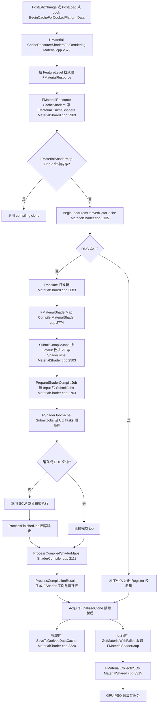

细节锚点:
- 同步/异步模式由 `RequiresSynchronousCompilation()`、`GShaderCompilingManager->AllowAsynchronousShaderCompiling()` 与 cook 场景共同决定(MaterialShared.cpp:3760-3777)。
- DDC 键串由 `GetMaterialShaderMapKeyString(ShaderMapId, FConservativeShaderParameters, Platform)` 生成并含 `GetMaterialShaderMapDDCGuid()`(FDevSystemGuids::MATERIALSHADERMAP_DERIVEDDATA_VER,ShaderCompiler.cpp:265-269)。
- 完整图在 `ProcessCompiledShaderMaps` 中只有 `IsComplete(Material,true)` 且无外部依赖时才 Put 到 DDC(ShaderCompiler.cpp:2223-2243 与 2336 处 `IsMaterialMapDDCEnabled()||bRequiredComplete` 判断)。

### 9.6.2 SCW 进程生命周期与文件协议

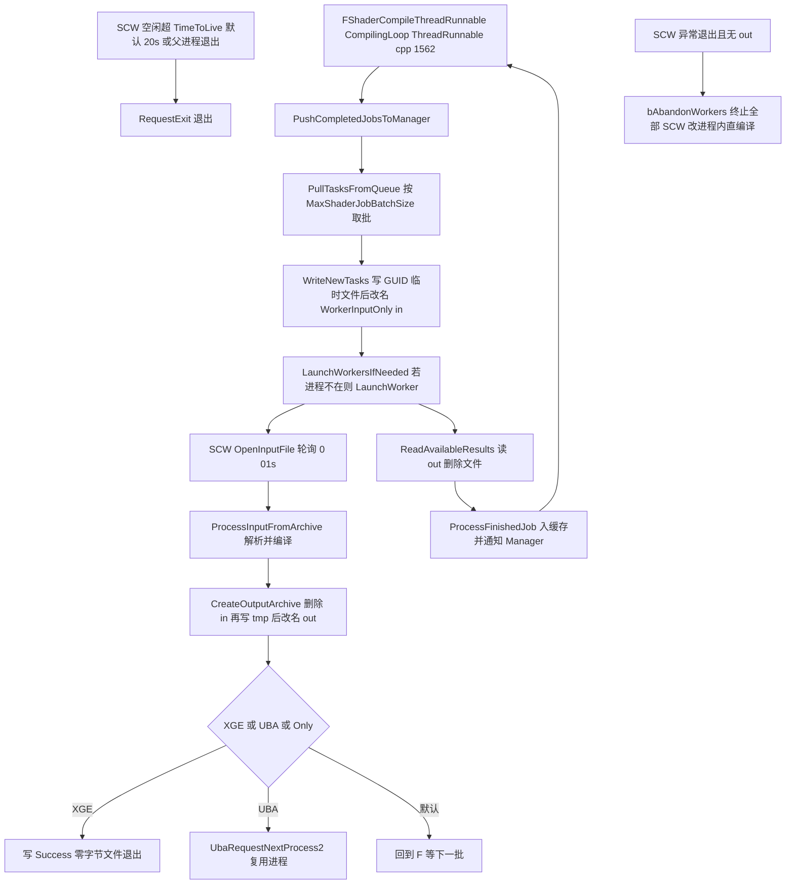

SCW 命令行(ShaderCompiler.cpp:1687):`"<绝对工作目录>/ <父进程Id> <线程Id> <输入文件> <输出文件> -communicatethroughfile -TimeToLive=<秒> [-buildmachine] [-nothreading ...]"`,SCW 侧在 `FWorkLoop`(Programs/ShaderCompileWorker/Private/ShaderCompileWorker.cpp:104-520)按 argv[1..5] 解释。`.in` 布局(ShaderCompileWorkerUtil.cpp:413-600):`InputVersion(int32)` → 压缩标记 FName → `TMap<FName,uint32> FormatVersionMap`(各 IShaderFormat::GetVersion)→ 共享环境与参数结构去重表 → `'S'` 头+单 job 批(每 job `SerializeWorkerInput`+`SerializeSharedInputs`)→ `'P'` 头+管线批(管线名+阶段数+各阶段)。`.out` 头含输出版本、主机名、`FShaderCompileWorkerDiagnostics`(错误码、批耗时、EntryPointTimestamp 等)、处理 job 数,随后回填每个 job 的 Output。XGE/分布式压缩路径用 `EWriteTasksFlags::CompressTaskFile|SkipSource`,源码以 `<InputFilePath><VirtualSourceIndex>` 虚拟文件随任务传输(ShaderCompileWorker.cpp:190-197、ShaderCompileWorkerUtil.cpp:1212-1240)。

### 9.6.3 纹理 DDC Build 流水线(TextureBuild worker)

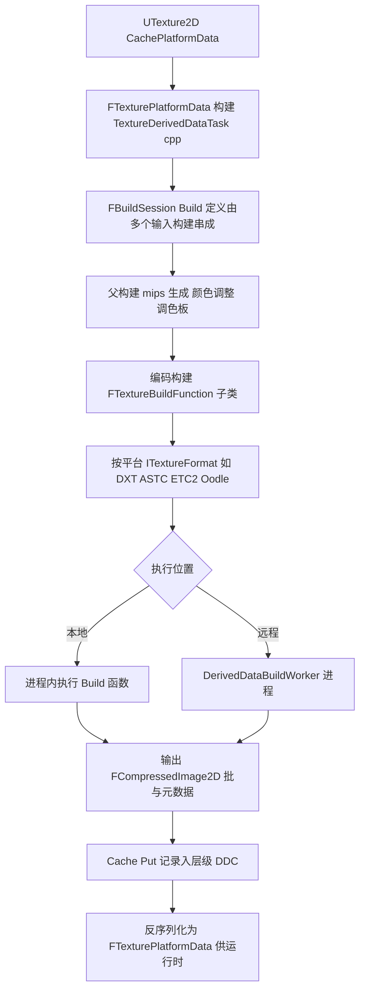

纹理构建在 5.8 已函数化:`FTextureBuildFunction : UE::DerivedData::IBuildFunction`(TextureBuild/Public/TextureBuildFunction.h:16)由 TextureFormat 模块经 `TBuildFunctionFactory` 注册;`Configure(FBuildConfigContext&)` 决定输入(源 mip、颜色设置、平台格式),`Build(FBuildContext&)` 内部调用 `ITextureFormat::ProcessMipLevel`。任务侧 `FTextureGenericBuildInputResolver : IBuildInputResolver`(TextureDerivedDataTask.cpp:673)负责把源图与父构建输出接成图,父构建完成回调再触发子构建(TextureDerivedDataTask.cpp:556-670)。远程执行由 DDC 构建系统派发到 `DerivedDataBuildWorker` 程序(Programs/DerivedDataBuildWorker/Private/DerivedDataBuildWorkerProgram.cpp:43 的 `FBuildWorkerProgram : IBuildInputResolver`,命令行给定 Action 文件,本地解析输入执行 Build 并写输出文件)。

### 9.6.4 异常路径

- SCW 崩溃/无输出:`LaunchWorkersIfNeeded` 返回 bAbandonWorkers → 终止全部 worker、丢弃输出文件、`bAllowCompilingThroughWorkers=false`,改为 `CompileDirectlyThroughDll()` 单线程直编译;`NumSingleThreadedRunsBeforeRetry` 从 `GSingleThreadedRunsIdle` 起指数恢复重试(ThreadRunnable.cpp:1607-1663)。
- 编译失败:`ProcessCompiledShaderMaps` 中 `CheckSingleJob` 收集唯一错误;材质收到 `MaterialsToUpdate.Add(Material, nullptr)` 清空 shader map 走默认材质;默认材质失败直接 Fatal(ShaderCompiler.cpp:2277-2302);`HandlePotentialRetry` 按 `bPromptToRetryFailedShaderCompiles` 弹重试框,`r.DumpShaderDebugInfo=2/3` 时带错误重编译以导出调试信息。
- 卡死检测:`WorkerStateHeartbeat`(状态哈希 + 时间戳)超时打印警告,`r.ShaderCompiler.ShadermapCompilationTimeout` 判定挂起,`r.ShaderCompiler.CrashOnHungShaderMaps=1` 时主动 crash。
- 内存限流:`CheckMemoryLimitViolation`/`SuspendWorkersAndBacklogJobs` 挂起 SCW 并把 job 转入 `BackloggedJobs`(声明 Public/ShaderCompiler.h:275-283、369-400);动态预算 `UpdateDynamicSCWMemoryBudget`。
- DDC 悬挂键校验:从 DDC 反序列化后重算 DataKey 与请求键比对,不一致 `checkf(false)`(MaterialShader.cpp:2100-2116)。

## 9.7 时序图

### 9.7.1 材质编辑→异步编译→应用到材质(GameThread 视角)

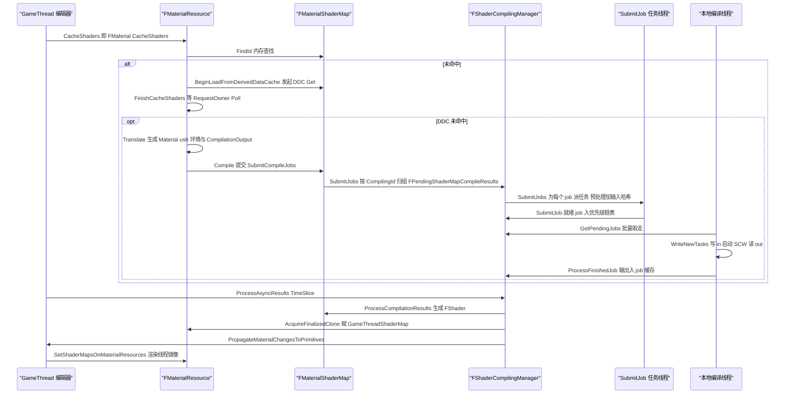

### 9.7.2 引擎 ↔ ShaderCompileWorker 文件协议一轮

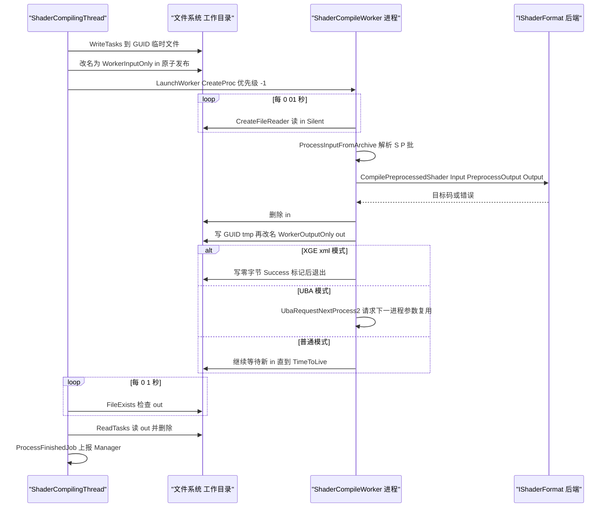

### 9.7.3 DDC Cache:材质 shader map 的 Get/Put 与 Zen

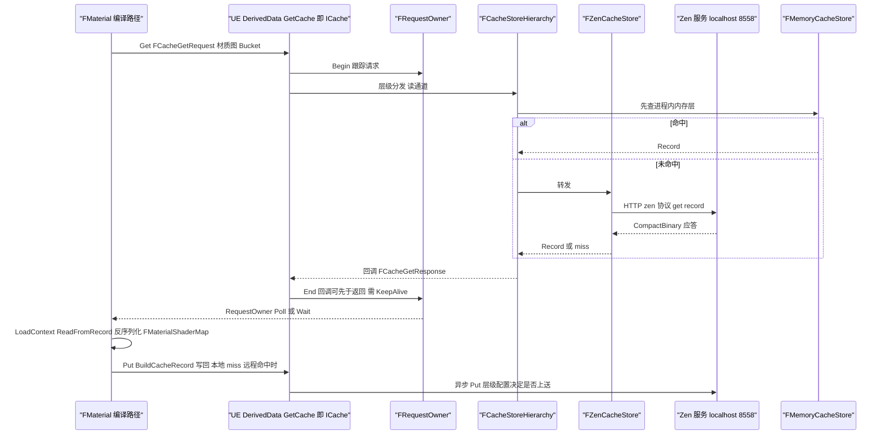

### 9.7.4 分布式编译(XGE / UBA / FASTBuild / DDC Build 控制器)

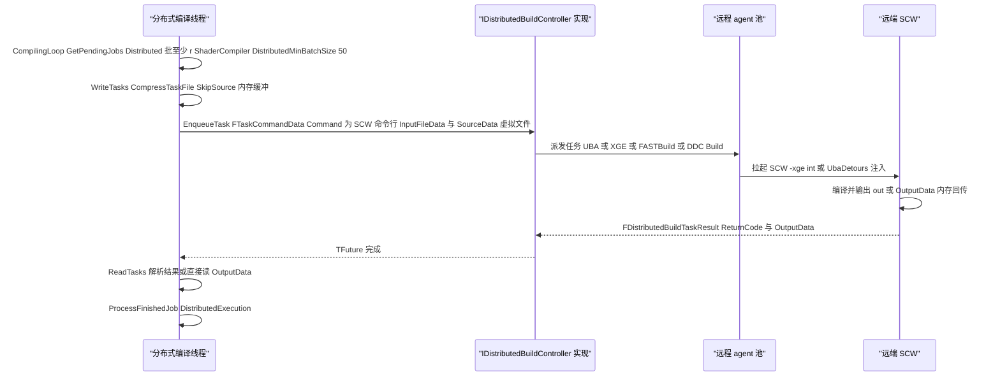

## 9.8 线程模型与同步

| 执行体 | 创建/拥有 | 主要职责 | 关键同步 | 判定依据 |
|---|---|---|---|---|
| GameThread | — | 材质 PostLoad/编辑回调、`FMaterial::CacheShaders`/`BeginCacheShaders`、`ProcessAsyncResults`、cook 入口 | 持 `CompileQueueSection` 提交(ShaderCompiler.cpp:1548-1568,非 GameThread 提交时锁覆盖到 AllJobs.SubmitJobs) | `IsInGameThread()` 分支(ShaderCompiler.cpp:1563) |
| 本地编译线程(ShaderCompilingThread) | `FShaderCompilingManager` 构造时 `LaunchLocalShaderCompilingThread`+`StartThread`(ShaderCompiler.cpp:880-893) | 与 SCW 文件通信、拉批/写 in/读 out、内存限流 | `WorkerInfosLock`(FCriticalSection,Public/ShaderCompiler.h:263)、`PerWorkerMemUsageLock` | `FRunnable::Run`;线程名见 `GetThreadName()` 默认 "ShaderCompilingThread"(ShaderCompiler.h:191-194) |
| 分布式编译线程 | `LaunchRemoteShaderCompilingThread` | 批序列化、EnqueueTask、结果回收 | `PriorityRangeLock`(FRWLock,ShaderCompiler.h:170)、`DispatchedTasks`(TSparseArray) | 线程名 override(ShaderCompilerDistributed.cpp) |
| SubmitJob 任务(UE::Tasks) | `FShaderJobCache::SubmitJobs` 逐 job Launch(ShaderCompilerJobCache.cpp:1507-1543) | 预处理(ShaderPreprocessor)+输入哈希+DDC 查询 | `JobLock`(FRWLock)、`PendingSubmitJobTaskJobs` 链表、`NumPendingSubmitJobs` 原子 | 优先级:cook 为 Normal,否则 BackgroundNormal(ShaderCompilerJobCache.cpp:1505) |
| SCW 进程(每 worker 一个) | `FShaderCompilingManager::LaunchWorker` → `FPlatformProcess::CreateProc`(ShaderCompiler.cpp:1766) | 实际编译(IShaderFormat) | 仅文件系统协议;进程级优先级修饰 -1(DevOptions.Shaders WorkerProcessPriority) | 独立进程,argc≥6(ShaderCompileWorker.cpp:770-783) |
| 渲染线程 | — | `FMaterialRenderProxy::EvaluateUniformExpressions`/`InitRHI`、GetMaterialWithFallback | 每 proxy `UE::FMutex Mutex`(MaterialRenderProxy.h:295)、`MaterialRenderProxyMapLock`、`DeferredUniformExpressionCacheRequestsMutex` | 头文件注释 "These functions should only be called by the rendering thread"(MaterialRenderProxy.h:151) |
| uniform 表达式异步任务 | `FUniformExpressionCacheAsyncUpdateScope` | 并行填充 uniform buffer | `FUniformExpressionCacheAsyncUpdater` | MaterialRenderProxy.h:87-98 |
| DDC 内部线程 | FRequestOwner/线程池任务 | HTTP(Zen)、文件 IO、压缩 | FRequestBarrier、EPriority | DerivedDataCache.h:51-55 线程安全声明 |
| Zen 服务 | 独立进程(C# ZenServer,默认 8558,FServiceConnectSettings/DesiredPort) | 存储后端与 build worker 池 | HTTP/自定义传输(ZenPluggableTransport) | Zen/Public/Experimental/ZenServerInterface.h:33-36 |

跨线程数据所有权:job 对象由 `FThreadSafeCounter NumRefs` 保活,完成前同时被 pending 链表、worker 队列、`PendingShaderMap` 持引用;`ShaderMapJobs`(TMap<int32,FPendingShaderMapCompileResultsPtr>)与 `NumExternalJobs` 只在 `CompileQueueSection` 内访问(ShaderCompiler.h:957-976 注释);材质侧 `GameThreadShaderMap`/`RenderingThreadShaderMap` 双指针,由 `SetShaderMapsOnMaterialResources` 在栅栏后切换;PSO 请求 Id 列表由共享 `PrecachedPSORequestIDsCS`(MaterialShared.h:3145)保护。

## 9.9 配置与扩展点

**ini([SystemSettings]/Engine.ini)**
- `[DevOptions.Shaders]`:`bAllowCompilingThroughWorkers`、`bAllowAsynchronousShaderCompiling`、`MaxShaderJobBatchSize`、`bPromptToRetryFailedShaderCompiles`、`bDebugBreakOnPromptToRetryShaderCompile`、`bLogJobCompletionTimes`、`WorkerTimeToLive`、`BuildWorkerTimeToLive`、`ProcessGameThreadTargetTime`、`WorkerProcessPriority`、`NumUnusedShaderCompilingThreads`、`NumUnusedShaderCompilingThreadsDuringGame`、`ShaderCompilerCoreCountThreshold`、`PercentageUnusedShaderCompilingThreads`、`bUseShaderCompilerFromLaunchDir`、`bForceUseSCWMemoryPressureLimits`(ShaderCompiler.cpp:813-843、1225-1234、796)。
- DDC 图:`[DerivedDataBackendGraph]`/`[DerivedDataCacheGraphs]`/`[DerivedDataCacheStores]` 以 `Shared`/`Local`/`Zen`/`Pak`/`Hierarchical` 等节点串成层级(Private/DerivedDataConfig.cpp:314-377、507);默认图名安装版为 `InstalledDerivedDataBackendGraph`、源码版为 `DerivedDataBackendGraph`(DerivedDataBackends.cpp:714);命令行开关含 `DDC-ForceMemoryCache`、`DDC-NoDefaultGraph`、`DDC-AllowNoActiveStores`、`DDC-Verify`(DerivedDataBackends.cpp:130、711、766、776)。
- DeviceProfile:config=DeviceProfiles, perObjectConfig 的 `CVars`/`BaseProfileName`/`FragmentIncludes`(DeviceProfile.h:21-77)。

**CVar(节选,均见对应 cpp)**
- `r.ShaderCompiler.AllowDistributedCompilation`(ShaderCompiler.cpp:146)、`r.ShaderCompiler.MaxDumpedShaderSources`(:154)、`r.ShaderCompiler.ShadermapCompilationTimeout`(:353)、`r.ShaderCompiler.CrashOnHungShaderMaps`(:360)、`r.ShaderCompiler.ForceAllCores`(:367)、`r.ShaderCompiler.LogSlowJobThreshold`(:184)、`r.DumpShaderDebugInfo`(:324)、`r.Shaders.AllowCompilingThroughWorkers`(:820)。
- job 缓存/DDC:`r.ShaderCompiler.MaxJobCacheMemoryPercent`、`r.ShaderCompiler.MaxJobCacheMemoryMB`、`r.ShaderCompiler.PerShaderDDCCook`、`r.ShaderCompiler.PerShaderDDCGlobal`、`r.ShaderCompiler.PerShaderDDCAsync`、`r.ShaderCompiler.JobCacheDDC`、`r.ShaderCompiler.JobCacheDDCEnableRemotePolicy`、`r.ShaderCompiler.JobCacheDDCCookEnableRemotePolicy`、`r.ShaderCompiler.DebugStallSubmitJob`、`r.ShaderCompiler.DebugStallDDCQuery`、`r.ShaderCompiler.DebugDiscardCacheOutputs`(ShaderCompilerJobCache.cpp:32-121)。
- 分布式:`r.ShaderCompiler.DistributedMinBatchSize`(默认 50,ShaderCompilerDistributed.cpp:20-31)、`r.ShaderCompiler.DistributedJobDescriptionLevel`。
- 命令行:`-noshaderworker`、`-noshaderddc`/`-nomaterialshaderddc`(首个键强制 miss)、`-odsc`(ODSC 服务器模式改用 job 级 DDC)、`-forceAllowShaderCompilerJobCache`、`-NoRemoteShaderCompile`、`-communicatethroughfile`。

**模块/插件扩展点**
- `IShaderFormatModule`(TargetPlatform/Public/Interfaces/IShaderFormatModule.h):模块名匹配 `*ShaderFormat*`(SHADERFORMAT_MODULE_WILDCARD)被 TargetPlatform 管理器枚举;`IShaderFormat` 见 9.5.4。
- `ITargetPlatformModule`(ITargetPlatformModule.h):平台模块返回 ITargetPlatform 列表;`ITargetPlatformManagerModule::GetOnTargetPlatformsInvalidatedDelegate` 通知失效(ITargetPlatformManagerModule.h:212)。
- `IDistributedBuildController`:IModularFeature 名 "DistributedBuildController",由 XGEController/UbaController/FastbuildController/DerivedDataBuildController 插件注册;`FShaderCompilingManager::FindRemoteCompilerController` 取第一个可用者(ShaderCompiler.h:1099)。
- `UE::DerivedData::IBuildFunction` + `TBuildFunctionFactory`:构建函数注册(FTextureBuildFunction、FCompileShaderJobsBuildFunction 等)。
- `IAudioFormat`:IModularFeature 名 "IAudioFormat"(IAudioFormat.h:51-55),各 AudioFormat* 模块注册。
- Zen 传输插件:Developer/ZenPluggableTransport/transport-sdk/include/transportplugin.h 的 `zen::TransportPlugin` C++ SDK(kTransportApiVersion=1)。
- 委托:`FOnGlobalShadersCompilation GetOnGlobalShaderCompilation()`(ShaderCompiler.h:1422-1423)、`FCoreDelegates::OnFEngineLoopInitComplete`(IgnoreAllThrottling 依据)、`FCoreDelegates::GetOutOfMemoryDelegate`(SCW 与 Manager 双方挂接)。

DDC 桶名锚点:材质 shader map 桶 `MaterialShaderMap`(显示名 "Material",MaterialShader.cpp:320-324);shader job 桶 `FShaderJobCacheShaders`(显示名 "Shader",ShaderCompilerJobCache.cpp:136)。

## 9.10 已知限制/未确认项

1. **FShaderJobCache 内部结构只读到类轮廓与关键方法**(ShaderCompilerJobCache.cpp:594-775、1493-1581、1841、2092、2263 附近):`FJobTable`/`FShaderJobData`/优先级链表组的完整字段与 LRU 淘汰(`CullOutputsToMemoryBudget`)细节未逐行核读,数据字典未列入。
2. **Zen 服务本体是独立 C# 程序(ZenServer,源码不在 UE C++ 树内的本仓库阅读范围)**:本文只确认了 UE 侧客户端(FZenServiceInstance/FScopeZenService/ZenCacheStore,默认端口 8558)与 transportplugin.h SDK;存储格式、压缩与 oplog 协议未在源码中确认。
3. **Horde 客户端(Developer/Horde)与 UbaCoordinatorHorde** 只确认模块存在与 Developer/Horde 附录条目,内部 API 未展开;Horde 作为 DDC 共享后端的具体接入路径未逐行确认。
4. **XGEController/FastBuildController/UbaController 插件**只读入口模块与 IDistributedBuildController 关系;XGEControlWorker.cpp(298 行)的 XML 生成细节、FASTBuild bff 生成、UBA 会话管理未逐行核读。
5. **MaterialIR 新翻译器**(MaterialIRModuleBuilder/MaterialIREmitter/MaterialIRToHLSLTranslator)只读了入口调用链(Translate_New),IR 节点体系(MIR::FModule 内部)未展开;新翻译器默认关闭,由材质上 bUsingNewHLSLGenerator 逐材质启用。
6. **Substrate**:仅确认 MaterialExpressionSubstrate.h、SubstrateMaterial.cpp/h(Private)、SubstrateTranslatorCommon 与 FSubstrateCompilationConfig 参与 ShaderMapId;BSDF 树编译细节属渲染章节范围。
7. **纹理构建 worker**:确认了 FTextureBuildFunction/IBuild 输入解析器与 DerivedDataBuildWorker 程序骨架,但 `FTexturePlatformData::BuildTexture` 到 FBuildDefinition 的具体函数名/输出 ValueId 列表未逐行摘录;TextureFormatDXT/ASTC/ETC2/IntelISPC 的编码器内部(第三方库)不在范围。
8. **MeshBuilder/NaniteBuilder/MeshReductionInterface** 仅覆盖模块职责与 IMeshBuilderModule/Nanite::IBuilderModule 入口;网格构建数据流细节属资产处理章节。
9. **AudioFormat\***:Opus 细节已核(UE_AUDIO_OPUS_VER=13、20ms 帧、80ms 预滚动),ADPCM/Ogg/Bink/Rad 只确认模块与 IAudioFormat::Cook 接口形态。
10. **附录缺口**:appendix/api 下没有 TextureFormatDXT/ASTC/ETC2/IntelISPCTexComp/Uncompressed、AudioFormatBink/Rad、Programs/ShaderCompileWorker、Programs/DerivedDataBuildWorker、ZenPluggableTransport、Plugins/DerivedDataBuildController 的条目(见 9.11),这些模块的符号清单无法通过附录交叉索引,文中结论均来自直接读源码。
11. 行号以本仓库 5.8.3-release 源码为准;若与 Epic 官方分支重排有出入,以函数名为准。
12. **ShaderFormatD3D/Metal** 等其余格式模块不在本章范围,仅在类图中示意性出现 D3D 节点(FShaderFormatD3D 存在于 Developer/Windows/ShaderFormatD3D)。

## 9.11 附录索引

本章覆盖模块与全量符号附录(`docs/ue5.8.3/appendix/api/<Tier>/<Module>.md`,相对 `docs/ue5.8.3/`)对照:

| 模块 | 附录文件 |
|---|---|
| Engine(Materials + Private/ShaderCompiler,共 6 part) | appendix/api/Runtime/Engine.part01.md ~ Engine.part06.md |
| RenderCore(ShaderCompilerCore/ShaderCore/JobTypes/ShaderCompileWorkerUtil) | appendix/api/Runtime/RenderCore.md |
| ShaderCompilerCommon | appendix/api/Developer/ShaderCompilerCommon.md |
| ShaderFormatOpenGL | appendix/api/Developer/ShaderFormatOpenGL.md |
| VulkanShaderFormat | appendix/api/Developer/VulkanShaderFormat.md |
| ShaderFormatVectorVM | appendix/api/Developer/ShaderFormatVectorVM.md |
| ShaderPreprocessor | appendix/api/Developer/ShaderPreprocessor.md |
| HlslParser | appendix/api/Developer/HlslParser.md |
| ShaderPlatformConfigEditor | appendix/api/Developer/ShaderPlatformConfigEditor.md |
| TargetPlatform | appendix/api/Developer/TargetPlatform.md |
| TargetDeviceServices | appendix/api/Developer/TargetDeviceServices.md |
| DerivedDataCache | appendix/api/Developer/DerivedDataCache.md |
| Zen | appendix/api/Developer/Zen.md |
| Horde | appendix/api/Developer/Horde.md |
| UbaCoordinatorHorde | appendix/api/Developer/UbaCoordinatorHorde.md |
| DistributedBuildInterface | appendix/api/Developer/DistributedBuildInterface.md |
| TextureBuild / TextureBuildUtilities | appendix/api/Developer/TextureBuild.md, TextureBuildUtilities.md |
| TextureCompressor | appendix/api/Developer/TextureCompressor.md |
| TextureFormat / TextureFormatOodle | appendix/api/Developer/TextureFormat.md, TextureFormatOodle.md |
| MeshBuilder / MeshUtilities / NaniteBuilder / MeshReductionInterface / MeshBuilderCommon | appendix/api/Developer/MeshBuilder.md, MeshUtilities.md, NaniteBuilder.md, MeshReductionInterface.md, MeshBuilderCommon.md |
| AudioFormatADPCM / Ogg / Opus | appendix/api/Developer/AudioFormatADPCM.md, AudioFormatOgg.md, AudioFormatOpus.md |
| DerivedDataTool | appendix/api/Programs/DerivedDataTool.md |
| XGEController / UbaController / FastbuildController | appendix/api/Plugins/XGEController.md, UbaController.md, FastbuildController.md |
| ComputeFramework(及 ComputeFrameworkEditor) | appendix/api/Plugins/ComputeFramework.md, ComputeFrameworkEditor.md |
| DeformerGraph(OptimusCore/Developer/Editor/Settings) | appendix/api/Plugins/OptimusCore.md, OptimusDeveloper.md, OptimusEditor.md, OptimusSettings.md |
| ZenDashboard / ZenLaunch / ZenOplogDiffTool | appendix/api/Programs/ZenDashboard.md, ZenLaunch.md, ZenOplogDiffTool.md |

附录未生成条目(源码已读、索引缺失,见 9.10 第 10 条):TextureFormatDXT、TextureFormatASTC、TextureFormatETC2、TextureFormatIntelISPCTexComp、TextureFormatUncompressed、AudioFormatBink、AudioFormatRad、Programs/ShaderCompileWorker、Programs/DerivedDataBuildWorker、Developer/ZenPluggableTransport、Plugins/DerivedDataBuildController。

