# 10 应用框架、输入、Slate、UMG 与 UI

本章覆盖 UE 5.8.3 中"操作系统消息 → 应用框架(ApplicationCore) → Slate/UMG 界面 → 游戏 PlayerController → EnhancedInput"的完整 UI 与输入栈。源码根 `$E = Engine/`(UnrealEngine-5.8.3-release),文中路径均相对 `$E`。

## 10.1 职责、边界与模块清单

| 模块 | 路径 | Build.cs 依赖(Public/Private) | 职责一句话 |
|---|---|---|---|
| ApplicationCore | Source/Runtime/ApplicationCore | P:Core | 平台无关应用抽象:`GenericApplication`、消息泵、窗口/光标/IME 的平台实现(Windows/Linux/Mac/SDL/Null 等) |
| InputCore | Source/Runtime/InputCore | P:Core, CoreUObject | 输入原子类型:`FKey`、`EKeys`、`EInputEvent`(注:在 EngineBaseTypes.h)、`FPlatformUserId`/`FInputDeviceId`(定义于 Core)与平台输入杂项 |
| InputDevice | Source/Runtime/InputDevice | P:(无) Pri:Core, Engine | 输入设备接口 `IInputDevice`、`IInputDeviceModule`、`IHapticDevice`,供所有设备插件实现 |
| SlateCore | Source/Runtime/SlateCore | P:ApplicationCore, Core, CoreUObject, DeveloperSettings, InputCore, Json | Slate 内核:`SWidget`、`FGeometry`、绘制元素/批处理、字体缓存(FreeType/HarfBuzz)、属性与失效(FastUpdate)、`FSlateRenderer` 抽象 |
| Slate | Source/Runtime/Slate | P:ApplicationCore, Core, CoreUObject, ImageWrapper, InputCore, Json, SlateCore | 完整 Slate 应用:`FSlateApplication`、`SWindow`、`FSlateUser`、具体 Widget 库、输入预处理 `IInputProcessor`、`MenuStack` |
| SlateBaseRenderer | Source/Runtime/SlateBaseRenderer | P:Core, CoreUObject, Slate, SlateCore | 渲染器公共层(字体 Blueprint 库、Slate FX 基类),被两个渲染器共用 |
| SlateRHIRenderer | Source/Runtime/SlateRHIRenderer | P:SlateBaseRenderer Pri:Core, CoreUObject, Engine, RHI, RenderCore, Renderer, Slate, SlateCore 等 | 基于 RHI/RenderGraph 的 Slate 渲染器 `FSlateRHIRenderer` 与 3D 渲染接口 `ISlate3DRenderer` |
| SlateNullRenderer | Source/Runtime/SlateNullRenderer | Pri:Core, CoreUObject, Engine, RHI, RenderCore, SlateBaseRenderer, SlateCore | NullRHI 下的空渲染器 `FSlateNullRenderer`(-nullrhi/commandlet 用) |
| UMG | Source/Runtime/UMG | P:FieldNotification, HTTP, MovieScene, MovieSceneTracks, PropertyPath, TimeManagement Pri:Engine, Slate, SlateCore 等 | UObject 化的 Widget 层:`UWidget`/`UUserWidget`/`UWidgetTree`/`UPanelWidget`、Widget 动画、蓝图生成类 `UWidgetBlueprintGeneratedClass` |
| AppFramework | Source/Runtime/AppFramework | P:ApplicationCore, Core, CoreUObject, Slate, SlateCore Pri:InputCore | 通用 UI 基础件:向导 `SWizard`、取色器 `SColorPicker`、测试套件 `STestSuite`/`SWidgetGallery` |
| AdvancedWidgets | Source/Runtime/AdvancedWidgets | P:Core, CoreUObject, SlateCore, UMG Pri:Engine, InputCore, PropertyEditor | 高级编辑向 Widget:径向滑条 `SRadialSlider`/`URadialSlider`、调色 `SColorGradingPicker`、属性查看器 `SPropertyViewer` |
| WidgetCarousel | Source/Runtime/WidgetCarousel | Pri:ApplicationCore, Core, CoreUObject, Slate, SlateCore | 轮播 Widget `SWidgetCarousel~T~` 与导航条 `SCarouselNavigationBar` |
| FieldNotification | Source/Runtime/FieldNotification | P:Core, CoreUObject | 字段变更通知接口 `INotifyFieldValueChanged`、`FFieldNotificationId`,UMG/MVVM 的绑定基础 |
| Engine(本章子集) | Source/Runtime/Engine | P:ApplicationCore, InputCore, Slate, SlateCore Pri:AppFramework, UMG, SlateRHIRenderer 等 | 游戏侧胶水:`UPlayerInput`、`APlayerController::ProcessPlayerInput`、`FViewport`/`FSceneViewport`、`UGameViewportClient` |
| EnhancedInput(插件) | Plugins/EnhancedInput/Source/EnhancedInput | P:(无) Pri:ApplicationCore, Core, CoreUObject, Engine, InputCore, Slate, SlateCore 等 | 新输入栈:`UEnhancedInputComponent`、`UInputAction`、`UInputMappingContext`、`UEnhancedPlayerInput` 与 LocalPlayer/World 两级子系统 |
| RawInput(插件) | Plugins/Experimental/RawInput/Source/RawInput | P:ApplicationCore, Core, CoreUObject, Engine, InputCore, Slate, SlateCore Pri:InputDevice | Windows HID Raw Input 设备 `FRawInputWindows`,以 `IInputDeviceModule` 注册 |
| GameInput(插件) | Plugins/Runtime/GameInput/Source/GameInputBase + Plugins/GameInputWindows/Source/GameInputWindows | GameInputBase P:ApplicationCore, AudioExtensions, Core, CoreUObject, DeveloperSettings, Engine, InputCore, InputDevice, Slate, SlateCore;GameInputWindows Pri:同前 + GameInputBase | 微软 GameInput API 适配:`IGameInputDeviceInterface` + 各类 `GameInputDeviceProcessor_*`(Beta,仅 Win64) |
| ModelViewViewModel(插件) | Plugins/Runtime/ModelViewViewModel/Source/ModelViewViewModel | P:Core, CoreUObject, Engine, FieldNotification Pri:Slate, SlateCore, UMG | MVVM:`UMVVMViewModelBase`、`UMVVMView`(UUserWidgetExtension)、View/ViewModel 蓝图类与子系统 |
| CommonUI(插件) | Plugins/Runtime/CommonUI/Source/CommonUI(+CommonInput) | P:ApplicationCore, CommonInput, Core, CoreUObject, Engine, EnhancedInput, GameplayTags, InputCore, MediaAssets, Slate, UMG, WidgetCarousel Pri:Analytics, SlateCore 等 | Lyra 系 UI 库:`UCommonUserWidget`、`UCommonActivatableWidget`、`UCommonButtonBase`、激活栈与 CommonInput 预处理器 |

补充边界说明:
- "UMG 蓝图编译"的编辑器侧(`FWidgetBlueprintCompiler`,UMGEditor 模块)不在本章 Runtime 范围,本章只覆盖其产物 `UWidgetBlueprintGeneratedClass` 的运行时初始化路径(见 10.6.3)。
- 平台专用的 XInput、Android/IOS 输入属于 Platforms 层,本章仅在输入链路中提及其注册方式。

## 10.2 总体架构

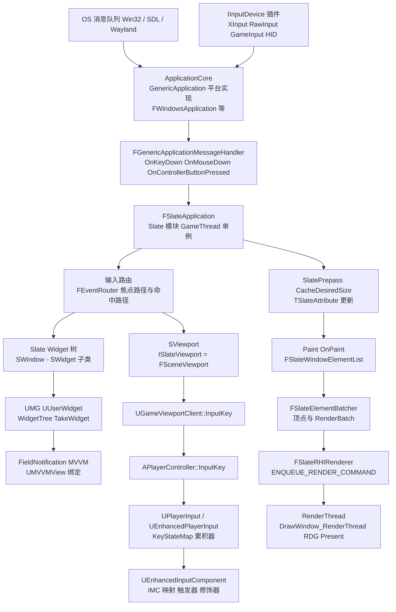

分层说明(自下而上):
1. **平台层(ApplicationCore)**:每平台一个 `GenericApplication` 派生类(Windows 为 `FWindowsApplication`),负责窗口创建、消息泵 `PumpMessages`(WindowsApplication.cpp:4201)、延迟消息 `ProcessDeferredEvents`(:4215)与外设轮询 `PollGameDeviceState`(:4247)。
2. **Slate 层(SlateCore+Slate)**:`FSlateApplication` 同时继承 `FSlateApplicationBase` 与 `FGenericApplicationMessageHandler`(SlateApplication.h:249-252),把平台回调翻译成 `FKeyEvent/FPointerEvent` 并沿焦点/命中路径路由;每帧由 `FEngineLoop::Tick` 两段式驱动(LaunchEngineLoop.cpp:5921 与 5991)。
3. **游戏接入层(Engine)**:游戏视口是一个 `SViewport` Widget(Widgets/SViewport.h),其 `SetViewportInterface` 绑定 `FSceneViewport`;SViewport.cpp:337 把 `OnKeyDown` 直接转给 `ISlateViewport`,从而进入 `UGameViewportClient::InputKey` → `APlayerController::InputKey` → `UPlayerInput` 的游戏输入管线。
4. **UMG 层**:UObject 世界的 Widget 树,在 `TakeWidget` 时惰性生成对应 Slate 树,通过 FieldNotification/MVVM 完成数据绑定。
5. **渲染层**:Paint 产生 `FSlateDrawElement` 序列,`FSlateRHIRenderer::DrawWindows_Private` 批处理后用 `ENQUEUE_RENDER_COMMAND(SlateDrawWindowsCommand)` 交给渲染线程绘制并 Present。

## 10.3 类图

### 10.3.1 应用与平台层

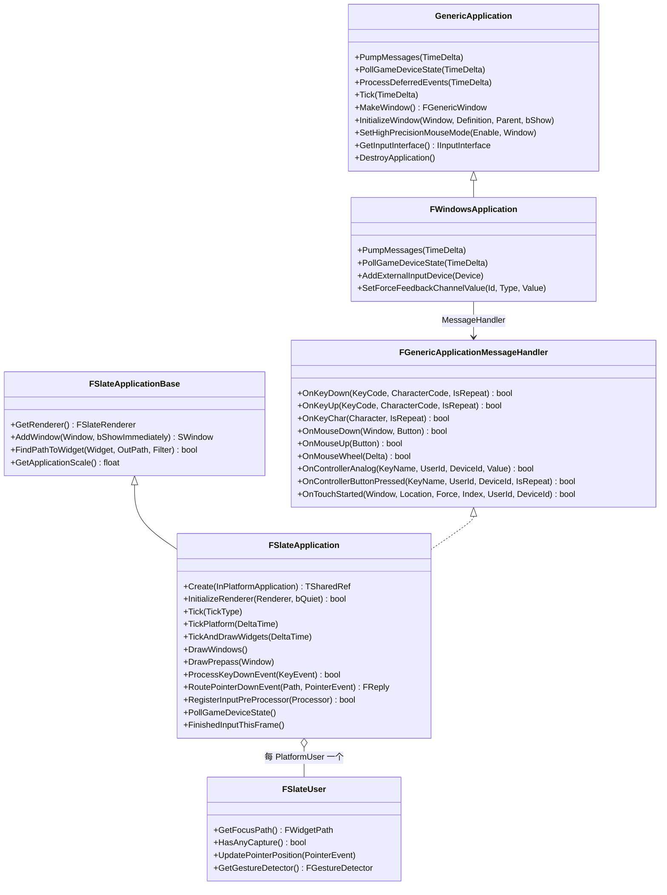

- `GenericApplication`(GenericApplication.h:444):平台无关应用接口;`PumpMessages`/`PollGameDeviceState`/`Tick` 均为虚函数(:463-469)。
- `FWindowsApplication`(WindowsApplication.cpp:4247 起):Win32 实现,`WM_KEYDOWN` 等消息先 `DeferMessage` 延迟处理(:2368),在 `ProcessMessage` 中区分左右 Ctrl/Alt/Shift 后回调 `MessageHandler->OnKeyDown`(:3248-3306)。
- `FSlateApplication`(SlateApplication.h:249):引擎唯一实例,`Create`(:295)在引擎启动时由 `FEngineLoop::PreInit` 创建;渲染器经 `InitializeRenderer`(:343) 注入(选择逻辑见 LaunchEngineLoop.cpp:3341-3355)。
- `FSlateUser`(SlateUser.h):按 `FPlatformUserId` 维护光标、焦点路径 `GetFocusPath`(:136)、指针捕获与拖拽、软件手势识别器。

### 10.3.2 Slate 核心(Widget/绘制/失效)

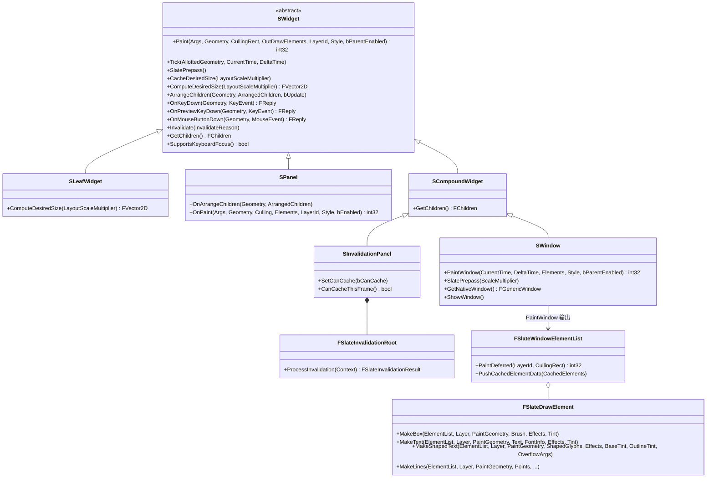

- `SWidget`(SWidget.h:163):所有 Slate Widget 基类。非虚入口 `Paint`(:294)负责失效判定/命中登记后调用虚 `OnPaint`;`Tick`(:303)、`SlatePrepass`(:669/675)、`CacheDesiredSize`(:759)与纯虚 `ComputeDesiredSize`(:774)构成布局三段式。
- `SPanel`(SPanel.h:40/71):面板基类,`OnArrangeChildren` 纯虚;`SPanel::OnPaint` 会先排列子项再逐子 Paint。
- `SWindow`(SWindow.h 位于 SlateCore/Public/Widgets/SWindow.h;`PaintWindow` 声明 :467):窗口是特殊 Widget,持有 `FHittestGrid` 与失效根,`PaintWindow`(SWindow.cpp:2122)统一走 `PaintInvalidationRoot`(:2151)。
- `SInvalidationPanel`(SInvalidationPanel.h:28):把子树变成 `FSlateInvalidationRoot`(FastUpdate/SlateInvalidationRoot.h:76),未失效帧直接回放缓存的绘制元素(`PushCachedElementData`,SWindow.cpp:2170)。

### 10.3.3 输入管线(InputCore / InputDevice / EnhancedInput / Engine)

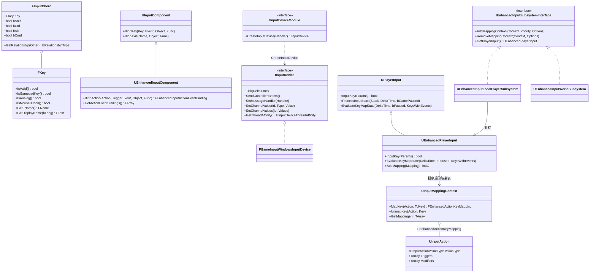

- `FKey`(InputCore/Classes/InputCoreTypes.h:48-127):键名的强类型包装,细节缓存在 `FKeyDetails`(:145);`EKeys` 命名空间(:345 起)提供 `AnyKey/MouseX/Gamepad_LeftStick...` 全部静态键。
- `IInputDevice`(InputDevice/Public/IInputDevice.h:32):设备插件接口;5.8 新增 `EInputDeviceThreadAffinity`(:19)声明 `Tick/SendControllerEvents` 的线程归属(GameInput 实现返回 `InputThreadSafe`)。
- `UEnhancedInputComponent`(EnhancedInputComponent.h:373)通过 `FEnhancedInputActionEventBinding`(:169)记录"动作 × 触发事件"绑定;`UInputAction`(InputAction.h:55)持有触发器/修饰器实例数组,运行时每个玩家实例化为 `FInputActionInstance`(:207)。
- `UEnhancedInputLocalPlayerSubsystem`(EnhancedInputSubsystems.h:21)挂 LocalPlayer;`UEnhancedInputWorldSubsystem`(:108)是 5.7+ 的实验性全局子系统,配合 `FEnhancedInputWorldProcessor`(IInputProcessor)接收无 PlayerController 的输入。

### 10.3.4 UMG 与数据绑定(FieldNotification / MVVM / CommonUI)

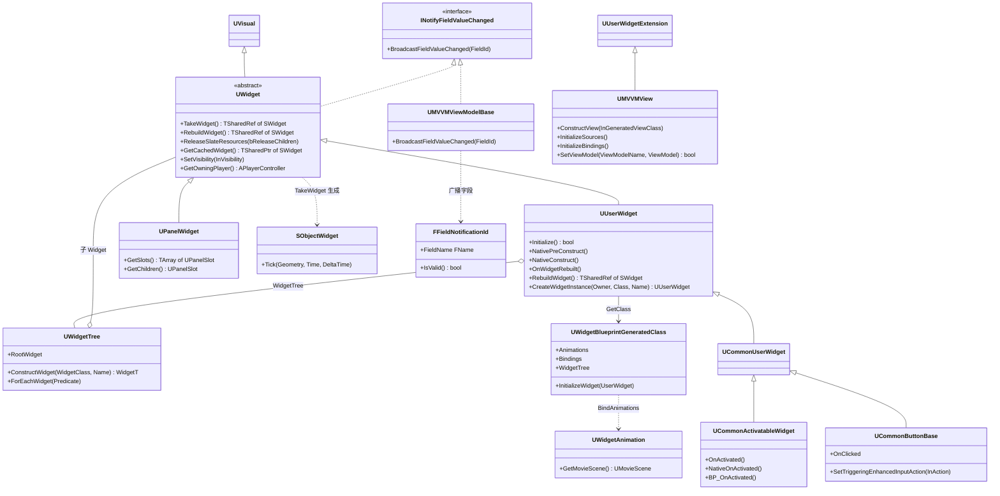

- `UWidget`(Components/Widget.h:216,`UCLASS(Abstract, CustomFieldNotify)`):UMG 基类,实现 `INotifyFieldValueChanged` 支持蓝图字段通知;`TakeWidget`(Widget.cpp:962)→ `RebuildWidget` 惰性生成 Slate Widget。
- `UUserWidget`(Blueprint/UserWidget.h:280):蓝图 Widget 基类;`Initialize`(UserWidget.cpp:135)按生成类 `UWidgetBlueprintGeneratedClass::InitializeWidget`(WidgetBlueprintGeneratedClass.cpp:327)复制模板树。
- `SObjectWidget`(Slate/SObjectWidget.h:30):UUserWidget 对应的 Slate 容器,持有 UObject 反向指针并驱动 `NativeTick`。
- `UMVVMView`(View/MVVMView.h:68)是 `UUserWidgetExtension`,在 Widget 构造后建立 ViewModel↔Widget 的绑定;`UMVVMViewModelBase`(MVVMViewModelBase.h:42)实现字段广播。
- CommonUI:`UCommonUserWidget`(CommonUserWidget.h:33)→ `UCommonActivatableWidget`(CommonActivatableWidget.h:43,激活/停用事件)、`UCommonButtonBase`(CommonButtonBase.h,支持直接挂 `UInputAction`)。

### 10.3.5 渲染与字体

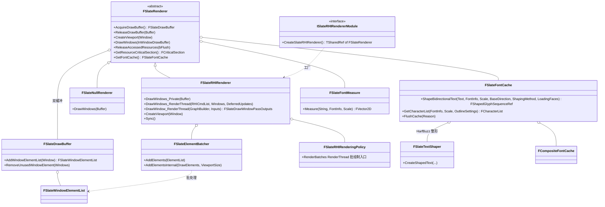

- `FSlateRenderer`(Rendering/SlateRenderer.h:约 257-575,`AcquireDrawBuffer`:266、`DrawWindows`:322、`GetResourceCriticalSection`:551):抽象渲染器,同时是字体服务持有者(`GetFontCache`:427)。
- `FSlateRHIRenderer`(Private/SlateRHIRenderer.h:40,`final`):RHI 实现;`DrawWindows_Private`(SlateRHIRenderer.cpp:1512)在 GameThread 收集窗口、`ElementBatcher->AddElements`(:1634)后 `ENQUEUE_RENDER_COMMAND(SlateDrawWindowsCommand)`(:1749)提交渲染线程。
- `FSlateNullRenderer`(Private/SlateNullRenderer.h:17):NullRHI 空实现,保持接口完整。
- 字体:`FSlateFontCache`(Fonts/FontCache.h:756)负责 FreeType 光栅化缓存与 HarfBuzz 整形(`ShapeBidirectionalText`,:788/790);BiDi 方向判定用 Core 的 `TextBiDi`(Internationalization/Text.h:1443,ICU 实现);`FSlateTextShaper`(Private/Fonts/SlateTextShaper.h:63)、`FSlateFontMeasure`(Fonts/FontMeasure.h:13)。

### 10.3.6 SWidget 子类全表(引附录)

下表穷举 SlateCore/Slate 两个模块 `Public/Widgets` 下公开声明的 S 系 Widget(按目录分组;完整符号清单见 10.11 附录 `appendix/api/Runtime/SlateCore.md` 与 `appendix/api/Runtime/Slate.md`):

| 分组 | Widget(基类) |
|---|---|
| 基类/骨架 | SCompoundWidget、SLeafWidget、SPanel、SBoxPanel、SOverlay、SUserWidget、SNullWidget、SWindow、SVirtualWindow、SWeakWidget、SPopup |
| 布局 | SBox、SBorder、SCanvas、SConstraintCanvas、SGridPanel、SUniformGridPanel、SUniformWrapPanel、SWrapBox、SHorizontalBox、SVerticalBox、SStackBox、SScaleBox、SSplitter、SSplitter2x2、SExpandableArea、SRadialBox、SResponsiveGridPanel、SDragAndDropVerticalBox、SBoxPanel 派生 SLinkedBox、SScissorRectBox、SDPIScaler、SSafeZone、SEnableBox、SFxWidget |
| 滚动/分页 | SScrollBox、SScrollBar、SScrollBarTrack、SScrollBorder、SScrollPanel、SLinkableScrollBar、SExpandableArea、STextScroller |
| 内容显示 | STextBlock、SRichTextBlock、SRichTextHyperlink、SInlineEditableTextBlock、SImage、SLayeredImage、SSpinningImage、SColorBlock、SProgressBar、SSeparator、SSlider、SBackgroundBlur、STooltipPresenter、SDeferredToolTip、SDeferredToolTipText、SVolumeControl |
| 交互输入 | SButton、SCheckBox、SComboBox、SComboButton、SComboRow、SSearchableComboBox、STextComboBox、STextComboPopup、SMultiColumnTableRow、STableRow、SListView、STileView、STreeView、SNumericEntryBox、SNumericDropDown、SNumericRotatorInputBox、SNumericVectorInputBox、SSegmentedControl、SSearchBox、SInputKeySelector、SEditableText、SEditableTextBox、SMultiLineEditableText、SMultiLineEditableTextBox、STextEntryPopup、SVirtualKeyboardEntry、SVirtualJoystick |
| 编辑器/框架扩展 | SHeader、SHeaderRow、SBreadcrumbTrail(及 Base)、SExpanderArrow、SMenuAnchor、SMenuOwner、SSubMenuHandler、SDockTab、SInvalidationPanel、SNotificationBackground、SPopupErrorText、SViewport |

补充:UMG 侧的 `SObjectWidget`、`SRetainerWidget`(UMG 模块)、AdvancedWidgets 的 `SRadialSlider`、WidgetCarousel 的 `SWidgetCarousel~T~`、AppFramework 的 `SWizard/SColorPicker` 等同样派生自上述基类,分别见对应附录文件。

## 10.4 数据字典

### 10.4.1 输入原子类型(InputCore/Core)

| 字段/成员 | 类型 | 含义 | 取值/约束 | 源码位置 |
|---|---|---|---|---|
| FKey::KeyName | FName | 键名,`FKey` 的唯一状态 | 大小写不敏感名 | InputCore/Classes/InputCoreTypes.h:120 |
| FKey::KeyDetails | TSharedPtr~FKeyDetails~ | 惰性求值的键元数据(可变缓存) | 首次查询时 `ConditionalLookupKeyDetails` | 同上:123 |
| FKeyDetails::EKeyFlags | enum 位标志 | GamepadKey、Axis1D、Axis2D、ButtonAxis、ModifierKey、Digital 等 | 组合位 | 同上:147 起 |
| EKeys::*(静态成员) | const FKey | 全部预定义键(AnyKey/MouseX/LeftMouseButton/Gamepad_*) | INPUTCORE_API 导出 | 同上:345-830 |
| FInputChord::Key/bShift/bCtrl/bAlt/bCmd | FKey + 4 位段 | 快捷键 = 键 + 修饰键 | Slate 模块 USTRUCT | Slate/Public/Framework/Commands/InputChord.h:29-39 |
| FPlatformUserId::InternalId | int32 | 平台用户内部 id | INDEX_NONE 表示无效(`PLATFORMUSERID_NONE`,CoreMiscDefines.h:511) | Core/Public/Misc/CoreMiscDefines.h:464 |
| FInputDeviceId | 同款包装结构 | 输入设备 id,由 `IPlatformInputDeviceMapper` 分配 | `INPUTDEVICEID_NONE` 无效;Core 定义、ApplicationCore 使用 | 同上:518 |
| EInputEvent | enum : int | 输入事件类型 | IE_Pressed=0、IE_Released=1、IE_Repeat=2、IE_DoubleClick=3、IE_Axis=4、IE_MAX=5 | Engine/Classes/Engine/EngineBaseTypes.h:28-36 |
| ETouchIndex | enum | 触点索引 | Touch1..Touch10、CursorPointerIndex(隐藏)、MAX_TOUCHES | InputCore/Classes/InputCoreTypes.h:253-275 |
| FTouchId | USTRUCT | 设备 + 触点二元组,5.8 新增多点触屏支持 | `IsValid()` 取决于 DeviceId | 同上:282-332 |
| FModifierKeysState | 9 个位段 | 左右 Shift/Ctrl/Alt/Cmd + CapsLock 状态 | 事件时刻快照 | ApplicationCore/Public/GenericPlatform/GenericApplication.h:74 |

### 10.4.2 Slate 事件与布局

| 字段/成员 | 类型 | 含义 | 取值/约束 | 源码位置 |
|---|---|---|---|---|
| FInputEvent(基类) | — | 携带 ModifierKeys、UserIndex、InputDeviceId、bIsRepeat、Timestamp | FKeyEvent/FPointerEvent/FCharacterEvent/FAnalogInputEvent 公共基 | SlateCore/Public/Input/Events.h:154 |
| FKeyEvent | FInputEvent 派生 | 键事件:Key、CharacterCode、KeyCode | 焦点路径路由用 | 同上:430 |
| FPointerEvent | 结构 | 指针事件:PointerIndex、ScreenSpacePosition、PressDelta、WheelDelta、EffectingButton、bIsTouchEvent | 命中路径路由用 | 同上:693 |
| FAnalogInputEvent | FKeyEvent 派生 | 模拟量事件,AnalogValue | Gamepad 轴 | 同上:526 |
| FGeometry | USTRUCT | 局部尺寸 + LayoutTransform + RenderTransform + 累计变换 | `MakeRoot/MakeChild` 构建;const 成员防篡改 | SlateCore/Public/Layout/Geometry.h:39 |
| FPaintGeometry | 结构 | Paint 专用轻量几何(仅累计变换+尺寸) | `FGeometry::ToPaintGeometry()` 转换 | SlateCore/Public/Layout/PaintGeometry.h |
| FPaintArgs | 类 | Paint 上下文:HittestGrid 引用、DeltaTime、LastPaintTime、当前 Widget 调试信息 | 值传递,`WithNewNode` 派生 | SlateCore/Public/Types/PaintArgs.h:22 |
| FHittestGrid | 类 | 窗口级命中测试网格,按像素块缓存 Widget 索引 | `SWindow::PaintWindow` 前 `SetHittestArea` 重置 | SlateCore/Public/Input/HittestGrid.h:43 |
| FReply | TReplyBase~FReply~ | 事件处理结果:Handled/Unhandled、捕获/焦点请求、Throttle | 不可变,`FReply::Handled()` 等 | SlateCore/Public/Input/Reply.h:23 |
| FWidgetPath | 结构 | 从窗口到目标 Widget 的完整路径 | 事件隧穿/冒泡依据 | SlateCore/Public/Layout/WidgetPath.h |

### 10.4.3 失效与属性(TSlateAttribute)

| 字段/成员 | 类型 | 含义 | 取值/约束 | 源码位置 |
|---|---|---|---|---|
| EInvalidateWidgetReason | enum class 位标志 | None=0、Layout=1<<0、Paint=1<<1、Volatility=1<<2、ChildOrder=1<<3、RenderTransform=1<<4、Visibility=1<<5、AttributeRegistration=1<<6、Prepass=1<<7;组合 PaintAndVolatility/LayoutAndVolatility | `SWidget::Invalidate(Reason)` 触发 | SlateCore/Public/Widgets/InvalidateWidgetReason.h:13-69 |
| FSlateInvalidationRoot | 类(FGCObject) | 失效根:持 `FSlateInvalidationWidgetList` 与缓存绘制元素 | SInvalidationPanel/SWindow 充当 | SlateCore/Public/FastUpdate/SlateInvalidationRoot.h:76 |
| FWidgetProxyHandle | 句柄 | Widget 在失效列表中的索引 + 可见性 | `SetFastPathProxyHandle`(SWidget.h:779) | SlateCore/Public/FastUpdate/WidgetProxy.h |
| TSlateAttribute~T~ | 模板 | 成员属性:Prepass 期间统一更新,变化即 Invalidate | 只能作为 SWidget 成员;`TSlateManagedAttribute` 用于可移动容器 | SlateCore/Public/Types/SlateAttribute.h:24-56(说明)与 Types/Attributes/*.inl(实现) |
| FSlateAttributeDescriptor | 类 | 属性→失效原因映射表,`PrivateRegisterAttributes` 注册 | SLATE_ADD_MEMBER_ATTRIBUTE_DEFINITION 宏 | SlateCore/Public/Types/SlateAttributeDescriptor.h |
| ComputeVolatility() | 虚函数 | 兼容旧 TAttribute 的波动性判定 | 绑定了 TAttribute 的 Widget 必须重写 | SWidget.h:138 附近注释 |

### 10.4.4 绘制与字体

| 字段/成员 | 类型 | 含义 | 取值/约束 | 源码位置 |
|---|---|---|---|---|
| FSlateWindowElementList | 类 | 每窗口的绘制元素容器,支持 deferred group | `PaintDeferred`(DrawElements.h:351) | SlateCore/Public/Rendering/DrawElements.h:219 |
| FSlateDrawElement | 类(静态工厂) | MakeBox/MakeText/MakeShapedText/MakeLines/MakeBox 等静态构造函数 | 只能在 GT/Slate 线程添加(DrawElements.h:236-243 有 check) | Rendering/DrawElementTypes.h:45-260 |
| FSlateDrawBuffer | 类(FGCObject) | 帧级缓冲,含多窗口元素表 | `FSlateRenderer::AcquireDrawBuffer` 获取并加锁 | Rendering/SlateDrawBuffer.h:19 |
| FSlateBrush | USTRUCT | 图片资源引用 + Margin/Tiling/Drawn/Mirroring/UI 材质 | ImageType 决定资源来源 | Styling/SlateBrush.h:235 |
| ESlateDrawEffect | enum 位标志 | None/PreMultiplyAlpha/NoGammaCorrection 等 | 元素级效果 | Rendering/RenderingCommon.h |
| FSlateFontInfo | 结构 | 字体族/尺寸/字母间距/轮廓 | CompositeFont 或 FontName 二选一 | Fonts/SlateFontInfo.h |
| FShapedGlyphSequenceRef | 共享引用 | 整形后的字形序列(BiDi 运行+字形索引) | MakeShapedText 输入 | Fonts/ShapedTextFwd.h |
| FCharacterList | 类 | 同一字体/尺寸/轮廓的字符图集页 | `FSlateFontCache::GetCharacterList`(FontCache.h:823) | Fonts/FontCache.h:666 |

### 10.4.5 游戏输入(Engine / EnhancedInput)

| 字段/成员 | 类型 | 含义 | 取值/约束 | 源码位置 |
|---|---|---|---|---|
| FKeyState::RawValue | FVector | 键当前值(轴:X/Y/Z) | EvaluateKeyMapState 中从累加器交换 | Engine/Public/KeyState.h:15 附近 |
| FKeyState::RawValueAccumulator | FVector | 帧内累加值 | 事件到达时累加,帧末清零 | 同上:51 |
| FKeyState::EventAccumulator/EventCounts | FInputEventCount[IE_MAX] | 按事件类型计数(累加器→本帧计数) | `Exchange` 后供委托排序 | 同上 |
| FKeyState::PairSampledAxes | uint8:3 | 配对轴采样掩码 | `FKey::GetPairedAxis` 相关 | 同上:39 |
| UPlayerInput::KeyStateMap | TMap~FKey,FKeyState~ | 键状态总表 | GT 访问 | Engine/Classes/GameFramework/PlayerInput.h |
| FInputKeyEventArgs | 结构 | 视口输入事件参数:Viewport、InputDevice、Key、Event、Delta、DeltaTime、NumSamples、bGamepad | GameViewportClient/PC::InputKey 入参 | Engine/Public/InputKeyEventArgs.h:21,字段 :176-186 |
| ETriggerEvent | enum class 位标志 | None=0、Triggered=1<<0、Started=1<<1、Ongoing=1<<2、Canceled=1<<3、Completed=1<<4 | 绑定时选择监听的事件 | EnhancedInput/Public/InputTriggers.h:34-56 |
| ETriggerState | enum class | None/Ongoing/Triggered | 触发器内部状态机 | 同上:18-28 |
| UInputAction::ValueType | EInputActionValueType | Boolean/Axis1D/Axis2D/Axis3D | 决定 FInputActionValue | EnhancedInput/Public/InputAction.h:116 |
| UInputAction::Triggers/Modifiers | TArray~TObjectPtr~ | 实例化触发器/修饰器 | 先映射级后动作级修饰 | 同上:135/145 |
| FEnhancedActionKeyMapping | USTRUCT | IMC 中的一条映射:Action + Key + 修饰器 + 触发器 + Slot | EnhancedActionKeyMapping.h:37 | Plugins/EnhancedInput/Public/EnhancedActionKeyMapping.h |
| UInputMappingContext::DefaultKeyMappings | FContextKeyMappings(Mappings 数组) | 默认映射集,可按 Profile 覆盖 | `GetMappings()` 返回 | InputMappingContext.h:75/219 |
| FInputActionInstance | 结构 | 玩家侧动作实例:SourceAction、Value、ElapsedTime、TriggeredTime、LastAxisValue 等 | InputAction.h:207 | 同上 |

### 10.4.6 UMG 与绑定

| 字段/成员 | 类型 | 含义 | 取值/约束 | 源码位置 |
|---|---|---|---|---|
| UUserWidget::WidgetTree | UWidgetTree* | 该 Widget 的子树容器 | RF_Transient;Initialize 时从模板复制 | Blueprint/UserWidget.h |
| UWidgetTree::RootWidget | UWidget* | 树根 | RebuildWidget 从这里 TakeWidget | Blueprint/WidgetTree.h |
| UWidgetBlueprintGeneratedClass::WidgetTree | UWidgetTree* | 蓝图编译产物的模板树 | 运行时 DuplicateAndInitializeFromWidgetTree 复制 | WidgetBlueprintGeneratedClass.h |
| UWidgetBlueprintGeneratedClass::Animations/Bindings | TArray~UWidgetAnimation*~ / FDelegateRuntimeBinding | 动画与运行时委托绑定,沿父类链收集 | InitializeWidgetStatic 中绑定 | WidgetBlueprintGeneratedClass.cpp:246/291 |
| UWidgetAnimation | UMovieSceneSequence 派生 | Widget 动画 = MovieScene 序列 | UMovieScene 记录轨道 | Animation/WidgetAnimation.h:25 |
| FFieldNotificationId::FieldName | FName | 被通知字段名 | `IsValid()` = 非 None | FieldNotification/Public/FieldNotificationId.h:85 |
| UMVVMViewModelBase | UObject + INotifyFieldValueChanged | ViewModel 基类,BlueprintSetField* 宏触发广播 | MVVMViewModelBase.h:42 | Plugins/Runtime/ModelViewViewModel/Public |
| UMVVMView | UUserWidgetExtension | 保存 View 的绑定源与生命周期 | InitializeSources 后绑定生效 | View/MVVMView.h:68 |

## 10.5 接口清单

### 10.5.1 ApplicationCore(平台应用)

| 原型 | 功能 | 参数与返回 | 线程/重入约束 | 位置 |
|---|---|---|---|---|
| `virtual void PumpMessages( const float TimeDelta )` | 泵取 OS 消息并分发 | 平台实现内部驱动消息处理器 | GameThread(主循环调用);模态窗时也可在 TickPlatform 内重入 | GenericPlatform/GenericApplication.h:465 |
| `virtual void PollGameDeviceState( const float TimeDelta )` | 轮询手柄等外设并生成事件 | 内部遍历 `ExternalInputDevices` 调 `Tick/SendControllerEvents` | GameThread(除非设备声明 InputThreadSafe) | 同上:463;Windows 实现 WindowsApplication.cpp:4247 |
| `virtual void ProcessDeferredEvents( const float TimeDelta )` | 处理延迟消息队列(如 Alt+Enter) | Windows 在 WndProc 中 DeferMessage 后此处消费 | GameThread | 同上:467 |
| `virtual void Tick( const float TimeDelta )` | 平台层每帧 Tick | — | GameThread | 同上:469 |
| `virtual TSharedRef< FGenericWindow > MakeWindow()` | 创建平台窗口对象 | 返回空壳 `FGenericWindow` | GameThread | 同上:471 |
| `virtual void InitializeWindow( const TSharedRef< FGenericWindow >& Window, const TSharedRef< FGenericWindowDefinition >& InDefinition, const TSharedPtr< FGenericWindow >& InParent, const bool bShowImmediately )` | 按描述初始化窗口 | 父窗口可空 | GameThread | 同上:473 |
| `virtual void SetHighPrecisionMouseMode( const bool Enable, const TSharedPtr< FGenericWindow >& InWindow )` | 鼠标相对模式(视口捕获) | — | GameThread | 同上:489 |
| `virtual bool OnKeyDown( const int32 KeyCode, const uint32 CharacterCode, const bool IsRepeat )` | 平台键按下回调(消息处理器接口) | 返回是否已处理 | GameThread,消息泵内 | GenericPlatform/GenericApplicationMessageHandler.h:256 |
| `virtual bool OnMouseDown( const TSharedPtr< FGenericWindow >& Window, const EMouseButtons::Type Button )` | 鼠标按下回调 | — | 同上 | 同上:270 |
| `virtual bool OnControllerAnalog(FGamepadKeyNames::Type KeyName, FPlatformUserId PlatformUserId, FInputDeviceId InputDeviceId, float AnalogValue)` | 手柄轴回调 | 携带平台用户与设备 id | GameThread/输入设备线程(5.8 支持 InputThreadSafe) | 同上:335 |
| `virtual bool OnControllerButtonPressed(FGamepadKeyNames::Type KeyName, FPlatformUserId PlatformUserId, FInputDeviceId InputDeviceId, bool IsRepeat)` | 手柄键按下回调 | — | 同上 | 同上:340 |
| `static APPLICATIONCORE_API class GenericApplication* CreateApplication()` | 平台工厂,创建具体应用 | — | 引擎启动时一次 | GenericPlatform/GenericPlatformApplicationMisc.h:116 |
| `inline static void PumpMessages(bool bFromMainLoop)` | 平台消息泵静态入口 | `FEngineLoop::Tick` 每帧调用 | GameThread | 同上:133 |

### 10.5.2 InputCore / InputDevice

| 原型 | 功能 | 参数与返回 | 线程/重入约束 | 位置 |
|---|---|---|---|---|
| `INPUTCORE_API bool IsGamepadKey() const`(FKey 成员函数族:IsValid/IsAnalog/IsAxis2D/IsDigital/IsMouseButton/GetFName/GetDisplayName) | 键元数据查询 | 全部 const,委托 KeyDetails | 任意线程(元数据不可变) | InputCore/Classes/InputCoreTypes.h:72-95 |
| `FKey(const FName InName)` | 由名字构造键 | — | 任意线程 | 同上:57 |
| `virtual void Tick( float DeltaTime ) = 0`(IInputDevice) | 设备轮询(检测连接等) | — | GameThread 或输入线程,取决于 GetThreadAffinity | InputDevice/Public/IInputDevice.h:38 |
| `virtual void SendControllerEvents() = 0` | 采样并向 MessageHandler 发事件 | — | 同上 | 同上:41 |
| `virtual EInputDeviceThreadAffinity GetThreadAffinity() const` | 声明设备线程归属 | GameThreadOnly(默认)/InputThreadSafe | — | 同上:49 |
| `virtual TSharedPtr< class IInputDevice > CreateInputDevice(const TSharedRef< FGenericApplicationMessageHandler >& InMessageHandler) override`(FRawInputPlugin) | 插件设备工厂 | 经 IModularFeatures 注册 | 引擎在 PollGameDeviceState 首帧收集 | Plugins/Experimental/RawInput/Public/RawInput.h:80-82 |

### 10.5.3 FSlateApplication / FSlateUser / 输入路由

| 原型 | 功能 | 参数与返回 | 线程/重入约束 | 位置 |
|---|---|---|---|---|
| `static SLATE_API TSharedRef<FSlateApplication> Create(const TSharedRef<class GenericApplication>& InPlatformApplication)` | 创建并绑定平台应用 | 返回共享引用 | 引擎启动一次,GameThread | Slate/Public/Framework/Application/SlateApplication.h:295 |
| `SLATE_API virtual bool InitializeRenderer( TSharedRef<FSlateRenderer> InRenderer, bool bQuietMode = false )` | 注入渲染器 | — | GameThread | 同上:343 |
| `SLATE_API void Tick(ESlateTickType TickType = ESlateTickType::All)` | Slate 主 Tick | ESlateTickType:Time/PlatformAndInput/Widgets/All | `check(IsInGameThread() || TickType == ESlateTickType::Time)`(cpp:1629),`FScopeLock SlateTickCriticalSection`(:1631) | SlateApplication.h:394,实现 cpp:1621 |
| `SLATE_API bool ProcessKeyDownEvent( const FKeyEvent& InKeyEvent )` | 键按下统一路由 | 返回是否 Handled | GameThread;输入泵/设备回调内 | SlateApplication.h:1343,实现 cpp:4961 |
| `SLATE_API bool ProcessMouseButtonDownEvent(const TSharedPtr< FGenericWindow >& PlatformWindow, const FPointerEvent& InMouseEvent)` | 鼠标按下路由(命中定位+捕获处理) | — | GameThread | 同上:1302,实现 cpp:5292 |
| `SLATE_API FReply RoutePointerDownEvent(const FWidgetPath& WidgetsUnderPointer, const FPointerEvent& PointerEvent)` | 沿命中路径隧穿+冒泡 OnPreviewMouseButtonDown/OnMouseButtonDown/OnTouchStarted,并设置键盘焦点 | 返回最终 FReply | GameThread | 同上:1763,实现 cpp:5414 |
| `SLATE_API bool RoutePointerMoveEvent( const FWidgetPath& WidgetsUnderPointer, const FPointerEvent& PointerEvent, bool bIsSynthetic )` | 鼠标移动/Enter/Leave 路由 | bIsSynthetic 为合成事件 | GameThread | 同上:1782 |
| `SLATE_API bool RegisterInputPreProcessor(TSharedPtr<class IInputProcessor> InputProcessor)`(重载:Index / EInputPreProcessorType / FInputPreprocessorRegistrationKey) | 注册输入预处理器(优先于所有 Widget) | 返回是否成功 | GameThread | 同上:1544-1568 |
| `SLATE_API void TickAndDrawWidgets(float DeltaTime)` | Widget Tick + Paint 总入口 | — | GameThread | 同上:1247,实现 cpp:1746 |
| `SLATE_API void DrawPrepass( TSharedPtr<SWindow> DrawOnlyThisWindow )` | 期望尺寸缓存与窗口重塑 | — | GameThread | 同上:1260,实现 cpp:1379 |
| `SLATE_API bool ProcessAnalogInputEvent(const FAnalogInputEvent& InAnalogInputEvent)` | 模拟轴事件路由 | — | GameThread | 同上:1359 |
| `inline TSharedRef<FWidgetPath> GetFocusPath() const`(FSlateUser) | 取该用户当前键盘焦点路径 | — | GameThread | SlateUser.h:136 |
| `SLATE_API bool HasAnyCapture() const`(FSlateUser) | 是否有指针捕获 | — | GameThread | 同上:63 |

### 10.5.4 SWidget / SWindow / 失效

| 原型 | 功能 | 参数与返回 | 线程/重入约束 | 位置 |
|---|---|---|---|---|
| `SLATECORE_API int32 Paint(const FPaintArgs& Args, const FGeometry& AllottedGeometry, const FSlateRect& MyCullingRect, FSlateWindowElementList& OutDrawElements, int32 LayerId, const FWidgetStyle& InWidgetStyle, bool bParentEnabled) const` | 非虚 Paint 入口(失效检查→OnPaint) | 返回最大 LayerId | GameThread/Slate 线程 | SlateCore/Public/Widgets/SWidget.h:294 |
| `SLATECORE_API virtual void Tick(const FGeometry& AllottedGeometry, const double InCurrentTime, const float InDeltaTime)` | 每 Tick(仅无效化面板外的活跃 Widget) | — | GameThread | 同上:303 |
| `SLATECORE_API virtual FReply OnKeyDown(const FGeometry& MyGeometry, const FKeyEvent& InKeyEvent)` | 键按下虚函数(默认 Unhandled) | — | GameThread | 同上:357 |
| `SLATECORE_API virtual FReply OnMouseButtonDown(const FGeometry& MyGeometry, const FPointerEvent& MouseEvent)` | 鼠标按下虚函数 | — | GameThread | 同上:388 |
| `SLATECORE_API void SlatePrepass(float InLayoutScaleMultiplier)` | 期望尺寸缓存 + 属性更新 | — | GameThread | 同上:675 |
| `SLATECORE_API virtual void CacheDesiredSize(float InLayoutScaleMultiplier)` | 缓存期望尺寸(调 ComputeDesiredSize) | — | GameThread | 同上:759 |
| `virtual FVector2D ComputeDesiredSize(float LayoutScaleMultiplier) const = 0` | 子类提供期望尺寸 | 纯虚 | GameThread | 同上:774 |
| `SLATECORE_API void ArrangeChildren(const FGeometry& AllottedGeometry, FArrangedChildren& ArrangedChildren, bool bUpdateAttributes = false) const` | 非虚子布局入口(属性更新→OnArrangeChildren) | — | GameThread | 同上:892 |
| `SLATECORE_API void Invalidate(EInvalidateWidgetReason InvalidateReason)` | 标记失效 | — | GameThread | 同上:1163 |
| `SLATECORE_API int32 PaintWindow( double CurrentTime, float DeltaTime, FSlateWindowElementList& OutDrawElements, const FWidgetStyle& InWidgetStyle, bool bParentEnabled )`(SWindow) | 窗口级 Paint(失效根处理) | 返回最大 LayerId | GameThread | SlateCore/Public/Widgets/SWindow.h:467,实现 SWindow.cpp:2122 |
| `SLATE_API void SetCanCache(bool InCanCache)`(SInvalidationPanel) | 开关缓存 | — | GameThread | Slate/Public/Widgets/SInvalidationPanel.h:62 |

### 10.5.5 渲染器与字体

| 原型 | 功能 | 参数与返回 | 线程/重入约束 | 位置 |
|---|---|---|---|---|
| `virtual FSlateDrawBuffer& AcquireDrawBuffer() = 0`(FSlateRenderer) | 获取并锁定帧绘制缓冲 | 返回引用,需 Release | GameThread/PrivateDrawWindows 持有期间 | Rendering/SlateRenderer.h:266 |
| `virtual void DrawWindows( FSlateDrawBuffer& InWindowDrawBuffer ) = 0` | 提交整帧窗口元素 | — | GameThread(RHI 实现内部再入渲染线程) | 同上:322 |
| `virtual void CreateViewport( const TSharedRef<SWindow> InWindow ) = 0` | 为窗口建 RHI 视口/交换链 | — | GameThread | 同上:280 |
| `virtual FCriticalSection* GetResourceCriticalSection() = 0` | 资源代理表锁 | PrivateDrawWindows 加锁防加载线程竞争 | GameThread 与加载线程 | 同上:551 |
| `virtual TSharedRef<class FSlateFontCache> GetFontCache() const` | 取当前线程字体缓存(线程本地) | — | 各线程各自缓存 | 同上:427 |
| `virtual void Sync() const` | 与渲染线程同步(等待 Slate 命令完成) | — | GameThread 阻塞调用 | 同上:449 |
| `void FSlateRHIRenderer::DrawWindows_Private(FSlateDrawBuffer& WindowDrawBuffer)`(实现,无虚) | 收集窗口→ElementBatcher 批处理→ENQUEUE_RENDER_COMMAND | `checkSlow(IsThreadSafeForSlateRendering())`(:1514) | GameThread | SlateRHIRenderer/Private/SlateRHIRenderer.cpp:1512 |
| `FSlateDrawWindowPassOutputs FSlateRHIRenderer::DrawWindow_RenderThread(FRDGBuilder& GraphBuilder, const FSlateDrawWindowPassInputs& Inputs)` | 渲染线程 RDG 绘制单窗口 | 返回输出纹理 | RenderThread | 同上:1212 |
| `virtual TSharedRef<FSlateRenderer> CreateSlateRHIRenderer( ) = 0`(ISlateRHIRendererModule) | 渲染器模块工厂 | — | 引擎初始化一次 | SlateRHIRenderer/Public/Interfaces/ISlateRHIRendererModule.h:31 |
| `SLATECORE_API FShapedGlyphSequenceRef ShapeBidirectionalText( const FString& InText, const FSlateFontInfo &InFontInfo, const float InFontScale, const TextBiDi::ETextDirection InBaseDirection, const ETextShapingMethod InTextShapingMethod , TArray<TWeakPtr<FFreeTypeFace>>* OutLoadingFontFaces = nullptr) const` | 双向文本整形(HarfBuzz) | 返回字形序列 | 线程本地缓存;字体加载可异步 | Fonts/FontCache.h:788 |
| `SLATECORE_API FCharacterList& GetCharacterList( const FSlateFontInfo &InFontInfo, float FontScale, const FFontOutlineSettings& InOutlineSettings = FFontOutlineSettings::NoOutline)` | 取/建字符光栅化列表 | — | 线程本地 | 同上:823 |
| `SLATECORE_API static void MakeBox( FSlateWindowElementList& ElementList, uint32 InLayer, const FPaintGeometry& PaintGeometry, const FSlateBrush* InBrush, ESlateDrawEffect InDrawEffects = ESlateDrawEffect::None, const FLinearColor& InTint = FLinearColor::White )`(FSlateDrawElement,同类:MakeText:134/MakeShapedText:153/MakeLines:228) | 追加绘制元素 | — | `check(IsInGameThread() || IsInSlateThread())`(DrawElements.h:236) | Rendering/DrawElementTypes.h:102 |

### 10.5.6 UMG

| 原型 | 功能 | 参数与返回 | 线程/重入约束 | 位置 |
|---|---|---|---|---|
| `UMG_API virtual bool Initialize()`(UUserWidget) | 初始化:生成类初始化、WidgetTree 复制、NativeOnInitialized | 返回是否首次 | GameThread(构造期) | Blueprint/UserWidget.h:297,实现 UserWidget.cpp:135 |
| `UMG_API virtual void ReleaseSlateResources(bool bReleaseChildren)` | 释放底层 Slate Widget | — | GameThread | 同上:322 |
| `UMG_API TSharedRef<SWidget> TakeWidget()`(UWidget) | 取/建底层 Slate Widget(缓存于 GetCachedWidget) | 返回共享引用 | GameThread | Components/Widget.h:823,实现 Widget.cpp:962 |
| `UMG_API TSharedRef<SWidget> TakeWidget_Private( ConstructMethodType ConstructMethod )` | 实际构造:调 RebuildWidget 并包 SObjectWidget | — | GameThread | 同上:852,实现 Widget.cpp:985 |
| `virtual TSharedRef<SWidget> RebuildWidget()`(UWidget 子类实现) | 生成具体 Slate 控件(如 UTextBlock→STextBlock) | — | GameThread | Widget.cpp:1438 起 |
| `UMG_API virtual void OnWidgetRebuilt()`(UUserWidget) | Slate 树建成后:BuildNavigation + NativePreConstruct/NativeConstruct | — | GameThread | UserWidget.h:1577,实现 UserWidget.cpp:1219 |
| `void UWidgetBlueprintGeneratedClass::InitializeWidget(UUserWidget* UserWidget) const` | 蓝图类初始化:沿父类链收集动画/绑定并复制模板树 | — | GameThread | WidgetBlueprintGeneratedClass.cpp:327 |
| `[[nodiscard]] inline WidgetT* ConstructWidget(TSubclassOf<WidgetT> WidgetClass = WidgetT::StaticClass(), FName WidgetName = NAME_None)`(UWidgetTree 模板函数) | 在树内构造 UWidget | 返回裸指针 | GameThread | Blueprint/WidgetTree.h:106 |
| `static UMG_API UUserWidget* CreateWidgetInstance(APlayerController& OwnerPC, TSubclassOf<UUserWidget> UserWidgetClass, FName WidgetName)`(另有 OwningWidget/WidgetTree/GameInstance/World 重载) | CreateWidget 的底层实例化 | — | GameThread | Blueprint/UserWidget.h:1470-1474 |

### 10.5.7 FieldNotification / MVVM / CommonUI

| 原型 | 功能 | 参数与返回 | 线程/重入约束 | 位置 |
|---|---|---|---|---|
| `virtual void BroadcastFieldValueChanged(UE::FieldNotification::FFieldId InFieldId) = 0`(INotifyFieldValueChanged) | 广播字段变更 | — | GameThread(UMG/MVVM 约定) | FieldNotification/Public/INotifyFieldValueChanged.h:48 |
| `FFieldNotificationId(FName InFieldName)`(explicit 构造) | 构造字段通知 id | — | 任意线程 | FieldNotification/Public/FieldNotificationId.h:92 |
| `UE_API virtual void BroadcastFieldValueChanged(UE::FieldNotification::FFieldId InFieldId) override`(UMVVMViewModelBase) | ViewModel 字段广播(蓝图 setter 内联触发) | — | GameThread | ModelViewViewModel/Public/MVVMViewModelBase.h:59 |
| `UE_API void InitializeSources()`(UMVVMView) | 初始化绑定源与绑定 | — | GameThread(Widget 构造后) | View/MVVMView.h:93 |
| `UE_API void BP_OnActivated()` / `UE_API virtual void NativeOnActivated()`(UCommonActivatableWidget) | 激活回调(蓝图/原生) | — | GameThread | CommonUI/Public/CommonActivatableWidget.h:168-169 |
| `COMMONUI_API void SetTriggeringEnhancedInputAction(UInputAction* InAction)`(UCommonButtonBase) | 按钮直接绑定 EnhancedInput 动作 | — | GameThread | CommonUI/Public/CommonButtonBase.h:476 |
| `UE_API virtual UEnhancedPlayerInput* GetPlayerInput() const override`(UEnhancedInputLocalPlayerSubsystem/UEnhancedInputWorldSubsystem) | 取该子系统拥有的玩家输入 | — | GameThread | EnhancedInput/Public/EnhancedInputSubsystems.h:33/130 |

### 10.5.8 Engine(视口/PlayerController/PlayerInput)

| 原型 | 功能 | 参数与返回 | 线程/重入约束 | 位置 |
|---|---|---|---|---|
| `ENGINE_API virtual bool InputKey(const FInputKeyEventArgs& EventArgs) override`(UGameViewportClient) | 视口键事件入口:全屏切换→控制台→LocalPlayer 路由 | 返回是否处理 | GameThread(Slate 事件回调内) | Engine/Classes/Engine/GameViewportClient.h:177,实现 GameViewportClient.cpp:725 |
| `ENGINE_API virtual void ProcessPlayerInput(const float DeltaTime, const bool bGamePaused)`(APlayerController) | 组输入栈并交给 PlayerInput | `check(IsInGameThread() && !InputStack.Num())` | GameThread,每帧一次 | Classes/GameFramework/PlayerController.h:1997,实现 PlayerController.cpp:2742 |
| `ENGINE_API virtual bool InputKey(const FInputKeyEventArgs& Params)`(APlayerController) | 单键事件入口(过滤平台用户后转 PlayerInput) | — | GameThread | 同上:1791,实现 PlayerController.cpp:2407 |
| `ENGINE_API virtual bool InputKey(const FInputKeyEventArgs& Params)`(UPlayerInput) | 写 KeyStateMap 累加器 | — | GameThread | Classes/GameFramework/PlayerInput.h:622,实现 PlayerInput.cpp:286 |
| `ENGINE_API virtual void ProcessInputStack(const TArray<UInputComponent*>& InputComponentStack, const float DeltaTime, const bool bGamePaused)` | 帧级输入处理:EvaluateKeyMapState→EvaluateInputDelegates | — | GameThread | 同上:678,实现 PlayerInput.cpp:1285 |
| `ENGINE_API virtual bool KeyState(FKey Key) const override`(FSceneViewport) | 键按下状态查询 | — | GameThread | Engine/Public/Slate/SceneViewport.h:111 |
| `ENGINE_API virtual FReply OnKeyDown( const FGeometry& InGeometry, const FKeyEvent& InKeyEvent ) override`(FSceneViewport) | Slate 键事件→ViewportClient::InputKey | 返回 Handled/Unhandled | GameThread | 同上:272,实现 SceneViewport.cpp:1266 |
| `virtual bool InputKey(const FInputKeyEventArgs& EventArgs) { return false; }`(FViewportClient) | 视口客户接口(默认空) | — | GameThread | Engine/Public/ViewportClient.h:47 |
| `TSharedRef<FSceneViewport> UGameViewportClient::CreateViewport(TSharedPtr<SViewport> InViewportWidget)` | 建游戏视口并绑 SViewport | — | GameThread | GameViewportClient.cpp:484-487 |
| `TSharedRef<SViewport> UGameEngine::CreateGameViewportWidget()` | 建游戏视口 Slate 壳(RenderDirectlyToWindow) | — | GameThread | GameEngine.cpp:213 |

### 10.5.9 EnhancedInput

| 原型 | 功能 | 参数与返回 | 线程/重入约束 | 位置 |
|---|---|---|---|---|
| `FEnhancedInputActionEventBinding& BindAction(const UInputAction* Action, ETriggerEvent TriggerEvent, UObject* Object, FName FunctionName)`(另有模板成员函数重载) | 绑定"动作×触发事件"到函数 | 返回绑定句柄引用 | GameThread(SetupInputComponent 期) | EnhancedInputComponent.h:497 |
| `UE_API virtual bool InputKey(const FInputKeyEventArgs& Params) override`(UEnhancedPlayerInput) | 键事件进入增强管线 | — | GameThread | EnhancedPlayerInput.h:123 |
| `UE_API virtual void EvaluateKeyMapState(const float DeltaTime, const bool bGamePaused, OUT TArray<TPair<FKey, FKeyState*>>& KeysWithEvents) override` | 帧内评估映射状态(触发器/修饰器求值) | — | GameThread(ProcessInputStack 内) | 同上:164 |
| `UE_API int32 AddMapping(const FEnhancedActionKeyMapping& Mapping)` | 添加运行时映射 | 返回索引 | GameThread | 同上:211 |
| `UE_API virtual void AddMappingContext(const UInputMappingContext* MappingContext, int32 Priority, const FModifyContextOptions& Options = FModifyContextOptions())`(IEnhancedInputSubsystemInterface) | 添加映射上下文(按优先级排序) | — | GameThread | EnhancedInputSubsystemInterface.h:265 |
| `UE_API FEnhancedActionKeyMapping& MapKey(const UInputAction* Action, FKey ToKey)`(UInputMappingContext) | 运行时添加键映射 | 返回可编辑引用 | GameThread(编辑期) | InputMappingContext.h:228 |
| `ETriggerState EvaluateTriggers(const UEnhancedPlayerInput* PlayerInput, const TArray<UInputTrigger*>& Triggers, FInputActionValue ModifiedValue, float DeltaTime)`(UInputAction) | 触发器状态机求值 | — | GameThread | InputAction.h:167 |
| `UE_API FInputActionValue ModifyRaw(const UEnhancedPlayerInput* PlayerInput, FInputActionValue CurrentValue, float DeltaTime) const`(UInputModifier 族:UInputModifierSmoothDelta:InputModifiers.h:108、UInputModifierDeadZone:170、UInputModifierScalar:213 等) | 修饰器链变换输入值 | — | GameThread | InputModifiers.h:46(基类:16) |
| `virtual ETriggerEventsSupported GetSupportedTriggerEvents() const`(UInputTrigger,UInputTriggerDown/Pressed/Held 等) | 触发器支持的事件位 | — | GameThread | InputTriggers.h:167 |

### 10.5.10 RawInput / GameInput / AppFramework / AdvancedWidgets / WidgetCarousel

| 原型 | 功能 | 参数与返回 | 线程/重入约束 | 位置 |
|---|---|---|---|---|
| `class FRawInputWindows : public IRawInput, IWindowsMessageHandler`(RawInputWindows.h:237) | Windows Raw Input 设备:注册 WM_INPUT 消息处理,转发给 MessageHandler | — | GameThread(消息泵) | Plugins/Experimental/RawInput/Private/Windows/RawInputWindows.h |
| `GAMEINPUTBASE_API virtual void Tick(float DeltaTime) override` / `GAMEINPUTBASE_API virtual void SendControllerEvents() override`(IGameInputDeviceInterface) | GameInput 轮询与事件发送 | `GetThreadAffinity() 返回 InputThreadSafe` | 输入线程或 GameThread | Plugins/Runtime/GameInput/Source/GameInputBase/Public/IGameInputDeviceInterface.h:37-38 |
| `class FGameInputWindowsInputDevice : public IGameInputDeviceInterface`(GameInputWindowsDevice.h:13) | Win64 GameInput 设备实现(设备连接回调、按设备类型分发 Processor) | — | 同上 | Plugins/GameInputWindows/Source/GameInputWindows/Private/GameInputWindowsDevice.h |
| `class SWizard : public SCompoundWidget`(SWizard.h:33) | 多页向导(OnCancelButtonClicked/ShowFinishButton 等声明链) | — | GameThread | AppFramework/Public/Widgets/Workflow/SWizard.h |
| `class SColorPicker`(SColorPicker.h:84)/ `class SColorGradingPicker`(SColorGradingPicker.h:23) | 取色器与调色 Widget | — | GameThread | AppFramework/Public/Widgets/Colors/SColorPicker.h;AdvancedWidgets/Public/Widgets/ColorGrading/SColorGradingPicker.h |
| `class URadialSlider : public UWidget`(RadialSlider.h:27) | UMG 径向滑条(对应 SRadialSlider) | — | GameThread | AdvancedWidgets/Public/Components/RadialSlider.h |
| `template <typename ItemType> class SWidgetCarousel : public SCompoundWidget`(SWidgetCarousel.h:423) | 数据驱动轮播(滑动/淡入参数:_MoveSpeed/_SlideValueLeftLimit/_FadeRate) | — | GameThread | WidgetCarousel/Public/SWidgetCarousel.h |

## 10.6 关键流程

### 10.6.1 一帧中输入与 Slate 的驱动次序(以游戏为例)

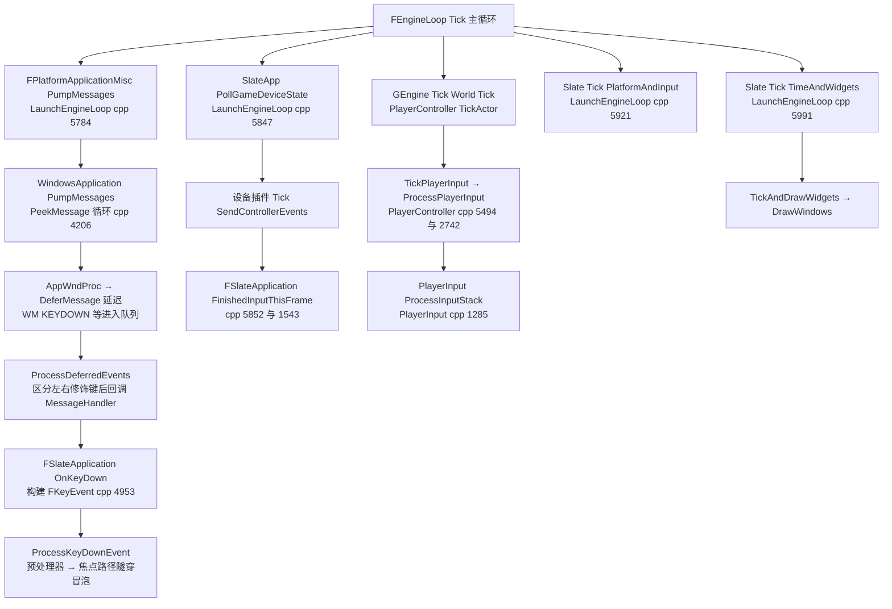

要点:
- OS 消息在 `FPlatformApplicationMisc::PumpMessages` 中进入 `FWindowsApplication::AppWndProc`(WindowsApplication.cpp:2209),输入类消息被 `DeferMessage` 延迟到 `ProcessDeferredEvents`(WM_KEYDOWN 分支:3248),再调用 `MessageHandler->OnKeyDown`;`MessageHandler` 即 `FSlateApplication`。
- 游戏手柄不走消息泵:`FSlateApplication::PollGameDeviceState`(cpp:1534)驱动 `PlatformApplication->PollGameDeviceState`,后者遍历 `ExternalInputDevices`(WindowsApplication.cpp:4276-4280)。
- 玩家输入分两拍:事件到达时 `UPlayerInput::InputKey` 只写 `KeyStateMap` 累加器(PlayerInput.cpp:264);真正派发在 `APlayerController::TickActor → TickPlayerInput → ProcessPlayerInput → UPlayerInput::ProcessInputStack`(PlayerController.cpp:5494、2742;PlayerInput.cpp:1285)。
- Slate 分两段 Tick:`PlatformAndInput`(TickPlatform:cpp:1689,含模态时补 PumpMessages)先于世界 Tick;`TimeAndWidgets`(TickTime:1676 + TickAndDrawWidgets:1746)与网络复制并发。

### 10.6.2 Slate Prepass/Paint 与渲染提交

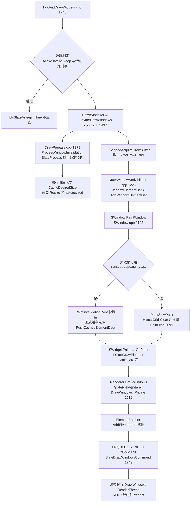

### 10.6.3 UMG 蓝图运行时构造

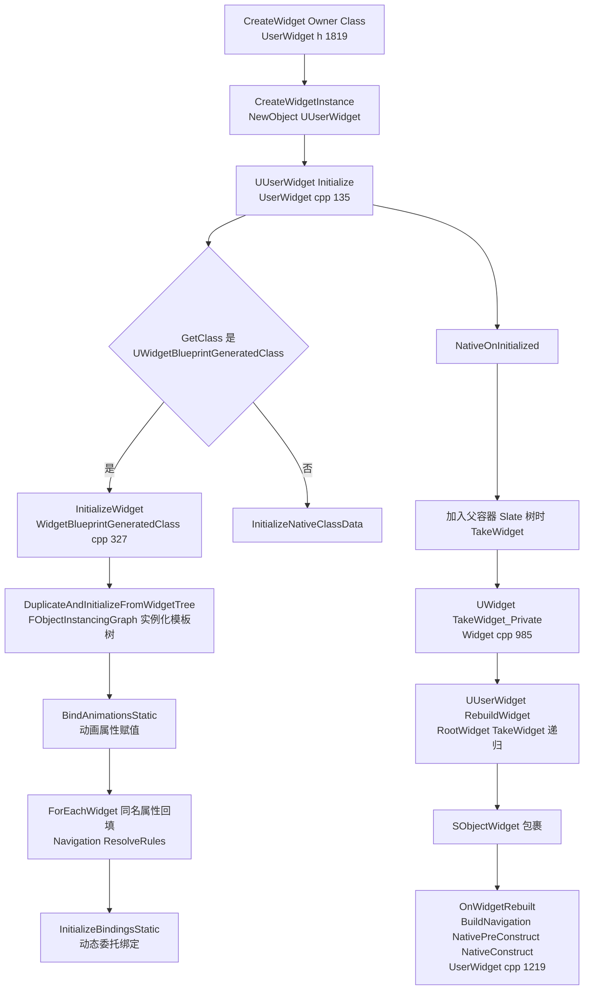

要点:蓝图编译(编辑器,UMGEditor 的 FWidgetBlueprintCompiler)产物是 `UWidgetBlueprintGeneratedClass` + 模板 `WidgetTree`;运行时构造严格"复制模板树 → 属性回填 → 惰性 TakeWidget"两阶段。Slate Widget 只有在进入可视树(或被显式 TakeWidget)时才创建;`ReleaseSlateResources` 在 GC/销毁时清空缓存可再次重建。

## 10.7 时序图

### 10.7.1 键盘输入全链路(OS → Slate → PlayerController → EnhancedInput)

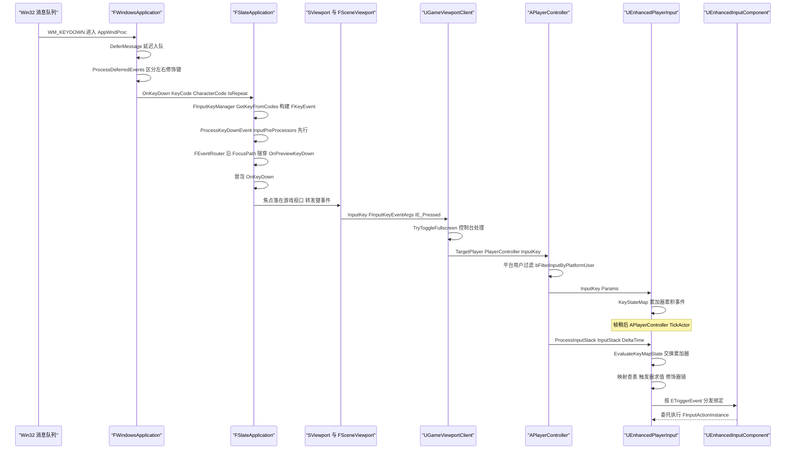

### 10.7.2 鼠标按下路由(命中路径与焦点)

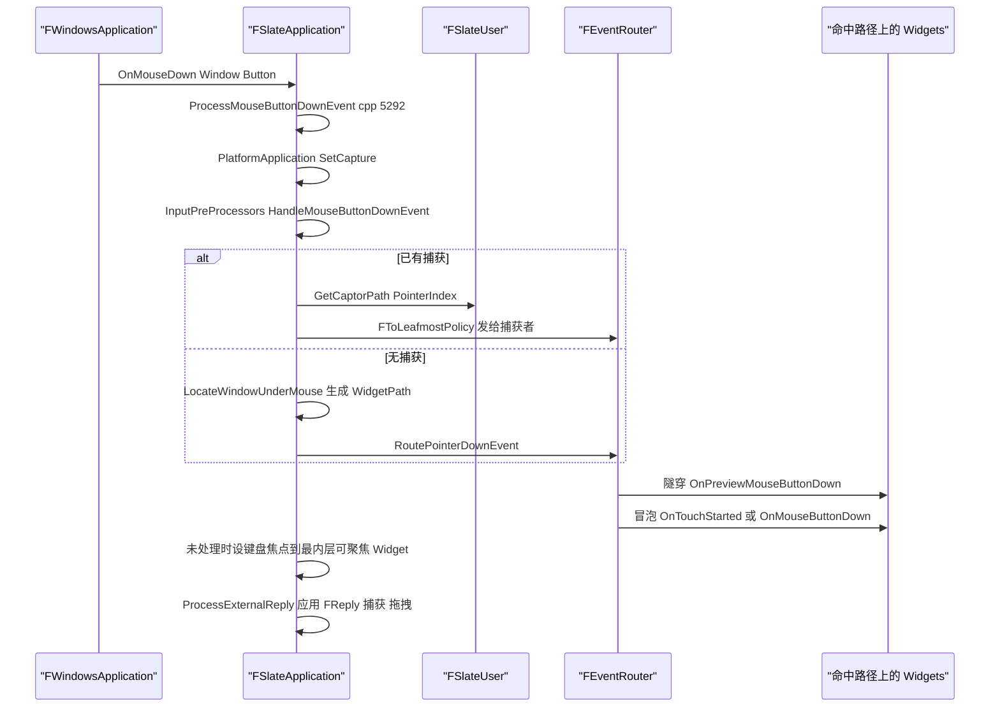

### 10.7.3 Slate 一帧的渲染提交(GameThread → RenderThread)

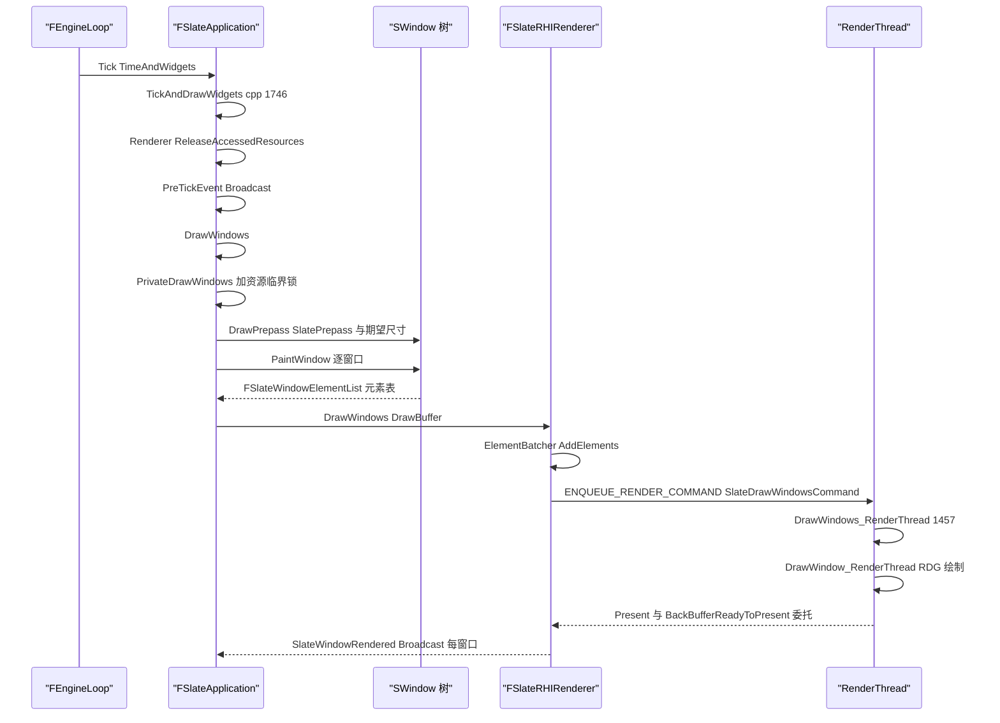

### 10.7.4 手柄轮询链路(设备插件)

```mermaid
sequenceDiagram
    participant EL as "FEngineLoop"
    participant SA as "FSlateApplication"
    participant PA as "FWindowsApplication"
    participant DV as "IInputDevice 插件"
    EL->>SA: PollGameDeviceState
    SA->>PA: PlatformApplication PollGameDeviceState
    PA->>PA: 首帧经 IModularFeatures 收集 IInputDeviceModule
    loop 每个 ExternalInputDevices
        PA->>DV: Tick TimeDelta
        PA->>DV: SendControllerEvents
        DV->>SA: OnControllerButtonPressed KeyName UserId DeviceId
        SA->>SA: ProcessKeyDownEvent 复用键盘链路
        DV->>SA: OnControllerAnalog 键轴
        SA->>SA: ProcessAnalogInputEvent
    end
    EL->>SA: FinishedInputThisFrame
    SA->>SA: InputPreProcessors Tick 与 FSlateUser FinishFrame
```

## 10.8 线程模型与同步

| 数据/流程 | 归属线程 | 同步手段与判定依据 |
|---|---|---|
| Slate Widget 树、FSlateApplication 状态 | GameThread(唯一例外:仅更新时间的 `ESlateTickType::Time` 可在电影/加载屏线程调用) | `FSlateApplication::Tick` 开头 `check(IsInGameThread() || TickType == ESlateTickType::Time)`(SlateApplication.cpp:1629);全模块宏 `SLATE_CROSS_THREAD_CHECK`(SlateGlobals.h:109)限定 GT 或 Slate 线程 |
| FSlateApplication::Tick 重入 | GT | `FScopeLock SlateTickCriticalSection`(cpp:1631)+ `TGuardValue bIsTicking` |
| 绘制元素追加 | GT/Slate 线程 | `FSlateDrawElement` 工厂有 `check(IsInGameThread() || IsInSlateThread())`(DrawElements.h:236/243) |
| 帧绘制缓冲 FSlateDrawBuffer | GT 专用 | `FSlateRenderer::AcquireDrawBuffer` 获取即上锁,`PrivateDrawWindows` 中 `ensureMsgf(IsLocked())`(cpp:1471),绘制结束经 `ENQUEUE_RENDER_COMMAND(SlateReleaseDrawBufferCommand)` 归还(SlateRHIRenderer.cpp:736) |
| 渲染器资源表(贴图/字体图集代理) | GT 与加载线程并发 | `PrivateDrawWindows` 持 `Renderer->GetResourceCriticalSection()` 的 `FScopeLock`(cpp:1449) |
| Slate 渲染命令 | GameThread 生成、RenderThread 执行 | `ENQUEUE_RENDER_COMMAND(SlateDrawWindowsCommand)`(SlateRHIRenderer.cpp:1749);`Sync()`/`FlushCommands()` 供 GT 等待 |
| 渲染线程延迟删除 | RT | `ENQUEUE_RENDER_COMMAND(SlateDeferredDelete)`(SlateRHIRenderer.cpp:2054) |
| 字体缓存 | 每线程一份(GT 一份、RT 一份) | `FSlateFontServices` 按 `ESlateTextureAtlasThreadId` 建立线程本地 `FSlateFontCache`(`GetFontCache` 返回当前线程缓存,SlateRenderer.h:424-438);光栅化结果写入线程专属图集 |
| KeyStateMap / UInputComponent / UPlayerInput | GameThread | `APlayerController::ProcessPlayerInput` 的 `check(IsInGameThread() ...)`(PlayerController.cpp:2751);`UPlayerInput::EvaluateKeyMapState` 同款 check(PlayerInput.cpp:1324) |
| IInputDevice Tick/SendControllerEvents | GT 或输入线程 | 5.8 新增 `EInputDeviceThreadAffinity`(IInputDevice.h:19):GameThreadOnly 为默认;GameInput 返回 InputThreadSafe(IGameInputDeviceInterface.h:38 注释),事件仍通过 `FGenericApplicationMessageHandler` 汇聚到 FSlateApplication |
| UMG UObject 世界 | GameThread | 所有 `TakeWidget/Initialize/ReleaseSlateResources` 均在 GT;`SetVisibility` 等通过 `GetValueOnGameThread` 的 CVar |
| 与网络复制并发 | GT 内分段 | `Tick(PlatformAndInput)` 与 `Tick(TimeAndWidgets)` 分两段(LaunchEngineLoop.cpp:5921/5991),中间可插 `FExecuteConcurrentWithSlateTickTask`(TaskGraph,ENamedThreads::GameThread 派发) |
| 加载屏专用 Slate 线程 | Slate 线程(movie thread) | `PrivateDrawWindows` 中 `if(!IsInSlateThread())` 才做窗口清理(cpp:1522);`FMoviePlayerProxy::SetIsSlateThreadAllowed` 控制(LaunchEngineLoop.cpp:5990-5992) |

## 10.9 配置与扩展点

**CVar(引擎内已注册,均可见源码):**
- `Slate.AllowSlateToSleep`(int32,SlateApplication.cpp:642)、`Slate.SleepBufferPostInput`(float,:648)、`Slate.ThrottleWhenMouseIsMoving`(int32,:630)、`Slate.UseFixedDeltaTime`(:131):Slate 空闲休眠/节流/固定步长。
- `tick.DoAsyncEndOfFrameTasks`(GameEngine.cpp:98):EndOfFrame 与 Slate Tick 并发任务。
- `t.SlowFrameLoggingThreshold`(GameEngine.cpp:91):慢帧日志阈值。

**ini/Settings:**
- `[/Script/Engine.InputSettings]`:`DefaultPlayerInputClass`、`DefaultInputComponentClass`(InputSettings.cpp:52/546-557;EnhancedInput 通过 `UInputSettings::SetDefaultPlayerInputClass` 注入 `UEnhancedPlayerInput`/`UEnhancedInputComponent`)。
- `UEnhancedInputDeveloperSettings`(config=Input,EnhancedInputDeveloperSettings.h:43):`DefaultMappingContexts`、`DefaultWorldSubsystemMappingContexts`、`bEnableWorldSubsystem`(:144)、`UserSettingsClass`。
- `URawInputSettings`(RawInputSettings.h,config):设备 VID/PID 过滤。
- `UGameInputDeveloperSettings`(GameInputDeveloperSettings.h)与 GameInput 插件开关(uplugin 默认 EnabledByDefault=false、Beta)。
- `USlateRHIRendererSettings`(SlateRHIRenderer/Public/SlateRHIRendererSettings.h)。

**委托/事件扩展点:**
- `FSlateApplication`:`PreTickEvent/PostTickEvent`(TickAndDrawWidgets 内广播,cpp:1758/1827)、`UnhandledKeyDownEventHandler`(焦点路径未处理时执行,SetUnhandledKeyDownEventHandler,.h:1507)、`FCoreDelegates::StarvedGameLoop`(模态消息泵饥饿回调,cpp:1710-1713)。
- `FSlateRenderer`:`FOnSlateWindowRendered`(每窗口渲染完成,GT)、`FOnBackBufferReadyToPresent`(RT,Present 前,TS 委托)。
- `FViewport::ViewportResizedEvent`(GameEngine.cpp:273 订阅)。
- 输入预处理:`RegisterInputPreProcessor`(SlateApplication.h:1544-1568),优先级桶 `EInputPreProcessorType`(.h:189-208:Overlay/PreEngine/Engine/PreEditor/Editor/PreGame/Game);CommonInput 的 `UCommonInputSubsystem`/预处理器即基于此。
- 设备插件:`IInputDeviceModule` 经 `IModularFeatures::GetModularFeatureImplementations`(WindowsApplication.cpp:4257)发现,`CreateInputDeviceIfPreferred` 建设备。

**模块接口/插件扩展:**
- 渲染器可替换:`ISlateRHIRendererModule::CreateSlateRHIRenderer` 与 `ISlateNullRendererModule::CreateSlateNullRenderer`(选择逻辑 LaunchEngineLoop.cpp:3341-3354,依据 `GUsingNullRHI`)。
- UMG:`UUserWidgetExtension`(MVVM 的 `UMVVMView` 即此扩展点);蓝图侧 `UWidgetBlueprintGeneratedClass::ForEachExtension`。
- MVVM 子系统:`UMVVMGameSubsystem`(GameInstance)/`UMVVMSubsystem`(Engine);绑定通过 FieldNotification 广播驱动。
- CommonUI:`UCommonUISubsystemBase`(GameInstanceSubsystem,CommonUISubsystemBase.h:21)、激活栈 `UCommonActivatableWidgetSwitcher`。

## 10.10 已知限制/未确认项

1. 未逐平台核对 Linux/Mac/SDL/Android 的 `GenericApplication` 派生实现,消息泵细节仅以 `FWindowsApplication` 为准(WindowsApplication.cpp)。
2. `FSlateShaper`/HarfBuzz 整形的内部算法(如连字、禁则处理)只读到接口层(FontCacheHarfBuzz.h 使用 `hb_buffer_t`),未逐行核对 HarfBuzz 参数;ICU BiDi 由 Core 的 `TextBiDi`(Text.h:1443)/ICUText.cpp 实现,属于 Core 模块,本章仅引用。
3. `UInputSettings` 中 EnhancedInput 替换默认类的具体 ini 写法未在引擎默认配置中找到(插件 Config/Input.ini 只注册了自动补全命令);实际替换通过项目/插件调用 `SetDefaultPlayerInputClass` 或 GameFeature Action,未在源码中确认唯一路径。
4. `FEnhancedInputWorldSubsystem`(实验性)与 `FEnhancedInputWorldProcessor` 的完整生命周期只在头文件与注册处(EnhancedInputSubsystems.cpp:188-197)确认,未展开其与 LocalPlayer 子系统的仲裁细节。
5. CommonUI/CommonInput 的激活栈与输入路由细节(`CommonActivatableWidget` 的激活队列)只覆盖类结构与关键入口,内部状态机未逐行核对。
6. `SlateBaseRenderer` 模块内容极少(4 头文件),本章将其归入渲染器公共层,未单列小节。
7. 5.8 的 `FViewport` 构造签名正在迁移(存在 `UE_DEPRECATED(5.8)` 的 `FViewport(FViewportClient*)`,UnrealClient.h:448-449),本章按新旧并存描述,未来版本可能变化。
8. 附录未包含 GameInputWindows 插件的独立文件(`GameInputWindows.md` 存在于 appendix/api/Plugins/),但 `GameInputBase.md` 已覆盖核心接口;引用时以两者为准。

## 10.11 附录索引

本章覆盖模块与对应附录文件(相对路径基于 `docs/ue5.8.3/appendix/api/`):

| Tier | 模块 | 附录文件 |
|---|---|---|
| Runtime | ApplicationCore | Runtime/ApplicationCore.md |
| Runtime | InputCore | Runtime/InputCore.md |
| Runtime | InputDevice | Runtime/InputDevice.md |
| Runtime | SlateCore | Runtime/SlateCore.md |
| Runtime | Slate | Runtime/Slate.md |
| Runtime | SlateBaseRenderer | Runtime/SlateBaseRenderer.md |
| Runtime | SlateRHIRenderer | Runtime/SlateRHIRenderer.md |
| Runtime | SlateNullRenderer | Runtime/SlateNullRenderer.md |
| Runtime | UMG | Runtime/UMG.md |
| Runtime | AppFramework | Runtime/AppFramework.md |
| Runtime | AdvancedWidgets | Runtime/AdvancedWidgets.md |
| Runtime | WidgetCarousel | Runtime/WidgetCarousel.md |
| Runtime | FieldNotification | Runtime/FieldNotification.md |
| Runtime | Engine(本章子集:PlayerInput/PlayerController/Viewport) | Runtime/Engine.part01.md ~ Engine.part06.md |
| Plugins | EnhancedInput | Plugins/EnhancedInput.md |
| Plugins | RawInput | Plugins/RawInput.md |
| Plugins | GameInputBase | Plugins/GameInputBase.md |
| Plugins | GameInputWindows | Plugins/GameInputWindows.md |
| Plugins | ModelViewViewModel | Plugins/ModelViewViewModel.md |
| Plugins | CommonUI / CommonInput | Plugins/CommonUI.md / Plugins/CommonInput.md |
| Plugins | XInputDevice(链路关联) | Plugins/XInputDevice.md |

模块依赖与符号统计总表见 `appendix/modules.json`。

