# 11 网络:NetDriver/复制/Iris/Sockets/预测

> 本章基于 UE 5.8.3 源码(`$UE/Engine`,下文路径均相对 `$E`)撰写。所有函数名/类名/行号均出自本章作者亲自阅读的源码文件。

## 11.1 职责、边界与模块清单

UE 的网络栈横跨 Runtime 核心、Engine、PacketHandlers、Online 与若干插件。模块清单如下(路径相对 `$E`;Build.cs 依赖只列网络相关项):

| 模块 | 路径 | Build.cs 依赖(Public/Private,仅网络相关) | 职责一句话 |
|---|---|---|---|
| NetCommon | Source/Runtime/Net/Common | P: Core | 网络公共类型:Socket 错误码(`Net/Common/Sockets/SocketErrors.h`)、PacketTraits(`Net/Common/Packets/PacketTraits.h`) |
| NetCore | Source/Runtime/Net/Core | P: Core, CoreUObject, TraceLog, NetCommon | 网络基础库:PushModel、PropertyConditions、NetToken、DDoS 检测、TrafficControl、LowLevelNetTrace(`Net/Core/Trace`)、FastArraySerializer(`Net/Core/Classes`) |
| IrisCore | Source/Runtime/Net/Iris | P: Core, CoreUObject, NetCore, TraceLog | Iris 复制系统核心:ReplicationSystem/Filtering/Prioritization/DeltaCompression/DataStream/NetRefHandle 等(198 头/约 7800 符号) |
| Iris(插件) | Plugins/Experimental/Iris/Source/Iris | 仅加载 IrisCore | Iris 插件壳:`FIrisModule::StartupModule` 只做 `LoadModule("IrisCore")`(IrisModule.cpp:8-11) |
| Engine(Net 部分) | Source/Runtime/Engine | P: NetCore, NetCommon, Sockets, PacketHandler, NetworkReplayStreaming;Private 引 NetCore/Private、Networking | UNetDriver/UNetConnection/UChannel 体系、FRepLayout/FObjectReplicator/UPackageMapClient/FNetGUIDCache、NetworkObjectList、Dormancy、NMT_* 控制消息、UDemoNetDriver、StatelessConnectHandlerComponent、Iris Engine 桥 |
| PacketHandler | Source/Runtime/PacketHandlers/PacketHandler | — | 分层包处理管线:`PacketHandler`/`HandlerComponent`/`FEncryptionComponent`(EncryptionComponent.h:13) |
| ReliabilityHandlerComponent | Source/Runtime/PacketHandlers/ReliabilityHandlerComponent | — | 可选的可靠包重排组件(Engine 默认不启用) |
| Sockets | Source/Runtime/Sockets | P(Private): Core, NetCommon | `ISocketSubsystem`/`FSocket`/`FInternetAddr` 抽象与平台分发 |
| Networking | Source/Runtime/Networking | P: Core, Sockets | 便捷组件:`FTcpListener`、`FUdpSocketReceiver`、`TcpSocketBuilder`、`UdpSocketBuilder`、`FUdpSocketSender` |
| OnlineSubsystemUtils(插件) | Plugins/Online/OnlineSubsystemUtils | — | **UIpNetDriver/UIpConnection 的实际宿主**(5.8 中已从 Engine 迁出)、OnlineBlueprint 库 |
| HTTP | Source/Runtime/Online/HTTP | —(平台条件引入 Curl/WinHttp/OpenSSL) | `IHttpRequest/FHttpManager/FHttpModule/HttpRetrySystem`,后台 Http 线程(Curl/EventLoop 双实现) |
| HTTPServer | Source/Runtime/Online/HTTPServer | — | 轻量 HTTP 服务端(MinimalHttpServerApi) |
| WebSockets | Source/Runtime/Online/WebSockets | — | `IWebSocket` 接口与实现(libwebsockets 封装) |
| WebSocketServer | Source/Runtime/Online/WebSocketServer | — | `IWebSocketServer` 接口 |
| SSL | Source/Runtime/Online/SSL | — | OpenSSL 封装:`FSslModule`、证书/密钥管理 |
| XMPP | Source/Runtime/Online/XMPP | — | XMPP 即时通信:连接/Presence/Chat/MUC/PubSub(strophe 封装) |
| Stomp | Source/Runtime/Online/Stomp | — | `IStompClient` STOMP 协议客户端 |
| ICMP | Source/Runtime/Online/ICMP | — | `FIcmp::IcmpEcho`、`FUDPPing::UDPEcho/UDPEchoMany` ping(Icmp.h:115/153) |
| BuildPatchServices | Source/Runtime/Online/BuildPatchServices | — | 补丁/安装器:manifest、chunk 下载、安装状态机(EBuildPatchState) |
| NetworkReplayStreaming | Source/Runtime/NetworkReplayStreaming(+LocalFile/InMemory/Http/SaveGame/Null 变体) | —(Engine P 依赖) | `INetworkReplayStreamer` 回放数据流抽象与各存储后端 |
| Messaging | Source/Runtime/Messaging | — | 消息总线:`IMessageBus/IMessageBridge/IMessageTransport` 等接口与实现 |
| MessagingCommon | Source/Runtime/MessagingCommon | — | `IMessageAttachment` 等公共类型 |
| MessagingRpc | Source/Runtime/MessagingRpc | — | 基于 Messaging 的 RPC 框架 |
| CoreOnline | Source/Runtime/CoreOnline | — | FOnlineSubsystem 相关基础类型(唯一 ID 等) |
| UdpMessaging(插件) | Plugins/Messaging/UdpMessaging | — | `FUdpMessageTransport`/`FUdpMessageProcessor`/Beacon/Tunnel,基于 UDP 多播/单播的消息传输 |
| TcpMessaging(插件) | Plugins/Messaging/TcpMessaging | — | `FTcpMessageTransport`(+`FTcpListener`)消息传输 |
| QuicMessaging(插件,实验) | Plugins/Experimental/QuicMessaging | — | QUIC 传输的消息扩展(`IQuicNetworkMessagingExtension`) |
| QuicMessagingTransport(同上) | Plugins/Experimental/QuicMessaging/Source/QuicMessagingTransport | — | MsQuic 封装:`FQuicEndpointManager` 等 |
| WebSocketNetworking(插件,实验) | Plugins/Experimental/WebSocketNetworking | — | `UWebSocketNetDriver`/`IWebSocketServer`,基于 WebSocket 的 NetDriver |
| WebSocketMessaging(插件,实验) | Plugins/Experimental/WebSocketMessaging | — | `IWebSocketMessagingModule`,浏览器/WS 消息桥 |
| NetworkServiceDiscovery(插件,实验) | Plugins/Experimental/NetworkServiceDiscovery | — | `INetworkServiceDiscovery`,UDP 多播服务发现 |
| NetworkPrediction(插件) | Plugins/Runtime/NetworkPrediction | — | 网络预测框架:`UNetworkPredictionWorldManager`/`UNetworkPredictionComponent`/ModelDef/Services |
| MultiServerReplication(插件) | Plugins/Runtime/MultiServerReplication | — | 跨服复制:`UMultiServerNode/UMultiServerProxy/MultiServerTransport/Beacon` |
| ReplicationGraph(插件) | Plugins/Runtime/ReplicationGraph | —(依赖 Engine) | `UReplicationGraph:UReplicationDriver` 节点图复制驱动(空间化/AlwaysRelevant/Dormancy 节点) |
| LowLevelNetTrace(插件,实验) | Plugins/Experimental/LowLevelNetTrace | — | LowLevelNetTrace 运行时开关模块(核心在 NetCore `Net/Core/Trace`) |
| MsQuicRuntime(插件) | Plugins/Runtime/MsQuic/Source | — | MsQuic 第三方库运行时模块加载(`FMsQuicRuntimeModule`) |

补充:CoreUObject 提供 `FNetBitWriter/FNetBitReader`(CoreUObject/Public/UObject/CoreNet.h:383/414)与 `FNetworkVersion` 所需版本基础设施;`FNetworkVersion` 位于 Core/Public/Misc/NetworkVersion.h。
## 11.2 总体架构

分层从下到上:平台 Socket → NetDriver/NetConnection(收发包、可靠传输)→ PacketHandler 管线(握手/加密/压缩)→ Channel(Bunch)→ 复制驱动(Generic RepLayout / ReplicationGraph / Iris)→ 游戏对象。RPC 与属性共用 ActorChannel;控制消息走 ControlChannel(NMT_*)。

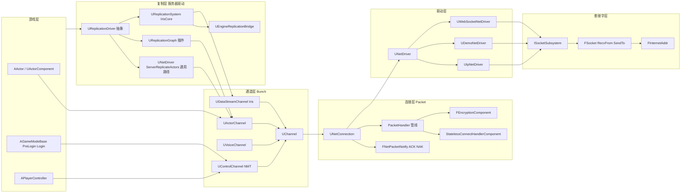

要点:
- `UNetDriver` 是抽象基类(NetDriver.h:809);5.8.3 中 `UIpNetDriver` 不在 Engine 而在 OnlineSubsystemUtils 插件(Engine/Config/BaseEngine.ini:343 `DriverClassName="/Script/OnlineSubsystemUtils.IpNetDriver"`)。
- 一帧内网络分两个世界事件阶段:`TickDispatch`(收)与 `TickFlush`(发+复制)(NetDriver.h:1742/1748),由 `RegisterTickEvents` 注册到 World(NetDriver.h:2188)。
- 复制层三选一:通用路径(`ServerReplicateActors` 内建 consider-list/priority)、ReplicationGraph 插件(`UReplicationGraph:UReplicationDriver`)、Iris(`UReplicationSystem`,通过 `UNetDriver::ReplicationSystem` NetDriver.h:2546 接入,此时 ReplicationDriver 不再使用)。

## 11.3 类图

### 11.3.1 NetDriver / NetConnection / Channel 家族

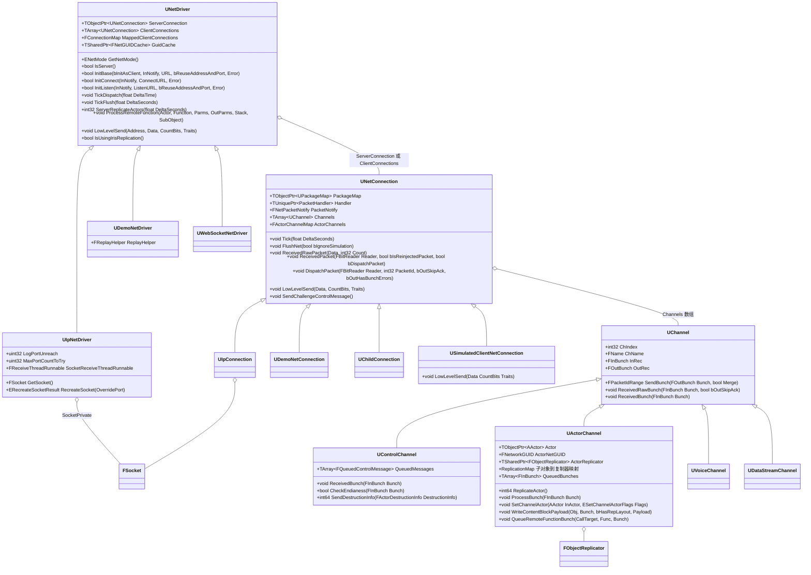
每类一行职责:
- `UNetDriver`(Classes/Engine/NetDriver.h:809):连接集合管理 + 收发 tick + 复制入口;`ServerConnection != nullptr` 即客户端。
- `UIpNetDriver`(OnlineSubsystemUtils/Classes/IpNetDriver.h:65):UDP socket 版驱动,含可选接收线程与 RecvMulti。
- `UDemoNetDriver`(Classes/Engine/DemoNetDriver.h:151):回放录制/回放驱动,复用整套通道/复制。
- `UWebSocketNetDriver`(WebSocketNetworking 插件):以 WebSocket 为承载的驱动。
- `UNetConnection`(Classes/Engine/NetConnection.h:284):单条连接:包序号/ACK/NAK、SendBuffer、超时、PacketHandler。
- `UIpConnection`:包经 socket 收发的连接实现(LowLevelSend 走 SendTo,IpConnection.cpp:422)。
- `UChannel`(Classes/Engine/Channel.h:62):bunch 收发/可靠重传/分片重组;`UControlChannel`(ControlChannel.h:43)承载 NMT_*;`UActorChannel`(Classes/Engine/ActorChannel.h:77)承载 Actor/子对象属性+RPC;`UVoiceChannel` 语音;`UDataStreamChannel`(Private/Net/Experimental/Iris/DataStreamChannel.h:21)承载 Iris 数据流;`UChildConnection` 分屏子连接。
- `USimulatedClientNetConnection`(NetConnection.h:2127):假连接,自动 ACK,压测用(`net.SimulateConnections`)。

### 11.3.2 复制核心(Generic 路径)

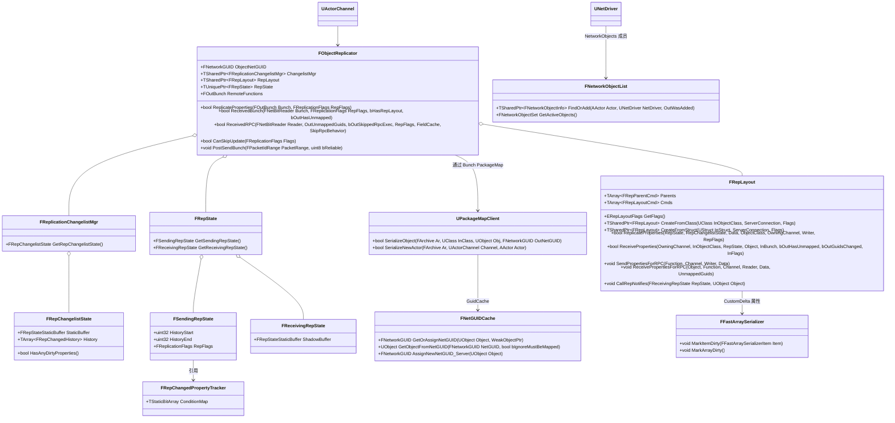

### 11.3.3 复制驱动与 Iris

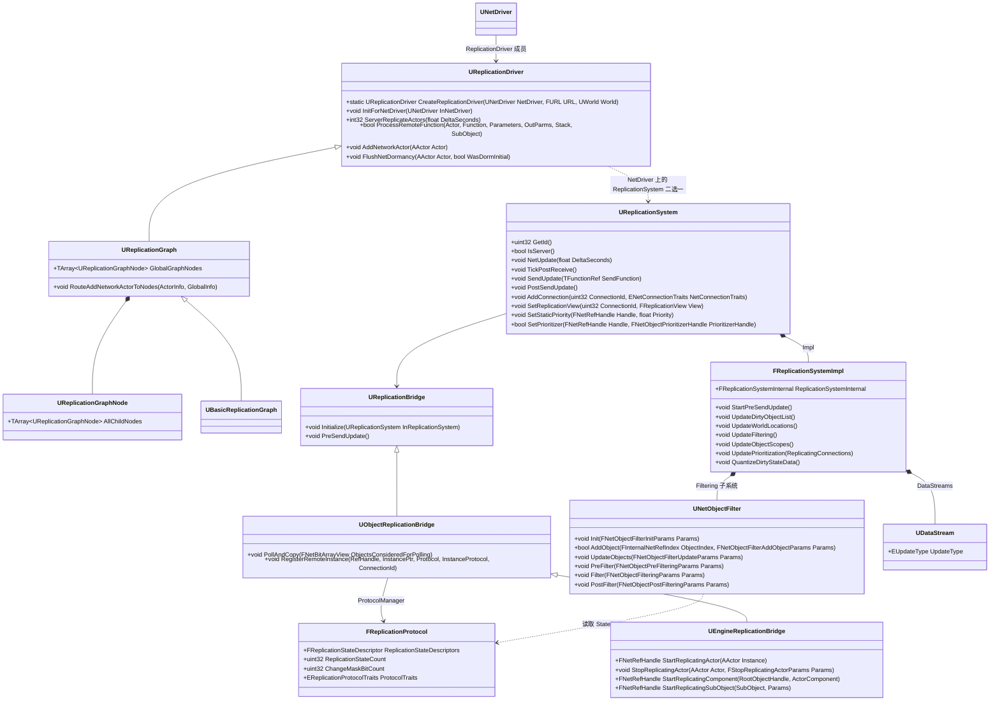
## 11.4 数据字典

### 11.4.1 包/Bunch 尺寸与头部常量(Classes/Engine/NetConnection.h:82-89)

| 常量 | 值 | 含义 |
|---|---|---|
| RELIABLE_BUFFER | 512 | 每 channel 未确认可靠 bunch 缓冲上限(2 的幂) |
| MAX_PACKETID | FNetPacketNotify::SequenceNumberT::SeqNumberCount | 包序号空间 |
| MAX_CHSEQUENCE | 1024 | bunch 序号空间(>RELIABLE_BUFFER) |
| MAX_BUNCH_HEADER_BITS | 256 | bunch 头最大位数 |
| MAX_PACKET_RELIABLE_SEQUENCE_HEADER_BITS | 32+16+SequenceHistoryT::MaxSizeInBits | 可靠包头(PackedHeader+HistorySequence+历史位图) |
| MAX_PACKET_INFO_HEADER_BITS | 1+10+1+8 | PacketInfo(JitterClockTime 10bit、ServerFrameTime 8bit) |
| MAX_PACKET_TRAILER_BITS | 1 | 包尾终止位(FlushNet 写入,NetConnection.cpp:2460) |
| GetMaxSingleBunchSizeBits() | MaxPacket*8-256-1-Header-MaxPacketHandlerBits | 单 bunch 上限(NetConnection.h:1361) |

### 11.4.2 FOutBunch / FInBunch(Public/Net/DataBunch.h:23/126)

| 字段 | 类型 | 含义 |
|---|---|---|
| ChIndex / ChName / ChSequence | int32/FName/int32 | 通道索引/类型名/可靠序号 |
| bOpen / bClose / bReliable | uint8:1 | 打开/关闭/可靠标志 |
| bPartial / bPartialInitial / bPartialFinal | uint8:1 | 分片 bunch 三态 |
| bHasPackageMapExports / bHasMustBeMappedGUIDs | uint8:1 | 是否携带 NetGUID 导出 / 前置必须映射 GUID |
| ExportNetGUIDs / NetFieldExports / NetTokensPendingExport | 数组 | 本 bunch 导出的 GUID/字段句柄/NetToken |
| CloseReason | EChannelCloseReason | 关闭原因(Destroyed/Dormancy/TearOff 等) |

### 11.4.3 连接与登录状态(NetConnection.h:94-163)

| 枚举 | 值 | 含义 |
|---|---|---|
| EConnectionState | USOCK_Invalid/Closed/Pending/Open/Closing | 连接状态;Closing 表示等待可靠数据 ACK 后关闭 |
| EClientLoginState(服务端视角) | Invalid/LoggingIn/Welcomed/ReceivedJoin/CleanedUp | NMT 握手推进状态;NMT_Join 处理完置 ReceivedJoin(World.cpp:7608) |
| EResendAllDataState | None/SinceOpen/SinceCheckpoint | 回放重发全部数据模式 |

### 11.4.4 NMT_* 控制通道消息全表(Public/Net/DataChannel.h:173-248,DEFINE_CONTROL_CHANNEL_MESSAGE)

| 消息 | Index | 参数 | 方向/用途 |
|---|---|---|---|
| NMT_Hello | 0 | uint8 LittleEndian, uint32 NetVersion, FString EncryptionToken, EEngineNetworkRuntimeFeatures | C→S 初始连接(UPendingNetGame::SendInitialJoin,PendingNetGame.cpp:169) |
| NMT_Welcome | 1 | FString Map, FString GameName, FString RedirectURL | S→C 准入通过,通知加载地图(UWorld::WelcomePlayer,World.cpp:7186) |
| NMT_Upgrade | 2 | uint32, EEngineNetworkRuntimeFeatures | S→C 版本不兼容 |
| NMT_Challenge | 3 | FString | S→C 挑战串(UNetConnection::SendChallengeControlMessage,NetConnection.h:1656) |
| NMT_Netspeed | 4 | int32 | C→S 上报网速,服务端 Clamp 到 [1800, MaxClientRate](World.cpp:7471) |
| NMT_Login | 5 | FString ClientResponse, FString URL, FUniqueNetIdRepl, FString PlatformName | C→S 登录请求,触发 PreLoginAsync |
| NMT_Failure | 6 | FString | 双向失败 |
| NMT_Join | 9 | (无参) | C→S 最终加入,服务端 SpawnPlayActor(World.cpp:7590) |
| NMT_JoinSplit | 10 | FString, FUniqueNetIdRepl | 分屏子玩家加入 |
| NMT_Skip / NMT_Abort | 12/13 | FGuid | 客户端跳过/放弃下载包 |
| NMT_PCSwap | 15 | int32 | C→S PlayerController 交换完成 |
| NMT_ActorChannelFailure | 16 | int32 | C→S Actor 通道打开失败(DataChannel.cpp:3337) |
| NMT_DebugText | 17 | FString | 调试文本 |
| NMT_NetGUIDAssign | 18 | FNetworkGUID, FString | S→C 显式分配 NetGUID |
| NMT_SecurityViolation | 19 | FString | S→C 安全违规断开 |
| NMT_GameSpecific | 20 | uint8, FString | 自定义消息路由到 UGameInstance |
| NMT_EncryptionAck | 21 | (无参) | 加密握手完成 |
| NMT_DestructionInfo | 22 | (无参) | 通道外销毁信息 |
| NMT_CloseReason | 23 | FString | 关闭原因(UNetConnection::SendCloseReason,NetConnection.h:1957) |
| NMT_NetPing | 24 | ENetPingControlMessage, FString | RTT 探测(EPingType 含 ICMP/UDP,World.cpp:7192-7195) |
| NMT_BeaconWelcome/BeaconJoin/BeaconAssignGUID/BeaconNetGUIDAck | 25-28 | — | Beacon 握手四步(DataChannel.h:195-216 注释流程) |
| NMT_IrisProtocolMismatch | 29 | uint64 | Iris 协议哈希不匹配 |
| NMT_IrisNetRefHandleError | 30 | ENetRefHandleError, uint64, TArray~uint64~ | NetRefHandle 错误诊断 |
| NMT_JoinNoPawn / NMT_JoinNoPawnSplit | 31/32 | — | 服务器间无 Pawn 连接(需 net.EnableSupportForNoPawnConnection) |
| NMT_CloseChildConnection | 34 | int32 | 关闭单个分屏子连接 |
| NMT_IrisNetRefHandleErrorWithDiagnosticMessage | 35 | …+FString | 带诊断文本 |
| NMT_IrisProtocolMismatchWithCDOState | 36 | uint64, TArray~uint8~ | 带 CDO 状态比对 |
| (未定义) | 7/8/11/14/33 | — | 5.8.3 头文件未使用的 Index(历史遗留空位) |

### 11.4.5 RPC 标志(EFunctionFlags,CoreUObject/Public/UObject/Script.h:132-168)

| 标志 | 值 | 含义 |
|---|---|---|
| FUNC_Net | 0x40 | 网络函数 |
| FUNC_NetReliable | 0x80 | 可靠 RPC |
| FUNC_NetRequest/NetResponse | 0x100/0x1000 | 网络服务请求/响应 |
| FUNC_NetMulticast | 0x4000 | 多播(S→所有 C) |
| FUNC_NetServer | 0x2000000 | 服务端 RPC(Server.h) |
| FUNC_NetClient | 0x1000000 | 客户端 RPC(Client.h) |
| FUNC_NetValidate | 0x80000000 | 需 _Validate 实现 |

### 11.4.6 休眠与相关性

| 项 | 值/字段 | 位置 |
|---|---|---|
| ENetDormancy | DORM_Never/DORM_Awake/DORM_DormantAll/DORM_DormantPartial/DORM_Initial | Classes/Engine/EngineTypes.h:3600-3610 |
| UChannel 状态位 | Dormant/bPendingDormancy/bIsInDormancyHysteresis/bTornOff/bPausedUntilReliableACK | Channel.h:73-81 |
| FNetworkObjectInfo | NextUpdateTime/OptimalNetUpdateDelta/DormantConnections/RecentlyDormantConnections/bPendingNetUpdate/ForceRelevantFrame | Classes/Engine/NetworkObjectList.h:34-109 |
| UNetDriver.RelevantTimeout | 默认 5s,失去相关性后通道保留时间 | NetDriver.h:928 |
| FActorPriority | Priority/ActorInfo/Channel/DestructionInfo(按 GetRelevantTime 与距离计权) | NetDriver.h:711-726;DataChannel.cpp:5152-5156 |

### 11.4.7 Iris 关键结构

| 结构/字段 | 含义 | 位置 |
|---|---|---|
| FNetRefHandle | 对象复制句柄(含唯一 serial 字段,见 ReplicationSystem.h:195-199 注释) | IrisCore Public/Iris/ReplicationSystem/NetRefHandle.h |
| UReplicationSystem::FReplicationSystemParams | MaxReplicatedObjectCount=65536、InitialNetObjectListCount=65536、NetObjectListGrowCount=16384、PreAllocatedMemoryBuffersObjectCount=65536、MaxDeltaCompressedObjectCount=2048、MaxNetObjectGroupCount=2048、bIsServer、bAllowObjectReplication、bAllowParallelTasks | Public/Iris/ReplicationSystem/ReplicationSystem.h:89-211 |
| FReplicationProtocol | ReplicationStateDescriptors/ReplicationStateCount/ChangeMaskBitCount/ProtocolTraits(HasDynamicState、HasLifetimeConditionals、HasConnectionSpecificSerialization、SupportsDeltaCompression、HasFullPushBasedDirtiness 等) | IrisCore Private/Iris/ReplicationSystem/ReplicationProtocol.h:56-138 |
| FReplicationInstanceProtocol | FragmentData(Fragments+ExternalSrcBuffer)+InstanceTraits | 同上:41-54 |
| UNetObjectFilter 生命周期 | Init→AddConnection/AddObject→UpdateObjects→PreFilter→Filter→PostFilter | Public/Iris/ReplicationSystem/Filtering/NetObjectFilter.h:190-238 |
| ENetFilterStatus | Allow/Disallow | 同上:43-48 |
| ENetFilterTraits | Spatial/NeedsUpdate | 同上:119-122 |
| FReplicationSystemInternal | 持有 NetRefHandleManager/DirtyNetObjectTracker/ReplicationStateStorage/FReplicationFiltering/FReplicationPrioritization/FNetBlobManager/FWorldLocations/FDeltaCompressionBaselineManager/ReplicationProtocolManager | Private/.../ReplicationSystemInternal.h:211-235 |

### 11.4.8 网络版本与握手

| 项 | 值 | 位置 |
|---|---|---|
| FNetworkVersion::GetLocalNetworkVersion() | 计算本地网络版本,可被 GetLocalNetworkVersionOverride 覆盖 | Core/Public/Misc/NetworkVersion.h:81 |
| FNetworkVersion::IsNetworkCompatible(Local, Remote) | 兼容判定 | 同上:92 |
| EHandshakeVersion | Original=0…NetCLUpgradeMessage=4(Latest) | Engine/Public/PacketHandlers/StatelessConnectHandlerComponent.h:29-41 |
| EHandshakePacketType | InitialPacket/Challenge/Response/Ack/RestartHandshake/RestartResponse/VersionUpgrade | 同上:50-61 |
| SECRET_COUNT / COOKIE_BYTE_SIZE | 2 / 20(两把轮换 HMAC 密钥、20 字节 cookie) | 同上:20-21 |

### 11.4.9 NetFieldExport / NetGUID 导出(PackageMapClient.h:43-117)

| 字段 | 类型 | 含义 |
|---|---|---|
| FNetFieldExport.Handle | uint32 | 连接内字段导出句柄(WriteFieldHeaderAndPayload 写入) |
| FNetFieldExport.CompatibleChecksum | uint32 | 向后兼容校验和 |
| FNetFieldExport.ExportName | FName | 首次导出的字段名(供对端反查) |
| FNetFieldExportGroup.PathName / NetFieldExports | FString / TArray~FNetFieldExport~ | 按类路径分组的字段导出表(UActorChannel::GetOrCreateNetFieldExportGroupForClassNetCache,ActorChannel.h:259) |

## 11.5 接口清单

以下原型逐字抄自头文件(去掉 `*_API` 宏)。线程约束:除特别标注外,NetDriver/NetConnection/Channel/复制接口均在游戏线程调用(证据:NetDriver.cpp:8151 `checkf(IsInGameThread(), ...)`;UNetConnection::Tick 由 TickFlush 在游戏线程驱动)。

### 11.5.1 UNetDriver(Classes/Engine/NetDriver.h)

| 原型 | 功能 | 位置 |
|---|---|---|
| `virtual bool InitBase(bool bInitAsClient, FNetworkNotify* InNotify, const FURL& URL, bool bReuseAddressAndPort, FString& Error)` | 服务端/客户端公共初始化 | NetDriver.h:1582 |
| `virtual bool InitConnect(class FNetworkNotify* InNotify, const FURL& ConnectURL, FString& Error)` | 客户端连接初始化(PURE_VIRTUAL) | NetDriver.h:1593 |
| `virtual bool InitListen(class FNetworkNotify* InNotify, FURL& ListenURL, bool bReuseAddressAndPort, FString& Error)` | 服务端监听初始化(PURE_VIRTUAL) | NetDriver.h:1605 |
| `virtual void TickDispatch( float DeltaTime )` | 收包阶段(读 socket→分派到连接) | NetDriver.h:1742 |
| `virtual void TickFlush(float DeltaSeconds)` | 发送+复制阶段 | NetDriver.h:1748 |
| `virtual int32 ServerReplicateActors(float DeltaSeconds)` | 服务器复制主入口 | NetDriver.h:1660 |
| `virtual void ProcessRemoteFunction(class AActor* Actor, class UFunction* Function, void* Parms, struct FOutParmRec* OutParms, struct FFrame* Stack, class UObject* SubObject = nullptr )` | RPC 发送入口 | NetDriver.h:1672 |
| `virtual void LowLevelSend(TSharedPtr<const FInternetAddr> Address, void* Data, int32 CountBits, FOutPacketTraits& Traits)` | 无连接发包(连接握手用) | NetDriver.h:1762 |
| `ENGINE_API void ProcessRemoteFunctionForChannel(UActorChannel* Ch, const class FClassNetCache* ClassCache, const FFieldNetCache* FieldCache, UObject* TargetObj, UNetConnection* Connection, UFunction* Function, void* Parms, FOutParmRec* OutParms, FFrame* Stack, const bool IsServer, const ERemoteFunctionSendPolicy SendPolicy = ERemoteFunctionSendPolicy::Default)` | 在已定位通道上发送 RPC(ERemoteFunctionSendPolicy: Default/ForceSend/ForceQueue,不可靠多播默认排队) | NetDriver.h:1696-1707 |
| `void FlushActorDormancy(AActor *Actor, bool bWasDormInitial=false)` | 冲刷休眠 | NetDriver.h:1817 |
| `void NotifyActorDormancyChange(AActor* Actor, ENetDormancy OldDormancyState)` | 休眠状态变化通知 | NetDriver.h:1822 |
| `TSharedPtr< FRepLayout > GetObjectClassRepLayout( UClass * InClass )` | 获取/创建类 RepLayout | NetDriver.h:1430 |
| `ENGINE_API TSharedPtr<FRepLayout> GetFunctionRepLayout( UFunction * Function )` | 获取/创建 RPC 参数 RepLayout | NetDriver.h:1433 |
| `bool IsUsingIrisReplication() const` | 是否启用 Iris | NetDriver.h:2014 |
| `UReplicationSystem* GetReplicationSystem()` | Iris 系统访问 | NetDriver.h:2038 |

### 11.5.2 UNetConnection(Classes/Engine/NetConnection.h)

| 原型 | 功能 | 位置 |
|---|---|---|
| `virtual void Tick(float DeltaSeconds)` | 连接 tick(超时/统计/通道 tick/FlushNet) | NetConnection.h:1082;实现在 NetConnection.cpp:4781 |
| `virtual void FlushNet(bool bIgnoreSimulation = false)` | 把 SendBuffer 打包发送 | NetConnection.h:1079;NetConnection.cpp:2412 |
| `virtual void ReceivedRawPacket(void* Data,int32 Count)` | 原始包入口(PacketHandler Incoming 之后) | NetConnection.h:1354;NetConnection.cpp:2130 |
| `virtual void ReceivedPacket( FBitReader& Reader, bool bIsReinjectedPacket=false, bool bDispatchPacket=true )` | 解析包头/ACK,乱序缓存 | NetConnection.h:1378;NetConnection.cpp:3247 |
| `virtual void DispatchPacket( FBitReader& Reader, int32 PacketId, bool& bOutSkipAck, bool& bOutHasBunchErrors )` | 包拆 bunch→通道 | NetConnection.h:1385;NetConnection.cpp:3609 |
| `virtual void LowLevelSend(void* Data, int32 CountBits, FOutPacketTraits& Traits)` | 底层发送(PURE_VIRTUAL) | NetConnection.h:1063 |
| `void Close(FNetResult&& CloseReason)` | 关闭连接(发送 close 通知) | NetConnection.h:1173 |
| `virtual void GracefulClose(FNetResult&& CloseReason)` | 优雅关闭(等可靠数据 ACK,受 net.EnableGracefulClose) | NetConnection.h:1182 |
| `ENGINE_API void SendChallengeControlMessage()` | 发 NMT_Challenge | NetConnection.h:1656 |
| `ENGINE_API bool HandleReceiveNetUpgrade(uint32 RemoteNetworkVersion, EEngineNetworkRuntimeFeatures RemoteNetworkFeatures, UE::Net::ENetUpgradeSource NetUpgradeSource=UE::Net::ENetUpgradeSource::ControlChannel)` | 处理 NMT_Upgrade | NetConnection.h:1985 |
| `int32 WriteBitsToSendBuffer(const uint8* Bits, const int32 SizeInBits, const uint8* ExtraBits = NULL, const int32 ExtraSizeInBits = 0, EWriteBitsDataType DataType = EWriteBitsDataType::Unknown)` | 写发送缓冲 | NetConnection.h:1322 |
| `UChannel* CreateChannelByName( const FName& ChName, EChannelCreateFlags CreateFlags, int32 ChannelIndex=INDEX_NONE )` | 按名称创建通道 | NetConnection.h:1371 |
| `ENGINE_API void EnableEncryption(const FEncryptionData& EncryptionData)` / `SendClientEncryptionAck()` | 加密握手 | NetConnection.h:1268/1283 |

### 11.5.3 UChannel / UActorChannel(Channel.h / ActorChannel.h)

| 原型 | 功能 | 位置 |
|---|---|---|
| `ENGINE_API virtual FPacketIdRange SendBunch(FOutBunch* Bunch, bool Merge)` | 发送 bunch(合并/分片/可靠排队);实现在 DataChannel.cpp:1249 | Channel.h:159 |
| `ENGINE_API void ReceivedRawBunch( FInBunch & Bunch, bool & bOutSkipAck )` | 乱序处理→ReceivedSequencedBunch | Channel.h:146 |
| `ENGINE_API virtual void ReceivedBunch( FInBunch& Bunch )` | bunch 处理(纯虚) | Channel.h:118 |
| `ENGINE_API virtual int64 Close(EChannelCloseReason Reason)` | 关闭通道 | Channel.h:112 |
| `ENGINE_API int64 ReplicateActor()` | **Actor 复制主流程**(见 11.6.2) | ActorChannel.h:190;DataChannel.cpp:3602 |
| `ENGINE_API void ProcessBunch( FInBunch & Bunch )` | 客户端处理通道 bunch | ActorChannel.h:174;DataChannel.cpp:3541/3273 |
| `ENGINE_API void SetChannelActor(AActor* InActor, ESetChannelActorFlags Flags)` | 绑定/解绑 Actor | ActorChannel.h:200 |
| `ENGINE_API int32 WriteContentBlockPayload( UObject* Obj, FNetBitWriter &Bunch, const bool bHasRepLayout, FNetBitWriter& Payload )` | 写内容块(NetGUID+字段数据) | ActorChannel.h:241 |
| `ENGINE_API UObject* ReadContentBlockPayload( FInBunch &Bunch, FNetBitReader& OutPayload, bool& bOutHasRepLayout )` | 读内容块 | ActorChannel.h:247 |
| `ENGINE_API int32 WriteFieldHeaderAndPayload( FNetBitWriter& Bunch, const FClassNetCache* ClassCache, const FFieldNetCache* FieldCache, FNetFieldExportGroup* NetFieldExportGroup, FNetBitWriter& Payload, bool bIgnoreInternalAck=false )` | 写字段头(FieldNetIndex+位数+载荷) | ActorChannel.h:250 |
| `ENGINE_API bool ReadFieldHeaderAndPayload( UObject* Object, const FClassNetCache* ClassCache, FNetFieldExportGroup* NetFieldExportGroup, FNetBitReader& Bunch, const FFieldNetCache** OutField, FNetBitReader& OutPayload ) const` | 读字段头 | ActorChannel.h:253 |
| `ENGINE_API void QueueRemoteFunctionBunch( UObject* CallTarget, UFunction* Func, FOutBunch &Bunch )` | 排队不可靠多播 RPC | ActorChannel.h:219 |
| `ENGINE_API bool KeyNeedsToReplicate(int32 ObjID, int32 RepKey)` | 子对象 RepKey 判脏 | ActorChannel.h:371 |

### 11.5.4 复制核心(Public/Net/DataReplication.h、Public/Net/RepLayout.h)

| 原型 | 功能 | 位置 |
|---|---|---|
| `void InitWithObject(UObject* InObject, UNetConnection* InConnection, bool bUseDefaultState = true)` | 复制器绑定对象/连接,建 ShadowBuffer | DataReplication.h:136;DataReplication.cpp:520 |
| `bool ReplicateProperties(FOutBunch& Bunch, FReplicationFlags RepFlags)` | 复制属性到 bunch | DataReplication.h:167;DataReplication.cpp:1919/1927 |
| `bool ReceivedBunch(FNetBitReader& Bunch, const FReplicationFlags& RepFlags, const bool bHasRepLayout, bool& bOutHasUnmapped)` | 客户端接收属性 | DataReplication.h:173;DataReplication.cpp:984 |
| `bool ReceivedRPC(FNetBitReader& Reader, TSet<FNetworkGUID>& OutUnmappedGuids, bool& bOutSkippedRpcExec, const FReplicationFlags& RepFlags, const FFieldNetCache* FieldCache, ESkipRpcBehavior SkipRpcBehavior)` | 接收并执行 RPC | DataReplication.h:190;DataReplication.cpp:1323 |
| `bool CanSkipUpdate(FReplicationFlags Flags)` | PushModel 空更新跳过判定 | DataReplication.h:288;DataReplication.cpp:1827 |
| `void PostSendBunch(FPacketIdRange& PacketRange, uint8 bReliable)` | 发送后记录 changelist 历史 | DataReplication.h:171;DataReplication.cpp:2144 |
| `static void CallProcessEventForReceivedRPC(UObject* Object, UFunction* Function, uint8* Params)` | 执行收到的 RPC(Object->ProcessEvent) | DataReplication.cpp:1479 |
| `static TSharedPtr<FRepLayout> CreateFromClass(UClass* InObjectClass, const UNetConnection* ServerConnection = nullptr, const ECreateRepLayoutFlags Flags = ECreateRepLayoutFlags::None)` | 从类构建 RepLayout | RepLayout.h:1189 |
| `static TSharedPtr<FRepLayout> CreateFromStruct(UStruct * InStruct, ...)` / `static TSharedPtr<FRepLayout> CreateFromFunction(UFunction* InFunction, ...)` | 从结构/函数构建 | RepLayout.h:1192/1195 |
| `bool ReplicateProperties(FSendingRepState* RESTRICT RepState, FRepChangelistState* RESTRICT RepChangelistState, const FConstRepObjectDataBuffer Data, UClass* ObjectClass, UActorChannel* OwningChannel, FNetBitWriter& Writer, const FReplicationFlags& RepFlags) const` | changelist→发送位流 | RepLayout.h:1260;RepLayout.cpp:1972 |
| `bool ReceiveProperties(UActorChannel* OwningChannel, UClass* InObjectClass, FReceivingRepState* RESTRICT RepState, UObject* Object, FNetBitReader& InBunch, bool& bOutHasUnmapped, bool& bOutGuidsChanged, const EReceivePropertiesFlags InFlags) const` | 位流→属性+RepNotify 队列 | RepLayout.h:1283;RepLayout.cpp:3789 |
| `void SendPropertiesForRPC(UFunction* Function, UActorChannel* Channel, FNetBitWriter& Writer, const FConstRepObjectDataBuffer Data) const` | RPC 参数序列化 | RepLayout.h:1403 |
| `void ReceivePropertiesForRPC(UObject* Object, UFunction* Function, UActorChannel* Channel, FNetBitReader& Reader, FRepObjectDataBuffer Data, TSet<FNetworkGUID>& UnmappedGuids) const` | RPC 参数反序列化 | RepLayout.h:1410 |
| `bool DiffProperties(TArray<FProperty*>* RepNotifies, TRepDataBuffer<DstType> Destination, TConstRepDataBuffer<SrcType> Source, const EDiffPropertiesFlags Flags) const`(模板) | 全量属性比较(影子状态维护) | RepLayout.h:1371-1376;RepLayout.cpp:5142 |
| `void UpdateUnmappedObjects(FReceivingRepState* RESTRICT RepState, UPackageMap* PackageMap, UObject* Object, struct FNetDeltaSerializeInfo& Params, bool& bCalledPreNetReceive, bool& bOutSomeObjectsWereMapped, bool& bOutHasMoreUnmapped) const` | 未映射 GUID 重映射 | RepLayout.h:1337 |
| `void CallRepNotifies(FReceivingRepState* RepState, UObject* Object) const` | 触发 RepNotify | RepLayout.h:1353;RepLayout.cpp:4661 |

### 11.5.5 UPackageMapClient / FNetGUIDCache(Classes/Engine/PackageMapClient.h)

| 原型 | 功能 | 位置 |
|---|---|---|
| `virtual bool SerializeObject( FArchive& Ar, UClass* InClass, UObject*& Obj, FNetworkGUID *OutNetGUID = NULL )` | UObject 引用序列化(NetGUID/路径) | PackageMapClient.h:483 |
| `virtual bool SerializeNewActor( FArchive& Ar, class UActorChannel *Channel, class AActor*& Actor)` | 新 Actor 序列化(类/位置/GUID 分配) | PackageMapClient.h:484 |
| `FNetworkGUID GetOrAssignNetGUID( UObject* Object, const TWeakObjectPtr<UObject>* WeakObjectPtr=nullptr )` | 取/分配 NetGUID | PackageMapClient.h:225 |
| `UObject * GetObjectFromNetGUID( const FNetworkGUID& NetGUID, const bool bIgnoreMustBeMapped )` | GUID→对象(客户端可触发异步加载) | PackageMapClient.h:235 |
| `virtual FNetworkGUID AssignNewNetGUID_Server( UObject* Object )` / `AssignNewNetGUIDFromPath_Server(...)` | 服务端分配 GUID | PackageMapClient.h:228/229 |
| `void RegisterNetGUIDFromPath_Client( const FNetworkGUID& NetGUID, const FString& PathName, const FNetworkGUID& OuterGUID, const uint32 NetworkChecksum, const bool bNoLoad, const bool bIgnoreWhenMissing )` / `RegisterNetGUID_Server( const FNetworkGUID& NetGUID, UObject* Object )` | 注册静态/动态 GUID 映射 | PackageMapClient.h:233/231 |
| `FNetGuidCacheObject` 字段:Object/OuterGUID/PathName/NetworkChecksum/bNoLoad/bIsPending/bIsBroken | GUID 缓存条目 | PackageMapClient.h:120-141 |

### 11.5.6 UReplicationDriver(Classes/Engine/ReplicationDriver.h)

| 原型 | 功能 | 位置 |
|---|---|---|
| `static UReplicationDriver* CreateReplicationDriver(UNetDriver* NetDriver, const FURL& URL, UWorld* World)` | 驱动工厂(优先 FCreateReplicationDriver 委托) | ReplicationDriver.h:57 |
| `static FCreateReplicationDriver& CreateReplicationDriverDelegate()` | 静态创建委托 | ReplicationDriver.h:60 |
| `virtual void InitForNetDriver(UNetDriver* InNetDriver)` | 绑定 NetDriver | ReplicationDriver.h:68 |
| `virtual int32 ServerReplicateActors(float DeltaSeconds)` | 每服务器 tick 的复制 | ReplicationDriver.h:107 |
| `virtual bool ProcessRemoteFunction(class AActor* Actor, UFunction* Function, void* Parameters, FOutParmRec* OutParms, FFrame* Stack, UObject* SubObject )` | 驱动处理 RPC(默认 false) | ReplicationDriver.h:104 |
| `virtual void AddClientConnection(UNetConnection* NetConnection)` / `RemoveClientConnection` | 连接增删 | ReplicationDriver.h:77/79 |
| `virtual void FlushNetDormancy(AActor* Actor, bool WasDormInitial)` / `NotifyActorDormancyChange` | 休眠联动 | ReplicationDriver.h:87/93 |
| `virtual void NotifyActorTearOff(AActor* Actor)` | TearOff | ReplicationDriver.h:89 |

### 11.5.7 Iris(Public/Iris/.../*.h)

| 原型 | 功能 | 线程/时机 | 位置 |
|---|---|---|---|
| `void NetUpdate(float DeltaSeconds)` | Iris 帧更新主入口(TickFlush 调用,管线见 11.6.4) | 游戏线程 | ReplicationSystem.h:238;ReplicationSystem.cpp:1035 |
| `void TickPostReceive()` | TickDispatch 后第二发送窗口(OOB 附件) | 游戏线程 | ReplicationSystem.h:244;ReplicationSystem.cpp:1144 |
| `void SendUpdate(TFunctionRef<void(TArrayView<uint32>)> SendFunction)` | 按当前 SendPass 计算需发送的连接集 | 游戏线程 | ReplicationSystem.h:258;ReplicationSystem.cpp:1158 |
| `void PostSendUpdate()` | 复位临时状态 | 游戏线程 | ReplicationSystem.h:263 |
| `void AddConnection(uint32 ConnectionId, UE::Net::ENetConnectionTraits NetConnectionTraits = {})` | 注册连接(创建 DataStream 等) | 游戏线程 | ReplicationSystem.h:270 |
| `void SetReplicationView(uint32 ConnectionId, const UE::Net::FReplicationView& View)` | 设置连接视点(供 prioritizer) | 游戏线程 | ReplicationSystem.h:324 |
| `bool SetPrioritizer(FNetRefHandle Handle, UE::Net::FNetObjectPrioritizerHandle PrioritizerHandle)` | 绑定优先级器 | 游戏线程 | ReplicationSystem.h:346 |
| `UDataStream* GetDataStream(uint32 ConnectionId, FName Name)` | 取数据流(Store/ReplicationDataStream 等) | 游戏线程 | ReplicationSystem.h:374 |
| `void PreReceiveUpdate()` / `void PostReceiveUpdate()` | 收包阶段前后回调(桥转发) | 游戏线程 | ReplicationSystem.h:247/250 |
| `virtual void Initialize(UReplicationSystem* InReplicationSystem)`(UReplicationBridge) | 桥初始化 | 游戏线程 | ReplicationBridge.h:169 |
| `void PollAndCopy(const UE::Net::FNetBitArrayView ObjectsConsideredForPolling)`(UObjectReplicationBridge) | 采集并复制源状态到内部状态(可并行任务) | 游戏线程发起,任务线程执行 | ObjectReplicationBridge.cpp:2233 |
| `FNetRefHandle StartReplicatingActor(AActor* Instance)`(UEngineReplicationBridge) | 开始复制 Actor(建 NetRefHandle+协议) | 游戏线程 | EngineReplicationBridge.h:107 |
| `void StopReplicatingActor(AActor* Actor, const FStopReplicatingActorParams& Params)` | 停止复制 | 游戏线程 | EngineReplicationBridge.h:110 |
| `virtual bool AddObject(UE::Net::FInternalNetRefIndex ObjectIndex, FNetObjectFilterAddObjectParams&)`(UNetObjectFilter,纯虚) | 过滤器登记对象 | 游戏线程(Filter 阶段) | NetObjectFilter.h:208 |
| `virtual void Filter(FNetObjectFilteringParams&)`(UNetObjectFilter) | 按 connection 批量过滤(设置 OutAllowedObjects 位) | 游戏线程(UpdateFiltering 内) | NetObjectFilter.h:223 |
| `bool ShouldUseIrisReplication()`(命名空间函数) | 是否启用 Iris(CVar net.Iris.UseIrisReplication) | 任意线程读 CVar | IrisConfig.h:14;IrisConfig.cpp:23 |

### 11.5.8 PacketHandler 与握手组件

| 原型 | 功能 | 位置 |
|---|---|---|
| `void Initialize(UE::Handler::Mode Mode, uint32 InMaxPacketBits, bool bConnectionlessOnly=false, TSharedPtr<class IAnalyticsProvider> InProvider=nullptr, FDDoSDetection* InDDoS=nullptr, FName InDriverProfile=NAME_None)` | 初始化组件管线(读 ini `[PacketHandlerComponents]`) | PacketHandlers/PacketHandler/Public/PacketHandler.h:275 |
| `TSharedPtr<HandlerComponent> AddHandler(const FString& ComponentStr, bool bDeferInitialize=false)` | 按名字加载组件 | PacketHandler.h:331 |
| `void IncomingHigh(FBitReader& Reader)` / `void OutgoingHigh(FBitWriter& Writer)` | 高层进出钩子 | PacketHandler.h:350/361 |
| `EIncomingResult Incoming(FReceivedPacketView& PacketView)` | 包进入管线(连接/连接无关) | PacketHandler.h:382 |
| `const ProcessedPacket Outgoing(uint8* Packet, int32 CountBits, FOutPacketTraits& Traits)` | 包发出管线 | PacketHandler.h:398 |
| `virtual void Incoming(FIncomingPacketRef PacketRef)` / `virtual void Outgoing(FBitWriter& Packet, FOutPacketTraits& Traits)`(HandlerComponent) | 组件级收/发改写(加密/压缩) | PacketHandler.h:801/815 |
| `virtual void IncomingConnectionless(FIncomingPacketRef PacketRef)` / `virtual void OutgoingConnectionless(const TSharedPtr<const FInternetAddr>& Address, FBitWriter& Packet, FOutPacketTraits& Traits)` | 无连接握手包处理 | PacketHandler.h:824/835 |
| `virtual void Initialize() = 0`(HandlerComponent) | 组件初始化 | PacketHandler.h:865 |
| `void InitFromConnectionless(StatelessConnectHandlerComponent* InConnectionlessHandler)` | 把无连接握手协商结果带入正式连接组件 | StatelessConnectHandlerComponent.h:161 |
| `virtual void EnableEncryption()` / `virtual void SetEncryptionData(const FEncryptionData& EncryptionData)` = 0(FEncryptionComponent 接口) | 加密组件接口(实际实现由平台/游戏注册) | PacketHandler/Public/EncryptionComponent.h:24/51 |

注:任务书提到的 "DTLS" 在 5.8.3 引擎源码中不存在名为 DTLSHandlerComponent 的类(全源码 grep 仅命中 ThirdParty/OpenSSL 头文件);实际的传输加密接口是 `FEncryptionComponent`,而 `StatelessConnectHandlerComponent` 的注释明确写明其握手 "Partially based on the Datagram Transport Layer Security protocol"(StatelessConnectHandlerComponent.h:116),即 cookie 挑战机制源自 DTLS 思想。

### 11.5.9 Sockets / Networking / ICMP

| 原型 | 功能 | 位置 |
|---|---|---|
| `virtual FSocket* CreateSocket(const FName& SocketType, const FString& SocketDescription, bool bForceUDP = false)` | 创建 socket(SOCKTYPE_*) | Sockets/Public/SocketSubsystem.h:98(重载 114/128) |
| `virtual TSharedRef<FInternetAddr> CreateInternetAddr()` | 创建地址对象 | SocketSubsystem.h:330 |
| `virtual TUniquePtr<FRecvMulti> CreateRecvMulti(int32 MaxNumPackets, int32 MaxPacketSize, ...)` | 批量接收上下文(配合 net.UseRecvMulti) | SocketSubsystem.h:349 |
| `SOCKETSUBSYSTEM_API virtual TArray<TSharedRef<FInternetAddr>> GetLocalBindAddresses()` | 本机可绑定地址集合 | SocketSubsystem.h:409 |
| `SOCKET_SUBSYSTEM_API int32 BindNextPort(FSocket* Socket, FInternetAddr& Addr, int32 PortCount, int32 PortIncrement)` | 从 Port 起尝试绑定 PortCount 个端口 | SocketSubsystem.h:421 |
| `SOCKETS_API virtual bool SendTo(const uint8* Data, int32 Count, int32& BytesSent, const FInternetAddr& Destination)` | UDP 发送 | Sockets/Public/Sockets.h:181 |
| `SOCKETS_API virtual bool RecvFrom(uint8* Data, int32 BufferSize, int32& BytesRead, FInternetAddr& Source, ESocketReceiveFlags::Type Flags = ESocketReceiveFlags::None)` | UDP 接收 | Sockets.h:206 |
| `virtual bool SetNonBlocking(bool bIsNonBlocking = true) = 0` / `SetBroadcast` / `JoinMulticastGroup` | socket 选项 | Sockets.h:271/279/298 |
| `virtual uint32 Run() override`(FTcpListener) | 监听线程(Accept→OnConnectionAccepted 委托) | Networking/Public/Common/TcpListener.h:152 |
| `virtual bool Stop() override`(FUdpSocketReceiver : FRunnable) | 停止接收线程(FRunnableThread::Create,TPri_AboveNormal) | Networking/Public/Common/UdpSocketReceiver.h:88/129 |
| `static ICMP_API void IcmpEcho(const FString& TargetAddress, float Timeout, FIcmpEchoResultCallback HandleResult)` | ICMP ping(异步线程,回调游戏线程) | Online/ICMP/Public/Icmp.h:133 |
| `static ICMP_API void UDPEchoMany(const TArray<FIcmpTarget>& Targets, float Timeout, FIcmpEchoManyCompleteCallback CompletionCallback)` | 批量 UDP ping | Icmp.h:205 |

平台实现说明:`ISocketSubsystem` 的具体实现位于 Core 平台层(`Source/Runtime/Core/Private/Windows/SocketSubsystemWindows.cpp`、`.../Unix/SocketSubsystemUnix.cpp` 等),Sockets 模块通过 `FSocketSubsystemModule` 按平台注册分发;Windows 实现 `SocketSubsystemWindows.cpp:251` 处保留 SE_UDP_ERR_PORT_UNREACH(UDP ICMP 端口不可达)错误映射。SteamSockets 插件(Plugins/Runtime/Steam/SteamSockets)提供另一套 FSocket/ISocketSubsystem 实现。 

### 11.5.10 HTTP / WebSockets / Stomp / SSL / XMPP(Online)

| 原型 | 功能 | 位置 |
|---|---|---|
| `static FHttpModule& Get()` | 模块单例 | Online/HTTP/Public/HttpModule.h:55 |
| `virtual TSharedRef<IHttpRequest, ESPMode::ThreadSafe> CreateRequest()` | 创建请求(平台实现 Curl/WinHttp) | HttpModule.h:71 |
| `virtual void StartThread()` / `virtual void StopThread()`(FHttpThreadBase) | HTTP 后台线程启停 | Online/HTTP/Private/HttpThread.h:49/55 |
| `virtual void AddRequest(FHttpRequestCommon* Request)` / `virtual void GetCompletedRequests(TArray<FHttpRequestCommon*>& OutCompletedRequests)` | 请求进/出 HTTP 线程(SPSC 队列) | HttpThread.h:69/84 |
| `virtual void Tick() override`(FSingleThreadRunnable) | 无独立线程时手动泵 | HttpThread.h:91 |
| `virtual void Connect() = 0` / `virtual void Send(const FString& Data) = 0`(IWebSocket) | WebSocket 连接/发送(委托 OnConnected/OnMessage 等) | Online/WebSockets/Public/IWebSocket.h:16/34/56/78 |
| `virtual void Send(const FString& Destination, const FString& Body, const FStompHeader& Header=FStompHeader(), const FStompRequestCompleted& CompletionCallback = FStompRequestCompleted())` = 0(IStompClient) | STOMP 发送 | Online/Stomp/Public/IStompClient.h:65 |
| `FXmppModule`(`Online/XMPP/Public/XmppModule.h:28`) | XMPP 单例;`FXmppConnection`/`FXmppPresence`/`FXmppChat`/`FXmppMultiUserChat`/`FXmppPubSub` 分域 | XmppConnection.h:51/98 等 |

### 11.5.11 Messaging / 回放 / 预测

| 原型 | 功能 | 位置 |
|---|---|---|
| `virtual void Publish(void* Message, UScriptStruct* TypeInfo, EMessageScope Scope, const TMap<FName, FString>& Annotations, const FTimespan& Delay, const FDateTime& Expiration, const TSharedRef<IMessageSender, ESPMode::ThreadSafe>& Publisher) = 0`(IMessageBus) | 消息发布 | Source/Runtime/Messaging/Public/IMessageBus.h:171 |
| `virtual bool TransportMessage(const TSharedRef<IMessageContext, ESPMode::ThreadSafe>& Context, const TArray<FGuid>& Recipients) = 0`(IMessageTransport) | 传输层投递(Udp/Tcp/Quic/WS 实现) | Messaging/Public/IMessageTransport.h:54 |
| `virtual void StartStreaming(const FStartStreamingParameters& Params, const FStartStreamingCallback& Delegate) = 0`(INetworkReplayStreamer) | 开始回放流(录制/回放) | NetworkReplayStreaming/Public/NetworkReplayStreaming.h:521 |
| `UE_API ENetworkPredictionTickingPolicy PreferredDefaultTickingPolicy() const`(UNetworkPredictionWorldManager) | 预测 tick 策略 | NetworkPrediction/Public/NetworkPredictionWorldManager.h:89 |
| `void OnWorldPreTick(UWorld* InWorld, ELevelTick InLevelTick, float InDeltaSeconds)` / `void ReconcileSimulationsPostNetworkUpdate()` / `void BeginNewSimulationFrame(UWorld* InWorld, ELevelTick InLevelTick, float InDeltaSeconds)`(private) | NP 世界管理器三大阶段钩子 | NetworkPredictionWorldManager.h:106-108 |

### 11.5.12 FNetBitReader / FNetBitWriter(CoreUObject/Public/UObject/CoreNet.h)

| 原型 | 功能 | 位置 |
|---|---|---|
| `FNetBitWriter(UPackageMap* InPackageMap, int64 InMaxBits)` | 带包映射的位写入器(FName/UObject* 走网络序列化) | CoreNet.h:386 |
| `FNetBitReader(UPackageMap* InPackageMap=nullptr, const uint8* Src=nullptr, int64 CountBits=0)` | 带包映射位读取器(ExtendedError) | CoreNet.h:424 |
| `virtual FArchive& operator<<(UObject*& Object) override`(两者) | 对象引用经 UPackageMap 序列化 | CoreNet.h:397/436 |

## 11.6 关键流程

### 11.6.1 一帧内的网络双阶段(World Tick → NetDriver)

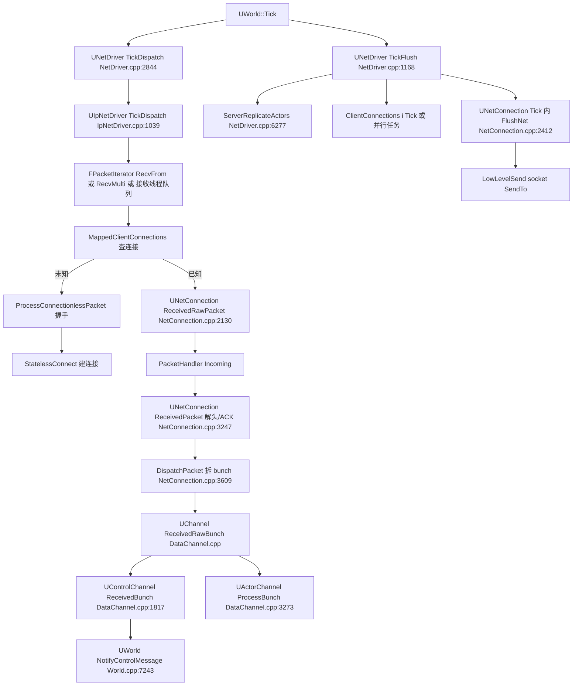

### 11.6.2 UActorChannel::ReplicateActor 主流程(DataChannel.cpp:3602-3983)

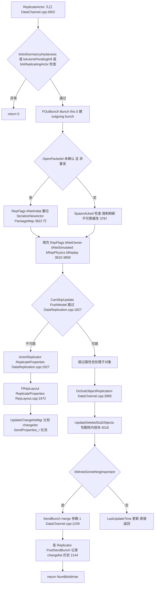

细节(行号均在 DataChannel.cpp 除非注明):
- 重入保护:`bIsReplicatingActor` 置位(FGuardValue_Bitfield,3774);违反即 ensure 失败(3643-3649)。
- 首次复制:`Connection->PackageMap->SerializeNewActor`(3822)写入类/GUID/位置;`bNetTemporary` Actor 直接 bClose+bReliable(3805-3806)。
- 属性:Actor 本体 `ActorReplicator->ReplicateProperties(Bunch, RepFlags)`(3882);子对象走 `ReplicateRegisteredSubObjects`(注册列表,3989-4002)或 `Actor->ReplicateSubobjects`(旧路径,4007)。
- 排队 RPC:不可靠多播在 `ReplicateProperties_r` 内追加 `RemoteFunctions` 位流(DataReplication.cpp:2094-2111)。
- 发送:有内容才 `SendBunch(&Bunch, 1)`(3921),随后每个 replicator `PostSendBunch(PacketRange, Bunch.bReliable)`(3925-3928)登记 NAK 重发范围。

### 11.6.3 连接建立握手(状态级)

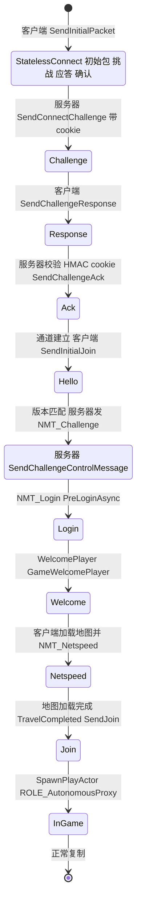

要点(行号):
- 无连接握手在 `UIpNetDriver::ProcessConnectionlessPacket`(IpNetDriver.h:118)→ `StatelessConnectHandlerComponent::IncomingConnectionless` 中完成;客户端组件 `InitFromConnectionless` 把协商出的序号/密钥注入正式连接组件(StatelessConnectHandlerComponent.h:161)。
- `UPendingNetGame::SendInitialJoin` 发 NMT_Hello(PendingNetGame.cpp:127-182);服务器在 `UWorld::NotifyControlMessage` case NMT_Hello 校验 `FNetworkVersion::IsNetworkCompatible`(World.cpp:7373-7408)。
- NMT_Login → `AGameModeBase::PreLoginAsync`(World.cpp:7556)→ `UWorld::WelcomePlayer`(7151)发 NMT_Welcome(7186)。
- 客户端 NMT_Welcome 后立即回 NMT_Netspeed(PendingNetGame.cpp:396),随后 TickWorldTravel 加载地图,完成后 `TravelCompleted→SendJoin`(PendingNetGame.cpp:224-229)。
- NMT_Join → `UWorld::SpawnPlayActor` 生成 PlayerController(World.cpp:7590),`SetClientLoginState(EClientLoginState::ReceivedJoin)`(7608)。

### 11.6.4 Iris NetUpdate 管线(ReplicationSystem.cpp:1035-1142)

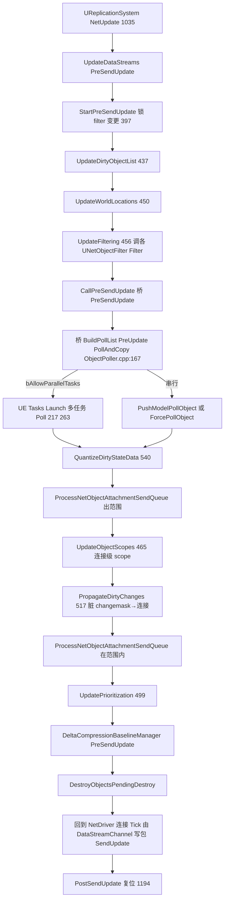

### 11.6.5 RPC 发送(客户端→服务器为例)

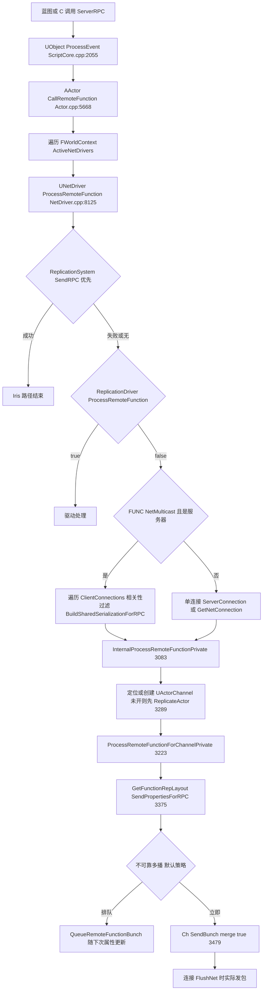

### 11.6.6 RPC 接收与执行

接收链:DispatchPacket(NetConnection.cpp:3609)→ 按 ChIndex 找 UChannel → `UChannel::ReceivedRawBunch`(DataChannel.cpp)→ `UActorChannel::ReceivedBunch`(3270 附近)→ `ProcessBunch`(3541)→ 循环 `ReadContentBlockPayload`(3412/5112)→ `ReadFieldHeaderAndPayload`(5199)→ `FObjectReplicator::ReceivedRPC`(DataReplication.cpp:1323):

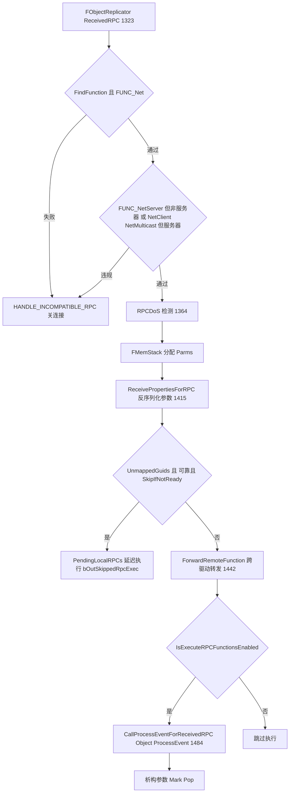

## 11.7 时序图

### 11.7.1 连接建立(Challenge/Login/Join/Welcome 全流程)

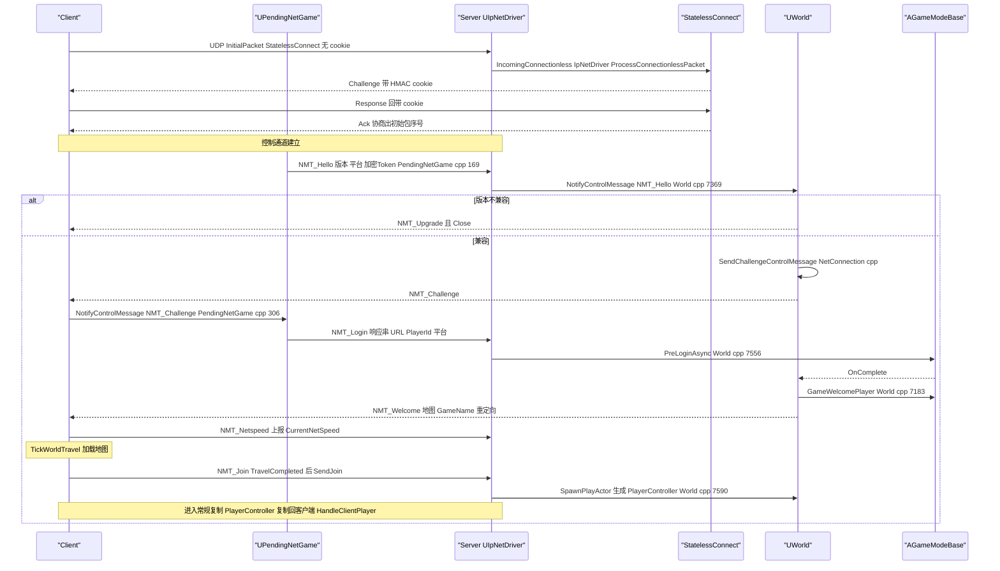

### 11.7.2 服务器属性复制(通用路径)

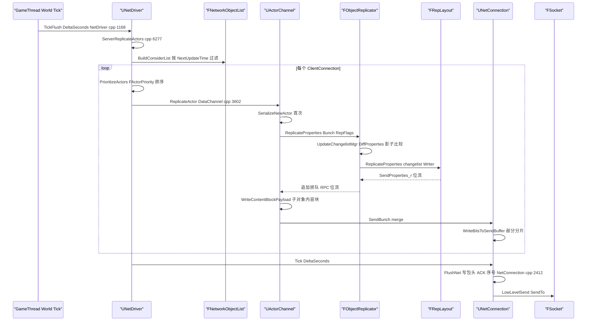

### 11.7.3 客户端接收与 Actor 生成/RPC 执行

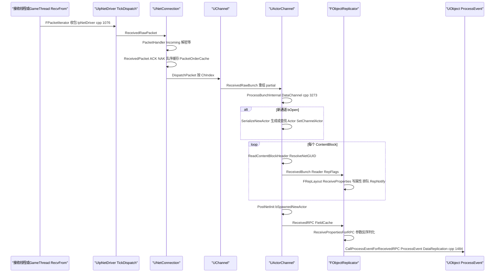

### 11.7.4 Iris 服务器帧数据流(含并行)

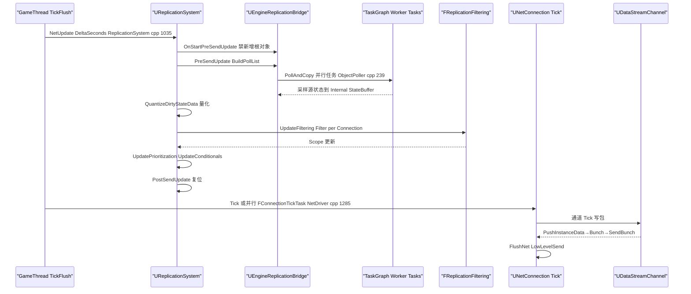
## 11.8 线程模型与同步

| 执行者 | 线程 | 证据与说明 |
|---|---|---|
| UNetDriver::TickDispatch / TickFlush / PostTickDispatch / PostTickFlush | 游戏线程 | 由 `RegisterTickEvents`(NetDriver.h:2188)注册到 World 的 TickDispatch/TickFlush 委托;`ProcessRemoteFunctionForChannelPrivate` 前 `checkf(IsInGameThread(),...)`(NetDriver.cpp:8151) |
| UIpNetDriver 包接收 | 默认游戏线程;可选专用接收线程 | CVar `net.IpNetDriverUseReceiveThread`(IpNetDriver.cpp:58);线程为 `FReceiveThreadRunnable`(IpNetDriver.h:358),`TCircularQueue<FReceivedPacket> ReceiveQueue`(380)生产者=接收线程、消费者=游戏线程 TickDispatch;`TAtomic<bool> bIsRunning`(383);命令/事件用两条 `TSpscQueue`(403/406)。接收线程上 `StatelessConnectHandlerComponent` 可直接完成握手并 `FStatelessHandshakeFailureInfo` 传回游戏线程(StatelessConnectHandlerComponent.h:85-109 注释) |
| RecvMulti 批量接收 | 游戏线程 | CVar `net.UseRecvMulti`(IpNetDriver.cpp:73)+ `FRecvMulti RecvMultiState`(IpNetDriver.h:425);`ISocketSubsystem::CreateRecvMulti`(SocketSubsystem.h:349) |
| UActorChannel::ReplicateActor / FObjectReplicator | 游戏线程 | ServerReplicateActors 内串行(NetDriver.cpp:6384 起 for 循环);AutoRTFM 下可包进事务(`UE::RemoteExecutor::ExecuteTransactional`,NetDriver.cpp:6307-6329) |
| Iris PollAndCopy | TaskGraph 工作线程(并行) | `FObjectPoller::PollAndCopyObjects`:`ReplicationSystemInternal->AreParallelTasksAllowed() && ...` 时 `UE::Tasks::Launch`×NumPollingTasks + `UE::Tasks::Wait`(ObjectPoller.cpp:217-263);并行相位由 `StartParallelPhase/StopParallelPhase` 保护(ReplicationSystemInternal.h:157-171) |
| Iris UNetConnection::Tick(并行) | TaskGraph 工作线程 | TickFlush 中 `bCanRunClientTickInParallel`(NetDriver.cpp:1261-1298),条件:IsServer+`bIsUsingParallelNetTick`+ReplicationSystem+`ReplicationSystemConfigServer.bAllowParallelTasks`+连接数≥MinConnectionsForParallelTick(默认 2);每个连接 `UE::Tasks::Launch(FConnectionTickTask)`,随后 `UE::Tasks::Wait` |
| 并行 Iris 的锁 | — | `UE_SUPPORT_PARALLEL_IRIS`(IrisConfig.h:57,服务端 Target 默认开)编译入 `FTransactionallySafeRWLock NetDriverStatsMutex`(NetDriver.h:1221)、`GetSharedNetTickMutex()`(NetConnection.h:675,FTransactionallySafeCriticalSection)、`TickReplicationStatsMutex`(ReplicationSystemInternal.h:240);Tick 内 `UE_IRIS_PARALLEL_EXPR(UE::TScopeLock ScopeLock(GetSharedNetTickMutex()))`(NetConnection.cpp:4789)并在 tick 支持并行的 channel 时 `TScopeUnlock`(4981) |
| PacketHandler(Outgoing) | 与调用者同线程;并行连接 tick 下要求组件线程安全 | `StatelessConnectHandlerComponent::SupportsParallelConnectionOutgoing()`(StatelessConnectHandlerComponent.h:176) |
| FUdpSocketReceiver / FTcpListener | 各自 FRunnableThread | UdpSocketReceiver.h:88(FRunnableThread::Create,TPri_AboveNormal);TcpListener.h:152 Run 循环 |
| HTTP | 专用 HTTP 线程 | `FHttpThreadBase : FRunnable`(HttpThread.h:41);请求/完成经线程安全集合 `AddRequest/GetCompletedRequests`;实现 `FCurlHttpThread`(CurlHttpThread.h:29)与 `FEventLoopHttpThread`(EventLoopHttpThread.h:9);无多线程平台 `NeedsSingleThreadTick()` 手动泵 |
| ICMP ping | 临时线程 | Icmp.h:121 注释 "resolution and ping send/receive will happen on a separate thread",回调游戏线程 |
| Messaging(Udp/Tcp/Quic) | 消息总线线程 + 传输线程 | `FUdpMessageTransport` 内含 socket 收发线程;`FTcpMessageTransport` 持 `FTcpListener`(TcpMessageTransport.h:107);Quic 用 MsQuic 回调线程(`FQuicEndpointManager`)。`IMessageBridge` 在总线线程上反序列化并分发 |
| BuildPatchServices | 后台线程组 | Installer/DownloadService 等在独立线程,通过 `FBuildPatchServicesSingleton` 与游戏线程交换状态(`BuildPatchProgress`/`BuildPatchState`) |

跨线程数据所有权总结:
- 接收线程→游戏线程:`ReceiveQueue`(包字节+地址+错误+时间戳,IpNetDriver.h:336-355)。
- 游戏线程→接收线程:`CommandQueue`(如 SetSocket);接收线程→游戏线程:`OwnerEventQueue`。
- HTTP 线程↔游戏线程:`FHttpThreadBase` 的请求入队/完成出队(HttpThread.h:69-84)。
- TaskGraph↔游戏线程:Iris PollAndCopy 的任务数据 `FReplicationPollTaskData`(每任务独立统计,Wait 后合并 PollStats,ObjectPoller.cpp:260-269)。

### 11.8.1 专用服务器(DS)与客户端(Client)差异要点

| 维度 | 服务器 | 客户端 | 依据 |
|---|---|---|---|
| 驱动形态 | `ClientConnections[]` 多连接,`ServerConnection==nullptr` | 单 `ServerConnection` | NetDriver.h:964-970;`UNetDriver::IsServer()` |
| TickFlush 主体 | `ServerReplicateActors`(或 Iris `NetUpdate`) | `ServerConnection->Tick` + Iris `UpdateIrisReplicationViews/NetUpdate` | NetDriver.cpp:1186-1258 |
| 并行连接 tick | 支持(需 Iris + bAllowParallelTasks) | 不支持(`bCanRunClientTickInParallel` 要求 IsServer) | NetDriver.cpp:1261-1265 |
| 复制方向 | 建发送状态(FSendingRepState/changelist,"GetReplicationChangeListMgr 决不在客户端 NetDriver 调用",NetDriver.h:1441-1444) | 建接收状态(FReceivingRepState/ShadowBuffer) | RepLayout.h:567/538 |
| RPC 过滤 | 拒收 FUNC_NetClient/Multicast,执行 FUNC_NetServer(需 net owner) | 拒收 FUNC_NetServer | DataReplication.cpp:1351-1361 |
| NetGUID 分配 | `AssignNewNetGUID_Server` 权威分配 | `RegisterNetGUIDFromPath_Client` 注册/异步加载 | PackageMapClient.h:228-233 |
| 握手角色 | NMT_Hello/Challenge/Login/Join 的处理方 | NMT_Hello/Join 的发起方,NMT_Welcome/Challenge 接收方 | World.cpp:7333-7813;PendingNetGame.cpp:243-421 |
| Iris 对象注册 | `StartReplicatingActor` 注册根对象/子对象 | NetRefHandle 反射创建对象(NetObjectFactory) | EngineReplicationBridge.h:107-125 |
| 客户端修正 | `SendClientMoveAdjustments`(移动修正 RPC 下发) | 本地预测+收 ServerMove 校正 | NetDriver.cpp:1373-1377 |
| 超时行为 | 连接级超时关单连接 | ServerConnection 超时广播 ENetworkFailure | NetConnection.cpp:4923-4968 |

## 11.9 配置与扩展点

### 11.9.1 关键 CVar(节选,均已在源码中确认)

| CVar | 作用 | 位置 |
|---|---|---|
| net.Iris.UseIrisReplication | 启用 Iris(默认 0) | IrisConfig.cpp:16 |
| -UseIrisReplication=N(命令行) | 覆盖默认复制系统 | IrisConfig.cpp:36 |
| net.IpNetDriverUseReceiveThread | UIpNetDriver 专用接收线程 | IpNetDriver.cpp:58-66 |
| net.UseRecvMulti / net.RecvMultiCapacity | 批量收包 | IpNetDriver.cpp:73/80 |
| net.UseRecvTimestamps | NIC 级时间戳 | IpNetDriver.cpp:1073 引用 |
| net.AllowEncryption | CVarNetAllowEncryption,控制 NMT_Hello 是否带 EncryptionToken | NetDriver.h:387;PendingNetGame.cpp:138 |
| net.EnableGracefulClose | 优雅关闭开关(注释) | NetConnection.h:1177 |
| net.EnableCongestionControl | CVarNetEnableCongestionControl | NetConnection.h:77 |
| net.UseAdaptiveNetUpdateFrequency | 自适应降频(注释引用) | NetDriver.h:1982-1984 |
| net.ClientIncomingBunchFrameTimeLimitMS | 客户端 bunch 处理时限 | NetDriver.h:2390-2394 |
| net.QueuedBunchTimeFailsafeSeconds | 排队 bunch 失效保护 | NetDriver.h:2399-2400 |
| net.MaxConstructedPartialBunchSizeBytes | 单 bunch 最大字节数 | DataChannel.cpp:1259 引用 |
| net.EnableSupportForNoPawnConnection | 启用 NMT_JoinNoPawn | DataChannel.h:231 注释 |
| net.MaxRPCDoSCount 等 | RPC DoS 检测(FRPCDoSDetection) | DataReplication.cpp:1364 使用 |
| net.RandomizeSequence | 包序号随机化(握手前禁止发送) | NetConnection.cpp:2428 |

### 11.9.2 ini 配置

- `[/Script/Engine.GameEngine]` `NetDriverDefinitions=(DefName="GameNetDriver",DriverClassName="/Script/OnlineSubsystemUtils.IpNetDriver",...)`(BaseEngine.ini:343-344);BeaconNetDriver 同理。
- `[/Script/OnlineSubsystemUtils.IpNetDriver]`:NetConnectionClassName、ReplicationDriverClassName(ReplicationDriver.h:13 注释示例)、ReplicationBridgeClassName、ChannelDefinitions、MaxClientRate/MaxInternetClientRate、InitialConnectTimeout/ConnectionTimeout/KeepAliveTime、RelevantTimeout(默认 5s)、SpawnPrioritySeconds、NetServerMaxTickRate、MaxNetTickRate、GracefulCloseConnectionTimeout(默认 2.0)、RecentlyDisconnectedTrackingTime、bSendImmediateAcks(默认 true)、ReplicationSystemConfigServer/Client(MinConnectionsForParallelTick=2、bAllowParallelTasks 等,NetDriver.h:659-706)。
- `[PacketHandlerComponents]`:按 DriverProfile 加载组件(PacketHandler::Initialize,PacketHandler.h:275-276)。
- UDemoNetDriver 的 DemoNetDriverClassName 与回放参数(DemoNetDriver.h)。
- UdpMessaging/TcpMessaging/QuicMessaging/NetworkServiceDiscovery 各自 Settings 类(如 UdpMessagingSettings.h)。
- NetworkMetrics:UNetworkMetricsConfig/UNetworkMetricsDatabase 监听器注册(NetDriver.h:1089-1104)。

### 11.9.3 委托/扩展点

- `FNetDelegates::OnReceivedNetworkEncryptionToken / OnReceivedNetworkEncryptionFailure`(World.cpp:7415/7441)。
- `UReplicationDriver::CreateReplicationDriverDelegate`(ReplicationDriver.h:60)——热更选择复制驱动。
- `UNetDriver::OnNetTokenStoreReady`(NetDriver.h:2050)。
- `UNetConnection::FOnConnectionOpened`(NetConnection.h:976)。
- `FOnConsiderListUpdate`(OnPre/PostConsiderListUpdateOverride 等,NetDriver.h:2233-2246)。
- `UNetDriver::FOnNetUpdateFrequencyChanged`、`FOnNetServerMaxTickRateChanged`(NetDriver.h:899/1108)。
- Iris:`FReplicationSystemDelegates`(ReplicationSystemDelegates.h)、`FNetObjectFilterDefinition`/`UNetObjectFilterDefinitions` ini 定义(NetObjectFilter.h:129-150)。
- 模块接口:IMessagingModule、IWebSocketNetworkingModule、IWebSocketMessagingModule、INetworkServiceDiscovery、IHttpThread 由平台覆盖。
- Iris 协议注册:UNetObjectFactory/NetObjectFactoryRegistry(IrisCore)、Engine 侧 NetActorFactory/NetSubObjectFactory/NetRootObjectFactory(Public/Net/Iris/ReplicationSystem/)。

## 11.10 已知限制/未确认项

1. **DTLSHandlerComponent 在 5.8.3 源码中不存在**(全源码检索仅 ThirdParty/OpenSSL 头);传输加密抽象为 `FEncryptionComponent`,具体加密实现由平台/插件提供,本章未找到引擎内默认实现类(引擎内 `UNetConnection::EnableEncryption` 经由 PacketHandler 组件转发)。
2. OodleNetworkHandlerComponent(Oodle 网络压缩插件)与 ReliabilityHandlerComponent 仅确认存在与目录位置,未逐行阅读实现。
3. OnlineSubsystem(Steam/EOS/GDK 等)各实现的内部线程与 NAT 细节超出本章范围,仅覆盖到 OnlineSubsystemUtils 的 UIpNetDriver/UIpConnection。
4. NetworkPrediction 插件(约 1500 符号)本章只覆盖世界管理器/组件/服务注册层;`NetworkPredictionSimulation.h` 的 FixedTick/独立 tick 数值细节、Cue 派发、以及 NetworkPredictionExtras/Insights 子插件未展开。
5. XMPP/Stomp/WebSockets/SSL 仅覆盖公共接口层;其底层 libwebsockets/strophe/OpenSSL 封装未逐行读。
6. BuildPatchServices 只梳理了模块结构、公共状态机(EBuildPatchState)与主要私有组件名;chunk 算法/云 CDN 协议细节未读。
7. MultiServerReplication 仅读公共头(UMultiServerNode/Proxy/Transport/Beacon),节点间协议格式未深入。
8. UDemoNetDriver/回放只覆盖驱动/连接/ReplayHelper/INetworkReplayStreamer 层;各 Streamer 后端(LocalFile/Http/InMemory/SaveGame)实现细节未读;客户端回放(ClientRewind)未展开。
9. Iris 的 DataStream 内部(StoreDataStream/ReplicationDataStream 的拥塞控制、FNetBlobHandler 细节)、DeltaCompression 编码格式、NetToken 同步协议未逐行读,只确认了类名与所在文件。
10. 行号基于 5.8.3 release 源码;`DataChannel.cpp` 同时实现 UChannel/UControlChannel/UActorChannel(无独立 Channel.cpp/ControlChannel.cpp),引用时已注明。
11. NetcodeUnitTest 插件、MessagingDebugger、UdpMessagingInsights 等调试类仅确认存在,未展开。

## 11.11 附录索引

本章覆盖模块与对应附录文件(相对本章文件位置:`../appendix/api/<Tier>/<Module>.md`):

| 模块 | 附录文件 |
|---|---|
| NetCore | ../appendix/api/Runtime/NetCore.md |
| NetCommon | ../appendix/api/Runtime/NetCommon.md |
| IrisCore | ../appendix/api/Runtime/IrisCore.md |
| Engine(Net 部分) | ../appendix/api/Runtime/Engine.part01.md ~ Engine.part06.md(NetDriver/NetConnection/Channel/PackageMap/NetSerialization/DemoNetDriver 等符号分布于多分片) |
| PacketHandler | ../appendix/api/Runtime/PacketHandler.md |
| ReliabilityHandlerComponent | ../appendix/api/Runtime/ReliabilityHandlerComponent.md |
| Sockets | ../appendix/api/Runtime/Sockets.md |
| Networking | ../appendix/api/Runtime/Networking.md |
| HTTP / HTTPServer | ../appendix/api/Runtime/HTTP.md、../appendix/api/Runtime/HttpServer.md |
| WebSockets / WebSocketServer | ../appendix/api/Runtime/WebSockets.md、../appendix/api/Runtime/WebSocketServer.md |
| SSL | ../appendix/api/Runtime/SSL.md |
| XMPP | ../appendix/api/Runtime/XMPP.md |
| Stomp | ../appendix/api/Runtime/Stomp.md |
| ICMP | ../appendix/api/Runtime/Icmp.md |
| BuildPatchServices | ../appendix/api/Runtime/BuildPatchServices.md |
| NetworkReplayStreaming(+变体) | ../appendix/api/Runtime/NetworkReplayStreaming.md、LocalFileNetworkReplayStreaming.md、InMemoryNetworkReplayStreaming.md、HttpNetworkReplayStreaming.md、SaveGameNetworkReplayStreaming.md、NullNetworkReplayStreaming.md |
| Messaging / MessagingCommon / MessagingRpc | ../appendix/api/Runtime/Messaging.md、MessagingCommon.md、MessagingRpc.md |
| CoreOnline | ../appendix/api/Runtime/CoreOnline.md |
| OnlineSubsystemUtils(UIpNetDriver) | ../appendix/api/Plugins/OnlineSubsystemUtils.md |
| UdpMessaging / TcpMessaging | ../appendix/api/Plugins/UdpMessaging.md、TcpMessaging.md |
| QuicMessaging / QuicMessagingTransport | ../appendix/api/Plugins/QuicMessaging.md、../appendix/api/Plugins/QuicMessagingTransport.md |
| WebSocketMessaging / WebSocketNetworking | ../appendix/api/Plugins/WebSocketMessaging.md、WebSocketNetworking.md |
| NetworkServiceDiscovery | ../appendix/api/Plugins/NetworkServiceDiscovery.md |
| NetworkPrediction(含 Extras/Insights) | ../appendix/api/Plugins/NetworkPrediction.md、NetworkPredictionExtras.md、NetworkPredictionInsights.md |
| MultiServerReplication | ../appendix/api/Plugins/MultiServerReplication.md |
| ReplicationGraph | ../appendix/api/Plugins/ReplicationGraph.md |
| LowLevelNetTrace(插件) | ../appendix/api/Plugins/LowLevelNetTrace.md(核心符号在 Runtime/NetCore.md 的 Net/Core/Trace 部分) |
| MsQuicRuntime | ../appendix/api/Plugins/MsQuicRuntime.md |
| Iris(插件壳) | 无独立附录文件(仅加载 IrisCore,见 IrisModule.cpp:10) |

