# 12 物理:PhysicsCore、Chaos、碰撞、车辆与破碎

本章覆盖 UE 5.8.3 的 Chaos 物理栈:从 Engine 层物理封装(UPhysicsSettings / FBodyInstance / FPhysScene_Chaos)到 Runtime/Experimental/Chaos 的解算器核心(FPBDRigidsSolver / FPBDRigidsEvolutionGBF),再到 GeometryCollection 破碎、车辆、布料、Flesh 等插件族。除非特别说明,源码路径均相对 `$E = Engine`,行号取自 5.8.3 release 源码。

## 12.1 职责、边界与模块清单

| 模块 | 路径($E/Source 下) | Build.cs 关键依赖(Public/Private) | 职责一句话 |
|---|---|---|---|
| PhysicsCore | Runtime/PhysicsCore | Pub: DeveloperSettings;Priv: Core, CoreUObject | 引擎无关的物理公共层:UPhysicsSettingsCore、FBodyInstanceCore、FChaosScene、SQ 查询加速器 FChaosSQAccelerator、FPhysInterface_Chaos 声明 |
| ChaosCore | Runtime/Experimental/ChaosCore | Pub: Core, IntelISPC | 零依赖数学/几何内核:TVec/TRotate/TRigidTransform、AABB、Triangle、TriangleMesh、Tetrahedron、碰撞检测与求交的原语 |
| Chaos | Runtime/Experimental/Chaos | Pub: AutoRTFM, Core, CoreUObject(另含 ChaosCore/ChaosSolverEngine 等见 Build.cs);Priv: Eigen, MeshDescription | 物理解算核心:FPBDRigidsSolver、Evolution、Particle/Handle、FImplicitObject、碰撞 Broad/Mid/Narrow、约束容器、岛与睡眠、Marshalling/RewindData、FieldSystem 命令 |
| ChaosSolverEngine | Runtime/Experimental/ChaosSolverEngine | Pub: Core, CoreUObject, Chaos(等);Priv: Messaging, RigidPhysics | AChaosSolverActor、UChaosSolverSettings、ChaosGameplayEventDispatcher、调试绘制组件等引擎侧对象 |
| ChaosSpatialPartitions | Runtime/Experimental/ChaosSpatialPartitions | Pub: Core, ChaosCore | 与 sim 解耦的空间划分库(Algorithms/Collections/ISpatialPartition),供 SQ/AI 等复用 |
| ChaosVisualDebugger(ChaosVDRuntime) | Runtime/Experimental/ChaosVisualDebugger | Pub: Core, TraceLog, Chaos(等) | Chaos VD 运行时记录:trace 通道、DataWrappers、录制会话管理 |
| ChaosVDData | Runtime/Experimental/ChaosVDData | (Core) | FChaosVDRecording 录制数据结构与序列化,供 CVD 回放 |
| FieldSystemEngine | Runtime/Experimental/FieldSystem/Source/FieldSystemEngine | Pub: Core, CoreUObject | UFieldSystemComponent/Actor/Asset:把 FFieldSystemCommand 提交给物理线程的场系统引擎侧 |
| GeometryCollectionEngine | Runtime/Experimental/GeometryCollectionEngine | Pub: ChaosSolverEngine, Core, GeometryCore, GeometryCollection(等);Priv: MeshConversion, GeometryCore | UGeometryCollectionComponent/Actor、破碎事件过滤、GeometryCollectionCache、ISMPool 渲染桥 |
| Voronoi | Runtime/Experimental/Voronoi | Pub: Core, CoreUObject | Voronoi 图/网格剖分,Fracture 工具的几何基础 |
| IndexedCacheStorage | Runtime/Experimental/IndexedCacheStorage | Pub: Core | FIndexedCacheStorageManager:按索引挂载的缓存存储(DDC 外的另一路物理缓存) |
| RigidPhysics | Runtime/Experimental/RigidPhysics | Pub: Core, CoreUObject | 新一代刚体抽象层(RigidPhysics/Geometry:ConvexGeometry、HeightFieldGeometry、TriangleMeshGeometry、IJointConstraint 等) |
| ChaosVehicles(Runtime/Experimental/ChaosVehicles,仅 Core) | Runtime/Experimental/ChaosVehicles | (ChaosCore/Chaos) | 车辆底层(被 ChaosVehiclesPlugin 引用) |
| Engine(物理封装部分) | Runtime/Engine/Public/Physics(26 头)+ Classes/PhysicsEngine | (Engine 自身) | FPhysScene_Chaos、FPhysInterface_Chaos、UPhysicsSettings、FBodyInstance、UBodySetup、UPhysicsAsset、FConstraintInstance、碰撞事件中继等 |
| ChaosVehiclesPlugin | Plugins/Experimental/ChaosVehiclesPlugin/Source/ChaosVehicles(+Editor) | (ChaosVehicles, Chaos, ChaosSolverEngine) | UChaosVehicleMovementComponent/UWheeledVehiclePawn、FChaosVehicleManagerAsyncCallback(ISimCallbackObject,PT 侧车辆 tick) |
| ChaosModularVehicle | Plugins/Experimental/ChaosModularVehicle/Source/{ChaosModularVehicle, ChaosModularVehicleEngine} | (Chaos, ChaosSolverEngine) | 模块化车辆:UModularVehicleBaseComponent、FChaosSimModuleManagerAsyncCallback、SimModule 组件族(Wheel/Suspension/Engine/...) |
| ChaosMover | Plugins/Experimental/ChaosMover/Source/ChaosMover | (Mover, Chaos) | Mover 框架的 Chaos 后端:UChaosMoverSimulation、移动模式(PT 侧) |
| Mover | Plugins/Experimental/Mover/Source/Mover(+MoverEditor/MoverCVDData) | (Chaos, ChaosSolverEngine, MoverCore) | 通用移动框架:MovementMode 状态机、MoveLibrary、LayeredMove,与 Chaos 通过 ChaosMover 对接 |
| ChaosCaching | Plugins/Experimental/ChaosCaching/Source/ChaosCaching(+Editor) | (Chaos, GeometryCollectionEngine) | 物理缓存回放(Chaos Cache Manager、observed 对象记录/回放) |
| ChaosCloth 家族 | Plugins/ChaosCloth/Source/ChaosCloth + Plugins/ChaosClothAsset/Source/{ChaosClothAsset, ChaosClothAssetEngine,...}(注:位于 Plugins 根而非 Experimental) | (Chaos, ClothingSystemRuntimeCommon) | 布料资产与 sim:UChaosClothComponent(ChaosClothAssetEngine/ClothComponent.h:86)、ChaosClothConstraints(XPBD 约束桥接)、ClothAsset Dataflow 图 |
| ChaosFlesh | Plugins/Experimental/ChaosFlesh/Source/{ChaosFlesh, ChaosFleshEngine, ChaosFleshNodes} | (Chaos, GeometryCollectionEngine, Dataflow) | 软组织(Flesh)模拟:FFleshCollection、XPBD/FEM tet 约束、Dataflow 节点 |
| ChaosRigidAsset | Plugins/Experimental/ChaosRigidAsset/Source/{ChaosRigidAssetEngine, ChaosRigidAssetNodes} | (Chaos, Dataflow, GeometryCollectionEngine) | Dataflow 驱动的刚体资产(Rigid Asset)构建与烘焙 |
| ChaosRigidPhysicsAsync | Plugins/Experimental/ChaosRigidPhysicsAsync/Source/ChaosRigidPhysicsAsync | (Chaos, ChaosSolverEngine) | RigidPhysics 抽象的 PT 异步执行支持(SimCallbackObject 桥) |
| ChaosNiagara | Plugins/Experimental/ChaosNiagara/Source/ChaosNiagara | (Chaos, NiagaraCore) | Niagara 数据接口:NiagaraDataInterfaceGeometryCollection(从 GC 读模拟数据) |
| ChaosSolverPlugin(ChaosSolverEditor) | Plugins/Experimental/ChaosSolverPlugin/Source/ChaosSolverEditor | (ChaosSolverEngine) | 编辑器桥:Chaos Solver 编辑器扩展(运行时 actor 在 ChaosSolverEngine) |
| ChaosUserDataPT | Plugins/Experimental/ChaosUserDataPT/Source/ChaosUserDataPT | (Chaos, ChaosSolverEngine) | 用户数据在 PT/GT 两侧的镜像与生命周期管理(ChaosUserDataPT.h) |
| PlanarCutPlugin | Plugins/Experimental/PlanarCutPlugin/Source/PlanarCut | (GeometryCore, MeshConversion) | 平面切割(PlanarCut.h)与 FractureAutoUV,编辑器破碎几何算法 |
| Fracture(FractureEngine) | Plugins/Experimental/Fracture/Source/FractureEngine | (GeometryCollection, PlanarCut, Voronoi) | 破碎引擎算法:FractureEngineFracturing/Clustering/Convex/Embed 等 |
| Buoyancy | Plugins/Experimental/Buoyancy/Source/Runtime | (Chaos, Water 无关:CoreUObject) | UBuoyancySubsystem/BuoyancyField/BuoyancyAlgorithms:浮力事件与求解(PerCellBuoyancy 在 Chaos 内) |
| PhysicsControl | Plugins/Animation/PhysicsControl/Source/PhysicsControl | (Chaos, Engine, AnimGraphRuntime) | UPhysicsControlComponent/UPhysicsControlAsset:肌肉式物理控制与 AnimNode_RigidBodyWithControl |
| HeadlessChaos | Source/Programs/HeadlessChaos(+HeadlessChaosPerf) | (Chaos, ChaosCore 等) | 无引擎环境下的 Chaos 单元/性能测试宿主(IMPLEMENT_APPLICATION(HeadlessChaos)) |

## 12.2 总体架构

Chaos 物理栈自上而下分四层;数据流是"GT 写 dirty 属性 → Marshalling 队列 → PT 解算 → Pull 队列 → GT 插值回写"。

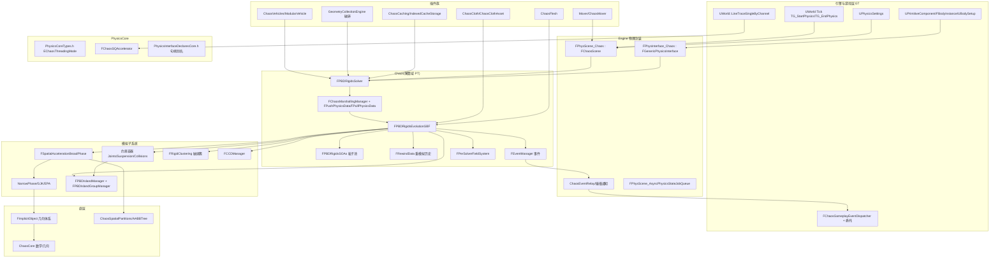

要点:

- **引擎层只持有 Proxy**。`FPhysicsActorHandle = Chaos::FSingleParticlePhysicsProxy*`(定义在 `Source/Runtime/PhysicsCore/Public/PhysicsInterfaceDeclaresCore.h:71`)。Component/FBodyInstance 不直接触碰 PT 粒子。
- **Chaos 模块是解算域**:所有 PT 状态(粒子 SOA、约束、岛、rewind 历史)归 `FPBDRigidsSolver` 所有,GT 通过 `FChaosMarshallingManager` 的双 SPSC 队列(push/pull)交换数据(ChaosMarshallingManager.h:502-513)。
- **ChaosCore 无 UE 依赖**:只含 TVec/TRigidTransform/AABB/Triangle 等模板;Chaos/ChaosCore 分层使 HeadlessChaos 等程序可独立编译。

## 12.3 类图

### 12.3.1 Solver 与数据搬运体系

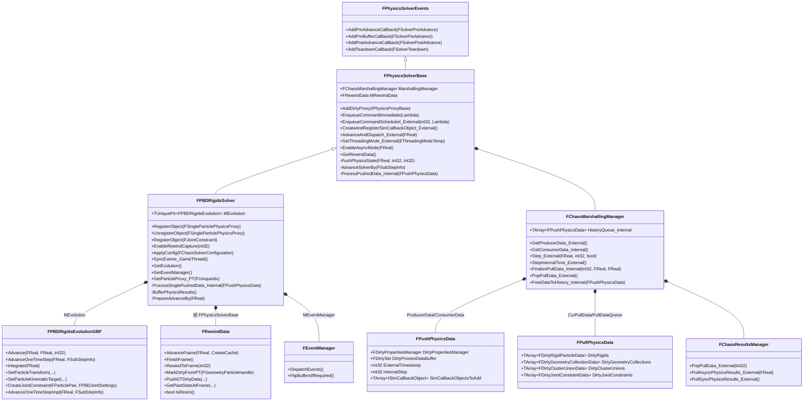

- `FPhysicsSolverBase`(`Source/Runtime/Experimental/Chaos/Public/Chaos/Framework/PhysicsSolverBase.h:346`)持锁、Marshalling、回调对象列表、rewind;构造受保护,只能经 `FChaosSolversModule::CreateSolver`(ChaosSolversModule.h:191)创建。
- `FPBDRigidsSolver`(`Public/PBDRigidsSolver.h:87`)组合 `FPBDRigidsEvolutionGBF`(typedef 别名 `FPBDRigidsEvolution`,PBDRigidsSolver.h:116)与粒子 SOA `FPBDRigidsSOAs`。
- `FPushPhysicsData`/`FPullPhysicsData` 分别是 GT→PT 与 PT→GT 的单帧载荷(ChaosMarshallingManager.h:286;PullPhysicsDataImp.h:165)。

### 12.3.2 粒子与 Proxy 体系(GT/PT 双份状态)

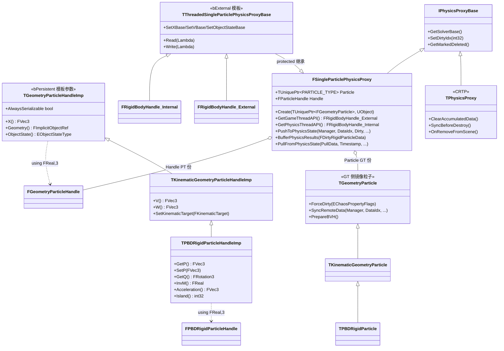

- Handle 层继承链在 `Public/Chaos/ParticleHandle.h`:`TGeometryParticleHandleImp`(:445)→`TKinematicGeometryParticleHandleImp`(:922)→`TPBDRigidParticleHandleImp`(:1002);`FGeometryParticleHandle/FPBDRigidParticleHandle` 是 `ParticleHandleFwd.h:24/60` 的 `using` 别名。
- GT 侧粒子 `TGeometryParticle`(:2754)→`TKinematicGeometryParticle`(:3327)→`TPBDRigidParticle`(:3420)与 PT Handle 一一对应,`FSingleParticlePhysicsProxy`(`Public/PhysicsProxy/SingleParticlePhysicsProxy.h:57`)同时持有两者。
- `FRigidBodyHandle_External/Internal`(:1167/:1610)只是 API 约束视图(`static_assert(sizeof相等)`,`VerifyContext()` 在 `PHYSICS_THREAD_CONTEXT=1` 时校验线程上下文,SingleParticlePhysicsProxy.h:1109-1128)。

### 12.3.3 FImplicitObject 几何体系

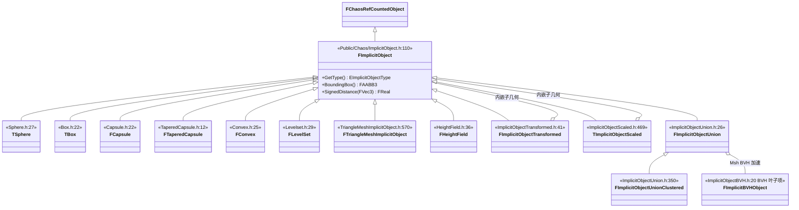

- `FImplicitObject3` 是 `FImplicitObject` 的 `typedef`(ImplicitObject.h:617),`FPhysicsGeometry = Chaos::FImplicitObject`(PhysicsInterfaceDeclaresCore.h:62)。
- 分析/凸/网格几何按 `EImplicitObjectType` 位标记区分(是 LevelSet/Convex/Scaled 等组合),碰撞窄相与 SQ 查询共用这套几何;`FPerShapeData`(`FPhysicsShape` 别名,PhysicsInterfaceDeclaresCore.h:61)包一层带材质与过滤的 shape。

### 12.3.4 约束、岛与求解并行体系

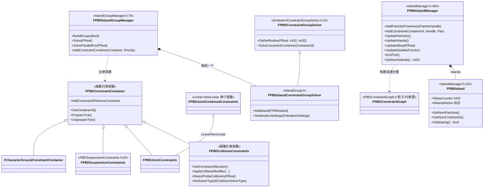

- 岛 = 粒子为节点、约束为边的连通分量(IslandManager.h:442-453 注释);kinematic 不属于任何岛(可同时在多个岛中出现)。
- `FPBDIslandGroupManager::BuildGroups(bIsResimming)` 把岛分配到可并行的组,`Solve(Dt)` 内部选择 `SolveSerial/SolveParallelFor/SolveParallelTasks`(IslandGroupManager.h:141-177)。
- 求解器类型可运行时切换:`p.Chaos.Solver.CollisionSolverType`(GaussSeidel/GaussSeidelSimd/PartialJacobi,PBDRigidsEvolutionGBF.cpp:503-527)。

## 12.4 数据字典

### 12.4.1 线程与调度

| 字段/类型 | 类型 | 含义 | 取值/约束 | 源码位置 |
|---|---|---|---|---|
| EChaosThreadingMode | enum class | Chaos 线程模式 | DedicatedThread(Hidden)/TaskGraph/SingleThread | Experimental/Chaos/Public/PhysicsCoreTypes.h:20 |
| EThreadingModeTemp | enum class | solver 内部使用的临时枚举,值域同上 | DedicatedThread/TaskGraph/SingleThread | Chaos/Framework/PhysicsSolverBase.h:260 |
| EChaosSolverTickMode | enum class | 求解步长模式 | Fixed/Variable/VariableCapped/VariableCappedWithTarget | PhysicsCoreTypes.h:10 |
| EMultiBufferMode | enum class | push/pull 缓冲模式 | Undefined/Single/Double/Triple/TripleGuarded | Chaos/Framework/MultiBufferResource.h:8 |
| EAsyncBlockMode | enum | 异步阻塞策略 | BlockOnlyPastFrames=0/BlockForBestInterpolation=1/DoNoBlock=2 | PhysicsSolverBase.h:98 |
| FSubStepInfo | struct | 单个求解子步信息 | PseudoFraction/Step/NumSteps/bSolverSubstepped | PhysicsSolverBase.h:62 |
| ThreadingMode | FPhysicsSolverBase 字段 | 当前线程模式(运行时可切) | GSingleThreadedPhysics=1 时强制 SingleThread | PhysicsSolverBase.h:898;cpp:298 |
| AsyncDt | FReal | 异步固定步长(<=0 表示同步模式) | IsUsingAsyncResults()==!ForceDisableAsyncPhysics && AsyncDt>=0 | PhysicsSolverBase.h:712 |

### 12.4.2 帧载荷与脏数据

| 字段/类型 | 类型 | 含义 | 取值/约束 | 源码位置 |
|---|---|---|---|---|
| FPushPhysicsData.ExternalTimestamp | int32 | 该帧 GT 时间戳(每帧 +1) | 与 RewindData 帧号对应 | ChaosMarshallingManager.h:292 |
| FPushPhysicsData.InternalStep | int32 | 该数据关联的 solver 内部步序号 | 子步时 IntervalStep∈[0,IntervalNumSteps-1] | ChaosMarshallingManager.h:293-295 |
| FPushPhysicsData.DirtyProxiesDataBuffer | FDirtySet | 按 EPhysicsProxyType 分桶的脏 Proxy 集 | Add/AddShape/SetNumDirtyShapes | ChaosMarshallingManager.h:289 |
| FDirtyProxy.ShapeDataIndices | TArray&lt;int32&gt; | 脏 shape 的索引列表 | 与 FShapeDirtyData 配对 | ChaosMarshallingManager.h:25 |
| FPushPhysicsData.SimCallbackInputs | TArray&lt;FSimCallbackInputAndObject&gt; | 本帧注入的异步回调输入 | 由 InjectInputs_External 填 | ChaosMarshallingManager.h:300 |
| FPullPhysicsData.DirtyRigids | TArray&lt;FDirtyRigidParticleData&gt; | PT 解算后变化的刚体结果 | 每步填充一次(ensure Num==0) | PullPhysicsDataImp.h:166 |
| FDirtyRigidParticleData | TBasePullData&lt;FSingleParticlePhysicsProxy,...&gt; | 单刚体回写载荷(X/R/V/W/状态) | PullFromPhysicsState 消费 | PullPhysicsDataImp.h:52 |
| FDirtyJointConstraintData.OutputData | FJointConstraintOutputData | 关节回写:破裂/驱动力/违约量 | bIsBreaking/bIsBroken/Force/Torque | PullPhysicsDataImp.h:137-152 |
| ExternalQueue / HistoryQueue_Internal | TArray&lt;FPushPhysicsData*&gt; | 已推送队列 / rewind 历史队列 | HistoryLength 控制保留长度 | ChaosMarshallingManager.h:504/507 |
| PullDataQueue / PullDataPool | TPhysicsSpscQueue&lt;FPullPhysicsData*&gt; | 结果 SPSC 队列与回收池 | GT Pop,PT Push | ChaosMarshallingManager.h:512-513 |

### 12.4.3 粒子状态

| 字段/类型 | 类型 | 含义 | 取值/约束 | 源码位置 |
|---|---|---|---|---|
| EObjectStateType | enum class | 粒子对象状态 | Uninitialized=0/Sleeping=1/Kinematic=2/Static=3/Dynamic=4 | Chaos/Particle/ObjectState.h:9 |
| ESleepType | enum | 睡眠类型 | MaterialSleep 等(默认 MaterialSleep) | SingleParticlePhysicsProxy.h:1098 |
| FUniqueIdx | struct | 粒子跨删除稳定索引 | UniqueIdxToGTParticles 映射回 GT | PhysicsSolverBase.h:566 |
| FPBDIsland.SleepCounter | int32 | 岛静止计数,达到阈值睡眠 | 默认阈值 20(p.Chaos.Solver.Sleep.Defaults.SleepCounterThreshold) | IslandManager.h:399;Private/Chaos/Island/IslandManager.cpp:122 |
| FPBDIsland.DisableCounter | int32 | 粒子静止禁用计数 | SetDisableCounterThreshold 可调 | IslandManager.h:402 |
| IterationSettings | FIterationSettings | 每粒子迭代覆盖(位置/速度/投影) | SetPositionSolverIterations 等 | SingleParticlePhysicsProxy.h:569-591 |
| CCDEnabled/MACDEnabled | bool | 粒子级连续碰撞检测开关 | FPBDRigidParticleHandle 字段 | SingleParticlePhysicsProxy.h:497-543 |

### 12.4.4 引擎侧配置与查询

| 字段/类型 | 类型 | 含义 | 取值/约束 | 源码位置 |
|---|---|---|---|---|
| UPhysicsSettings.bTickPhysicsAsync | bool(config) | 是否异步 tick 物理 | 配合 AsyncFixedTimeStepSize | Classes/PhysicsEngine/PhysicsSettings.h:333 |
| UPhysicsSettings.AsyncFixedTimeStepSize | float(config) | 异步固定步长(秒) | editcondition=bTickPhysicsAsync | PhysicsSettings.h:337 |
| UPhysicsSettings.bSubstepping / MaxSubstepDeltaTime / MaxSubsteps | bool/float/int32(config) | 同步子步 | MaxSubsteps∈[1,16] | PhysicsSettings.h:325/341/345 |
| UPhysicsSettings.MaxPhysicsDeltaTime | float(config) | 单帧最大物理 dt | [0.0013,1.0] | PhysicsSettings.h:321 |
| UPhysicsSettings.PhysicsPrediction | FPhysicsPredictionSettings | 网络物理预测/重模拟开关 | bEnablePhysicsPrediction 等 | PhysicsSettings.h:193-267 |
| FCollisionQueryParams.TraceTag | FName | 查询标签(调试) | — | Public/CollisionQueryParams.h:45 |
| FCollisionQueryParams.bTraceComplex | bool | 走三角 mesh 而非简化碰撞 | — | CollisionQueryParams.h:51 |
| FCollisionQueryParams.bReturnPhysicalMaterial | bool | 命中返回物理材质 | — | CollisionQueryParams.h:60 |
| FCollisionQueryParams.bIgnoreBlocks / bIgnoreTouches | bool | 过滤阻挡/触碰命中 | — | CollisionQueryParams.h:63-66 |
| FHitResult.Time / Distance | float | 归一化命中时间/距离 | — | Classes/Engine/HitResult.h:33/37 |
| FHitResult.bStartPenetrating | uint8:1 | 初始穿透 | PenetrationDepth 伴随 | HitResult.h:91/116 |
| FHitResult.Component / BoneName | TWeakObjectPtr&lt;UPrimitiveComponent&gt;/FName | 命中组件与骨骼 | — | HitResult.h:131/141 |
| FHitResult.FaceIndex | int32 | 命中三角面索引 | complex trace 有效 | HitResult.h:26 |

## 12.5 接口清单(核心)

### 12.5.1 FPhysicsSolverBase / FPBDRigidsSolver

| 原型(去 *_API) | 功能 | 参数/返回 | 线程/重入约束 | 位置 |
|---|---|---|---|---|
| `void ChangeBufferMode(EMultiBufferMode InBufferMode)` | 运行时切换缓冲模式 | — | GT | Chaos/Framework/PhysicsSolverBase.h:361 |
| `void AddDirtyProxy(IPhysicsProxyBase* ProxyBaseIn)` | 把 Proxy 加入生产者脏集 | 内部调用 `MarshallingManager.AddDirtyProxy` | GT(或 async init body 任务,持 MarshallingManagerLock) | PhysicsSolverBase.h:363 |
| `void AddDirtyProxyShape(IPhysicsProxyBase* ProxyBaseIn, int32 ShapeIdx)` | 标脏单个 shape | — | 同上 | PhysicsSolverBase.h:400 |
| `template <typename TSimCallbackObjectType, typename... ConstructorArgTypes> TSimCallbackObjectType* CreateAndRegisterSimCallbackObject_External(ConstructorArgTypes&&...)` | 创建 PT 侧 SimCallback 对象(车辆/布景等) | 返回裸指针,需 `UnregisterAndFreeSimCallbackObject_External` 释放 | GT;对象在 PT 消费 | PhysicsSolverBase.h:412 |
| `template <typename Lambda> void EnqueueCommandImmediate(Lambda&& Func)` | 立即投递一次性命令到 PT | `check(IsInGameThread())`(除非 async init body) | GT | PhysicsSolverBase.h:477 |
| `template <typename Lambda> void EnqueueCommandScheduled_External(const int32 ExecuteOnStep, Lambda&& Func)` | 定步命令(rewind 时按步重放) | ExecuteOnStep=物理步号 | GT | PhysicsSolverBase.h:487 |
| `FGraphEventRef AdvanceAndDispatch_External(FReal InDt)` | 单帧入口:推送 GT 状态并派发 PT 任务链 | 返回需阻塞等待的事件(async 模式返回上帧事件) | GT(调度本身在 TaskGraph) | PhysicsSolverBase.h:659;实现 Private/Chaos/Framework/PhysicsSolverBase.cpp:581 |
| `void EnableAsyncMode(FReal FixedDt)` / `void DisableAsyncMode()` | 开关异步固定步长(设 AsyncDt) | — | GT | PhysicsSolverBase.h:636/641 |
| `void SetThreadingMode_External(EThreadingModeTemp InThreadingMode)` | 切线程模式 | GSingleThreadedPhysics 时强制 SingleThread | GT | PhysicsSolverBase.h:615 |
| `void WaitOnPendingTasks_External()` | 等待所有 pending 任务 | `FTaskGraphInterface::WaitUntilTaskCompletes` | GT | PhysicsSolverBase.h:578 |
| `bool IsUsingAsyncResults() const` | 是否异步取结果 | `!ForceDisableAsyncPhysics && AsyncDt >= 0` | 任意 | PhysicsSolverBase.h:712 |
| `FReal GetPhysicsResultsTime_External() const` | 当前插值取用时间 | 固定步长时回看 AsyncDt*AsyncMultiplier | GT | PhysicsSolverBase.h:769 |
| `FGeometryParticle* UniqueIdxToGTParticle_External(const FUniqueIdx&)` | UniqueIdx→GT 粒子(异步输出消费) | 粒子已删则 nullptr | GT | PhysicsSolverBase.h:566 |
| `FPhysSceneLock& GetExternalDataLock_External() const` | 外部数据读写锁 | FPhysSceneLock 递归 RW 锁 | 任意(锁内) | PhysicsSolverBase.h:1027 |

FPBDRigidsSolver(PBDRigidsSolver.h):

| 原型(去 *_API) | 功能 | 参数/返回 | 线程 | 位置 |
|---|---|---|---|---|
| `void RegisterObject(FSingleParticlePhysicsProxy* Proxy)` | 注册单粒子(创建 PT Handle、加 SOA) | — | GT(内部转 PushData 命令) | PBDRigidsSolver.h:132;实现 PBDRigidsSolver.cpp:820 |
| `void RegisterObject(FGeometryCollectionPhysicsProxy* InProxy)` | 注册破碎集合 | — | GT | PBDRigidsSolver.h:135 |
| `void RegisterObject(Chaos::FJointConstraint* GTConstraint)` / `FSuspensionConstraint*` / `FCharacterGroundConstraint*` | 注册各类约束 | — | GT | PBDRigidsSolver.h:141-148 |
| `void UnregisterObject(FSingleParticlePhysicsProxy* Proxy)` | 注销并延迟销毁(FPendingDestroyInfo) | — | GT;真正 delete 在 PT `DestroyPendingProxies_Internal` | PBDRigidsSolver.h:133;实现 :915 |
| `void EnableRewindCapture(int32 NumFrames, bool InUseCollisionResimCache, TUniquePtr<IRewindCallback>&&)` 等 4 个重载 | 开启 rewind 历史 | NumFrames=容量 | GT | PBDRigidsSolver.h:245-248 |
| `void ApplyConfig(const FChaosSolverConfiguration& InConfig)` | 应用 solver 配置(迭代数/余量等) | — | GT | PBDRigidsSolver.h:325 |
| `void SyncEvents_GameThread()` | 派发碰撞/破碎/移除事件到 GT | 调 `GetEventManager()->DispatchEvents()` | GT(EndFrame 内) | PBDRigidsSolver.h:266;实现 :1565 |
| `FSingleParticlePhysicsProxy* GetParticleProxy_PT(const FUniqueIdx& Idx)` | PT 侧取 Proxy | — | PT | PBDRigidsSolver.h:358 |
| `virtual void PrepareAdvanceBy(const FReal DeltaTime) override` | 广播 PreAdvance、StartingSceneSimulation | — | PT | PBDRigidsSolver.h:392;实现 :1488 |
| `virtual void AdvanceSolverBy(const FSubStepInfo& SubStepInfo) override` | 单个求解步(evolution tick+回写缓冲) | — | PT | PBDRigidsSolver.h:393;实现 :1500 |
| `virtual void PushPhysicsState(const FReal DeltaTime, const int32 NumSteps, const int32 NumExternalSteps) override` | 把 GT 脏状态序列化进 ProducerData 并 Step_External | — | GT(ParallelForEachProxy 并行) | PBDRigidsSolver.h:394;实现 :1573 |
| `void ProcessSinglePushedData_Internal(FPushPhysicsData& PushData)` | PT 侧消费一帧 PushData(注册/删脏/输入) | — | PT | PBDRigidsSolver.h:482;实现 :1717 |
| `void BufferPhysicsResults()` | PT 侧把脏粒子写入 PullData | 多线程走 TaskDispatcher | PT | PBDRigidsSolver.h:385;实现 :2996 |
| `void UpdateGameThreadStructures()` | 测试用:立即回写 | — | GT | PBDRigidsSolver.h:179;实现 :3144 |

### 12.5.2 任务类型(PT 调度链)

| 原型 | 功能 | 线程 | 位置 |
|---|---|---|---|
| `void FPhysicsSolverProcessPushDataTask::ProcessPushData()` | 消费 PushData→`ProcessPushedData_Internal`+`PrepareAdvanceBy` | TaskGraph(CPrio_FPhysicsTickTask) | PhysicsSolverBase.h:108;PhysicsSolverBase.cpp:111/126 |
| `void FPhysicsSolverFrozenGTPreSimCallbacks::GTPreSimCallbacks()` | 冻结 GT 期间执行 PT 回调 | GT HighTaskPriority | PhysicsSolverBase.h:131;cpp:148 |
| `void FPhysicsSolverAdvanceTask::AdvanceSolver()` | `AdvanceSolverBy`+FreeDataToHistory | TaskGraph 或 GT(p.PhysicsRunsOnGT) | PhysicsSolverBase.h:151;cpp:220 |
| `void FPhysicsSolverRewindTask::RewindSolver()` | 条件触发 rewind/重模拟 | TaskGraph | PhysicsSolverBase.h:182;cpp:167 |
| `void FAllSolverTasks::AdvanceSolver()` | 单线程模式顺序执行上述任务 | 当前线程 | PhysicsSolverBase.h:201;cpp:763 |
| `void FSolverTasksPTOnly::AdvanceSolver()` | 仅 PT 侧任务(无 GT 回调) | PT | PhysicsSolverBase.h:228;cpp:781 |

派发顺序(PhysicsSolverBase.cpp:709-740):默认 `RewindBeforeAdvance==1`(即 `p.Resim.RewindBeforeAdvance`,PhysicsSolverBase.cpp:31-32)时 RewindTask → ProcessPushData →(可选 GTPreSimCallbacks)→ AdvanceTask;`RewindBeforeAdvance==0` 时 RewindTask 后置。

### 12.5.3 FChaosMarshallingManager

| 原型(去 *_API) | 功能 | 线程 | 位置 |
|---|---|---|---|
| `FPushPhysicsData* GetProducerData_External()` | 取 GT 正在写的 PushData | GT | ChaosMarshallingManager.h:321 |
| `FPushPhysicsData* GetConsumerData_Internal()` | 取 PT 正在消费的 PushData | PT | :327 |
| `void Step_External(FReal ExternalDT, const int32 NumSteps = 1, bool bSolverSubstepped = false)` | 结束本帧 GT 数据,推进外部时间 | GT | :441 |
| `FPushPhysicsData* StepInternalTime_External()` | 推进内部时间,返回应解算的一帧 | GT(AdvanceAndDispatch 内) | :444 |
| `void FreeData_Internal(FPushPhysicsData* PushData)` | 归还池 | PT | :447 |
| `void FreeDataToHistory_Internal(FPushPhysicsData* PushData)` | 归还或写入 HistoryQueue(rewind 需要) | PT | :450 |
| `void FinalizePullData_Internal(int32 LatestExternalTimestampConsumed, FReal SimStartTime, FReal DeltaTime)` | 把 CurPullData 移交 GT | PT | :471 |
| `FPullPhysicsData* PopPullData_External()` | GT 弹出结果 | GT | :474 |
| `void SetHistoryLength_Internal(int32 InHistoryLength)` | 设置历史保留帧数 | PT | :481 |
| `void AddSimCallbackInputData_External(ISimCallbackObject*, FSimCallbackInput*)` | 注入异步回调输入 | GT | :436 |

### 12.5.4 FSingleParticlePhysicsProxy 与 Handle API

| 原型(去 *_API) | 功能 | 线程 | 位置 |
|---|---|---|---|
| `static FSingleParticlePhysicsProxy* Create(TUniquePtr<FGeometryParticle>&& Particle, UObject* InOwner)` | 创建 Proxy(Handle 初始为 null) | GT | SingleParticlePhysicsProxy.h:63/1678 |
| `FRigidBodyHandle_External& GetGameThreadAPI()` / `FRigidBodyHandle_Internal* GetPhysicsThreadAPI()` | 取线程约束视图 | GT / PT | :78/89 |
| `void PushToPhysicsState(const FDirtyPropertiesManager& Manager, int32 DataIdx, const FDirtyProxy& Dirty, FShapeDirtyData* ShapesData, FReal ExternalDt)` | GT→PT 应用脏属性 | GT(写 GT 粒子的 SyncRemoteData 缓冲) | :124 |
| `void BufferPhysicsResults(FDirtyRigidParticleData&)` | PT 写回写载荷 | PT | :130 |
| `bool PullFromPhysicsState(const FDirtyRigidParticleData& PullData, int32 SolverSyncTimestamp, const FDirtyRigidParticleData* NextPullData = nullptr, const FRealSingle* Alpha = nullptr, const FDirtyRigidParticleReplicationErrorData* Error = nullptr, const Chaos::FReal AsyncFixedTimeStep = 0)` | GT 应用结果(支持双帧插值 Alpha 与网络纠错) | GT | :136 |
| `bool IsDirty()` / `EWakeEventEntry GetWakeEvent() const` / `void ClearEvents()` | 脏标记与唤醒事件 | GT | :139-146 |
| `FPhysicsObjectHandle GetPhysicsObject()` | 取关联 FPhysicsObject | 任意 | :170 |
| (FRigidBodyHandle_External)`void SetX(const FVec3& InX, bool bInvalidate = true)` | GT 写位置,记录 OverWriteX 时间戳 | GT(VerifyContext) | :1201 |
| (External)`void SetV(const FVec3& InV, bool bInvalidate = true)` | GT 写速度;清零时同步冻结位置 | GT | :1217 |
| (External)`void SetObjectState(const EObjectStateType InState, bool bAllowEvents = false, bool bInvalidate = true)` | 切换 Sleeping/Kinematic/Dynamic,动→静时清速度 | GT | :1246 |
| (External)`void SetCCDEnabled(bool bEnabled)` / `SetMACDEnabled` | 粒子级 CCD 开关 | GT | :1417/1437 |
| (Internal)`void SetX(const FVec3& InX, bool bInvalidate = true)` | PT 写位置并同步 P | PT | :1637 |
| (Base)`void SetKinematicTarget(const FKinematicTarget& InKinematicTarget, bool bInvalidate = true)` | 设置单步运动学目标 | GT/PT 各自版本 | :388 |

### 12.5.5 Evolution / 碰撞 / 岛 / 睡眠

| 原型(去 *_API) | 功能 | 线程 | 位置 |
|---|---|---|---|
| `void FPBDRigidsEvolutionGBF::Advance(const FReal Dt, const FReal MaxStepDt, const int32 MaxSteps)` | 按 MaxStepDt 拆步并循环 `AdvanceOneTimeStepImpl` | PT | PBDRigidsEvolutionGBF.h:133;实现 Private/Chaos/PBDRigidsEvolutionGBF.cpp:375 |
| `void FPBDRigidsEvolutionGBF::AdvanceOneTimeStep(const FReal dt, const FSubStepInfo& SubStepInfo = FSubStepInfo())` | 单步(PrepareTick+Impl+UnprepareTick) | PT | PBDRigidsEvolutionGBF.h:134;实现 :406 |
| `void FPBDRigidsEvolutionGBF::Integrate(FReal Dt)` | 半隐式积分、力清零、包围盒膨胀 | PT | PBDRigidsEvolutionGBF.h:256;实现 :868 |
| `void SetParticleTransform(FGeometryParticleHandle* InParticle, const FVec3& InPos, const FRotation3& InRot, const bool bIsTeleport, const bool bWakeUp = true)` | 外部移动粒子(不改变速度) | PT | PBDRigidsEvolutionGBF.h:172 |
| `bool SetParticleKinematicTarget(FGeometryParticleHandle* ParticleHandle, const FKinematicTarget& NewKinematicTarget)` | 设置 kinematic 单步目标 | PT | :186 |
| `void ApplyParticleTransformCorrectionDelta(...)` / `ApplyParticleTransformCorrection(...)` | 网络纠错的动量无关修正(EXPERIMENTAL) | PT(pre-Integrate) | :197/202 |
| `void ApplySleepOnConnectedParticles(FGeometryParticleHandle* InParticle)` | 连通粒子整体入睡 | PT | :207 |
| `FPBDJointConstraintHandle* CreateJointConstraint(const FParticlePair& InParticlePair, const FPBDJointSettings& InJointSettings)` | 创建关节约束 | PT | :268 |
| `void DestroyJointConstraint(FPBDJointConstraintHandle* InJointHandle)` / `FPBDJointConstraintHandle* SetJointConstraintSettings(...)` | 销毁/改设置(可能换 Handle) | PT | :271/275 |
| `void FSpatialAccelerationBroadPhase::ProduceOverlaps(FReal Dt, ...)` | BroadPhase 产 midphase 对 | PT(TaskGraph) | Chaos/Collision/SpatialAccelerationBroadPhase.h:343 |
| `void FSpatialAccelerationBroadPhase::ProduceCollisions(FReal Dt)` | MidPhase→NarrowPhase(GJK/EPA/专用对) | PT(TaskGraph) | :352 |
| `void FSpatialAccelerationBroadPhase::GatherConstraints(bool bIsDeterministic)` | 汇总约束到容器 | PT | :354 |
| `void FSpatialAccelerationCollisionDetector::RunBroadPhase(const FReal Dt, FEvolutionResimCache* ResimCache)` / `RunNarrowPhase(...)` | 演化层调用的两阶段入口 | PT | Chaos/Collision/SpatialAccelerationCollisionDetector.h:27/40 |
| `template <typename T, typename TGeometryA, typename TGeometryB> bool GJKIntersection(const TGeometryA& RESTRICT A, const TGeometryB& RESTRICT B, const TRigidTransform<T, 3>& BToATM, const T InThicknessA = 0, const TVector<T, 3>& InitialDir = TVector<T, 3>(1, 0, 0))` | GJK 相交测试(大尺度自动切双精度) | PT/SQ | Chaos/GJK.h:189 |
| `template <typename T> bool InitializeEPA(TArray<TVec3<T>>& VertsA, TArray<TVec3<T>>& VertsB, TFunctionRef<TVector<T, 3>(const TVec3<T>& V)> SupportA, ..., TEPAWorkingArray<TEPAEntry<T>>& OutEntries, TVec3<T>& OutTouchNormal)` | EPA 初始化(支持函数指针版) | PT/SQ | Chaos/EPA.h:155 |
| `void FPBDIslandManager::UpdateSleep(const FReal Dt = 0)` | 岛级睡眠判定 | PT(每步末) | Chaos/Island/IslandManager.h:505 |
| `void FPBDIslandManager::UpdateDisable(TFunctionRef<void(FPBDRigidParticleHandle*)> ParticleDisableFunctor)` | 岛级 disable(回调 DisableParticle) | PT | :506 |
| `void FPBDIslandGroupManager::BuildGroups(const bool bIsResimming)` | 岛→并行组 | PT | Chaos/Island/IslandGroupManager.h:120 |
| `void FPBDIslandGroupManager::Solve(const FReal Dt)` | 组内迭代求解(容器优先级顺序) | PT | :141 |
| `void FCCDManager::ApplyCCD(const FReal Dt, TArrayView<FPBDCollisionConstraint* const> SweptConstraints, const int32 NumDynamicParticles)` / `ProjectCCD(...)` | CCD 扫掠约束生成/投影 | PT | Chaos/CCDUtilities.h:90/94 |

### 12.5.6 场景与查询(Engine/PhysicsCore)

| 原型(去 *_API) | 功能 | 线程 | 位置 |
|---|---|---|---|
| `FChaosScene::FChaosScene(UObject* OwnerPtr, Chaos::FReal InAsyncDt, const FName& DebugName = NAME_None)` | 建场景:CreateSolver(TaskGraph/SingleThread)+注册 FChaosSceneSimCallback | GT | PhysicsCore/Public/Chaos/ChaosScene.h:90;Private/ChaosScene.cpp:58 |
| `Chaos::FPhysicsSolver* FChaosScene::GetSolver() const` | 取 solver | 任意(注意所有权) | ChaosScene.h:101 |
| `void FChaosScene::StartFrame()` | 帧首:OnStartFrame+AdvanceAndDispatch_External | GT | ChaosScene.h:140;ChaosScene.cpp:363 |
| `void FChaosScene::SetUpForFrame(const FVector* NewGrav, float InDeltaSeconds, float InMinPhysicsDeltaTime, float InMaxPhysicsDeltaTime, float InMaxSubstepDeltaTime, int32 InMaxSubsteps, bool bSubstepping)` | 应用重力/步长上限 | GT | ChaosScene.h:141;ChaosScene.cpp:331 |
| `void FChaosScene::EndFrame()` | 帧尾:SyncBodies+FlipEventManagerBuffer+SyncEvents_GameThread | GT | ChaosScene.h:142;ChaosScene.cpp:500 |
| `virtual void FChaosScene::OnSyncBodies(Chaos::FPhysicsSolverBase* Solver)` | 虚函数:回写脏 Proxy(`PullPhysicsStateForEachDirtyProxy_External`) | GT | ChaosScene.h:178;ChaosScene.cpp:389 |
| `virtual float FPhysScene_Chaos::OnStartFrame(float InDeltaTime)` | Engine 侧重写:计算本帧 dt、注入异步输入 | GT | Engine/Public/Physics/Experimental/PhysScene_Chaos.h:253 |
| `ENGINE_API virtual void FPhysScene_Chaos::OnSyncBodies(Chaos::FPhysicsSolverBase* Solver)` | Engine 侧重写回写(组件 transform 更新) | GT | PhysScene_Chaos.h:450 |
| `bool UWorld::LineTraceSingleByChannel(struct FHitResult& OutHit, const FVector& Start, const FVector& End, ECollisionChannel TraceChannel, const FCollisionQueryParams& Params = FCollisionQueryParams::DefaultQueryParam, const FCollisionResponseParams& ResponseParam = FCollisionResponseParams::DefaultResponseParam) const` | 单命中射线 | GT(或异步物理线程上下文) | Engine/Classes/Engine/World.h:2161;实现 Private/Collision/WorldCollision.cpp:128 |
| `static ENGINE_API bool FGenericPhysicsInterface::RaycastSingle(const UWorld* World, struct FHitResult& OutHit, const FVector Start, const FVector End, ECollisionChannel TraceChannel, const FCollisionQueryParams& Params, const FCollisionResponseParams& ResponseParams, const FCollisionObjectQueryParams& ObjectParams = FCollisionObjectQueryParams::DefaultObjectQueryParam)` | 查询实现入口(FPhysicsInterface 即 FPhysInterface_Chaos) | GT | Engine/Public/Physics/GenericPhysicsInterface.h:31;别名 PhysicsCore/Public/PhysicsInterfaceDeclaresCore.h:89 |
| `PHYSICSCORE_API void FChaosSQAccelerator::Raycast(const FVector& Start, const FVector& Dir, const float DeltaMagnitude, ChaosInterface::FSQHitBuffer<ChaosInterface::FRaycastHit>& HitBuffer, EHitFlags OutputFlags, const ChaosInterface::FSceneQueryCommonParams& CommonParams) const` | 对空间加速结构做射线 | GT/PT 双版本(FPTRaycastHit) | PhysicsCore/Public/SQAccelerator.h:45 |
| `PHYSICSCORE_API void FChaosSQAccelerator::Sweep(const Chaos::FImplicitObject& QueryGeom, const FTransform& StartTM, ...)` / `Overlap(const Chaos::FImplicitObject& QueryGeom, const FTransform& GeomPose, ...)` | 扫掠/重叠查询 | 同上 | SQAccelerator.h:48-52 |
| `ENGINE_API void FBodyInstance::InitBody(UBodySetup* Setup, const FTransform& Transform, UPrimitiveComponent* PrimComp, FPhysScene* InRBScene, const FInitBodySpawnParams& SpawnParams, IPhysicsBodyInstanceOwner* BodyInstanceOwner = nullptr)` | 创建物理体(生成 Proxy 并注册到 solver) | GT | Engine/Classes/PhysicsEngine/BodyInstance.h:771 |
| `ENGINE_API void FBodyInstance::TermBody(bool bNeverDeferRelease = false)` | 销毁物理体 | GT | BodyInstance.h:845 |
| `ENGINE_API bool FBodyInstance::LineTrace(struct FHitResult& OutHit, const FVector& Start, const FVector& End, bool bTraceComplex, bool bReturnPhysicalMaterial = false) const` | 对单 body 的射线 | GT | BodyInstance.h:1351 |

其余子系统(约束数据结构、FieldSystem、GeometryCollection、RewindData 细节、插件族)的接口清单见 `12_physics_chaos_part2.md` 的 12.5 续。

## 12.6 关键流程

### 12.6.1 一次物理步进全流程(GT 提交→PT 解算→回写→事件)

基于真实调用链:`FStartPhysicsTickFunction::ExecuteTick`(PhysLevel.cpp:239)→`UWorld::StartPhysicsSim`(:215)→`FChaosScene::StartFrame`(ChaosScene.cpp:363)→`AdvanceAndDispatch_External`(PhysicsSolverBase.cpp:581)。

```mermaid
flowchart TD
    A["TG_StartPhysics tick"]
    B["UWorld::StartPhysicsSim"]
    C["FChaosScene::StartFrame ChaosScene.cpp 363"]
    D["OnStartFrame 计算 dt 与异步输入"]
    E["AdvanceAndDispatch_External PhysicsSolverBase.cpp 581"]
    F{"IsUsingFixedDt 固定步长"}
    G["AccumulatedTime 累加 取 AsyncDt 步长 NumSteps=floor"]
    H["子步 NumSteps=ceil dt MaxDt 上限 MaxSubSteps"]
    I["PushPhysicsState PBDRigidsSolver.cpp 1573"]
    I2["ParallelForEachProxy 同步脏 Proxy 到 PushData"]
    I3["Step_External 交接 ProducerData"]
    J{"ThreadingMode"}
    K["SingleThread FAllSolverTasks 立即执行"]
    L["TaskGraph 派发三任务链"]
    M["ProcessPushData 任务 ProcessPushedData_Internal 1717"]
    N["PrepareAdvanceBy 1488"]
    O["AdvanceTask AdvanceSolverBy 1500"]
    P["AdvanceOneTimeStepTask DoWork"]
    Q["Evolution AdvanceOneTimeStepImpl 529"]
    R["Integrate + ApplyKinematicTargets"]
    S["RunBroadPhase 343 ProduceOverlaps"]
    S2["MidPhase 修饰回调"]
    T["RunNarrowPhase ProduceCollisions GJK EPA"]
    U["CreateConstraintGraph + CreateIslands"]
    V["BuildGroups + IslandGroupManager Solve"]
    W["CCDManager ApplyCCD ProjectCCD"]
    X["UpdateSleep UpdateDisable IslandManager"]
    Y["Clustering AdvanceClustering 破碎簇"]
    Z["FinalizePullData_Internal 1527"]
    Z2["BufferPhysicsResults 2996 写 FPullPhysicsData"]
    AA["TG_EndPhysics FEndPhysicsTickFunction"]
    AB["UWorld::FinishPhysicsSim"]
    AC["FChaosScene::EndFrame 500"]
    AD["SyncBodies PullPhysicsStateForEachDirtyProxy_External"]
    AE["FlipEventManagerBuffer + SyncEvents_GameThread"]
    A --> B --> C --> D --> E --> F
    F -- 是 --> G --> I
    F -- 否 --> H --> I
    I --> I2 --> I3 --> J
    J -- SingleThread --> K --> P
    J -- TaskGraph --> L --> M --> N --> O
    O --> P --> Q
    Q --> R --> S --> S2 --> T --> U --> V --> W --> X --> Y --> Z2 --> Z
    Z --> AA --> AB --> AC --> AD --> AE
```

说明:

- `AdvanceSolverBy` 中 `AdvanceOneTimeStepTask(this, MLastDt, SubStepInfo).DoWork()` 同步执行演化(PBDRigidsSolver.cpp:1520),演化内部用 TaskDispatcher 并行;`FinalizePullData_Internal` 只在 `MLastDt > 0` 时调用(:1522-1528)。
- `DoNoBlock` 模式下可丢步:NumSteps 被 `p.MaxPhysicsStepsPerGameTick - NumPendingSolverAdvanceTasks` 截断(PhysicsSolverBase.cpp:629-640,默认 3,cvar :578)。
- 事件在 PT 侧写入 FEventManager 三缓冲,`EndFrame` 翻转后在 GT `SyncEvents_GameThread` 派发(PBDRigidsSolver.cpp:1565;ChaosScene.cpp:561-572)。

### 12.6.2 查询 vs 模拟(LineTrace 调用链)

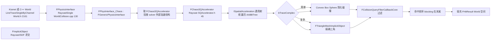

- 查询走 **外部(拷贝的)加速结构**:`FChaosScene::CopySolverAccelerationStructure`(ChaosScene.h:128)在 EndFrame 把 solver 内部结构拷出,GT 只读;`FPhysSceneLock` 读锁保护(`FPhysicsSceneGuardScopedRead`,Threading.h:931)。
- PT 侧查询(物理线程内)走 `Chaos::Private::FGenericPhysicsInterface_Internal::RaycastMulti` 等内部接口(GenericPhysicsInterface.h:108-156),直接使用内部加速结构,无需锁。

### 12.6.3 Proxy/Particle 生命周期

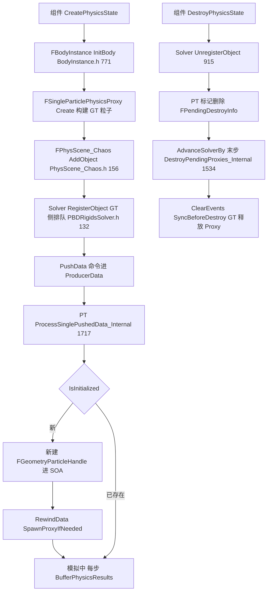

## 12.7 时序图

### 12.7.1 GT 提交 → PT 解算 → 回写(TaskGraph 模式)

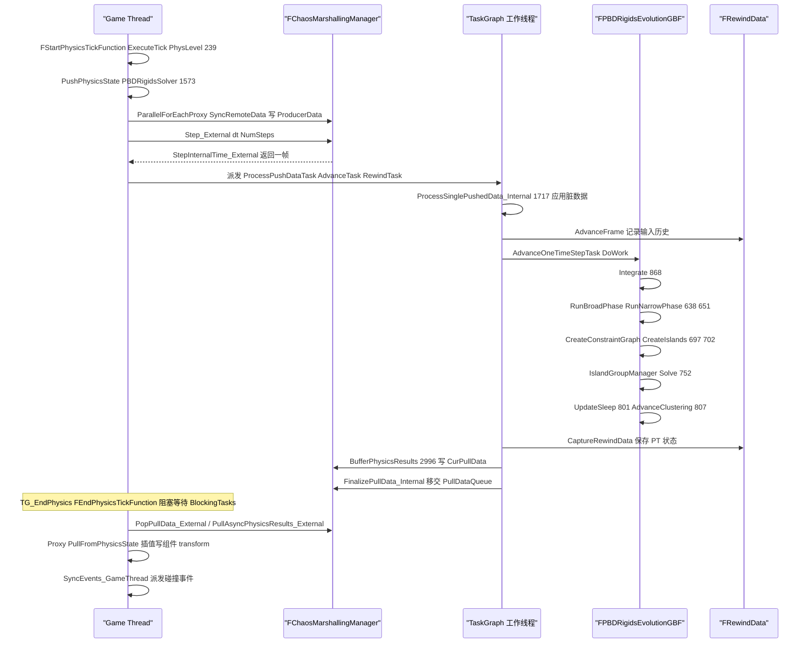

### 12.7.2 车辆 PT 回调(ChaosVehiclesPlugin)

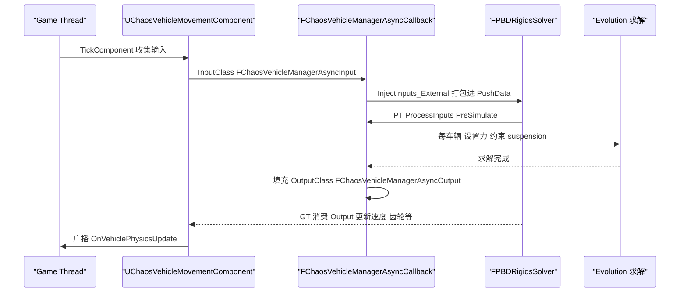

- `FChaosVehicleManagerAsyncCallback : public Chaos::TSimCallbackObject<FChaosVehicleManagerAsyncInput, FChaosVehicleManagerAsyncOutput, Chaos::ESimCallbackOptions::Presimulate | Chaos::ESimCallbackOptions::Rewind>`(ChaosVehicleManagerAsyncCallback.h:475),即车辆逻辑完全跑在物理线程,GT 只注入输入、消费输出。

### 12.7.3 碰撞事件从 PT 到 Blueprint

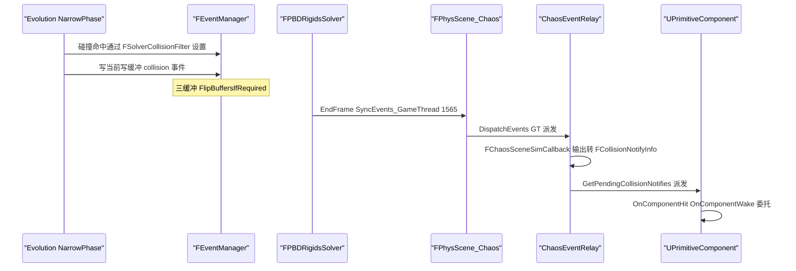

- 事件开关由 `FPBDRigidsSolver::SetGenerateCollisionData(bool)`(PBDRigidsSolver.h:202)等控制,过滤参数 `SetCollisionFilterSettings(FSolverCollisionFilterSettings)`(:210);Engine 侧由 `FPhysScene_Chaos::RegisterForCollisionEvents(UPrimitiveComponent*)`(PhysScene_Chaos.h:133)登记接收者。
- 破碎/移除/拖尾事件同构:`SetGenerateBreakingData`(:203)/`SetGenerateRemovalData`(:209)/`SetGenerateTrailingData`(:208)。

### 12.7.4 睡眠状态机(EObjectStateType + 岛)

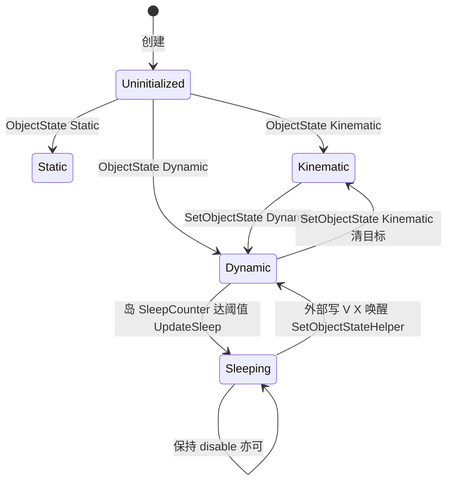

- 唤醒路径:`TThreadedSingleParticlePhysicsProxyBase::SetXBase/SetVBase` 检测 `Sleeping` 即调 `SetObjectStateHelper(..., EObjectStateType::Dynamic, true)`(SingleParticlePhysicsProxy.h:240-251/322-340)。
- 岛级判定在 `FPBDIslandManager::UpdateSleep`(IslandManager.h:505):静止计数器阈值默认 20(IslandManager.cpp:122),材料 sleep 阈值可乘 `SleepThresholdMultiplier`(SingleParticlePhysicsProxy.h:1577);部分睡眠 `PartialIslandSleepAllowed`(:1457)。

## 12.8 线程模型与同步

详见 `12_physics_chaos_part2.md` 第 12.8 节。

## 12.9 配置与扩展点

详见 `12_physics_chaos_part2.md` 第 12.9 节。

## 12.10 已知限制/未确认项

详见 `12_physics_chaos_part2.md` 第 12.10 节。

## 12.11 附录索引

| 模块 | 附录文件(相对 docs/ue5.8.3/appendix/api/) |
|---|---|
| PhysicsCore | Runtime/PhysicsCore.md |
| ChaosCore | Runtime/ChaosCore.md |
| Chaos | Runtime/Chaos.part01.md、Runtime/Chaos.part02.md |
| ChaosSolverEngine | Runtime/ChaosSolverEngine.md |
| ChaosSpatialPartitions | Runtime/ChaosSpatialPartitions.md |
| ChaosVehiclesCore(Chaos 模块内车辆 core) | Runtime/ChaosVehiclesCore.md |
| ChaosVisualDebugger(ChaosVDRuntime) | Runtime/ChaosVDRuntime.md |
| ChaosVDData | Runtime/ChaosVDData.md |
| FieldSystemEngine | Runtime/FieldSystemEngine.md |
| GeometryCollectionEngine | Runtime/GeometryCollectionEngine.md |
| Voronoi | Runtime/Voronoi.md |
| IndexedCacheStorage | Runtime/IndexedCacheStorage.md |
| RigidPhysics | Runtime/RigidPhysics.md |
| Engine(物理部分,含 Physics/Experimental) | Runtime/Engine.md(Engine 全模块附录) |
| ChaosVehiclesPlugin | Plugins/ChaosVehicles.md、Plugins/ChaosVehiclesEditor.md |
| ChaosModularVehicle | Plugins/ChaosModularVehicle.md、Plugins/ChaosModularVehicleEngine.md、Plugins/ChaosModularVehicleEditor.md |
| ChaosMover | Plugins/ChaosMover.md |
| Mover | Plugins/Mover.md、Plugins/MoverEditor.md、Plugins/MoverCVDData.md 等 |
| ChaosCaching | Plugins/ChaosCaching.md、Plugins/ChaosCachingEditor.md、Plugins/ChaosCachingUSD.md |
| ChaosCloth 家族 | Plugins/ChaosCloth.md、Plugins/ChaosClothAsset.md、Plugins/ChaosClothAssetEngine.md、Plugins/ChaosClothEditor.md 等 |
| ChaosFlesh | Plugins/ChaosFlesh.md、Plugins/ChaosFleshEngine.md、Plugins/ChaosFleshNodes.md 等 |
| ChaosRigidAsset | Plugins/ChaosRigidAssetEngine.md、Plugins/ChaosRigidAssetNodes.md、Plugins/ChaosRigidAssetEditor.md |
| ChaosRigidPhysicsAsync | Plugins/ChaosRigidPhysicsAsync.md |
| ChaosNiagara | Plugins/ChaosNiagara.md |
| ChaosSolverPlugin | Plugins/ChaosSolverEditor.md |
| ChaosUserDataPT | Plugins/ChaosUserDataPT.md |
| PlanarCutPlugin | Plugins/PlanarCut.md |
| Fracture | Plugins/FractureEngine.md、Plugins/FractureEditor.md |
| Buoyancy | Plugins/Buoyancy.md |
| PhysicsControl | Plugins/PhysicsControl.md、Plugins/PhysicsControlEditor.md |
| HeadlessChaos | Programs/HeadlessChaos.md、Programs/HeadlessChaosPerf.md |
| ChaosVisualDebugger(程序) | Programs/ChaosVisualDebugger.md |

## 续篇索引

- `12_physics_chaos_part2.md`:12.5(续)约束/FieldSystem/GeometryCollection/RewindData/插件族接口清单;12.8 线程模型与同步;12.9 配置与扩展点;12.10 已知限制/未确认项。

