# 13 动画:AnimInstance、AnimGraph、骨骼网格、ControlRig/RigVM

> 源码根 `$UE` = `/home/timeshift/opensource/game_engine/unreal/UnrealEngine-5.8.3-release`,`$E` = `$UE/Engine`。
> 本章所有路径相对 `$E`;`路径:行号` 均对 5.8.3-release 源码实测。模块符号全量清单见 X.11 附录索引。

## 13.1 职责、边界与模块清单

本章覆盖引擎动画栈运行时:每帧动画管线(Tick→Update→Evaluate→Post→渲染上传)、AnimGraph 节点体系、动画资产与压缩、骨骼/骨骼网格数据、渲染线程蒙皮、以及 ControlRig/RigVM 与 Plugins/Animation 全部运行时插件。不含:动画蓝图编辑器编译流水线细节(属编辑器章节)、Chaos 布料求解器内部(仅接口层)、Niagara/Sequencer 通用求值(仅动画侧接入)。

| 模块 | 路径 | Build.cs 关键依赖(P=Public/其他为 Private) | 职责一句话 |
|---|---|---|---|
| AnimationCore | Source/Runtime/AnimationCore | P: Core,CoreUObject | 无引擎依赖的动画基础库:骨骼索引类型、IK 数学(FABRIK/CCDIK/TwoBoneIK/SoftIK/SplineIK)、骨骼权重、约束、样条 |
| AnimGraphRuntime | Source/Runtime/AnimGraphRuntime | P: AnimationCore,Core,CoreUObject,Engine,GeometryCollectionEngine | AnimGraph 运行时节点库:SequencePlayer/BlendSpace/Slot/状态机结果/骨骼控制器,以及 Sequencer 动画覆盖与混合实例 |
| Engine(Animation 部分) | Source/Runtime/Engine(Classes/Animation 99 头、Public/Animation 76 头、BonePose.h/BoneContainer.h/SkeletalRender*) | — | UAnimInstance/FAnimInstanceProxy、资产(UAnimSequence/Montage/BlendSpace/PoseAsset)、压缩编解码、USkeleton/USkeletalMesh、蒙皮组件与渲染对象 |
| MeshDescription | Source/Runtime/MeshDescription | P: Core(P) | 网格元素/属性容器基础抽象(FMeshDescription),骨骼网格描述的底座 |
| SkeletalMeshDescription | Source/Runtime/SkeletalMeshDescription | P: Core(P) | FMeshDescription 的骨骼网格扩展:蒙皮权重属性(FSkeletalMeshAttributes)、顶点皮肤权重引用、网格操作 |
| ClothingSystemRuntimeInterface | Source/Runtime/ClothingSystemRuntimeInterface | P: Core,CoreUObject | 布料接口层:IClothingSimulation、ClothingSimulationFactory、Interactor、碰撞数据类型 |
| ClothingSystemRuntimeCommon | Source/Runtime/ClothingSystemRuntimeCommon | P: ClothingSystemRuntimeInterface,Core,CoreUObject | 布料通用数据:UClothConfig、ClothingAsset、LOD 数据、tether、点权重图 |
| ClothingSystemRuntimeNv | Source/Runtime/ClothingSystemRuntimeNv | P: ClothingSystemRuntimeCommon,ClothingSystemRuntimeInterface,Core,CoreUObject | NvCloth 后端实现(legacy;5.8 主布料路径为 Chaos Cloth/ChaosClothAsset 插件) |
| ACLPlugin | Plugins/Animation/ACLPlugin | P: Core,CoreUObject,Engine;P: DesktopPlatform 等 | 用 Animation Compression Library 压缩 AnimSequence(编解码器 + 压缩数据库流送) |
| AnimationData | Plugins/Animation/AnimationData | P: AnimGraphRuntime,Core,MovieSceneTools | 数据资产形式组织动画(UBlendSpace 等 IAnimationDataContainer/Controller 生成通道) |
| AnimationLocomotionLibraryRuntime | Plugins/Animation/AnimationLocomotionLibrary/Source/Runtime | P: AnimGraphRuntime,AnimationCore,Core,CoreUObject,Engine | 运动动画驱动技术库(方向/支点预测等动画图形函数) |
| AnimationModifierLibrary | Plugins/Animation/AnimationModifierLibrary | P: AnimationModifiers,AnimationBlueprintLibrary 等 | 批量修改动画资产的 UAnimationModifier 集合 |
| AnimationWarpingRuntime | Plugins/Animation/AnimationWarping/Source/Runtime | P: AnimGraphRuntime,AnimationCore,Core,CoreUObject,Engine | 姿态/动画扭曲框架:Stride/Orientation/Slope Warping 与 RootMotionDelta 属性 |
| AnimatorKit | Plugins/Animation/AnimatorKit | (设置模块 AnimatorKitSettings) | Sequencer 动画化工具的设置与运行时支撑 |
| AudioDrivenAnimation | Plugins/Animation/AudioDrivenAnimation | P: Engine 等 | 由音频驱动的动画(音频→曲线→动画) |
| BlendSpaceMotionAnalysis | Plugins/Animation/BlendSpaceMotionAnalysis | P: Engine 等 | 分析 BlendSpace 中的移动/根运动属性 |
| BlendStack | Plugins/Animation/BlendStack/Source/Runtime | P: AnimGraphRuntime,AnimationCore,Core,CoreUObject,Engine | 惯性化姿势堆栈混合 API(PoseSearch 依赖其做姿势过渡) |
| ControlRig | Plugins/Animation/ControlRig/Source/ControlRig | P: AnimGraph,AnimationCore,Constraints,LevelSequence,RHI,RigVM,RigVMDeveloper 等 | 基于 RigVM 的程序化绑定/IK/程序动画框架(UControlRig、RigHierarchy、RigUnit) |
| ControlRigDeveloper | Plugins/Animation/ControlRig/Source/ControlRigDeveloper | P: ControlRig | ControlRig 编译期/开发期类型(RigUnit 注册、图结构) |
| ControlRigModules | Plugins/Animation/ControlRigModules | P: ControlRig 等 | 附加 ControlRig 模块化 Rig 单元集(嵌套 Rig/连接器执行) |
| ControlRigSpline | Plugins/Animation/ControlRigSpline | P: ControlRig,Core,CoreUObject,Engine,RigVM | ControlRig 样条创建与求值(FRigUnit_Chain...) |
| DeformerGraph(OptimusCore) | Plugins/Animation/DeformerGraph/Source/OptimusCore | P: SlateCore;P: ComputeFramework,RigVM,Renderer,MeshDescription 等 | GPU 网格变形图(Optimus)运行时内核(5.8 名称仍为 OptimusCore) |
| DNACalib(DNACalibLib/Module) | Plugins/Animation/DNACalib | P: RigLogicLib(RigLogicModule) | MetaHuman DNA 校准库及 UE 封装 |
| EaseCurveTool | Plugins/Animation/EaseCurveTool | 编辑器工具 | 缓动曲线生成工具 |
| GameplayInsights | Plugins/Animation/GameplayInsights | P: AnimGraph,AnimGraphRuntime,Trace 等 | 通过 Unreal Insights/Trace 调试动画系统的分析与可视化 |
| GeneSplicer(GeneSplicerModule/Lib) | Plugins/Animation/GeneSplicer | P: RigLogicModule;P: GeneSplicerLib | 表情动画基因拼接(RigLogic 系) |
| IKRig | Plugins/Animation/IKRig/Source/IKRig | P: ControlRig,Core,PBIK,RigVM | IK 重定向/求解绑定资产与 UIKRigComponent(PBIK 求解器) |
| LiveLink | Plugins/Animation/LiveLink/Source/LiveLink | P: Core,CoreUObject,Engine,LiveLinkInterface,LiveLinkMessageBusFramework | LiveLink 客户端/主题/动画虚拟主体(动画数据流入侧) |
| LiveLinkComponents | Plugins/Animation/LiveLink/Source/LiveLinkComponents | P: Core,CoreUObject,Engine,LiveLinkInterface | ULiveLinkComponentController 等组件,把 LiveLink 数据施加到 Actor/动画 |
| LiveLinkGraphNode | Plugins/Animation/LiveLink/Source/LiveLinkGraphNode | P: AnimGraph 等 | AnimGraph 中的 LiveLinkPose 节点(编辑图 + 运行时姿势求值) |
| LiveLinkCurveDebugUI | Plugins/Animation/LiveLinkCurveDebugUI | 调试 UI | LiveLink 曲线调试视图 |
| LiveLinkDevice/ExampleDevice/GenericRecordingDevice/UnrealDevice/Hub | Plugins/Animation/LiveLink* | P: LiveLinkInterface 等 | LiveLink Hub 设备接口族与通用录制/UE 端设备 |
| MLDeformerFramework | Plugins/Animation/MLDeformer/MLDeformerFramework/Source | P: Core;P: ComputeFramework,GeometryCache,OptimusCore,RHI,RenderCore | 机器学习变形框架:UMLDeformerAsset/Component/Model/ModelInstance(GPU 推理变形) |
| NearestNeighborModel / NeuralMorphModel / VertexDeltaModel | Plugins/Animation/MLDeformer/* | P: MLDeformerFramework 等 | MLDeformer 具体模型(最近邻、神经变形目标、顶点增量) |
| MotionWarping | Plugins/Animation/MotionWarping/Source/MotionWarping | P: AnimGraph,Core,CoreUObject,Engine,NetCore | 运动扭曲组件:按 WarpTarget 修改根运动/同步窗口 |
| PerformanceCaptureCore | Plugins/Animation/PerformanceCaptureCore | P: Core 等 | 表演捕获记录核心 |
| PhysicsControl | Plugins/Animation/PhysicsControl | P: Core;P: AnimGraphRuntime,AnimationCore | UPhysicsControlComponent 与 RigidBody With Control 动画节点 |
| PoseSearch | Plugins/Animation/PoseSearch/Source/Runtime | P: AnimGraphRuntime,AnimationCore,BlendStack,Chooser,TraceLog | 姿势索引/检索框架(Motion Matching、PoseSearch 数据库与节点) |
| RigLogic(RigLogicModule/Lib) | Plugins/Animation/RigLogic | P: ControlRig,RigLogicLib,RigVM;P: AnimGraphRuntime,AnimationCore | MetaHuman 面部 RigLogic 求值器(与 ControlRig/RigVM 集成) |
| SkeletalMeshModelingTools | Plugins/Animation/SkeletalMeshModelingTools | P: DynamicMesh,AnimationCore 等 | 骨骼网格建模编辑工具 |
| TweeningUtils | Plugins/Animation/TweeningUtils | P: Core;P: Engine | 缓动/插值算法与工具 |
| FullBodyIK(实验) | Plugins/Experimental/FullBodyIK/Source/FullBodyIK | P: ControlRig,Core,Eigen,RigVM | 全身 IK 求解(FBIK)作为 ControlRig 单元 |
| ControlRigPhysics(实验) | Plugins/Experimental/ControlRigPhysics/Source | P: Core,PhysicsControl;P: ControlRig,RigVM | ControlRig 内的物理模拟(刚体/约束 RigUnit) |
| ControlRigDynamics(实验) | Plugins/Experimental/ControlRigDynamics/Source | P: Core,PhysicsControl;P: ControlRig,RigVM | ControlRig 内的简单动力学/装饰模拟 |
| MovieSceneAnimMixer(实验) | Plugins/Experimental/MovieSceneAnimMixer/Source | P: AnimGraphRuntime,MovieScene,UAF,UAFAnimGraph,UAFMirroring | 序列中的分层动画混合系统(Sequencer Mixer) |
| UAF(AnimNext 系统,实验) | Plugins/Experimental/UAF/UAF/Source/UAF | P: Core,CoreUObject,Engine,RigVM,HierarchyTable*,PropertyBindingUtils | 下一代动画框架(原 AnimNext):UUAFComponent、模块/系统、RigVM 承载 |
| UAFAnimGraph | Plugins/Experimental/UAF/UAFAnimGraph/Source | P: RigVM,UAF;评估 VM | UAF 动画图:FEvaluationVM/FEvaluationProgram 任务式求值器 |
| UAFAnimNode | Plugins/Experimental/UAF/UAFAnimNode/Source | P: UAF;P: ControlRig,UAFAnimGraph | UAF 中的节点库(Trait 化动画图节点) |
| UAFChooser/Layering/Mass/Mirroring/PoseSearch/SharedAssets/StateTree/Warping/ControlRig | Plugins/Experimental/UAF/* | P: UAF 系 | UAF 的选择器、分层、Mass 集成、镜像、姿势搜索、共享资产、状态树、扭曲、ControlRig 桥 |
| MoverAnimNext(实验) | Plugins/Experimental/MoverAnimNext | P: Mover 等 | Mover 移动框架到 UAF 的动画桥 |
| AnimationBudgetAllocator | Plugins/Runtime/AnimationBudgetAllocator | P: Core,CoreUObject,Engine | 按预算动态节流骨骼网格组件 Tick 的性能系统 |
| SkeletalMerging | Plugins/Runtime/SkeletalMerging | P: Core,CoreUObject,Engine | 运行时骨骼网格合并(USkeletalMergingLibrary) |
| RigVM | Plugins/Runtime/RigVM/Source/RigVM | P: AnimGraphRuntime,AnimationCore,Core,CoreUObject,Engine,Projects | RigVM 虚拟机:URigVM、FRigVMByteCode、URigVMHost、执行上下文与内存 |
| RigVMDeveloper | Plugins/Runtime/RigVM/Source/RigVMDeveloper | P: RigVM | RigVM 编译器与图模型(URigVMCompiler 在编译期使用) |

说明:Engine 模块的动画代码分散于 `Classes/Animation/`(UObject 资产与节点)、`Public/Animation/`(代理、压缩类型、子系统)、`Public/BonePose.h`、`Public/BoneContainer.h`、`Classes/Components/SkeletalMeshComponent.h`、`Private/SkeletalRender{,CPU,GPU}Skin.*`、`Public/GPUSkinCache.h`,均计入本章范围。

## 13.2 总体架构

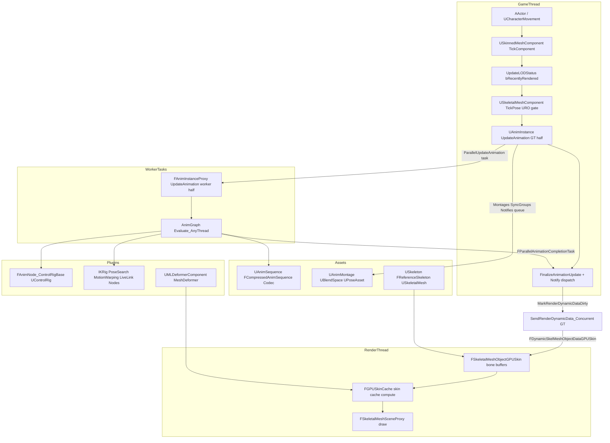

分层说明:
- **组件层(GT)**:`USkinnedMeshComponent::TickComponent`(SkinnedMeshComponent.cpp:1848)决定可见性/LOD/是否 Tick;`USkeletalMeshComponent::TickPose`(SkeletalMeshComponent.cpp:1938)套 URO 闸门后进 `TickAnimation`(1696)→ `TickAnimInstances`(1755)驱动主实例/链接实例/后处理实例。
- **实例层**:`UAnimInstance` 是 UObject 壳(蓝图事件、Montage 状态在 GT),`FAnimInstanceProxy`(AnimInstanceProxy.h:143)是工作线程可用的数据面;Update 阶段被拆成 GT 半场(`UpdateAnimation`,AnimInstance.cpp:669)与 AnyThread 半场(`ParallelUpdateAnimation`→`FAnimInstanceProxy::UpdateAnimation`,AnimInstanceProxy.cpp:1231)。
- **图节点层**:根节点 `FAnimNode_Root` 按 `FPoseLink`/`FComponentSpacePoseLink` 的 LinkID 串成图;每节点实现 Initialize/CacheBones/Update/Evaluate 四个 `*_AnyThread` 入口(AnimNodeBase.h:729-762)。
- **资产层**:序列姿态从 `FCompressedAnimSequence` 经 `UE::Anim::Decompression::DecompressPose`(AnimationDecompression.h:15)解压;Montage/BlendSpace 由 `FAnimTickRecord` + `UE::Anim::FAnimSync` 推进。
- **渲染层**:求值结果落回组件双缓冲数组,经 `SendRenderDynamicData_Concurrent`→`FSkeletalMeshObjectGPUSkin::Update` 以 `ReferenceToLocal` 矩阵上传,RT 上按需走 GPUSkinCache/网格变形器。
- **插件层**:ControlRig 以 `FAnimNode_ControlRigBase` 挂进图内,驱动自身 RigVM;MLDeformer 以 `IMeshDeformerProducer` 在 RT 侧接管变形。

## 13.3 类图

### 13.3.1 动画实例与代理(UAnimInstance 侧)

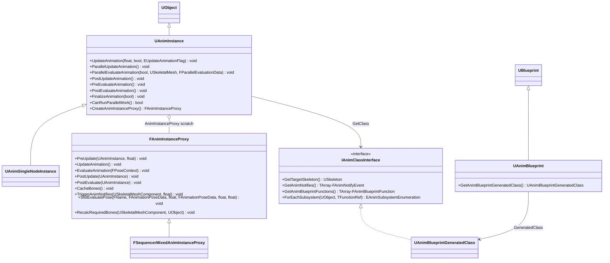

- `UAnimInstance`(Classes/Animation/AnimInstance.h):动画蓝图实例基类,持有 GT 侧状态(MontageInstances、NotifyQueue、ExtractedRootMotion);`typedef FAnimInstanceProxy ProxyType`(AnimInstance.h:362)允许子类换代理。
- `FAnimInstanceProxy`(Public/Animation/AnimInstanceProxy.h:143):"Proxy object passed around during animation tree update in lieu of a UAnimInstance",Update/Evaluate 阶段在 worker 上使用的非 UObject 数据面。
- `IAnimClassInterface`(Classes/Animation/AnimClassInterface.h:187-204):由 `UAnimBlueprintGeneratedClass`(AnimBlueprintGeneratedClass.h:365)实现,提供编译期烘焙数据(通知列表、同步组名、图函数、节点属性表)。
- `FSequencerMixedAnimInstanceProxy`:MovieSceneAnimMixer 注入的混合代理(`struct FSequencerMixedAnimInstanceProxy : public FAnimInstanceProxy`,Plugins/Experimental/MovieSceneAnimMixer/Source/MovieSceneAnimMixer/Public/Systems/MovieSceneAnimInstanceTargetSystem.h:75;AnimInstanceProxy.h:599 友元)。

### 13.3.2 AnimGraph 节点体系(FAnimNode_Base)

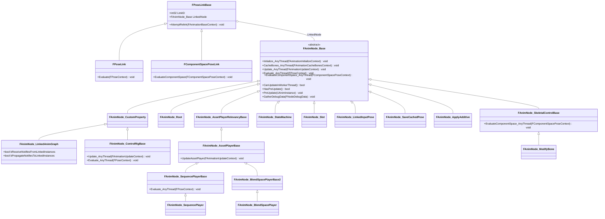

- 继承关系逐条核对:`FAnimNode_Root : FAnimNode_Base`(AnimNode_Root.h:12)、`FAnimNode_StateMachine : FAnimNode_Base`(AnimNode_StateMachine.h:119)、`FAnimNode_AssetPlayerRelevancyBase : FAnimNode_Base`(AnimNode_RelevantAssetPlayerBase.h:13)、`FAnimNode_AssetPlayerBase : FAnimNode_AssetPlayerRelevancyBase`(AnimNode_AssetPlayerBase.h:14)、`FAnimNode_BlendSpacePlayerBase : FAnimNode_AssetPlayerBase`(AnimNode_BlendSpacePlayer.h:15)、`FAnimNode_Slot : FAnimNode_Base`(AnimNode_Slot.h:15)、`FAnimNode_LinkedInputPose : FAnimNode_Base`(AnimNode_LinkedInputPose.h:13)、`FAnimNode_SaveCachedPose : FAnimNode_Base`(AnimNode_SaveCachedPose.h:46)、`FAnimNode_SkeletalControlBase : FAnimNode_Base`(AnimNode_SkeletalControlBase.h:21)。
- 图中 `FAnimNode_BlendSpacePlayerBase2` 即源码 `FAnimNode_BlendSpacePlayerBase`,改名仅为绕过 Mermaid 标识符冲突。
- `FPoseLinkBase`(AnimNodeBase.h:617)以序列化 `LinkID` 在初始化时解析为 `LinkedNode` 指针(`AttemptRelink`,AnimNodeBase.h:670),是图拓扑的物理连接;`FPoseLink::Evaluate`(692)与 `FComponentSpacePoseLink::EvaluateComponentSpace`(709)分别转发两种坐标空间的求值。
- AnimGraphRuntime 节点全景(全部位于 Source/Runtime/AnimGraphRuntime/Public/AnimNodes 与 BoneControllers):ApplyAdditive、BlendListByBool/Enum/Int、BlendSpaceEvaluator/Player/Graph、CopyPoseFromMesh、CurveSource、LayeredBoneBlend、MakeDynamicAdditive、Mirror、ModifyCurve、MultiWayBlend、PoseBlendNode、PoseByName、PoseDriver、PoseSnapshot、RandomPlayer、RefPose、RemoveCurve、RotateRootBone、SequenceEvaluator、Slot、StateResult、Sync、TwoWayBlend;骨骼控制器:AnimDynamics、ApplyLimits、BoneDrivenController、CCDIK、Constraint、CopyBone(Delta)、Fabrik、HandIKRetargeting、LegIK、LookAt、ModifyBone、ObserveBone、ResetRoot、RigidBody、RotationMultiplier、ScaleChainLength、SplineIK、SpringBone。

### 13.3.3 动画资产与压缩

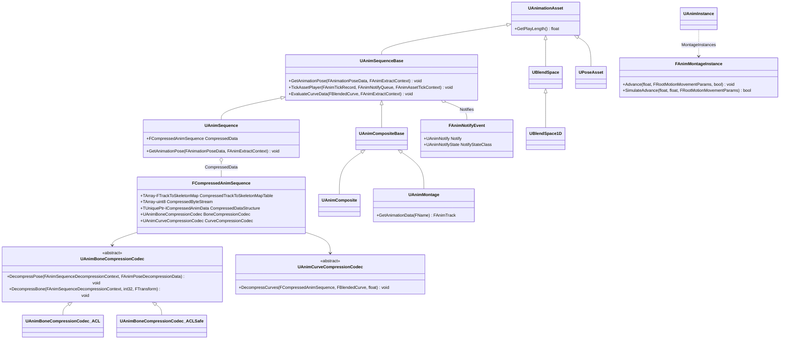

- `UAnimSequence`(Classes/Animation/AnimSequence.h:202)持有 `FCompressedAnimSequence CompressedData`,是 cook 后运行时唯一的骨骼数据来源;`GetAnimationPose`(AnimSequence.h:427)经解压上下文产出姿态。
- `FCompressedAnimSequence`(Public/Animation/AnimCompressionTypes.h:770):`CompressedByteStream` 在非编辑器下是 `TMaybeMappedArray<uint8>`(可与 DDC/inline bulk 数据映射,AnimCompressionTypes.h:793);骨骼数据实际载体是 `CompressedDataStructure`(ICompressedAnimData)。
- 编解码器抽象:`UAnimBoneCompressionCodec`(AnimBoneCompressionCodec.h:26)与 `UAnimCurveCompressionCodec`(AnimCurveCompressionCodec.h:33);ACL 插件提供 `UAnimBoneCompressionCodec_ACL/ACLCustom/ACLDatabase/ACLSafe`(Plugins/Animation/ACLPlugin/Source/ACLPlugin/Classes/AnimBoneCompressionCodec_ACL*.h)与 `UAnimCurveCompressionCodec_ACL`。
- `UBlendSpace` 直接继承 `UAnimationAsset`(BlendSpace.h:470,同时实现 `IInterpolationIndexProvider`);5.8 已无 `UBlendSpaceBase` 中间类;`UBlendSpace1D : UBlendSpace`(BlendSpace1D.h:19)。
- 蒙太奇运行时状态 `FAnimMontageInstance`(AnimMontage.h:342)由 `UAnimInstance::MontageInstances` 持有,`Advance`(588-589)推进时间并输出根运动参数;代理侧的 `FMontageEvaluationState` 数组(`MontageEvaluationData`,AnimInstanceProxy.h:1137)是其 worker 线程快照。

### 13.3.4 骨骼、骨骼网格与渲染对象

```mermaid
classDiagram
    class USkeleton {
        +TArray-FBoneNode BoneTree
        +GetSlotGroupName(FName) FName
        +IsCompatibleMesh(USkinnedAsset, bool) bool
    }
    class FBoneNode {
        +FName Name
        +int32 ParentIndex
    }
    class FReferenceSkeleton {
        +TArray-FMeshBoneInfo FinalRefBoneInfo
        +TArray-FTransform FinalRefBonePose
        +GetRefBonePose() TArray-FTransform
        +GetParentIndex(int32) int32
        +FindBoneIndex(FName) int32
    }
    class FMeshBoneInfo {
        +FName Name
        +int32 ParentIndex
        +FName ExportName
    }
    class USkinnedAsset
    class USkeletalMesh {
        +GetSkeleton() USkeleton
        +GetRefSkeleton() FReferenceSkeleton
        +GetResourceForRendering() FSkeletalMeshRenderData
        +FillComponentSpaceTransforms(TArray-FTransform, TArray-FBoneIndexType, TArray-FTransform) void
    }
    class FSkeletalMeshRenderData {
        +TIndirectArray-FSkeletalMeshLODRenderData LODRenderData
    }
    class USkinnedMeshComponent {
        +TArray-FTransform ComponentSpaceTransformsArray
        +TickPose(float, bool) void
        +SendRenderDynamicData_Concurrent() void
        +FinalizeBoneTransform() void
        +FlipEditableSpaceBases() void
    }
    class USkeletalMeshComponent {
        +TickComponent(float, ELevelTick, FActorComponentTickFunction) void
        +TickAnimation(float, bool) void
        +TickPose(float, bool) void
        +RefreshBoneTransforms(FActorComponentTickFunction) void
        +PerformAnimationProcessing(...) void
        +ParallelAnimationEvaluation() void
        +CompleteParallelAnimationEvaluation(bool) void
        +PostAnimEvaluation(FAnimationEvaluationContext) void
        +DispatchParallelEvaluationTasks(FActorComponentTickFunction) void
        +HandleExistingParallelEvaluationTask(bool, bool) bool
    }
    class FBoneContainer {
        +GetAsset() UObject
        +GetCompactPoseNumBones() int32
        +SetUseRAWData(bool) void
    }
    class FPrimitiveSceneProxy
    class FSkeletalMeshSceneProxy
    class FSkeletalMeshObject {
        <<abstract>>
        +InitResources(FSkinnedMeshSceneProxyDesc) void
        +ReleaseResources() void
        +Update(int32, FSkinnedMeshSceneProxyDynamicData, FPrimitiveSceneProxy, USkinnedAsset, FMorphTargetWeightMap, TArray-float, EPreviousBoneTransformUpdateMode, FExternalMorphWeightData) void
        +GetReferenceToLocalMatrices() TConstArrayView-FMatrix44f
    }
    class FSkeletalMeshObjectGPUSkin
    class FSkeletalMeshObjectCPUSkin
    class FDynamicSkelMeshObjectDataGPUSkin {
        +TArray-FMatrix44f ReferenceToLocal
        +TArray-FMatrix44f PreviousReferenceToLocal
        +FMorphTargetWeightMap ActiveMorphTargets
    }
    class FGPUSkinCache {
        +IsGPUSkinCacheEnabled(ERHIFeatureLevel) bool
        +ProcessEntry(FRHICommandList, FProcessEntryInputs, FGPUSkinCacheEntry) void
    }
    class FGPUSkinCacheEntry
    UObject <|-- USkeleton
    UObject <|-- USkinnedAsset
    USkinnedAsset <|-- USkeletalMesh
    USkeletalMesh *-- FReferenceSkeleton
    FReferenceSkeleton *-- FMeshBoneInfo
    FReferenceSkeleton --> TArray~FTransform~ : FinalRefBonePose
    USkeleton *-- FBoneNode : BoneTree
    USkeletalMesh --> USkeleton
    USkeletalMesh --> FSkeletalMeshRenderData
    USceneComponent <|-- USkinnedMeshComponent
    USkinnedMeshComponent <|-- USkeletalMeshComponent
    USkinnedMeshComponent o-- FSkeletalMeshObject : MeshObject
    FPrimitiveSceneProxy <|-- FSkeletalMeshSceneProxy
    FSkeletalMeshObject <|-- FSkeletalMeshObjectGPUSkin
    FSkeletalMeshObject <|-- FSkeletalMeshObjectCPUSkin
    FSkeletalMeshObjectGPUSkin --> FDynamicSkelMeshObjectDataGPUSkin : DynamicData
    FSkeletalMeshObjectGPUSkin --> FGPUSkinCacheEntry : SkinCacheEntry
    FGPUSkinCache --> FGPUSkinCacheEntry
    FAnimInstanceProxy --> FBoneContainer : RequiredBones
```

- `USkeleton`(Classes/Animation/Skeleton.h:294)是骨骼命名拓扑与槽位/动画索引映射的资产;`FBoneNode`(Skeleton.h:93)是其 `BoneTree` 元素。`IsCompatibleMesh`(Skeleton.h:766)决定动画蓝图能否用于某网格。
- `FReferenceSkeleton`(Public/ReferenceSkeleton.h)是网格内骨骼的紧凑表(`FMeshBoneInfo`(13)+ Raw/Final 两组姿态数组(108-116)),`GetRefBonePose`(267)返回 T-Pose 数组。
- `USkinnedAsset::FillComponentSpaceTransforms`(Classes/Engine/SkinnedAsset.h:234)把本地(骨骼空间)变换按父链前推为组件空间变换,是求值与插值后的最后一步 FK。
- `FSkeletalMeshObject`(Public/SkeletalRenderPublic.h:122)是渲染线程侧"每组件渲染对象"抽象:GPU 蒙皮(`FSkeletalMeshObjectGPUSkin`,Private/SkeletalRenderGPUSkin.h:377)、CPU 蒙皮(`FSkeletalMeshObjectCPUSkin`,Private/SkeletalRenderCPUSkin.h)与 Nanite 蒙皮三实现;组件以 `MeshObject` 指针持有(SkinnedMeshComponent.cpp:1282 构造 GPUSkin 对象)。
- `USkinnedMeshComponent` 以 `ComponentSpaceTransformsArray[2]` 双缓冲组件空间变换(`GetComponentSpaceTransforms()` 读 CurrentReadComponentSpaceTransforms,SkinnedMeshComponent.h:450/1734-1741),由 `FlipEditableSpaceBases` 翻转。
- `FGPUSkinCache`(Public/GPUSkinCache.h:120)按 LOD/Section 缓存蒙皮结果(`FGPUSkinCacheEntry`),供光追、网格变形器与皮肤缓存材质路径复用。

### 13.3.5 RigVM 与 ControlRig

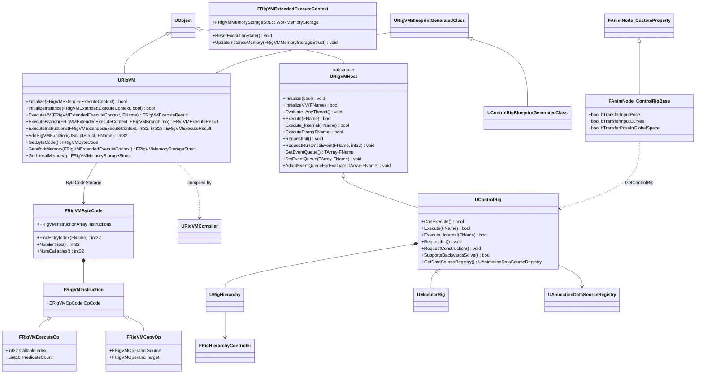

- `URigVMHost`(Plugins/Runtime/RigVM/Source/RigVM/Public/RigVMHost.h)是宿主抽象:持有 `EventQueue`/`EventQueueToRun`、`EvaluateMutex`(FTransactionallySafeCriticalSection,Host.h:113)与外部变量绑定,`Evaluate_AnyThread`(Host.h:110)是 worker 线程总入口。
- `URigVM`(RigVM.h:155)聚合字节码、函数表与三类内存(Literal/Work + 实例 Debug);`ExecuteVM`(211)定位入口 entry 后调私有 `ExecuteInstructions`(221,实现在 RigVM.cpp:1957)按 `ERigVMOpCode` switch 解释执行。
- `FRigVMByteCode`(RigVMCore/RigVMByteCode.h):指令数组 + entry/callable 表 + 谓词分支;指令按操作数个数分为 Unary/Binary/Ternary/Quaternary(RigVMByteCode.h:486-653)。
- `UControlRig`(Plugins/Animation/ControlRig/Source/ControlRig/Public/ControlRig.h:63)继承 URigVMHost 并实现 `IMeshDeformerProducer`;`Execute_Internal`(ControlRig.cpp:1749)最终 `VM->ExecuteVM(Context, InEventName)`(1835)。`UModularRig : UControlRig`(ModularRig.h:168)是模块化嵌套 Rig。事件名常量来自 `FRigUnit_PrepareForExecution::EventName`(构造)与 `FRigUnit_BeginExecution::EventName = "Forwards Solve"`(Units/Execution/RigUnit_BeginExecution.h:29)。
- `FAnimNode_ControlRigBase`(ControlRig/Source/ControlRig/Public/AnimNode_ControlRigBase.h:42)把 ControlRig 接入 AnimGraph,`bTransferInputPose/bTransferPoseInGlobalSpace` 等选项决定输入姿态搬运方式。

## 13.4 数据字典

### 13.4.1 FAnimInstanceProxy(AnimInstanceProxy.h)

| 字段 | 类型 | 含义 | 取值/约束 | 源码位置 |
|---|---|---|---|---|
| ComponentTransform / ComponentRelativeTransform / ActorTransform | FTransform | 组件世界/相对与 Actor 变换快照 | PreUpdate 时在 GT 写入 | AnimInstanceProxy.h:1011-1017 |
| AnimInstanceObject | UObject* | 宿主实例对象指针 | 常驻 | AnimInstanceProxy.h:1020 |
| AnimClassInterface | IAnimClassInterface* | 动画类烘焙数据接口 | 常驻 | AnimInstanceProxy.h:1023 |
| Skeleton / SkeletalMeshComponent / MainInstanceProxy | 指针 | 仅 Pre/Post update 窗口内有效 | InitializeObjects 填、ClearObjects 清(AnimInstanceProxy.cpp:753/801) | AnimInstanceProxy.h:1025-1032 |
| RootNode | FAnimNode_Base* | AnimGraph 根节点 | InitializeRootNode 建立 | AnimInstanceProxy.h:1058 |
| Sync | UE::Anim::FAnimSync | 同步组/标记同步状态机 | PreUpdate 里 Reset | AnimInstanceProxy.h:1067 |
| MachineWeightArrays[2] / StateWeightArrays[2] | TArray&lt;float&gt; | 双缓冲状态机/状态权重 | PostUpdateAnimation 里 FlipBufferWriteIndex | AnimInstanceProxy.h:1070-1073 |
| BufferWriteIndex | int32 | 双缓冲写索引 | 读索引 = 1-写索引 | AnimInstanceProxy.h:1079 |
| NotifyQueue | FAnimNotifyQueue | 本 tick 触发的通知队列 | worker 上填充,GT 派发 | AnimInstanceProxy.h:1082 |
| RootMotionMode | ERootMotionMode::Type | 根运动模式副本 | PreUpdate 拷自实例 | AnimInstanceProxy.h:1085 |
| SlotWeightTracker[2] | TArray&lt;FMontageActiveSlotTracker&gt; | 槽位权重双缓冲 | 按槽名索引 | AnimInstanceProxy.h:1088-1089 |
| AnimationCurves[] | TMap&lt;FName,float&gt; | 按曲线类型(材质/morph/其他)的当前值 | EAnimCurveType::MaxAnimCurveType 个 | AnimInstanceProxy.h:1092 |
| InitializationCounter/CachedBonesCounter/UpdateCounter/EvaluationCounter | FGraphTraversalCounter | 图遍历计数器,防重复初始化/驱动 HasEverBeenUpdated | URO 下 SetMaxSkippedFrames | AnimInstanceProxy.h:1102-1106 |
| ExtractedRootMotion | FRootMotionMovementParams | 自上次消费以来的根运动累积 | PostUpdateAnimation 转存实例 | AnimInstanceProxy.h:1117 |
| RequiredBones | TSharedPtr&lt;FBoneContainer&gt; | 本 LOD 必需骨骼表(组件级共享) | RecalcRequiredBones 重建 | AnimInstanceProxy.h:1123 |
| MontageEvaluationData | TArray&lt;FMontageEvaluationState&gt; | "Copy of UAnimInstance::MontageInstances data used for update & evaluation" | worker 安全的蒙太奇快照 | AnimInstanceProxy.h:1136-1137 |
| GameThreadPreUpdateNodes | TArray&lt;FAnimNode_Base*&gt; | 声明 HasPreUpdate 的节点,GT PreUpdate 轮询 | LOD 可摘除 | AnimInstanceProxy.h:1144 |
| NumUroSkippedFrames_Update/Eval | int16 | URO 将跳过的帧数 | InitializeObjects 计算 | AnimInstanceProxy.h:1132-1133 |

### 13.4.2 求值上下文与姿态(AnimNodeBase.h / BonePose.h / BoneContainer.h)

| 类型 | 字段 | 含义 | 约束 | 位置 |
|---|---|---|---|---|
| FPoseContext | Pose: FCompactPose;Curve: FBlendedCurve;CustomAttributes: FStackAttributeContainer | 本地空间求值输出 | "allocated using MemStack. You should not use it outside of stack" | AnimNodeBase.h:345-352 |
| FComponentSpacePoseContext | Pose: FCSPose&lt;FCompactPose&gt;;Curve;CustomAttributes | 组件空间求值输出 | 仅骨骼控制器/CS 节点 | AnimNodeBase.h:463-468 |
| FAnimationUpdateContext | DeltaTime、CurrentWeight、RootMotionWeightModifier | Update 阶段上下文 | GetFinalBlendWeight/GetDeltaTime | AnimNodeBase.h:220-341 |
| FCompactPose | 继承 FBaseCompactPose&lt;FAnimStackAllocator&gt; | 紧凑骨骼变换数组 | 分配于线程局部 MemStack | BonePose.h:346 |
| FMeshPose | FBasePose&lt;FMeshPoseBoneIndex, FDefaultAllocator&gt; | 网格骨骼序姿态 | 与 FBoneContainer 换算 | BonePose.h:359 |
| FBoneContainer | GetAsset()/GetCompactPoseNumBones()/SetUseRAWData() | RequiredBones 的宿主:mesh 索引↔紧凑索引映射、参考姿态缓存 | LOD 变化时重建 | BoneContainer.h:191-413 |
| FAnimTickRecord | SourceAsset、TimeAccumulator、EffectiveBlendWeight、MarkerTickRecord | 单个资产播放器的推进记录 | 由 Sync.TickAssetPlayerInstances 消费 | Classes/Animation/AnimationAsset.h:382 |
| FAnimationEvaluationContext | bDoEvaluation/bDoInterpolation/bDuplicateToCacheBones/bForceRefPose + 双缓冲变换/曲线/属性 | worker 求值的全部输入输出 | 组件与求值上下文缓冲 Exchange | Classes/Components/SkeletalMeshComponent.h:86-130 |

### 13.4.3 压缩数据(FCompressedAnimSequence,AnimCompressionTypes.h)

| 字段 | 类型 | 含义 | 取值/约束 | 位置 |
|---|---|---|---|---|
| CompressedTrackToSkeletonMapTable | TArray&lt;FTrackToSkeletonMap&gt; | 压缩轨道→骨骼树索引映射 | 加性烘焙可致轨道数与原始不同 | AnimCompressionTypes.h:780 |
| IndexedCurveNames | TArray&lt;FAnimCompressedCurveIndexedName&gt; | 曲线名→压缩缓冲索引(按 FName 排序) | RebuildCurveIndexTable 维护 | AnimCompressionTypes.h:783 |
| CompressedByteStream | WITH_EDITOR: TArray&lt;uint8&gt;+FByteBulkData;否则 TMaybeMappedArray&lt;uint8&gt; | 字节流,布局由编解码器决定 | 可映射到 DDC/内联 bulk | AnimCompressionTypes.h:789-794 |
| CompressedCurveByteStream | TArray&lt;uint8&gt; | 曲线压缩流 | 曲线编解码器解读 | AnimCompressionTypes.h:797 |
| CompressedDataStructure | TUniquePtr&lt;ICompressedAnimData&gt; | 骨骼压缩数据对象(编解码器自描述) | 由 BoneCompressionCodec 生成 | AnimCompressionTypes.h:800 |
| BoneCompressionCodec / CurveCompressionCodec | TObjectPtr | 选定的骨骼/曲线编解码器 | 压缩设置资产决定 | AnimCompressionTypes.h:803-806 |

### 13.4.4 渲染侧动态数据(FDynamicSkelMeshObjectDataGPUSkin,Private/SkeletalRenderGPUSkin.h)

| 字段 | 类型 | 含义 | 约束 | 位置 |
|---|---|---|---|---|
| ReferenceToLocal | TArray&lt;FMatrix44f&gt; | 参考姿态→本地(骨骼空间)蒙皮矩阵 | InitDynamicSkelMeshObjectDataGPUSkin 中由组件变换计算 | SkeletalRenderGPUSkin.h:85 |
| ReferenceToLocalForRayTracing | TArray&lt;FMatrix44f&gt; | 光追 LOD 专用矩阵集 | RT LOD 与光栅 LOD 不同时 | SkeletalRenderGPUSkin.h:86 |
| PreviousReferenceToLocal | TArray&lt;FMatrix44f&gt; | 上一帧矩阵(运动模糊/速度) | EPreviousBoneTransformUpdateMode 控制 | SkeletalRenderGPUSkin.h:89 |
| BoneTransformFrameNumber / RevisionNumber / PreviousRevisionNumber | uint32 | 骨骼数据版本号与帧号 | 与组件 UpdateBoneTransformRevisionNumber 对应 | SkeletalRenderGPUSkin.h:100-102 |
| ActiveMorphTargets / MorphTargetWeights / NumWeightedActiveMorphTargets | FMorphTargetWeightMap / TArray&lt;float&gt; / int32 | 活动 morph 目标及权重 | 决定 MorphVertexBuffer 更新 | SkeletalRenderGPUSkin.h:110-117 |
| ClothingSimData / ClothObjectLocalToWorld / ClothBlendWeight | TMap&lt;int32,FClothSimulData&gt; / FMatrix / float | 布料顶点写回数据 | 由 IClothSimulationDataProvider 提供 | SkeletalRenderGPUSkin.h:129-135 |
| GPUSkinTechnique | ESkeletalMeshGPUSkinTechnique | Inline / GPUSkinCache / MeshDeformer | 逐 LOD 决定蒙皮技术路线 | SkeletalRenderGPUSkin.h:162 |

### 13.4.5 RigVM 执行结构(RigVM 插件)

| 类型 | 字段 | 含义 | 位置 |
|---|---|---|---|
| URigVM::ByteCodeStorage | FRigVMByteCode | 序列化的指令容器(UPROPERTY) | RigVM.h:344 |
| URigVM::LiteralMemoryStorage | FRigVMMemoryStorageStruct | 编译期生成的常量内存(CDO) | RigVM.h:313 |
| URigVM::DefaultWorkMemoryStorage | FRigVMMemoryStorageStruct | 实例工作内存的初始模板 | RigVM.h:316 |
| FRigVMExtendedExecuteContext.WorkMemoryStorage | FRigVMMemoryStorageStruct | 每实例工作内存(含外部变量绑定) | RigVM.h:255-262(GetWorkMemory) |
| ERigVMMemoryType | Work/Literal/External/Debug 四类 | `static_assert((int32)ERigVMMemoryType::Num == 4)` | RigVMMemoryCommon.h:40;RigVM.cpp:2001 |
| FRigVMInstruction | OpCode + 指令体 | Execute/InvokeCallable/Copy/Zero/BoolTrue/Increment/Equals/JumpAbsolute(JumpIf) 等操作码 | RigVMByteCode.h;执行 switch 见 RigVM.cpp:2082-2395 |
| FRigVMExecuteOp | CallableIndex、PredicateCount | 调用宿主函数表项(Functions[Op.CallableIndex]->FunctionPtr) | RigVM.cpp:2084-2111 |
| FRigVMOperand | MemoryType+RegisterIndex+Offset | 内存定位;运行前经 PreCachedMemoryHandles 预解析为句柄 | RigVM.cpp:2095/2232 |
| URigVMHost::EventQueue / EventQueueToRun | TArray&lt;FName&gt; | 本帧要跑的事件序列;Evaluate_AnyThread 期间锁定 | RigVMHost.h:541-542 |
| FRigVMExecuteResult | Failed / Succeeded / Halted(仅 WITH_EDITOR 断点) | 执行结果枚举 | RigVMMemoryStorage.h:45-51 |

### 13.4.6 其他关键类型速查

| 类型 | 位置 | 要点 |
|---|---|---|
| FAnimNotifyQueue | Public/Animation/AnimNotifyQueue.h:169 | worker 阶段累积通知,PostUpdate 拷回实例后 GT 派发 |
| FRootMotionMovementParams | Classes/Animation/AnimationAsset.h:678 | 根运动累积容器(Accumulate/AccumulateWithBlend/MakeUpToFullWeight,AnimInstance.cpp:904-925 使用) |
| IAnimRootMotionProvider | Public/Animation/AnimRootMotionProvider.h:19 | AnimationWarping 注册的 IModularFeature("AnimationWarping"),以根运动属性(Attribute)方式注入 |
| FRootMotionReset | Public/Animation/AnimCompressionTypes.h:856 | 根骨骼锁定策略(AnimFirstFrame/Zero/RefPose)在解压时重置根骨 |
| FParallelEvaluationData | AnimInstance.h:62 | ParallelEvaluateAnimation 的输出打包:OutCurve/OutPose/OutAttributes |
| FClothingSimulationInstance | ClothingSystemRuntimeInterface/ClothingSimulationInstance.h | 组件与布料模拟间上下文/交互器/数据回写的实例封装 |
| FSkinnedMeshSceneProxyDynamicData | Public/SkinnedMeshSceneProxyDesc.h:136 | GT→RT 动态数据包:ComponentSpaceTransforms 视图、RevisionNumber、蒙皮矩阵视图等 |
| FBoneTransforms | Public/SkeletalRenderPublic.h:230 | 当前/上一帧 FMatrix44f 视图 + 修订号 + 更新模式 |
| FSkeletalMeshObjectLODInfo | Public/SkeletalRenderPublic.h:397 | 每 LOD 隐藏材质、ScreenSize、LODHysteresis |
| FSkeletalMeshAttributes | Source/Runtime/SkeletalMeshDescription/Public/SkeletalMeshAttributes.h:228 | FMeshDescription 的蒙皮扩展:顶点权重属性(SkinWeights,profile 化)、骨骼索引/权重访问(FSkinWeightsVertexAttributesRef) |

## 13.5 接口清单

以下原型逐字抄自头文件(仅去掉 `*_API` 宏),`路径:行号` 相对 `$E`。线程约束缩写:GT=GameThread、WT=TaskGraph 工作线程、RT=RenderThread、Any=任意线程。

### 13.5.1 USkeletalMeshComponent(Classes/Components/SkeletalMeshComponent.h)

| 原型 | 功能 | 参数与返回 | 线程/约束 | 位置 |
|---|---|---|---|---|
| `void TickComponent(float DeltaTime, enum ELevelTick TickType, FActorComponentTickFunction *ThisTickFunction)` | 组件 Tick 入口 | — | GT(`PrimaryComponentTick.bRunOnAnyThread=false` 时;bEnableAnimation=false 时可转 WT) | Classes/Components/SkeletalMeshComponent.h:1964 |
| `void TickPose(float DeltaTime, bool bNeedsValidRootMotion)` | URO 闸门 + 调 TickAnimation | — | GT | Classes/Components/SkeletalMeshComponent.h:2187 |
| `void TickAnimation(float DeltaTime, bool bNeedsValidRootMotion)` | 驱动全部动画实例 | — | GT | Classes/Components/SkeletalMeshComponent.h:1804 |
| `void RefreshBoneTransforms( FActorComponentTickFunction* TickFunction = NULL )` | 决定并分派(并行)求值 | — | GT,`check(IsInGameThread())`(SkeletalMeshComponent.cpp:2872) | Classes/Components/SkeletalMeshComponent.h:2182 |
| `void PerformAnimationProcessing(const USkeletalMesh* InSkeletalMesh, UAnimInstance* InAnimInstance, bool bInDoEvaluation, bool bInForceRefPose, TArray<FTransform>& OutSpaceBases, TArray<FTransform>& OutBoneSpaceTransforms, FVector& OutRootBoneTranslation, FBlendedHeapCurve& OutCurve, UE::Anim::FMeshAttributeContainer& OutAttributes)` | worker 求值主体:并行 Update→Evaluate→FK | 输出组件空间/骨骼空间变换、曲线、属性 | WT(并行路径)或 GT(串行路径) | Classes/Components/SkeletalMeshComponent.h:2258 |
| `void ParallelAnimationEvaluation()` | 调 PerformAnimationProcessing + ParallelDuplicateAndInterpolate + UpdateCurvesToEvaluationContext | — | WT(FParallelAnimationEvaluationTask 内) | Classes/Components/SkeletalMeshComponent.h:2707 |
| `ENGINE_API virtual void CompleteParallelAnimationEvaluation(bool bDoPostAnimEvaluation)` | 回收任务、换缓冲并触发 PostAnimEvaluation | — | GT(FParallelAnimationCompletionTask) | Classes/Components/SkeletalMeshComponent.h:2708 |
| `ENGINE_API bool HandleExistingParallelEvaluationTask(bool bBlockOnTask, bool bPerformPostAnimEvaluation)` | 等待/完成在途求值任务 | bBlockOnTask=true 时 `FTaskGraphInterface::Get().WaitUntilTaskCompletes(..., ENamedThreads::GameThread)` | GT only(`check(IsInGameThread())`,cpp:5024) | Classes/Components/SkeletalMeshComponent.h:2718 |
| `ENGINE_API void PostAnimEvaluation(FAnimationEvaluationContext& EvaluationContext)` | GT 收尾:PostUpdate、曲线应用、物理写回、FinalizeAnimationUpdate | — | GT | Classes/Components/SkeletalMeshComponent.h:2271 |
| `ENGINE_API void RecalcRequiredBones(int32 LODIndex)` | 重建 RequiredBones | — | GT | Classes/Components/SkeletalMeshComponent.h:1868 |

### 13.5.2 USkinnedMeshComponent 与渲染对象

| 原型 | 功能 | 参数与返回 | 线程/约束 | 位置 |
|---|---|---|---|---|
| `ENGINE_API virtual void SendRenderDynamicData_Concurrent() override;` | 把骨骼/曲线/morph 动态数据发往渲染对象 | — | GT(End-Of-Frame 更新阶段,可并发于其他组件) | Classes/Components/SkinnedMeshComponent.h:1346(SkinnedMeshComponent.cpp:1496 实现) |
| `ENGINE_API virtual void FinalizeBoneTransform();` | 翻转骨骼缓冲并标记有效(USkeletalMeshComponent 重写并追加通知派发/委托广播,SkeletalMeshComponent.cpp:5167-5191) | — | GT(PostAnimEvaluation/EndPhysics 之后) | Classes/Components/SkinnedMeshComponent.h:1712(SkinnedMeshComponent.cpp:4883) |
| `void FlipEditableSpaceBases()` | 双缓冲 ComponentSpaceTransforms 翻转 + 推 RevisionNumber | — | GT | SkinnedMeshComponent.cpp:4900 |
| `void Update(int32 LODIndex, const USkinnedMeshComponent* InMeshComponent, const FMorphTargetWeightMap& InActiveMorphTargets, const TArray<float>& MorphTargetWeights, EPreviousBoneTransformUpdateMode PreviousBoneTransformUpdateMode, const FExternalMorphWeightData& InExternalMorphWeightData)` | 组件→渲染对象动态数据入口(包装 FSkinnedMeshSceneProxyDynamicData) | — | GT | Public/SkeletalRenderPublic.h:147(SkeletalRender.cpp:370) |
| `virtual void Update(int32 LODIndex, const FSkinnedMeshSceneProxyDynamicData& InDynamicData, const FPrimitiveSceneProxy* InSceneProxy, const USkinnedAsset* InSkinnedAsset, const FMorphTargetWeightMap& InActiveMorphTargets, const TArray<float>& InMorphTargetWeights, EPreviousBoneTransformUpdateMode PreviousBoneTransformUpdateMode, const FExternalMorphWeightData& InExternalMorphWeightData) = 0` | 渲染对象更新纯虚接口 | — | GT 调用,内部转 RT | Public/SkeletalRenderPublic.h:148 |
| `virtual void InitResources(const FSkinnedMeshSceneProxyDesc& InMeshDesc) = 0` | 初始化各 LOD 渲染资源 | — | GT 调用,RT 执行 | Public/SkeletalRenderPublic.h:133 |
| `virtual TConstArrayView<FMatrix44f> GetReferenceToLocalMatrices() const = 0` | 当前蒙皮矩阵视图 | — | RT | Public/SkeletalRenderPublic.h:203 |
| `static bool IsGPUSkinCacheEnabled(ERHIFeatureLevel::Type FeatureLevel)` | SkinCache 可用性(r.SkinCache.Mode 等) | — | 任意 | Public/GPUSkinCache.h:180 |
| `void ProcessEntry(FRHICommandList& RHICmdList, const FProcessEntryInputs& Inputs, FGPUSkinCacheEntry*& InOutEntry)` | 蒙皮缓存计算通道派发 | — | RT | Public/GPUSkinCache.h:170 |

### 13.5.3 UAnimInstance / FAnimInstanceProxy

| 原型 | 功能 | 线程 | 位置 |
|---|---|---|---|
| `ENGINE_API void UpdateAnimation(float DeltaSeconds, bool bNeedsValidRootMotion, EUpdateAnimationFlag UpdateFlag = EUpdateAnimationFlag::Default )` | Update 的 GT 半场(蒙太奇、Native/Blueprint Update) | GT | Classes/Animation/AnimInstance.h:1408 |
| `ENGINE_API void ParallelUpdateAnimation()` | Update 的 worker 半场(`GetProxyOnAnyThread<FAnimInstanceProxy>().UpdateAnimation()`) | Any | Classes/Animation/AnimInstance.h:1411 |
| `ENGINE_API void ParallelEvaluateAnimation(bool bForceRefPose, const USkeletalMesh* InSkeletalMesh, FParallelEvaluationData& OutAnimationPoseData)` | worker 上求值 AnimGraph 产出 OutPose/OutCurve/OutAttributes | Any | Classes/Animation/AnimInstance.h:1423 |
| `ENGINE_API void PreEvaluateAnimation()` | 求值前把 UObject 指针重新装入代理 | GT | Classes/Animation/AnimInstance.h:1417 |
| `ENGINE_API void PostUpdateAnimation()` | 求值完成:翻缓冲、拷通知队列、累积根运动 | GT | Classes/Animation/AnimInstance.h:1414 |
| `ENGINE_API void PostEvaluateAnimation()` | Native/BlueprintPostEvaluate + 代理 PostEvaluate(ClearObjects) | GT | Classes/Animation/AnimInstance.h:1429 |
| `ENGINE_API void FinalizeAnimation(bool bWasEvaluated)` | 无论是否求值都执行的收尾虚函数 | GT | Classes/Animation/AnimInstance.h:1431 |
| `ENGINE_API virtual void NativeThreadSafeUpdateAnimation(float DeltaSeconds)` | 线程安全 Native Update 钩子 | Any | Classes/Animation/AnimInstance.h:1442 |
| `virtual bool CanRunParallelWork() const { return true; }` | 是否允许并行 Update/Eval(编辑器调试/断点会强制 false) | GT | Classes/Animation/AnimInstance.h:506 |
| `virtual void PreUpdate(UAnimInstance* InAnimInstance, float DeltaSeconds)` | 代理预更新:拷贝变换/LOD/根运动模式、重置通知与同步、跑 GameThreadPreUpdateNodes | GT | Public/Animation/AnimInstanceProxy.h:612 |
| `ENGINE_API void UpdateAnimation()` | 代理侧图更新总入口(CacheBones→线程安全 Update→RootNode Update→Sync.TickAssetPlayerInstances) | Any | Public/Animation/AnimInstanceProxy.h:685 |
| `ENGINE_API void EvaluateAnimation(FPoseContext& Output)` | 代理侧求值入口(Evaluate_WithRoot 或 EvaluateAnimationNode_WithRoot) | Any | Public/Animation/AnimInstanceProxy.h:691 |
| `ENGINE_API void TriggerAnimNotifies(USkeletalMeshComponent* SkelMeshComp, float DeltaSeconds)` | 代理通知队列触发(委托给实例 NotifyQueue 派发路径) | GT | Public/Animation/AnimInstanceProxy.h:254 |
| `ENGINE_API void SlotEvaluatePose(const FName& SlotNodeName, const FAnimationPoseData& SourceAnimationPoseData, float InSourceWeight, FAnimationPoseData& OutBlendedAnimationPoseData, float InBlendWeight, float InTotalNodeWeight)` | 蒙太奇槽位姿态混合(worker 安全,读 MontageEvaluationData) | Any | Public/Animation/AnimInstanceProxy.h:439 |
| `ENGINE_API void RecalcRequiredBones(USkeletalMeshComponent* Component, UObject* Asset)` | 由组件触发重建代理 RequiredBones | GT | Public/Animation/AnimInstanceProxy.h:778 |
| `ENGINE_API virtual void UpdateCurvesPostEvaluation(USkeletalMeshComponent* SkelMeshComp)` | 求值后把曲线推向材质/morph | GT | Public/Animation/AnimInstanceProxy.h:969 |

### 13.5.4 FAnimNode_Base(AnimNodeBase.h:729-810)与资产节点

| 原型 | 功能 | 线程 | 位置 |
|---|---|---|---|
| `virtual void Initialize_AnyThread(const FAnimationInitializeContext& Context)` | 节点(重)初始化 | Any | AnimNodeBase.h:729 |
| `virtual void CacheBones_AnyThread(const FAnimationCacheBonesContext& Context)` | 缓存 FBoneReference 等 | Any | AnimNodeBase.h:737 |
| `virtual void Update_AnyThread(const FAnimationUpdateContext& Context)` | 更新权重/时间/触发输入绑定 | Any | AnimNodeBase.h:746 |
| `virtual void Evaluate_AnyThread(FPoseContext& Output)` | 本地空间求值 | Any | AnimNodeBase.h:754 |
| `virtual void EvaluateComponentSpace_AnyThread(FComponentSpacePoseContext& Output)` | 组件空间求值(与上者二选一) | Any | AnimNodeBase.h:762 |
| `virtual bool CanUpdateInWorkerThread() const` | 任一节点返回 false 则整图回退 GT 更新 | GT(CDO 上调用) | AnimNodeBase.h:779 |
| `virtual bool HasPreUpdate() const` / `virtual void PreUpdate(const UAnimInstance* InAnimInstance)` | 声明并执行 GT 预更新(收集非线程安全数据) | GT | AnimNodeBase.h:787/790 |
| `virtual void OnInitializeAnimInstance(const FAnimInstanceProxy* InProxy, const UAnimInstance* InAnimInstance)` | 实例创建时的一次性初始化 | GT | AnimNodeBase.h:902 |
| `const FExposedValueHandler& GetEvaluateGraphExposedInputs() const` | 取编译期生成的属性绑定执行器 | Any | AnimNodeBase.h:820 |
| `void Evaluate_AnyThread(FPoseContext& Output)`(FAnimNode_SequencePlayerBase) | 序列播放求值(经解压) | Any | Classes/Animation/AnimNode_SequencePlayer.h:36 |
| `ENGINE_API UAnimInstance* GetLinkedAnimGraphInstanceByTag(FName InTag) const;`(UAnimInstance) | 取链接 AnimGraph 实例 | GT | Classes/Animation/AnimInstance.h:850 |

### 13.5.5 资产与压缩

| 原型 | 功能 | 线程 | 位置 |
|---|---|---|---|
| `ENGINE_API virtual void GetAnimationPose(FAnimationPoseData& OutAnimationPoseData, const FAnimExtractContext& ExtractionContext) const` | 序列姿态解压输出 | Any | Classes/Animation/AnimSequence.h:427 |
| `virtual void TickAssetPlayer(FAnimTickRecord& Instance, struct FAnimNotifyQueue& NotifyQueue, FAnimAssetTickContext& Context) const {}`(UAnimationAsset) | 资产播放器推进(时间、循环、通知入队) | Any | Classes/Animation/AnimationAsset.h:1058 |
| `ENGINE_API void DecompressPose(FCompactPose& OutPose, const FCompressedAnimSequence& CompressedData, const FAnimExtractContext& ExtractionContext, FAnimSequenceDecompressionContext& DecompressionContext, const TArray<FTransform>& RetargetTransforms, const FRootMotionReset& RootMotionReset)` | 姿态解压统一入口 | Any | Public/Animation/AnimationDecompression.h:15 |
| `ENGINE_API virtual void DecompressPose(FAnimSequenceDecompressionContext& DecompContext, const UE::Anim::FAnimPoseDecompressionData& DecompressionData) const` | 骨骼编解码器新接口 | Any | Classes/Animation/AnimBoneCompressionCodec.h:109 |
| `virtual void DecompressCurves(const FCompressedAnimSequence& AnimSeq, FBlendedCurve& Curves, float CurrentTime) const` | 曲线编解码器接口 | Any | Classes/Animation/AnimCurveCompressionCodec.h:85 |
| `ENGINE_API bool IsCompatibleMesh(const USkinnedAsset* InSkinnedAsset, bool bDoParentChainCheck=true) const` | 骨架兼容性 | GT | Classes/Animation/Skeleton.h:766 |
| `ENGINE_API void FillComponentSpaceTransforms(const TArray<FTransform>& InBoneSpaceTransforms, const TArray<FBoneIndexType>& InFillComponentSpaceTransformsRequiredBones, TArray<FTransform>& OutComponentSpaceTransforms) const` | 本地→组件空间 FK | Any | Classes/Engine/SkinnedAsset.h:234 |

### 13.5.6 URigVM / URigVMHost / UControlRig

| 原型 | 功能 | 线程 | 位置 |
|---|---|---|---|
| `RIGVM_API virtual bool Initialize(FRigVMExtendedExecuteContext& Context)` | 预备缓存与内存 | GT(通常) | Plugins/Runtime/RigVM/Source/RigVM/Public/RigVMCore/RigVM.h:204 |
| `RIGVM_API virtual ERigVMExecuteResult ExecuteVM(FRigVMExtendedExecuteContext& Context, const FName& InEntryName = NAME_None)` | 从入口执行字节码 | Any(线程安全靠宿主锁) | RigVM.h:211 |
| `RIGVM_API ERigVMExecuteResult ExecuteBranch(FRigVMExtendedExecuteContext& Context, const FRigVMBranchInfo& InBranchToRun)` | 执行单条惰性分支 | Any | RigVM.h:218 |
| `RIGVM_API virtual int32 AddRigVMFunction(UScriptStruct* InRigVMStruct, const FName& InMethodName)` | 注册执行函数指针 | GT(编译/初始化) | RigVM.h:228 |
| `UE_API virtual void Evaluate_AnyThread()` | 宿主 worker 总入口(锁 EventQueue、跑事件队列) | Any | Plugins/Runtime/RigVM/Source/RigVM/Public/RigVMHost.h:110 |
| `UE_API virtual bool Execute(const FName& InEventName)` | 单事件执行(带前后事件广播) | Any | RigVMHost.h:218 |
| `UE_API virtual void RequestRunOnceEvent(const FName& InEventName, int32 InEventIndex = -1)` | 请求一次性事件(如构造) | 任意(内部临界区) | RigVMHost.h:289 |
| `CONTROLRIG_API virtual bool Execute_Internal(const FName& InEventName)` | UControlRig 事件执行:VM->ExecuteVM | Any | Plugins/Animation/ControlRig/Source/ControlRig/Public/ControlRig.h:278(ControlRig.cpp:1749) |
| `CONTROLRIG_API virtual void AdaptEventQueueForEvaluate(TArray<FName>& InOutEventQueueToRun)` | 在事件队列插入 Pre/Post 构造与前向求解事件 | Any | ControlRig.h(ControlRig.cpp:1876) |
| `UE_API virtual void OnInitializeAnimInstance(const FAnimInstanceProxy* InProxy, const UAnimInstance* InAnimInstance) override`(FAnimNode_ControlRigBase) | AnimGraph 挂接时初始化 Rig | GT | ControlRig/Source/ControlRig/Public/AnimNode_ControlRigBase.h:56 |

### 13.5.7 委托、通知与扩展接口

| 接口/委托 | 声明 | 触发时机(线程) | 位置 |
|---|---|---|---|
| `FOnBoneTransformsFinalizedMultiCast OnBoneTransformsFinalizedMC` | 多播委托 | USkeletalMeshComponent::FinalizeBoneTransform 末尾,骨骼最终化后(GT) | Private/Components/SkeletalMeshComponent.cpp:5188 |
| `FOnLODRequiredBonesUpdate OnLODRequiredBonesUpdate_Static` | 静态多播 | LOD 变化重算 RequiredBones 后(GT) | SkeletalMeshComponent.cpp:147 |
| `DECLARE_DELEGATE_RetVal(bool, FCanTakeTransition)` + `FOnGraphStateChanged` | 状态机原生转换/进出状态绑定 | AddNativeTransitionBinding 注册,GT 注册、AnyThread 判定 | Public/Animation/AnimInstanceProxy.h:72-73 |
| `virtual void Notify(USkeletalMeshComponent* MeshComp, UAnimSequenceBase* Animation, const FAnimNotifyEventReference& EventReference)` / `NotifyBegin(..., float TotalDuration, ...) / NotifyTick(..., float FrameDeltaTime, ...) / NotifyEnd(...)` | 通知事件虚函数 | GT(TriggerAnimNotifies 内,AnimInstance.cpp:1978/2005/2034) | Classes/Animation/AnimNotifies/AnimNotify.h:85、AnimNotifies/AnimNotifyState.h:74-76 |
| `IAnimRootMotionProvider : IModularFeature` | ModularFeature 名 "AnimationWarping" | AnyThread(以姿态属性方式读/写根运动) | Public/Animation/AnimRootMotionProvider.h:19-39 |
| `IAnimClassInterface::ForEachSubsystem(UObject*, TFunctionRef<...>)` | AnimSubsystem(FAnimSubsystemInstance)枚举 | GT 与 AnyThread 分别有 OnPreUpdate_GameThread / OnPreUpdate_WorkerThread 路径 | Classes/Animation/AnimClassInterface.h;AnimInstance.cpp:781/1340 |
| `IMeshDeformerProducer`(UControlRig 实现) | 网格变形数据生产者 | RT(DeformerGraph/MLDeformer 消费) | ControlRig.h:63 |
| `IAnimationDataSourceRegistry`(UControlRig::GetDataSourceRegistry) | ControlRig 与外部数据源(LiveLink 等)桥 | Any | ControlRig.h |
| `IClothingSimulation / IClothingSimulationInteractor`(ClothingSystemRuntimeInterface) | 布料模拟与交互抽象 | 模拟 WT、交互器 GT | ClothingSystemRuntimeInterface/Public/ClothingSimulationInterface.h |

## 13.6 关键流程

### 13.6.1 每帧动画主管线(含并行分派决策)

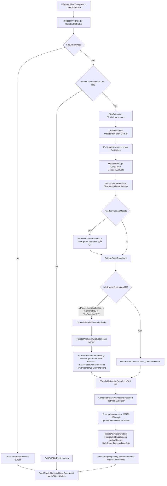

关键分支依据:
- `bDoPAE = a.ParallelAnimEvaluation && FApp::ShouldUseThreadingForPerformance()`(SkeletalMeshComponent.cpp:2915);`bDoParallelEvaluation` 还要求 `HasValidAnimationInstance() && 主/后处理实例 CanRunParallelWork() && (bShouldDoEvaluation || bShouldDoParallelInterpolation) && TickFunction->IsCompletionHandleValid()`(2917-2920)。
- `NeedsImmediateUpdate`(AnimInstance.cpp:1020-1044)在根运动 RootMotionFromEverything、编辑器调试对象/断点、`a.ParallelAnimUpdate==0`、`a.ParallelAnimEvaluation==0`、DeltaTime==0 等情况为真,Update 内联在 GT 完成。
- worker 任务优先级:`CPrio_ParallelAnimationEvaluationTask` = ENamedThreads::HighThreadPriority + NormalTaskPriority(高优先级线程)否则普通线程 HighTaskPriority(SkeletalMeshComponent.cpp:138-144);完成任务跑在 `GameThread | HighTaskPriority`(受 `TaskGraph.TaskPriorities.ParallelAnimCompletionTaskHighPriority` 控制,130-136)。

### 13.6.2 动画实例初始化(InitAnim)

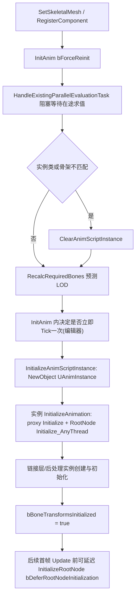

依据:InitAnim(SkeletalMeshComponent.cpp:1151 起)阻塞在途任务(1177)、RecalcRequiredBones(1196);InitializeOnRegister/OnRegister(1018-1075);代理延迟根初始化在 UpdateAnimation_WithRoot(AnimInstanceProxy.cpp:1298-1321)。

### 13.6.3 通知(Notify)收集与派发

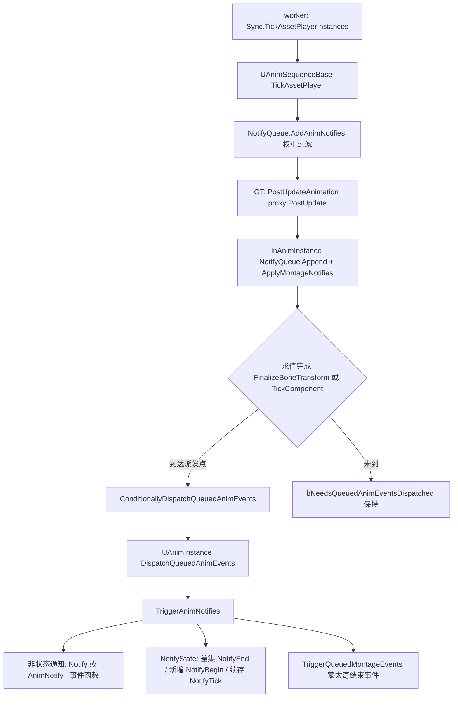

依据:通知入队在 worker 的 TickAssetPlayer 路径;`FAnimInstanceProxy::PostUpdate`(AnimInstanceProxy.cpp:670-671)`InAnimInstance->NotifyQueue.Append(NotifyQueue)`;派发点在 `USkeletalMeshComponent::FinalizeBoneTransform`(SkeletalMeshComponent.cpp:5186 ConditionallyDispatchQueuedAnimEvents)与 `USkeletalMeshComponent::TickComponent`(SkeletalMeshComponent.cpp:2101-2110);差集算法在 `UAnimInstance::TriggerAnimNotifies`(AnimInstance.cpp:1820-2037)。过滤 CVar `a.Notifies.DispatchPolicy`(181)。

### 13.6.4 RequiredBones 重算(LOD 变化)

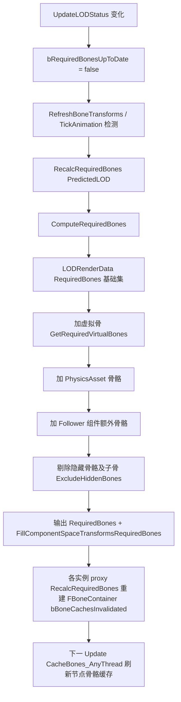

依据:ComputeRequiredBones(SkeletalMeshComponent.cpp:2198-2259);`OnPreUpdateLODChanged` 摘除低 LOD 不启用节点的 PreUpdate(AnimInstanceProxy.cpp:560-600)。

### 13.6.5 RigVM 指令执行循环

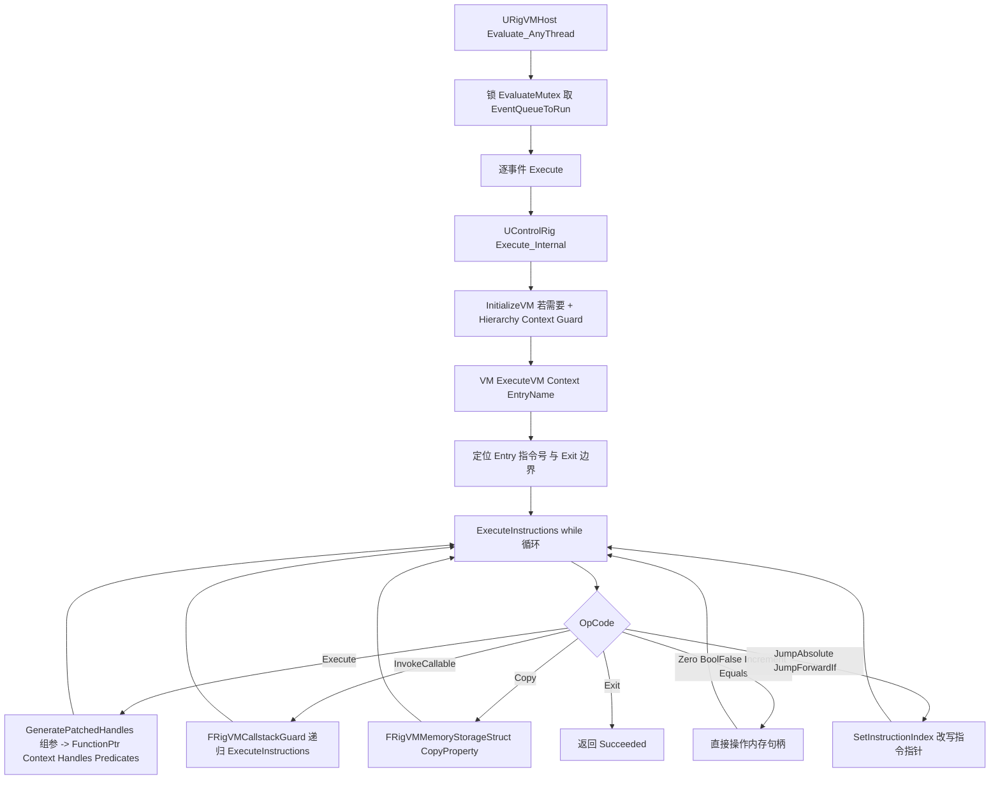

依据:RigVM.cpp:1701(ExecuteVM)、1957-2395(ExecuteInstructions switch);函数调用 `(*Function->FunctionPtr)(Context, Handles, Predicates)`(2110);分支/谓词 FRigVMPredicateBranchArray(2098-2102);事件队列适配 ControlRig.cpp:1876-1937。

### 13.6.6 布料 Tick 与并行布料

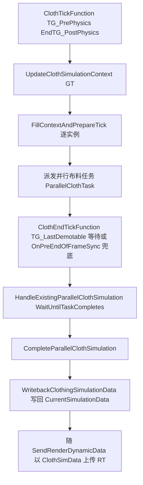

依据:ClothTick/EndPhysicsTick 注册与组设置(SkeletalMeshComponent.cpp:441-467、798-835);UpdateClothSimulationContext(2701)、HandleExistingParallelClothSimulation(2745)、WritebackClothingSimulationData(2767);RT 侧数据经 `FSkinnedMeshSceneProxyDynamicData::ClothSimulDataProvider` 与 `FDynamicSkelMeshObjectDataGPUSkin::ClothingSimData`(SkeletalRenderGPUSkin.h:129)进入 SkinCache。

## 13.7 时序图

### 13.7.1 并行动画评估主时序(单 SkeletalMeshComponent 一帧)

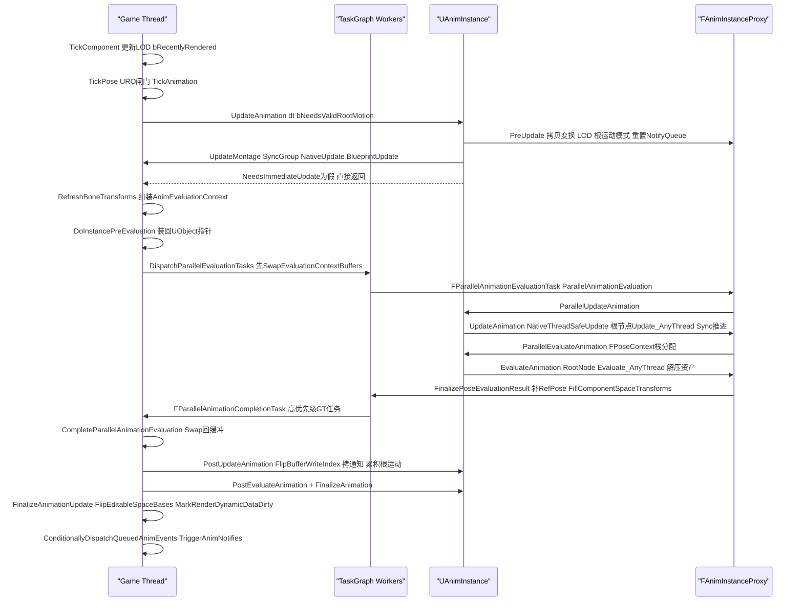

### 13.7.2 骨骼姿态上传渲染线程(GT→RT)

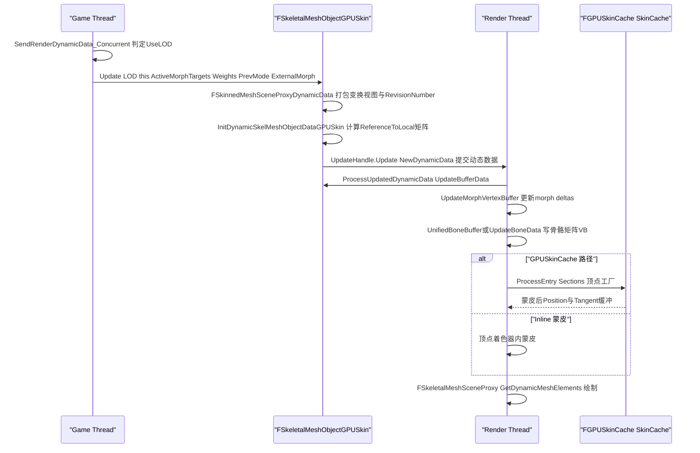

依据:GT 侧 `USkinnedMeshComponent::SendRenderDynamicData_Concurrent`(SkinnedMeshComponent.cpp:1542)→`FSkeletalMeshObject::Update`(SkeletalRender.cpp:370)→`FSkeletalMeshObjectGPUSkin::Update`(SkeletalRenderGPUSkin.cpp:781-817,`UpdateHandle.Update`);UpdateHandle 由 `InMeshDesc.Scene->GetSkeletalMeshUpdater()->Create(this)` 创建(674);RT 侧由 `FSkeletalMeshUpdatePacketGPUSkin::ProcessUpdatedDynamicData`(491-563)按 Raster/RayTracing 模式驱动 `ProcessUpdatedDynamicData`(972)→`UpdateBufferData`(899)写骨骼缓冲。

### 13.7.3 AnimGraph 内 ControlRig/RigVM 求值

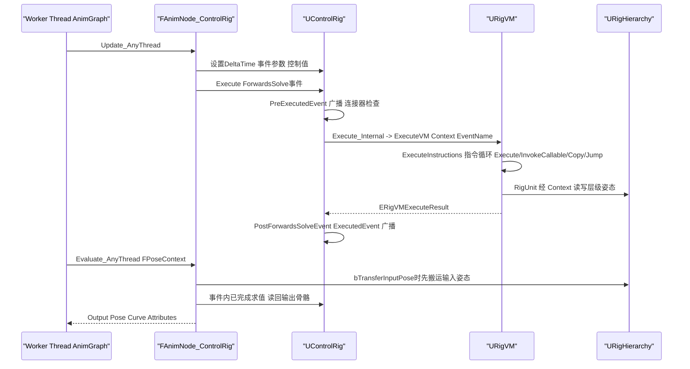

### 13.7.4 蒙太奇播放与槽位混合(worker)

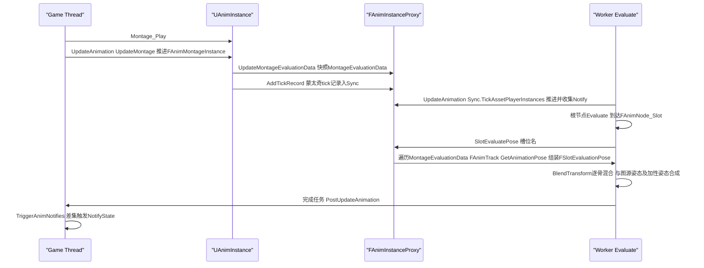

依据:蒙太奇 tick 记录入队(AnimInstance.cpp:601-613);槽位求值 SlotEvaluatePose(AnimInstanceProxy.cpp:1885-2100,含 BlendProfile 路径 1560-1883);`FAnimTrack::GetAnimationPose`(SlotEvaluatePose 内调用,1948-1967)。

## 13.8 线程模型与同步

| 数据/阶段 | 归属线程 | 同步机制 | 依据 |
|---|---|---|---|
| UAnimInstance UObject 事件(NativeUpdateAnimation/BlueprintUpdateAnimation/Notify) | GT | 仅 GT;蓝图事件不可上 worker | AnimInstance.cpp:789-798 |
| 线程安全更新(NativeThreadSafeUpdateAnimation/BlueprintThreadSafeUpdateAnimation) | WT(或 GT 内联) | 由 bUseMultiThreadedAnimationUpdate + a.ParallelAnimUpdate 控制 | AnimInstance.cpp:1020-1043;AnimInstanceProxy.cpp:1348-1361 |
| 代理 UObject 指针窗口(Skeleton/SkeletalMeshComponent/MainInstanceProxy) | 仅 Pre/Post update 窗口 | InitializeObjects 赋值、ClearObjects 置空;非窗口期 GetSkeleton() 触发 ensureAlways | AnimInstanceProxy.cpp:753-806;AnimInstanceProxy.h:372-395 |
| 组件变换双缓冲 ComponentSpaceTransformsArray(2)/BoneSpaceTransforms | GT 写、求值任务用交换后的 AnimEvaluationContext | SwapEvaluationContextBuffers 以 Exchange 交换,避免拷贝 | SkeletalMeshComponent.cpp:3043-3059 |
| 状态机/槽位权重双缓冲 | worker 写写缓冲、GT/worker 读读缓冲 | PostUpdateAnimation 中 FlipBufferWriteIndex | AnimInstanceProxy.h:1070-1090;AnimInstance.cpp:898-900 |
| RequiredBones(FBoneContainer,TSharedPtr) | 组件与全部实例共享 | 仅 GT 重建;worker 只读 | AnimInstanceProxy.h:1119-1123 |
| FParallelAnimationEvaluationTask | TaskGraph | `TickFunction->GetCompletionHandle()->DontCompleteUntil(TickCompletionEvent)` 把组件 tick 完成事件挂到动画完成之后 | SkeletalMeshComponent.cpp:3086-3096 |
| 在途任务阻塞 | GT | HandleExistingParallelEvaluationTask→WaitUntilTaskCompletes(GameThread);AutoRTFM 事务下强制中止重试 | SkeletalMeshComponent.cpp:4995-5041 |
| 通知队列 NotifyQueue | worker 写 → GT 读 | 单向:PostUpdate Append 后才在 GT TriggerAnimNotifies | AnimInstanceProxy.cpp:670-671 |
| 根运动累积 ExtractedRootMotion | worker 写 proxy → GT 转存实例 | PostUpdateAnimation 单点搬移 | AnimInstance.cpp:904-910 |
| 渲染动态数据 | GT 构造 → RT 消费 | FDynamicSkelMeshObjectDataGPUSkin 池化(TPooledSkeletalMeshDynamicData)+ UpdateHandle;RT 上 RevisionNumber 比对 | SkeletalRenderGPUSkin.h:52;SkeletalRenderGPUSkin.cpp:781-817 |
| MinDesiredLODLevel | RT 写(PreRenderView)→ GT 读 | "should only ever be WRITTEN by the RENDER thread and READ by the GAME thread" + DesiredLODLevelMutex(SkeletalRenderPublic.h:539) | SkeletalRenderPublic.h:420-447、535-539 |
| RigVM 宿主执行 | Any(典型 worker) | EvaluateMutex(FTransactionallySafeCriticalSection)包 Evaluate_AnyThread;EventQueueToRunOnceMutex 保护一次性事件 | RigVMHost.h:112-116、685 |
| RigVM 内存 | Work/External=实例内,Literal=CDO 只读,Debug=实例可选 | 预缓存句柄 PreCachedMemoryHandles;外部变量经 FRigVMExternalVariableRuntimeData 重定向 | RigVM.cpp:1998-2009 |
| 布料模拟 | WT(ParallelClothTask) | GT 在 ClothEndTick(TG_LastDemotable)或 EndOfFrame WaitUntilTaskCompletes | SkeletalMeshComponent.cpp:443-467、2745-2764 |

判定依据速记:
- GT 独占:`check(IsInGameThread())` 见 RefreshBoneTransforms(SkeletalMeshComponent.cpp:2872)、HandleExistingParallelEvaluationTask(5024)、GetClothingSimulationContext(2655)。
- worker 侧:`ANIM_MT_SCOPE_CYCLE_COUNTER(..., !IsInGameThread())` 见 PerformAnimationProcessing(2539)、UpdateAnimation_WithRoot(AnimInstanceProxy.cpp:1274)、EvaluateAnimation_WithRoot(1435)。
- RT 独占:UpdateMinDesiredLODLevel 注释与签名(SkeletalRenderPublic.h:299-303)。

## 13.9 配置与扩展点

### 13.9.1 控制台变量(CVar)

| CVar | 默认 | 作用 | 位置 |
|---|---|---|---|
| `a.ParallelAnimEvaluation` | 1 | 0 时求值纯 GT | SkeletalMeshComponent.cpp:76 |
| `a.ParallelAnimUpdate` | 1 | 0 时 Update 全在 GT(蓝图线程安全更新失效) | SkeletalMeshComponent.cpp:77 |
| `a.ForceParallelAnimUpdate` | 0 | 无视项目/蓝图设置强制 worker 更新 | SkeletalMeshComponent.cpp:78 |
| `a.ParallelAnimInterpolation` | 1 | URO 跳帧插值是否并行 | SkeletalMeshComponent.cpp:79 |
| `tick.AnimationDelaysEndGroup` | 1 | 无物理依赖时把 EndTickGroup 延到 TG_PostPhysics | SkeletalMeshComponent.cpp:2026-2029 |
| `tick.HiPriSkinnedMeshes` | 1 | 骨骼网格 tick 提前调度 | SkeletalMeshComponent.cpp:86-89 |
| `TaskGraph.TaskPriorities.ParallelAnimationEvaluationTask` | 高线程优先级/普通任务优先级 | 求值任务优先级 | SkeletalMeshComponent.cpp:138-144 |
| `TaskGraph.TaskPriorities.ParallelAnimCompletionTaskHighPriority` | true | 完成任务用 GT 高任务优先级 | SkeletalMeshComponent.cpp:130-136 |
| `a.CacheLocalSpaceBounds` | 1 | 缓存本地空间包围盒 | SkeletalMeshComponent.cpp:110-113 |
| `a.Notifies.DispatchPolicy` 等 | — | 通知派发过滤(a.Montage.*、a.Notifies.*) | AnimInstance.cpp:114-181 |
| `CriticalPathStall.ParallelAnimation` | 0.0 | 调试:并行任务注入延迟(ms) | SkeletalMeshComponent.cpp:81-84 |
| `a.SkinnedAsset.ISPC`(旧 a.SkeletalMesh.ISPC) | 平台相关 | 蒙皮 FK 的 ISPC 版本 | SkeletalMeshComponent.cpp:103-108 |
| `r.SkinCache.Allow` / `r.SkinCache.CompileShaders` / `r.SkinCache.Mode` | 0/0/0 | GPUSkinCache 开关与着色器 | Private/GPUSkinCache.cpp:78-110 |

### 13.9.2 项目/引擎设置与组件属性

- `UEngine::bAllowMultiThreadedAnimationUpdate`(NeedsImmediateUpdate 读取,AnimInstance.cpp:1022)与 `UAnimInstance::bUseMultiThreadedAnimationUpdate`(AnimInstance.h:382):蓝图级并行开关。
- `USkinnedMeshComponent::VisibilityBasedAnimTickOption`(SkinnedMeshComponent.h:94 注释:决定 TickPose/RefreshBoneTransforms 行为);`bEnableUpdateRateOptimizations` 构造默认 false(SkeletalMeshComponent.cpp:493);`FAnimUpdateRateParameters`(URO 速率、ShouldSkipUpdate/ShouldSkipEvaluation/GetInterpolationAlpha)。
- `RootMotionMode`(ERootMotionMode)、`GlobalAnimRateScale`、`bNoSkeletonUpdate`、`KinematicBonesUpdateType`、`PostProcessAnimBPLODThreshold`(SkeletalMeshComponent.cpp:5193-5209)。

### 13.9.3 委托/事件扩展点

- `USkeletalMeshComponent::OnBoneTransformsFinalizedMC`(RegisterOnBoneTransformsFinalizedDelegate,5302)、`OnLODRequiredBonesUpdate_Static/_Member`(5312-5325)、`OnSkelMeshPhysicsCreated/Teleported`(5282-5300)、`OnTickPose`(SkinnedMeshComponent TickPose 首行 Broadcast,SkinnedMeshComponent.cpp:1817)。
- `UAnimInstance` 通知/蒙太奇委托:`FOnMontageEnded`、`FOnMontageBlendingOutStarted`、`FOnMontageBlendedInEnded`、`FOnMontageSectionChanged`(AnimMontage.h:188-204)、`OnAllMontageInstancesEnded`(AnimInstance.cpp:649)。
- 状态机原生绑定:`AddNativeTransitionBinding`/`AddNativeStateEntryBinding`/`AddNativeStateExitBinding`(AnimInstanceProxy.h:914-929)。
- ControlRig 执行事件:`PreExecutedEvent`/`ExecutedEvent`/`PreForwardsSolveEvent`/`PostForwardsSolveEvent`(ControlRig.cpp:1400-1443)与 `OnInitialized_AnyThread/OnExecuted_AnyThread/OnEarlyExit_AnyThread`(RigVMHost.h:340-350)。

### 13.9.4 模块/插件扩展点

- `IAnimRootMotionProvider`(IModularFeature,AnimRootMotionProvider.h:19):AnimationWarping 用属性(Attribute)注入根运动修改,任何模块可注册。
- AnimSubsystem(`IAnimClassInterface::ForEachSubsystem`):动画类级子系统,分 GT/Worker 两套 Update 钩子(AnimInstanceProxy.cpp:1288-1296、1338-1371)。
- 网格变形生产者:`IMeshDeformerProducer`(UControlRig 实现)+ `UMeshDeformerInstance`(SkinnedMeshComponent 持有并发起 RT 工作,SkinnedMeshComponent.cpp:1351-1374、1558-1575);MLDeformer 框架与 DeformerGraph(OptimusCore)挂接于此。
- 压缩编解码器:继承 UAnimBoneCompressionCodec/UAnimCurveCompressionCodec 并以 UAnimBoneCompressionSettings/UAnimCurveCompressionSettings 资产引用(ACLPlugin 即此模式)。
- 布料:`ClothingSystemRuntimeInterface` 的工厂(`ClothingSimulationFactory.h`)注册新后端;5.8 默认 Chaos Cloth 经 ChaosCloth/ChaosClothAsset 插件走 IClothSimulationDataProvider 通道。
- LiveLink:LiveLinkComponents 的 `ULiveLinkComponentController` + Controllers(Anim/Transform/Character/Light)把 LiveLink 主题数据映射到动画/变换;AnimGraph 侧 LiveLinkGraphNode 提供 LiveLinkPose 求值。

## 13.10 已知限制/未确认项

1. **编辑器编译流水线未展开**:AnimBlueprint 的 FKismetCompiler/AnimGraphNode 展开、常量折叠(FoldProperty/NodeData)与 UAnimBlueprintGeneratedClass 的生成过程本章仅引用结果(IAnimClassInterface 烘焙数据),编译细节属编辑器章节,未在源码级展开。
2. **UAF(AnimNext)细节深度有限**:UAF 是实验插件且 API 在快速演进;本章确认了 UUAFComponent(AnimNextComponent.h:76)、模块结构、UAFAnimGraph 的 FEvaluationVM/FEvaluationProgram 求值模型存在,但其 Trait 求值任务的完整执行语义、与 MovieSceneAnimMixer 的分层混合细节未逐文件核实,标注为概述级。
3. **MovieSceneAnimMixer**:仅确认模块依赖(PUB: AnimGraphRuntime,MovieScene,UAF,UAFAnimGraph,UAFMirroring)、`FSequencerMixedAnimInstanceProxy`(MovieSceneAnimInstanceTargetSystem.h:75)与 `FAnimSubsystem_SequencerMixer`/`FAnimNode_SequencerMixerTarget`(Public/AnimSubsystem_SequencerMixer.h、Public/AnimNode_SequencerMixerTarget.h:10)的存在与挂接点;混合算法细节未展开。
4. **Chaos Cloth**:范围限定 ClothingSystemRuntime*(接口/Common/Nv);5.8 中 Chaos 布料实现在 ChaosCloth/ChaosClothAsset 插件,其求解器内部不在本章,未确认 NvCloth 后端在 5.8 默认是否仍可启用(ClothingSystemRuntimeNv 模块随引擎构建存在)。
5. **Legacy 曲线压缩编解码器**(AnimCompress_*、AnimCurveCompressionCodec_UniformlySampled 等)仅列名,未逐一验证 cook 路径差异。
6. **具体插件运行时语义**:GameplayInsights、AnimatorKit、EaseCurveTool、DNACalib、GeneSplicer、SkeletalMeshModelingTools、TweeningUtils、PerformanceCaptureCore、AudioDrivenAnimation、BlendSpaceMotionAnalysis、LiveLink Hub 设备族等以模块清单与依赖为准给出职责;未深入其内部实现(编辑器/工具为主)。其中 AudioDrivenAnimation 与 ControlRigModules 在附录 tools 清单中无独立分片(前者可能未抓取,后者并入 ControlRig),已按现状标注。
7. **FSkeletalMeshObjectNanite**、光追蒙皮(RayTracingLODIndex/UpdateRayTracingGeometry)只确认入口存在,渲染细节(资产管线章节范围)未展开。
8. **行号时效**:全部行号基于 5.8.3-release 源码;`Private/Components/SkeletalMeshComponent.cpp` 与 `SkinnedMeshComponent.cpp` 存在多处同名实现(USkeletalMeshComponent:: 与 USkinnedMeshComponent:: 各自的 TickComponent/TickPose/RefreshBoneTransforms 等),本章引用时已逐一标注类名与文件。

## 13.11 附录索引

本章覆盖模块对应的符号全量附录(`appendix/api/<Tier>/<Module>.md`,相对 `docs/ue5.8.3/`):

| 模块 | 附录文件 |
|---|---|
| AnimationCore | appendix/api/Runtime/AnimationCore.md |
| AnimGraphRuntime | appendix/api/Runtime/AnimGraphRuntime.md |
| Engine(动画部分) | appendix/api/Runtime/Engine.part01.md ~ Engine.part06.md |
| ClothingSystemRuntimeInterface/Common/Nv | appendix/api/Runtime/ClothingSystemRuntimeInterface.md、ClothingSystemRuntimeCommon.md、ClothingSystemRuntimeNv.md |
| SkeletalMeshDescription、MeshDescription | appendix/api/Runtime/SkeletalMeshDescription.md、MeshDescription.md |
| ACLPlugin | appendix/api/Plugins/ACLPlugin.md、ACLPluginEditor.md |
| AnimationData | appendix/api/Plugins/AnimationData.md |
| AnimationLocomotionLibrary | appendix/api/Plugins/AnimationLocomotionLibraryRuntime.md、AnimationLocomotionLibraryEditor.md |
| AnimationModifierLibrary | appendix/api/Plugins/AnimationModifierLibrary.md |
| AnimationWarping | appendix/api/Plugins/AnimationWarpingRuntime.md、AnimationWarpingEditor.md |
| BlendStack | appendix/api/Plugins/BlendStack.md、BlendStackEditor.md |
| ControlRig | appendix/api/Plugins/ControlRig.md、ControlRigDeveloper.md、ControlRigEditor.md |
| ControlRigModules / ControlRigSpline | appendix/api/Plugins/ControlRig.md(ControlRigModules 无独立附录分片)、ControlRigSpline.md |
| ControlRigPhysics / ControlRigDynamics | appendix/api/Plugins/ControlRigPhysics.md、ControlRigDynamics.md(含 *Editor) |
| FullBodyIK | appendix/api/Plugins/FullBodyIK.md |
| IKRig | appendix/api/Plugins/IKRig.md、IKRigDeveloper.md、IKRigEditor.md、IKRigUAF.md |
| LiveLink 动画侧 | appendix/api/Plugins/LiveLink.md、LiveLinkComponents.md、LiveLinkGraphNode.md、LiveLinkCurveDebugUI.md、LiveLinkDevice.md、LiveLinkExampleDevice.md、LiveLinkGenericRecordingDevice.md、LiveLinkUnrealDevice.md、LiveLinkHub.md |
| MLDeformer | appendix/api/Plugins/MLDeformerFramework.md、MLDeformerFrameworkEditor.md、NearestNeighborModel.md、NeuralMorphModel.md、VertexDeltaModel.md(含 *Editor) |
| MotionWarping | appendix/api/Plugins/MotionWarping.md |
| PoseSearch | appendix/api/Plugins/PoseSearch.md、PoseSearchEditor.md |
| RigLogic / GeneSplicer / DNACalib | appendix/api/Plugins/RigLogicModule.md、RigLogicLib.md、GeneSplicerModule.md、GeneSplicerLib.md、DNACalibModule.md、DNACalibLib.md |
| DeformerGraph(Optimus) | appendix/api/Plugins/OptimusCore.md、OptimusDeveloper.md、OptimusSettings.md |
| PhysicsControl | appendix/api/Plugins/PhysicsControl.md、PhysicsControlEditor.md、PhysicsControlUncookedOnly.md |
| GameplayInsights | appendix/api/Plugins/GameplayInsights.md、GameplayInsightsEditor.md |
| SkeletalMeshModelingTools | appendix/api/Plugins/SkeletalMeshModelingTools.md |
| TweeningUtils | appendix/api/Plugins/TweeningUtils.md、TweeningUtilsEditor.md |
| AnimatorKit / EaseCurveTool / BlendSpaceMotionAnalysis / PerformanceCaptureCore | appendix/api/Plugins/AnimatorKitSettings.md、EaseCurveTool.md、BlendSpaceMotionAnalysis.md、PerformanceCaptureCore.md(AudioDrivenAnimation 无附录分片,见 13.10-6) |
| MovieSceneAnimMixer | appendix/api/Plugins/MovieSceneAnimMixer.md、MovieSceneAnimMixerEditor.md、MovieSceneAnimMixerScripting.md |
| UAF(AnimNext) | appendix/api/Plugins/UAF.md、UAFEditor.md、UAFUncookedOnly.md、UAFAnimGraph.md、UAFAnimGraphEditor.md、UAFAnimGraphUncookedOnly.md、UAFAnimGraphTestSuite.md、UAFAnimNode.md、UAFAnimNodeEditor.md、UAFChooser.md、UAFLayering.md、UAFMass.md、UAFMirroring.md、UAFPoseSearch.md、UAFSharedAssets.md、UAFStateTree.md、UAFWarping.md、UAFControlRig.md |
| MoverAnimNext | appendix/api/Plugins/MoverAnimNext.md |
| RigVM | appendix/api/Plugins/RigVM.md、RigVMDeveloper.md |
| AnimationBudgetAllocator | appendix/api/Plugins/AnimationBudgetAllocator.md |
| SkeletalMerging | appendix/api/Plugins/SkeletalMerging.md |

附录按工具抓取的模块名组织;`Engine.part01-06` 含全部 Engine 头(动画相关符号散布各分片,可按 `UAnimInstance`、`FAnimInstanceProxy`、`USkeletalMeshComponent` 等符号名检索)。

