# 14 音频:AudioDevice、AudioMixer、MetaSound、音频线程

本章覆盖 UE 5.8.3 Runtime 音频栈(AudioMixerCore/AudioMixer/Engine 音频对象)、各编解码模块、平台音频设备实现(XAudio2/WASAPI/CoreAudio/AudioUnit/OpenSLES/SDL3)、MetaSound 全家(GraphCore/Frontend/Engine/Generator/StandardNodes)以及 Plugins/Runtime 下的全部音频插件。所有结论均出自对 `$UE/Engine` 下 5.8.3 源码的直接阅读,引用格式为 `路径:行号`(相对 `$E` = `$UE/Engine`)。

一个必须先澄清的事实:5.8.3 中"音频线程"已经不是独占线程,而是任务管道 `UE::Tasks::FPipe GAudioPipe`(`Source/Runtime/Core/Private/HAL/ThreadingBase.cpp:245`),`Source/Runtime/Engine/Public/AudioThread.h:16` 注释原文:"the naming is outdated as the thread was replaced by piped tasks"。`IsInAudioThread()` 的实现是 `GAudioPipe.IsInContext()`(`ThreadingBase.cpp:256-259`)。本章沿用"音频线程"一词指代该管道上下文。

## 14.1 职责、边界与模块清单

### 14.1.1 Runtime 核心模块(Engine/Source/Runtime 下)

| 模块 | 路径 | Build.cs Public/Private 依赖 | 职责 |
|---|---|---|---|
| AudioMixerCore | Source/Runtime/AudioMixerCore | Priv: Core, SignalProcessing, TraceLog | 平台无关混音器核心:IAudioMixer、IAudioMixerPlatformInterface、FOutputBuffer、平台设置读取 |
| AudioMixer | Source/Runtime/AudioMixer | Pub: Core, CoreUObject, AudioLinkEngine; Priv: Engine, NonRealtimeAudioRenderer, AudioMixerCore, SignalProcessing, AudioPlatformConfiguration, SoundFieldRendering, AudioExtensions, AudioLinkCore, HeadMountedDisplay, TraceLog | FMixerDevice/FMixerSourceManager/FMixerSubmix/FMixerSource 等音频设备完整实现 |
| AudioExtensions | Source/Runtime/AudioExtensions | Pub: Core, CoreUObject, SignalProcessing, AudioMixerCore | 音频扩展接口:插件(Spatialization/Occlusion/Reverb/SourceDataOverride)、参数传输、Soundfield 格式/端点、解码覆写 |
| AudioPlatformConfiguration | Source/Runtime/AudioPlatformConfiguration | Priv: Core, CoreUObject | FAudioPlatformSettings 读取、音频压缩设置、重采样器 |
| AudioPlatformSupport(Wasapi) | Source/Runtime/AudioPlatformSupport/Windows/WASAPI | Priv: Core | WASAPI 底层辅助库(供 AudioMixerWasapi 使用) |
| AudioDeviceEnumeration | Source/Runtime/AudioDeviceEnumeration/Windows/WindowsMMDeviceEnumeration | Priv: Engine | Windows MMDevice 设备枚举(IMMDeviceEnumerator 封装),供 XAudio2/WASAPI 使用 |
| AudioCaptureCore | Source/Runtime/AudioCaptureCore | Pub: Core, SignalProcessing; Priv: Engine | 麦克风采集抽象:FAudioCapture、IAudioCaptureStream(IModularFeature) |
| AudioCaptureImplementations | Source/Runtime/AudioCaptureImplementations/{AudioCaptureRtAudio, Android/AudioCaptureAndroid, IOS/AudioCaptureAudioUnit, Windows/AudioCaputureWasapi} | Priv: (RtAudio 无额外依赖) | 各平台采集实现(RtAudio/OpenSL/AVAudioUnit/WASAPI) |
| AudioAnalyzer | Source/Runtime/AudioAnalyzer | Pub: Core, SignalProcessing; Priv: CoreUObject, Engine, AudioMixer | 实时/非实时分析器框架:IAudioAnalyzerInterface、IAudioAnalyzerNRTInterface、FAudioAnalyzerFacade |
| AudioLinkCore / AudioLinkEngine | Source/Runtime/AudioLink | Core Pub: Core, CoreUObject; Engine Priv: Core, CoreUObject, Engine, SignalProcessing | 音频外链抽象:IAudioLink、IAudioLinkFactory(IModularFeature)、缓冲监听器,把引擎音频推给外部系统 |
| AudioMixerPlatformAudioLink | Source/Runtime/AudioLink/AudioMixerPlatformAudioLink | Priv: AudioMixer, AudioMixerCore, AudioLinkEngine, Core, CoreUObject, Engine | 以 IAudioMixerPlatformInterface 形式出现的 AudioLink 输出"设备" |
| AudioChannelAgnosticCore | Source/Runtime/AudioChannelAgnosticCore | Pub: Core; Priv: Core, SignalProcessing | 通道无关类型系统:FChannelAgnosticType、FChannelTypeFamily、离散格式注册表与转码器(MetaSound 离散/格式化输出用) |
| SoundFieldRendering | Source/Runtime/SoundFieldRendering | Priv: Core, Engine, SignalProcessing, AudioMixer, AudioExtensions | Ambisonics 声场编解码:FAmbisonicsSoundfieldBuffer、FSoundFieldDecoder、球谐计算 |
| SignalProcessing | Source/Runtime/SignalProcessing | Pub: IntelISPC; Priv: Core, MathCore | DSP 基础库:AlignedBuffer、FFT、BiQuad、EnvelopeFollower、ChannelMap、Ambisonics、重采样等 70+ 头 |
| NonRealtimeAudioRenderer | Source/Runtime/NonRealtimeAudioRenderer | Priv: Core, CoreUObject, Engine, AudioMixerCore, SignalProcessing, AudioMixer | 非实时渲染设备(FMixerPlatformNonRealtime),用于导出/离线渲染 |
| AdpcmAudioDecoder | Source/Runtime/AdpcmAudioDecoder/Module | Pub: Core, CoreUObject, Engine | ADPCM 解码:FADPCMAudioInfo(ICompressedAudioInfo) |
| BinkAudioDecoder | Source/Runtime/BinkAudioDecoder/Module | Pub: Core, CoreUObject, Engine | BinkA 解码:FBinkAudioInfo(IStreamedCompressedInfo) |
| OpusAudioDecoder | Source/Runtime/OpusAudioDecoder/Module | Pub: Core, CoreUObject, Engine | Opus 解码:FOpusAudioInfo(IStreamedCompressedInfo) |
| VorbisAudioDecoder | Source/Runtime/VorbisAudioDecoder/Module | Pub: Core, CoreUObject, Engine | Vorbis 解码:FVorbisAudioInfo(ICompressedAudioInfo) |
| RadAudioCodec | Source/Runtime/RadAudioCodec/Module(RadAudioDecoder) | Pub: Core, CoreUObject, Engine | RAD 解码:FRadAudioInfo(IStreamedCompressedInfo) |
| UEWavComp | Source/Runtime/UEWavComp | Priv: (无模块依赖) | UE 无损 WAV 容器读写(uewav.h),供音频工具/程序使用 |
| Engine(音频部分) | Source/Runtime/Engine(Classes/Sound 72 个头 + Public/Audio 等) | (Engine 为巨型模块) | FAudioDevice/FAudioDeviceManager/FAudioThread/FActiveSound/FWaveInstance/FSoundSource 与全部 USound* UObject |

### 14.1.2 平台混音设备模块(实现 IAudioMixerPlatformInterface)

| 模块 | 路径(Source/Runtime 下) | Priv 依赖 | 实现类 | GetPlatformApi 返回值 |
|---|---|---|---|---|
| AudioMixerXAudio2 | Windows/AudioMixerXAudio2 | Engine, WindowsMMDeviceEnumeration | `FMixerPlatformXAudio2 : FAudioMixerPlatformSwappable, IXAudio2EngineCallback`(Private/AudioMixerPlatformXAudio2.h:72) | "XAudio2" |
| AudioMixerWasapi | Windows/AudioMixerWasapi | Engine, AudioPlatformSupportWasapi, SignalProcessing, WindowsMMDeviceEnumeration | `FAudioMixerWasapi : FAudioMixerPlatformSwappable`(Private/AudioMixerWasapi.h:59) | "WASAPIMixer" |
| AudioMixerCoreAudio | Apple/AudioMixerCoreAudio | Core, CoreUObject, AudioMixerCore | `FMixerPlatformCoreAudio`(Private/AudioMixerPlatformCoreAudio.h) | "CoreAudio" |
| AudioMixerAudioUnit | Apple/AudioMixerAudioUnit | Core, CoreUObject, AudioMixerCore | `FMixerPlatformAudioUnit`(Private/AudioMixerPlatformAudioUnit.h) | "AudioUnit" |
| AudioMixerAndroid | Android/AudioMixerAndroid | Core, AudioMixerCore | `FMixerPlatformAndroid : IAudioMixerPlatformInterface`(Private/AudioMixerPlatformAndroid.h:14) | "OpenSLES"(5.8.3 源码无 AAudio 实现) |
| AudioMixerSDL | Linux/AudioMixerSDL | Core, CoreUObject, Engine, AudioMixer, AudioMixerCore | `FMixerPlatformSDL : IAudioMixerPlatformInterface`(Private/AudioMixerPlatformSDL.h:15) | "SDL3" |
| NonRealtimeAudioRenderer | NonRealtimeAudioRenderer | Core, CoreUObject, Engine, AudioMixerCore, SignalProcessing, AudioMixer | `FMixerPlatformNonRealtime`(Public/AudioMixerPlatformNonRealtime.h:11) | (离线渲染,非实时) |
| AudioMixerPlatformAudioLink | AudioLink/AudioMixerPlatformAudioLink | AudioMixer, AudioMixerCore, AudioLinkEngine 等 | `FAudioMixerPlatformAudioLink`(Private/AudioMixerPlatformAudioLink.h:10) | (转发给外部 AudioLink) |
| (空设备) | AudioMixerCore 内 | — | `FMixerNullCallback`(Public/AudioMixerNullDevice.h:24) | 无硬件时由平台接口内部驱动 |

### 14.1.3 Plugins/Runtime 插件模块

| 模块 | 路径(Engine/Plugins 下) | Build.cs Public/Private 依赖(已验证) | 职责 |
|---|---|---|---|
| MetasoundGraphCore | Plugins/Runtime/Metasound/Source/MetasoundGraphCore | Pub: Core, CoreUObject, SignalProcessing, AudioExtensions | 运行时图数据模型:FGraph/FNode/IOperator/FExecuter/FOperatorBuilder/FOperatorSettings |
| MetasoundFrontend | Plugins/Runtime/Metasound/Source/MetasoundFrontend | Pub: Slate, SlateCore; Priv: Projects | 前端文档(FMetasoundFrontendDocument)、文档构建器(FDocumentBuilder)、图构建器(FGraphBuilder)、节点注册/查询 |
| MetasoundEngine | Plugins/Runtime/Metasound/Source/MetasoundEngine | Pub: Core, CoreUObject, DeveloperSettings, Engine, MetasoundFrontend, MetasoundStandardNodes, Serialization, AudioPlatformConfiguration, WaveTable; Priv: AssetRegistry, AudioExtensions, AudioMixer, MetasoundGraphCore, MetasoundGenerator, SignalProcessing, AudioChannelAgnosticCore, Projects | UMetaSoundSource/UMetaSoundWave 资产、BuilderSubsystem、参数路由、AudioBus 写入节点 |
| MetasoundGenerator | Plugins/Runtime/Metasound/Source/MetasoundGenerator | Pub: Core, CoreUObject, AudioMixer, MetasoundGraphCore, MetasoundStandardNodes, MetasoundFrontend; Priv: SignalProcessing, Engine, AudioExtensions, TraceLog, AudioChannelAgnosticCore | FMetasoundGenerator(ISoundGenerator)、FAsyncMetaSoundBuilder、FOperatorPool |
| MetasoundStandardNodes | Plugins/Runtime/Metasound/Source/MetasoundStandardNodes | Pub: AudioExtensions, Core, MetasoundFrontend, Serialization, SignalProcessing; Priv: CoreUObject, MetasoundGraphCore | 标准节点库(数学/振荡器/采样播放/触发等) |
| MetasoundEditor | Plugins/Runtime/Metasound/Source/MetasoundEditor | Pub: ApplicationCore, AudioAnalyzer, AudioEditor, AudioMixer, AudioWidgets, AssetDefinition, GraphEditor, Slate 等编辑器全家 | MetaSound 图编辑器(Editor 模块,运行时不含) |
| AudioModulation | Plugins/Runtime/AudioModulation/Source/AudioModulation | Pub: AudioExtensions, AudioMixer, Core, LevelSequence, MovieScene, MovieSceneTracks, WaveTable; Priv: AudioMixer, AudioMixerCore, CoreUObject, DeveloperSettings, Engine, Projects, SignalProcessing, TraceLog | 声音调制系统:USoundControlBus/USoundControlBusMix/USoundModulatorBase 与 FAudioModulationSystem 渲染端 |
| AudioSynesthesia(+Core) | Plugins/Runtime/AudioSynesthesia/Source | Synesthesia Pub: Core, CoreUObject, Engine, SignalProcessing, AudioMixerCore, AudioMixer, AudioAnalyzer, AudioSynesthesiaCore;Core Pub: Core, CoreUObject, SignalProcessing | 实时音频分析资产(LKFS 响度、ConstantQ、音高检测)与 NRT 工厂 |
| AudioWidgets(+Core) | Plugins/Runtime/AudioWidgets/Source | Widgets Pub: AudioAnalyzer, AudioSynesthesia, AudioWidgetsCore, Core, UMG;Core Pub: Core | UMG 音频可视化控件(表头、示波器、频谱、 loudness 表) |
| AudioMotorSim | Plugins/Runtime/AudioMotorSim/Source/AudioMotorSim | Pub: Core, CoreUObject, Engine | 发动机模拟组件框架(UAudioMotorModelComponent,IAudioMotorSim) |
| Synthesis | Plugins/Runtime/Synthesis/Source/Synthesis | Pub: Core, CoreUObject, Engine, AudioExtensions; Priv: AudioMixer, SignalProcessing, UMG, Slate 等 | 合成器组件/源效果(EpicSynth1、MonoWaveTable、ConvolutionReverb、Flexiverb) |
| WaveTable | Plugins/Runtime/WaveTable/Source/WaveTable | Pub: AudioExtensions, Core, CoreUObject, Engine; Priv: SignalProcessing | 波表合成库(WaveTableBank/WaveTableSampler)与源效果 |
| ResonanceAudio | Plugins/Runtime/ResonanceAudio/Source/ResonanceAudio | Pub: Core, CoreUObject, Engine, AudioMixer, SoundFieldRendering, ProceduralMeshComponent; Priv: InputCore, Projects, AudioExtensions | Google ResonanceAudio 空间化/声场插件(Spatialization 插件实现) |
| SoundFields | Plugins/Runtime/SoundFields/Source/SoundFields | Pub: Core; Priv: CoreUObject, Engine, SignalProcessing, SoundFieldRendering, AudioExtensions | ISoundfieldFactory 实现(将声场格式接入混音器的编码/解码流) |
| Spatialization | Plugins/Runtime/Spatialization/Source/Spatialization | Pub: Core; Priv: CoreUObject, Engine, SignalProcessing, AudioExtensions | ITD 空间化插件示例(ITDSpatializer) |
| MicrosoftSpatialSound | Plugins/Runtime/MicrosoftSpatialAudio/Source/MicrosoftSpatialSound | Pub: Core, AudioExtensions; Priv: CoreUObject, Engine | Windows Sonic(MicrosoftSpatialSoundPlugin)空间化插件 |
| SoundMod | Plugins/Runtime/SoundMod/Source/SoundMod | Pub: AudioExtensions, Core, CoreUObject, Engine | SoundNodeModPlayer 旧式 FMOD 风格 mod 播放节点 |
| SoundCueTemplates | Plugins/Runtime/SoundCueTemplates/Source/SoundCueTemplates | Pub: Core; Priv: CoreUObject, Engine, Slate 等 | SoundCue 模板资产(容器、距离交叉淡出) |
| SoundScape | Plugins/Runtime/Soundscape/Source/SoundScape | Pub: Core, CoreUObject, DeveloperSettings, GameplayTags; Priv: CoreUObject, Engine | Soundscape 调色板/颜色点动态声景系统(USoundscapeSubsystem) |
| MusicEnvironment | Plugins/Runtime/MusicEnvironment/Source/MusicEnvironment | Pub: Core, CoreUObject, Engine, TimeManagement, GameplayTags, MovieScene | 音乐时钟/节拍器(MusicEnvironmentMetronome、MusicClockSourceManager) |
| Harmonix | Plugins/Runtime/Harmonix/Source(Harmonix/HarmonixDsp/HarmonixMidi/HarmonixMetasound) | Harmonix Pub: Core, AudioExtensions, DeveloperSettings; Dsp Pub: Engine, Core, CoreUObject, DeveloperSettings, HarmonixMidi, AudioExtensions, Harmonix; Midi Pub: Core, CoreUObject, TimeManagement, MusicEnvironment; Metasound Pub: Engine, Core, CoreUObject, MusicEnvironment, TimeManagement, MovieScene, MetasoundStandardNodes, HarmonixDsp, HarmonixMidi, Harmonix | 音乐制作套件:AudioRenderableProxy、DSP(采样器/变调/拉伸)、MIDI 文件与游标、节拍图、MetaSound 桥 |
| SoundUtilities | Plugins/Runtime/SoundUtilities/Source/SoundUtilities | Pub: Core, CoreUObject, Engine, AudioMixer, UMG, Slate, InputCore, Projects | 通用音频蓝图工具(SoundSimple、SoundUtilities BFL) |
| AudioGameplay | Plugins/AudioGameplay/Source/AudioGameplay | Pub: AudioExtensions, Core, GameplayTags; Priv: CoreUObject, Engine, AudioMixerCore | Gameplay 侧音频组件组/标签缓存/SoundHandle 子系统 |
| AudioGameplayVolume | Plugins/AudioGameplayVolume/Source/AudioGameplayVolume | Pub: Core; Priv: AudioGameplay, CoreUObject, Engine | AAudioGameplayVolume 体积代理/子系统,把体积效果代理进音频线程 |
| AudioInsights | Plugins/AudioInsights/Source/AudioInsights | Pub: Engine; Priv: UnrealEd | Audio Insights 面板:基于 UE_TRACE(AudioChannel) 的音频遥测看板 |

说明:表中"已验证"指依赖列表直接解析自各模块 .Build.cs 的 Add/AddRange 调用;未列出的 Editor 测试模块(MetasoundEngineTest、HarmonixDspTests 等)不在运行时链路内。

## 14.2 总体架构

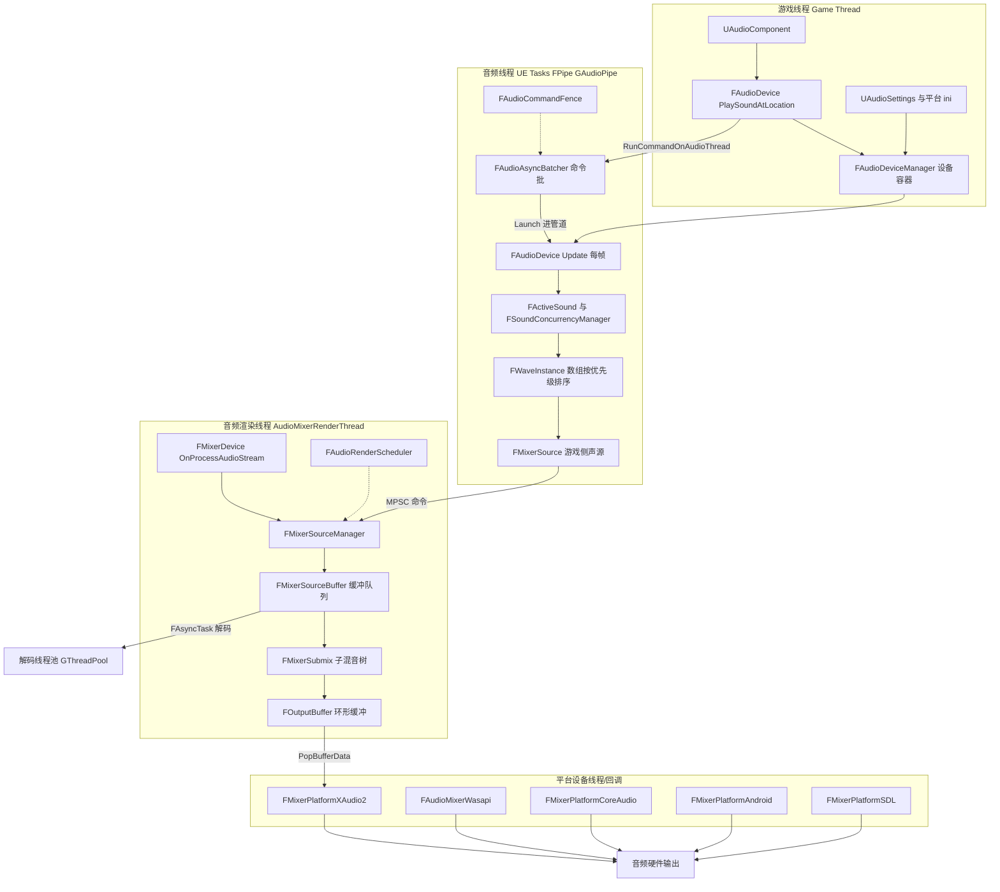

分层要点:

1. **游戏线程**只做"发声请求"与资产引用:`UAudioComponent::Play`(`Classes/Components/AudioComponent.h:517`)、`FAudioDevice::PlaySoundAtLocation`(`Public/AudioDevice.h:755`)。设备生命周期由 `FAudioDeviceManager` 管理(单例,`Public/AudioDeviceManager.h:171`)。
2. **音频线程(GAudioPipe 管道)**承载 `FAudioDevice::Update`(`Private/AudioDevice.cpp:4725`)的全部逻辑:ActiveSound 更新、并发评估(`FSoundConcurrencyManager::CreateNewActiveSound`,SoundConcurrency.h:391)、WaveInstance 收集排序(`GetSortedActiveWaveInstances`,AudioDevice.cpp:4159)、声源启停(`StopSources`/`StartSources`,AudioDevice.cpp:4455/4541)。判定依据:这些函数体内有 `check(IsInAudioThread())` 或经 `FAudioThread::RunCommandOnAudioThread` 转发(AudioDevice.cpp:4742、5300)。
3. **音频渲染线程**是每设备一条的 `FRunnableThread`,名字 `AudioMixerRenderThread(N)`,由 `IAudioMixerPlatformInterface::BeginGeneratingAudio` 创建(`AudioMixerCore/Private/AudioMixer.cpp:695`),优先级默认 `TPri_Highest`(CVar `au.RenderThreadPriority`,AudioMixer.cpp:94)。它执行 `Run → RunInternal`(AudioMixer.cpp:926/867):循环调 `FOutputBuffer::MixNextBuffer`(AudioMixer.cpp:264)直到环形缓冲填满,再等 `AudioRenderEvent`。
4. **平台层**以回调驱动:XAudio2 的 `FXAudio2VoiceCallback::OnBufferEnd`(AudioMixerPlatformXAudio2.cpp:93)→ `ReadNextBuffer`(AudioMixer.cpp:583)→ 提交上一块并触发渲染线程补块。
5. **旁路线程池**:解码走 `FAsyncTask<FAsyncDecodeWorker>`(AudioMixerSourceDecode.cpp:202-229,`GThreadPool`/`GBackgroundPriorityThreadPool`),MetaSound 算子构建走 `FAsyncTask<FAsyncMetaSoundBuilder>`(MetasoundGenerator.cpp:1186-1199,后台池)。

## 14.3 类图

### 14.3.1 音频设备与平台接口继承体系

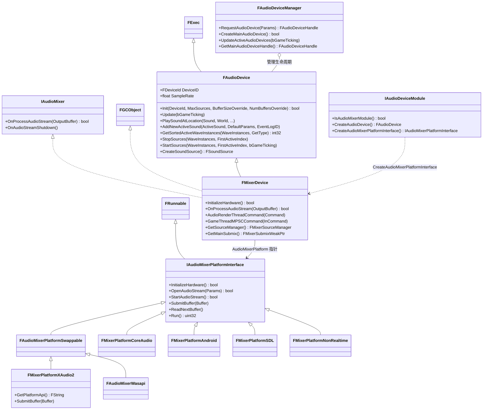

每类职责:FAudioDevice——平台无关音频设备基类(Engine);FMixerDevice——唯一在用实现,同时是 IAudioMixer(供平台回调)与 FGCObject(音频线程持 UObject 引用需 GC 注册,AddReferencedObjects 于 AudioMixerDevice.h:228);FAudioDeviceManager——设备容器与主设备持有者;IAudioMixerPlatformInterface/FAudioMixerPlatformSwappable——平台硬件抽象与可换设备扩展;IAudioDeviceModule——每平台模块入口(XAudio2 模块的 `FAudioMixerModuleXAudio2::CreateAudioMixerPlatformInterface`,AudioMixerXAudio2.cpp:21)。

设备实例化代码路径:`FAudioDeviceManager::FAudioDeviceContainer` 构造时,若平台模块 `CreateAudioDevice()` 返回空,则 `Device = new Audio::FMixerDevice(DeviceManager->AudioDeviceModule->CreateAudioMixerPlatformInterface())`(`Private/AudioDeviceManager.cpp:1621-1626`),随后 `Device->Init(...)`、`SetMaxChannels(QualitySettings.MaxChannels)`(AudioDeviceManager.cpp:1635-1639)。非实时设备走 `NonRealtimeAudioRenderer` 模块(AudioDeviceManager.cpp:1610-1612)。

### 14.3.2 发声对象模型(USoundBase → WaveInstance → 声源)

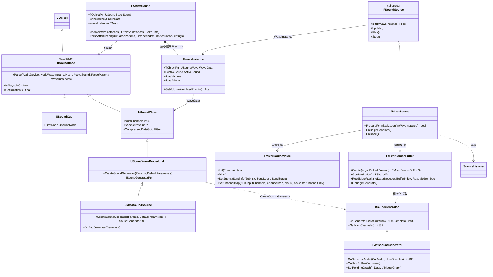

说明:`TObjectPtr_USoundBase` 表示 `TObjectPtr<USoundBase>`(图内避免尖括号)。FActiveSound 定义于 `Public/ActiveSound.h:282`(`struct FActiveSound : public ISoundModulatable`),FWaveInstance 于 `Public/Audio.h:162`,FSoundSource 于 `Public/Audio.h:609`,FMixerSource 于 `Runtime/AudioMixer/Private/AudioMixerSource.h:30`(同时实现 `ISourceListener`),FMixerSourceVoice 于 `Private/AudioMixerSourceVoice.h:19`,FMixerSourceBuffer 于 `Private/AudioMixerSourceBuffer.h:67`(实现 `ISoundWaveClient`),UMetaSoundSource 于 `Plugins/Runtime/Metasound/Source/MetasoundEngine/Public/MetasoundSource.h:89`(`class UMetaSoundSource : public USoundWaveProcedural, public FMetasoundAssetBase, public IMetaSoundDocumentInterface`)。

### 14.3.3 混音内部:SourceManager 与 Submix 图

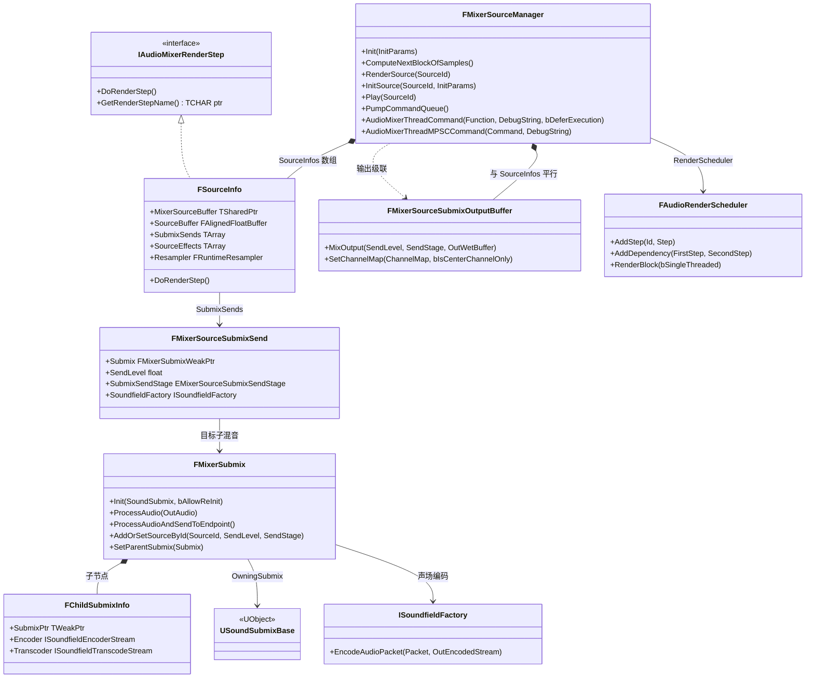

说明:FSourceInfo(Private/AudioMixerSourceManager.h:473)是渲染线程侧"每个声源的全部状态",继承 IAudioMixerRenderStep 以便交给 FAudioRenderScheduler(Private/AudioRenderScheduler.h:74)做依赖调度——"目前只有 source rendering 使用 scheduler"(AudioRenderScheduler.h:69-71 注释)。FMixerSubmix(Public/AudioMixerSubmix.h:112)构成从各 Main/普通子混音到 Endpoint 的 DAG;`FMixerDevice::DefaultEndpointSubmixes` 与 `ExternalEndpointSubmixes` 两个数组(AudioMixerDevice.h:503-507)分别表示"汇总进主输出"与"送外部端点"的叶子。

### 14.3.4 MetaSound:图 → Frontend 文档 → 算子 → 执行

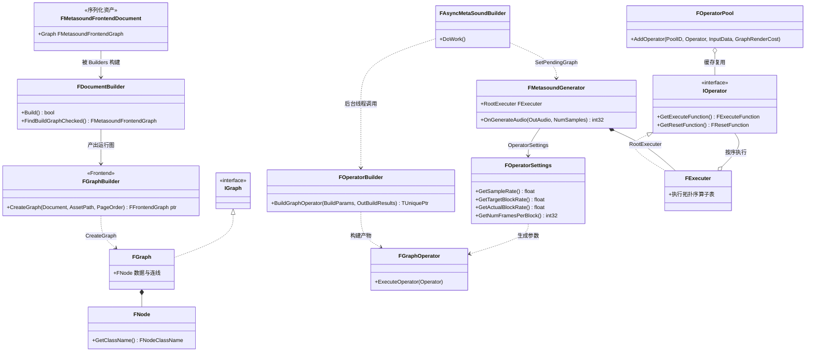

说明:资产侧文档 `FMetasoundFrontendDocument` 由 `Frontend::FDocumentBuilder`(MetasoundFrontendDocumentBuilder.h:246 附近)构建/校验;`Frontend::FGraphBuilder::CreateGraph`(MetasoundFrontendGraphBuilder.h:87-137)把文档转为运行时 `Metasound::FGraph`(MetasoundGraph.h:19)/`FNode`(MetasoundNode.h:16)。播放时 `FMetasoundConstGraphGenerator::BuildGraph`(MetasoundGenerator.cpp:1182-1200)把 `FAsyncTask<FAsyncMetaSoundBuilder>` 丢入 `GBackgroundPriorityThreadPool`,DoWork 内 `GeneratorBuilder::BuildGraphOperator` → `FOperatorBuilder(InInitParams.BuilderSettings)` + `Builder.BuildGraphOperator(BuildParams, OutBuildResults)`(MetasoundGeneratorBuilder.cpp:282-305),产物 `FGraphOperator`(`class FGraphOperator : public TExecutableOperator<FGraphOperator>`,MetasoundGraphOperator.h:23)由 `FExecuter`(MetasoundExecutableOperator.h:248,`class FExecuter : public IOperator`)包装。算子执行函数是裸函数指针 `using FExecuteFunction = void(*)(IOperator*)`(MetasoundOperatorInterface.h:159),调用约定零虚表开销。

## 14.4 数据字典

### 14.4.1 平台设置与流参数(采样率/块大小权威来源)

| 类型/字段 | 类型 | 含义 | 取值/约束 | 源码位置 |
|---|---|---|---|---|
| FAudioPlatformSettings.SampleRate | int32 | 混音采样率 | 默认 48000;ini 键 AudioSampleRate,下限 8000 | AudioMixerCore/Public/AudioMixerTypes.h:65、82;解析 AudioMixer.cpp:1247-1250 |
| FAudioPlatformSettings.CallbackBufferFrameSize | int32 | 每回调块帧数 | 默认 1024;ini 键 AudioCallbackBufferFrameSize,下限 240 | AudioMixerTypes.h:68、83;AudioMixer.cpp:1252-1255 |
| FAudioPlatformSettings.NumBuffers | int32 | 排队缓冲数 | 默认 2;ini 键 AudioNumBuffersToEnqueue,下限 1(Windows ini 实配 1) | AudioMixerTypes.h:71、84;BaseEngine.ini:3425 |
| FAudioPlatformSettings.MaxChannels | int32 | 最大同时声源 | 0=用 UAudioSettings 质量档;ini 键 AudioMaxChannels | AudioMixerTypes.h:74、85 |
| FAudioPlatformSettings.NumSourceWorkers | int32 | 声源工作线程数(遗留) | 默认 0;Windows ini 实配 4 | AudioMixerTypes.h:77、86;BaseEngine.ini:3426 |
| FAudioMixerOpenStreamParams(ctor 默认) | struct | 打开音频流参数 | NumFrames 默认 1024、NumBuffers 默认 1、SampleRate 默认 44100(会被 PlatformSettings 覆盖,见 FMixerDevice::InitializeHardware AudioMixerDevice.cpp:1252-1256) | AudioMixerCore/Public/AudioMixer.h:217-256 |
| FAudioPlatformDeviceInfo | struct | 设备实际能力 | NumChannels/NumDirectOutChannels/SampleRate/Format/OutputChannelArray/bIsSystemDefault | AudioMixer.h:93-136 |
| FAudioQualitySettings.MaxChannels | int32 | 质量档最大声道 | 默认 32 | Engine/Classes/Sound/AudioSettings.h:90-93 |
| MAX_AUDIOCHANNELS | 宏 | ini 可设最大通道 | 64 | AudioMixerCore/Public/AudioDefines.h:10 |
| AUDIO_MIXER_MAX_OUTPUT_CHANNELS | 宏 | 输出最大扬声器 | 8(7.1) | AudioMixer.h:70 |
| Audio::MonoUpmixFullVolume 等 | constexpr float | 单声道上混常数 | 1.0 / 0.707(EqualPower)/ 0.5(Linear) | AudioDefines.h:70-72 |

实际块时长 = CallbackBufferFrameSize / SampleRate;Windows 默认 1024/48000 ≈ 21.3 ms。ini 读取入口是 `FAudioPlatformSettings::GetPlatformSettings(FPlatformProperties::GetRuntimeSettingsClassName())`(XAudio2 侧 AudioMixerPlatformXAudio2.cpp:1160-1163),Windows 段名 `[/Script/WindowsTargetPlatform.WindowsTargetSettings]`(BaseEngine.ini:3423-3426:AudioSampleRate=48000、AudioCallbackBufferFrameSize=1024、AudioNumBuffersToEnqueue=1、AudioNumSourceWorkers=4;Mac 段同值,BaseEngine.ini:3444-3447)。

### 14.4.2 声音播放与并发

| 类型/字段 | 类型 | 含义 | 取值/约束 | 源码位置 |
|---|---|---|---|---|
| FSoundParseParameters | struct | Parse 累积的最终参数(Volume/Pitch/Priority/SoundClass/SubmixSends/BusSends[3]/滤波频率/空间化开关等) | 构造默认 Volume=1、Pitch=1、EnvelopeFollowerAttack=10ms/Release=100ms | Public/ActiveSound.h:63-280 |
| FActiveSound.PlayOrder | uint32 | 实例唯一号 | GetInstanceID() 返回它 | ActiveSound.h:309、319 |
| FActiveSound.ConcurrencyGroupData | TMap<FConcurrencyGroupID, FConcurrencySoundData> | 该声在各并发组的状态 | — | ActiveSound.h:401 |
| FActiveSound.FadeOut | EFadeOut | 谁请求淡出 | None/User/Concurrency | ActiveSound.h:440-450 |
| FWaveInstance.Volume/Priority | float | 波实例音量/优先级 | GetVolumeWeightedPriority() 用于排序 | Public/Audio.h:206-232 |
| FWaveInstance.PlayOrderCounter | static uint32 | 波实例全局序号(去重 hash) | — | Audio.h:166 |
| EVirtualizationMode | enum class | 虚拟化策略 | Disabled/PlayWhenSilent/Restart/SeekRestart(5.6 实验) | Classes/Sound/SoundBase.h:57-77 |
| ESortedActiveWaveGetType::Type | enum | 排序收集模式 | FullUpdate/PausedUpdate/QueryOnly | Public/AudioDevice.h:142-150 |
| FSoundConcurrencyManager | class | 并发管理器(音频线程) | CreateNewActiveSound/StopDueToVoiceStealing/UpdateSoundsToCull | Classes/Sound/SoundConcurrency.h:384-451 |
| FAudioVirtualLoop | class | 虚拟循环(出范围/被并发踢出的 loop 载体) | Virtualize() 静态判定 | Public/AudioVirtualLoop.h、AudioDevice.cpp:5386-5424 |

### 14.4.3 混音器内部结构

| 类型/字段 | 类型 | 含义 | 取值/约束 | 源码位置 |
|---|---|---|---|---|
| EAudioOutputStreamState::Type | enum | 输出流状态机 | Closed/Open/Stopped/Stopping/Running/SwappingDevice | AudioMixerTypes.h:23-45 |
| EAudioMixerStreamDataFormat::Type | enum | 设备流格式 | Unknown/Float/Int16/Unsupported | AudioMixerTypes.h:8-17 |
| NAME_BINKA/ADPCM/PCM/OPUS/RADA/OGG | inline FName | 支持的音频格式名 | OGG 归为 platform-specific | AudioMixerTypes.h:51-59 |
| FMixerSourceVoiceInitParams | struct | 声源初始化参数 | MixerSourceBuffer/SubmixSends/AudioBusSends[3]/SourceEffectChain/空间化插件设置/Quartz 量化请求/AudioLink 等 | AudioMixerSourceManager.h:141-193 |
| FSourceManagerInitParams | struct | 源管理器初始化 | NumSources/NumGeneratorSources | AudioMixerSourceManager.h:195-200 |
| FSourceInfo | class : IAudioMixerRenderStep | 渲染线程声源状态 | CurrentPCMBuffer/SourceBuffer/PreEffectBuffer/Pre&PostDistanceAttenuationBuffer/SubmixSends/SourceEffects/Volume,Pitch 插值参数/FRuntimeResampler/调制目标 | AudioMixerSourceManager.h:473-656 |
| FAudioMixerThreadCommand | struct | 渲染线程命令 | Function/bDeferExecution/DebugString | AudioMixerSourceManager.h:410-434 |
| EMixerSourceSubmixSendStage | enum | 发送抽取点 | PostDistanceAttenuation(默认)/PreDistanceAttenuation | AudioMixerSubmix.h:65-72 |
| FMixerSourceSubmixSend | struct | 单条子混音发送 | Submix/SubmixId/SendLevel/bIsMainSend/SendStage/SoundfieldFactory/滤波 | AudioMixerSourceManager.h:102-127 |
| FSubmixMap | class | ObjectId→FMixerSubmixPtr 线程安全表 | 内部 FCriticalSection MutationLock | AudioMixerDevice.h:103-120 |
| FChildSubmixInfo | struct | 子混音边(可含声场编码/转码流) | SubmixPtr/Encoder/Transcoder/IncomingPacketToTranscode | AudioMixerSubmix.h:88-110 |
| FMixerSourceBufferInitArgs | struct | 解码缓冲初始化 | AudioDeviceID/SampleRate/AudioMixerNumOutputFrames/SoundWave/LoopingMode/StartTime/bForceSyncDecode | AudioMixerSourceBuffer.h:50-64 |
| MAX_BUFFERS_QUEUED | const int32 | 每源最多排队缓冲 | 3 | AudioMixerSourceBuffer.h:13 |
| EBufferType::Type | enum | 缓冲类型 | PCM/PCMPreview/PCMRealTime/Streaming/Invalid | AudioMixerBuffer.h:11-21 |
| FDecodeAudioTaskData | struct | 解码任务入参 | AudioData/DecompressionState/BufferType/NumChannels/NumPrecacheFrames/NumFramesToDecode/bLoopingMode/bSkipFirstBuffer/bForceSyncDecode | AudioMixerSourceDecode.h:17-58 |
| FOperatorSettings | class | MetaSound 算子音频设置 | SampleRate/TargetBlockRate(成员默认 1.f,实际由设备与 UMetaSoundSettings 提供)/ActualBlockRate(SIMD 对齐后)/NumFramesPerBlock | MetasoundOperatorSettings.h:44-110 |
| UMetaSoundSettings::BlockRate | FPerPlatformFloat | 项目默认块率 | 默认 0 = 用内置默认 100 Hz(注释"Zero value ... use the Default (100)") | MetasoundEngine/Public/MetasoundSettings.h:150-153 |
| FAudioRenderTimeAnalysis | struct | 渲染耗时统计 | Avg/Max/Total/RenderTimeSinceLastLog | AudioMixer.h:296-310 |

## 14.5 接口清单

以下原型逐字抄自头文件(仅去掉 `*_API` 宏),路径相对 `$E`。

### 14.5.1 FAudioDevice(游戏/音频线程入口,Public/AudioDevice.h)

| 原型 | 功能 | 参数/返回 | 线程约束 | 位置 |
|---|---|---|---|---|
| `bool Init(Audio::FDeviceId InDeviceID, int32 InMaxSources, int32 BufferSizeOverride = INDEX_NONE, int32 NumBuffersOverride = INDEX_NONE);` | 设备初始化 | 返回是否成功 | 游戏线程(由 FAudioDeviceManager 构造调用) | AudioDevice.h:519 |
| `void Update(bool bGameTicking);` | 音频主 tick(ActiveSound/并发/排序/启停) | — | 游戏线程调用则转发到音频线程;真正执行在音频线程(内部 check) | AudioDevice.h:544;AudioDevice.cpp:4725-4751 |
| `void PlaySoundAtLocation(USoundBase* Sound, UWorld* World, float VolumeMultiplier, float PitchMultiplier, float StartTime, const FVector& Location, const FRotator& Rotation, USoundAttenuation* AttenuationSettings = nullptr, USoundConcurrency* ConcurrencySettings = nullptr, const TArray<FAudioParameter>* Params = nullptr, const AActor* OwningActor = nullptr);` | 一次性播放(mobile 版 move 重载在 :757) | — | `check(IsInGameThread())`(AudioDevice.cpp:6707) | AudioDevice.h:755 |
| `void AddNewActiveSound(const FActiveSound& ActiveSound, const TArray<FAudioParameter>* InDefaultParams = nullptr, const FString* EventLogID = nullptr);` / `void AddNewActiveSound(TSharedRef<FActiveSound> ActiveSound, TArray<FAudioParameter>&& InDefaultParams, const FString* EventLogID = nullptr);` | 注册 ActiveSound(内部转音频线程) | — | 任意线程,音频线程内直接执行 | AudioDevice.h:763、768 |
| `int32 GetSortedActiveWaveInstances(TArray<FWaveInstance*>& WaveInstances, const ESortedActiveWaveGetType::Type GetType);` | 收集+排序波实例,返回首个可发声下标 | 返回 FirstActiveIndex | `check(IsInAudioThread())`(AudioDevice.cpp:4161) | AudioDevice.h:571 |
| `void StopSources(TArray<FWaveInstance*>& WaveInstances, int32 FirstActiveIndex);` / `void StartSources(TArray<FWaveInstance*>& WaveInstances, int32 FirstActiveIndex, bool bGameTicking);` | 停止低优先级/启动高优先级声源 | — | 音频线程(仅由 Update 调用) | AudioDevice.h:1512、1517 |
| `virtual FSoundSource* CreateSoundSource() = 0;` | 平台声源工厂 | FMixerDevice 返回 FMixerSource | 音频线程 | AudioDevice.h:1809 |
| `void SendCommandToActiveSounds(uint64 InAudioComponentID, TUniqueFunction<void(FActiveSound&)> InFunc, const TStatId InStatId = TStatId());` | 对组件的全部 ActiveSound 执行回调 | — | 任意线程(转音频线程) | AudioDevice.h:1378 |

### 14.5.2 FAudioThread 与栅栏(Public/AudioThread.h)

| 原型 | 功能 | 参数/返回 | 线程约束 | 位置 |
|---|---|---|---|---|
| `static void StartAudioThread();` | 启用音频线程管道并注册 GC 挂起回调 | — | `check(IsInGameThread())`(AudioThread.cpp:631) | AudioThread.h:52 |
| `static void RunCommandOnAudioThread(TUniqueFunction<void()> InFunction, const TStatId InStatId = TStatId());` | 投递命令到音频线程;音频线程内立即执行,游戏线程进批处理器,其他线程直接 GAudioPipe.Launch | — | 任意线程(策略见 AudioThread.cpp:494-517) | AudioThread.h:58 |
| `static void ProcessAllCommands();` | 冲刷 GAudioAsyncBatcher 批 | — | 游戏线程 | AudioThread.h:61 |
| `static void RunCommandOnGameThread(TUniqueFunction<void()> InFunction, const TStatId InStatId = TStatId());` | 音频线程→游戏线程命令(TG_PrePhysics tick 批处理或 ExecuteOnGameThread) | — | 音频线程(或无音频线程时的游戏线程) | AudioThread.h:64 |
| `static void SuspendAudioThread(); / static void ResumeAudioThread();` | GC 期间挂起/恢复音频处理(嵌套计数) | — | 仅游戏线程(AudioThread.cpp:331、365) | AudioThread.h:69-70 |
| `void BeginFence();`(FAudioCommandFence) | 在当前批后立栅栏 | — | `check(IsInGameThread())`(AudioThread.cpp:688) | AudioThread.h:112 |
| `void Wait(bool bProcessGameThreadTasks = false) const;`(FAudioCommandFence) | 等待栅栏前的全部音频命令完成 | — | 游戏线程 | AudioThread.h:118 |
| `bool IsFenceComplete() const;`(FAudioCommandFence) | 非阻塞查询 | — | 游戏线程 | AudioThread.h:121 |

### 14.5.3 平台接口(AudioMixerCore/Public/AudioMixer.h)

| 原型 | 功能 | 参数/返回 | 线程约束 | 位置 |
|---|---|---|---|---|
| `virtual bool InitializeHardware() = 0;` | 初始化平台音频 API | — | 游戏线程(FMixerDevice::InitializeHardware ensure IsInGameThread) | AudioMixer.h:436 |
| `virtual bool OpenAudioStream(const FAudioMixerOpenStreamParams& Params) = 0;` | 按参数打开输出流 | — | 游戏线程 | AudioMixer.h:475 |
| `virtual bool StartAudioStream() = 0; / virtual bool StopAudioStream() = 0;` | 启停流(Start 内部拉起渲染线程) | — | 游戏线程 | AudioMixer.h:481、483 |
| `virtual void SubmitBuffer(const uint8* Buffer) {};` | 把已混好的字节提交给设备 | — | 平台回调线程(XAudio2 OnBufferEnd 链) | AudioMixer.h:504 |
| `void ReadNextBuffer();` | 弹出一块并提交,再触发渲染线程补块 | — | 平台回调线程 | AudioMixer.h:565;AudioMixer.cpp:583 |
| `uint32 Run() override;`(FRunnable) | 渲染线程入口(RunInternal 循环) | — | 音频渲染线程 | AudioMixer.h:548;AudioMixer.cpp:926 |
| `bool OnProcessAudioStream(FAlignedFloatBuffer& OutputBuffer) = 0;`(IAudioMixer) | 混出一整块(FMixerDevice 实现) | 返回是否继续 | 音频渲染线程 | AudioMixer.h:143 |
| `static bool GetChannelTypeAtIndex(const int32 Index, EAudioMixerChannel::Type& OutType);` | 通道索引→枚举 | — | 任意线程 | AudioMixer.h:526 |
| `virtual FAudioPlatformSettings GetPlatformSettings() const = 0;` | 平台设置(ini 解析入口) | — | 任意线程 | AudioMixer.h:469 |
| `class IAudioDeviceModule ... virtual FAudioDevice* CreateAudioDevice(); virtual Audio::IAudioMixerPlatformInterface* CreateAudioMixerPlatformInterface();` | 模块级设备工厂 | — | 模块加载线程 | AudioMixer.h:874-884 |

### 14.5.4 FMixerDevice / FMixerSourceManager / FMixerSubmix

| 原型 | 功能 | 参数/返回 | 线程约束 | 位置 |
|---|---|---|---|---|
| `virtual bool OnProcessAudioStream(FAlignedFloatBuffer& OutputBuffer) override;`(FMixerDevice) | 渲染一块:泵命令→时钟→源管理→主子混音→端点→时钟推进 | 返回 true 继续 | 音频渲染线程(入口 ResetAudioRenderingThreadId) | AudioMixerDevice.h:223;AudioMixerDevice.cpp:1666-1789 |
| `void AudioRenderThreadCommand(TFunction<void()> Command);`(FMixerDevice) | 命令入 `TMpscQueue CommandQueue`,渲染线程泵 | — | 任意线程(典型音频线程) | AudioMixerDevice.h:356;AudioMixerDevice.cpp:2557 |
| `void GameThreadMPSCCommand(TFunction<void()> InCommand);`(FMixerDevice) | 命令入 `TMpscQueue GameThreadCommandQueue`,游戏线程 UpdateGameThread 泵 | — | 音频渲染线程 | AudioMixerDevice.h:359;AudioMixerDevice.cpp:2562 |
| `void ComputeNextBlockOfSamples();`(FMixerSourceManager) | 源管理器渲染一块(泵命令→调制→调度/生成→总线) | — | 音频渲染线程 `AUDIO_MIXER_CHECK_AUDIO_PLAT_THREAD`(AudioMixerSourceManager.cpp:4051) | AudioMixerSourceManager.h:286 |
| `void RenderSource(const int32 SourceId);`(FMixerSourceManager) | 单源三段:ComputeSourceBuffer→ComputePostSourceEffectBuffer→ComputeOutputBuffers | — | 渲染线程或其并行子任务 | AudioMixerSourceManager.h:290;AudioMixerSourceManager.cpp:3800-3806 |
| `void AudioMixerThreadCommand(TFunction<void()>&& InFunction, const char* InDebugString = nullptr, bool bInDeferExecution = false);` | 写入双缓冲命令表(音频线程生产) | — | 音频线程 `AUDIO_MIXER_CHECK_GAME_THREAD`(AudioMixerSourceManager.cpp:4209,注意宏名如此) | AudioMixerSourceManager.h:436 |
| `void AudioMixerThreadMPSCCommand(TFunction<void()>&& InCommand, const char* InDebugString=nullptr);` | 任意线程→渲染线程 MPSC | — | 任意线程 | AudioMixerSourceManager.h:333;AudioMixerSourceManager.cpp:4190 |
| `void PumpCommandQueue();`(FMixerSourceManager) | 渲染线程泵两条命令队列 | — | 音频渲染线程(记录 AudioRenderThreadId) | AudioMixerSourceManager.h:328;AudioMixerSourceManager.cpp:4277 |
| `void InitSource(const int32 SourceId, const FMixerSourceVoiceInitParams& InitParams);` | 初始化渲染侧声源 | — | 任意线程(内部转命令) | AudioMixerSourceManager.h:218 |
| `void AddOrSetSourceById(const int32 InSourceId, const float SendLevel, EMixerSourceSubmixSendStage InSubmixSendStage);`(FMixerSubmix) | 登记源→子混音发送 | — | 音频线程(命令) | AudioMixerSubmix.h:193 |
| `void ProcessAudio(FAlignedFloatBuffer& OutAudio);`(FMixerSubmix) | 递归混音该子混音(子→源→效果→监听→父) | — | 音频渲染线程 | AudioMixerSubmix.h:236 |
| `void ProcessAudioAndSendToEndpoint();`(FMixerSubmix) | 外部端点叶子渲染 | — | 音频渲染线程 | AudioMixerSubmix.h:243 |

### 14.5.5 解码与声源缓冲

| 原型 | 功能 | 参数/返回 | 线程约束 | 位置 |
|---|---|---|---|---|
| `static FMixerSourceBufferPtr Create(FMixerSourceBufferInitArgs& InArgs, TArray<FAudioParameter>&& InDefaultParams=TArray<FAudioParameter>());`(FMixerSourceBuffer) | 创建解码缓冲(含总线连接) | — | 音频线程 | AudioMixerSourceBuffer.h:70 |
| `bool ReadMoreRealtimeData(ICompressedAudioInfo* InDecoder, int32 BufferIndex, EBufferReadMode BufferReadMode);` | 发起异步解码任务 | 返回是否成功入队 | 音频线程(任务在线程池) | AudioMixerSourceBuffer.h:104 |
| `TSharedPtr<FAlignedFloatBuffer, ESPMode::ThreadSafe> GetNextBuffer();` | 取下一块 PCM(供渲染) | 空则 nullptr | 音频渲染线程 | AudioMixerSourceBuffer.h:92 |
| `void DoProceduralRendering(const FProceduralAudioTaskData& ProceduralTaskData, FProceduralAudioTaskResults& ProceduralResult);` | 程序化声波拉取 ISoundGenerator | 注释:"can be called either directly on the rendering thread or from a background decode task" | 渲染线程或后台任务 | AudioMixerSourceBuffer.h:141 |
| `IAudioTask* CreateAudioTask(Audio::FDeviceId InDeviceId, const FHeaderParseAudioTaskData& InJobData);` / `IAudioTask* CreateAudioTask(Audio::FDeviceId InDeviceId, const FDecodeAudioTaskData& InJobData);` | 创建头部解析/解码任务 | 返回可查询句柄 | 任意线程(内部 FAsyncTask) | AudioMixerSourceDecode.h:128、131 |
| `virtual bool IsDone() const = 0; virtual EAudioTaskType GetType() const = 0; virtual void EnsureCompletion() = 0; virtual void CancelTask() = 0;`(IAudioTask) | 任务句柄接口 | — | 任意线程 | AudioMixerSourceDecode.h:106-125 |
| `virtual bool StreamCompressedData(uint8* Destination, bool bLooping, uint32 BufferSize, int32& OutNumBytesStreamed) { OutNumBytesStreamed = -1; return false; }`(ICompressedAudioInfo 基类虚设,流式子类覆写) | 流式解压一块 | — | 解码线程池 | Engine/Public/AudioDecompress.h:164 |
| 解码器类:`FADPCMAudioInfo`(ICompressedAudioInfo)、`FBinkAudioInfo`/`FOpusAudioInfo`/`FRadAudioInfo`(IStreamedCompressedInfo)、`FVorbisAudioInfo`(ICompressedAudioInfo) | 各编解码实现 | — | 解码线程池 | AdpcmAudioDecoder/Module/Public/Decoders/ADPCMAudioInfo.h:92、BinkAudioDecoder/Module/Public/BinkAudioInfo.h:12、OpusAudioDecoder/Module/Public/Decoders/OpusAudioInfo.h:18、RadAudioCodec/Module/Public/*.h:12、VorbisAudioDecoder/Module/Public/Decoders/VorbisAudioInfo.h:42 |

注:任务书提到的"IAudioTaskQueue"同步任务队列在 5.8.3 已被标记废弃——`FMixerDevice::CreateSynchronizedAudioTaskQueue/DestroySynchronizedAudioTaskQueue/KickQueuedTasks` 三接口带 `UE_DEPRECATED(5.8, "Synchronized audio task queues are deprecated.")`(AudioMixerDevice.h:569-576);现行解码全部经 `FAsyncTask<FAsyncDecodeWorker>` 直接投线程池(AudioMixerSourceDecode.cpp:202-229)。

### 14.5.6 MetaSound 接口

| 原型 | 功能 | 参数/返回 | 线程约束 | 位置 |
|---|---|---|---|---|
| `ISoundGeneratorPtr CreateSoundGenerator(const FSoundGeneratorInitParams& InParams, TArray<FAudioParameter>&& InDefaultParameters) override;`(UMetaSoundSource) | 播放时创建生成器(建图) | — | 音频线程 | MetasoundSource.h:311;MetasoundSource.cpp:1233 |
| `virtual int32 OnGenerateAudio(float* OutAudio, int32 NumSamples) override;`(FMetasoundGenerator,ISoundGenerator) | 渲染一块:泵命令→执行参数更新→RootExecuter→交错/转码 | 返回生成样本数 | 音频渲染线程 | MetasoundGenerator.h:277 |
| `void OnNextBuffer(TFunction<void(FMetasoundGenerator&)> Command)` | 在下个 buffer 前(同线程)安全改生成器状态 | — | 任意线程投递,渲染线程执行 | MetasoundGenerator.h:302-305 |
| `UE_API void QueueParameterPack(TSharedPtr<FMetasoundParameterPackStorage> ParameterPack);` | 排队参数包(经 FDataTransmissionCenter) | — | 任意线程 | MetasoundGenerator.h:206 |
| `virtual FExecuteFunction GetExecuteFunction() = 0;`(IOperator) | 返回算子执行函数指针 | — | 构建期 | MetasoundOperatorInterface.h:159、169 |
| `TUniquePtr<FFrontendGraph> CreateGraph(const FMetasoundFrontendDocument& InDocument, const FString& InDebugAssetName, TArrayView<const FGuid> InPageOrder = { });`(Frontend::FGraphBuilder,静态) | 文档→运行时图 | — | 构建线程(编辑器/异步构建) | MetasoundFrontendGraphBuilder.h:117 |
| `void BuildGraph(FGeneratorInitParams&& InInitParams);`(FMetasoundConstGraphGenerator) | 同步/异步构建算子(bBuildAsync 由 `Metasound::ConsoleVariables::bEnableAsyncMetaSoundGeneratorBuilder` 决定) | — | 音频线程发起,任务在 GBackgroundPriorityThreadPool | MetasoundGenerator.cpp:1182-1200 |
| `void SetPendingGraph(MetasoundGeneratorPrivate::FMetasoundGeneratorData&& InData, bool bTriggerGraph);` | 后台构建完成置换图(下个 buffer 生效) | — | 构建线程调用,渲染线程消费(PendingGraphMutex) | MetasoundGenerator.h:343;MetasoundGenerator.cpp:365-375 |

### 14.5.7 扩展插件接口(AudioExtensions)

| 原型 | 功能 | 线程约束 | 位置 |
|---|---|---|---|
| `class IAudioPluginFactory`(及 IAudioSpatializationFactory/IAudioOcclusionFactory/IAudioReverbFactory 等子工厂,IModularFeature) | 空间化/遮挡/混响/SourceDataOverride 插件注册 | 工厂:任意;实例:渲染线程 | AudioExtensions/Public/IAudioExtensionPlugin.h:195、245 |
| `class ISoundfieldFactory : public IModularFeature` | 声场格式工厂(EncodeAudioPacket/DecodeAudioPacket 流) | 渲染线程 | AudioExtensions/Public/ISoundfieldFormat.h:253 |
| `class ISoundfieldEndpointFactory : public ISoundfieldFactory` / `class IAudioEndpointFactory : public IModularFeature` | 声场/普通音频端点(ExternalEndpointSubmix 消费者) | 渲染线程 | ISoundfieldEndpoint.h:167、IAudioEndpoint.h:201 |
| `class IAudioLinkFactory : public IModularFeature`(IAudioLink.h/IAudioLinkFactory.h) | AudioLink 工厂:CreateSourceLink/CreateSubmixLink 把音频推给外部(如另一个引擎实例) | 混音侧 | AudioLinkEngine/Public/IAudioLinkFactory.h:20 |
| `class IAudioModulationManager : public TSharedFromThis<IAudioModulationManager>` | 调制管理器接口(ProcessModulators 在渲染线程被 SourceManager 调,见 AudioMixerSourceManager.cpp:4072-4075) | 渲染线程 | AudioExtensions/Public/IAudioModulation.h:192 |
| `class IAudioParameterTransmitter`/`IAudioParameterInterfaceRegistry` | 参数发射/接口注册(MetaSound、AudioComponent 参数通道) | 发射:任意线程,消费:渲染线程 | AudioExtensions/Public/IAudioParameterTransmitter.h、IAudioParameterInterfaceRegistry.h:193 |
| `class IAudioDecoderOverride` | 解码覆写(项目可替换解码路径) | 解码线程 | AudioExtensions/Public/IAudioDecoderOverride.h |
| `class IWaveformTransformation` | 波形变换(WaveformTransformations 插件) | 工具线程 | AudioExtensions/Public/IWaveformTransformation.h |
| `class ISoundWaveCloudStreaming` | 云端流式 SoundWave 扩展 | — | AudioExtensions/Public/ISoundWaveCloudStreaming.h |

### 14.5.8 采集与分析

| 原型 | 功能 | 线程约束 | 位置 |
|---|---|---|---|
| `class FAudioCapture`(AudioCaptureCore) | 统一采集 API:OpenCaptureStream/GetCaptureStreamAudioTime 等 | 回调在平台采集线程 | AudioCaptureCore/Public/AudioCaptureCore.h:28 |
| `class IAudioCaptureStream : public IModularFeature` | 平台采集实现注册点 | — | AudioCaptureCore/Public/AudioCaptureDeviceInterface.h:64 |
| `virtual void Analyze(TArrayView<const float> InAudio, IAnalyzerResult* OutResult) = 0;`(IAudioAnalyzerInterface) | 实时分析器帧回调 | 渲染线程(经 Submix/SpectrumAnalysis 挂接) | AudioAnalyzer/Public/IAudioAnalyzerInterface.h:66 |
| `class FAudioAnalyzerFacade` / `FAudioAnalyzerNRTFacade` | 面向业务的分析器门面 | — | AudioAnalyzer/Public/AudioAnalyzerFacade.h、AudioAnalyzerNRTFacade.h |

## 14.6 关键流程

### 14.6.1 设备初始化(游戏线程发起)

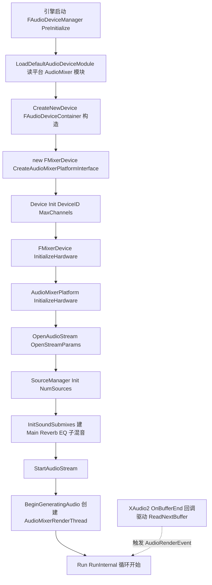

要点:`InitializeHardware` 中 `OpenStreamParams.SampleRate = SampleRate`(来自 PlatformSettings),`AudioClockDelta = NumFrames / SampleRate`(AudioMixerDevice.cpp:1319-1320);设备变更(Unplug/默认设备切换)由 `IAudioMixerDeviceChangedListener::OnDefaultRenderDeviceChanged` 等回调(AudioMixer.h:384-390)→ `FAudioMixerPlatformSwappable::CheckThreadedDeviceSwap`(AudioMixer.h:790)在音频线程 `UpdateHardware` 里轮询完成(AudioMixerDevice.cpp:1501-1543)。

### 14.6.2 USoundBase 播放完整链路(主路径)

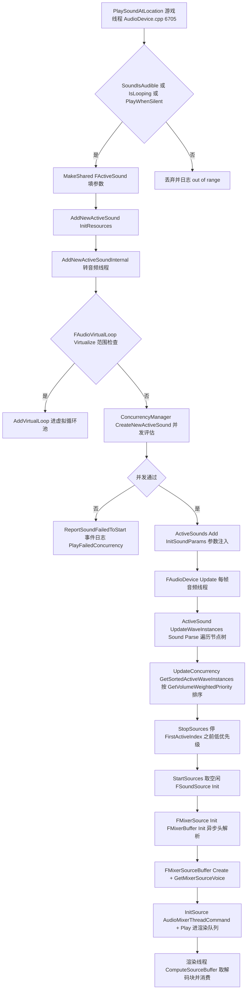

关键事实(逐条对应源码):
- 可闻性预筛:`GetMaxDistanceAndFocusFactor` + `SoundIsAudible`(AudioDevice.cpp:6720-6726);短声音二次筛:`Sound->GetDuration() <= SoundDistanceOptimizationLengthCVar`(au.SoundDistanceOptimizationLength,AudioDevice.cpp:5343)。
- 并发:`SCOPE_CYCLE_COUNTER(STAT_AudioEvaluateConcurrency)` 包裹 `ConcurrencyManager.CreateNewActiveSound`(AudioDevice.cpp:5404-5409);失败且非重触发时再试虚拟化(5411-5434)。
- 虚拟化:`FAudioVirtualLoop::Virtualize(..., bDoRangeCheck=true)`(5389-5397);每帧 `VirtualizeInactiveLoops()`(4846)把出范围 loop 压入 `VirtualLoops`,`UpdateVirtualLoops` 负责重触发(`RetriggerVirtualLoop`,AudioDevice.h:779)。
- Parse:`USoundBase::Parse` 虚函数(SoundBase.h:350),USoundCue 沿 `FirstNode` 遍历 USoundNode 树,`USoundNodeWavePlayer` 产 FWaveInstance(经 `FActiveSound::AddWaveInstance`,ActiveSound.h:706)。
- 排序:`FCompareFWaveInstanceByPlayPriority` 按 `GetVolumeWeightedPriority()` 升序(低优先在前),`FirstActiveIndex = Max(Num - MaxChannels, 0)`(AudioDevice.cpp:4246-4288);若 `au.EnableRelativeRenderCostVoiceLimit=1` 则按"相对渲染成本"截断(4263-4282)。
- 声源初始化:`StartSources` → `FMixerSource::Init`(AudioMixerSource.h:41)→ `FMixerBuffer::Init`(AudioMixerBuffer.h:42,静态)+ `FMixerSourceBuffer::Create`;渲染侧通过 `FMixerDevice::GetMixerSourceVoice()`(AudioMixerDevice.h:251,从 `TSpscQueue<FMixerSourceVoice*> SourceVoices` AudioMixerDevice.h:519 取空闲)后 `InitSource`/`Play` 命令入队。

### 14.6.3 渲染一块的全流程(音频渲染线程)

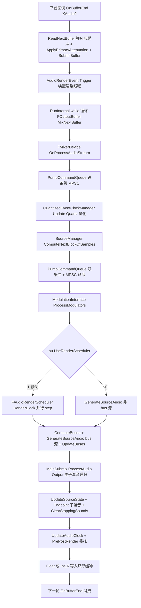

- 单源渲染三段在 `RenderSource`(AudioMixerSourceManager.cpp:3800-3806):`ComputeSourceBuffer`(拉 FMixerSourceBuffer 队列、执行 SourceDataOverride/程序化生成、音高重采样 `FRuntimeResampler`)→ `ComputePostSourceEffectBuffer`(源效果链)→ `ComputeOutputBuffers`(channel map/HRTF/空间化插件、写入 `FMixerSourceSubmixOutputBuffer`)。
- 并行策略:`au.DisableParallelSourceProcessing=0`(默认)时,每个播放源一个 `UE::Tasks::Launch(TEXT("Render Audio Source"), ..., ETaskPriority::High)` 嵌套任务,外层任务 `Wait()`(AudioMixerSourceManager.cpp:3735-3758);`au.UseRenderScheduler=1`(默认)时改由 `FAudioRenderScheduler::RenderBlock` 按依赖图调度(AudioMixerSourceManager.cpp:4080-4086)。
- 主输出与端点:`GetMasterSubmix()->ProcessAudio(Output)`(AudioMixerDevice.cpp:1699-1718);`au.submix.audibledefaultendpoints` 可让默认(静音)端点子混音进主输出(1728-1741);外部端点 `ProcessAudioAndSendToEndpoint()`(1743-1751)。
- 缓冲不足(underrun):`PopBufferData` 返回长度小于视图即计数并限频告警(AudioMixer.cpp:615-649);渲染线程 `AudioRenderEvent->Wait` 超时(au.OverrunTimeoutMSec 默认 5000ms)会强制设备 swap(AudioMixer.cpp:887-917)。

### 14.6.4 销毁/异常路径

- 设备 Teardown:`FMixerDevice::TeardownHardware`(AudioMixerDevice.cpp:1413-1458):反注册全部 USoundSubmix → `SourceManager->Update()` → `StopAudioStream → CloseAudioStream → TeardownHardware`;渲染线程经 `StopGeneratingAudio`(AudioMixer.cpp:699-747)Kill 线程。
- 音频渲染线程卡死检测:`FMixerSourceManager::AudioMixerThreadCommand` 发现命令缓冲超过 `au.CommandBufferMaxSizeInMb`(默认 10MB)置 `bShouldResetHardwareCallback`,音频线程 `UpdateHardware` 里 `CheckAndResetHardwareCallbackStallFlag` 触发强制设备切换(AudioMixerSourceManager.cpp:4256-4267;AudioMixerDevice.cpp:1490-1494)。
- GC 协作:`FAudioThread::StartAudioThread` 注册 4 个 GC 委托,GC 前 `SuspendAudioThread`(管道内挂起),GC 后恢复(AudioThread.cpp:640-644);`au.FlushAudioRenderThreadOnGC` 控制相关行为(AudioDevice.cpp:135)。
- 无硬件:平台初始化失败时 `StartRunningNullDevice()`/`FMixerNullCallback`(AudioMixer.h:682-688)保证引擎逻辑仍可跑(静音)。

## 14.7 时序图

### 14.7.1 PlaySoundAtLocation → 声源进入渲染线程

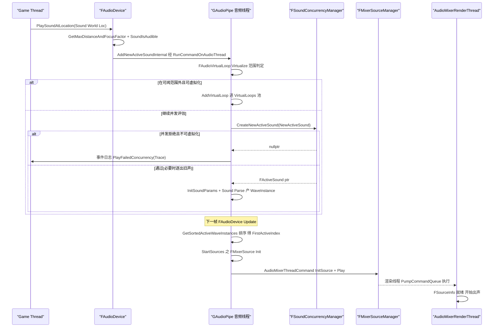

### 14.7.2 渲染一块(平台回调 ↔ 渲染线程 ↔ 子混音)

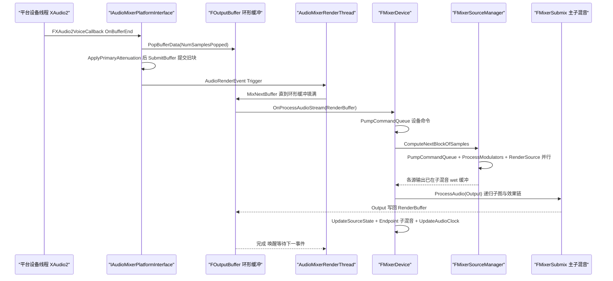

### 14.7.3 MetaSound:播放 → 后台建图 → 渲染线程生成

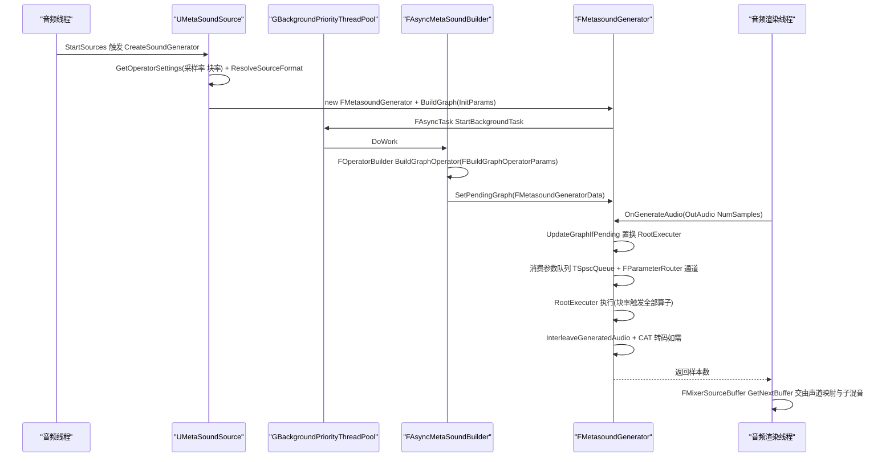

MetaSound 线程模型要点(源码依据):图构建在后台池(MetasoundGenerator.cpp:1186-1199);生成在渲染线程(`FMixerSourceBuffer::DoProceduralRendering` 注释明示"directly on the rendering thread or from a background decode task",AudioMixerSourceBuffer.h:140-141;`UMetaSoundSource::CreateSoundGenerator` 在音频线程被调用);图置换通过 `PendingGraphMutex` 保护的 pending 槽 + 渲染线程 `UpdateGraphIfPending`(MetasoundGenerator.cpp:365-398);参数从游戏线程经 `FParameterRouter::FindOrCreateDataChannelForReader` 建立的 `TSpscQueue<FMetaSoundParameterTransmitter::FParameter>` 数据通道无锁传递(MetasoundSource.cpp:1257-1258)。

## 14.8 线程模型与同步

### 14.8.1 线程清单

| 线程/上下文 | 创建者 | 关键职责 | 判定依据 |
|---|---|---|---|
| Game Thread | 引擎 | UAudioComponent、PlaySoundAtLocation、资产/委托 | `check(IsInGameThread())`(AudioDevice.cpp:6707 等) |
| 音频线程(管道) | `UE::Tasks::FPipe GAudioPipe`(ThreadingBase.cpp:245) | FAudioDevice::Update 全逻辑、ActiveSound/并发、命令执行 | `IsInAudioThread() = GAudioPipe.IsInContext()`(ThreadingBase.cpp:256) |
| 音频渲染线程 | `IAudioMixerPlatformInterface::BeginGeneratingAudio` → `FRunnableThread::Create(TEXT("AudioMixerRenderThread(N)"), TPri_Highest, GetAudioRenderThreadMask())`(AudioMixer.cpp:694-696) | OnProcessAudioStream 整块混音 | `AUDIO_MIXER_CHECK_AUDIO_PLAT_THREAD` = `CheckAudioRenderingThread()`(AudioMixer.h:63) |
| 平台设备线程 | XAudio2/WASAPI/CoreAudio 等 | OnBufferEnd → ReadNextBuffer/SubmitBuffer | FXAudio2VoiceCallback(AudioMixerPlatformXAudio2.cpp:93-99) |
| 解码工作线程 | FAsyncTask 于 GThreadPool / GBackgroundPriorityThreadPool | FAsyncDecodeWorker::DoWork(AudioMixerSourceDecode.cpp:55-117) | `ShouldUseBackgroundPoolFor_FAsyncRealtimeAudioTask()` 分流(AudioMixerSourceDecode.cpp:214-215) |
| MetaSound 构建线程 | FAsyncTask 于 GBackgroundPriorityThreadPool | FAsyncMetaSoundBuilder::DoWork | MetasoundGenerator.cpp:1191、1239 |
| 源渲染并行任务 | UE::Tasks(ETaskPriority::High) | RenderSource 单源 | AudioMixerSourceManager.cpp:3752-3757 |

### 14.8.2 队列与同步原语

| 名称 | 方向 | 类型/机制 | 生产者→消费者 | 源码 |
|---|---|---|---|---|
| FAudioAsyncBatcher | GT→音频线程 | TArray 批(默认 128 条/批)+ GAudioPipe.Launch("AudioBatch") | 游戏线程→管道任务 | AudioThread.cpp:405-455 |
| FGameThreadAudioCommandQueue | 音频线程→GT | TSpscQueue<FAudioCommand> + FTickFunction(TG_PrePhysics) | 管道→游戏线程 tick | AudioThread.cpp:96-222 |
| FAudioCommandFence | GT↔音频线程 | `UE::Tasks::FTask Fence`(取 LastBatch 任务句柄 Wait) | 游戏线程等待音频命令排空 | AudioThread.h:102-126 |
| FMixerDevice::CommandQueue | 任意→渲染线程 | TMpscQueue<TFunction<void()>> | 音频线程→渲染线程,PumpCommandQueue 消费 | AudioMixerDevice.h:537;PumpCommandQueue 声明 AudioMixerDevice.h:417、实现 AudioMixerDevice.cpp:2567 |
| FMixerDevice::GameThreadCommandQueue | 渲染线程→GT | TMpscQueue<TFunction<void()>> | 渲染线程→游戏线程(UpdateGameThread 泵) | AudioMixerDevice.h:540;AudioMixerDevice.cpp:418、2562-2566 |
| FMixerSourceManager::CommandBuffers[2] | 音频线程→渲染线程 | 双缓冲 TArray<FAudioMixerThreadCommand> + FThreadSafeCounter RenderThreadCommandBufferIndex + FCriticalSection CommandBufferIndexCriticalSection + FEvent CommandsProcessedEvent | 音频线程写非当前缓冲,渲染线程交换 | AudioMixerSourceManager.h:455-466;Pump 实现 AudioMixerSourceManager.cpp:4277+ |
| FMixerSourceManager::MpscCommandQueue | 任意→渲染线程 | TMpscQueue<FAudioMixerThreadCommand> | 任意线程(AudioMixerThreadMPSCCommand) | AudioMixerSourceManager.h:470-471 |
| FMixerDevice::SourceVoices | 渲染线程空闲声源池 | TSpscQueue<FMixerSourceVoice*> | 分配/回收无锁 | AudioMixerDevice.h:519 |
| FOutputBuffer | 渲染线程→平台线程 | Audio::TCircularAudioBuffer<uint8>(格式转换后字节流) | 渲染线程 Push,平台回调 Pop | AudioMixer.h:313-357;AudioMixer.cpp:264-303 |
| AudioRenderEvent | 平台→渲染线程 | FEvent(池化) | OnBufferEnd 触发渲染线程继续混 | AudioMixer.cpp:657-660、887 |
| DeviceSwapCriticalSection | 设备切换互斥 | FCriticalSection(TryLock 快速路径) | 平台回调 vs 换设备流程 | AudioMixer.h:713;AudioMixer.cpp:602 |
| PendingGraphMutex | 构建线程→渲染线程 | FCriticalSection + bIsNewGraphPending | MetaSound 图置换 | MetasoundGenerator.cpp:365-398 |
| FSoundWaveCritSec / DecodeTaskCritSec | 解码缓冲内部 | FCriticalSection | USoundWave 访问与任务生命周期 | AudioMixerSourceBuffer.h:185-186 |

### 14.8.3 跨线程数据所有权

- UObject(USoundBase/USoundWave/USoundSubmix 等)引用:音频线程持有,通过 `FAudioDevice::AddReferencedObjects`(AudioDevice.h:564)与 `FMixerDevice::AddReferencedObjects`(FGCObject,AudioMixerDevice.h:228)向 GC 报告;GC 开始前音频线程必须挂起(AudioThread.cpp:640-644)。渲染线程不直接长期持 UObject,渲染期用 `FSoundWaveProxy`/`FSoundWaveData`(AudioMixer.h:81-87 前置声明;AudioMixerCore 使用 `FSoundWavePtr = TSharedPtr<FSoundWaveData, ESPMode::ThreadSafe>`)。
- ActiveSound/WaveInstance/FSoundSource:音频线程独占;渲染线程只通过命令(FMixerSourceVoiceInitParams 等值拷贝结构,AudioMixerSourceManager.h:141)拿快照。
- FSourceInfo 与各缓冲:渲染线程独占(`AUDIO_MIXER_CHECK_AUDIO_PLAT_THREAD`)。
- 双缓冲命令表所有权随 `RenderThreadCommandBufferIndex` 原子翻转;命令内 lambda 捕获的共享指针决定对象生命周期跨线程安全(ESPMode::ThreadSafe 到处强制)。

## 14.9 配置与扩展点

### 14.9.1 关键 CVar(名称、默认值均抄自源码)

| CVar | 默认 | 作用 | 位置 |
|---|---|---|---|
| AudioThread.SuspendAudioThread | 0 | 1=挂起音频线程 | Engine/Private/AudioThread.cpp:26 |
| AudioThread.AboveNormalPriority | 0 | 音频线程优先级提升 | AudioThread.cpp:29 |
| AudioThread.EnableBatchProcessing | 1 | 命令批处理 | AudioThread.cpp:35 |
| AudioThread.BatchAsyncBatchSize | 128 | 每批命令数 | AudioThread.cpp:43 |
| AudioThread.BatchCommands | true | 音频→GT 命令进 tick 批 | AudioThread.cpp:241 |
| AudioThread.UseSafeRunCommandOnGameThread | true | GT 命令仅安全点执行 | AudioThread.cpp:251 |
| AudioCommand.FenceWaitTimeMs | 35 | 栅栏等待 | AudioThread.cpp:50 |
| AudioThread.TaskPriority | (命令) | 音频任务优先级(High/Normal/…) | AudioThread.cpp:311 |
| au.UseRenderScheduler | 1(ECVF_SaveForNextBoot) | 渲染依赖调度器开关 | AudioMixer/Private/AudioMixerCVars.cpp:12-18 |
| au.DisableSubmixEffectEQ | 1 | 关 EQ 子混音 | AudioMixerDevice.cpp:61-67 |
| au.submix.audibledefaultendpoints | 0 | 端点子混音进主输出(调试) | AudioMixerDevice.cpp:77-83 |
| au.MuteAudio | 0(ECVF_Cheat) | 最终输出静音(不改动行为) | AudioMixerDevice.cpp:124-130 |
| au.NumGeneratorSources | 0 | 生成器源数量 | AudioMixerDevice.cpp:139-144 |
| au.PatchBufferBlocks | 3 | patch 缓冲块数 | AudioMixerDevice.cpp:117-122 |
| au.RemoveSubmixesFromRoot | 1 | 子混音根引用计数回收 | AudioMixerDevice.cpp:203-209 |
| au.RenderThreadPriority | 3(TPri_Highest) | 渲染线程优先级 | AudioMixerCore/Private/AudioMixer.cpp:94-100 |
| au.RenderThreadAffinity | 0 | 渲染线程亲和性覆盖 | AudioMixer.cpp:102-108 |
| au.UseThreadedDeviceSwap | 1(仅 Windows 生效) | 换设备走宽线程 | AudioMixer.cpp:110-116、954-961 |
| au.UseCachedDeviceInfoCache | 1 | 设备信息缓存 | AudioMixer.cpp:118-124 |
| au.RecycleThreads | 1 | 渲染线程复用 | AudioMixer.cpp:126-132 |
| au.OverrunTimeoutMSec | 5000 | 回调超时→强制换设备 | AudioMixer.cpp:134-139 |
| au.LogRenderTimes | 0 | 渲染耗时日志 | AudioMixer.cpp:77-83 |
| au.DisableParallelSourceProcessing | 0 | 关源渲染并行 | AudioMixerSourceManager.cpp:40-47 |
| au.DisableSourceEffects / au.DisableFiltering / au.DisableHPFiltering / au.DisableEnvelopeFollowing / au.DisableDistanceAttenuation / au.BypassAudioPlugins | 0 | 渲染管线逐段禁用(调试) | AudioMixerSourceManager.cpp:50-98 |
| au.CommandBufferMaxSizeInMb | 10 | 命令缓冲上限(超限触发硬件复位请求) | AudioMixerSourceManager.cpp:111-117 |
| au.ForceSyncAudioDecodes | 0 | 解码强制同步 | AudioMixerSourceDecode.cpp:13-19 |
| au.SetAudioChannelCount / au.SetAudioChannelScaleCount | — | 运行时 MaxChannels | Engine/Private/AudioDevice.cpp:44、52 |
| au.DisableStoppingVoices / au.DisableAppVolume / au.DisableAutomaticPrecache / au.WaitForSoundWaveToLoad / au.BakedAnalysisEnabled / au.NumPrecacheFrames | — | 设备级行为开关 | AudioDevice.cpp:59-104 |
| au.SoundDistanceOptimizationLength | — | 短声音距离剔除阈值 | AudioDevice.cpp:114 |
| au.EnableRelativeRenderCostVoiceLimit | — | 按"渲染成本"而非个数限声源 | AudioDevice.cpp:205 |
| au.spatialization.SetCurrentSpatialPlugin / au.spatialization.ListAvailableSpatialPlugins | (命令) | 切换空间化插件 | AudioDevice.cpp:148、179 |
| au.MetaSound.RecordActiveMetasoundsToCsv | false | 活动算子记 CSV | MetasoundGenerator/Private/MetasoundGeneratorModule.cpp:22-26 |
| au.MetaSound.Experimental.OperatorPool.SetMaxNumOperators | -1 | 算子池上限 | MetasoundGeneratorModule.cpp:53-62 |
| au.Debug.Generator / Amp / Channel / Freq | 0/0.2/0/440 | 混音器测试音 | AudioMixerDevice.cpp:85-115 |

### 14.9.2 ini / 设置对象

- `[/Script/<Platform>TargetPlatform.<Platform>Settings]`:AudioSampleRate / AudioCallbackBufferFrameSize / AudioNumBuffersToEnqueue / AudioMaxChannels / AudioNumSourceWorkers(读取逻辑 AudioMixer.cpp:1241-1273;Windows/Mac 值见 BaseEngine.ini:3423-3426、3444-3447)。
- `UAudioSettings`(Engine/Classes/Sound/AudioSettings.h):质量档 MaxChannels(默认 32)、默认 Main/Reverb/EQ 子混音、MonoChannelUpmixMethod、PanningMethod 等。
- `UAudioPlatformSettings`(Classes/Sound/AudioPlatformSettings.h:33):每平台 DecodeCache 设置(EnableDecodeCache 默认 false、MaxDecodeCacheSizeMB 10、FramesPerChunk 4096、AutoDurationThreshold 2s)。
- `UMetaSoundSettings`(MetasoundSettings.h:140+,config=MetaSound):SampleRate(0=设备率)、BlockRate(0=默认 100Hz)。

### 14.9.3 委托与扩展点

- 设备渲染前后委托:`FAudioDevice::AddPreRenderDelegate/AddPostRenderDelegate`(AudioDevice.h:1756-1762;触发点 AudioMixerDevice.cpp:1688、1782)。
- 设备生命周期:`FAudioDeviceManagerDelegates::OnPreAudioDeviceDestroyed` 等(MetasoundGeneratorModule.cpp:75 使用)。
- 插件工厂(IModularFeature):空间化/遮挡/混响/SourceDataOverride(IAudioExtensionPlugin.h:245+)、Soundfield(ISoundfieldFormat.h:253)、AudioLink(IAudioLinkFactory.h:20)、采集(IAudioCaptureStream)、端点(IAudioEndpoint.h:201)。
- 子混音监听:`RegisterSubmixBufferListener`(AudioDevice.h:988)与分析委托(StartSpectrumAnalysis,AudioDevice.h:1492)。
- Quartz 量化:FQuartzClockManager 挂在 FMixerDevice(AudioMixerDevice.h:345),每块 `QuantizedEventClockManager.Update(NumOutputFrames)`(AudioMixerDevice.cpp:1694)。
- Audio Insights:UE_TRACE 通道 AudioChannel/AudioMixerChannel(AudioMixer.cpp:29-31)与事件名常量(AudioMixer.cpp:34-74),供 Plugins/AudioInsights 面板消费。

## 14.10 已知限制/未确认项

1. **IAudioTaskQueue 已废弃**:任务书所列"解码异步任务 IAudioTaskQueue"在 5.8.3 源码中只剩 `FMixerDevice::CreateSynchronizedAudioTaskQueue` 等三个 `UE_DEPRECATED(5.8)` 静态函数(AudioMixerDevice.h:569-576),正文搜索 `IAudioTaskQueue` 仅出现在这两处头/cpp 与 `SoundGenerator.h` 的 `AudioTaskQueueId` 别名(Engine/Classes/Sound/SoundGenerator.h:14)。现行机制是 `IAudioTask` 句柄 + `FAsyncTask<FAsyncDecodeWorker>`(14.5.5),已如实描述。
2. **AAudio 不存在**:任务书示例提到 "AAudio 等平台实现",但 5.8.3 `Runtime/Android/AudioMixerAndroid` 全模块 grep 无 AAudio,`FMixerPlatformAndroid::GetPlatformApi()` 返回 "OpenSLES"(AudioMixerPlatformAndroid.h:23)。
3. **"AudioMixer 渲染线程优先级默认 TPri_Highest"** 依据是 CVar 初值 `(int32)TPri_Highest`(AudioMixer.cpp:94);实际生效值还受 `FRunnableThread::Create` 平台实现影响,未逐一验证各 OS 行为。
4. **双缓冲命令表的完整泵逻辑**:我只精读了 `AudioMixerThreadCommand`(入队,AudioMixerSourceManager.cpp:4195-4274)与 `PumpCommandQueue` 开头(4277-4308,MPSC 段),双缓冲交换段的剩余部分(4308 行之后)未逐行阅读,机制描述基于结构体与索引原子量推断 + 入队侧 `CommandBuffers[!RenderThreadCommandBufferIndex]` 的写法。
5. **FMixerSubmix::ProcessAudio 内部顺序**:头部签名与统计宏(STAT_AudioMixerSubmixChildren/Source/EffectProcessing/Buffers,AudioMixerSubmix.h:28-50)证实"子→源→效果→监听"分段,但未逐行核对该函数体;声场子混音编码顺序同样未逐行验证。
6. **MetaSound 块率 100Hz**:依据是 UMetaSoundSettings 注释 "Zero value will have no effect and use the Default (100)"(MetasoundSettings.h:151-152)与 FOperatorSettings 的 ActualBlockRate 说明;未从代码里找到字面常量 100.f 的定义位置(可能在 Frontend/Engine 转换层),该数值引用自官方注释。
7. **各插件内部实现**(AudioModulation 的 FAudioModulationSystem 渲染细节、Harmonix DSP/MIDI 全量节点、Soundscape 色彩点图、AudioInsights 面板)只做了类清单级阅读,未逐行分析;其职责描述来自各自 Public 头与 Build.cs。
8. **IOSAudio 模块**(Runtime/IOS/IOSAudio)属旧非混音器路径(IOSAudioDevice.cpp),本章未纳入渲染链路描述。
9. **Quartz**(AudioMixer/Quartz 与 Engine QuartzCommandQueue.h)只覆盖到时钟管理器在渲染块中的调用点,完整量化命令流程未展开(可另立章节)。

## 14.11 附录索引

本章覆盖模块对应的全量符号附录(`appendix/api/<Tier>/<Module>.md`,相对 `docs/ue5.8.3/`):

**Runtime**
- AudioMixerCore → `appendix/api/Runtime/AudioMixerCore.md`
- AudioMixer → `appendix/api/Runtime/AudioMixer.md`
- AudioExtensions → `appendix/api/Runtime/AudioExtensions.md`
- AudioPlatformConfiguration → `appendix/api/Runtime/AudioPlatformConfiguration.md`
- AudioPlatformSupport(WASAPI)→ `appendix/api/Runtime/AudioPlatformSupportWasapi.md`
- AudioDeviceEnumeration(WindowsMMDeviceEnumeration)→ `appendix/api/Runtime/WindowsMMDeviceEnumeration.md`(未在附录列表中单列时并入该平台文件)
- AudioCaptureCore → `appendix/api/Runtime/AudioCaptureCore.md`
- AudioCaptureImplementations → `appendix/api/Runtime/AudioCaptureRtAudio.md`、`appendix/api/Runtime/AudioCaptureWasapi.md`、`appendix/api/Runtime/AudioCaptureAudioUnit.md`、`appendix/api/Runtime/AudioCaptureAndroid.md`
- AudioAnalyzer → `appendix/api/Runtime/AudioAnalyzer.md`
- AudioLink → `appendix/api/Runtime/AudioLinkCore.md`、`appendix/api/Runtime/AudioLinkEngine.md`、`appendix/api/Runtime/AudioMixerPlatformAudioLink.md`
- AudioChannelAgnosticCore → `appendix/api/Runtime/AudioChannelAgnosticCore.md`
- SoundFieldRendering → `appendix/api/Runtime/SoundFieldRendering.md`
- SignalProcessing → `appendix/api/Runtime/SignalProcessing.md`
- NonRealtimeAudioRenderer → `appendix/api/Runtime/NonRealtimeAudioRenderer.md`
- AdpcmAudioDecoder / BinkAudioDecoder / OpusAudioDecoder / VorbisAudioDecoder / RadAudioCodec(RadAudioDecoder)/ UEWavComp → `appendix/api/Runtime/AdpcmAudioDecoder.md`、`BinkAudioDecoder.md`、`OpusAudioDecoder.md`、`VorbisAudioDecoder.md`、`RadAudioDecoder.md`、`UEWavComp.md`
- 平台混音器 → `appendix/api/Runtime/AudioMixerXAudio2.md`、`AudioMixerWasapi.md`、`AudioMixerCoreAudio.md`、`AudioMixerAudioUnit.md`、`AudioMixerAndroid.md`、`AudioMixerSDL.md`
- Engine(音频部分)→ `appendix/api/Runtime/Engine.part01.md` ~ `Engine.partNN.md`(Engine 为分片大文件,FAudioDevice/FActiveSound/FWaveInstance/USound* 等符号散布其间)

**Plugins**
- MetaSound → `appendix/api/Plugins/MetasoundGraphCore.md`、`MetasoundFrontend.md`、`MetasoundEngine.md`、`MetasoundGenerator.md`、`MetasoundStandardNodes.md`、`MetasoundEditor.md`(另 `MetasoundExperimental*.md` 为实验模块)
- AudioModulation → `appendix/api/Plugins/AudioModulation.md`(+ `AudioModulationEditor.md`、`AudioModulationInsights.md`)
- AudioSynesthesia → `appendix/api/Plugins/AudioSynesthesia.md`、`AudioSynesthesiaCore.md`、`AudioSynesthesiaEditor.md`
- AudioWidgets → `appendix/api/Plugins/AudioWidgets.md`、`AudioWidgetsCore.md`、`AudioWidgetsEditor.md`
- AudioMotorSim → `appendix/api/Plugins/AudioMotorSim.md`、`AudioMotorSimStandardComponents.md`、`AudioMotorSimDebug.md`
- Synthesis → `appendix/api/Plugins/Synthesis.md`、`SynthesisEditor.md`
- WaveTable → `appendix/api/Plugins/WaveTable.md`、`WaveTableEditor.md`
- ResonanceAudio → `appendix/api/Plugins/ResonanceAudio.md`、`ResonanceAudioEditor.md`
- SoundFields → `appendix/api/Plugins/SoundFields.md`
- Spatialization → `appendix/api/Plugins/Spatialization.md`、`SpatializationEditor.md`
- MicrosoftSpatialSound → `appendix/api/Plugins/MicrosoftSpatialSound.md`
- SoundMod → `appendix/api/Plugins/SoundMod.md`、`SoundModImporter.md`
- SoundCueTemplates → `appendix/api/Plugins/SoundCueTemplates.md`、`SoundCueTemplatesEditor.md`
- Soundscape → `appendix/api/Plugins/SoundScape.md`、`SoundScapeEditor.md`
- MusicEnvironment → `appendix/api/Plugins/MusicEnvironment.md`、`MusicEnvironmentEditor.md`
- Harmonix → `appendix/api/Plugins/Harmonix.md`、`HarmonixDsp.md`、`HarmonixMidi.md`、`HarmonixMetasound.md`(及各自 Editor/Tests 分册)
- SoundUtilities → `appendix/api/Plugins/SoundUtilities.md`、`SoundUtilitiesEditor.md`
- AudioGameplay → `appendix/api/Plugins/AudioGameplay.md`、`AudioGameplayTests.md`
- AudioGameplayVolume → `appendix/api/Plugins/AudioGameplayVolume.md`、`AudioGameplayVolumeEditor.md`
- AudioInsights → `appendix/api/Plugins/AudioInsights.md`、`AudioInsightsEditor.md`、`AudioInsightsRuntime.md`

