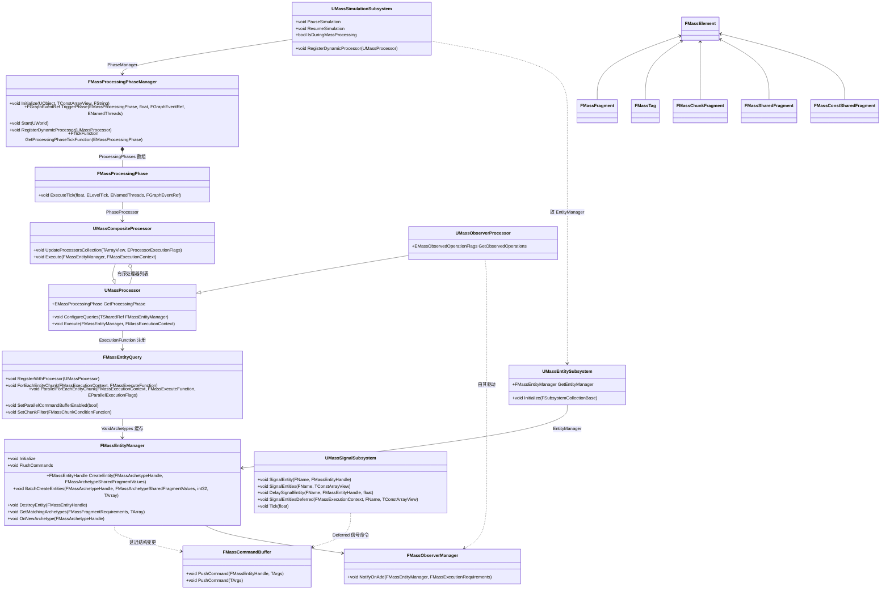

# 15 AI、导航与玩法框架:AIModule/Nav/Mass/StateTree/GAS/GameplayTags/GameFeatures

> 源码基线:UE 5.8.3 release(`$UE = /home/timeshift/opensource/game_engine/unreal/UnrealEngine-5.8.3-release`,`$E = $UE/Engine`)。本章覆盖 AI 控制器与行为树/黑板/EQS/感知、NavigationSystem 与 Recast NavMesh 异步生成、GameplayTags/GameplayTasks/GameplayDebugger、MassEntity 与 MassGameplay/MassAI 全家、StateTree/GameplayStateTree、SmartObjects/GameplayBehaviors/GameplayInteractions、ZoneGraph/WorldConditions/NavCorridor/PropertyAccess、GameplayAbilities(GAS)、GameplayTargetingSystem、CharacterAI、LearningAgents/Learning、StateGraph、Chooser、SignificanceManager、GameFeatures/ModularGameplay/DataRegistry。所有结论均出自对本仓源码的亲自阅读,行号以本仓为准;文中路径相对 `$E`(插件路径相对 `$E/Plugins`)。

## 15.1 职责、边界与模块清单

### 15.1.1 引擎源码模块(Source/Runtime 下,11 个)

| 模块 | 路径(相对 `$E/Source/Runtime`) | Build.cs 依赖(摘 Public) | 职责一句话 |
|---|---|---|---|
| AIModule | AIModule | Core、CoreUObject、Engine、GameplayTags、GameplayTasks | AI 控制器、行为树/黑板、EQS、感知、寻路跟随、Detour Crowd 管理器 |
| NavigationSystem | NavigationSystem | Chaos、Core、CoreUObject、Engine、GeometryCollectionEngine | 导航系统主框架:UNavigationSystemV1、导航八叉树、脏区控制器、同步/异步路径查询 |
| Navmesh | Navmesh | Priv:Core(无 Public 依赖) | 第三方 Recast/Detour/DetourCrowd/DetourTileCache 源码封装(纯 C,无 UObject) |
| GameplayTags | GameplayTags | Core、CoreUObject、Engine、DeveloperSettings | 层级标签树、标签容器/查询、原生标签注册、Iris NetSerializer |
| GameplayTasks | GameplayTasks | Core、CoreUObject、Engine、NetCore | 异步任务基类 UGameplayTask 与宿主组件 UGameplayTasksComponent |
| GameplayDebugger | GameplayDebugger | Core、CoreUObject、Engine | 运行时调试 HUD/分类复制框架(与 AIModule 的 GameplayDebugger 分类扩展配合) |
| MassCore | Mass/MassCore | Core、CoreUObject、TraceLog | Mass 元素基类:FMassFragment/FMassTag/共享片段/FMassEntityHandle 等 |
| MassEngine | Mass/MassEngine | Chaos、Core、CoreUObject、Engine、MassCore、MassEntity | Mass 与引擎世界互操作:Actor 表示、物理、导航片段与处理器 |
| MassSignals | Mass/MassSignals | Core、CoreUObject、Engine、MassCore | UMassSignalSubsystem:按名字的实体信号广播(含延迟/延迟帧刷新) |
| MassDeveloper | Mass/MassDeveloper | (Private 为主) | Mass Trace 分析器/Provider 等开发期设施 |
| MassEntity | MassEntity | Core、CoreUObject、Engine、DeveloperSettings、MassCore | Mass ECS 核心:FMassEntityManager、Archetype、Query、命令缓冲、处理器与阶段管理器 |

注:Mass(根)目录下还有 `MassEngine`、`MassDeveloper` 等模块;`Source/Runtime/Mass` 顶层无同名 Build 模块。

### 15.1.2 Plugins 运行时插件(30 个;除注明 Experimental/其他目录外均在 `$E/Plugins/Runtime` 下)

| 模块 | 路径(相对 `$E/Plugins`) | Build.cs 依赖(摘 Public) | 职责一句话 |
|---|---|---|---|
| MassSimulation | Runtime/MassGameplay/Source/MassSimulation | Core、CoreUObject、Engine、MassCommon、NavigationSystem、MassCore、MassEntity | UMassSimulationSubsystem:托管 FMassProcessingPhaseManager,驱动全部 Mass 阶段 |
| MassActors | Runtime/MassGameplay/Source/MassActors | Core、CoreUObject、Engine、MassCore、MassEntity、AIModule、MassCommon | Mass 实体与 AActor 互转(UMassActorSubsystem)、Agent 组件、Translator |
| MassCommon | Runtime/MassGameplay/Source/MassCommon | (Engine/MassCore 等) | 通用片段(FTransformFragment 等)、随机序列、MassGameplaySettings |
| MassEQS | Runtime/MassGameplay/Source/MassEQS | (AIModule、MassEntity 等) | 面向 Mass 的 EQS 生成器/项/处理器(UMassEQSSubsystem) |
| MassLOD | Runtime/MassGameplay/Source/MassLOD | Core、CoreUObject、Engine、AIModule、MassCore、MassEntity、MassCommon | LOD 计算/收集处理器与 LOD 管理子系统(按距离/可见性) |
| MassMovement | Runtime/MassGameplay/Source/MassMovement | (MassEntity 等) | 移动片段(MassMovementVelocity 等)与弹簧移动处理器 |
| MassReplication | Runtime/MassGameplay/Source/MassReplication | (NetCore、MassEntity 等) | Mass 实体复制:客户端气泡(ClientBubble)处理与复制处理器 |
| MassRepresentation | Runtime/MassGameplay/Source/MassRepresentation | Core、CoreUObject、Engine、AIModule、MassCore、MassEntity、MassCommon、MassActors、MassSpawner、(MassLOD 等) | 实体到 ISM/Actor 的呈现切换处理器(UMassRepresentationSubsystem) |
| MassSmartObjects | Runtime/MassGameplay/Source/MassSmartObjects | MassCore、MassEntity、Core、CoreUObject、Engine、GameplayTags、MassCommon | SmartObject 的 Mass 侧:FMassSmartObjectHandler、请求/注册处理器 |
| MassSpawner | Runtime/MassGameplay/Source/MassSpawner | Core、CoreUObject、Engine、AIModule、MassCore、MassEntity、MassCommon(动态加载 MassGameplayEditor) | UMassSpawnerSubsystem、UMassEntityTemplateRegistry、生成点生成器 |
| MassCharacterTrajectory | Runtime/MassGameplay/Source/MassCharacterTrajectory | (MassEntity 等) | 角色轨迹片段与轨迹生成/移动处理器 |
| MassGameplayDebug | Runtime/MassGameplay/Source/MassGameplayDebug | (MassEntity 等) | 调试可视化处理器与 UMassDebuggerSubsystem |
| MassGameplayExternalTraits | Runtime/MassGameplay/Source/MassGameplayExternalTraits | (MassEntity 等) | 外部提供的 Trait 片段集合 |
| StateTreeModule | Runtime/StateTree/Source/StateTreeModule | Core、CoreUObject、DeveloperSettings、Engine、AIModule、GameplayTags、PropertyBindingUtils | 状态树运行时:执行上下文、实例数据、Task/Evaluator/Condition/Transition |
| GameplayStateTreeModule | Runtime/GameplayStateTree/Source/GameplayStateTreeModule | AIModule、Core、CoreUObject、Engine、GameplayTags、GameplayTasks、NavigationSystem、(StateTreeModule 等) | UStateTreeComponent/UStateTreeAIComponent 与玩法侧 Schema/Task |
| SmartObjectsModule | Runtime/SmartObjects/Source/SmartObjectsModule | Core、CoreUObject、DeveloperSettings、Engine、AIModule、GameplayTags、GameplayAbilities | USmartObjectSubsystem、运行时槽状态、空间哈希/八叉树、注解 |
| GameplayBehaviorsModule | Experimental/GameplayBehaviors/Source/GameplayBehaviorsModule | (Engine、GameplayTags 等) | UGameplayBehaviorSubsystem 与 UGameplayBehavior(智能体行为资产) |
| GameplayBehaviorSmartObjectsModule | Runtime/GameplayBehaviorSmartObjects/Source/GameplayBehaviorSmartObjectsModule | (SmartObjects、GameplayBehaviors 等) | 把 GameplayBehavior 作为 SmartObject 槽行为定义的桥 |
| GameplayInteractionsModule | Runtime/GameplayInteractions/Source/GameplayInteractionsModule | AIModule、ContextualAnimation、Core、CoreUObject、Engine、GameplayStateTreeModule、GameplayTags(另依赖 SmartObjects、StateTreeModule 等) | 交互框架:FGameplayInteractionContext + StateTree 驱动的交互 Schema |
| ZoneGraph | Runtime/ZoneGraph/Source/ZoneGraph | Core、CoreUObject、Engine、RHI、RenderCore、DeveloperSettings、MassCore | UZoneGraphSubsystem、FZoneGraphStorage/Lane、A* 与 BVTree |
| ZoneGraphAnnotations | Runtime/ZoneGraphAnnotations(独立插件) | Core、CoreUObject、Engine、MassCore、MassEntity、RHI、ZoneGraph、ZoneGraphDebug | ZoneGraph 注解系统(注解片段/处理器,供导航与人群语义查询使用) |
| WorldConditions | Runtime/WorldConditions/Source/WorldConditions | Core、CoreUObject、Engine、GameplayTags | FWorldConditionQuery/Schema/Context:带缓存的世界条件表达式 |

| 模块 | 路径(相对 `$E/Plugins`) | Build.cs 依赖(摘 Public) | 职责一句话 |
|---|---|---|---|
| NavCorridor | Runtime/NavCorridor/Source/NavCorridor | AIModule、Core、CoreUObject、Engine、NavigationSystem | FNavCorridor:基于多边形走廊的路径后处理/拉绳(string pulling) |
| ModularGameplay | Runtime/ModularGameplay/Source/ModularGameplay | Core、Engine、GameplayTags | UGameFrameworkComponentManager 与 GameFramework 组件/InitState 扩展点 |
| DataRegistry | Runtime/DataRegistry/Source/DataRegistry | Core、CoreUObject、Engine、GameplayTags、DeveloperSettings | UDataRegistrySubsystem:类型化数据表/曲线表注册与查找 |
| SignificanceManager | Runtime/SignificanceManager/Source/SignificanceManager | Pub:无;Priv:Core、CoreUObject、Engine、EngineSettings | USignificanceManager:按视点更新对象重要度并回调 |
| GameFeatures | Runtime/GameFeatures/Source/GameFeatures | Core、CoreUObject、DeveloperSettings、Engine、ModularGameplay、DataRegistry | UGameFeaturesSubsystem、GFP 状态机、UGameFeatureAction 体系 |
| GameplayAbilities | Runtime/GameplayAbilities/Source/GameplayAbilities | Core、CoreUObject、NetCore、Engine、GameplayTags、GameplayTasks | GAS:ASC/能力/效果/属性集/能力任务/预测键/GameplayCue |
| Chooser | ../Chooser/Source/Chooser(位于 `$E/Plugins/Chooser`,非 Runtime 子目录) | Pub:无;Priv:Core、CoreUObject、Engine、GameplayTags、AnimationCore、AnimGraphRuntime、BlendStack、TraceLog、RewindDebuggerRuntimeInterface | UChooserTable:多列决策表评估(EvaluateChooser) |
| PropertyAccessEditor | Runtime/PropertyAccess/Source/PropertyAccessEditor | (编辑器侧) | PropertyAccess 库的编辑器 UI/编译辅助(运行时部分在 Engine 模块 `PropertyAccess.h`) |

### 15.1.3 Experimental 插件(6 个)

| 模块 | 路径(相对 `$E/Plugins`) | Build.cs 依赖(摘 Public) | 职责一句话 |
|---|---|---|---|
| GameplayTargetingSystem | Experimental/GameplayTargetingSystem/Source/GameplayTargetingSystem(TargetingSystem.Build.cs) | Core、CoreUObject、Engine、GameplayTasks、GameplayAbilities、GameplayTags | UTargetingSubsystem:目标选择管线(选择/过滤/排序任务链,同步与异步) |
| CharacterAI | Experimental/CharacterAI/Source/CharacterAI | Core、CoreUObject、Engine、RenderCore、RHI、AIModule | 5.8.3 中仅剩空模块:`ICharacterAIModuleInterface` + FCharacterAIModule 启动/关闭(Public/CharacterAIModule.h:19) |
| LearningAgents | Experimental/LearningAgents/Source/LearningAgents | (Learning 等) | ULearningAgentsManager/Policy/Interactor/Controller:强化学习代理运行时 |
| Learning | Experimental/LearningCore/Source/Learning | (Core 等) | `UE::Learning` 命名空间:神经网络推理/训练原语、数组视图、优化器 |
| StateGraph | Experimental/StateGraph/Source/StateGraph | (Core) | FStateGraph/FStateGraphNode:带依赖跟踪的异步状态图(StateGraphManager 子系统管理) |
| StateGraphManager | Experimental/StateGraph/Source/StateGraphManager | (Engine、StateGraph 等) | UStateGraphManagerSubsystem:并发运行多个 FStateGraph |

另:MassAI 插件(`Plugins/AI/MassAI`)提供 MassAIBehavior、MassNavigation、MassNavMeshNavigation、MassZoneGraphNavigation、MassCrowd、MassAIReplication、MassAIDebug 等模块(见 15.1.4),属 AI 插件目录而非 Runtime。

### 15.1.4 MassAI 插件(`Plugins/AI/MassAI`,7 个运行时模块)

| 模块 | 职责一句话 |
|---|---|
| MassAIBehavior | Mass 版 AI 行为:UMassStateTreeSubsystem/ExecutionContext、SmartObject 任务、移动/转向处理器 |
| MassNavigation | Mass 避障导航:avoidance 处理器与导航片段 |
| MassNavMeshNavigation | Mass 实体的 NavMesh 寻路/路径跟随片段与处理器 |
| MassZoneGraphNavigation | ZoneGraph 上的 Mass 跟随/换道逻辑 |
| MassCrowd | Mass 人群(基于 MassAIBehavior/ZoneGraph 的人群配置与生成) |
| MassAIReplication | Mass AI 状态的复制辅助 |
| MassAIDebug | Mass AI 的调试绘制 |

## 15.2 总体架构

整个"AI 与玩法框架"可以分成四条主线,它们通过 GameplayTags 和组件/子系统彼此咬合:

1. **经典单体 AI 栈(AIModule+NavigationSystem)**:每 Agent 一个 `AAIController`,决策用 `UBehaviorTreeComponent`(配 `UBlackboardComponent`),移动用 `UPathFollowingComponent`(可替换为 `UCrowdFollowingComponent` 走 Detour Crowd),感知用 `UAIPerceptionComponent`+`UAIPerceptionSystem`,空间查询用 `UEnvQueryManager`。全部在 Game Thread 上按 Tick 串行。
2. **导航数据栈(NavigationSystem+Navmesh)**:`UNavigationSystemV1` 持有 `FNavigationOctree`(经 `FNavigationOctreeController`)与 `FNavigationDirtyAreasController`;几何变化→脏区→`ARecastNavMesh` 的生成器 `FRecastNavMeshGenerator` 把 tile 打包成 `FRecastTileGeneratorTask`(FAsyncTask,线程池)离线烘焙,完成后回 GT 更新 dtNavMesh tile。寻路查询有同步(FindPathSync,GT)与异步(FindPathAsync→FSimpleDelegateGraphTask 批量,TaskGraph 工作线程)两条路。
3. **Mass 数据流(MassEntity+MassGameplay+MassAI)**:`UMassSimulationSubsystem` 托管 `FMassProcessingPhaseManager`,后者按 `EMassProcessingPhase`(PrePhysics/DuringPhysics/PostPhysics/FrameEnd)注册为 tick function;每阶段用 `FMassProcessorDependencySolver` 把处理器排成依赖图,可并行执行(ParallelFor),结构变更全部走 `FMassCommandBuffer` 在阶段末 GT flush;`UMassObserverProcessor` 监听片段增删,`UMassSignalSubsystem` 提供按名字的信号广播(可经命令缓冲延迟)。
4. **玩法能力栈(GAS+GameFeatures+周边)**:`UAbilitySystemComponent`(继承 `UGameplayTasksComponent`)驱动 `UGameplayAbility`/`UAbilityTask`,状态修改走 `UGameplayEffect`→`FGameplayEffectSpec`→`UAttributeSet`,预测用 `FPredictionKey`;`UGameFeaturesSubsystem` 用 GFP 状态机把插件从 UnknownStatus 一路推进到 Active,沿途通过 `UGameFeatureAction` 挂接组件/数据;ModularGameplay 的 `UGameFrameworkComponentManager` 提供组件注入与 InitState 事件;StateTree/SmartObjects/ZoneGraph/WorldConditions/Chooser 则是决策与空间语义的"积木层",GameplayStateTree 把 StateTree 装进 UBrainComponent 体系,MassStateTree(MassAIBehavior)把 StateTree 装进 Mass 处理器体系。

```mermaid
flowchart TD
    subgraph GA["经典单体 AI 栈 - Game Thread"]
        AAI["AAIController"] --> BTC["UBehaviorTreeComponent"]
        AAI --> PFC["UPathFollowingComponent"]
        BTC --> BBC["UBlackboardComponent"]
        BTC -. "RunBehaviorTree" .-> BT["UBehaviorTree 资产"]
        AAI --> PERC["UAIPerceptionComponent"]
        EQS["UEnvQueryManager"] --> BTC
    end
    subgraph PS["感知系统"]
        PSYS["UAIPerceptionSystem"] --> SIGHT["UAISense_Sight 等实例"]
        PSYS --> PERC
    end
    subgraph NAV["导航栈"]
        NAVSYS["UNavigationSystemV1"] --> OCT["FNavigationOctreeController"]
        NAVSYS --> DIRTY["FNavigationDirtyAreasController"]
        NAVSYS --> RNM["ARecastNavMesh"]
        RNM --> GEN["FRecastNavMeshGenerator"]
        GEN --> POOL["线程池 FRecastTileGeneratorTask"]
        PFC --> NAVSYS
        CROWD["UCrowdManager + dtCrowd"] --> PFC2["UCrowdFollowingComponent"]
    end
    subgraph MASS["Mass 数据流"]
        MSUB["UMassSimulationSubsystem"] --> PH["FMassProcessingPhaseManager"]
        PH --> PROC["UMassProcessor 处理器图"]
        PROC --> QUERY["FMassEntityQuery 并行"]
        QUERY --> EM["FMassEntityManager Archetype"]
        PROC --> CB["FMassCommandBuffer"]
        CB --> EM
        SIG["UMassSignalSubsystem"] --> PROC
    end
    subgraph GAS["玩法能力栈"]
        ASC["UAbilitySystemComponent"] --> GA2["UGameplayAbility"]
        GA2 --> AT["UAbilityTask"]
        ASC --> GES["FGameplayEffectSpec"]
        GES --> AGE["FActiveGameplayEffect"]
        ASC --> AS2["UAttributeSet"]
        CUE["UGameplayCueManager"]
        ASC --> CUE
    end
    subgraph GF["插件化玩法"]
        GFS["UGameFeaturesSubsystem"] --> FSM["FGameFeaturePluginStateMachine"]
        FSM --> ACT["UGameFeatureAction"]
        GFS --> DR["UDataRegistrySubsystem"]
        GFM["UGameFrameworkComponentManager"]
        GFS --> GFM
    end
    ST["StateTree - FStateTreeExecutionContext"] --> BBC
    SO["USmartObjectSubsystem"] --> ST
    ZG["UZoneGraphSubsystem"] --> MSUB
    TAGS["GameplayTags - UGameplayTagsManager"] --> GA2
    TAGS --> GES
    TAGS --> GFS
```

图中共 33 个节点。实线是调用/持有关系,虚线是资产加载关系;GameplayTagsManager 处于底层,被 GAS/GameFeatures/SmartObjects/StateTree 等共享(分层上属于"语义总线")。

## 15.3 类图

### 15.3.1 AIModule 经典 AI 栈类图

说明:每类后括号内是关键源码位置;方法行均摘自头文件(去 `AIMODULE_API`)。

```mermaid
classDiagram
    class AAIController {
        +FPathFollowingRequestResult MoveTo(FAIMoveRequest)
        +bool RunBehaviorTree(UBehaviorTree)
        +FVector GetFocalPoint
        +void Tick(float)
        +void OnPossess(APawn)
        +void UpdateControlRotation(float, bool)
        +void FindPathForMoveRequest(FAIMoveRequest, FPathFindingQuery, FNavPathSharedPtr)
    }
    class UBrainComponent {
        +void StartLogic
        +void StopLogic(FString)
        +void PauseLogic(FString)
        +void Cleanup
    }
    class UBehaviorTreeComponent {
        +void StartTree(UBehaviorTree, EBTExecutionMode)
        +void StopTree(EBTStopMode)
        +void TickComponent(float, ELevelTick, FActorComponentTickFunction)
        +void ExecuteTask(UBTTaskNode)
        +void OnTaskFinished(UBTTaskNode, EBTNodeResult)
        +void ProcessExecutionRequest
    }
    class UBlackboardComponent {
        +bool InitializeBlackboard(UBlackboardData)
        +UObject GetValueAsObject(FName)
        +void SetValueAsObject(FName, UObject)
        +FDelegateHandle RegisterObserver(FBlackboardFKey, UObject, FOnBlackboardChangeNotification)
    }
    class UBTNode {
        +void InitializeNode(UBTCompositeNode, uint16, uint16, uint8)
        +void InitializeMemory(UBehaviorTreeComponent, uint8, EBTMemoryInit)
        +void CleanupMemory(UBehaviorTreeComponent, uint8, EBTMemoryClear)
    }
    class UBTTaskNode {
        +EBTNodeResult ExecuteTask(UBehaviorTreeComponent, uint8)
        +void TickTask(UBehaviorTreeComponent, uint8, float)
        +void OnTaskFinished(UBehaviorTreeComponent, uint8, EBTNodeResult)
    }
    class UBTAuxiliaryNode {
        +void TickNode(UBehaviorTreeComponent, uint8, float)
        +void OnBecomeRelevant(UBehaviorTreeComponent, uint8)
    }
    class UBTDecorator {
        +bool CalculateRawConditionValue(UBehaviorTreeComponent, uint8)
        +void OnNodeActivation(FBehaviorTreeSearchData)
        +void OnNodeProcessed(FBehaviorTreeSearchData, EBTNodeResult)
    }
    class UBTService {
        +void TickNode(UBehaviorTreeComponent, uint8, float)
        +void ScheduleNextTick(UBehaviorTreeComponent, uint8)
    }
    class UBTCompositeNode {
        +int32 GetNextChildHandler(FBehaviorTreeSearchData, int32, EBTNodeResult)
        +void InitializeMemory(UBehaviorTreeComponent, uint8, EBTMemoryInit)
    }
    class UAIPerceptionComponent {
        +void RequestStimuliListenerUpdate
        +void GetCurrentlyPerceivedActors(UAISense, TArray)
        +void GetKnownPerceivedActors(UAISense, TArray)
    }
    class UAIPerceptionSystem {
        +void Tick(float)
        +void UpdateListener(UAIPerceptionComponent)
        +void MakeNoiseImpl(AActor, float, APawn, FVector, float, FName)
    }
    class UAISense {
        +float Update
        +void RegisterEvent(FEventClass)
        +bool ProgressTime(float)
    }
    class UPathFollowingComponent {
        +void TickComponent(float, ELevelTick, FActorComponentTickFunction)
        +void UpdatePathSegment
        +void FollowPathSegment(float)
        +void AbortMove(UObject, FPathFollowingResultFlags, FAIRequestID)
        +void PauseMove(FAIRequestID)
        +void ResumeMove(FAIRequestID)
    }
    class UCrowdManagerBase {
        +void Tick(float)
    }
    class UCrowdManager {
        +void Tick(float)
        +void UpdateAgentParams(ICrowdAgentInterface)
        +void UpdateAgentState(ICrowdAgentInterface)
        +void OnNavMeshUpdate
    }
    class UCrowdFollowingComponent
    class UEnvQueryManager {
        +void Tick(float)
        +int32 RunQuery(FEnvQueryRequest, EEnvQueryRunMode, FQueryFinishedSignature)
        +TSharedPtr FEnvQueryResult RunInstantQuery(FEnvQueryRequest, EEnvQueryRunMode)
        +TSharedPtr FEnvQueryInstance PrepareQueryInstance(FEnvQueryRequest, EEnvQueryRunMode)
    }
    AAIController --> UBrainComponent : 持有 BrainComponent
    AAIController --> UPathFollowingComponent : 持有
    UBehaviorTreeComponent --|> UBrainComponent
    UBehaviorTreeComponent --> UBlackboardComponent : 持有
    UBehaviorTreeComponent --> UBTNode : 资产节点实例化
    UBTTaskNode --|> UBTNode
    UBTAuxiliaryNode --|> UBTNode
    UBTDecorator --|> UBTAuxiliaryNode
    UBTService --|> UBTAuxiliaryNode
    UBTCompositeNode --|> UBTNode
    UBTCompositeNode o-- UBTNode : Children
    AAIController --> UAIPerceptionComponent : 持有
    UAIPerceptionSystem --> UAIPerceptionComponent : ListenerContainer
    UAIPerceptionSystem --> UAISense : Senses 数组
    UAIPerceptionComponent ..> UAISense : 接收刺激
    UCrowdManager --|> UCrowdManagerBase
    UCrowdFollowingComponent --|> UPathFollowingComponent
    UCrowdFollowingComponent ..> UCrowdManager : 注册 agent
    UPathFollowingComponent ..> UCrowdManager : 可选
    UEnvQueryManager ..> UBlackboardComponent : 读参
```

类清单(继承关系以外,均为 AIModule 真实类):
- `AAIController`(`Classes/AIController.h:196/262/344/351/378`):AI 版 PlayerController,持有 Brain/PathFollowing/Perception 组件并管理焦点优先级。
- `UBrainComponent`(`Classes/BrainComponent.h`):决策组件抽象(Start/Stop/Pause/ResumeLogic)。
- `UBehaviorTreeComponent`(`Classes/BehaviorTree/BehaviorTreeComponent.h:104`):行为树运行时,串行事件机;`FBTNodeExecutionInfo/FBTPendingExecutionInfo/EBTBranchAction`(同文件 25/51/81 行)是其搜索/执行队列的载荷。
- `UBlackboardComponent`(`Classes/BehaviorTree/BlackboardComponent.h:97/103/133/73`):黑板键值存储+观察者。
- `UBTNode` 四类(`BTNode.h:54/60`、`BTTaskNode.h:40/108/118`、`BTDecorator.h:121/106`、`BTService.h:79/92`、`BTCompositeNode.h:147`):树节点基类,区分任务/装饰器/服务/组合。
- `UAIPerceptionSystem`(`Classes/Perception/AIPerceptionSystem.h:30`):世界级感知中枢(FTickableGameObject Tick)。
- `UAISense`(`Classes/Perception/AISense.h:128` 的 `virtual float Update()`):感官实例基类(视线/听觉/伤害/触碰/预测/队伍)。
- `UPathFollowingComponent`(`Classes/Navigation/PathFollowingComponent.h:216`):路径跟随状态机。
- `UCrowdManager`(`Classes/Navigation/CrowdManager.h:179`,基类 `UCrowdManagerBase` 在 NavigationSystem `Public/CrowdManagerBase.h`):Detour Crowd 的 UE 侧宿主,内部持有 `dtCrowd`(`Classes/Navigation/CrowdManager.h:16` 前向声明,实现在 Navmesh 模块 DetourCrowd)。
- `UEnvQueryManager`(`Classes/EnvironmentQuery/EnvQueryManager.h:217`):EQS 时间分片调度器。

### 15.3.2 Mass 家族类图(MassEntity + Mass + MassGameplay)

说明:
- `UMassEntitySubsystem`(`Source/Runtime/MassEntity/Public/MassEntitySubsystem.h:18`)本身只有一件事:为一个 World 托管默认 `FMassEntityManager` 实例(文件注释 12–16 行明说)。
- 驱动链在 **MassGameplay** 插件:`UMassSimulationSubsystem`(`Plugins/Runtime/MassGameplay/Source/MassSimulation/Public/MassSimulationSubsystem.h:18`)持有 `TSharedRef<FMassProcessingPhaseManager> PhaseManager`(同文件 96 行)与 `FMassRuntimePipeline RuntimePipeline`(104 行)。
- `FMassProcessingPhase` 是 `FTickFunction` 派生的 tick 函数(`MassProcessingPhaseManager.h:257` 直接以 `FTickFunction&` 返回),它内嵌 `PhaseProcessor`(UMassCompositeProcessor)。`ExecuteTick`(`Private/MassProcessingPhaseManager.cpp:65`)按 `bRunInParallelMode` 走 `ProcessingQueue.Execute_GetEventRef` / `UE::Mass::Executor::TriggerParallelTasks` / 串行 `UE::Mass::Executor::Run` 三条路径。
- 片段基类全部在 `Source/Runtime/Mass/MassCore/Public/Mass/EntityElementTypes.h`(FMassElement:8、FMassFragment:15、FMassSparseFragment:30、FMassTag:40、FMassChunkFragment:56、FMassSharedFragment:62、FMassConstSharedFragment:68)。
- `UMassSignalSubsystem` 在 `Source/Runtime/Mass/MassSignals/Public/MassSignalSubsystem.h:25`,基类 `UMassTickableSubsystemBase`(GT tick)。

### 15.3.3 GAS(GameplayAbilities)类图

```mermaid
classDiagram
    class UGameplayTasksComponent {
        +void TickComponent(float, ELevelTick, FActorComponentTickFunction)
        +void AddTaskReadyForActivation(UGameplayTask)
    }
    class UAbilitySystemComponent {
        +void InitAbilityActorInfo(AActor, AActor)
        +FGameplayAbilitySpecHandle GiveAbility(FGameplayAbilitySpec)
        +bool TryActivateAbility(FGameplayAbilitySpecHandle, bool)
        +bool InternalTryActivateAbility(FGameplayAbilitySpecHandle, FPredictionKey)
        +void CallServerTryActivateAbility(FGameplayAbilitySpecHandle, bool, FPredictionKey)
        +void AbilitySpecInputPressed(FGameplayAbilitySpec)
        +void SetReplicationMode(EGameplayEffectReplicationMode)
        +void TickComponent(float, ELevelTick, FActorComponentTickFunction)
    }
    class UGameplayAbility {
        +bool CanActivateAbility(FGameplayAbilitySpecHandle, FGameplayAbilityActorInfo, FGameplayTagContainer, FGameplayTagContainer)
        +void ActivateAbility(FGameplayAbilitySpecHandle, FGameplayAbilityActorInfo, FGameplayAbilityActivationInfo, FGameplayEventData)
        +void EndAbility(FGameplayAbilitySpecHandle, FGameplayAbilityActorInfo, FGameplayAbilityActivationInfo, bool, bool)
        +bool CommitAbility(FGameplayAbilitySpecHandle, FGameplayAbilityActorInfo, FGameplayAbilityActivationInfo, FGameplayTagContainer)
    }
    class UAbilityTask {
        +void OnDestroy(bool)
        +void Activate
        +void ExternalConfirm(bool)
    }
    class UGameplayTask {
        +void ReadyForActivation
        +void Activate
        +void EndTask
    }
    class UGameplayEffect {
        +bool CanApply(FActiveGameplayEffectsContainer, FGameplayEffectSpec)
        +FGameplayEffectSpecHandle CreateSpec(FGameplayEffectContextHandle, float)
        +int32 GetStackLimitCount
    }
    class FGameplayEffectSpec {
        +void Initialize(UGameplayEffect, FGameplayEffectContextHandle, float)
        +float GetSetByCallerMagnitude(FGameplayTag, bool, float)
        +float GetLevel
        +bool AttemptCalculateDurationFromDef(OUT float)
    }
    class FActiveGameplayEffect {
        +float GetLevel
    }
    class FActiveGameplayEffectsContainer {
        +void ApplyGameplayEffectSpec(FActiveGameplayEffectsContainer, FGameplayEffectSpec)
    }
    class UAttributeSet {
        +void PreAttributeChange(FGameplayAttribute, float)
        +void PostGameplayEffectExecute(FGameplayEffectModCallbackData)
    }
    class FGameplayAttributeData
    class FGameplayAttribute {
        +FGameplayAttributeData GetGameplayAttributeData(UAttributeSet)
    }
    class FPredictionKey {
        +FPredictionKey CreateNewPredictionKey(UAbilitySystemComponent)
        +void GenerateNewPredictionKey
        +FPredictionKeyEvent NewRejectedDelegate
        +bool WasLocallyGenerated
    }
    class FPredictionKeyDelegates {
        +FPredictionKeyEvent NewRejectedDelegate(KeyType)
    }
    class UGameplayCueManager {
        +void HandleGameplayCue(AActor, FGameplayTag, EGameplayCueEvent, FGameplayCueParameters)
        +void HandleGameplayCues(AActor, FGameplayTagContainer, EGameplayCueEvent, FGameplayCueParameters)
    }
    class IGameplayCueInterface {
        +void HandleGameplayCue(UObject, FGameplayTag, EGameplayCueEvent, FGameplayCueParameters)
    }
    class UAbilitySystemGlobals {
        +UGameplayCueManager GetGameplayCueManager
    }
    UAbilitySystemComponent --|> UGameplayTasksComponent
    UAbilitySystemComponent --> UAttributeSet : SpawnedAttributes
    UAbilitySystemComponent --> FActiveGameplayEffectsContainer : ActiveGameplayEffects
    UAbilitySystemComponent --> UGameplayAbility : ActivatableAbilities 规格实例
    UGameplayAbility --> UAbilityTask : 生成
    UAbilityTask --|> UGameplayTask
    FActiveGameplayEffectsContainer o-- FActiveGameplayEffect : FFastArraySerializer
    FActiveGameplayEffect --> FGameplayEffectSpec : Spec
    FGameplayEffectSpec --> UGameplayEffect : Def
    UGameplayEffect ..> FGameplayEffectSpec : CreateSpec
    UAttributeSet o-- FGameplayAttributeData : 属性数据
    FGameplayAttribute ..> FGameplayAttributeData : 反射绑定
    UAbilitySystemComponent ..> FPredictionKey : 预测窗口
    FPredictionKeyDelegates ..> FPredictionKey : 静态委托表
    UAbilitySystemGlobals --> UGameplayCueManager : 持有
    UGameplayCueManager ..> IGameplayCueInterface : 分发到实现者
    UGameplayCueManager ..> FGameplayEffectSpec : 参数来源
```

说明:
- `UAbilitySystemComponent`(`Plugins/Runtime/GameplayAbilities/Source/GameplayAbilities/Public/AbilitySystemComponent.h:109`)继承 `UGameplayTasksComponent`,所以能力任务复用 15.1 中 GameplayTasks 的调度。
- 复制模式枚举 `EGameplayEffectReplicationMode`(同文件 81 行):`Minimal`(84,不适用于 Owner 侧 ASC)、`Mixed`(86,仅对模拟代理最小化)、`Full`(88);由 `SetReplicationMode`(268 行)设置,`ReplicationMode`(271 行)存储。
- `UGameplayAbility` 的执行策略枚举在 `Abilities/GameplayAbilityTypes.h:37/59/99`:Instancing(NonInstanced/InstancedPerActor/InstancedPerExecution)、NetExecution(LocalPredicted/LocalOnly/ServerInitiated/ServerOnly)、Replication(ReplicateNo/ReplicateYes)。
- `FGameplayEffectSpec`(`GameplayEffect.h:1014`)是 GE 的运行时实例(等级、上下文、SetByCaller 幅度表);`FActiveGameplayEffect`(`GameplayEffect.h:1355`)继承 `FFastArraySerializerItem`,即持续型 GE 走 FastArray 复制。
- `FPredictionKey`(`GameplayPrediction.h:296`)与 `FPredictionKeyDelegates`(435 行)构成预测回滚的键/委托表。

### 15.3.4 决策积木与插件化玩法类图(StateTree/SmartObjects/ZoneGraph/WorldConditions/GameFeatures)

```mermaid
classDiagram
    class FStateTreeExecutionContext {
        +FStateTreeExecutionContext(UObject, UStateTree, FStateTreeInstanceData)
        +EStateTreeRunStatus Tick(float)
        +EStateTreeRunStatus TickUpdateTasks(float)
        +void TickTriggerTransitions(float)
        +void SendEvent(FGameplayTag, FConstStructView, FName)
        +void ScheduleNextTick(ETickReason)
    }
    class FStateTreeInstanceData {
        +void Reset
        +void ResetBroadcastedDelegates
        +void ResetTransitionRequests
    }
    class FStateTreeTaskBase {
        +EStateTreeRunStatus EnterState(FStateTreeExecutionContext, FStateTreeTransitionResult)
        +void ExitState(FStateTreeExecutionContext, FStateTreeTransitionResult)
        +EStateTreeRunStatus Tick(FStateTreeExecutionContext, float)
    }
    class FStateTreeEvaluatorBase {
        +void Tick(FStateTreeExecutionContext, float)
    }
    class FStateTreeConditionBase {
        +bool TestCondition(FStateTreeExecutionContext)
    }
    class FStateTreeNodeBase
    class UStateTreeComponent {
        +void TickComponent(float, ELevelTick, FActorComponentTickFunction)
        +void StartLogic
    }
    class USmartObjectSubsystem {
        +ESmartObjectCollectionRegistrationResult RegisterCollection(ASmartObjectPersistentCollection)
        +FSmartObjectRequestResult FindSmartObject(FSmartObjectRequest, FConstStructView)
        +bool FindSmartObjects(FSmartObjectRequest, TArray, FConstStructView)
        +bool CanBeClaimed(FSmartObjectSlotHandle, ESmartObjectClaimPriority)
        +FSmartObjectClaimHandle MarkSlotAsClaimed(FSmartObjectSlotHandle, ESmartObjectClaimPriority, FConstStructView)
    }
    class FSmartObjectRuntime {
        +ESmartObjectSlotState GetSlotState
    }
    class FSmartObjectRuntimeSlot
    class UZoneGraphSubsystem {
        +FZoneGraphDataHandle RegisterZoneGraphData(AZoneGraphData)
        +AZoneGraphData GetZoneGraphData(FZoneGraphDataHandle)
    }
    class FZoneGraphStorage
    class FWorldConditionQuery {
        +bool IsActive
        +bool Activate(UObject, FWorldConditionContextData)
        +bool IsTrue(FWorldConditionContextData)
        +void Deactivate(FWorldConditionContextData)
    }
    class FWorldConditionQueryState
    class UWorldConditionSchema
    class UGameFeaturesSubsystem {
        +void LoadGameFeaturePlugin(FString, FGameFeaturePluginLoadComplete)
        +void LoadAndActivateGameFeaturePlugin(FString, FGameFeaturePluginLoadComplete)
        +void ChangeGameFeatureTargetState(FString, EGameFeatureTargetState, FGameFeaturePluginChangeStateComplete)
        +void DeactivateGameFeaturePlugin(FString, FGameFeaturePluginDeactivateComplete)
        +void UnloadGameFeaturePlugin(FString, FGameFeaturePluginUnloadComplete, bool)
        +void OnGameFeatureRegistering(UGameFeatureData, FString, FGameFeaturePluginIdentifier)
    }
    class FGameFeaturePluginStateMachine {
        +void UpdateState(FGameFeaturePluginStateStatus)
        +void BeginState
    }
    class FGameFeaturePluginState
    class UGameFeatureData
    class UGameFeatureAction {
        +void OnGameFeatureRegistering
        +void OnGameFeatureActivating(FGameFeatureActivatingContext)
        +void OnGameFeatureDeactivating(FGameFeatureDeactivatingContext)
        +void OnGameFeatureUnregistering
    }
    class UGameFrameworkComponentManager {
        +void AddGameFrameworkComponentReceiver(AActor)
        +void SendGameFrameworkComponentExtensionEvent(AActor, FName)
    }
    class UDataRegistrySubsystem {
        +void FindCachedItemBP(FDataRegistryId, EDataRegistrySubsystemGetItemResult, FTableRowBase)
        +void EvaluateDataRegistryCurve(FDataRegistryId, float, float, EDataRegistrySubsystemGetItemResult, float)
    }
    class USignificanceManager {
        +void Update(TArrayView FTransform)
        +void RegisterObject(UObject, FName, FManagedObjectSignificanceFunction)
        +bool QuerySignificance(const UObject, float)
    }
    class UTargetingSubsystem {
        +FTargetingRequestHandle CreateTargetRequestHandle
        +FTargetingRequestHandle MakeTargetRequestHandle(UTargetingPreset, FTargetingSourceContext)
        +void ExecuteTargetingRequestWithHandle(FTargetingRequestHandle, FTargetingRequestDelegate)
        +void StartAsyncTargetingRequestWithHandle(FTargetingRequestHandle, FTargetingRequestDelegate)
        +void RemoveAsyncTargetingRequestWithHandle(FTargetingRequestHandle)
    }
    FStateTreeExecutionContext --> FStateTreeInstanceData : 读写实例
    FStateTreeTaskBase --|> FStateTreeNodeBase
    FStateTreeEvaluatorBase --|> FStateTreeNodeBase
    FStateTreeConditionBase --|> FStateTreeNodeBase
    UStateTreeComponent --> FStateTreeExecutionContext : Tick 中构造
    USmartObjectSubsystem o-- FSmartObjectRuntime : 注册表
    FSmartObjectRuntime o-- FSmartObjectRuntimeSlot : 槽数组
    UZoneGraphSubsystem --> FZoneGraphStorage : 经 AZoneGraphData
    FWorldConditionQuery --> FWorldConditionQueryState : 可变状态
    FWorldConditionQuery --> UWorldConditionSchema : 类型绑定
    USmartObjectSubsystem ..> FWorldConditionQuery : 槽启用条件
    UGameFeaturesSubsystem *-- FGameFeaturePluginStateMachine : 状态机表
    FGameFeaturePluginStateMachine --> FGameFeaturePluginState : 当前状态
    UGameFeatureData o-- UGameFeatureAction : Actions
    FGameFeaturePluginStateMachine ..> UGameFeatureData : 注册时读取
    UGameFeaturesSubsystem ..> UGameFrameworkComponentManager : 经 ModularGameplay
    UGameFeaturesSubsystem ..> UDataRegistrySubsystem : GameFeatureAction_DataRegistry
    UTargetingSubsystem ..> USmartObjectSubsystem : FindSmartObjectsInTargetingRequest
```

节点共 30 个。补充源码定位:
- StateTree 四类节点:`StateTreeTaskBase.h:19/46/56/78`、`StateTreeEvaluatorBase.h:39`、`StateTreeConditionBase.h:26`、`StateTreeNodeBase.h`;执行入口 `FStateTreeExecutionContext::Tick`(`StateTreeExecutionContext.h:507`,可拆为 `TickUpdateTasks`:515 与 `TickTriggerTransitions`)、事件 `SendEvent`(:256)、按需排期 `ScheduleNextTick`(:267)。
- `UStateTreeComponent` 在 GameplayStateTree 插件(`Components/StateTreeComponent.h:50/54`);Mass 侧对应 `UMassStateTreeSubsystem`(MassAIBehavior)。
- SmartObjects:`USmartObjectSubsystem`(`SmartObjectsModule/Public/SmartObjectSubsystem.h:303/464/473/622/631`),槽状态枚举 `ESmartObjectSlotState`(`SmartObjectRuntime.h:22`:Invalid/Free/Claimed/Occupied)。
- ZoneGraph:`UZoneGraphSubsystem`(`ZoneGraph/Public/ZoneGraphSubsystem.h:46/57`),数据句柄 `FZoneGraphDataHandle`(`ZoneGraphTypes.h:480`)。
- WorldConditions:`FWorldConditionQuery`(`WorldConditions/Public/WorldConditionQuery.h:584`,方法 590–613 行),`FWorldConditionQueryState`(:397)持可变缓存(`CachedResult`:334)。
- GameFeatures:`UGameFeaturesSubsystem`(`GameFeatures/Public/GameFeaturesSubsystem.h:611/621/626/647/652/859`);状态机在 Private(`GameFeaturePluginStateMachine.h:507` 的 `FGameFeaturePluginState`,枚举 `EGameFeaturePluginStateType`:496)。
- `UTargetingSubsystem`(`GameplayTargetingSystem/Public/TargetingSystem/TargetingSubsystem.h:79`)同时是 `FTickableGameObject`(异步请求的分帧推进)。

## 15.4 数据字典

### 15.4.1 行为树与黑板(AIModule)

| 类型/字段 | 类型 | 含义 | 取值/约束 | 源码位置 |
|---|---|---|---|---|
| FBTNodeExecutionInfo.SearchStart/SearchEnd | FBTNodeIndex | 本次搜索允许执行的节点范围 | 索引;装饰器重启时更新 | Classes/BehaviorTree/BehaviorTreeComponent.h:29-31 |
| FBTNodeExecutionInfo.ExecuteInstanceIdx | uint16 | 子树实例索引 | 0..N | 同上 :37 |
| FBTNodeExecutionInfo.bIsRestart | uint8:1 | 是否装饰器触发的重启请求 | 0/1 | 同上 :46 |
| FBTPendingExecutionInfo.NextTask | TObjectPtr&lt;UBTTaskNode&gt; | 下一帧要执行的任务 | 可空 | 同上 :54 |
| FBTPendingExecutionInfo.bOutOfNodes/bLocked | uint32:1 | 树耗尽/请求被锁 | 0/1;锁在装饰器评估期间生效 | 同上 :57-58 |
| EBTBranchAction | uint16 位标志 | 分支动作集合 | DecoratorEvaluate(0x1)、DecoratorActivate_IfNotExecuting(0x2)、DecoratorActivate_EvenIfExecuting(0x4)、DecoratorDeactivate(0x8)、UnregisterAuxNodes(0x10)、StopTree_Safe(0x20)、StopTree_Forced(0x40)、ActiveNodeEvaluate(0x80)、SubTreeEvaluate(0x100)、ProcessPendingInitialize(0x200)、Cleanup(0x400)、UninitializeComponent(0x800) | 同上 :81-100 |
| FAIMessage | 结构 | 任务间消息(请求 ID+内容) | 经 HandleMessage 分发 | Classes/BehaviorTree/BehaviorTreeTypes.h(UObject 侧 AITypes.h) |
| FBlackboard::FKey | 类型别名 | 黑板键 ID | 根据键数量分配 | Classes/BehaviorTree/BlackboardComponent.h(BlackboardData.h 定义键描述) |

### 15.4.2 路径与跟随(AIModule/NavigationSystem)

| 类型/字段 | 类型 | 含义 | 取值/约束 | 源码位置 |
|---|---|---|---|---|
| FPathFollowingResult | 结构 | 移动请求结果 | Code(EPathtFollowingResult)+Flags+MoveRequestId | Classes/Navigation/PathFollowingComponent.h:121 |
| UPathFollowingComponent.CurrentRequestId | FAIRequestID | 当前活动请求 | NextRequestId 静态自增(:740) | 同上 :741 |
| FPathFollowingRequestResult | 结构 | MoveTo 返回 | Type:Failed/AlreadyAtGoal/RequestSuccessful + MoveId | Classes/AITypes.h(AAIController.h:39 前向) |
| FPathFindingQueryData | 结构 | 寻路查询数据(起终点/过滤器/tile) | — | NavigationSystem/Public/NavigationSystemTypes.h:28 |
| EPathFindingMode | 命名空间枚举 | Regular/Hierarchical | FindPath* 的 Mode 参数 | 同上 :76 |
| FPathFindingResult | 结构 | 查询结果(枚举+路径指针) | ENavigationQueryResult | NavigationData.h |
| FNavigationDirtyArea | 结构 | 脏区盒+原因+标志 | 由 AddDirtyArea 入队 | NavigationSystem/Public/NavigationDirtyAreasController.h |
| FRecastTileGenerator | 类 | 单 tile 的烘焙上下文(几何、rcHeightfield) | 由包装任务驱动 | NavigationSystem/Public/NavMesh/RecastNavMeshGenerator.h:369 |
| TRunningTileElement.AsyncTask | FAsyncTask 指针 | tile 任务句柄 | 线程池任务 | 同上 :729 |
| FNavCorridorParams | 结构 | 走廊参数(半径/采样步长) | — | Plugins/Runtime/NavCorridor/.../NavCorridor.h:15 |
| FNavCorridorPortal | 结构 | 走廊一侧的门户(左右点) | — | 同上 :74 |
| FNavCorridor | 结构 | 多边形走廊(TSharedFromThis) | BuildCorridor 后供拉绳 | 同上 :121 |

### 15.4.3 感知与 EQS

| 类型/字段 | 类型 | 含义 | 取值/约束 | 源码位置 |
|---|---|---|---|---|
| UAIPerceptionSystem.PerceptionAgingRate | float(config) | 刺激老化周期(秒) | 默认值见 ini | Classes/Perception/AIPerceptionSystem.h:49-50 |
| UAIPerceptionSystem.NextStimuliAgingTick | double | 下次老化时刻 | Tick 内比较 | 同上 :208-209 |
| FDelayedStimulus | 结构 | 延迟送达刺激 | DeliveryTimestamp+ListenerId+Stimulus | 同上 :65-72 |
| UAISense.Update 返回值 | float | 距下次需要更新的时间 | FLT_MAX=不再调度 | Classes/Perception/AISense.h:128 |
| UEnvQueryManager.MaxAllowedTestingTime | float | 每 tick 测试时间预算 | 时间分片调度 | Classes/EnvironmentQuery/EnvQueryManager.h(Tick 使用) |
| FEnvQueryRequest | 结构 | 查询请求封装 | QueryTemplate+Owner+NamedParams | 同上 :70-94 |

### 15.4.4 GameplayTags

| 类型/字段 | 类型 | 含义 | 取值/约束 | 源码位置 |
|---|---|---|---|---|
| FGameplayTag.TagName | FName | 标签全名 | 只读,空名=无效 | Classes/GameplayTagContainer.h:41/180 |
| FGameplayTag.MatchesTag | bool | 层级包含匹配(A 匹配 A.B) | 只对"祖先"成立 | 同上 :91 |
| FGameplayTag.MatchesTagExact | bool | 严格同名匹配 | — | 同上 :100 |
| FGameplayTagContainer | TArray&lt;FGameplayTag&gt; | 标签集合 | HasAny/HasAll/HasAnyExact/HasAllExact/AppendMatchingTags | 同上 :247 起 |
| FGameplayTagContainer.MatchesQuery | bool | 对查询求值 | — | 同上 :464 |
| FGameplayTagQuery | 结构 | 编译后的布尔表达式(Tag/AnyTagsMatchAll/AllTagsMatch/NoTagsMatch/Any/All/Not 组合) | Build/BuildQuery 静态构造 | 同上 :737/812/815 |
| FGameplayTagQueryExpression | 结构 | 查询构造期表达式 | ExprSet 递归 | 同上 :865/952 |
| FGameplayTagNetIndex | uint16 | 网络序列化用的标签索引 | 树内序号 | 同上 :33;GameplayTagsManager.h:237/301 |
| UGameplayTagsManager.NetIndexTrueBitNum / NetIndexFirstBitSegment | int32 | 索引序列化位宽(两段式可变长) | VerifyNetworkIndex 后有效 | Classes/GameplayTagsManager.h:683-686 |
| FNativeGameplayTag | 类 | 原生标签 RAII 注册器 | UE_DEFINE_GAMEPLAY_TAG(宏,仅 .cpp) | Public/NativeGameplayTags.h:36-46/58 |
| FGameplayTagNetSerializer | Iris 序列化器 | 按 NetIndex 序列化 | UE_NET_DECLARE_SERIALIZER | Public/GameplayTagNetSerializer.h:17 |
| FGameplayTagContainerNetSerializer | Iris 序列化器 | 容器序列化 | 同上 | Public/GameplayTagContainerNetSerializer.h:17 |

### 15.4.5 Mass(MassEntity/MassCore/MassSignals)

| 类型/字段 | 类型 | 含义 | 取值/约束 | 源码位置 |
|---|---|---|---|---|
| FMassEntityHandle | 结构 | 实体句柄(索引+序列号) | IsValid 校验非 0 | Mass/MassCore/Public/Mass/EntityHandle.h |
| FMassFragment/FMassTag/FMassChunkFragment/FMassSharedFragment/FMassConstSharedFragment | USTRUCT 基类 | 片段五类:实体私有/标记/块级/共享可变/共享只读 | 必须 trivially copyable(否则特化 traits) | Mass/MassCore/Public/Mass/EntityElementTypes.h:15/40/56/62/68 |
| FMassSparseFragment/FMassSparseTag | USTRUCT 基类 | 稀疏存储片段基类 | 配合 UE::Mass::FSparseElementsStorage | 同上 :30/50 |
| FMassArchetypeData.NumEntitiesPerChunk | int32 | 每 chunk 实体数 | Archetype 创建时固定 | MassEntity/Internal/MassArchetypeData.h:398 |
| UMassProcessor.ProcessingPhase | EMassProcessingPhase | 注册阶段 | PrePhysics/DuringPhysics/PostPhysics/FrameEnd | MassEntity/Public/MassProcessor.h:244;MassProcessingTypes.h:173-181 |
| UMassProcessor.ExecutionFlags | uint8 | 执行环境掩码 | EProcessorExecutionFlags:Editor/Standalone/Game 等 | 同上 :247-248 |
| UMassProcessor.bAutoRegisterWithProcessingPhases | uint8:1 | 是否自动注册到阶段 | 默认 true | 同上 :252 |
| FMassEntityQuery.ValidArchetypes/OrderedArchetypeIndices/ArchetypeFragmentMapping | TArray | 需求匹配缓存 | 新 Archetype 出现时增量更新 | MassEntity/Public/MassEntityQuery.h:317-319 |
| FMassEntityQuery.bAllowParallelCommands | uint8:1 | 并行执行时每 Job 独立命令缓冲 | 默认 true;关闭后执行函数拿不到命令缓冲 | 同上 :336-344 |
| FMassCommandBuffer | 类 | 延迟命令队列(对象池复用) | Flush 期间禁止 PushCommand(checkf) | MassEntity/Public/MassCommandBuffer.h:24/98 |
| FMassProcessingPhaseManager.PendingDynamicProcessors | TMpscQueue | 动态处理器注册/注销的多生产者队列 | 每阶段一个 | MassEntity/Public/MassProcessingPhaseManager.h:322-324 |
| FMassProcessingPhaseManager.CurrentPhase | EMassProcessingPhase | 当前执行阶段 | MAX=空闲 | 同上 :328 |
| UMassSignalSubsystem.NamedSignals | TMap&lt;FName, FSignalDelegate&gt; | 信号名→多播委托 | GetSignalDelegateByName | Mass/MassSignals/Public/MassSignalSubsystem.h:116 |
| UMassSignalSubsystem.DelayedSignals | TArray&lt;FDelayedSignal&gt; | 延迟信号队列 | GT Tick 检查 TargetTimestamp | Mass/MassSignals/Private/MassSignalSubsystem.cpp(Tick) |

### 15.4.6 GAS(GameplayAbilities)

| 类型/字段 | 类型 | 含义 | 取值/约束 | 源码位置(相对 GameplayAbilities/Public) |
|---|---|---|---|---|
| EGameplayEffectReplicationMode | uint8 枚举 | GE 复制模式 | Minimal(不适用于 Owner ASC)/Mixed(仅模拟代理最小化)/Full | AbilitySystemComponent.h:81-90 |
| UAbilitySystemComponent.ReplicationMode | EGameplayEffectReplicationMode | 当前模式 | SetReplicationMode 修改 | 同上 :271/268 |
| EGameplayAbilityInstancingPolicy | 枚举 | 实例化策略 | NonInstanced(5.5 起弃用)/InstancedPerActor/InstancedPerExecution | Abilities/GameplayAbilityTypes.h:37-52 |
| EGameplayAbilityNetExecutionPolicy | 枚举 | 网络执行策略 | LocalPredicted/LocalOnly/ServerInitiated/ServerOnly | 同上 :59-71 |
| EGameplayAbilityNetSecurityPolicy | 枚举 | 客户端请求安全级别 | ClientOrServer/ServerOnlyExecution/ServerOnlyTermination/ServerOnly | 同上 :75-88 |
| EGameplayEffectDurationType | uint8 枚举 | 持续策略 | Instant/Infinite/HasDuration | GameplayEffect.h:686-694 |
| FGameplayEffectSpec | 结构 | GE 运行时实例 | Def/Level/ContextHandle/Modifiers/DynamicAssetTags/SetByCaller 幅度表 | 同上 :1014 起 |
| FActiveGameplayEffect | FFastArraySerializerItem | 活动持续型 GE(复制单元) | StartWorldTime/Duration/StackCount 等 | 同上 :1355 |
| FGameplayAttributeData | USTRUCT | 属性值封装(支持浮点/整型) | AttributeSet 字段基类 | AttributeSet.h:21 |
| FGameplayAttribute | 结构 | 属性反射描述(FProperty 绑定) | GetGameplayAttributeData(UAttributeSet) | 同上 :58 |
| FPredictionKey | 结构 | 预测键(Current/Base/WasLocallyGenerated) | CreateNewPredictionKey 生成 | GameplayPrediction.h:296/316/365/404 |
| FPredictionKeyDelegates | 结构 | 键→接受/拒绝/追平委托 | 静态 NewRejectedDelegate(KeyType) | 同上 :435/455 |
| FGameplayCueParameters | 结构 | Cue 参数(位置、来源、Spec 关联) | HandleGameplayCue 携带 | GameplayCueInterface.h |

### 15.4.7 决策积木与插件化玩法

| 类型/字段 | 类型 | 含义 | 取值/约束 | 源码位置 |
|---|---|---|---|---|
| EStateTreeRunStatus | uint8 枚举 | 状态树运行状态 | Running/Succeeded/Failed | StateTreeExecutionTypes.h |
| FStateTreeTransitionResult | 结构 | 转移结果(源/目标状态) | Enter/ExitState 参数 | 同上 :1305 |
| ESmartObjectSlotState | uint8 枚举 | SmartObject 槽状态 | Invalid/Free/Claimed/Occupied | SmartObjectRuntime.h:22-32 |
| FSmartObjectClaimHandle | 结构 | 认领句柄(SmartObject+Slot+User) | IsClaimedSmartObjectValid 校验 | 同上 :53-99 |
| FZoneGraphDataHandle | 结构 | ZoneGraph 数据句柄 | Index+Generation | ZoneGraphTypes.h:480 |
| FZoneGraphLaneLocation | 结构 | 车道上的位置(lane+距离+切线) | — | 同上 :560 |
| EWorldConditionResultValue | uint8 枚举 | 条件结果 | IsTrue/IsFalse/Invalid | WorldConditionTypes.h:12 |
| FWorldConditionQueryState.CachedResult | EWorldConditionResultValue | 查询结果缓存 | GetCachedResult 直接读内存 | WorldConditionQuery.h:334/478-482 |
| EGameFeaturePluginState | uint8 枚举 | GFP 公共状态全集 | Uninitialized/Terminal/UnknownStatus/Uninstalled/Uninstalling/ErrorUninstalling/CheckingStatus/ErrorCheckingStatus/ErrorUnavailable/StatusKnown/Releasing/ErrorManagingData/Downloading/Installed/ErrorMounting/ErrorWaitingForDependencies/ErrorRegistering/WaitingForDependencies/AssetDependencyStreamOut/ErrorAssetDependencyStreaming/AssetDependencyStreaming/Unmounting/Mounting/Unregistering/Registering/Registered/ErrorLoading/Unloading/Loading/Loaded/ErrorActivatingDependencies/ActivatingDependencies/Deactivating/ErrorDeactivatingDependencies/DeactivatingDependencies/Activating/Active | GameFeatures/Public/GameFeatureTypes.h:17-53 |
| EGameFeaturePluginProtocol | uint8 枚举 | 插件 URL 协议 | File("file:")/InstallBundle("installbundle:")/Unknown | 同上 :79-87 |
| FGameplayInteractionContext | 结构 | 交互上下文(状态机+智能体) | Tick(DeltaTime) 推进 | GameplayInteractionsModule/Public/GameplayInteractionContext.h:22/77 |
| FChooserEvaluationContext | 结构 | 决策表评估上下文(参数栈) | EvaluateChooser 消费 | Chooser/Public/Chooser.h:214 |
| FManagedObjectSignificanceFunction | 委托 | 重要度回调签名 | RegisterObject 注册 | SignificanceManager/Public/SignificanceManager.h:121 附近 |
| EPostSignificanceType | 枚举 | 重要度后处理时机 | Concurrency/PostUpdate | 同上 |

## 15.5 接口清单

本节按子系统给出核心公共入口(原型逐字摘自头文件,去 `*_API` 宏)。完整穷举见 15.11 附录索引。

### 15.5.1 AAIController 与移动

| 原型 | 功能 | 参数/返回 | 线程/重入 | 位置 |
|---|---|---|---|---|
| `virtual FPathFollowingRequestResult MoveTo(const FAIMoveRequest& MoveRequest, FNavPathSharedPtr* OutPath = nullptr)` | 发起移动(寻路+请求跟随) | 返回请求结果(含 MoveId) | GameThread(AI Tick) | Classes/AIController.h:196;实现在 Private/AIController.cpp:664 |
| `virtual bool RunBehaviorTree(UBehaviorTree* BTAsset)` | 启动行为树 | 成功与否 | GameThread | Classes/AIController.h:262 |
| `virtual void Tick(float DeltaTime)` | 控制器 Tick(焦点更新等) | — | GameThread | 同上 :344 |
| `virtual void UpdateControlRotation(float DeltaTime, bool bUpdatePawn = true)` | 朝向更新 | — | GameThread | 同上 :378 |
| `void FindPathForMoveRequest(const FAIMoveRequest& MoveRequest, FPathFindingQuery& Query, FNavPathSharedPtr& OutPath) const` | MoveTo 内部寻路(默认 FindPathSync) | — | GameThread | Private/AIController.cpp:899(FindPathSync 调用在 :906) |

### 15.5.2 行为树与黑板

| 原型 | 功能 | 参数/返回 | 线程/重入 | 位置 |
|---|---|---|---|---|
| `void StartTree(UBehaviorTree& Asset, EBTExecutionMode::Type ExecuteMode = EBTExecutionMode::Looped)` | 启动/重启树 | — | GameThread | Classes/BehaviorTree/BehaviorTreeComponent.h:137 |
| `void StopTree(EBTStopMode::Type StopMode = EBTStopMode::Safe)` | 停树(Safe 等待任务收尾) | — | GameThread | 同上 :140 |
| `virtual void TickComponent(float DeltaTime, enum ELevelTick TickType, FActorComponentTickFunction *ThisTickFunction)` | 帧驱动(节流到 NextTickDeltaTime) | — | GameThread | 同上 :202;Private/BehaviorTree/BehaviorTreeComponent.cpp:1698 |
| `void ExecuteTask(UBTTaskNode* TaskNode)` | 执行任务节点(包装 WrappedExecuteTask) | — | GameThread,重入由 FBTPendingExecutionInfo.bLocked 保护 | 同上 :442;cpp:2456 |
| `void OnTaskFinished(const UBTTaskNode* TaskNode, EBTNodeResult::Type TaskResult)` | 任务完成回调(触发下个搜索) | — | GameThread | 同上 :176 |
| `virtual EBTNodeResult::Type ExecuteTask(UBehaviorTreeComponent& OwnerComp, uint8* NodeMemory)` | 任务节点执行入口(子类覆写) | 返回 Succeeded/Failed/InProgress | GameThread | Classes/BehaviorTree/BTTaskNode.h:40 |
| `virtual void TickTask(UBehaviorTreeComponent& OwnerComp, uint8* NodeMemory, float DeltaSeconds)` | 活动任务帧更新 | — | GameThread | 同上 :108 |
| `virtual bool CalculateRawConditionValue(UBehaviorTreeComponent& OwnerComp, uint8* NodeMemory) const` | 装饰器条件求值 | — | GameThread | Classes/BehaviorTree/BTDecorator.h:121 |
| `virtual void TickNode(UBehaviorTreeComponent& OwnerComp, uint8* NodeMemory, float DeltaSeconds)` | 服务节点周期更新 | — | GameThread | Classes/BehaviorTree/BTService.h:79 |
| `bool InitializeBlackboard(UBlackboardData& NewAsset)` | 初始化黑板(键表) | — | GameThread | Classes/BehaviorTree/BlackboardComponent.h:97 |
| `UObject* GetValueAsObject(const FName& KeyName) const` / `void SetValueAsObject(const FName& KeyName, UObject* ObjectValue)` | 键值读写(另有 Type/Class/Enum/Int/Float/Bool/Vector/Rotator/String/Name 系列重载) | — | GameThread | 同上 :103/133 |
| `FDelegateHandle RegisterObserver(FBlackboard::FKey KeyID, const UObject* NotifyOwner, FOnBlackboardChangeNotification ObserverDelegate)` | 键变化观察者 | 返回注销句柄 | GameThread | 同上 :73 |

### 15.5.3 感知与 EQS

| 原型 | 功能 | 参数/返回 | 线程/重入 | 位置 |
|---|---|---|---|---|
| `virtual void Tick(float DeltaTime)` | 感知系统主循环(老化、感官 Update、分发) | — | GameThread(FTickableGameObject) | Classes/Perception/AIPerceptionSystem.h:39;Private/Perception/AIPerceptionSystem.cpp Tick |
| `static AIMODULE_API void MakeNoiseImpl(AActor* NoiseMaker, float Loudness, APawn* NoiseInstigator, const FVector& NoiseLocation, float MaxRange, FName Tag)` | 噪声入口(供 GameplayStatics::SpawnNoise 等) | — | GameThread | Classes/Perception/AIPerceptionSystem.h:158 |
| `virtual float Update()` | 感官推进,返回距下次更新的秒数 | FLT_MAX=不需再更新 | GameThread(由系统 Tick 调用) | Classes/Perception/AISense.h:128 |
| `void RequestStimuliListenerUpdate()` | 请求刷新监听注册(延后到系统 Tick) | — | GameThread | Classes/Perception/AIPerceptionComponent.h:326 |
| `void GetCurrentlyPerceivedActors(TSubclassOf<UAISense> SenseToUse, TArray<AActor*>& OutActors) const` | 当前可见 actor | — | GameThread | 同上 :372 |
| `FActorPerceptionUpdatedDelegate OnTargetPerceptionUpdated` | 感知更新多播委托 | — | GameThread 广播 | 同上 :423 |
| `virtual void Tick(float DeltaTime)` | EQS 调度(时间分片) | — | GameThread | Classes/EnvironmentQuery/EnvQueryManager.h:217;cpp Tick |
| `int32 RunQuery(const FEnvQueryRequest& Request, EEnvQueryRunMode::Type RunMode, FQueryFinishedSignature const& FinishDelegate)` | 异步运行查询,返回请求 ID | — | GameThread 入口 | 同上 :223 |
| `TSharedPtr<FEnvQueryResult> RunInstantQuery(const FEnvQueryRequest& Request, EEnvQueryRunMode::Type RunMode)` | 立即同步执行 | — | GameThread | 同上 :238 |

### 15.5.4 路径跟随与 Crowd

| 原型 | 功能 | 参数/返回 | 线程/重入 | 位置 |
|---|---|---|---|---|
| `virtual void TickComponent(float DeltaTime, enum ELevelTick TickType, FActorComponentTickFunction *ThisTickFunction)` | 跟随主循环 | — | GameThread | Classes/Navigation/PathFollowingComponent.h:233 |
| `virtual void UpdatePathSegment()` | 状态推进(等待/跟随/结束) | — | GameThread | 同上 :637 |
| `virtual void FollowPathSegment(float DeltaTime)` | 段内移动(经 NavMovementInterface RequestPathMove/RequestDirectMove) | — | GameThread | 同上 :634 |
| `virtual void AbortMove(const UObject& Instigator, FPathFollowingResultFlags::Type AbortFlags, FAIRequestID RequestID = FAIRequestID::CurrentRequest, EPathFollowingVelocityMode VelocityMode = EPathFollowingVelocityMode::Reset)` | 中止移动 | — | GameThread | 同上 :251 |
| `virtual void PauseMove(FAIRequestID RequestID = FAIRequestID::CurrentRequest, EPathFollowingVelocityMode VelocityMode = EPathFollowingVelocityMode::Reset)` / `virtual void ResumeMove(FAIRequestID RequestID = FAIRequestID::CurrentRequest)` | 暂停/恢复 | — | GameThread | 同上 :260/264 |
| `virtual void Tick(float DeltaTime)` | Crowd 主循环(步进 dtCrowd 后回写 agent) | — | GameThread | Classes/Navigation/CrowdManager.h:186(UCrowdManagerBase Tick :171) |
| `void UpdateAgentParams(const ICrowdAgentInterface* Agent) const` / `void UpdateAgentState(const ICrowdAgentInterface* Agent) const` | 参数/状态同步到 dtCrowd | — | GameThread | 同上 :196/199 |
| `void OnNavMeshUpdate()` | navmesh tile 更新后刷新 agent | — | GameThread | 同上 :254 |

### 15.5.5 导航系统(NavigationSystem/Navmesh)

| 原型 | 功能 | 参数/返回 | 线程/重入 | 位置 |
|---|---|---|---|---|
| `virtual void Tick(float DeltaSeconds)` | 导航系统主循环(octree 更新、脏区重建、异步构建 tick、异步查询分发) | — | GameThread | Public/NavigationSystem.h:622;Private/NavigationSystem.cpp:1633 |
| `FPathFindingResult FindPathSync(const FNavAgentProperties& AgentProperties, FPathFindingQuery Query, EPathFindingMode::Type Mode = EPathFindingMode::Regular)` | 同步寻路 | 返回结果+路径 | GameThread(AAIController::FindPathForMoveRequest 使用) | Public/NavigationSystem.h:650 |
| `uint32 FindPathAsync(const FNavAgentProperties& AgentProperties, FPathFindingQuery Query, const FNavPathQueryDelegate& ResultDelegate, EPathFindingMode::Type Mode = EPathFindingMode::Regular)` | 异步寻路(请求 ID,委托回调) | — | 入口 GT;计算在 TaskGraph 工作线程(见 15.8) | 同上 :668;Private/NavigationSystem.cpp:2018-2128 |
| `bool TestPathSync(FPathFindingQuery Query, EPathFindingMode::Type Mode = EPathFindingMode::Regular, int32* NumVisitedNodes = NULL) const` | 仅可达性测试 | — | GameThread | 同上 :679 |
| `void AddDirtyArea(const FBox& NewArea, ENavigationDirtyFlag Flags, const FName& DebugReason = NAME_None)` | 标记脏区 | — | GameThread | 同上 :973 |
| `virtual void Build()` | 全量构建入口 | — | GameThread | 同上 :1072 |
| `virtual ANavigationData* CreateNavigationDataInstanceInLevel(const FNavDataConfig& NavConfig, ULevel* SpawnLevel)` | 生成 NavData actor | — | GameThread | 同上 :767 |
| `virtual void TickAsyncBuild(float DeltaSeconds)` | 生成器 GT 侧 tick(提交/收割 tile 任务) | — | GameThread | Public/NavMesh/RecastNavMeshGenerator.h:780;Private/NavMesh/RecastNavMeshGenerator.cpp:5865 |
| `virtual void RebuildDirtyAreas(const TArray<FNavigationDirtyArea>& DirtyAreas)` | 脏区→tile 任务入队 | — | GameThread | 同头文件 :784 |
| `virtual void EnsureBuildCompletion()` / `virtual void CancelBuild()` | 等待全部完成/取消构建 | — | GameThread(阻塞等待) | 同头文件 :778/779 |
| `virtual FRecastNavMeshGenerator* CreateGeneratorInstance()`(ARecastNavMesh) | 工厂:创建生成器 | — | GameThread | Public/NavMesh/RecastNavMesh.h:1531 |
| `virtual void GatherGeometry(const FRecastNavMeshGenerator& ParentGenerator, bool bGeometryChanged)`(FRecastTileGenerator) | 收集 tile 烘焙几何 | GT 或工作线程(取决于 GatherGeometryOnGameThread) | — | RecastNavMeshGenerator.h:444 |
| `bool DoWork()`(FRecastTileGenerator) | tile 烘焙主体(Recast 光栅化/区域/轮廓/Detour 多边形) | 返回是否产出压缩层 | 线程池(FAsyncTask) | 实现于 Private/NavMesh/RecastNavMeshGenerator.cpp:1980 |

### 15.5.6 GameplayTags / GameplayTasks / GameplayDebugger

| 原型 | 功能 | 参数/返回 | 线程/重入 | 位置 |
|---|---|---|---|---|
| `bool MatchesTag(const FGameplayTag& TagToCheck) const` | 层级匹配 | — | 任意线程(只读) | Classes/GameplayTagContainer.h:91 |
| `bool MatchesQuery(const struct FGameplayTagQuery& Query) const`(FGameplayTagContainer) | 查询求值 | — | 任意线程(只读) | 同上 :464 |
| `static void BuildQuery(struct FGameplayTagQueryExpression& RootQueryExpr, FString InDescription = FString())` | 构造查询 | 返回 FGameplayTagQuery | GameThread(资产/初始化期) | 同上 :815 |
| `inline static UGameplayTagsManager& Get()` | 管理器单例 | — | 任意线程(构造后) | Classes/GameplayTagsManager.h:344 |
| `FGameplayTag AddNativeGameplayTag(FName TagName, const FString& TagDevComment = TEXT("(Native)"))` | 运行期注册原生标签 | — | GameThread(启动/模块加载) | 同上 :403 |
| `void ConstructGameplayTagTree()` | 从 ini/资产构建标签树并分配 NetIndex | — | 启动期 GameThread | 同上 :543 |
| `bool ImportSingleGameplayTag(FGameplayTag& Tag, FName ImportedTagName, bool bImportFromSerialize = false) const` | 反序列化导入标签 | — | GameThread(加载) | 同上 :658 |
| `FGameplayTagNetIndex GetNetIndexFromTag(const FGameplayTag &InTag) const` / `FName GetTagNameFromNetIndex(FGameplayTagNetIndex Index) const` | 网络索引映射 | — | 网络线程序列化/反序列化 | 同上 :661-662 |
| `#define UE_DEFINE_GAMEPLAY_TAG(TagName, Tag)` | 原生标签定义宏(仅 .cpp) | — | 静态初始化 | Public/NativeGameplayTags.h:41 |
| `void ReadyForActivation()`(UGameplayTask) | 任务就绪(挂到宿主) | — | GameThread | Classes/GameplayTask.h:157 |
| `virtual void Activate()` / `void EndTask()` | 激活/结束任务 | — | GameThread | 同上 :162/229 |
| `virtual void TickComponent(float DeltaTime, enum ELevelTick TickType, FActorComponentTickFunction* ThisTickFunction)`(UGameplayTasksComponent) | 任务帧更新 | — | GameThread | Classes/GameplayTasksComponent.h:123 |
| `void AddTaskReadyForActivation(UGameplayTask& NewTask)` | 新任务入就绪队列 | — | GameThread | 同上 :132 |
| `void DrawCategory(APlayerController* OwnerPC, FGameplayDebuggerCanvasContext& CanvasContext)`(FGameplayDebuggerCategory) | 调试分类绘制 | — | GameThread(HUD 绘制) | Runtime/GameplayDebugger/Public/GameplayDebuggerCategory.h:74 |
| `virtual void TickActor(float DeltaTime, enum ELevelTick TickType, FActorTickFunction& ThisTickFunction)` / `virtual void Tick(float DeltaTime)`(FGameplayDebuggerPlayerManager) | 调试器玩家管理 tick | — | GameThread | Public/GameplayDebuggerPlayerManager.h:37/42 |

### 15.5.7 Mass 核心(MassEntity/Mass/MassGameplay)

| 原型 | 功能 | 参数/返回 | 线程/重入 | 位置(相对 `$E/Source`,MassGameplay 相对插件根) |
|---|---|---|---|---|
| `void Initialize()` / `void Initialize(const FMassEntityManagerStorageInitParams& InitializationParams)`(FMassEntityManager) | 初始化管理器/存储 | — | GameThread | MassEntity/Public/MassEntityManager.h:153-154 |
| `FMassEntityHandle CreateEntity(const FMassArchetypeHandle& ArchetypeHandle, const FMassArchetypeSharedFragmentValues& SharedFragmentValues = {})` | 创建实体 | 返回句柄 | GameThread;并行路径见 CreateEntityAsyncUnsafe | 同上 :284 |
| `TSharedRef<FEntityCreationContext> BatchCreateEntities(const FMassArchetypeHandle& ArchetypeHandle, const FMassArchetypeSharedFragmentValues& SharedFragmentValues, const int32 Count, TArray<FMassEntityHandle>& InOutEntities)` | 批量创建 | 返回创建上下文 | GameThread | 同上 :345 |
| `void DestroyEntity(FMassEntityHandle EntityHandle)` | 销毁(可经命令缓冲延迟) | — | GameThread(或命令缓冲执行期) | 同上 :354 |
| `void GetMatchingArchetypes(const FMassFragmentRequirements& Requirements, TArray<FMassArchetypeHandle>& OutValidArchetypes) const` | 需求→原型匹配 | — | GameThread(查询注册期) | 同上 :259 |
| `void FlushCommands()`(FMassEntityManager) | 冲洗全部命令缓冲 | — | 处理末尾(并行完成回 GT 后) | 同上 :921(MassExecutor.cpp:153-154 调用) |
| `virtual void ConfigureQueries(const TSharedRef<FMassEntityManager>& EntityManager)`(UMassProcessor) | 声明查询/依赖 | — | GameThread(注册期) | MassEntity/Public/MassProcessor.h:225 |
| `virtual void Execute(FMassEntityManager& EntityManager, FMassExecutionContext& Context)`(UMassProcessor) | 处理器主体 | — | 并行时工作线程;串行时 GT | 同上 :233 |
| `void UpdateProcessorsCollection(TArrayView<FMassProcessorOrderInfo> InOutOrderedProcessors, EProcessorExecutionFlags InWorldExecutionFlags = EProcessorExecutionFlags::None)`(UMassCompositeProcessor) | 重排/编译处理器集合 | — | GameThread | 同上 :404 |
| `void RegisterWithProcessor(UMassProcessor& Owner)`(FMassEntityQuery) | 查询挂到处理器 | — | GameThread | MassEntity/Public/MassEntityQuery.h:86 |
| `void ForEachEntityChunk(FMassExecutionContext& ExecutionContext, const FMassExecuteFunction& ExecuteFunction)` | 串行逐 chunk 执行 | — | 调用者线程(通常 GT) | 同上 :89 |
| `void ParallelForEachEntityChunk(FMassExecutionContext& ExecutionContext, const FMassExecuteFunction& ExecuteFunction, const EParallelExecutionFlags Flags = EParallelExecutionFlags::Default)` | 并行执行(ParallelFor) | — | 工作线程(执行体),受 mass.AllowQueryParallelFor CVar 控制 | MassEntity/Public/MassEntityQuery.h:113;Private/MassEntityQuery.cpp:530-682 |
| `void SetParallelCommandBufferEnabled(const bool bInAllowParallelCommands)` | 并行命令缓冲开关 | — | 注册期 GameThread | 同上 :264-267 |
| `void PushCommand(const FMassEntityHandle Entity, TArgs&&... InArgs)`(模板) | 压入延迟命令 | — | Flush 期间禁止(MassCommandBuffer.h:24 checkf) | MassEntity/Public/MassCommandBuffer.h:105 |

| 原型 | 功能 | 参数/返回 | 线程/重入 | 位置(相对 `$E/Source`,MassGameplay 相对插件根) |
|---|---|---|---|---|
| `const FGraphEventRef& TriggerPhase(const EMassProcessingPhase Phase, const float DeltaTime, const FGraphEventRef& MyCompletionGraphEvent, ENamedThreads::Type CurrentThread = ENamedThreads::GameThread)`(FMassProcessingPhaseManager) | 触发阶段执行(依赖图任务) | — | GT 发起;处理器在工作线程 | MassEntity/Public/MassProcessingPhaseManager.h:201 |
| `void Initialize(UObject& InOwner, TConstArrayView<FMassProcessingPhaseConfig> ProcessingPhasesConfig, const FString& DependencyGraphFileName = TEXT(""))` | 按配置创建各阶段 | — | GameThread | 同上 :196 |
| `void Start(UWorld& World)` / `void Stop()` | 启停阶段 tick | — | GameThread | 同上 :207/213 |
| `void RegisterDynamicProcessor(UMassProcessor& Processor)` / `void UnregisterDynamicProcessor(UMassProcessor& Processor)` | 动态注册(经 TMpscQueue 下个 tick 生效) | — | GameThread 入队;阶段开始时消费 | 同上 :243-245 |
| `void ExecuteTick(float DeltaTime, ELevelTick TickType, ENamedThreads::Type CurrentThread, const FGraphEventRef& MyCompletionGraphEvent)`(FMassProcessingPhase) | 阶段 tick 主体(并行/串行分派+命令缓冲 flush) | — | GT(tick function);处理器在工作线程 | Private/MassProcessingPhaseManager.cpp:65 |
| `void SignalEntities(FName SignalName, TConstArrayView<FMassEntityHandle> Entities)`(UMassSignalSubsystem) | 立即广播信号 | — | GameThread(或命令缓冲 flush 期) | Mass/MassSignals/Public/MassSignalSubsystem.h:52;Private cpp Broadcast |
| `void SignalEntitiesDeferred(FMassExecutionContext& Context, FName SignalName, TConstArrayView<FMassEntityHandle> Entities)` | 延迟到命令缓冲 flush 时广播 | — | 工作线程安全(入命令缓冲) | 同头文件 :84;cpp SignalEntitiesDeferred |
| `void DelaySignalEntity(FName SignalName, const FMassEntityHandle Entity, const float DelayInSeconds)` | 定时信号 | — | GameThread | 同头文件 :60 |
| `virtual void Tick(float DeltaTime)`(UMassSignalSubsystem) | 检查 DelayedSignals 并触发 | — | GameThread | 同头文件 :110;cpp Tick |
| `MASSSIMULATION_API void RegisterDynamicProcessor(UMassProcessor& Processor)`(UMassSimulationSubsystem) | 代理到阶段管理器 | — | GameThread | MassGameplay/Source/MassSimulation/Public/MassSimulationSubsystem.h:37 |
| `static void HandleSimulationTickingEnabledCVarChange(IConsoleVariable*)`(UMassSimulationSubsystem) | 响应 `mass.SimulationTickingEnabled` CVar | — | GameThread | 同上 :46 |
| `EMassObservedOperationFlags GetObservedOperations() const`(UMassObserverProcessor) | 声明观察的增/删操作 | — | GameThread(注册期) | MassEntity/Public/MassObserverProcessor.h:90 |

### 15.5.8 StateTree / GameplayStateTree

| 原型 | 功能 | 参数/返回 | 线程/重入 | 位置(相对 `$E/Plugins/Runtime/StateTree/Source/StateTreeModule/Public`) |
|---|---|---|---|---|
| `FStateTreeExecutionContext(UObject& InOwner, const UStateTree& InStateTree, FStateTreeInstanceData& InInstanceData, const FOnCollectStateTreeExternalData& CollectExternalDataCallback = {}, const EStateTreeRecordTransitions RecordTransitions = EStateTreeRecordTransitions::No)` | 构造执行上下文 | — | GameThread(值类型,栈上使用) | StateTreeExecutionContext.h:332 |
| `EStateTreeRunStatus Tick(const float DeltaTime)` | 完整更新(任务+转移) | — | GameThread | 同上 :507 |
| `EStateTreeRunStatus TickUpdateTasks(const float DeltaTime)` | 只更新任务 | — | GameThread | 同上 :515 |
| `void SendEvent(const FGameplayTag Tag, const FConstStructView Payload = FConstStructView(), const FName Origin = FName())` | 注入事件触发转移 | — | GameThread | 同上 :256 |
| `void ScheduleNextTick(UE::StateTree::ETickReason Reason = UE::StateTree::ETickReason::None)` | 请求下次 tick 时机 | — | GameThread | 同上 :267 |
| `virtual EStateTreeRunStatus EnterState(FStateTreeExecutionContext& Context, const FStateTreeTransitionResult& Transition) const`(FStateTreeTaskBase) | 进入状态 | — | GameThread(执行期内) | StateTreeTaskBase.h:46 |
| `virtual void ExitState(FStateTreeExecutionContext& Context, const FStateTreeTransitionResult& Transition) const` | 离开状态 | — | 同上 | 同上 :56 |
| `virtual EStateTreeRunStatus Tick(FStateTreeExecutionContext& Context, const float DeltaTime) const` | 任务帧更新 | — | 同上 | 同上 :78 |
| `virtual bool TestCondition(FStateTreeExecutionContext& Context) const`(FStateTreeConditionBase) | 条件求值 | — | 执行期内 | StateTreeConditionBase.h:26 |
| `virtual void Tick(FStateTreeExecutionContext& Context, const float DeltaTime) const`(FStateTreeEvaluatorBase) | 求值器更新 | — | 执行期内 | StateTreeEvaluatorBase.h:39 |
| `UE_API virtual void TickComponent(float DeltaTime, enum ELevelTick TickType, FActorComponentTickFunction *ThisTickFunction)` / `UE_API virtual void StartLogic()`(UStateTreeComponent) | BrainComponent 集成 | — | GameThread | GameplayStateTree .../Components/StateTreeComponent.h:50/54 |

### 15.5.9 SmartObjects / GameplayBehaviors / GameplayInteractions / ZoneGraph / WorldConditions / NavCorridor

| 原型 | 功能 | 参数/返回 | 线程/重入 | 位置(相对 `$E/Plugins`) |
|---|---|---|---|---|
| `ESmartObjectCollectionRegistrationResult RegisterCollection(ASmartObjectPersistentCollection& InCollection)`(USmartObjectSubsystem) | 注册持久化采集 | — | GameThread | Runtime/SmartObjects/.../SmartObjectSubsystem.h:303 |
| `FSmartObjectRequestResult FindSmartObject(const FSmartObjectRequest& Request, const FConstStructView UserData) const` | 按请求找单个 SO(结果含 Claim/Slot 句柄) | — | GameThread(经空间索引) | 同上 :464 |
| `bool FindSmartObjects(const FSmartObjectRequest& Request, TArray<FSmartObjectRequestResult>& OutResults, const FConstStructView UserData) const` | 批量查找 | — | GameThread | 同上 :473 |
| `bool FindSmartObjectsInTargetingRequest(const FSmartObjectRequestFilter& Filter, const FTargetingRequestHandle TargetingHandle, TArray<FSmartObjectRequestResult>& OutResults, const FConstStructView UserData) const` | 与目标选择管线联动 | — | GameThread/目标管线线程约束 | 同上 :496 |
| `bool CanBeClaimed(const FSmartObjectSlotHandle& SlotHandle, ESmartObjectClaimPriority ClaimPriority = ESmartObjectClaimPriority::Normal) const` | 可认领检查(含 WorldCondition) | — | GameThread | 同上 :622 |
| `FSmartObjectClaimHandle MarkSlotAsClaimed(const FSmartObjectSlotHandle& SlotHandle, ESmartObjectClaimPriority ClaimPriority, const FConstStructView UserData = {})` | 认领槽 | — | GameThread | 同上 :631 |
| `static UE_API bool TriggerBehavior(const UGameplayBehaviorConfig& Config, AActor& Avatar, AActor* SmartObjectOwner = nullptr)`(UGameplayBehaviorSubsystem) | 触发行为实例 | — | GameThread | Experimental/GameplayBehaviors/.../GameplayBehaviorSubsystem.h:33 |
| `bool Tick(const float DeltaTime)`(FGameplayInteractionContext) | 交互上下文推进(内部驱动 StateTree) | — | GameThread | Runtime/GameplayInteractions/.../GameplayInteractionContext.h:77 |
| `FZoneGraphDataHandle RegisterZoneGraphData(AZoneGraphData& InZoneGraphData)`(UZoneGraphSubsystem) | 注册 ZoneGraph 数据 | — | GameThread | Runtime/ZoneGraph/.../ZoneGraphSubsystem.h:46 |
| `const AZoneGraphData* GetZoneGraphData(const FZoneGraphDataHandle DataHandle) const` | 取数据(含 FZoneGraphStorage) | — | GameThread(只读存储可跨线程读) | 同上 :57 |
| `bool Activate(const UObject& Owner, const FWorldConditionContextData& ContextData) const`(FWorldConditionQuery) | 激活查询(分配状态) | — | GameThread | Runtime/WorldConditions/.../WorldConditionQuery.h:594 |
| `bool IsTrue(const FWorldConditionContextData& ContextData) const` | 求值(命中缓存直接返回) | — | GameThread | 同上 :605 |
| `void Deactivate(const FWorldConditionContextData& ContextData) const` | 停用 | — | GameThread | 同上 :612 |
| `UE_API bool IsTrue() const`(FWorldConditionContext) | 带上下文求值 | — | GameThread | WorldConditionContext.h:289 |

### 15.5.10 GAS(GameplayAbilities)

| 原型 | 功能 | 参数/返回 | 线程/重入 | 位置(相对 `$E/Plugins/Runtime/GameplayAbilities/Source/GameplayAbilities/Public`) |
|---|---|---|---|---|
| `virtual void InitAbilityActorInfo(AActor* InOwnerActor, AActor* InAvatarActor)` | 绑定 Owner/Avatar | — | GameThread | AbilitySystemComponent.h:1523 |
| `FGameplayAbilitySpecHandle GiveAbility(const FGameplayAbilitySpec& AbilitySpec)` | 授予能力(服务端) | 返回规格句柄 | GameThread(权威端) | 同上 :949 |
| `bool TryActivateAbility(FGameplayAbilitySpecHandle AbilityToActivate, bool bAllowRemoteActivation = true)` | 尝试激活 | — | GameThread | 同上 :1040 |
| `bool InternalTryActivateAbility(FGameplayAbilitySpecHandle AbilityToActivate, FPredictionKey InPredictionKey = FPredictionKey(), UGameplayAbility ** OutInstancedAbility = nullptr, FOnGameplayAbilityEnded::FDelegate* OnGameplayAbilityEndedDelegate = nullptr, const FGameplayEventData* TriggerEventData = nullptr)` | 激活内部实现 | — | GameThread | 同上 :1189 |
| `void CallServerTryActivateAbility(FGameplayAbilitySpecHandle AbilityToActivate, bool InputPressed, FPredictionKey PredictionKey)` | 客户端→服务端 RPC | — | GameThread(RPC 发起) | 同上 :1300 |
| `virtual void SetReplicationMode(EGameplayEffectReplicationMode NewReplicationMode)` | 设置复制模式 | — | GameThread(初始化期) | 同上 :268 |
| `virtual void TickComponent(float DeltaTime, enum ELevelTick TickType, FActorComponentTickFunction* ThisTickFunction)` | ASC Tick(能力任务等) | — | GameThread | 同上 :1638 |
| `virtual bool CanActivateAbility(const FGameplayAbilitySpecHandle Handle, const FGameplayAbilityActorInfo* ActorInfo, const FGameplayTagContainer* SourceTags = nullptr, const FGameplayTagContainer* TargetTags = nullptr, OUT FGameplayTagContainer* OptionalRelevantTags = nullptr) const`(UGameplayAbility) | 可激活性检查(冷却/成本/标签) | — | GameThread | Abilities/GameplayAbility.h:263 |
| `virtual void ActivateAbility(const FGameplayAbilitySpecHandle Handle, const FGameplayAbilityActorInfo* ActorInfo, const FGameplayAbilityActivationInfo ActivationInfo, const FGameplayEventData* TriggerEventData)` | 激活入口(BP 事件入口) | — | GameThread | 同上 :574 |
| `virtual void EndAbility(const FGameplayAbilitySpecHandle Handle, const FGameplayAbilityActorInfo* ActorInfo, const FGameplayAbilityActivationInfo ActivationInfo, bool bReplicateEndAbility, bool bWasCancelled)` | 结束能力 | — | GameThread | 同上 :604 |
| `virtual bool CommitAbility(const FGameplayAbilitySpecHandle Handle, const FGameplayAbilityActorInfo* ActorInfo, const FGameplayAbilityActivationInfo ActivationInfo, OUT FGameplayTagContainer* OptionalRelevantTags = nullptr)` | 提交成本+冷却 | — | GameThread | 同上 :336 |
| `FGameplayEffectSpecHandle CreateSpec(FGameplayEffectContextHandle EffectContext, float SourceLevel) const`(UGameplayEffect) | 创建运行时 Spec | — | GameThread | GameplayEffect.h:500 |
| `float GetSetByCallerMagnitude(FGameplayTag DataTag, bool WarnIfNotFound = true, float DefaultIfNotFound = 0.f) const`(FGameplayEffectSpec) | 读取 SetByCaller 幅度 | — | GameThread | 同上 :1123 |
| `virtual void PreAttributeChange(const FGameplayAttribute& Attribute, float& NewValue)` / `virtual void PostGameplayEffectExecute(const struct FGameplayEffectModCallbackData &Data)`(UAttributeSet) | 属性钳制/落点回调 | — | GameThread | AttributeSet.h:220/206 |
| `static UE_API FPredictionKey CreateNewPredictionKey(const UAbilitySystemComponent*)` | 生成预测键 | — | GameThread | GameplayPrediction.h:316 |
| `FPredictionKeyEvent& NewRejectedDelegate()` | 键被拒绝时回滚回调 | — | GameThread | 同上 :325 |
| `UE_API virtual void HandleGameplayCue(AActor* TargetActor, FGameplayTag GameplayCueTag, EGameplayCueEvent::Type EventType, const FGameplayCueParameters& Parameters, EGameplayCueExecutionOptions Options = EGameplayCueExecutionOptions::Default)`(UGameplayCueManager) | Cue 分发总入口 | — | GameThread(可配置执行线程,见 15.8) | GameplayCueManager.h:170 |

### 15.5.11 目标选择 / 学习代理 / 状态图 / 决策表 / 重要度 / GameFeatures / ModularGameplay / DataRegistry

| 原型 | 功能 | 参数/返回 | 线程/重入 | 位置(相对 `$E/Plugins`) |
|---|---|---|---|---|
| `static FTargetingRequestHandle CreateTargetRequestHandle()`(UTargetingSubsystem) | 分配请求句柄(对象池) | — | GameThread | Experimental/GameplayTargetingSystem/.../TargetingSubsystem.h:117 |
| `static void ExecuteTargetingRequestWithHandle(FTargetingRequestHandle TargetingHandle, FTargetingRequestDelegate CompletionDelegate = FTargetingRequestDelegate(), FTargetingRequestDynamicDelegate CompletionDynamicDelegate = FTargetingRequestDynamicDelegate())` | 同步执行目标请求(在调用栈内跑完任务链) | — | GameThread | 同上 :129 |
| `static void StartAsyncTargetingRequestWithHandle(FTargetingRequestHandle TargetingHandle, FTargetingRequestDelegate CompletionDelegate = FTargetingRequestDelegate(), FTargetingRequestDynamicDelegate CompletionDynamicDelegate = FTargetingRequestDynamicDelegate())` | 异步请求(子系统 Tick 分帧推进) | — | GameThread 分帧 | 同上 :136 |
| `static void RemoveAsyncTargetingRequestWithHandle(UPARAM(ref) FTargetingRequestHandle& TargetingHandle)` | 移除异步请求 | — | GameThread | 同上 :140 |
| `UE_API void RunInference(const float ActionNoiseScale = 1.0f)`(ULearningAgentsPolicy) | 对全部 agent 跑策略推理 | — | GameThread(内部可并行推理,见 15.8) | Experimental/LearningAgents/.../LearningAgentsPolicy.h:192 |
| `UE_API virtual bool CheckDependencies() const` / `UE_API virtual void Complete()` / `UE_API virtual void Reset()`(FStateGraphNode) | 状态图节点依赖检查/完成/复位 | — | GameThread(管理器驱动) | Experimental/StateGraph/.../StateGraph.h:111/114/117 |
| `static CHOOSER_API FObjectChooserBase::EIteratorStatus EvaluateChooser(FChooserEvaluationContext& Context, const UChooserTable* Chooser, FObjectChooserBase::FObjectChooserIteratorCallback Callback)`(UChooserTable) | 决策表评估(逐行匹配) | — | GameThread(动画/游戏线程均可调用) | Chooser/.../Chooser.h:214 |
| `UE_API virtual void Update(TArrayView<const FTransform> Viewpoints)`(USignificanceManager) | 按视点重算重要度 | — | GameThread(建议 PrePhysics) | Runtime/SignificanceManager/.../SignificanceManager.h:118 |
| `UE_API void RegisterObject(UObject* Object, FName Tag, FManagedObjectSignificanceFunction SignificanceFunction, EPostSignificanceType InPostSignificanceType = EPostSignificanceType::None, FManagedObjectPostSignificanceFunction InPostSignificanceFunction = nullptr)` | 注册受管对象 | — | GameThread | 同上 :121 |
| `UE_API void LoadGameFeaturePlugin(const FString& PluginURL, const FGameFeaturePluginLoadComplete& CompleteDelegate)`(UGameFeaturesSubsystem) | 装载 GFP(状态机推进到 Loaded) | — | GameThread 入口;细节加载用 UE::Tasks(LoadGameFeaturePluginDetailsAsync :912) | Runtime/GameFeatures/.../GameFeaturesSubsystem.h:611 |
| `UE_API void LoadAndActivateGameFeaturePlugin(const FString& PluginURL, const FGameFeaturePluginLoadComplete& CompleteDelegate)` | 装载并激活(到 Active) | — | 同上 | 同上 :621 |
| `UE_API void ChangeGameFeatureTargetState(const FString& PluginURL, EGameFeatureTargetState TargetState, const FGameFeaturePluginChangeStateComplete& CompleteDelegate)` | 通用状态迁移(含卸载) | — | GameThread | 同上 :626 |
| `UE_API void DeactivateGameFeaturePlugin(const FString& PluginURL, const FGameFeaturePluginDeactivateComplete& CompleteDelegate)` | 停用 | — | GameThread | 同上 :648 |
| `UE_API void UnloadGameFeaturePlugin(const FString& PluginURL, const FGameFeaturePluginUnloadComplete& CompleteDelegate, bool bKeepRegistered = false)` | 卸载 | — | GameThread | 同上 :653 |
| `void OnGameFeatureRegistering(const UGameFeatureData* GameFeatureData, const FString& PluginName, const FGameFeaturePluginIdentifier& PluginIdentifier)` | 状态机 Registering 阶段回调(资产发现) | — | GameThread | 同上 :859 |
| `virtual void OnGameFeatureRegistering()` / `UE_API virtual void OnGameFeatureActivating(FGameFeatureActivatingContext& Context)` / `virtual void OnGameFeatureDeactivating(FGameFeatureDeactivatingContext& Context)` / `virtual void OnGameFeatureUnregistering()`(UGameFeatureAction) | Action 生命周期钩子 | — | GameThread | Runtime/GameFeatures/.../GameFeatureAction.h:24/36/45/27 |
| `static UE_API void AddGameFrameworkComponentReceiver(AActor* Receiver, bool bAddOnlyInGameWorlds = true)` / `static UE_API void SendGameFrameworkComponentExtensionEvent(AActor* Receiver, const FName& EventName, bool bOnlyInGameWorlds = true)`(UGameFrameworkComponentManager) | 接收者注册/事件广播(InitState 扩展点) | — | GameThread | Runtime/ModularGameplay/.../GameFrameworkComponentManager.h:113/161(类声明 :90 起) |
| `static UE_API void EvaluateDataRegistryCurve(FDataRegistryId ItemId, float InputValue, float DefaultValue, EDataRegistrySubsystemGetItemResult& OutResult, float& OutValue)`(UDataRegistrySubsystem) | 曲线表求值 | — | GameThread | Runtime/DataRegistry/.../DataRegistrySubsystem.h:107 |

本节之外,PropertyAccess 运行时核心是 Engine 模块内的自由函数:`ENGINE_API extern void ProcessCopies(UObject* InObject, const FPropertyAccessLibrary& InLibrary, const FCopyBatchId& InBatchId)`(`Source/Runtime/Engine/Public/PropertyAccess.h:61`),按编译出的拷贝批次执行属性间搬运;编辑器插件 PropertyAccessEditor 负责库的构建 UI。

---

本章续篇(15.6 关键流程 / 15.7 时序图 / 15.8 线程模型与同步 / 15.9 配置与扩展点 / 15.10 已知限制与未确认项 / 15.11 附录索引)见:**[15_ai_gameplay_mass_part2.md](15_ai_gameplay_mass_part2.md)**。

