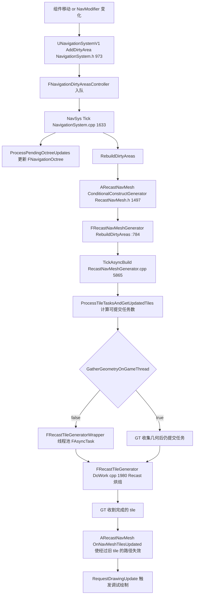
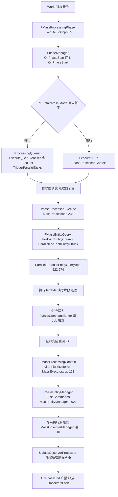
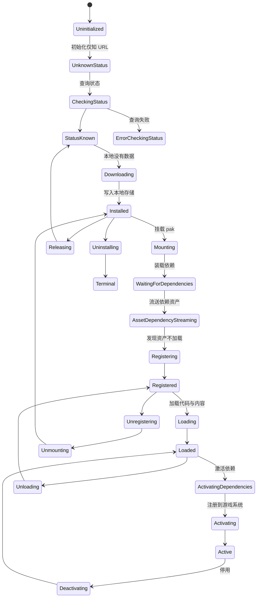
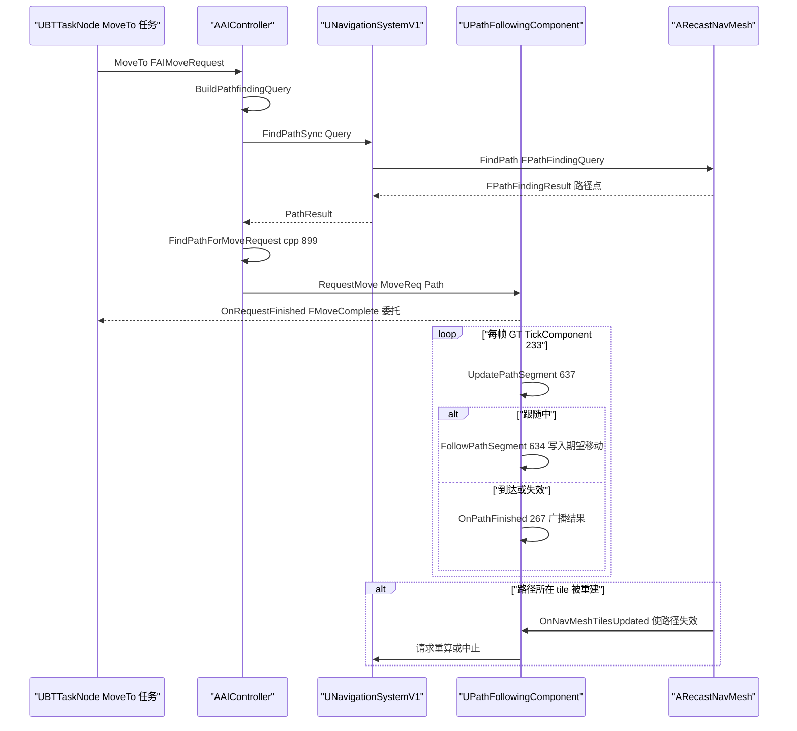
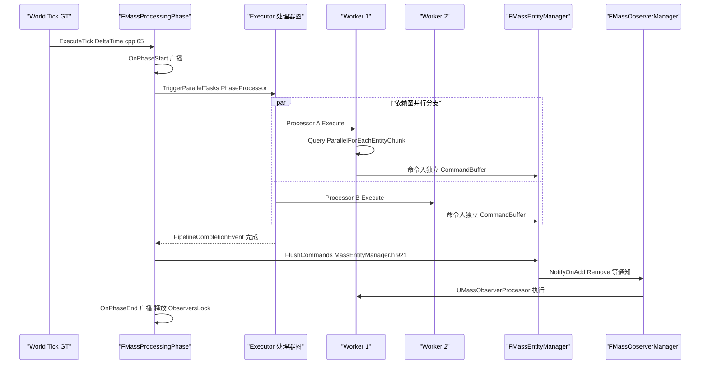
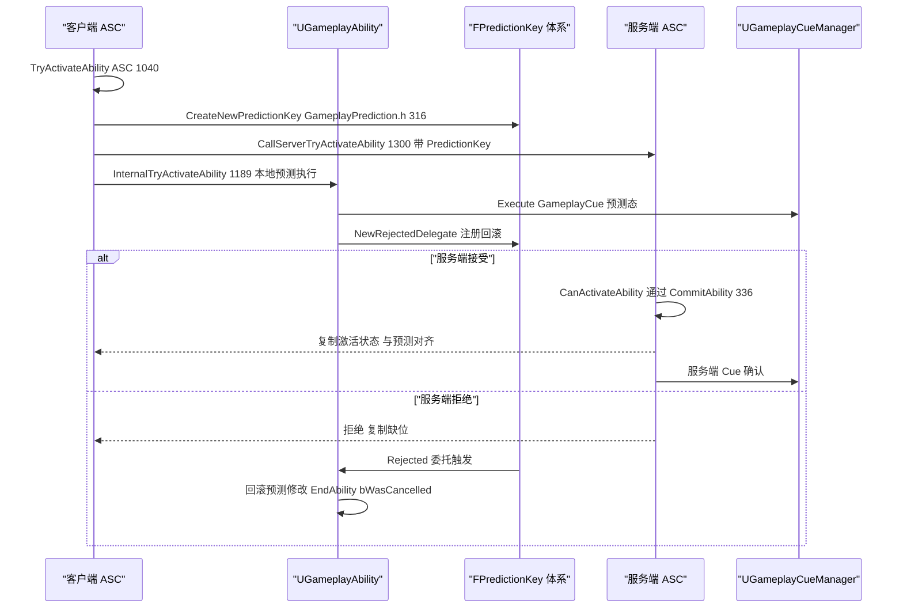
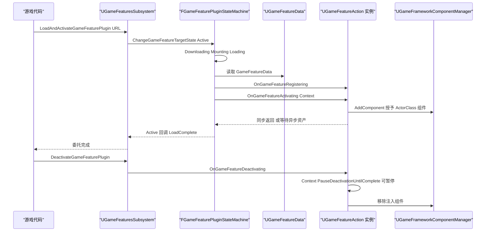

# 15(续)AI、导航与玩法框架 —— 关键流程 / 时序 / 线程模型 / 配置扩展 / 附录索引

> 本文是 `15_ai_gameplay_mass.md` 的续篇,章节号延续(X.6~X.11)。源码基线与路径约定见主篇开头。

## 15.6 关键流程

### 15.6.1 NavMesh 脏区到异步 tile 重建

要点:
- 任务并发上限:`TickAsyncBuild` 中 `NumTasksToSubmit = (bDoAsyncDataGathering ? 1 : MaxTileGeneratorTasks) - NumRunningTasks`(`RecastNavMeshGenerator.cpp:5892` 附近)——当几何收集不在 GT 完成时强制单工作线程(源码注释 "temp solution to enforce only one worker thread ... due to missing safety features")。
- 时间切片:`FNavRegenTimeSliceManager`(`RecastNavMeshGenerator.h:44` 前向声明)在 NavSys Tick 中对生成器做分帧调度(`NavigationSystem.cpp` Tick 中 `NavRegenTimeSliceManager.DoTimeSlicedUpdate()`)。
- 完成判据:`FRecastNavMeshGenerator::EnsureBuildCompletion()`(RecastNavMeshGenerator.h:778)可阻塞等待,`CancelBuild()`(:779)丢弃。

### 15.6.2 Mass 一帧流水线(阶段 tick → 并行处理器 → 命令缓冲 flush)

要点:
- 阶段集合 `EMassProcessingPhase` = PrePhysics/DuringPhysics/PostPhysics/FrameEnd(`MassProcessingTypes.h:173-181`),每个阶段是一个 `FTickFunction`(`GetProcessingPhaseTickFunction`,MassProcessingPhaseManager.h:257)。
- 观察者锁:并行执行期间持有 `EntityManager.GetOrMakeObserversLock()` 的共享指针(`MassProcessingPhaseManager.cpp:85` 与 :135),flush 前释放(`OnPreCommandFlush` lambda,:95-98)。
- 串行路径的命令 flush 发生在 `FMassProcessingContext` 析构时(源码注释:"it's important to create the processing context in this scope so that it wraps up its destruction before we call OnPhaseEnd",cpp:157-165)。

### 15.6.3 GameFeature 插件状态机(简化主干)

完整状态见 15.4.7 的 `EGameFeaturePluginState` 全表(37 个值 + MAX);下图只画正常路径主干与典型错误分支:

说明:状态迁移由 `FGameFeaturePluginStateMachine`(Private/GameFeaturePluginStateMachine.h)驱动,每个状态是 `FGameFeaturePluginState` 派生类(`BeginState`/`UpdateState`,:507-521);对外入口是 `UGameFeaturesSubsystem::LoadGameFeaturePlugin / ChangeGameFeatureTargetState` 等(GameFeaturesSubsystem.h:611/626)。`Registering` 阶段调用 `OnGameFeatureRegistering`(:859)读取 `UGameFeatureData::Actions`;`Activating` 阶段逐个调用 `UGameFeatureAction::OnGameFeatureActivating(Context)`(GameFeatureAction.h:36,默认转发到无参版本);`FGameFeatureStateChangeContext` 用 `SetRequiredWorldContextHandle` 限定生效世界(GameFeaturesSubsystem.h:82);停用侧 `FGameFeatureDeactivatingContext::PauseDeactivationUntilComplete(FString InPauserTag)` 允许观察者把停用挂起到异步动作完成(GameFeaturesSubsystem.h:128)。

## 15.7 时序图

### 15.7.1 AAIController MoveTo:同步寻路 → 跟随(GT 内)

### 15.7.2 Mass 阶段并行执行与命令缓冲回收

### 15.7.3 GAS 本地预测激活(LocalPredicted)与回滚

### 15.7.4 GameFeature 插件激活(含 Action 挂接)

## 15.8 线程模型与同步

| 子系统 | 所在线程 | 依据(源码证据) | 跨线程数据/同步原语 |
|---|---|---|---|
| AAIController / 行为树 / 黑板 / 路径跟随 / Crowd / 感知 / EQS | 全部 Game Thread | 均为 ActorComponent/FTickableGameObject Tick(如 `UAIPerceptionSystem::Tick` AIPerceptionSystem.h:39;`UBehaviorTreeComponent::TickComponent` :202);BT 显式节流 `NextTickDeltaTime`(cpp:1698 起) | 无内部锁;消息队列 FAIMessage GT 内消费 |
| NavMesh tile 烘焙 | 线程池(FAsyncTask) | `FRecastTileGeneratorTask = FAsyncTask<FRecastTileGeneratorWrapper>`(RecastNavMeshGenerator.h:639);`TickAsyncBuild` 提交/收割(cpp:5865);几何收集可选线程化(bDoAsyncDataGathering,强制单 worker) | tile 任务句柄 `TRunningTileElement.AsyncTask`(:729);完成后 GT 上 `OnNavMeshTilesUpdated` |
| 导航系统 GT 侧 | Game Thread | `UNavigationSystemV1::Tick`(NavigationSystem.cpp:1633):octree/脏区/invoker/生成器 tick/异步查询结果分发 | `AsyncPathFindingCompletedQueries` 由任务线程 Append,GT Tick 里 DispatchAsyncQueriesResults(:2039) |
| 异步寻路 | TaskGraph 工作线程(批量任务) | `TriggerAsyncQueries` 用 `FSimpleDelegateGraphTask::CreateAndDispatchWhenReady`(NavigationSystem.cpp:2018-2028),`PerformAsyncQueries` 在任务上执行 `NavData->FindPath`(:2053-2099) | `bAbortAsyncQueriesRequested` 原子布尔 + `FTaskGraphInterface::WaitUntilTaskCompletes(...ENamedThreads::GameThread)`(PostponeAsyncQueries,:2031-2039) |
| Mass 处理器 | GT 发起,处理器在 TaskGraph/LowLevelTasks 工作线程 | `FMassProcessingPhase::ExecuteTick` 分派 `TriggerParallelTasks`/`ProcessingQueue`(MassProcessingPhaseManager.cpp:65-165);`FMassEntityQuery::ParallelForEachEntityChunk` 用 `ParallelFor`/`ParallelForWithTaskContext`(MassEntityQuery.cpp:522/674) | 每 Job 独立 `FMassCommandBuffer`(bAllowParallelCommands,MassEntityQuery.h:344);`TMpscQueue PendingDynamicProcessors`(MassProcessingPhaseManager.h:324);观察者锁 `GetOrMakeObserversLock`(cpp:85/135);CVar `mass.AllowQueryParallelFor`(MassEntityQuery.cpp:31) |
| Mass 命令缓冲 flush | 阶段完成回 GT 后 | `MassExecutor.cpp:153-154` `SetFlushDeferredCommands(true)`+`FlushDeferred`;`FlushCommands`(MassEntityManager.h:921) | flush 期间命令缓冲禁止再 Push(checkf,MassCommandBuffer.h:24) |
| UMassSignalSubsystem | Game Thread(FTickable) | `UMassTickableSubsystemBase` 基类;`Tick` 检查 DelayedSignals(MassSignalSubsystem.cpp) | `UE_MT_SCOPED_WRITE_ACCESS(DelayedSignalsAccessDetector)`(Tick 内);延迟信号经 `Context.Defer().PushCommand<FMassDeferredSetCommand>`(cpp SignalEntitiesDeferred) |
| EQS | Game Thread 分片 | `UEnvQueryManager::Tick` 时间预算 `MaxAllowedTestingTime`(cpp Tick 循环) | 查询实例队列 RunningQueries |
| StateTree / GameplayStateTree | Game Thread | `UStateTreeComponent::TickComponent`(StateTreeComponent.h:50)构造 `FStateTreeExecutionContext` 栈上 Tick | 实例数据归组件所有,GT only |
| SmartObjects / ZoneGraph / WorldConditions | Game Thread 为主 | `USmartObjectSubsystem`、`UZoneGraphSubsystem` 均为 WorldSubsystem;`FZoneGraphStorage` 构建后只读 | ZoneGraph 数据句柄带 Generation;WorldCondition 状态缓存按 QueryState 内存布局 |
| GAS | Game Thread | ASC 是 ActorComponent(`TickComponent`,AbilitySystemComponent.h:1638);RPC/复制由网络线程搬运到 GT | FastArray 复制 FActiveGameplayEffect;预测键依赖复制序(见 15.7.3) |
| GameplayTargetingSystem | Game Thread 分帧 | `UTargetingSubsystem : FTickableGameObject`(TargetingSubsystem.h:79),异步请求在 Tick 推进 | 请求句柄对象池 |
| LearningAgents 推理 | GameThread 发起,内部数组级并行 | `ULearningAgentsPolicy::RunInference`(LearningAgentsPolicy.h:192);`UE::Learning` 使用 `UE::Tasks` 并行循环(见 Learning 模块 Array/Process 实现) | 观测/动作缓冲归 Manager |
| GameFeatures | Game Thread 入口 + UE::Tasks 装载 | `LoadGameFeaturePluginDetailsAsync` 返回 `UE::Tasks::TTask`(GameFeaturesSubsystem.h:912) | 状态机每步回调回 GT;停用挂起经 `FGameFeatureDeactivatingContext::PauseDeactivationUntilComplete`(GameFeaturesSubsystem.h:128) |
| SignificanceManager | Game Thread | `Update(TArrayView<const FTransform> Viewpoints)`(SignificanceManager.h:118),建议在 PrePhysics 调用 | 对象表+委托 |
| GameplayDebugger | Game Thread + 复制 | `FGameplayDebuggerPlayerManager::TickActor/Tick`(GameplayDebuggerPlayerManager.h:37/42);分类数据经 Actor 复制到本地 | 调试数据 GT 生成 |

## 15.9 配置与扩展点

### 15.9.1 CVar

| CVar | 作用 | 默认/取值 | 位置 |
|---|---|---|---|
| `mass.AllowQueryParallelFor` | 是否允许 FMassEntityQuery 使用 ParallelFor | bool,ECVF_Cheat | Source/Runtime/MassEntity/Private/MassEntityQuery.cpp:23-31 |
| `mass.SimulationTickingEnabled` | 全部 World 的 Mass 模拟启停 | 静态处理函数 `HandleSimulationTickingEnabledCVarChange`(MassSimulationSubsystem.h:46) | MassGameplay/Source/MassSimulation |
| EQS `MaxAllowedTestingTime` | 每 tick 测试时间预算(构造默认 0.01f,CDO 经 config 覆盖) | 秒 | AIModule/Private/EnvironmentQuery/EnvQueryManager.cpp:182;Classes/.../EnvQueryManager.h:341(config) |

### 15.9.2 ini / config 属性(摘)

| 配置项 | 含义 | 源码位置 |
|---|---|---|
| `[/Script/NavigationSystem.NavigationSystemV1] bGenerateNavigationOnlyAroundNavigationInvokers` | 只在 NavigationInvoker 周围生成 navmesh(配合 ActiveTilesGenerationRadius/等,ClampMin 0.1) | NavigationSystem/Public/NavigationSystem.h:391-398 |
| `bWholeWorldNavigable` | 生成失败时回退为全图可导航 | 同上 :371 |
| `bTickWhilePaused` | 暂停时是否继续导航系统 tick | 同上 :339 |
| `PerceptionAgingRate`(UAIPerceptionSystem,config) | 刺激老化周期(秒) | Classes/Perception/AIPerceptionSystem.h:49-50 |
| `MaxTileGeneratorTasks`(FRecastNavMeshGenerator) | 同时进行的 tile 烘焙任务数上限 | RecastNavMeshGenerator.h |
| `GameplayTags` 列表 ini(`[/Script/GameplayTags.GameplayTagsSettings]`) | 项目标签/排除目录,`ConstructGameplayTagTree` 消费 | Classes/GameplayTagsSettings.h + GameplayTagsManager.h:543 |
| `UMassSimulationSubsystem`(config=Game, defaultconfig) | Mass 模拟子系统可配置 | MassSimulationSubsystem.h:17 |

### 15.9.3 关键委托/事件(扩展点)

| 委托 | 触发时机 | 位置 |
|---|---|---|
| `FActorPerceptionUpdatedDelegate OnTargetPerceptionUpdated` / `FActorPerceptionForgetUpdatedDelegate OnTargetPerceptionForgotten` / `FPerceptionUpdatedDelegate OnPerceptionUpdated` | 感知刷新 | Classes/Perception/AIPerceptionComponent.h:396/408/423 |
| `FOnNavDataGenericEvent OnNavigationGenerationFinishedDelegate` | 一次导航生成结束 | NavigationSystem/Public/NavigationSystem.h:444 |
| `FMassProcessingPhase::FOnPhaseEvent OnPhaseStart/OnPhaseEnd`(`GetOnProcessingPhaseStarted/Finished`) | Mass 阶段首尾 | MassProcessingPhaseManager.h:182-190;MassSimulationSubsystem.h:30-31 |
| `UMassSimulationSubsystem::FOnSimulationStarted` / `OnSimulationPaused/Resumed` | 模拟启停 | MassSimulationSubsystem.h:22-23/32-35 |
| `UE::MassSignal::FSignalDelegate`(按名字) | 实体信号广播 | Mass/MassSignals/Public/MassSignalSubsystem.h:18/116 |
| `FQueryFinishedSignature`(RunQuery 参数) | EQS 完成 | Classes/EnvironmentQuery/EnvQueryManager.h:223 |
| `FOnGameplayEffectAppliedDelegate OnGameplayEffectAppliedToSelf/ToTarget` 系(ASC 上多个) | GE 应用/移除 | AbilitySystemComponent.h:120 |
| `UGameplayCueManager::HandleGameplayCue` 可覆写 + `IGameplayCueInterface::HandleGameplayCue` | Cue 注入点 | GameplayCueManager.h:170;GameplayCueInterface.h:37 |
| GFP 完成委托:`FGameFeaturePluginLoadComplete` / `FGameFeaturePluginDeactivateComplete` / `FGameFeaturePluginUnloadComplete` / `FGameFeaturePluginChangeStateComplete` | GFP 各状态完成 | GameFeaturesSubsystem.h:611-654 |

### 15.9.4 模块级扩展点(继承面)

- **AIModule**:自定义任务/装饰器/服务(`UBTTaskNode/UBTDecorator/UBTService` 的 Execute/Tick/条件虚函数,BTTaskNode.h:40/108、BTDecorator.h:121、BTService.h:79);自定义感官(`UAISense::Update`,AISense.h:128);装饰器观察者中断经 `InitNotifyFlags`(BTDecorator.h:131-147);`UCrowdFollowingComponent` 替换默认跟随(CrowdManager.h:48 注释)。
- **NavigationSystem**:`ARecastNavMesh::CreateGeneratorInstance()`(RecastNavMesh.h:1531)替换生成器;`FRecastTileGenerator::GatherGeometry/ApplyVoxelFilter`(:444/:490)介入烘焙;`UNavigationSystemV1::CreateNavigationDataInstanceInLevel`(:767)插入自定义 NavData;`UNavigationComponent`/`INavigationInvokerInterface` 控制按需生成。
- **Mass**:从 `UMassProcessor` 派生并声明 `FMassEntityQuery`+依赖(`ConfigureQueries/Execute`,MassProcessor.h:225/233);`bAutoRegisterWithProcessingPhases=false` 时经 `UMassSimulationSubsystem::RegisterDynamicProcessor` 动态挂入;`UMassObserverProcessor` 监听片段增删(MassObserverProcessor.h:82);信号经 `UMassSignalSubsystem` 按名广播/订阅;Fragment 定义继承 `FMassFragment/FMassTag/FMassChunkFragment/FMassSharedFragment/FMassConstSharedFragment` 之一(含稀疏变体,EntityElementTypes.h)。
- **StateTree**:Task/Evaluator/Condition 三类节点基类(15.5.8);`UStateTreeSchema` 定制属性绑定与外部数据;GameplayStateTree 提供 `UStateTreeComponent/UStateTreeAIComponent` 两个宿主;MassAIBehavior 的 `UMassStateTreeSubsystem` 把 StateTree 驱动进 Mass 阶段。
- **SmartObjects**:`USmartObjectBehaviorDefinition` 派生(如 GameplayBehaviorSmartObjects 的桥、GameplayInteractions 的交互定义);`FSmartObjectAnnotation` 注解渲染;WorldConditions 作为槽启用条件(SmartObjects 模块内 WorldConditions 子目录)。
- **GAS**:`UGameplayAbility`(15.5.10 全套虚函数)、`UGameplayEffect`+`FGameplayEffectComponent` 组合(GameplayEffect.h FindComponent 模板)、`UAttributeSet` 属性集、`UAbilityTask` 派生(AbilityTask.h:90)、`UGameplayCueManager` 派生(`UAbilitySystemGlobals::GetGameplayCueManager`,AbilitySystemGlobals.h:113)。
- **GameFeatures/ModularGameplay**:`UGameFeatureAction` 派生(引擎自带 AddComponents/AddCheats/DataRegistry 等 10+,GameFeatures/Public 目录);`UGameFeaturesProjectPolicies`(项目策略);`UGameFrameworkComponentManager` 的接收者/事件(GameFrameworkComponentManager.h:83-90 注释)。
- **DataRegistry**:`UDataRegistrySource` 派生(DataTable/CurveTable 内置),`FDataRegistryLookup` 复合查找。
- **GameplayTargetingSystem**:`UTargetingTask` 派生(选择/过滤/排序三类,Tasks 目录),`UTargetingPreset` 组合。
- **Chooser**:`UChooserTable` 行列评估(Chooser.h:22/214),自定义列 `IChooserColumn`。

## 15.10 已知限制/未确认项

1. **Mass 默认 Chunk 大小**:FMassArchetypeData::NumEntitiesPerChunk(MassArchetypeData.h:398)确认为字段,但其默认值常量 `UE::Mass::ChunkSize`(MassEntityTypes.h:997 注释引用)未能在 5.8.3 源码中 grep 到定义,本章不给出具体数值。
2. **CharacterAI** 在 5.8.3 中是空壳插件(仅 `ICharacterAIModuleInterface`),历史上它承载的 AI 移动/碰撞相关内容不在本版本源码中,无法分析其行为。
3. `FMassObserverManager` 的完整通知协议(NotifyOnAdd/Remove 的确切签名)未逐行阅读 MassObserverManager.h 全文,类图中方法行为"由其驱动"的表述基于 UMassObserverProcessor 与 ExecuteTick 中 ObserversLock 的持有关系。
4. GameplayDebugger 的复制通道细节(GameplayDebuggerCategoryReplicator 的字节流格式)未展开,仅覆盖入口与 tick 归属。
5. LearningAgents/Learning 的训练侧(LearningAgentsTraining/TrainingEditor)与 replay 插件未读;`RunInference` 内部并行度(具体 UE::Tasks 分块策略)未逐行核实,15.8 中表述为"内部数组级并行"。
6. StateGraph/StateGraphManager 为 Experimental 插件,本章只覆盖 FStateGraph/FStateGraphNode 骨架(StateGraph.h:41/185/203),未覆盖其编辑器与测试部分。
7. GameplayInteractions 的 StateTree 任务族(StateTree 子目录)未逐个阅读,仅确认 FGameplayInteractionContext::Tick 驱动方式。
8. `EAISenseConfig` 各感官(视线锥体/半径参数)与 Navmesh 模块 Detour 源码内部(dtCrowd 参数)未逐行展开,引用停留在 UE 侧封装层。
9. `FRecastNavMeshGenerator::MaxTileGeneratorTasks` 的默认数值未核对(仅确认字段存在);同理 `ActiveTilesGenerationRadius` 等具体默认值未列出。
10. 附录中 MassGameplay 各模块的 `.partNN` 拆分情况未逐一比对;X.11 给出的附录路径以实际文件名为准。

## 15.11 附录索引

本章覆盖模块与对应全量符号附录(相对 `docs/ue5.8.3/appendix/api/`):

| 模块 | 附录文件 |
|---|---|
| AIModule | Runtime/AIModule.md |
| NavigationSystem | Runtime/NavigationSystem.md |
| Navmesh | Runtime/Navmesh.md |
| GameplayTags | Runtime/GameplayTags.md |
| GameplayTasks | Runtime/GameplayTasks.md |
| GameplayDebugger | Runtime/GameplayDebugger.md |
| MassCore | Runtime/MassCore.md |
| MassEngine | Runtime/MassEngine.md |
| MassSignals | Runtime/MassSignals.md |
| MassDeveloper | Runtime/MassDeveloper.md |
| MassEntity | Runtime/MassEntity.md |
| MassSimulation | Plugins/MassSimulation.md |
| MassActors | Plugins/MassActors.md |
| MassCommon | Plugins/MassCommon.md |
| MassEQS | Plugins/MassEQS.md |
| MassLOD | Plugins/MassLOD.md |
| MassMovement | Plugins/MassMovement.md |
| MassReplication | Plugins/MassReplication.md |
| MassRepresentation | Plugins/MassRepresentation.md |
| MassSmartObjects | Plugins/MassSmartObjects.md |
| MassSpawner | Plugins/MassSpawner.md |
| MassCharacterTrajectory | Plugins/MassCharacterTrajectory.md |
| MassGameplayDebug | Plugins/MassGameplayDebug.md |
| MassGameplayExternalTraits | Plugins/MassGameplayExternalTraits.md |
| MassAIBehavior | Plugins/MassAIBehavior.md |
| MassNavigation(MassAI) | Plugins/MassNavigation.md |
| MassNavMeshNavigation | Plugins/MassNavMeshNavigation.md |
| MassZoneGraphNavigation | Plugins/MassZoneGraphNavigation.md |
| MassCrowd | Plugins/MassCrowd.md |
| MassAIReplication | Plugins/MassAIReplication.md |
| MassAIDebug | Plugins/MassAIDebug.md |
| StateTreeModule | Plugins/StateTreeModule.md |
| StateTreeEditorModule / StateTreeDeveloper | Plugins/StateTreeEditorModule.md、Plugins/StateTreeDeveloper.md |
| GameplayStateTreeModule | Plugins/GameplayStateTreeModule.md |
| SmartObjectsModule | Plugins/SmartObjectsModule.md |
| GameplayBehaviorsModule | Plugins/GameplayBehaviorsModule.md |
| GameplayBehaviorSmartObjectsModule | Plugins/GameplayBehaviorSmartObjectsModule.md |
| GameplayInteractionsModule | Plugins/GameplayInteractionsModule.md |
| ZoneGraph / ZoneGraphAnnotations | Plugins/ZoneGraph.md、Plugins/ZoneGraphAnnotations.md |
| WorldConditions | Plugins/WorldConditions.md |
| NavCorridor | Plugins/NavCorridor.md |
| PropertyAccessEditor | Plugins/PropertyAccessEditor.md |
| PropertyAccess(运行时,Engine 模块) | Runtime/Engine*.md(符号在 Engine 模块附录,Engine/Public/PropertyAccess.h) |
| GameplayAbilities | Plugins/GameplayAbilities.md |
| GameplayTargetingSystem | Plugins/TargetingSystem.md |
| CharacterAI | Plugins/CharacterAI.md |
| LearningAgents / LearningAgentsReplay / LearningAgentsTraining | Plugins/LearningAgents.md、Plugins/LearningAgentsReplay.md、Plugins/LearningAgentsTraining.md |
| Learning(LearningCore)/ LearningTraining | Plugins/Learning.md、Plugins/LearningTraining.md |
| StateGraph / StateGraphManager | Plugins/StateGraph.md、Plugins/StateGraphManager.md |
| Chooser / ChooserEditor / ChooserUncooked | Plugins/Chooser.md、Plugins/ChooserEditor.md、Plugins/ChooserUncooked.md |
| SignificanceManager | Plugins/SignificanceManager.md |
| GameFeatures / GameFeaturesEditor | Plugins/GameFeatures.md、Plugins/GameFeaturesEditor.md |
| ModularGameplay | Plugins/ModularGameplay.md |
| DataRegistry / DataRegistryEditor | Plugins/DataRegistry.md、Plugins/DataRegistryEditor.md |

主篇:`15_ai_gameplay_mass.md`(15.1 模块清单、15.2 总体架构、15.3 类图、15.4 数据字典、15.5 接口清单)。

