# 16 特效与程序化:Niagara/VectorVM、GeometryCore、PCG、Water、HairStrands

本章覆盖 UE 5.8.3 中"特效与程序化内容生成"两条主线及其几何底座:Niagara 特效运行时(VectorVM 字节码、CPU/GPU 模拟)、Cascade(旧粒子系统)与 FXSystem 接口、GeometryCore/GeometryFramework/MeshDescription/InteractiveToolsFramework 几何与工具框架、PCG 程序化内容生成(含 GPU PCG 与 Interops)、Water/Landmass 水体、HairStrands 毛发,以及一批运行时几何组件与小型环境插件。文中所有函数签名逐字摘自源码头文件(仅去掉 `*_API` 宏),行号均为 `$E`(Engine 目录)下相对路径。

## 16.1 职责、边界与模块清单

### 16.1.1 引擎侧 Runtime 模块

| 模块名 | 路径 | Build.cs 依赖(Public 代表) | 职责一句话 |
| --- | --- | --- | --- |
| VectorVM | Source/Runtime/VectorVM | Core, CoreUObject | Niagara 脚本的 128-bit SIMD 字节码虚拟机与外部函数调用机制 |
| GeometryCore | Source/Runtime/GeometryCore | Core | 纯 C++ 几何库:FDynamicMesh3 动态网格、AABB 树、网格查询、算法基础 |
| GeometryFramework | Source/Runtime/GeometryFramework | Core, CoreUObject, Engine, RenderCore, GeometryCore | 把 FDynamicMesh3 包装成 UObject/组件(UDynamicMesh/UDynamicMeshComponent)与几何事务(Change) |
| MeshDescription | Source/Runtime/MeshDescription | Core, CoreUObject | 静态/骨骼网格资产序列化用的元素化网格描述(FMeshDescription)与属性数组 |
| MeshConversion | Source/Runtime/MeshConversion | Core, MeshDescription, StaticMeshDescription, SkeletalMeshDescription, GeometryCore | FMeshDescription 与 FDynamicMesh3 双向转换 |
| InteractiveToolsFramework | Source/Runtime/InteractiveToolsFramework | Core, CoreUObject, GeometryCore | 交互工具(UInteractiveTool)、Gizmo、输入路由、事务(Change)通用框架 |
| MRMesh(引用) | Source/Runtime/MRMesh | — | 网格重建(mesh reconstruction)接收端渲染网格,配合 MeshTrackerInterface/DummyMeshReconstructor 使用 |

### 16.1.2 Engine 模块内的 Particles/FXSystem

| 内容 | 路径 | 说明 |
| --- | --- | --- |
| Cascade | Source/Runtime/Engine/Classes/Particles(共 132 个 .h) | 旧粒子系统:UParticleSystem/UParticleSystemComponent/UParticleEmitter/UParticleModule* 等,由 Engine 模块编译 |
| FXSystem 接口 | Source/Runtime/Engine/Public/FXSystem.h | FFXSystemInterface 抽象层,场景通过该接口驱动各 FX 后端(仅 Niagara 实现了 GPU 派发接口) |

### 16.1.3 Plugins/FX(Niagara 家族与转换器)

| 模块名 | 路径 | 依赖要点 | 职责一句话 |
| --- | --- | --- | --- |
| NiagaraCore | Plugins/FX/Niagara/Source/NiagaraCore | CoreUObject, VectorVM | Niagara 公共类型:数据接口基类、编译类型、参数存储 |
| Niagara | Plugins/FX/Niagara/Source/Niagara | CoreUObject, MovieScene, VectorVM(Private 大量) | Niagara 运行时主体:组件、系统/发射器实例、WorldManager、GPU 派发、DataInterface |
| NiagaraShader | Plugins/FX/Niagara/Source/NiagaraShader | Core, RenderCore, VectorVM, RHI | FNiagaraShader/FNiagaraShaderMap:把 VectorVM 编译为 HLSL 计算着色器 |
| NiagaraVertexFactories | 同上目录 | RenderCore | Niagara 渲染器顶点工厂(sprite/mesh/ribbon) |
| NiagaraAnimNotifies | 同上 | Niagara | 动画通知触发 Niagara |
| NiagaraBlueprintNodes | 同上 | Niagara | 蓝图节点支持 |
| NiagaraFluids | Plugins/FX/Niagara/Source/NiagaraFluids | Niagara(内容插件为主) | 流体模拟(2D/3D 网格)内容与模块 |
| NiagaraSimCaching | Plugins/FX/NiagaraSimCaching/Source/NiagaraSimCaching | Niagara | SimCache 录制/回放的 Sequencer 轨道(数据本体 UNiagaraSimCache 在 Niagara 模块) |
| NiagaraInsights/NiagaraMRQ/NiagaraNanite(+Shader)/NiagaraUIRenderer/NiagaraToolsets/NiagaraPreviewContent | Plugins/FX/... | — | 分析器、MRQ、Nanite 渲染、UI 渲染、工具集、预览内容 |
| CascadeToNiagaraConverter | Plugins/FX/CascadeToNiagaraConverter | Niagara(编辑器) | 编辑器右键把 UParticleSystem 资产转换为 Niagara 系统 |
| ChaosNiagara | Plugins/FX/ChaosNiagara | Niagara, Chaos | Chaos 数据与 Niagara 互通 |

### 16.1.4 Plugins/Runtime(几何/网格组件/毛发)

| 模块名 | 路径 | 职责一句话 |
| --- | --- | --- |
| DynamicMesh | Plugins/Runtime/GeometryProcessing/Source/DynamicMesh | FDynamicMesh3 的引擎侧包装(GeometryProcessing 插件) |
| GeometricObjects | Plugins/Runtime/GeometryProcessing/Source/GeometricObjects | 基础几何对象(FVectorUtil、曲线曲面等) |
| GeometryAlgorithms | Plugins/Runtime/GeometryProcessing/Source/GeometryAlgorithms | 网格算法(布尔、Remesh、简化等 FDynamicMeshOperator) |
| GeometryScriptingCore | Plugins/Runtime/GeometryScripting/Source/GeometryScriptingCore | UGeometryScriptLibrary_* 蓝图网格操作函数库 |
| MeshModelingTools | Plugins/Runtime/MeshModelingToolset/Source/MeshModelingTools | 建模模式交互工具(基于 InteractiveToolsFramework) |
| ModelingComponents | 同上插件 | 工具共用机制(预览、选择、机械) |
| ModelingOperators | 同上插件 | 网格算子封装 |
| SkeletalMeshModifiers | 同上插件 | 骨骼网格编辑工具 |
| GeometryCache(+Ed/Sequencer/Streamer/Tracks) | Plugins/Runtime/GeometryCache/Source/* | 逐帧顶点动画缓存与流送 |
| ProceduralMeshComponent | Plugins/Runtime/ProceduralMeshComponent | UProceduralMeshComponent 运行时三角形网格组件 |
| CustomMeshComponent | Plugins/Runtime/CustomMeshComponent | 轻量自定义网格组件 |
| CableComponent | Plugins/Runtime/CableComponent | UCableComponent:Verlet 绳索约束求解(SolveConstraints) |
| EditableMesh | Plugins/Runtime/EditableMesh | 仅存类型与适配器头(EditableMeshTypes.h、EditableStaticMeshAdapter.h、EditableGeometryCollectionAdapter.h),无 .Build.cs 模块;历史 UEditableMeshComponent 已移除 |
| HairStrandsCore | Plugins/Runtime/HairStrands/Source/HairStrandsCore | Groom 资产/组件/绑定/烘焙,RT FGroomManager |
| HairStrandsSolver | Plugins/Runtime/HairStrands/Source/HairStrandsSolver | UGroomSolverComponent(IDataflowPhysicsSolverInterface)毛发物理 |
| HairStrandsRuntime/Deformer/Dataflow/Editor | 同上插件 | 毛发渲染、形变器、Dataflow 节点、编辑器 |

### 16.1.5 Plugins/Experimental(几何流/水/地形/风/纹理图)

| 模块名 | 路径 | 职责一句话 |
| --- | --- | --- |
| GeometryFlowCore | Plugins/Experimental/GeometryFlow/Source/GeometryFlowCore | GeometryFlow 节点图执行框架(FGraph/INodeInput/INodeOutput,不可变数据流) |
| GeometryFlowMeshProcessing | 同上 | 网格处理节点集(后台计算) |
| DataflowCore(引用) | Source/Runtime/Dataflow/Core | FDataflowNode/FDataflowCompiledGraph 数据流运行时(非插件) |
| DataflowEnginePlugin | Plugins/Dataflow/Source/DataflowEnginePlugin | UDataflow 资产/组件与引擎接线 |
| DataflowNodes/DataflowEditor | Plugins/Dataflow/Source/* | 节点集与图编辑器 |
| GeometryDataflowNodes | Plugins/Experimental/GeometryDataflow/Source/GeometryDataflowNodes | 几何专用 Dataflow 节点 |
| Water | Plugins/Experimental/Water/Source/Runtime | 水系统:AWaterZone/UWaterMeshComponent(四叉树 GPU 网格)、WaterBody 组件族、Gerstner 波 |
| WaterEditor | Plugins/Experimental/Water/Source/WaterEditor | 水编辑器 |
| WaterAdvanced | Plugins/Experimental/WaterAdvanced/Source/WaterAdvanced | 浅水/ShallowWater、FFT 海洋(FFTOceanPatchSubsystem) |
| WaterExtras | Plugins/Experimental/WaterExtras | 内容示例插件(无 Source 模块) |
| Landmass | Plugins/Experimental/Landmass/Source/Runtime | 地形雕刻笔刷效果(BrushEffectsList/TerrainCarvingSettings) |
| Volumetrics | Plugins/Experimental/Volumetrics | 内容插件(仅 Shaders 与 uplugin,依赖 Landmass/Niagara) |
| VirtualHeightfieldMesh | Plugins/Experimental/VirtualHeightfieldMesh | FVirtualHeightfieldMeshComponent:运行时高度场虚拟网格(HeightfieldMinMaxTexture) |
| DynamicWind | Plugins/Experimental/DynamicWind/Source/DynamicWind | UDynamicWindSubsystem 与风场数据(DynamicWindData) |
| TextureGraph / TextureGraphEngine | Plugins/TextureGraph/Source/* | 程序化纹理图(TG_Expression、Tex 图求值) |

### 16.1.6 Plugins/PCG 与 Interops、环境插件

| 模块名 | 路径 | 职责一句话 |
| --- | --- | --- |
| PCG | Plugins/PCG/Source/PCG | PCG 核心:图/节点/设置/元素/执行器/数据/子系统 |
| PCGEditor | Plugins/PCG/Source/PCGEditor | 图编辑器 |
| PCGCompute | Plugins/PCG/Source/PCGCompute | GPU PCG 与 ComputeFramework 的胶水模块 |
| PCGInterops(稳定) | Plugins/PCGInterops:PCGGeometryScriptInterop、PCGExternalDataInterop、PCGPythonInterop | PCG 与 GeometryScript/外部数据/Python 互通 |
| PCGInterops(实验) | Plugins/Experimental/PCGInterops:PCGNiagaraInterop、PCGWaterInterop、PCGInstancedActorsInterop、PCGFastGeoInterop、PCGNaniteAssembliesInterop | 与 Niagara/Water/ISM/FastGeo/Nanite Assemblies 互通 |
| PCGMeshPartitionInterop(+Editor) | Plugins/Experimental/PCGMeshPartitionInterop | 网格分区互通 |
| PCGBiomeCore | Plugins/Experimental/PCGBiomeCore | Biome(生物群系)生成核心 |
| PCGPrimitives | Plugins/Experimental/PCGPrimitives | 基本体(Primitives)生成节点 |
| CelestialVault | Plugins/Runtime/CelestialVault/Source/CelestialVault | 天穹/太阳月亮星体(VSOP87 星历) |
| SunPosition | Plugins/Runtime/SunPosition/Source/SunPosition | 太阳方位计算放置工具 |
| GeoReferencing | Plugins/Runtime/GeoReferencing/Source/GeoReferencing | AGeoReferencingSystem:地理坐标与引擎坐标换算(椭球) |
| HDRIBackdrop | Plugins/Runtime/HDRIBackdrop/Source/HDRIBackdrop | AHDRIBackdrop:HDRI 背景/光照 |

## 16.2 总体架构

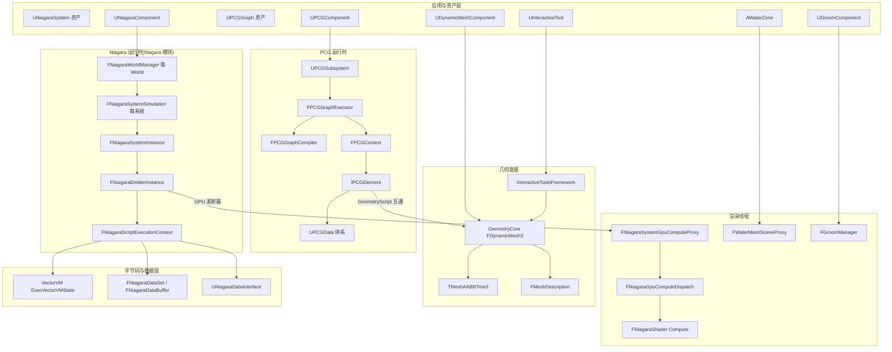

说明:Niagara 与 PCG 是两条独立的"资产→运行时→并行执行"管线,共享的底座是 GeometryCore 几何库与 InteractiveToolsFramework 工具框架;Niagara 的 GPU 路径通过 FFXSystemInterface(NiagaraGpuComputeDispatch)接入渲染器 InitViews/PostRenderOpaque,PCG 的 GPU 路径通过 ComputeFramework(UComputeGraph)接入;Water/HairStrands 各自在渲染线程持有 SceneProxy/Manager。

## 16.3 类图

### 16.3.1 Niagara 运行时类图

每类职责:UNiagaraSystem(资产)/UNiagaraComponent(场景组件)在 GameThread,组件通过 FNiagaraSystemInstanceController(5.0+ 引入的拥有层)创建系统实例;FNiagaraWorldManager 是每 World 单例,按 tick group 持有 FNiagaraSystemSimulation;后者把同一系统的所有 FNiagaraSystemInstance 打包进共享 FNiagaraDataSet 并跑系统级脚本;系统实例包含 FNiagaraEmitterInstance(发射器实例),CPU 脚本走 FNiagaraScriptExecutionContext(VectorVM),GPU 发射器持 FNiagaraComputeExecutionContext 与渲染线程代理;UNiagaraDataInterface 通过 Proxy 与渲染线程通信。

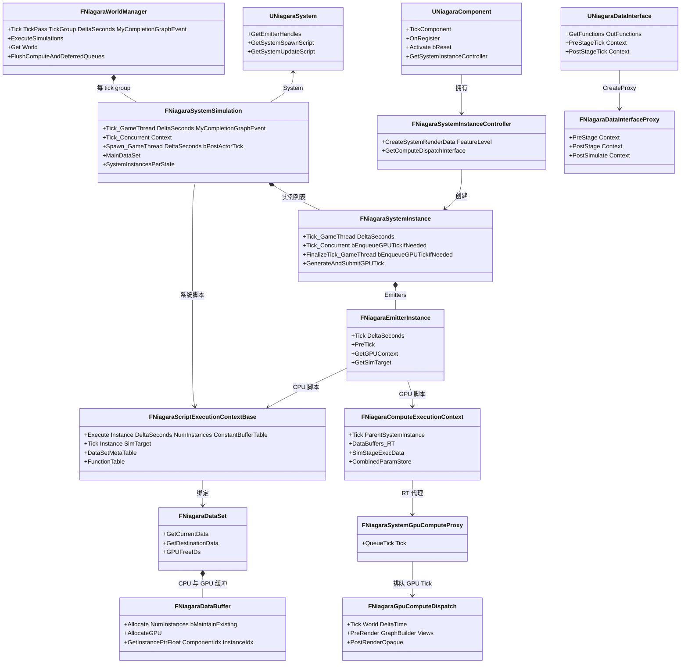

### 16.3.2 PCG 类图

UPCGGraph(资产)由 FPCGGraphCompiler 编译为 FPCGGraphTask DAG,FPCGGraphExecutor 按 ReadyTasks/ActiveTasks 调度;每个任务对应一个 UPCGNode 的 UPCGSettings 派生类创建的 IPCGElement,执行时持有 FPCGContext(输入输出 FPCGDataCollection);数据体系以 UPCGData 为根,UPCGSpatialData/UPCGPointData/UPCGBasePointData 为最常用派生;UPCGComponent 通过 IPCGGraphExecutionSource 接口提交给 UPCGSubsystem。

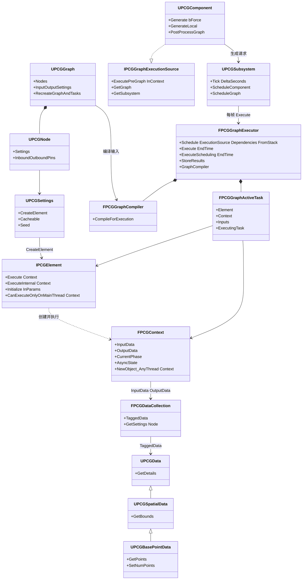

### 16.3.3 几何与交互工具类图

FDynamicMesh3 是核心网格数据(顶点/三角形/边三张表 + 引用计数 + 可选属性 + FDynamicMeshAttributeSet);TMeshAABBTree3 对其做包围盒加速;FMeshDescription 是资产侧描述,由 MeshConversion 双向转换;GeometryFramework 把两者包装为 UDynamicMesh/UDynamicMeshComponent;InteractiveToolsFramework 提供 UInteractiveTool(Setup/Tick/Render/Shutdown)与 UInteractiveToolManager 生命周期管理,UInteractiveToolBuilder 决定可构建性,FPrimitiveDrawInterface 依赖从 IToolsContextRenderAPI 注入。

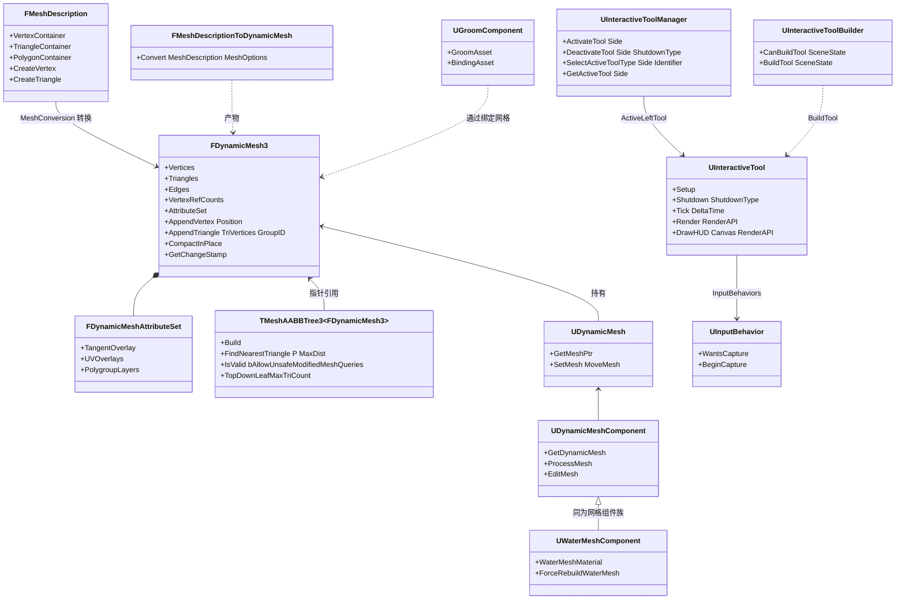

注:UWaterMeshComponent 实际继承 UMeshComponent(非 UDynamicMeshComponent),图中为示意其与网格组件族的关系;UGroomComponent 与 FDynamicMesh3 仅在 Dataflow/Cards 烘焙路径发生关系。

## 16.4 数据字典

### 16.4.1 Niagara 数据结构

| 字段/类型 | 所属 | 含义 | 取值/约束 | 源码位置 |
| --- | --- | --- | --- | --- |
| `TArray<uint8> FloatData / Int32Data / HalfData` | FNiagaraDataBuffer | CPU 模拟数据按类型分平面存储 | 组件缓冲按 VECTOR_WIDTH_BYTES(16)对齐并加一个向量余量 | Plugins/FX/Niagara/Source/Niagara/Classes/NiagaraDataSet.h:213-217,202-205 |
| `uint32 NumInstances / NumInstancesAllocated` | FNiagaraDataBuffer | 当前实例数/分配容量 | SetNumInstances 带 check 上限 | 同上:243-244 |
| `FRWBuffer GPUBufferFloat/GPUBufferInt/GPUBufferHalf/GPUIDToIndexTable` | FNiagaraDataBuffer | GPU 模拟缓冲(浮点/整型/半精/ID→索引表) | 仅 GPU 模拟使用 | 同上:230-236 |
| `ENiagaraGpuComputeTickStage::Type GPUDataReadyStage` | FNiagaraDataBuffer | 帧内 GPU 数据就绪阶段 | First/PreInitViews/PostInitViews/PostOpaqueRender | 同上:226 |
| `TArray<int32> IDToIndexTable` | FNiagaraDataBuffer | 粒子 ID→缓冲索引映射 | 持久 ID 模式 | 同上:220 |
| `FNiagaraDataBuffer* DataBuffers_RT[2]` | FNiagaraComputeExecutionContext | RT 双缓冲(当前/上一帧) | 仅渲染线程访问,BufferSwapsThisFrame_RT 奇偶切换 | Plugins/FX/Niagara/Source/Niagara/Classes/NiagaraComputeExecutionContext.h:207-208 |
| `std::atomic&lt;uint32&gt; ParticleCountReadFence / ParticleCountWriteFence` | FNiagaraComputeExecutionContext | 粒子计数读写栅栏(避免 GT 与 RT 竞争) | 读计数 ≤ 写栅栏时可用 | 同上:199-200 |
| `std::atomic&lt;uint32&gt; CurrentNumInstances_RT` | FNiagaraComputeExecutionContext | RT 当前实例数 | 5.8 起弃用直接访问,改用 Set/GetCurrentNumInstances | 同上:222-243 |
| `FNiagaraGpuSpawnInfo GpuSpawnInfo_GT` | FNiagaraComputeExecutionContext | GT 侧生成信息(EventSpawnTotal/SpawnRateInstances/MaxParticleCount + SpawnInfoStartOffsets/Params 数组) | 数组长度 NIAGARA_MAX_GPU_SPAWN_INFOS,须为 4 的倍数 | 同上:35-58,188-189 |
| `FNiagaraSimStageExecutionDataPtr SimStageExecData` | FNiagaraComputeExecutionContext | 编译期 Simulation Stage 执行数据(阶段顺序、迭代绑定) | 由脚本编译产生 | 同上:229 |
| `TArray&lt;const FVMExternalFunction*&gt; FunctionTable` | FNiagaraScriptExecutionContextBase | VM 外部函数表(DI 函数指针) | 与脚本字节码序号对应 | Plugins/FX/Niagara/Source/Niagara/Classes/NiagaraScriptExecutionContext.h:140 |
| `TArray&lt;FDataSetMeta,TInlineAllocator&lt;2&gt;&gt; DataSetMetaTable` | 同上 | 输入/输出数据集到 VM 寄存器视图映射 | Spawn/Update 两个槽位 | 同上:150 |
| `FScriptExecutionConstantBufferTable`(MaxBufferCount=12) | 同上文件 | 常量缓冲表(指针+大小) | Buffers/BufferSizes 平行数组 | 同上:102-127 |
| `VectorVM::Runtime::FVectorVMState* VectorVMState` | 同上 | 预分配的 VM 状态(寄存器映射缓存) | AllocVectorVMState 创建 | 同上:137 |
| `uint32 SpawnInfoStartOffsets/SpawnInfoParams` | FNiagaraGpuSpawnInfo | GPU 生成批描述(浮点成对打包为 float4) | static_assert 对齐 SHADER_PARAMETER_ARRAY_ELEMENT_ALIGNMENT | NiagaraComputeExecutionContext.h:27-58;NiagaraGpuComputeDispatch.cpp:1617-1622 |

### 16.4.2 VectorVM 数据结构

| 字段/类型 | 所属 | 含义 | 取值/约束 | 源码位置 |
| --- | --- | --- | --- | --- |
| `EVectorVMOp`(0..178) | VectorVM | 字节码操作码枚举(含 fused merged ops) | 共 179 个(0=done,87=external_func_call,93/94=ID 读写) | Source/Runtime/VectorVM/Public/VectorVM.h:50-241 |
| `VECTOR_WIDTH=128 / VECTOR_WIDTH_BYTES=16 / VECTOR_WIDTH_FLOATS=4` | 宏 | SIMD 向量宽度 | 每次处理 4 实例 | 同上:28-30 |
| `FInputRegisterView / FOutputRegisterView` | FDataSetMeta | 输入/输出寄存器指针表 | 与 FNiagaraDataBuffer::BuildRegisterTable 对应 | 同上:248-249 |
| `int32 IDAcquireTag` | FDataSetMeta | ID 获取代标记 | 与 FNiagaraComputeExecutionContext::TickCounter 匹配 | 同上:273 |
| `uint32** RegisterData / uint8* RegInc` | FVectorVMExternalFunctionContext | 外部函数寄存器表与步进表 | GetNextRegister 顺序消费 | 同上:318-319 |
| `TArrayView&lt;FDataSetMeta&gt; DataSets` | 同上 | 外部函数可见数据集 | — | 同上:334 |
| `FVMExternalFunction` 委托 | VectorVM | 外部函数签名(delegate OneParam) | DI 经 GetFunctions+Bind 匹配生成 | 同上:358 |
| `EVectorVMFlags` | 同上 | 脚本标志 | VVMFlag_LargeScript=1&lt;&lt;2(16bit 寄存器索引)等 | 同上:529-536 |
| `FVectorVMExecContext.NumInstances / ConstantTableData / ExtFunctionTable` | Runtime::FVectorVMExecContext | ExecVectorVMState 入参 | ExtFunctionTable 数必须与状态内 NumExtFunctions 相等否则直接返回 | Source/Runtime/VectorVM/Public/VectorVMRuntime.h:16-28;Private/VectorVMRuntime.cpp:2199-2202 |
| `MaxChunksPerBatch=4` | ExecVectorVMState 内部 | 每批 chunk 数 | 必须 2 的幂 | Private/VectorVMRuntime.cpp:2234-2235 |

### 16.4.3 PCG 数据结构

| 字段/类型 | 所属 | 含义 | 取值/约束 | 源码位置 |
| --- | --- | --- | --- | --- |
| `FPCGDataCollection InputData / OutputData` | FPCGContext | 元素输入/输出数据集合 | 含 TaggedData 与 Settings | Plugins/PCG/Source/PCG/Public/PCGContext.h:117-118 |
| `EPCGExecutionPhase CurrentPhase` | FPCGContext | 元素执行阶段 | NotExecuted→PrepareData→Execute→PostExecute→Done | 同上:53-60,138 |
| `FPCGAsyncState AsyncState` | FPCGContext | 时间片/停止标志/并行执行状态(NumAvailableTasks、EndTime、bIsRunningOnMainThread) | Execute 返回 false 表示未完成需重入 | 同上:128;Helpers/PCGAsyncState.h |
| `TSet&lt;FPCGTaskId&gt; DynamicDependencies` | FPCGContext | 运行期动态依赖 | 空才能进入 Execute(PCGGraphExecutor.cpp:2067 check) | 同上:136 |
| `bool bMustRunOnMainThread` | FPCGContext | RequestToRunOnMainThread 置位 | 决定任务进 ActiveTasksGameThreadOnly | 同上:150-151 |
| `FPCGTaskId TaskId / CompiledTaskId` | FPCGContext | 运行任务号/编译任务号 | InvalidPCGTaskId=INDEX_NONE | 同上:133-134 |
| `FPCGElementPtr Element` | FPCGGraphActiveTask | 当前任务的可执行元素 | TSharedPtr&lt;IPCGElement&gt; | Plugins/PCG/Source/PCG/Private/Graph/PCGGraphTask.h:198 |
| `TUniquePtr&lt;FPCGContext&gt; Context` | FPCGGraphActiveTask | 每任务上下文(独占) | — | 同上:199 |
| `UE::Tasks::TTask&lt;bool&gt; ExecutingTask` | FPCGGraphActiveTask | UE::Tasks 句柄 | 须在 LiveTasksLock 下改 | 同上:208-209 |
| `TArray&lt;FPCGGraphScheduleTask&gt; ScheduledTasks` | FPCGGraphExecutor | 已调度未就绪任务(ScheduleLock) | — | Plugins/PCG/Source/PCG/Private/Graph/PCGGraphExecutor.h:296-297 |
| `TMap&lt;FPCGTaskId,FPCGGraphTask&gt; Tasks / TaskSuccessors` | FPCGGraphExecutor | 任务 DAG 与后继表(TasksLock) | — | 同上:301-303 |
| `ReadyTasks / ActiveTasks / ActiveTasksGameThreadOnly / PausedTasks` | FPCGGraphExecutor | 就绪/执行中(GT 专用/暂停)任务(LiveTasksLock) | — | 同上:306-311 |
| `TMpscQueue&lt;FPostTaskExecuteItem&gt; Queue` | FPostTaskExecuteConsumerThread | 工作线程→消费线程的结果队列 | FRunnable 专用线程,默认关闭 | 同上:363-378 |
| `struct FPCGGraphTask`(InputDependencies/Element/NodeId…) | PCGGraphTask.h | 编译产物:节点→元素+输入依赖 | 由 FPCGGraphCompiler 生成 | PCGGraphTask.h:80 |

### 16.4.4 几何数据结构

| 字段/类型 | 所属 | 含义 | 取值/约束 | 源码位置 |
| --- | --- | --- | --- | --- |
| `TDynamicVector&lt;FVector3d&gt; Vertices` | FDynamicMesh3 | 顶点位置 | 删除用引用计数,索引保持稳定 | Source/Runtime/GeometryCore/Public/DynamicMesh/DynamicMesh3.h:170 |
| `FRefCountVector VertexRefCounts/TriangleRefCounts/EdgeRefCounts` | FDynamicMesh3 | 三类元素引用计数 | 迭代可得知哪些索引有效 | 同上:172,185,196 |
| `TDynamicVector&lt;FIndex3i&gt; Triangles / TriangleEdges` | FDynamicMesh3 | 三角形顶点索引/边索引 | AppendTriangle 返回 NonManifoldID(-2)/DuplicateTriangleID(-3) 表示拒绝 | 同上:183,187;159-162 |
| `TDynamicVector&lt;FEdge&gt; Edges` | FDynamicMesh3 | 边表(Vert 二元组+Tri 二元组) | VertA&lt;VertB,Tri1 可为 InvalidID(边界边) | 同上:193-194 |
| `TOptional&lt;...&gt; VertexNormals/VertexColors/VertexUVs/TriangleGroups` | FDynamicMesh3 | 可选属性层 | EMeshComponents 开关 | 同上:174-189 |
| `TUniquePtr&lt;FDynamicMeshAttributeSet&gt; AttributeSet` | FDynamicMesh3 | 扩展属性(多 UV 层、硬法线、Polygroup 层) | — | 同上:199 |
| `FChangeStamp ChangeStampShape/ChangeStampTopology` | FDynamicMesh3 | 形状/拓扑变更戳(互斥保护) | 拓扑戳默认启用,形状戳默认关闭 | 同上:267-272 |
| `const TriangleMeshType* Mesh; uint64 MeshChangeStamp` | TMeshAABBTree3 | 关联网格与构建时变更戳 | IsValid 用 MeshChangeStamp==Mesh->GetChangeStamp() 判断失效 | Source/Runtime/GeometryCore/Public/Spatial/MeshAABBTree3.h:71-72,118-130 |
| `int TopDownLeafMaxTriCount = 3` | TMeshAABBTree3 | 自顶向下叶子最大三角形数 | SetBuildOptions 可改 | 同上:73,132-136 |
| `FVertexContainer/FTriangleContainer/FPolygonContainer` | FMeshDescription | 元素化容器(顶点/三角形/多边形) | CreateVertex/CreateTriangle/CreatePolygon | Source/Runtime/MeshDescription/Public/MeshDescription.h:93 |

### 16.4.5 关键枚举

| 枚举 | 值 | 含义 | 源码位置 |
| --- | --- | --- | --- |
| ENiagaraWorldManagerTickPass | NoneOverlapping=0, Overlapping=1 | 每个 tick group 两个 tick pass:不可跨 tick group 重叠/可重叠(EndTickGroup=TG_LastDemotable) | Plugins/FX/Niagara/Source/Niagara/Public/NiagaraWorldManager.h:37-45 |
| NiagaraFirstTickGroup/NiagaraLastTickGroup/NiagaraNumTickGroups | TG_PrePhysics..TG_LastDemotable | Niagara 挂接的引擎 tick group 区间 | Plugins/FX/Niagara/Source/Niagara/Public/NiagaraCommon.h:78-80 |
| ENiagaraGPUTickHandlingMode | None/GameThread/Concurrent/GameThreadBatched/ConcurrentBatched | GPU Tick 提交时机(单发或打包、GT 或并发) | Plugins/FX/Niagara/Source/Niagara/Public/NiagaraSystemSimulation.h:19-26 |
| ENiagaraSystemInstanceState | None/PendingSpawn/PendingSpawnPaused/Spawning/Running/Paused/Num | 系统实例状态(每状态一份数据集槽,Complete 判定用 IsComplete() 而非状态) | Plugins/FX/Niagara/Source/Niagara/Public/NiagaraCommon.h:1864;状态数组见 Public/NiagaraSystemSimulation.h:373 |
| ENiagaraIterationSource | Particles/DataInterface/DirectSet | Simulation Stage 迭代源 | Plugins/FX/Niagara/Source/NiagaraCore/Public/NiagaraCore.h:27 |
| EToolShutdownType | Completed=0, Accept=1, Cancel=2 | 工具关闭方式 | Source/Runtime/InteractiveToolsFramework/Public/InteractiveTool.h:44-52 |
| EPCGExecutionPhase | NotExecuted/PrepareData/Execute/PostExecute/Done | PCG 元素执行阶段机 | Plugins/PCG/Source/PCG/Public/PCGContext.h:53-60 |

## 16.5 接口清单

### 16.5.1 Niagara:WorldManager / SystemSimulation

| 原型 | 功能 | 参数与返回 | 线程/重入约束 | 位置 |
| --- | --- | --- | --- | --- |
| `static FNiagaraWorldManager* Get(const UWorld* World)` | 取 World 的管理器 | World→管理器(可能空) | 任意线程读,Map 静态 | Plugins/FX/Niagara/Source/Niagara/Public/NiagaraWorldManager.h:108 |
| `void Tick(ENiagaraWorldManagerTickPass TickPass, ETickingGroup TickGroup, float DeltaSeconds, const FGraphEventRef& MyCompletionGraphEvent)` | tick pass 入口:预工作→执行模拟→后工作 | DeltaSeconds 已乘 DebugPlaybackRate;MyCompletionGraphEvent 用于挂接 DontCompleteUntil | GameThread(由 FTickFunction 驱动) | 同上:145;实现在 Private/NiagaraWorldManager.cpp:1623 |
| `void PreSendAllEndOfFrameUpdates()` | EOF 更新前等待异步完成 | 无 | GameThread(NiagaraWorldManager.cpp:1551) | 同上头:158 |
| `void FlushComputeAndDeferredQueues(bool bWaitForGPU)` | 冲刷 compute 队列与延迟方法 | bWaitForGPU 控制是否等 GPU | GameThread | 同上头:271 |
| `static void EnqueueGlobalDeferredCallback(TFunction<void()>&& Callback)` | 线程安全投递 GT 回调 | 每 tick group 开头冲刷 | 任意线程入队,GameThread 执行 | 同上头:277 |
| `FNiagaraSystemSimulationRef GetSystemSimulation(ETickingGroup TickGroup, UNiagaraSystem* System)` | 取/建某 tick group 的系统模拟 | 返回共享引用 | GameThread | 同上头:128 |
| `void Tick_GameThread(float DeltaSeconds, const FGraphEventRef& MyCompletionGraphEvent)` | 系统模拟第一阶段 | 固定步长时内部多次 Tick_GameThread_Internal | GameThread(check(IsInGameThread())) | Plugins/FX/Niagara/Source/Niagara/Public/NiagaraSystemSimulation.h:262;Private/NiagaraSystemSimulation.cpp:1051,1154 |
| `void Tick_Concurrent(FNiagaraSystemSimulationTickContext& Context)` | 系统模拟第二阶段(系统脚本) | Context 含 Instances/DataSet/CompletionEvents | 任意 TaskGraph 工作线程 | 同上头:264 |
| `void Spawn_GameThread(float DeltaSeconds, bool bPostActorTick)` | 孵化 PendingSpawn 实例 | bPostActorTick=在 PostActorTick 时补 spawn | GameThread | 同上头:272 |
| `void WaitForConcurrentTickComplete(bool bEnsureComplete = false)` / `WaitForInstancesTickComplete(bool bEnsureComplete = false)` | 等待并发 tick/实例 tick 完成 | 未完成可 ensure | GameThread | 同上头:282-284 |

### 16.5.2 Niagara:SystemInstance / EmitterInstance / ExecContext

| 原型 | 功能 | 参数与返回 | 线程/重入约束 | 位置 |
| --- | --- | --- | --- | --- |
| `void Tick_GameThread(float DeltaSeconds)` | 实例 GT 段:等上帧并发、TickDataInterfaces(presim)、Age 累计 | DeltaSeconds→CachedDeltaSeconds | GameThread | Plugins/FX/Niagara/Source/Niagara/Public/NiagaraSystemInstance.h:218;Private/NiagaraSystemInstance.cpp:2584 |
| `void Tick_Concurrent(bool bEnqueueGPUTickIfNeeded = true)` | 实例并发段:按执行顺序 PreTick+Tick 全部发射器、汇总 GPU 参数、更新局部包围盒 | bEnqueueGPUTickIfNeeded 决定 ConcurrentBatched 下是否本线程提交 GPU tick | 任意线程(通常 TaskGraph worker) | 同上头:220;cpp:2659 |
| `void FinalizeTick_GameThread(bool bEnqueueGPUTickIfNeeded = true)` | 收尾:检查并发完成、PostTick 数据接口、按模式提交 GPU tick、执行 OnPostTickDelegate、处理延迟 Reset | — | GameThread(FNiagaraSystemInstanceFinalizeTask) | 同上头:225;cpp:2838 |
| `void GenerateAndSubmitGPUTick()` | 生成 FNiagaraGPUSystemTick 并 ENQUEUE_RENDER_COMMAND 到代理 | NeedsGPUTick() 为真才提交 | 调用方线程,内部转 RT | 同上头:227;cpp:2897 |
| `void InitGPUTick(FNiagaraGPUSystemTick& OutTick)` | 填充 GPU tick 数据 | check(SystemGpuComputeProxy 有效) | 调用方线程 | 同上头:228;cpp:2918 |
| `NIAGARA_API void TickDataInterfaces(float DeltaSeconds, bool bPostSimulate)` | 逐 DI 调 PerInstanceTick(预)/PerInstanceTickPostSimulate(后),后段可能触发 DI 实例数据重建并重绑 VM 函数 | — | GameThread(两处调用点:TICK_GT:2625 与 Finalize:2864) | 同上头:251;cpp:1863 |
| `virtual void Tick(float DeltaSeconds) = 0` / `virtual void PreTick() {}` | 发射器实例 tick(FNiagaraEmitterInstance 抽象接口) | — | 与系统实例 Tick_Concurrent 同线程 | Plugins/FX/Niagara/Source/Niagara/Classes/NiagaraEmitterInstance.h:45-46 |
| `virtual bool Tick(class FNiagaraSystemInstance* Instance, ENiagaraSimTarget SimTarget) = 0` | CPU 脚本执行上下文 tick(装配数据集→Execute) | 返回是否成功 | 任意线程 | Plugins/FX/Niagara/Source/Niagara/Classes/NiagaraScriptExecutionContext.h:175 |
| `virtual bool Execute(class FNiagaraSystemInstance* Instance, float DeltaSeconds, uint32 NumInstances, const FScriptExecutionConstantBufferTable& ConstantBufferTable)` | 跑一次 VM:PreStageTick→ExecuteInternal→PostStageTick | NumInstances=0 直接 true | 任意线程 | 同上:176;Private/NiagaraScriptExecutionContext.cpp:200 |
| `bool Tick(FNiagaraSystemInstance* ParentSystemInstance)` | GPU 上下文 tick(GT 侧准备/参数打包) | — | GameThread/并发 | Plugins/FX/Niagara/Source/Niagara/Classes/NiagaraComputeExecutionContext.h:97 |

### 16.5.3 Niagara:GPU 派发与 DataInterface

| 原型 | 功能 | 参数与返回 | 线程/重入约束 | 位置 |
| --- | --- | --- | --- | --- |
| `virtual FFXSystemInterface* GetInterface(const FName& InName)` | 按 FName 取 FX 系统接口(Niagara 注册 FNiagaraGpuComputeDispatch) | — | 任意 | Plugins/FX/Niagara/Source/Niagara/Private/NiagaraGpuComputeDispatch.h:90 |
| `virtual void AddGpuComputeProxy(FNiagaraSystemGpuComputeProxy* ComputeProxy)` / `RemoveGpuComputeProxy(...)` | 登记/注销系统 GPU 代理 | — | GameThread | 同上:97,100 |
| `virtual void Tick(UWorld* World, float DeltaTime)` | GT 帧泵:ENQUEUE_RENDER_COMMAND(NiagaraPumpBatcher) 触发 RT ProcessPendingTicksFlush 与间接参数池冲刷 | — | GameThread(check(IsInGameThread())cpp:实现首行) | 同上:126;Private/NiagaraGpuComputeDispatch.cpp(Tick 实现) |
| `virtual void PreRender(FRDGBuilder& GraphBuilder, TConstStridedView&lt;FSceneView&gt; Views, FSceneUniformBuffer &SceneUniformBuffer, bool bAllowGPUParticleUpdate)` | 渲染前回调 | — | 渲染线程(RDG) | 同上:123 |
| `virtual void PostRenderOpaque(...)` 同签名 | 不透明后执行 GPU 模拟(TickStage=PostOpaqueRender) | — | 渲染线程 | 同上:128 |
| `void ExecuteTicks(FRDGBuilder& GraphBuilder, TConstStridedView&lt;FSceneView&gt; Views, ENiagaraGpuComputeTickStage::Type TickStage)`(private) | 按 stage 执行 dispatch group(PreStage/PostStage 接口回调) | — | 渲染线程 | 同上:194;Private/NiagaraGpuComputeDispatch.cpp:1100 |
| `void DispatchStage(FRDGBuilder& GraphBuilder, const FNiagaraGPUSystemTick& Tick, const FNiagaraComputeInstanceData& InstanceData, const FNiagaraSimStageData& SimStageData)`(private) | 单发射器单 stage:算 DispatchCount(1D/2D/3D/Indirect)、装配 FNiagaraShader 参数、AddComputePass | — | 渲染线程 | 同上:195;cpp:1475 |
| `void QueueTick(FNiagaraGPUSystemTick& Tick)`(FNiagaraSystemGpuComputeProxy) | RT 接收 GT 提交的 tick 数据 | — | 渲染线程 | Private/NiagaraSystemGpuComputeProxy.cpp:165 |
| `virtual void GetFunctions(TArray&lt;FNiagaraFunctionSignature&gt;& OutFunctions)` | DI 暴露给脚本的函数签名表 | 编辑器/编译期填充 | GameThread(编译期) | Plugins/FX/Niagara/Source/Niagara/Classes/NiagaraDataInterface.h:882 |
| `virtual void PreStageTick(FNDICpuPreStageContext& Context){}` / `PostStageTick(FNDICpuPostStageContext& Context){}` | CPU 每 stage 前后回调 | — | 与脚本执行同线程 | 同上:636,639 |
| `virtual void PreStage(const FNDIGpuComputePreStageContext& Context) {}` / `PostStage(...)` / `PostSimulate(...)` | 代理侧(渲染线程)每 stage 回调 | — | 渲染线程 | 同上(Proxy 段):410-412 |
| `virtual void ProvidePerInstanceDataForRenderThread(void* DataForRenderThread, void* PerInstanceData, const FNiagaraSystemInstanceID& SystemInstance)` | 把实例数据拷给 RT | — | GameThread(打包时) | 同上:665 |

### 16.5.4 VectorVM 与 FXSystem

| 原型 | 功能 | 参数与返回 | 线程/重入约束 | 位置 |
| --- | --- | --- | --- | --- |
| `VECTORVM_API FVectorVMState* AllocVectorVMState(TConstArrayView&lt;uint8&gt; ContextData)` | 从脚本字节码预分配 VM 状态(寄存器映射) | ContextData=编译后脚本 | 脚本 Init 时(GT/并发) | Source/Runtime/VectorVM/Public/VectorVMRuntime.h:29 |
| `VECTORVM_API void FreeVectorVMState(FVectorVMState* State)` | 释放 VM 状态 | — | — | 同上:30 |
| `VECTORVM_API void ExecVectorVMState(FVectorVMExecContext* ExecCtx)` | 执行字节码:装填外部函数表、构建映射缓存、按批(chunk)分块跑 4 实例/循环 | ExtFunctionTable 数量不符直接返回 | 调用线程内执行(Niagara 在 TaskGraph worker 上调) | 同上:32;Private/VectorVMRuntime.cpp:2197 |
| `VECTORVM_API uint8 GetNumOpCodes()` | 操作码总数 | 返回 NumOpcodes | — | Source/Runtime/VectorVM/Public/VectorVM.h:370 |
| `DECLARE_DELEGATE_OneParam(FVMExternalFunction, FVectorVMExternalFunctionContext& Context)` | 外部函数委托类型 | — | DI 函数在 VM 线程执行 | 同上:358 |
| `virtual void Tick(UWorld* World, float DeltaTime) = 0` | FFXSystemInterface:每帧 RT 驱动 | — | 渲染线程 | Source/Runtime/Engine/Public/FXSystem.h:185 |
| `virtual void PreRender(FRDGBuilder& GraphBuilder, TConstStridedView&lt;FSceneView&gt; Views, FSceneUniformBuffer &SceneUniformBuffer, bool bAllowGPUParticleUpdate) = 0` | 渲染前钩子 | — | 渲染线程 | 同上:282 |
| `virtual void PostRenderOpaque(FRDGBuilder& GraphBuilder, TConstStridedView&lt;FSceneView&gt; Views, FSceneUniformBuffer &SceneUniformBuffer, bool bAllowGPUParticleUpdate) = 0` | 不透明后钩子 | — | 渲染线程 | 同上:290 |
| `virtual FFXSystemInterface* GetInterface(const FName& InName) { return nullptr; }` | 接口查询 | 默认空 | — | 同上:168 |

### 16.5.5 PCG:执行器与元素

| 原型 | 功能 | 参数与返回 | 线程/重入约束 | 位置 |
| --- | --- | --- | --- | --- |
| `FPCGTaskId Schedule(IPCGGraphExecutionSource* InExecutionSource, const TArray&lt;FPCGTaskId&gt;& TaskDependency = TArray&lt;FPCGTaskId&gt;(), const FPCGStack* InFromStack = nullptr)` | 调度一次图执行 | 返回任务号 | 线程安全(ScheduleLock) | Plugins/PCG/Source/PCG/Private/Graph/PCGGraphExecutor.h:58 |
| `void Compile(UPCGGraph* InGraph)` | 编译并缓存图 | — | 线程安全 | 同上:55 |
| `void Execute()` / `void Execute(double& InOutEndTime)` | 每帧驱动(时间片内推进调度与执行) | — | NOT THREADSAFE,GameThread(UPCGSubsystem::Tick→IPCGBaseSubsystem::Tick) | 同上:141-142;Private/Subsystems/IPCGBaseSubsystem.cpp:94-101 |
| `bool ExecuteScheduling(double EndTime, TSharedPtr&lt;FPCGGraphActiveTask&gt;* OutMainThreadTask = nullptr, bool bForceCheckPausedTasks = false)`(private) | 调度循环:Ready→Active、GT 执行、UE::Tasks::Launch | — | GT 或工作线程(机会式抢锁) | 同上头:206;Private/Graph/PCGGraphExecutor.cpp:1857,2076 |
| `FPCGTaskId ScheduleGenericWithContext(TFunction&lt;bool(FPCGContext*)&gt; InOperation, IPCGGraphExecutionSource* InExecutionSource, const TArray&lt;FPCGTaskId&gt;& TaskExecutionDependencies, const TArray&lt;FPCGTaskId&gt;& TaskDataDependencies, bool bSupportBasePointDataInput = false)` | 通用任务(带上下文) | — | 线程安全 | 同上头:102 |
| `bool GetOutputData(FPCGTaskId InTaskId, FPCGDataCollection& OutData)` | 取任务输出 | 数据未就绪返回 false | GameThread | 同上头:115 |
| `TArray&lt;IPCGGraphExecutionSource*&gt; Cancel(IPCGGraphExecutionSource* InExecutionSource)` / `CancelAll()` | 取消任务 | — | GameThread(内部 Wait) | 同上头:73,79 |
| `UE_API bool Execute(FPCGContext* Context) const` | 元素执行入口:PreExecute→PrepareData→ExecuteInternal(直到返回 true)→PostExecute | 返回 true=完成 | 由执行器在 GT 或 worker 上调用 | Plugins/PCG/Source/PCG/Public/PCGElement.h:187 |
| `UE_API virtual FPCGContext* Initialize(const FPCGInitializeElementParams& InParams)` | 创建/初始化元素上下文 | 默认 new FPCGContext | 调度线程(PrepareForExecute) | 同上:145 |
| `virtual bool CanExecuteOnlyOnMainThread(FPCGContext* Context) const { return false; }` | 是否只能主线程执行 | — | — | 同上:151 |
| `UE_API virtual bool IsCacheable(const UPCGSettings* InSettings) const` | 结果可否入缓存 | — | — | 同上:157 |
| `virtual bool ExecuteInternal(FPCGContext* Context) const = 0` | 元素核心逻辑(重入直到 true) | — | GT 或 worker(视上一条) | 同上:216 |
| `virtual void AbortInternal(FPCGContext* Context) const {}` | 取消回调 | — | — | 同上:222 |

### 16.5.6 PCG:组件与子系统

| 原型 | 功能 | 参数与返回 | 线程/重入约束 | 位置 |
| --- | --- | --- | --- | --- |
| `void Generate()` / `void Generate_Implementation(bool bForce)` / `FPCGTaskId GenerateLocalGetTaskId(EPCGComponentGenerationTrigger RequestedGenerationTrigger, bool bForce, uint32 Grid, const TArray&lt;FPCGTaskId&gt;& Dependencies)` | 触发生成(蓝图可覆盖) | GenerateInternal→GetSubsystem()->ScheduleComponent | GameThread | Plugins/PCG/Source/PCG/Private/PCGComponent.cpp:486-578 |
| `FPCGTaskId GenerateInternal(bool bForce, uint32 Grid, EPCGComponentGenerationTrigger RequestedGenerationTrigger, const TArray&lt;FPCGTaskId&gt;& Dependencies)` | 生成主入口(去重+委托广播) | — | GameThread | 同上:544 |
| `void PostProcessGraph(const FBox& InNewBounds, bool bInGenerated, FPCGContext* Context)` | 生成收尾:托管资源清理、输出扁平化、PostGenerate 函数 | — | GameThread | 同上:627 |
| `PCG_API FPCGTaskId ScheduleComponent(UPCGComponent* PCGComponent, uint32 Grid, bool bForce, const TArray&lt;FPCGTaskId&gt;& InDependencies)` | 子系统调度组件生成 | — | GameThread | Plugins/PCG/Source/PCG/Public/Subsystems/PCGSubsystem.h:160 |
| `PCG_API FPCGTaskId ScheduleGraph(UPCGGraph* Graph, IPCGGraphExecutionSource* ExecutionSource, FPCGElementPtr PreGraphElement, FPCGElementPtr InputElement, const TArray&lt;FPCGTaskId&gt;& Dependencies, const FPCGStack* InFromStack, bool bAllowHierarchicalGeneration)` | 子系统调度图(带前置元素) | — | GameThread | 同上:170 |
| `PCG_API virtual void Tick(float DeltaSeconds) override` | 每帧:刷 runtime-gen 源→Super::Tick→IPCGBaseSubsystem::Tick(驱动执行器)→TrackingManager/RuntimeGenScheduler | — | GameThread(UTickableWorldSubsystem) | 同上:106;Private/Subsystems/PCGSubsystem.cpp:364 |
| `static PCG_API UPCGSubsystem* GetInstance(UWorld* World)` | 取子系统 | — | — | 同上:113 |

### 16.5.7 交互工具框架

| 原型 | 功能 | 参数与返回 | 线程/重入约束 | 位置 |
| --- | --- | --- | --- | --- |
| `INTERACTIVETOOLSFRAMEWORK_API virtual void Setup()` | 工具初始化(建属性集/Behavior/预览) | — | GameThread(ActivateToolInternal 内) | Source/Runtime/InteractiveToolsFramework/Public/InteractiveTool.h:390 |
| `INTERACTIVETOOLSFRAMEWORK_API virtual void Shutdown(EToolShutdownType ShutdownType)` | 工具关闭(Accept/Cancel/Completed) | — | GameThread(DeactivateToolInternal 内) | 同上:396 |
| `INTERACTIVETOOLSFRAMEWORK_API virtual void Tick(float DeltaTime) final` | 每帧 tick(final,内部调 internal 版) | — | GameThread(编辑器 tick) | 同上:415 |
| `INTERACTIVETOOLSFRAMEWORK_API virtual void Render(IToolsContextRenderAPI* RenderAPI)` / `virtual void DrawHUD(FCanvas* Canvas, IToolsContextRenderAPI* RenderAPI)` | 视口绘制 | — | 渲染相关回调,GameThread 上下文 | 同上:402,409 |
| `INTERACTIVETOOLSFRAMEWORK_API virtual bool ActivateTool(EToolSide Side)` | 激活当前选中工具(先关旧工具,包事务) | — | GameThread | Source/Runtime/InteractiveToolsFramework/Public/InteractiveToolManager.h:153;Private/InteractiveToolManager.cpp:141 |
| `INTERACTIVETOOLSFRAMEWORK_API virtual void DeactivateTool(EToolSide Side, EToolShutdownType ShutdownType)` | 关闭活动工具 | — | GameThread | 同上头:224;cpp:237 |
| `INTERACTIVETOOLSFRAMEWORK_API virtual bool SelectActiveToolType(EToolSide Side, const FString& Identifier)` | 选择待激活工具类型 | — | GameThread | 同上头:131 |
| `virtual bool CanBuildTool(const FToolBuilderState& SceneState) const`(UInteractiveToolBuilder,默认 true) | 工具可构建判定 | — | GameThread | Source/Runtime/InteractiveToolsFramework/Public/InteractiveToolBuilder.h:38 |

### 16.5.8 GeometryCore / MeshConversion / GeometryFramework

| 原型 | 功能 | 参数与返回 | 线程/重入约束 | 位置 |
| --- | --- | --- | --- | --- |
| `GEOMETRYCORE_API int AppendTriangle(const FIndex3i& TriVertices, int GroupID = 0)` | 追加三角形(自动建边、拒绝非流形/重复) | 返回三角形 ID 或 NonManifoldID(-2)/DuplicateTriangleID(-3) | 单线程拥有(FDynamicMesh3 非线程安全,靠外部按 mesh 分区并行) | Source/Runtime/GeometryCore/Public/DynamicMesh/DynamicMesh3.h:677 |
| `GEOMETRYCORE_API void Copy(const FDynamicMesh3& CopyMesh, bool bNormals = true, bool bColors = true, bool bUVs = true, bool bAttributes = true)` | 复制网格(可选属性) | — | 同上 | 同上:298 |
| `void SetMesh(const TriangleMeshType* SourceMesh, bool bAutoBuild = true)` / `void Build()` | 关联网格并构建 AABB 树 | — | 构建线程任意(离线);Build 后记录 MeshChangeStamp | Source/Runtime/GeometryCore/Public/Spatial/MeshAABBTree3.h:98,138 |
| `virtual int FindNearestTriangle(...)`(IMeshSpatial 重写) | 最近三角形查询 | MaxDist 内或 InvalidID | 只读线程安全 | 同上:159 |
| `MESHCONVERSION_API void Convert(const FMeshDescription* MeshIn, FDynamicMesh3& MeshOut, bool bCopyTangents = false)`(FMeshDescriptionToDynamicMesh);FDynamicMeshToMeshDescription::Convert 反向:`MESHCONVERSION_API void Convert(const FDynamicMesh3* MeshIn, FMeshDescription& MeshOut, bool bCopyTangents = false)` | FMeshDescription↔FDynamicMesh3 双向转换 | — | 任意线程(编辑器后台线程常用) | Source/Runtime/MeshConversion/Public/MeshDescriptionToDynamicMesh.h:107;DynamicMeshToMeshDescription.h:73 |
| `virtual UDynamicMesh* GetDynamicMesh() override { return MeshObject; }` / `GEOMETRYFRAMEWORK_API virtual void ProcessMesh(TFunctionRef<void(const UE::Geometry::FDynamicMesh3&)> ProcessFunc) const` | 取内部网格对象/只读回调改写 | — | GameThread 组件 | Source/Runtime/GeometryFramework/Public/Components/DynamicMeshComponent.h:197,215 |

### 16.5.9 其余运行时组件(代表性入口)

| 原型/入口 | 功能 | 线程 | 位置 |
| --- | --- | --- | --- |
| `UE_API void CreateMeshSection(int32 SectionIndex, const TArray&lt;FVector&gt;& Vertices, const TArray&lt;int32&gt;& Triangles, const TArray&lt;FVector&gt;& Normals, const TArray&lt;FVector2D&gt;& UV0, const TArray&lt;FVector2D&gt;& UV1, const TArray&lt;FVector2D&gt;& UV2, const TArray&lt;FVector2D&gt;& UV3, const TArray&lt;FColor&gt;& VertexColors, const TArray&lt;FProcMeshTangent&gt;& Tangents, bool bCreateCollision)` | UProceduralMeshComponent 建段(4 UV 版) | GameThread | Plugins/Runtime/ProceduralMeshComponent/Source/ProceduralMeshComponent/Public/ProceduralMeshComponent.h:175 |
| `UE_API void SolveConstraints()` | UCableComponent Verlet 约束求解(每 tick) | GameThread(组件 tick) | Plugins/Runtime/CableComponent/Source/CableComponent/Classes/CableComponent.h:203 |
| `NIAGARA_API bool WriteFrame(UNiagaraComponent* NiagaraComponent)` / `NIAGARA_API bool ReadFrame(int32 FrameIndex, float FrameFraction, FNiagaraSystemInstance* SystemInstance) const` | UNiagaraSimCache 录制一帧/回放一帧 | GT 写;读可在 SimCache tick | Plugins/FX/Niagara/Source/Niagara/Classes/NiagaraSimCache.h:451,458 |
| `class AWaterZone : public AActor`(重建入口 UWaterMeshComponent::RebuildWaterMesh,WaterMeshComponent.cpp:274) | 水域网格拥有者(UWaterMeshComponent 四叉树) | GameThread+RT proxy | Plugins/Experimental/Water/Source/Runtime/Public/WaterZoneActor.h:35 |
| `class UGroomSolverComponent : public UMeshComponent, public IDataflowPhysicsSolverInterface` | 毛发物理求解组件(Dataflow 物理) | GameThread/求解线程 | Plugins/Runtime/HairStrands/Source/HairStrandsSolver/Public/GroomSolverComponent.h:99 |
| `class UNiagaraSimCache : public UObject`(NiagaraSimCaching 插件轨道驱动) | SimCache 资产本体 | — | Plugins/FX/Niagara/Source/Niagara/Classes/NiagaraSimCache.h:400 |
| `class UDynamicWindSubsystem : public UWorldSubsystem` | 动态风场数据子系统(风参数与骨架风数据聚合) | GameThread | Plugins/Experimental/DynamicWind/Source/DynamicWind/Public/DynamicWindSubsystem.h:18 |
| `class AGeoReferencingSystem : public AInfo` | 地理参照原点/椭球换算 | GameThread | Plugins/Runtime/GeoReferencing/Source/GeoReferencing/Public/GeoReferencingSystem.h |

## 16.6 关键流程

### 16.6.1 Niagara 一帧更新管线(GameThread/TaskGraph 侧)

依据:Private/NiagaraWorldManager.cpp(Tick:1623、ExecutePreTickWork:1673、ExecuteSimulations:1799、ExecutePostTickWork:1856、PostActorTick:1408、PreSendAllEndOfFrameUpdates:1551)与 Private/NiagaraSystemSimulation.cpp(Tick_GameThread:1051、Tick_GameThread_Internal:1139、FlushTickBatch:989、任务结构体:312-446)。

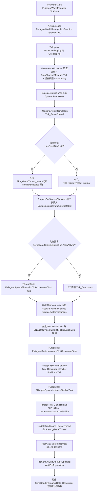

要点:tick 函数在 Init 时按 `NiagaraFirstTickGroup..NiagaraLastTickGroup` 共 NiagaraNumTickGroups 组 × 2 pass 注册(Overlapping pass 的 EndTickGroup=TG_LastDemotable,并 AddPrerequisite 依赖前一 pass),见 NiagaraWorldManager.cpp:447-469;当某 pass 无模拟时动态 SetTickFunctionEnable(false)(cpp:1829-1833)。

### 16.6.2 Niagara GPU 模拟(渲染线程侧)

依据:Private/NiagaraGpuComputeDispatch.cpp(PreInitViews:1901/2071、PostInitViews:2109/2119、PostRenderOpaque:2134/2191、ExecuteTicks:1100、DispatchStage:1475、ProcessPendingTicksFlush:404-427)。

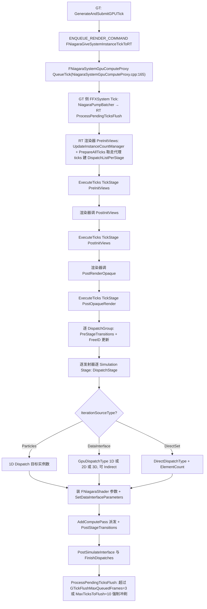

### 16.6.3 PCG 组件生成全流程

依据:Private/PCGComponent.cpp(GenerateInternal:544、CreateGenerateTask:580、PostProcessGraph:627)、Private/Graph/PCGGraphExecutor.cpp(Schedule:392、ExecuteScheduling:1857、管线注释:2144-2186)。

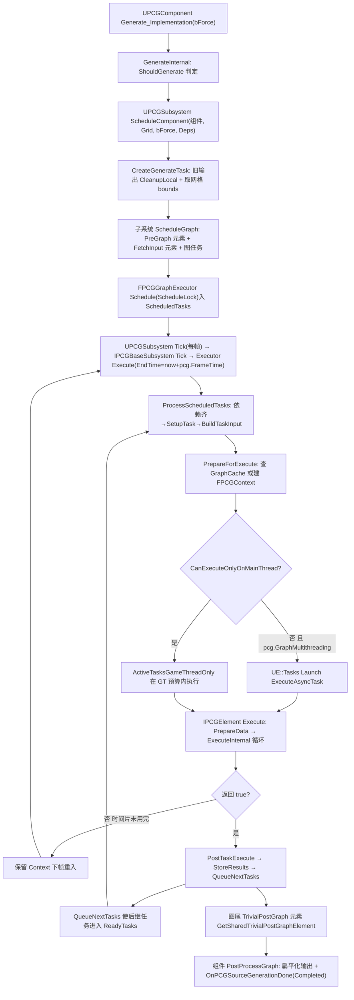

### 16.6.4 PCG 任务状态机

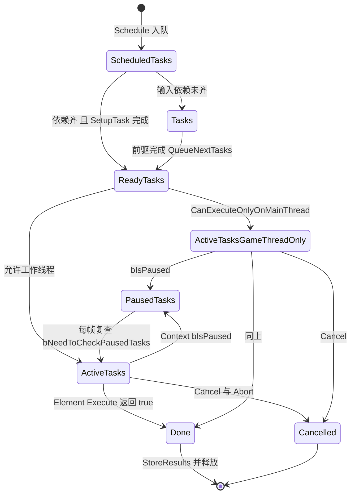

### 16.6.5 交互工具生命周期(Modeling Tools)

依据:Private/InteractiveToolManager.cpp(ActivateTool:141、ActivateToolInternal:191、DeactivateToolInternal:296)、Public/InteractiveTool.h。

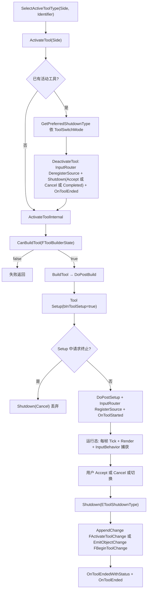

### 16.6.6 VectorVM CPU 脚本执行

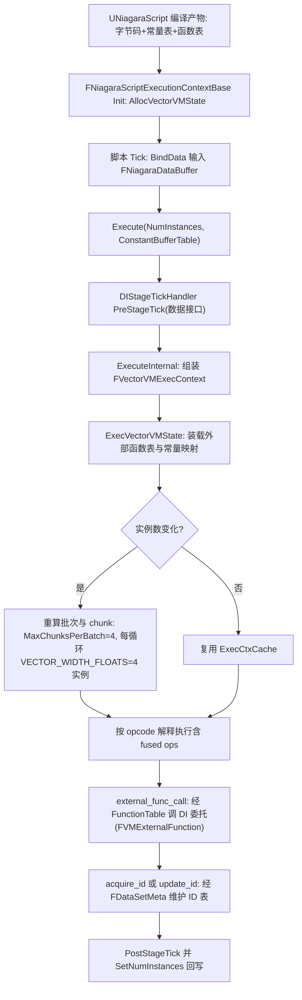

## 16.7 时序图

### 16.7.1 Niagara CPU 模拟一帧(GT 与 TaskGraph 协作)

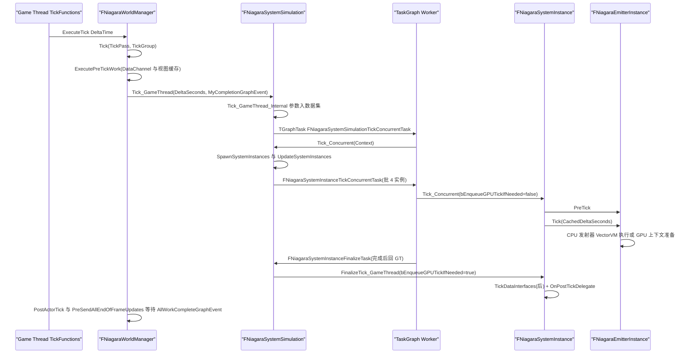

判定依据:Tick_GameThread_Internal 内 `check(IsInGameThread())`(NiagaraSystemSimulation.cpp:1154);并发任务线程由 NiagaraSimulationTaskPriority::GetTickGroupPriority 决定(NiagaraSimulationTaskPriority.cpp:180-199);Finalize 任务通过 TGraphTask 建立在实例并发完成事件之上(cpp:1032-1036)。

### 16.7.2 Niagara GPU Tick 提交与渲染线程派发

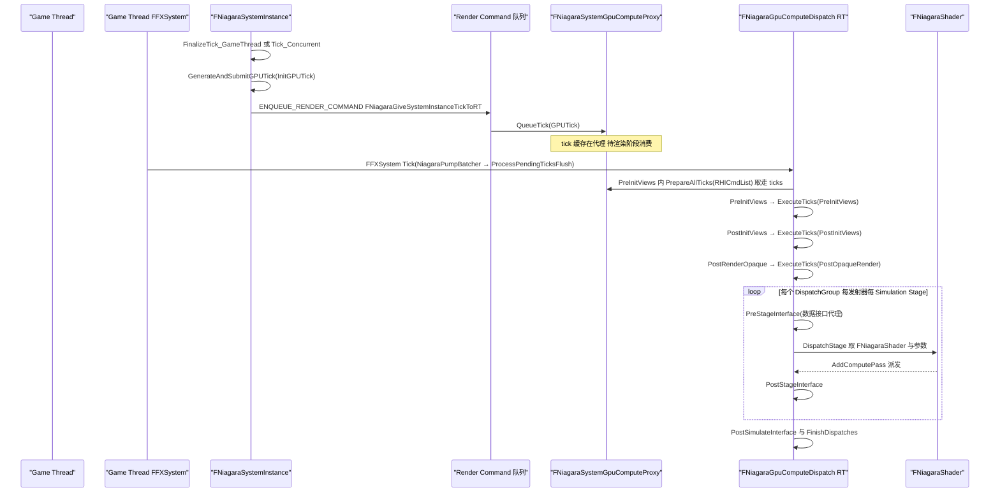

### 16.7.3 PCG 一次生成(子系统与执行器与元素)

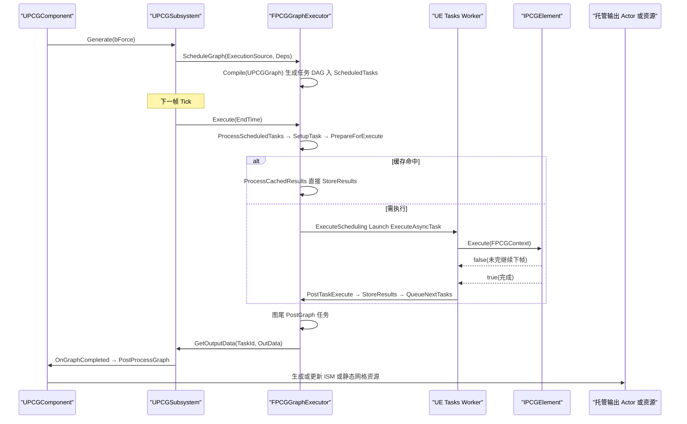

### 16.7.4 建模工具激活与关闭(编辑器)

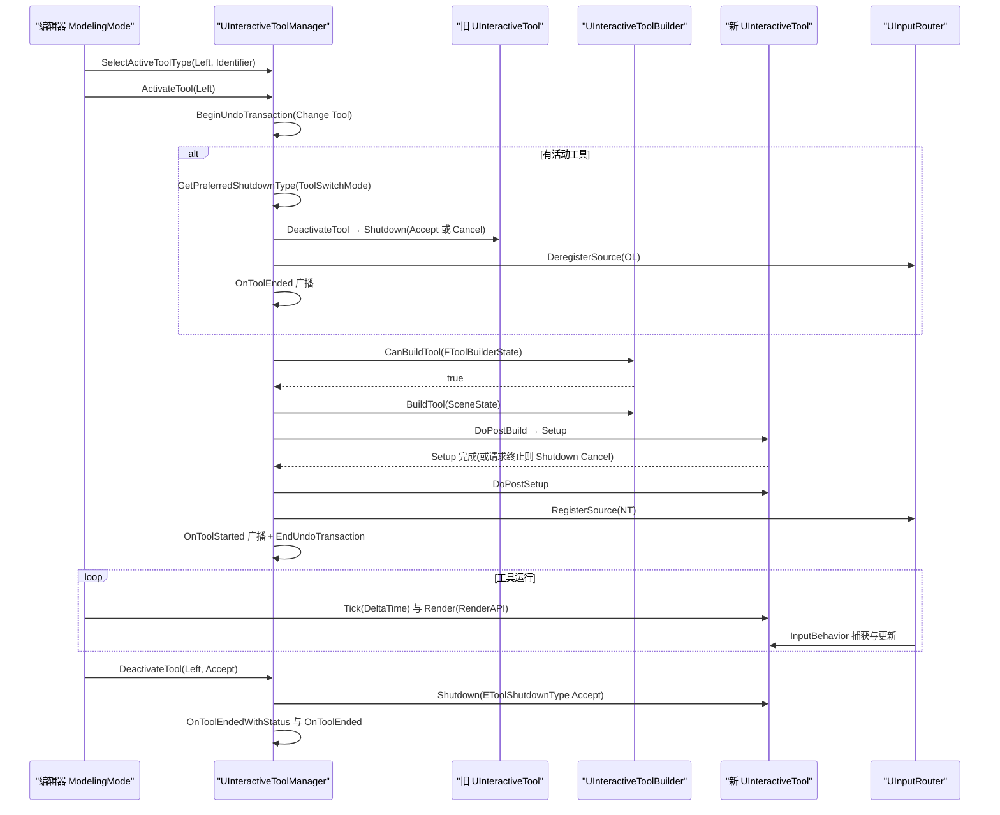

## 16.8 线程模型与同步

### 16.8.1 Niagara

| 环节 | 线程 | 判定依据与同步原语 |
| --- | --- | --- |
| FNiagaraWorldManager::Tick 全链(ExecutePreTickWork/ExecuteSimulations/ExecutePostTickWork) | GameThread | 经 FTickFunction(FNiagaraWorldManagerTickFunction::ExecuteTick,NiagaraWorldManager.cpp:379);Tick_GameThread_Internal 内 check(IsInGameThread())(NiagaraSystemSimulation.cpp:1154) |
| 系统模拟第二阶段 Tick_Concurrent | TaskGraph 工作线程 | TGraphTask<FNiagaraSystemSimulationTickConcurrentTask>(cpp:312-341),GetDesiredThread=GetTickGroupPriority(...),即 fx.Niagara.TaskPriorities.*(High/Normal/Low/Background 四档,默认 Normal=HighThreadPriority+NormalTaskPriority,NiagaraSimulationTaskPriority.cpp:40-47) |
| 实例并发批 | TaskGraph 工作线程 | FNiagaraSystemInstanceTickConcurrentTask(cpp:380-446);批大小 GNiagaraSystemSimulationTickBatchSize 初值 4(fx.Niagara.SystemSimulation.TickBatchSize,cpp:104-110);ConcurrentBatched GPU 模式下批内收集 GPUTicks 一次 ENQUEUE_RENDER_COMMAND(cpp:403-431) |
| 实例收尾 Finalize | 回到 GameThread | FNiagaraSystemInstanceFinalizeTask(cpp:449)GetDesiredThread()=ENamedThreads::GameThread 且 check(CurrentThread==GameThread)(cpp:474-475);FinalizeTick_GameThread 内 check(ConcurrentTickGraphEvent->IsComplete())(NiagaraSystemInstance.cpp:2847-2850) |
| 完成事件 | TaskGraph 事件 | AllWorkCompleteGraphEvent 收集所有 Finalize 任务;PreSendAllEndOfFrameUpdates/WaitForAsyncWork 等待(NiagaraWorldManager.cpp:1551,1133);世界管理器亦把 EventsToWaitFor 挂 DontCompleteUntil(cpp:300-305) |
| GPU Tick 传递 | GT→RT | ENQUEUE_RENDER_COMMAND(FNiagaraGiveSystemInstanceTickToRT)(NiagaraSystemInstance.cpp:2909;NiagaraSystemSimulation.cpp:421);FNiagaraSystemGpuComputeProxy 归渲染线程所有 |
| GPU 数据双缓冲与计数 | 渲染线程写,GT 原子读 | FNiagaraComputeExecutionContext::DataBuffers_RT[2](仅 RT),ParticleCountReadFence/WriteFence 与 CurrentNumInstances_RT 为 std::atomic(NiagaraComputeExecutionContext.h:199-243) |
| 数据接口实例数据 | GT 写/RT 消费 | ProvidePerInstanceDataForRenderThread 打包入 FNiagaraGPUSystemTick,RT 端 ConsumePerInstanceDataFromGameThread(NiagaraDataInterface.h:665,406) |
| 内存屏障 | 实例批并发可见性 | FlushTickBatch 中 FPlatformMisc::MemoryBarrier() 确保 ConcurrentTickBatchGraphEvent 先于清除(cpp:1028) |

### 16.8.2 PCG

| 环节 | 线程 | 判定依据与同步原语 |
| --- | --- | --- |
| UPCGSubsystem::Tick 与 Executor::Execute | GameThread | UTickableWorldSubsystem(Subsystem.h:77,106);Execute 注释"NOT THREADSAFE"(PCGGraphExecutor.h:140) |
| Schedule/Compile | 任意线程 | 注释"This call is threadsafe",ScheduleLock 保护 ScheduledTasks(PCGGraphExecutor.h:295-298) |
| 任务调度 ProcessScheduledTasks/ExecuteScheduling | GT + worker 机会式 | worker 仅 TryLock,失败即跳过(源码注释 PCGGraphExecutor.cpp:2149-2167);LiveTasksLock 保护 Ready/Active/Paused(h:306-311);锁分级:ScheduleLock(1)>TasksLock(2)>LiveTasksLock(3)>各叶级锁(h:295-345) |
| 元素执行 | UE::Tasks worker | UE::Tasks::Launch(PCGGraphExecutor.cpp:2076);并发上限受 pcg.Runtime.MaxPercentageOfThreadsToUse(0.9)、MaxPercentageOfExecutingThreads(0.3)、MaxExecutingThreads(8)约束(cpp:51-69);ActiveTasks 内首任务常在 GT 预算内直跑 |
| 结果回传 | 消费线程(可选) | FPostTaskExecuteConsumerThread(FRunnable+TMpscQueue),默认关闭 pcg.Runtime.EnablePostExecuteConsumerThread=false(cpp:70-78) |
| 元素内并行 | PCGAsync(FPCGAsyncState) | AsyncState.NumAvailableTasks = max(1, MaxPCGAsyncThreads)(cpp:2070);时间片 EndTime 控制重入 |
| GT 专用任务 | GameThread | CanExecuteOnlyOnMainThread(元素声明,如 FPCGFetchInputElement/FPCGPreGraphElement/FPCGComputeGraphElement/FPCGGridLinkageElement 均 true,PCGGraphExecutor.h:404,426;PCGComputeGraphElement.h:139) |

### 16.8.3 其余子系统

| 子系统 | 线程 | 说明 |
| --- | --- | --- |
| VectorVM | 调用线程 | ExecVectorVMState 无内部并行;并行度来自多个系统实例/发射器在不同 task 上同时执行 |
| InteractiveToolsFramework | GameThread | 工具激活/关闭/Tick/Render 均由编辑器在主线程驱动(ActivateToolInternal/DeactivateToolInternal 调用链无跨线程派发) |
| GeometryCore 算法 | 任意线程 | FDynamicMesh3 非线程安全,调用方保证独占;建模工具用 FDynamicMeshOperator 在后台线程跑算子 |
| CableComponent | GameThread | 组件 TickComponent 内 SolveConstraints |
| HairStrands | GT 提交 + RT 求解 | FGroomManager 在渲染线程组织 RDG 求解(Private/GroomManager.h) |
| Water | GT 更新 + RT SceneProxy | UWaterMeshComponent:UMeshComponent,RT 持水网 proxy(WaterMeshComponent.h:19) |
| GeometryFlow 后台 | worker 线程 | FBackgroundCompute 类后台计算(GeometryFlowCore) |

## 16.9 配置与扩展点

### 16.9.1 控制台变量(实测源码)

| CVar | 默认 | 作用 | 位置 |
| --- | --- | --- | --- |
| fx.Niagara.TaskPriorities.High/Normal/Low/Background | 四档定义 | 任务线程/任务优先级档位;默认各 tick group 与 PostActorTick 都取 Normal(索引 1,Initialize 时置 1) | Private/NiagaraSimulationTaskPriority.cpp:40-47,160-172 |
| fx.Niagara.TaskPriorities.TickGroupPriority | 字符串 | 按 tick group 覆盖优先级,如 TG_PrePhysics:2 | 同上:80-87 |
| fx.Niagara.TaskPriorities.PostActorTickPriority | 1 | post-actor-tick 任务优先级 | 同上:21-27 |
| fx.Niagara.SystemSimulation.UpdateOnSpawn / AllowASync / AllowASyncSimCache | 1 / 1 / 1 | 生成即小步更新 / 系统模拟 tick 并行化 / SimCache tick 并行化 | Private/NiagaraSystemSimulation.cpp:73-97 |
| fx.Niagara.SystemSimulation.TaskStallTimeout | 0 | 任务停滞超时告警(秒) | 同上:97 |
| fx.Niagara.SystemSimulation.TickBatchSize / TickBatchMode | 4 / 1 | 实例批大小与批执行模式(0=任务化,1=最后一批内联,2=全内联) | 同上:104-124 |
| fx.Niagara.SystemSimulation.ConcurrentGPUTickInit / BatchGPUTickSubmit | 1 / 1 | GPU tick 允许并发段初始化 / 允许打包提交到渲染线程 | 同上:125-137 |
| Niagara GPU 队列冲刷(变量 GTickFlushMaxQueuedFrames/GTickFlushMaxPendingTicks) | 3 / 10 | RT 未消费 tick 的帧/数量上限 | Private/NiagaraGpuComputeDispatch.cpp:104-115 |
| pcg.FrameTime | 5.0(ms) | 每帧 PCG 时间片 | Private/Graph/PCGGraphExecutor.cpp:82-85 |
| pcg.GraphMultithreading | true | 图级多任务派发 | 同上:87-91 |
| pcg.Runtime.MaxProcessingTasks | 4096 | 并发任务上限 | 同上:51-54 |
| pcg.Runtime.MaxPercentageOfThreadsToUse / MaxPercentageOfExecutingThreads / MaxExecutingThreads | 0.9 / 0.3 / 8 | 线程占比与硬顶 | 同上:56-69 |
| pcg.Runtime.EnablePostExecuteConsumerThread / PostExecuteConsumerThreadTime | false / 5.0(ms) | 消费线程开关与让出时间 | 同上:70-78 |

### 16.9.2 扩展点

| 扩展点 | 机制 | 源码依据 |
| --- | --- | --- |
| 自定义数据接口 | 继承 UNiagaraDataInterface:GetFunctions 暴露函数、PreStageTick/PostStageTick 参与 CPU stage、Proxy 的 PreStage/PostStage/PostSimulate 参与 GPU stage | Classes/NiagaraDataInterface.h:584,636-639,882;Proxy 段 406-418 |
| Simulation Stage | UNiagaraSimulationStageBase(NumIterations、DirectDispatchType、IterationSource 绑定) | Public/NiagaraSimulationStageBase.h:19,83,143 |
| PCG 自定义节点 | UPCGSettings 派生重写 CreateElement 返回 IPCGElement;元素 ExecuteInternal 重入直至完成;FPCGGenericElement 提供回调式扩展 | Public/PCGElement.h:139-259;PCGSettings.h |
| PCG 互通 | Interop 插件模式(PCGGeometryScriptInterop/PCGNiagaraInterop/PCGWaterInterop 等) | Plugins/PCGInterops、Plugins/Experimental/PCGInterops |
| GPU PCG | UPCGComputeKernel(UComputeKernel)与 UPCGComputeDataProvider,FPCGComputeGraphElement 把 GPU 节点折叠为 ComputeFramework 图 | Public/Compute/PCGComputeKernel.h:101;Private/Compute/Elements/PCGComputeGraphElement.h:109 |
| 交互工具 | UInteractiveToolBuilder+UInteractiveTool 注册到 UInteractiveToolManager;FInteractiveToolActionSet 注册工具动作 | InteractiveTool.h:615;InteractiveToolActionSet.h |
| 几何脚本 | UGeometryScriptLibrary_* 蓝图函数库(GeometryScriptingCore) | Plugins/Runtime/GeometryScripting/Source/GeometryScriptingCore |
| Dataflow 节点 | struct FDataflowNode(TSharedFromThis)派生+注册(Runtime/Dataflow/Core) | Source/Runtime/Dataflow/Core/Public/Dataflow/DataflowNode.h:58 |
| 水体扩展 | UWaterBodyCustomComponent、GerstnerWaterWaves 自定义波源、WaterBodyExclusionVolume | Plugins/Experimental/Water/Source/Runtime/Public |
| 纹理图 | TG_Expression 蓝图节点集(TextureGraph) | Plugins/TextureGraph/Source/TextureGraph/Public/Expressions |

## 16.10 已知限制/未确认项

1. **EditableMesh 已退化**:`Plugins/Runtime/EditableMesh` 在 5.8.3 仅剩 3 个头文件(EditableMeshTypes.h 与两个 Adapter),无 .Build.cs、无实现模块;历史上的 UEditableMesh 组件体系未在源码中出现,附录将其归入 NoModule(_nomodule__Plugins__Plugins__Runtime__EditableMesh__Source.md)。本章不为其展开设计。
2. **Volumetrics 与 WaterExtras 为纯内容插件**:目录内只有 uplugin/Config/Shaders,无 Source 模块;其行为(蓝图/Niagara 内容)无法从 C++ 源码层面分析。
3. **Water 插件位于 Experimental 且路径为 Plugins/Experimental/Water**:与任务描述一致;Water 的渲染细节(四叉树 GPU 网格 WaterQuadTreeGPU.h、WaterInfoRendering)只读了头文件名与关键类声明,未逐行核对四叉树生成算法。
4. **HairStrands 求解器细节未展开**:FGroomManager/各 solver pass 在 Private/GroomManager.h 中体量巨大,本章只确认了模块划分(7 个 Source 模块)、UGroomSolverComponent 继承 IDataflowPhysicsSolverInterface 与 RT 管理器归属,未逐 pass 分析 RDG 图。
5. **NiagaraShader 编译管线未深入**:FNiagaraShaderMap/FNiagaraShaderMapId 的着色器 permutation 生成、HLSL 交叉编译细节属于第 7/8 章渲染编译主题,此处只引用其运行时接口(GetDefaultThreadGroupSize 等)。
6. **Cascade(Particles 132 头)按存量系统处理**:本章仅登记其边界与 FFXSystemInterface 关系,逐模块设计(UParticleModule 子族)未展开——它是被 CascadeToNiagaraConverter 迁出方向的遗留系统。
7. **TextureGraph 执行模型未画图**:TG_Expression/Tex 求值属于资产烘焙工具流,与运行时帧管线耦合弱,仅在模块表与扩展点登记;TextureGraphEngine 的 GPU 求值路径未读实现。
8. **GeometryFlow/GeometryDataflow 只确认了模块与节点注册框架**(GeometryFlowCoreNodeRegistration.h、FDataflowNode),后台计算调度(FBackgroundCompute)仅按注释与头文件结论记入 16.8.3,未核对实现。
9. **PCG HiGen(分层生成)与 RuntimeGen 调度**仅描述到 FPCGGridLinkageElement/PCGHiGenGrid 与 FPCGRuntimeGenScheduler 的存在与线程约束,分区/网格分层的完整算法未展开。
10. **ChaosNiagara、PCGFastGeoInterop 等边缘互通插件**仅在模块表登记,未读实现。
11. `FXBudget.h`(Engine Particles)与 FParticlePerfStats 的预算统计链未展开,只在 Niagara 线程优先级处引用 FParticlePerfStats 对优先级的影响。
12. Mermaid 类图中 `TMeshAABBTree3~FDynamicMesh3` 的泛型写法为示意(实际模板参数为 TriangleMeshType);16.3.3 图中 `UDynamicMeshComponent <|-- UWaterMeshComponent` 与 `UGroomComponent ..> FDynamicMesh3` 两条关系边为"族属/烘焙路径示意",真实基类:UWaterMeshComponent : UMeshComponent(WaterMeshComponent.h:19)、UGroomComponent : UMeshComponent + ILODSyncInterface + INiagaraPhysicsAssetDICollectorInterface(GroomComponent.h:29)。除注明的示意边外,图内类名与方法名均在源码中检索确认过。

## 16.11 附录索引

本章覆盖模块对应的符号清单附录(相对本章文件位于 `../appendix/api/`):

| 模块 | 附录文件 |
| --- | --- |
| VectorVM | Runtime/VectorVM.md |
| GeometryCore | Runtime/GeometryCore.md |
| GeometryFramework | Runtime/GeometryFramework.md |
| MeshConversion / MeshConversionEngineTypes | Runtime/MeshConversion.md、Runtime/MeshConversionEngineTypes.md |
| MeshDescription / StaticMeshDescription / SkeletalMeshDescription | Runtime/MeshDescription.md、Runtime/StaticMeshDescription.md、Runtime/SkeletalMeshDescription.md |
| InteractiveToolsFramework | Runtime/InteractiveToolsFramework.md |
| MRMesh | Runtime/MRMesh.md |
| Niagara / NiagaraCore / NiagaraShader | Plugins/Niagara.md、Plugins/NiagaraCore.md、Plugins/NiagaraShader.md(大模块分 part 见附录目录) |
| NiagaraVertexFactories / NiagaraAnimNotifies / NiagaraBlueprintNodes | Plugins/NiagaraVertexFactories.md、Plugins/NiagaraAnimNotifies.md、Plugins/NiagaraBlueprintNodes.md |
| NiagaraFluids / NiagaraSimCaching(+Editor) / NiagaraMRQ / NiagaraInsights / NiagaraUIRenderer / NiagaraToolsets / NiagaraNanite(+Editor/+Shader) | Plugins/NiagaraFluids.md、Plugins/NiagaraSimCaching.md、Plugins/NiagaraSimCachingEditor.md、Plugins/NiagaraMRQ.md、Plugins/NiagaraInsights.md、Plugins/NiagaraUIRenderer.md、Plugins/NiagaraToolsets.md、Plugins/NiagaraNanite.md、Plugins/NiagaraNaniteEditor.md、Plugins/NiagaraNaniteShader.md |
| CascadeToNiagaraConverter / ChaosNiagara | Plugins/CascadeToNiagaraConverter.md、Plugins/ChaosNiagara.md |
| PCG / PCGEditor / PCGCompute | Plugins/PCG.md、Plugins/PCGEditor.md、Plugins/PCGCompute.md |
| PCG Interops(全部) | Plugins/PCGGeometryScriptInterop.md、Plugins/PCGExternalDataInterop.md、Plugins/PCGPythonInteropEditor.md、Plugins/PCGNiagaraInterop.md、Plugins/PCGWaterInterop.md、Plugins/PCGInstancedActorsInterop.md、Plugins/PCGFastGeoInterop.md、Plugins/PCGNaniteAssembliesInterop.md、Plugins/PCGMeshPartitionInterop.md、Plugins/PCGMeshPartitionInteropEditor.md |
| PCGBiomeCore / PCGPrimitives | Plugins/PCGBiomeCore.md;PCGPrimitives 无独立附录符号清单 |
| GeometryProcessing(DynamicMesh/GeometricObjects/GeometryAlgorithms/MeshFileUtils) | Plugins/DynamicMesh.md、Plugins/GeometryAlgorithms.md、Plugins/MeshFileUtils.md(NoModule 汇总 NoModule/_nomodule__Plugins__Plugins__Runtime__GeometryProcessing__Source.md;GeometricObjects 无独立附录) |
| GeometryScriptingCore / Editor | Plugins/GeometryScriptingCore.md、Plugins/GeometryScriptingEditor.md |
| MeshModelingToolset 全模块 | Plugins/MeshModelingTools.md、Plugins/MeshModelingToolsExp.md、Plugins/MeshModelingToolsEditorOnly.md、Plugins/MeshModelingToolsEditorOnlyExp.md 等(见附录目录 MeshModeling* 与 SkeletalMeshModifiers.md) |
| GeometryCache 家族 | Plugins/GeometryCache.md、Plugins/GeometryCacheEd.md、Plugins/GeometryCacheSequencer.md、Plugins/GeometryCacheStreamer.md、Plugins/GeometryCacheTracks.md |
| ProceduralMeshComponent / CustomMeshComponent / CableComponent | Plugins/ProceduralMeshComponent.md、Plugins/CustomMeshComponent.md、Plugins/CableComponent.md |
| EditableMesh | NoModule/_nomodule__Plugins__Plugins__Runtime__EditableMesh__Source.md(NoModule 组) |
| HairStrands 家族 | Plugins/HairStrandsCore.md、Plugins/HairStrandsSolver.md、Plugins/HairStrandsEditor.md、Plugins/HairStrandsDeformer.md、Plugins/HairStrandsDataflow.md 等 |
| GeometryFlow / GeometryDataflow / Dataflow | Plugins/GeometryFlowCore.md、Plugins/GeometryFlowMeshProcessing.md、Plugins/GeometryDataflowNodes.md、Plugins/DataflowEnginePlugin.md、Plugins/DataflowNodes.md、Plugins/DataflowEditor.md(DataflowCore 运行时模块在 Runtime/DataflowCore.md) |
| Water / WaterAdvanced / Landmass / VirtualHeightfieldMesh / DynamicWind / Volumetrics | Plugins/Water.md、Plugins/WaterEditor.md、Plugins/WaterAdvanced.md、Plugins/Landmass.md、Plugins/LandmassEditor.md、Plugins/VirtualHeightfieldMesh.md、Plugins/DynamicWind.md(Volumetrics 无源码模块,无附录) |
| TextureGraph 家族 | Plugins/TextureGraph.md、Plugins/TextureGraphEngine.md、Plugins/TextureGraphEditor.md |
| CelestialVault / SunPosition / GeoReferencing / HDRIBackdrop | Plugins/CelestialVault.md、Plugins/SunPosition.md、Plugins/GeoReferencing.md、Plugins/HDRIBackdrop.md |

> 说明:附录中大模块(如 Niagara、PCG)可能拆分为 `<Module>.partNN.md`,上表给出主文件名,续篇请按附录目录同名前缀查找。
