# 17 Sequencer/媒体/XR/虚拟制片

本章覆盖 UE 5.8.3 中"时间轴驱动内容"与"实时制片信号链"两大主题:Sequencer(MovieScene 评估体系)、媒体播放与采集(Media/MediaAssets/MediaUtils 及 Plugins/Media 全家)、XR(HeadMountedDisplay/XRBase/OpenXR/AR/MRMesh/EyeTracker)、虚拟制片(LiveLink、nDisplay、DMX、Compositing、ICVFX、VPUtilities)以及相关实验性插件与外部程序。所有结论均来自对 `$E`(Engine 目录)源码的逐文件阅读,引用格式为 `路径:行号`(相对 `$E`)。

## 17.1 职责、边界与模块清单

### 17.1.1 Runtime 模块

| 模块 | 路径 | 主要依赖(Build.cs) | 职责 |
|---|---|---|---|
| MovieScene | Source/Runtime/MovieScene | Pub: Core,CoreUObject,Engine,InputCore,SlateCore,TimeManagement,UniversalObjectLocator | Sequencer 数据模型(UMovieScene/Track/Section)与实体系统评估引擎(ECS) |
| MovieSceneTracks | Source/Runtime/MovieSceneTracks | Pub: AnimationCore,AudioMixer,BlueprintGraph,Constraints,MovieScene | 内置轨道集:属性/变换/动画/事件/摄像机切换等 40+ 种 Track |
| MovieSceneCapture | Source/Runtime/MovieSceneCapture | Pri: AVIWriter,ImageWriteQueue,Json,RHI | 过场渲染采集:UMovieSceneCapture + 协议(Protocol)框架 |
| LevelSequence | Source/Runtime/LevelSequence | Pub: MovieScene,MovieSceneTracks,TimeManagement,UMG | 关卡级序列资产/播放器/Actor(ULevelSequence/ALevelSequenceActor) |
| CinematicCamera | Source/Runtime/CinematicCamera | Pri: MovieScene,MovieSceneTracks | 电影摄影机:ACineCameraActor/UCineCameraComponent/CameraRig_Rail/Crane |
| Media | Source/Runtime/Media | Pub: Core,RenderCore | 媒体抽象接口层:IMediaPlayer/IMediaSamples/FMediaClock/FMediaTicker |
| MediaAssets | Source/Runtime/MediaAssets | Pub: Media,MediaUtils,AudioMixer,RenderCore | UMediaPlayer/UMediaTexture/UMediaSource/UMediaSoundComponent 等 UObject 资产 |
| MediaUtils | Source/Runtime/MediaUtils | Pub: Media,ImageWrapper | FMediaPlayerFacade:播放器生命周期、时钟分级、样本分发 |
| MoviePlayer | Source/Runtime/MoviePlayer | Pub: Engine,ApplicationCore | 启动/关卡加载影片(IMovieStreamer/IGameMoviePlayer/FDefaultGameMoviePlayer) |
| AVEncoder | Source/Runtime/AVEncoder | Pub: CUDA,Core,RHI,RenderCore | 音视频软/硬件编码器封装(5.4 起废弃,推荐 AVCodecs 插件族) |
| GameplayMediaEncoder | Source/Runtime/GameplayMediaEncoder | Pri: AVEncoder | 基于视口回读的游戏内推流编码器(Ibm 直播) |
| AVIWriter | Source/Runtime/AVIWriter | Pub: Core | DirectShow 风格 AVI 写文件(Windows,采集协议落盘) |
| HeadMountedDisplay | Source/Runtime/HeadMountedDisplay | Pri: RHI,RenderCore,Renderer | XR 抽象:IXRTrackingSystem/IHeadMountedDisplay/IXRCamera/IMotionController |
| EyeTracker | Source/Runtime/EyeTracker | Pri: Engine,InputCore | 眼动追踪接口 IEyeTracker 与功能库 |
| AugmentedReality | Source/Runtime/AugmentedReality | Pub: MRMesh | AR 会话框架:FARSupportInterface/IARSystemSupport/UARSessionConfig |
| MRMesh | Source/Runtime/MRMesh | — | MR 网格重建:UMRMeshComponent + IMRMesh 阻塞队列 |
| LiveLinkInterface | Source/Runtime/LiveLinkInterface | Pub: Core,CoreUObject | LiveLink 公共类型:ILiveLinkClient/ILiveLinkSource/FLiveLinkSubjectKey/Role |
| LiveLinkAnimationCore | Source/Runtime/LiveLinkAnimationCore | Pub: LiveLinkInterface | LiveLink → 动画蓝图/AnimNode 的核心评估类型 |
| LiveLinkMessageBusFramework | Source/Runtime/LiveLinkMessageBusFramework | Pub: LiveLinkInterface,MessagingCommon,Serialization | ILiveLinkProvider/FLiveLinkProvider 消息总线协议端 |

### 17.1.2 Plugins/Runtime 与 Plugins/Animation

| 模块 | 路径 | 主要依赖 | 职责 |
|---|---|---|---|
| XRBase | Plugins/Runtime/XRBase/Source/XRBase | Pub: HeadMountedDisplay,AugmentedReality | XR 公共基类:FXRTrackingSystemBase/FHeadMountedDisplayBase/FDefaultXRCamera/默认 SpectatorScreen |
| OpenXRHMD | Plugins/Runtime/OpenXR/Source/OpenXRHMD | Pub: XRBase,HeadMountedDisplay,VulkanRHI,D3D12RHI | OpenXR 运行时接入:FOpenXRHMD 会话/帧循环/合成层 |
| OpenXRInput | Plugins/Runtime/OpenXR/Source/OpenXRInput | Pub: EnhancedInput | OpenXR 动作/控制器映射(FOpenXRInput) |
| OpenXRAR | Plugins/Runtime/OpenXR/Source/OpenXRAR | Pub: MRMesh | OpenXR AR 扩展:FOpenXRARSystem(锚点/平面/图像跟踪) |
| OpenXRHandTracking | Plugins/Runtime/OpenXR/Source/OpenXRHandTracking | Pub: InputDevice | 手骨架追踪(EXT_hand_tracking) |
| OpenXREyeTracker | Plugins/Runtime/OpenXR/Source/OpenXREyeTracker | Pub: EyeTracker | OpenXR 眼动扩展实现 IEyeTracker |
| AR(插件目录) | Plugins/Runtime/AR(ARUtilities/AppleARKit/…) | — | AR 设备插件集合:ARKit/ARCore 支撑与工具 |
| LiveLink | Plugins/Animation/LiveLink/Source/LiveLink | Pub: LiveLinkInterface,LiveLinkMessageBusFramework | FLiveLinkClient 运行时、消息总线源、Recording |
| LiveLinkComponents | Plugins/Animation/LiveLink/Source/LiveLinkComponents | Pub: LiveLinkInterface | ULiveLinkComponentController/Anim 等 Actor 组件 |
| LiveLinkMovieScene | Plugins/Animation/LiveLink/Source/LiveLinkMovieScene | Pub: MovieScene | LiveLink 轨道/Section(Sequencer 记录与回放) |
| LiveLinkSequencer | Plugins/Animation/LiveLink/Source/LiveLinkSequencer | Pub: LiveLinkComponents,LiveLinkMovieScene | LiveLink 与 Sequencer/Take 联动 |
| LiveLinkHub(插件) | Plugins/Animation/LiveLinkHub/Source/{LiveLinkHub,LiveLinkHubMessaging} | Pub: LiveLinkInterface / LiveLinkMessageBusFramework | LiveLink Hub 桌面程序的全部功能模块(客户端/服务/消息) |

### 17.1.3 Plugins/Media

| 模块 | 路径 | 主要依赖 | 职责 |
|---|---|---|---|
| ElectraPlayerRuntime | Plugins/Media/ElectraPlayer/Source/ElectraPlayerRuntime | Pub: DirectX | FElectraPlayer:HLS/DASH/ISM/本地文件的自适应流播放器(IMediaPlayer 实现) |
| ElectraPlayerFactory | Plugins/Media/ElectraPlayer/Source/ElectraPlayerFactory | — | IMediaPlayerFactory 注册 |
| ElectraPlayerPlugin | Plugins/Media/ElectraPlayer/Source/ElectraPlayerPlugin | — | 插件壳(模块加载/设置) |
| ElectraBase/ElectraHTTPStream | Plugins/Media/ElectraUtil/Source/* | Pub: Core / Core | FMediaRunnable/FMediaThread 线程原语与 HTTP 流读取 |
| ElectraDecoders 及解码器族 | Plugins/Media/ElectraCodecs/Source/ElectraDecoders;Plugins/Media/*DecoderElectra | Pub: DirectX | IElectraDecoder 接口与 H264/H265/AV1/ProRes/DNxHD/HAP/VPx/Opus/Flac/MJPEG 解码实现 |
| ImgMedia | Plugins/Media/ImgMedia/Source/ImgMedia | Pub: MediaAssets,TimeManagement | 图像序列播放器 FImgMediaLoader(异步读盘/mipmap 流送) |
| WmfMedia | Plugins/Media/WmfMedia/Source/WmfMedia | Pub: WmfMediaFactory | Windows Media Foundation 播放器 |
| AvfMedia | Plugins/Media/AvfMedia/Source/AvfMedia | — | Apple AVFoundation 播放器/采集 |
| WebMMedia | Plugins/Media/WebMMedia/Source/WebMMedia | Pub: LibVpx,LibWebM,Vorbis,libOpus | WebM/VPx/Opus 软件播放器 |
| MfMedia / AndroidMedia 等 | Plugins/Media/MfMedia,AndroidMedia… | — | 平台专用旧版播放器(MfMedia 已被 Electra 取代) |
| MediaCompositing | Plugins/Media/MediaCompositing/Source/MediaCompositing | Pub: MovieScene | UMovieSceneMediaTrack/Section:Sequencer 驱动媒体播放 |
| MediaFrameworkUtilities | Plugins/Media/MediaFrameworkUtilities/Source/MediaFrameworkUtilities | Pub: MediaProfile,TimeManagement | UMediaBundle(播放器+纹理+声音打包)与同步采集接口 |
| MediaIOCore | Plugins/Media/MediaIOFramework/Source/MediaIOCore | Pub: Media,MediaAssets,MediaUtils,MovieSceneCapture,RHI | UMediaOutput/UMediaCapture 采集管线与 MediaIOCoreSamples |
| MediaPlate | Plugins/Media/MediaPlate/Source/MediaPlate | Pub: Core | AMediaPlate/UMediaPlateComponent:场景内一块自持播放的媒体面板 |
| MediaProfile | Plugins/Media/MediaProfile/Source/MediaProfile | Pub: Engine | UMediaProfile:按主机替换媒体输出/采集资产 |
| PixelStreaming2 | Plugins/Media/PixelStreaming2/Source/PixelStreaming2 | Pub: AVCodecsCore,PixelCapture,MediaIOCore,PixelStreaming2Core | UE5 PixelStreaming2:IPixelStreaming2Streamer/WebRTC 信令与推流 |
| PixelStreaming2Core | Plugins/Media/PixelStreaming2/Source/PixelStreaming2Core | Pub: PixelCapture,WebRTC | 流核心(IPixelStreaming2Streamer/Streamer.h) |
| PixelCapture | Plugins/Media/PixelCapture/Source/PixelCapture | Pub: MediaIOCore,RHI | 帧格式转换捕获链(RGBA→I420/NV12/I010) |
| NDIMedia | Plugins/Media/NDIMedia/Source/NDIMedia | Pub: MediaAssets,MediaIOCore | NewTek NDI 输入输出(UNDIMediaSource/UNDIMediaCapture) |
| AjaMedia | Plugins/Media/AjaMedia/Source/AjaMedia | Pub: MediaAssets | AJA 采集卡 I/O(SDI) |
| BlackmagicMedia | Plugins/Media/BlackmagicMedia/Source/BlackmagicMedia | Pub: MediaAssets,MediaIOCore,RHI | DeckLink 采集卡 I/O |
| TimecodeSynchronizer | Plugins/Media/TimecodeSynchronizer/Source/TimecodeSynchronizer | Pub: MediaAssets,TimeManagement | UTimecodeSynchronizer(5.0 起废弃,让位 TimedDataMonitor) |
| LinearTimecode | Plugins/Media/LinearTimecode/Source/LinearTimecode | Pub: Media,MediaUtils | ULinearTimecodeComponent 音频口 LTC 解码为时码 |
| MediaMovieStreamer | Plugins/Media/MediaMovieStreamer/Source/MediaMovieStreamer | — | 用媒体框架实现的 IMovieStreamer(启动影片) |

### 17.1.4 虚拟制片、实验性插件与程序

| 模块 | 路径 | 主要依赖 | 职责 |
|---|---|---|---|
| DisplayCluster | Plugins/Runtime/nDisplay/Source/DisplayCluster | Pub: CinematicCamera,DisplayClusterConfiguration,VirtualProduction | nDisplay 核心:集群管理、帧/时间码同步、Cluster Events、根 Actor |
| DisplayClusterConfiguration | Plugins/Runtime/nDisplay/Source/DisplayClusterConfiguration | — | nDisplay .ndisplay 配置资产 |
| DisplayClusterMedia | Plugins/Runtime/nDisplay/Source/DisplayClusterMedia | Pub: Media,MediaAssets,MediaIOCore | nDisplay 媒体输入输出(ICVFX 内屏/外屏视频) |
| DMXRuntime | Plugins/VirtualProduction/DMX/DMXEngine/Source/DMXRuntime | Pub: DMXProtocol,DMXGDTF | UDMXSubsystem/UDMXLibrary/Fixture/Patch 运行时 |
| DMXProtocol(+ArtNet/sACN) | Plugins/VirtualProduction/DMX/DMXProtocol/Source/DMXProtocol{,ArtNet,SACN} | Pub: Core,Projects | IDMXProtocol 接口与 ArtNet/sACN 传输实现 |
| DMXPixelMapping* | Plugins/VirtualProduction/DMX/DMXPixelMapping/Source/DMXPixelMappingCore | Pub: Core | 像素映射:纹理像素 → DMX 通道 → 灯具 |
| Composure | Plugins/Compositing/Composure/Source/Composure | Pub: MediaIOCore,MovieScene,CinematicCamera | 合成元素树:ACompositingElement 输入/变换/输出 pass |
| Composite / CompositeCore | Plugins/Compositing/{Composite,CompositeCore} | Pub: CompositeCore / Engine | 基础合成图(CompElementCore)与 CFR(Chroma关键帧)支持 |
| ICVFX(元插件) | Plugins/VirtualProduction/ICVFX(ICVFX.uplugin) | 依赖集合 | 聚合启用 nDisplay/Composure/CameraCalibration 等的 ICVFX 工作流入口 |
| VPUtilities | Plugins/Experimental/VirtualProductionUtilities/Source/VPUtilities | Pub: CinematicCamera,CineCameraSceneCapture,TimeManagement | AVPGameMode/VPTimecodeCustomTimeStep/VPBookmark 制片工具 |
| CineCameraRigs | Plugins/Experimental/CineCameraRigs/Source/CineCameraRigs | Pub: CinematicCamera,Constraints | ACineCameraRigRail(样条轨道车)与 AttachMount |
| CineCameraSceneCapture | Plugins/Experimental/CineCameraSceneCapture/Source/CineCameraSceneCapture | Pub: OpenColorIO | 电影机 SceneCapture 组件(用于 VP 取景/返送) |
| DaySequence | Plugins/Experimental/DaySequence/Source/DaySequence | Pub: LevelSequence,MovieScene | ADaySequenceActor:世界时间驱动的昼夜序列 |
| ImagePlate | Plugins/Experimental/ImagePlate/Source/ImagePlate | Pub: Engine | AImagePlate/UImagePlateComponent:场景中一块贴图/序列平面 |
| PanoramicCapture | Plugins/Experimental/PanoramicCapture/Source/PanoramicCapture | — | FStereoPanoramaManager:立体全景批量截图 |
| GameplayCameras | Plugins/Cameras/GameplayCameras/Source/GameplayCameras | Pub: CinematicCamera,MovieScene,HeadMountedDisplay | 新一代摄像机资产:UCameraRigAsset/CameraDirector/CameraNode |
| LiveLinkHub(程序) | Source/Programs/LiveLinkHub(LiveLinkHub.uproject)+ LiveLinkHubLauncher | — | 独立 LiveLink 集中管理程序(启动器 + 插件模块组) |
| SwitchboardListener | Source/Programs/SwitchboardListener | — | SwlListener 远程执行守护(被 Switchboard 控制启停 UE 实例) |
| UnrealMultiUserServer | Source/Programs/UnrealMultiUserServer | — | Concert 多用户会话服务器(编辑器 Multi-User 后端) |

> 注:MRMesh、EyeTracker、AugmentedReality 位于 `Source/Runtime` 而非插件;Plugins/Runtime/AR 目录下为 ARUtilities/AppleARKit 等 AR 设备插件。表中"主要依赖"取自各 Build.cs 的 PublicDependencyModuleNames(部分模块仅有 Private 依赖,已注明 Pri)。

## 17.2 总体架构

四条相对独立的子系统纵向贯穿引擎帧循环,通过明确的接口解耦:Sequencer 负责时间轴求值,媒体负责流/纹理,XR 负责姿态与立体渲染,LiveLink/nDisplay 负责外部数据与多机一致。

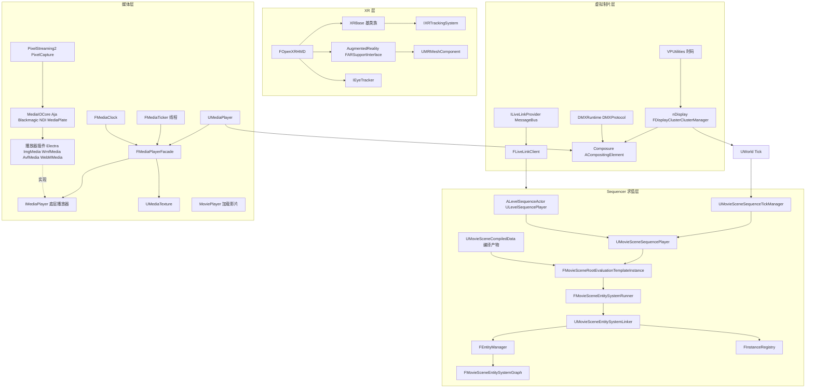

架构要点(自上而下):

1. **Sequencer 是纯求值器**:`UMovieSceneSequencePlayer` 不持有世界状态,每帧把 `FMovieSceneContext`(时间+状态)交给 `FMovieSceneEntitySystemRunner`。Runner 是状态机(`ERunnerFlushState`),驱动 `UMovieSceneEntitySystemLinker`(每世界一个默认 Linker)上的 ECS 管线,由 `FMovieSceneCompiledData`(编译期生成的 `FMovieSceneEvaluationTemplate` + `FMovieSceneSequenceHierarchy` + `FMovieSceneEntityComponentField`)提供静态结构(Compilation/MovieSceneCompiledDataManager.h:86-115)。属性写入最终落到 Track 生成 Entity 的组件上。
2. **媒体层把"解码线程产物"归一到游戏线程时钟**:`FMediaPlayerFacade` 实现 `IMediaClockSink`(TickInput/TickFetch/TickOutput/TickRender 四个时机)与 `IMediaTickable`(FMediaTicker 高频线程),底层 `IMediaPlayer` 由各播放器插件通过 `IMediaPlayerFactory` 提供。视频样本经 sample sink 队列在游戏线程选出,`ENQUEUE_RENDER_COMMAND(MediaTextureResourceRender)` 上传(MediaTexture.cpp:506)。
3. **XR 是横向接口族**:`IXRTrackingSystem`/`IHeadMountedDisplay`/`IXRCamera` 定义在 Runtime/HeadMountedDisplay,XRBase 提供跨设备基类,OpenXR 插件实现帧循环(xrWaitFrame 在 GT,xrBeginFrame/xrEndFrame 在 RHI 线程)。AR/MRMesh/EyeTracker 均挂接在该接口族上。
4. **虚拟制片围绕"共享时钟与集群一致性"**:LiveLink 用 MessageBus 线程收帧、游戏线程出帧;nDisplay 主节点在 `UDisplayClusterGameEngine::Tick` 两端布置 barrier,时间码/对象状态/Cluster Events 逐帧复制到从节点;DMX/Composure/PixelStreaming 在此之上做灯光、合成与远端呈现。

## 17.3 类图

### 17.3.1 Sequencer 核心类图

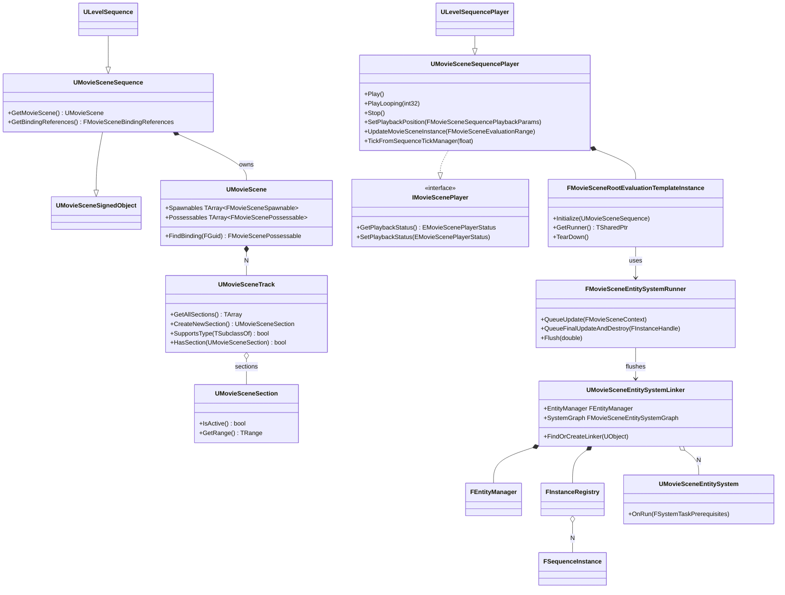

每类一行职责:`UMovieSceneSequence` 序列资产抽象(轨道容器+绑定解析);`ULevelSequence` 关卡序列(带 director/绑定引用);`UMovieScene` 具体时间轴数据(Spawnable/Possessable 绑定);`UMovieSceneTrack`/`UMovieSceneSection` 轨道与激活区间;`IMovieScenePlayer` 播放上下文契约;`UMovieSceneSequencePlayer` 时间推进与求值入口;`FMovieSceneRootEvaluationTemplateInstance` 根模板实例(编译数据+实例注册表+Runner 的组合根);`FMovieSceneEntitySystemRunner` 帧内分阶段状态机;`UMovieSceneEntitySystemLinker` ECS 世界;`FEntityManager` 组件存储;`FInstanceRegistry`/`FSequenceInstance` 运行时序列实例;`UMovieSceneEntitySystem` 按 `ESystemPhase` 参与图执行的子系统。

### 17.3.2 媒体管线类图

```mermaid
classDiagram
  class IMediaPlayer {
    <<interface>>
    +Open(FString, IMediaOptions) bool
    +GetSamples() IMediaSamples
    +GetPlayerFeatureFlag(EFeatureFlag) bool
  }
  class IMediaSamples {
    <<interface>>
    +FetchVideo(TRange) bool
    +PeekVideoSampleTime(FMediaTimeStamp) bool
  }
  class IMediaClockSink {
    <<interface>>
    +TickInput(FTimespan, FTimespan)
    +TickFetch(FTimespan, FTimespan)
    +TickOutput(FTimespan, FTimespan)
    +TickRender(FTimespan, FTimespan)
  }
  class IMediaTickable {
    <<interface>>
    +TickTickable()
  }
  class FMediaPlayerFacade {
    +Open(FString, IMediaOptions) bool
    +AddVideoSampleSink(TSharedRef)
    +TickInput(FTimespan, FTimespan)
    +TickTickable()
  }
  class UMediaPlayer
  class UMediaSource
  class UFileMediaSource
  class UCaptureCardMediaSource
  class UMediaTexture {
    +TickResource(FTimespan)
  }
  class FMediaTextureClockSink
  class FMediaClock {
    +TickInput()
    +TickFetch()
    +TickRender()
    +TickOutput()
  }
  class FMediaTicker {
    +Run() uint32
    +TickTickables()
  }
  class FElectraPlayer
  class FImgMediaPlayer
  class FWmfMediaPlayer
  class FAvfMediaPlayer
  class FWebMMediaPlayer
  class IMovieStreamer {
    <<interface>>
    +Tick(FRHICommandListBase, float) bool
    +Cleanup()
  }
  class FDefaultGameMoviePlayer
  FMediaPlayerFacade ..|> IMediaClockSink
  FMediaPlayerFacade ..|> IMediaTickable
  UMediaPlayer --> FMediaPlayerFacade : owns
  FMediaPlayerFacade --> IMediaPlayer : selects
  FElectraPlayer ..|> IMediaPlayer
  FImgMediaPlayer ..|> IMediaPlayer
  FWmfMediaPlayer ..|> IMediaPlayer
  FAvfMediaPlayer ..|> IMediaPlayer
  FWebMMediaPlayer ..|> IMediaPlayer
  FElectraPlayer --> IMediaSamples : produces
  FMediaTextureClockSink ..|> IMediaClockSink
  FMediaTextureClockSink --> UMediaTexture : ticks
  UMediaTexture --> IMediaPlayer : reads samples
  UMediaPlayer --> UMediaSource : opens
  UFileMediaSource --|> UMediaSource
  UCaptureCardMediaSource --|> UMediaSource
  FMediaClock o-- IMediaClockSink : N
  FMediaTicker --> IMediaTickable : high frequency
  FDefaultGameMoviePlayer --> IMovieStreamer : drives
```

职责:`FMediaPlayerFacade` 是 UObject 层与播放器实现之间的翻译层(选播放器、分发样本、聚合事件);`UMediaPlayer` 是面向蓝图/Sequencer 的播放器资产;`UMediaSource` 描述"从哪播"(文件/采集卡/流);`UMediaTexture` 把视频样本暴露为纹理;`FMediaClock` 按引擎帧四个时机推进所有 sink;`FMediaTicker` 是独立高频线程(5ms);`FElectraPlayer` 等为各平台/协议的 IMediaPlayer 实现;`IMovieStreamer`/`FDefaultGameMoviePlayer` 负责加载期影片(渲染线程 tick 的 FTickableObjectRenderThread,DefaultGameMoviePlayer.h:56)。

### 17.3.3 XR 类图

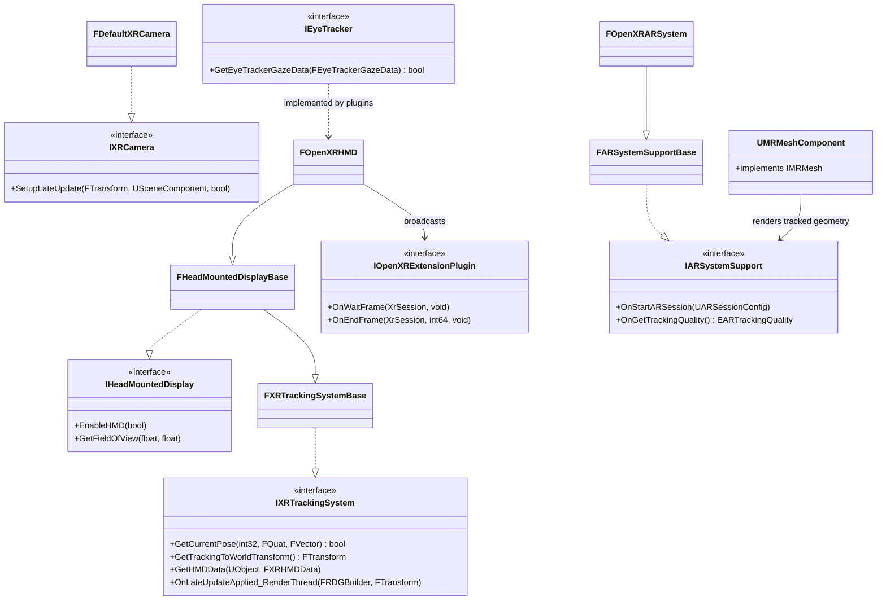

职责:`FXRTrackingSystemBase`(XRTrackingSystemBase.h:28)集中实现设备枚举/姿态换算的公共逻辑;`FHeadMountedDisplayBase`(HeadMountedDisplayBase.h:17)再叠加 `IHeadMountedDisplay`+`IStereoRendering`;`FOpenXRHMD`(OpenXRHMD.h:40)继承两者并混入 `FXRRenderTargetManager`/`FHMDSceneViewExtension` 等;`IOpenXRExtensionPlugin` 是所有 OpenXR 扩展插件的挂点(OnWaitFrame/OnEndFrame 注入 next 链);`FARSupportInterface`(ARSupportInterface.h:28)以 `IARSystemSupport` 实现构造,持有 XR 系统;`UMRMeshComponent`(MRMeshComponent.h:105)接收 MR 网格数据流;`IEyeTracker`(IEyeTracker.h:11)由设备插件以模块特性注册实现。

### 17.3.4 LiveLink / nDisplay 类图

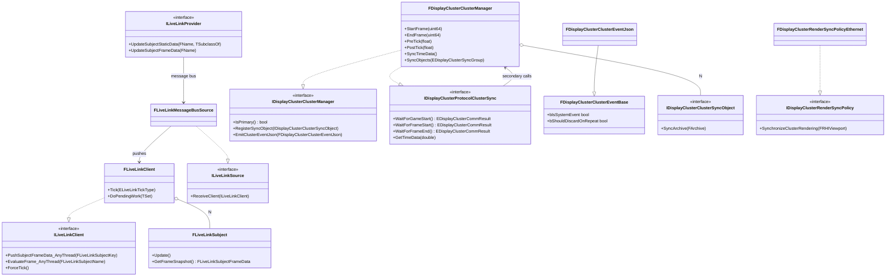

职责:`FLiveLinkClient`(LiveLinkClient.h:48)是 LiveLink 域根(源/主体/虚拟主体),以 `FCoreDelegates::OnSamplingInput` 为默认心跳;`FLiveLinkSubject` 维护帧快照(读多写少锁);`FLiveLinkMessageBusSource` 是"从 MessageBus 收数"的源;`ILiveLinkProvider` 是发送端(编辑器/设备程序);`FDisplayClusterClusterManager` 在主节点充当服务端、从节点充当客户端实现同一接口;`IDisplayClusterClusterSyncObject` 是用户可注册的逐帧同步负载;`IDisplayClusterRenderSyncPolicy`(+Ethernet/Nvidia 实现)负责渲染线程级同步。

## 17.4 数据字典

### 17.4.1 MovieScene 评估体系

| 类型 | 字段/成员 | 类型 | 含义 | 源码位置 |
|---|---|---|---|---|
| ERunnerFlushState | Start | 1<<0 | 评估开始:初始化外部 player/listener 标志 | EntitySystem/MovieSceneEntitySystemRunner.h:40 |
| ERunnerFlushState | ConditionalRecompile | 1<<1 | 序列脏则条件性重编译 | 同上:41 |
| ERunnerFlushState | Import | 1<<2 | 更新序列实例并导入实体 | 同上:42 |
| ERunnerFlushState | ReimportAfterCompile | 1<<3 | 编译后重导入(不常走) | 同上:43 |
| ERunnerFlushState | Spawn | 1<<4 | Spawn 阶段(生成对象、触发 spawn 事件) | 同上:44 |
| ERunnerFlushState | Instantiation | 1<<5 | 实例化阶段(全局实体/结构变更) | 同上:45 |
| ERunnerFlushState | Evaluation | 1<<6 | 求值阶段(动画数据计算,实体管理器锁定) | 同上:46 |
| ERunnerFlushState | Finalization | 1<<7 | 收尾阶段+触发外部事件 | 同上:47 |
| ERunnerFlushState | EventTriggers | 1<<8 | 触发绑定的事件(可重入) | 同上:48 |
| ERunnerFlushState | PostEvaluation | 1<<9 | 调用实例的 PostEvaluation 回调(可重入) | 同上:49 |
| ERunnerFlushState | End | 1<<10 | 复位外部 player/listener | 同上:50 |
| ESystemPhase | Import~Finalization | uint8 位掩码 | 子系统在图中的执行相(None/Import/Spawn/Instantiation/Scheduling/Evaluation/Finalization) | EntitySystem/MovieSceneEntitySystemTypes.h:44-63 |
| FMovieSceneContext | Range(Status 等继承) | FMovieSceneEvaluationRange | 本帧求值区间(时间/上一时间/方向/帧率) | Evaluation/MovieScenePlayback.h:183 |
| FMovieSceneContext | Status | EMovieScenePlayerStatus::Type | Playing/Paused/Scrubbing/Stopped | 同上:186 |
| FMovieSceneContext | HierarchicalBias | int32 | 嵌套子序列层级偏置 | 同上:188 |
| FMovieSceneContext | bHasJumped/bHasLooped | bool | 跳变/循环标记,驱动事件重触发 | 同上:189-190 |
| FMovieSceneContext | bSilent/bSectionPreRoll/bSectionPostRoll | bool | 静默求值、Pre/PostRoll 阶段标志 | 同上:191-194 |
| UMovieScene | Spawnables | TArray&lt;FMovieSceneSpawnable&gt; | 可生成对象模板(GUID→模板) | MovieScene.h:1291 |
| UMovieScene | Possessables | TArray&lt;FMovieScenePossessable&gt; | 占有对象绑定(父绑定/轨道) | MovieScene.h:1295 |
| FMovieSceneEvaluationTemplate | Tracks | TMap&lt;FMovieSceneTrackIdentifier, FMovieSceneEvaluationTrack&gt; | 轨道标识→求值轨道 | Evaluation/MovieSceneEvaluationTemplate.h:277 |
| FMovieSceneEvaluationTemplate | StaleTracks | 同上(瞬态) | 编译期间被淘汰的轨道 | 同上:280 |
| FMovieSceneEvaluationTemplate | SequenceSignature | FGuid | 序列签名 | 同上:285 |
| FMovieSceneEvaluationTemplate | TemplateSerialNumber | FMovieSceneEvaluationTemplateSerialNumber | 每次重新生成 +1 | 同上:289 |
| UMovieSceneCompiledData | EvaluationTemplate | FMovieSceneEvaluationTemplate | 编译产物一:模板 | Compilation/MovieSceneCompiledDataManager.h:104 |
| UMovieSceneCompiledData | Hierarchy | FMovieSceneSequenceHierarchy | 编译产物二:子序列层级 | 同上:108 |
| UMovieSceneCompiledData | EntityComponentField | FMovieSceneEntityComponentField | 编译产物三:实体组件字段(评估场) | 同上:112 |
| FMovieSceneObjectBindingID | Guid + SequenceID | FGuid/FMovieSceneSequenceID | 跨序列定位对象绑定的稳定句柄 | MovieSceneObjectBindingID.h:202 |
| FMovieSceneEvaluationField | Ranges/Groups/MetaData | 数组 | 时间区间→(实体组,元数据) 的评估场 | Evaluation/MovieSceneEvaluationField.h:670 |

### 17.4.2 媒体

| 类型 | 字段/成员 | 类型 | 含义 | 源码位置 |
|---|---|---|---|---|
| FMediaTicker | Stopping | TAtomic&lt;bool&gt; | 线程停止标志 | Private/MediaTicker.h:59 |
| FMediaTicker | WakeupEvent | FEvent* | 唤醒事件(AddTickable 触发) | 同上:68 |
| FMediaPlayerFacade | DesiredPlayerName | FName | 指定底层播放器名(可选) | MediaUtils/Public/MediaPlayerFacade.h:64 |
| FMediaPlayerFacade | TimeDelay | FTimespan | 播放时间偏移(降低当前时间) | 同上:66 |
| FMediaPlayerFacade | CriticalSection | FCriticalSection | 保护 facade 状态(跨 ticker 线程,如 TickTickable) | MediaUtils/Public/MediaPlayerFacade.h:1049 |
| FMediaPlayerFacade | TimeValueLock | FCriticalSection(mutable) | 保护时间值跨线程读写(LastAudioRenderedSampleTime 等) | 同上:1092 |
| IMediaPlayer::EFeatureFlag | UsePlaybackTimingV2 等 | enum class | 播放器能力开关(V2:游戏线程选帧) | Media/Public/IMediaPlayer.h:334 |
| UMediaTexture | SampleQueue | TSharedPtr&lt;FMediaTextureSampleSink&gt; | 视频样本队列(由 facade 注入) | MediaTexture.cpp:577 |
| UMediaTexture | AutoClear/ClearColor | bool/FLinearColor | 无样本时清屏策略 | MediaTexture.cpp:59-62 |
| FMediaTextureResource::FRenderParams | TextureSample/SampleSource/Rate/Time | 复合 | 渲染线程渲染参数(样本或样本源) | MediaTexture.cpp:381-467 |
| IMediaStreamer(加载影片) | Tick(RHICmdList, DeltaTime) | bool | 每帧推进,返回 false 表示影片结束 | MoviePlayer/Public/MoviePlayer.h:90 |

### 17.4.3 LiveLink

| 类型 | 字段/成员 | 类型 | 含义 | 源码位置 |
|---|---|---|---|---|
| FLiveLinkSubjectKey | Source/SubjectName/SubjectUid | FGuid/FName/uint32 | 唯一定位一帧数据的生产者 | LiveLinkInterface/Public/LiveLinkTypes.h:77 |
| FLiveLinkTime | Time/SequenceIdx/SceneTime | FTimespan/int32/FQualifiedFrameTime | 单帧时间戳(多重时钟) | LiveLinkTypes.h:172 |
| FLiveLinkClient | SubjectFrameToPush | TArray&lt;FPendingSubjectFrame&gt; | 任意线程推入、GT 消费的待处理帧队列 | LiveLink/Private/LiveLinkClient.cpp:1178 |
| FLiveLinkClient | PendingFramesCriticalSection | FCriticalSection | 保护上述队列 | 同上:1147 |
| ELiveLinkTickType | Default/Scheduled/Triggered | enum class | UE 常规路径 / Hub 定时器 / GT 外触发的帧到达 | LiveLink/Public/LiveLinkClient.h:33-38 |
| FLiveLinkSubject | FrameSnapshot | FLiveLinkSubjectFrameData | 每帧对外的一致快照(读写锁保护) | LiveLinkSubject.h:261,329 |
| FLiveLinkSubject | CachedTimedDataMonitorInfoCS | FCriticalSection | LiveLink 线程写、GT 读的监视信息 | 同上:318 |

### 17.4.4 nDisplay 集群

| 类型 | 字段/成员 | 类型 | 含义 | 源码位置 |
|---|---|---|---|---|
| EDisplayClusterSyncGroup | PreTick/Tick/PostTick | enum | 对象同步时机三档(引擎 tick 前后) | DisplayCluster/Private/Cluster/DisplayClusterClusterManager.cpp:63-65 |
| FDisplayClusterClusterEventBase | bIsSystemEvent | bool | nDisplay 内部事件(用户不可用) | Cluster/DisplayClusterClusterEvent.h:34 |
| FDisplayClusterClusterEventBase | bShouldDiscardOnRepeat | bool | 同名旧事件是否丢弃 | 同上:37 |
| FDisplayClusterClusterManager | DeltaTimeCache/GameTimeCache/FrameTimeCache | double/TOptional&lt;FQualifiedFrameTime&gt; | 主节点缓存的本帧时间数据 | DisplayClusterClusterManager.cpp:614-621 |
| FDisplayClusterClusterManager | ObjectsToSyncCache | 按 SyncGroup 分组 | 主节点导出的对象序列化数据缓存 | 同上:68-74 |
| EDisplayClusterNodeRole | Primary/Secondary/Backup | enum | 集群角色 | IDisplayClusterClusterManager.h:45-48 |
| FDisplayClusterClusterEventJson | Category/Type/Name/Parameters | FString/TMap | JSON 事件负载 | DisplayClusterClusterEvent.h:53+ |

## 17.5 接口清单

### 17.5.1 MovieScene/Sequencer

| 原型 | 功能 | 参数与返回 | 线程/约束 | 位置 |
|---|---|---|---|---|
| `MOVIESCENE_API virtual void TickFromSequenceTickManager(float DeltaSeconds, FMovieSceneEntitySystemRunner* Runner) override` | 被 TickManager 逐帧调用 | DeltaSeconds 为未暂停 delta,Runner 为本 linker 组的 runner | GameThread(UWorld::Tick→MovieSceneSequenceTick) | MovieSceneSequencePlayer.h:596 |
| `MOVIESCENE_API virtual void UpdateMovieSceneInstance(FMovieSceneEvaluationRange InRange, EMovieScenePlayerStatus::Type PlayerStatus, const FMovieSceneUpdateArgs& Args)` | 构造 Context 并入队求值 | InRange 求值区间,Args 含 bIsAsync/bHasJumped/bHasLooped | GameThread | MovieSceneSequencePlayer.h:537 |
| `MOVIESCENE_API void Play()` / `MOVIESCENE_API void Stop()` | 播放/停止(恢复 PreAnimated 状态) | 无参 | GameThread | MovieSceneSequencePlayer.h:193/220 |
| `MOVIESCENE_API void SetPlaybackPosition(FMovieSceneSequencePlaybackParams PlaybackParams)` | 跳转/刮擦到指定时间 | PlaybackParams(时间、方法 Play/Jump/Scrub) | GameThread | MovieSceneSequencePlayer.h:344 |
| `MOVIESCENE_API void QueueUpdate(const FMovieSceneContext& Context, FInstanceHandle Instance, UE::MovieScene::ERunnerUpdateFlags UpdateFlags = UE::MovieScene::ERunnerUpdateFlags::None)` | 排队一次实例更新 | Context 求值上下文 | GameThread(Flush 内 check) | EntitySystem/MovieSceneEntitySystemRunner.h:93 |
| `MOVIESCENE_API bool QueueFinalUpdateAndDestroy(FInstanceHandle Instance)` | 排队最终更新并销毁实例 | 实例句柄 | GameThread | 同上:102 |
| `MOVIESCENE_API void Flush(double BudgetMs = 0.f, UE::MovieScene::ERunnerFlushState TargetState = UE::MovieScene::ERunnerFlushState::None)` | 冲洗队列执行全部阶段 | BudgetMs=0 表示无预算一次做完 | GameThread(FlushOutstanding check(IsInGameThread()), cpp:531) | 同上:118 |
| `static MOVIESCENE_API UMovieSceneEntitySystemLinker* FindOrCreateLinker(UObject* PreferredOuter, UE::MovieScene::EEntitySystemLinkerRole LinkerRole, const TCHAR* Name = TEXT("DefaultMovieSceneEntitySystemLinker"))` | 查找/创建命名 linker | 返回 linker(UObject) | GameThread | EntitySystem/MovieSceneEntitySystemLinker.h:143 |
| `virtual const TArray<UMovieSceneSection*>& GetAllSections() const` | 枚举轨道全部 Section | 返回数组引用 | 任意(编辑期为主) | MovieSceneTrack.h:539 |
| `virtual bool SupportsType(TSubclassOf<UMovieSceneSection> SectionClass) const` | 该轨道能否挂此 Section 类型 | bool | 任意 | MovieSceneTrack.h:488 |
| `virtual UMovieSceneSection* CreateNewSection()` | 新建 Section(PURE_VIRTUAL) | 返回新 Section | GameThread | MovieSceneTrack.h:532 |
| `virtual FMovieSceneEvalTemplatePtr CreateTemplateForSection(const UMovieSceneSection& InSection) const = 0` | 编译期为 Section 生成求值模板 | 返回模板指针 | 编译线程(序列编译) | Compilation/IMovieSceneTrackTemplateProducer.h:115 |
| `virtual UMovieScene* GetMovieScene() const` | 取序列内 UMovieScene(PURE_VIRTUAL) | 可空 | 任意 | MovieSceneSequence.h:217 |
| `virtual void OnRun(FSystemTaskPrerequisites& InPrerequisites, FSystemSubsequentTasks& Subsequents)` | 系统相执行体 | 由任务图调用 | 依赖系统的任务定义(Evaluation 相为并行) | EntitySystem/MovieSceneEntitySystem.h:239 |

### 17.5.2 媒体播放与采集

| 原型 | 功能 | 参数与返回 | 线程/约束 | 位置 |
|---|---|---|---|---|
| `virtual bool Open(const FString& Url, const IMediaOptions* Options) = 0` | 打开 URL/源 | 返回是否开始打开(异步) | GameThread(实现内部自管理线程) | Media/Public/IMediaPlayer.h:153 |
| `virtual bool FetchVideo(TRange<FMediaTimeStamp> TimeRange, TSharedPtr<IMediaTextureSample, ESPMode::ThreadSafe>& OutSample)` | 按时间区间取视频样本 | bool;另有 TRange&lt;FTimespan&gt; 旧签名(:105) | 由 facade 在 GameThread/Ticker 线程调用 | Media/Public/IMediaSamples.h:109 |
| `virtual bool PeekVideoSampleTime(FMediaTimeStamp& TimeStamp) = 0` | 窥视队首样本时间 | bool | 播放器线程安全实现 | 同上:136 |
| `MEDIAUTILS_API bool Open(const FString& Url, const IMediaOptions* Options, const FMediaPlayerOptions* PlayerOptions = nullptr)` | 选播放器并打开 | PlayerOptions 控制 V2 时序等 | GameThread | MediaUtils/Public/MediaPlayerFacade.h:614 |
| `MEDIAUTILS_API virtual void TickInput(FTimespan DeltaTime, FTimespan Timecode)` | 引擎 tick 开始:驱动底层播放器、处理事件与样本区间 | — | GameThread(UGameEngine::Tick→TickPreEngine) | 同上:842(实现在 cpp:2238) |
| `MEDIAUTILS_API virtual void TickFetch(FTimespan DeltaTime, FTimespan Timecode)` | 引擎 tick 末尾:遗留事件广播 | — | GameThread(TickPostEngine) | 同上:841(cpp:2380) |
| `MEDIAUTILS_API virtual void TickOutput(FTimespan DeltaTime, FTimespan Timecode)` | 渲染后处理(旧时序的最终样本消费) | — | GameThread(FEngineLoop::Tick 末段 TickPostRender) | 同上:843(cpp:2490) |
| `virtual void TickTickable() = 0` | 高频 tick:音频推进与音频样本分发 | — | FMediaTicker 线程(MediaTicker.cpp:38 Run 循环) | Media/Public/IMediaTickable.h:14(实现在 Facade cpp:2508) |
| `void UMediaTexture::TickResource(FTimespan Timecode)` | 选帧并压渲染命令 | — | GameThread(FMediaClock::TickRender 阶段) | MediaAssets/Private/Assets/MediaTexture.cpp:363 |
| `virtual bool Tick(FRHICommandListBase& RHICmdList, float DeltaTime)` | 加载影片每帧推进 | 返回 false 表示播完 | 渲染线程(FDefaultGameMoviePlayer 为 FTickableObjectRenderThread) | MoviePlayer/Public/MoviePlayer.h:90 |
| `virtual void Setup(TSharedRef<FVideoEncoderInput> input, FLayerConfig const& config)` | 初始化编码层 | bool | 编码器线程模型由实现定 | AVEncoder/Public/VideoEncoder.h:67(已废弃) |
| `AVIWRITER_API static FAVIWriter* CreateInstance(const FAVIWriterOptions& InOptions)` | 从选项创建 AVI 写入器 | 返回实例 | GameThread 创建;`Update(double FrameTimeSeconds, TArray<FColor> FrameData)`(同文件:210)提交帧,FCapturedFrames 线程安全 | AVIWriter/Public/AVIWriter.h:176 |

### 17.5.3 XR

| 原型 | 功能 | 参数与返回 | 线程/约束 | 位置 |
|---|---|---|---|---|
| `virtual void EnableHMD(bool bEnable = true)` | 开关 HMD 立体渲染 | — | GameThread | HeadMountedDisplay/Public/IHeadMountedDisplay.h:61 |
| `virtual bool GetCurrentPose(int32 DeviceId, FQuat& OutOrientation, FVector& OutPosition)` | 取设备姿态 | bool | GameThread(编辑器/游戏查询) | IXRTrackingSystem.h:132 |
| `virtual FTransform GetTrackingToWorldTransform() const` | 追踪空间→世界变换 | FTransform | GameThread | 同上:184 |
| `virtual void OnLateUpdateApplied_RenderThread(FRDGBuilder& GraphBuilder, const FTransform& NewRelativeTransform)` | Late Update 应用后通知 | — | RenderThread | 同上:402 |
| `virtual void SetupLateUpdate(const FTransform& ParentToWorld, USceneComponent* Component, bool bSkipLateUpdate)` | 注册 Late Update 组件 | — | GameThread | IXRCamera.h:54 |
| `virtual bool OnStartGameFrame(FWorldContext& WorldContext)`(FOpenXRHMD override) | GT 帧首:poll 事件→xrWaitFrame→更新姿态 | bool | GameThread(OpenXRHMD.cpp:4091,4046) | OpenXRHMD/Private/OpenXRHMD.h:405 |
| `void OnBeginRendering_RHIThread(IRHICommandContext& RHICmdContext, const FPipelinedFrameState& InFrameState, FXRSwapChainPtr ColorSwapchain, FXRSwapChainPtr DepthSwapchain, FXRSwapChainPtr MotionVectorSwapchain, FXRSwapChainPtr MotionVectorDepthSwapchain, FXRSwapChainPtr EmulationSwapchain)` | RHI 线程帧首:xrBeginFrame(4379) | — | RHI 线程(OpenXRHMD.cpp:4329) | OpenXRHMD.cpp:4329 |
| `void OnFinishRendering(IRHICommandContext* RHICmdContext)` | RHI 线程帧尾:提交合成层并 xrEndFrame | — | RHI 线程(cpp:4466,4634) | OpenXRHMD.cpp:4466 |
| `virtual bool GetEyeTrackerGazeData(FEyeTrackerGazeData& OutGazeData) const` | 取注视数据 | bool | GameThread | EyeTracker/Public/IEyeTracker.h:25 |

### 17.5.4 LiveLink

| 原型 | 功能 | 参数与返回 | 线程/约束 | 位置 |
|---|---|---|---|---|
| `UE_API virtual void PushSubjectFrameData_AnyThread(const FLiveLinkSubjectKey& SubjectKey, FLiveLinkFrameDataStruct&& FrameData)` | 源推帧入待处理队列 | — | 任意线程(MessageBus/设备线程) | LiveLinkInterface/Public/ILiveLinkClient.h:123(实现 LiveLink/Private/LiveLinkClient.cpp:1131) |
| `UE_API virtual bool EvaluateFrame_AnyThread(FLiveLinkSubjectName SubjectName, TSubclassOf<ULiveLinkRole> Role, FLiveLinkSubjectFrameData& OutFrame)` | 求值当前帧(读快照) | bool | 任意线程(动画工作线程) | LiveLinkInterface/Public/ILiveLinkClient.h:282 |
| `UE_API virtual void ForceTick()` | 立即处理 pending 帧 | — | GameThread | ILiveLinkClient.h:313(实现 LiveLinkClient.cpp:1879) |
| `virtual bool UpdateSubjectStaticData(const FName SubjectName, TSubclassOf<ULiveLinkRole> Role, FLiveLinkStaticDataStruct&& StaticData, const TMap<FName, FString>& ExtraAnnotations = {})` | 发送端声明主体结构 | bool | 任意线程(序列化后经总线) | LiveLinkMessageBusFramework/Public/LiveLinkProvider.h:56 |
| `virtual bool UpdateSubjectFrameData(const FName SubjectName, FLiveLinkFrameDataStruct&& FrameData, const TMap<FName, FString>& ExtraAnnotations = {})` | 发送端推帧 | bool | 任意线程 | 同上:74 |

### 17.5.5 nDisplay 集群

| 原型 | 功能 | 参数与返回 | 线程/约束 | 位置 |
|---|---|---|---|---|
| `virtual bool IsPrimary() const` / `virtual bool IsSecondary() const` / `virtual bool IsBackup() const` | 集群角色查询 | bool | 任意 | Cluster/IDisplayClusterClusterManager.h:31-39 |
| `virtual void RegisterSyncObject(IDisplayClusterClusterSyncObject* SyncObj, EDisplayClusterSyncGroup SyncGroup)` | 注册逐帧同步对象 | — | GameThread | 同上:60 |
| `virtual void EmitClusterEventJson(const FDisplayClusterClusterEventJson& Event, bool bPrimaryOnly)` | 广播 JSON 集群事件 | — | GameThread | 同上:129 |
| `virtual void EmitClusterEventBinary(const FDisplayClusterClusterEventBinary& Event, bool bPrimaryOnly)` | 广播二进制集群事件 | — | GameThread | 同上:132 |
| `virtual EDisplayClusterCommResult WaitForFrameStart() = 0` | 从节点帧首 barrier | 通信结果 | GameThread(UDisplayClusterGameEngine::Tick 调用,DisplayClusterGameEngine.cpp:380) | Network/Protocol/IDisplayClusterProtocolClusterSync.h:27 |
| `virtual EDisplayClusterCommResult WaitForFrameEnd() = 0` | 从节点帧尾 barrier | 同上 | GameThread(DisplayClusterGameEngine.cpp:405) | 同上:31 |
| `virtual EDisplayClusterCommResult GetTimeData(double& OutDeltaTime, double& OutGameTime, TOptional<FQualifiedFrameTime>& OutFrameTime) = 0` | 从节点拉取主节点时间 | — | GameThread(SyncTimeData→ImportTimeData 写 FApp) | 同上:35 |
| `virtual EDisplayClusterCommResult GetObjectsData(EDisplayClusterSyncGroup InSyncGroup, TMap<FString, TArray<uint8>>& OutObjectsData) = 0` | 从节点拉取同步对象序列化数据 | — | GameThread(SyncObjects) | 同上:39 |
| `virtual EDisplayClusterCommResult GetEventsData(TArray<TSharedPtr<FDisplayClusterClusterEventJson, ESPMode::ThreadSafe>>& OutJsonEvents, TArray<TSharedPtr<FDisplayClusterClusterEventBinary, ESPMode::ThreadSafe>>& OutBinaryEvents) = 0` | 从节点拉取集群事件(JSON+二进制) | — | GameThread(SyncEvents→派发给监听者) | 同上:43 |
| `virtual EDisplayClusterCommResult GetNativeInputData(TMap<FString, TArray<uint8>>& OutNativeInputData) = 0` | 从节点拉取主节点原生输入 | — | GameThread | 同上:47 |
| `virtual EDisplayClusterCommResult PropagateStatesData(const TArray<uint8>& InLocalStatesData, TArray<uint8>& OutClusterStatesData) = 0` | 自定义状态双向传播 | — | GameThread(PreTick 的 SyncStates) | 同上:51 |
| `virtual bool SynchronizeClusterRendering(FRHIViewport* ViewportRHI, int32& InOutSyncInterval) = 0` | 渲染线程集群同步(可选 Present) | bool | RenderThread(由 RHI Present 路径调用) | Render/Synchronization/IDisplayClusterRenderSyncPolicy.h:39 |

## 17.6 关键流程

### 17.6.1 MovieScene 单帧评估链路(FlushNext 状态机)

依据 `FMovieSceneEntitySystemRunner::FlushNext`(MovieSceneEntitySystemRunner.cpp:375-470)源码中的 11 个步骤:

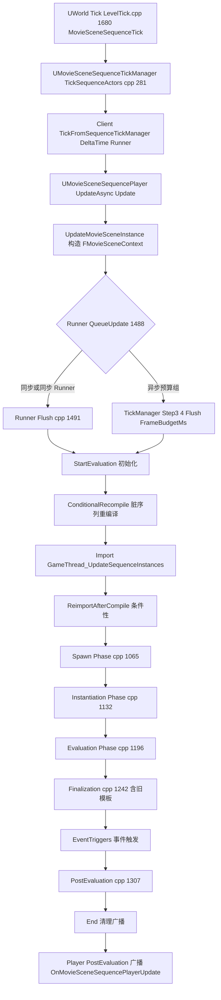

说明:`Import` 阶段由 `GameThread_UpdateSequenceInstances` 完成——序列实例按编译产物 `FMovieSceneEntityComponentField` 中的评估场区间,在当前时间命中的 entry 导入/移除实体;`Evaluation` 相对"快而分布",实体管理器被锁;属性最终写入由 Finalization 相与 execution token 完成(源码注释见 ESystemPhase,MovieSceneEntitySystemTypes.h:44-63)。

### 17.6.2 UMediaTexture 帧上传

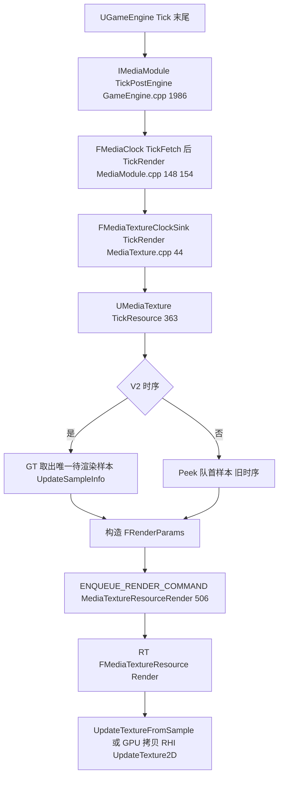

### 17.6.3 nDisplay 一帧(从节点视角)

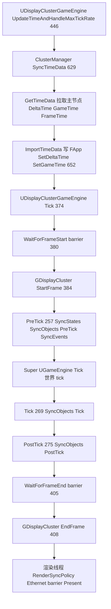

主节点对应流程:同一调用点不等待网络,而是在 `StartFrame` 时 `CacheTimeData`(触发 `TimeDataCacheReadySignal`)、在各 SyncGroup 的 `CacheObjects` 预先导出数据供从节点拉取(DisplayClusterClusterManager.cpp:614,728)。

### 17.6.4 LiveLink 数据入帧

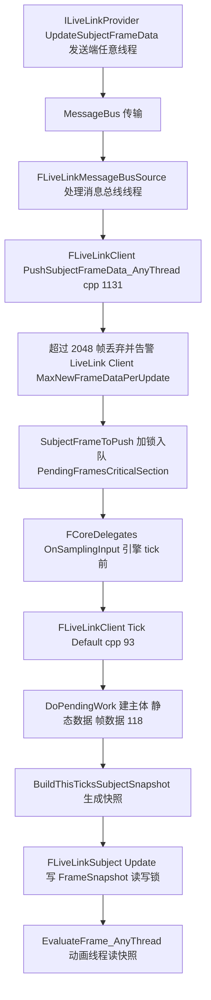

## 17.7 时序图

### 17.7.1 Sequencer 逐帧评估

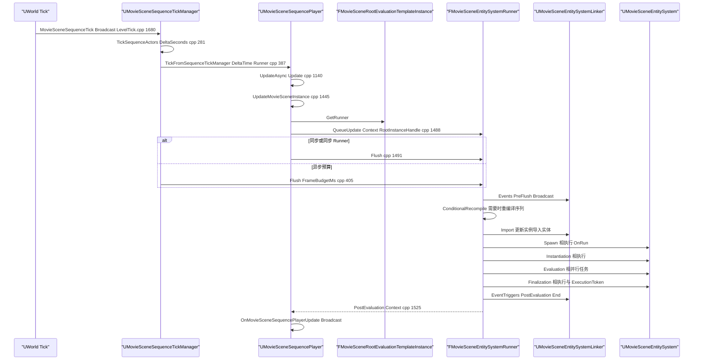

### 17.7.2 媒体播放多线程协作

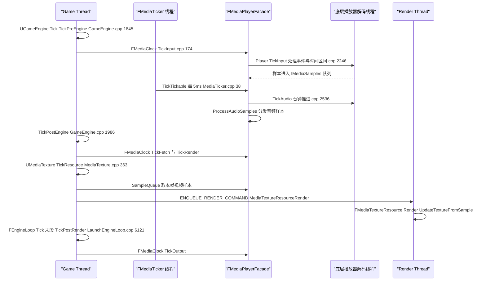

### 17.7.3 OpenXR 帧循环

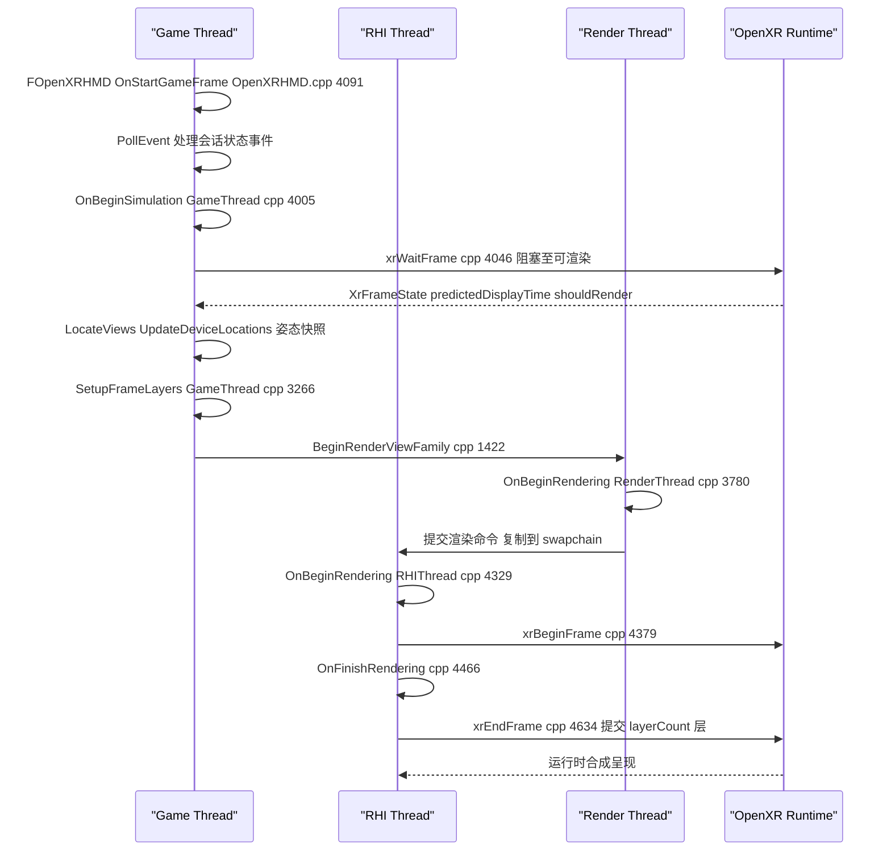

要点:xrWaitFrame 在游戏线程帧首(注释明确说明渲染线程会在 xrBeginFrame 前克隆游戏侧管线状态,OpenXRHMD.cpp:4050-4052);`bUseWaitCountToAvoidExtraXrBeginFrameCalls` 用 WaitCount 防止 LoadMap 期间多余 xrBeginFrame(cpp:4342-4350)。

### 17.7.4 nDisplay 多机一帧同步

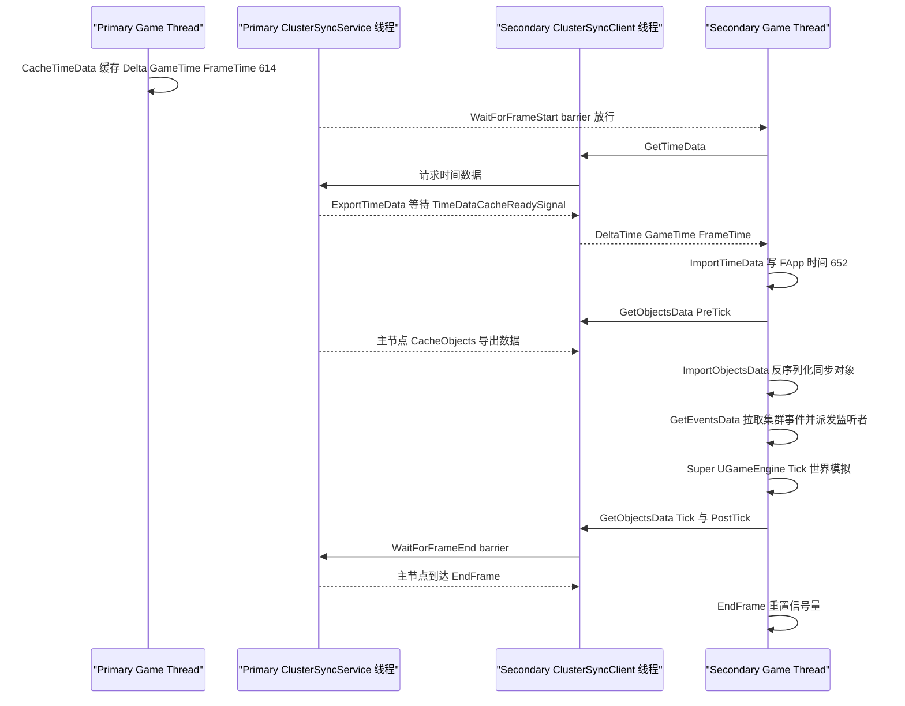

### 17.7.5 LiveLink 帧数据流(线程边界)

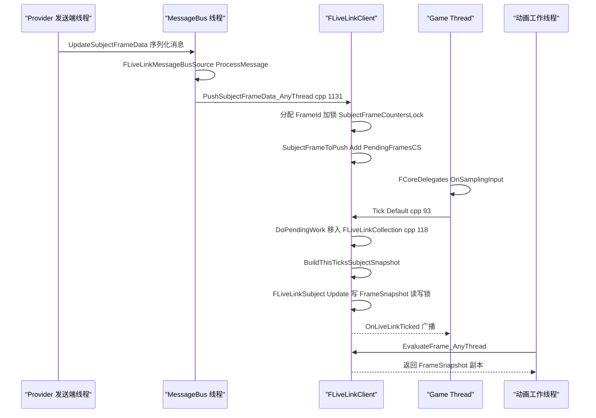

## 17.8 线程模型与同步

| 子系统 | 线程 | 关键证据 | 同步原语 |
|---|---|---|---|
| MovieScene 评估 | 全部阶段在 GameThread | `check(IsInGameThread())`(MovieSceneEntitySystemRunner.cpp:531);注释"需要从游戏线程运行以便触发事件" | FlushState 位图状态机;系统相内 TaskGraph 并行(Evaluation 相),由 FSystemTaskPrerequisites/Subsequents 汇合 |
| MovieScene 编译 | 序列编译可离线/异步 | UMovieSceneCompiledDataManager 管理编译产物(ConditionalRecompile 在 GT 阶段触发) | 编译数据按 FMovieSceneCompiledDataID 索引 |
| 媒体时钟 | FMediaClock 的四阶段都在 GameThread 调用 | GameEngine.cpp:1845/1986、LaunchEngineLoop.cpp:6121、LevelTick.cpp:1688 | FMediaClock::SinkCriticalSection(MediaClock.h) |
| FMediaTicker | 独立线程,5ms 轮询 | MediaTicker.cpp:38-47(Run 循环 + Sleep(0.005f)) | FCriticalSection + FEvent(WakeupEvent) |
| 媒体样本分发 | 播放器解码线程→facade | `bAreEventsSafeForAnyThread || IsInGameThread()`(MediaPlayerFacade.cpp:2252/2388) | facade CriticalSection;样本队列 TQueue/TSampleSink |
| 纹理上传 | GT 选帧→RT 上传 | `ENQUEUE_RENDER_COMMAND(MediaTextureResourceRender)`(MediaTexture.cpp:506) | 渲染命令;FMediaTextureClockSink::CriticalSection |
| 加载影片 | 渲染线程 tick | FDefaultGameMoviePlayer : FTickableObjectRenderThread(DefaultGameMoviePlayer.h:56) | MoviePlayerThreading 的独立线程泵 |
| OpenXR | xrWaitFrame=GT;xrBeginFrame/xrEndFrame=RHI 线程 | OpenXRHMD.cpp:4046/4379/4634;调用点 4272(GT)/4329(RHI) | FPipelinedFrameState 三副本(GT/RT/RHI)+ SessionHandleMutex(FReadScopeLock) |
| LiveLink | 源线程任意;快照构建 GT;消费动画线程 | PushSubjectFrameData_AnyThread(任意);Tick 绑定 OnSamplingInput(GT,LiveLinkClient.cpp:58) | PendingFramesCriticalSection;FrameSnapshot 读写锁(LiveLinkSubject.h:329);CachedTimedDataMonitorInfoCS |
| nDisplay 游戏 tick | GT barrier | UDisplayClusterGameEngine::Tick(DisplayClusterGameEngine.cpp:374-410) | FPlatformProcess::GetSynchEventFromPool 信号量(Manager.cpp:72-74);ClusterSync TCP 服务 |
| nDisplay 渲染 | RT/RHI Present 路径 | IDisplayClusterRenderSyncPolicy::SynchronizeClusterRendering | Ethernet barrier / NVIDIA swap barrier(插件实现) |
| Electra | 每类解码器独立 FMediaThread | FVideoDecoderImpl : FMediaThread(VideoDecoder.cpp:49);FMediaRunnable 封装 FRunnableThread(ElectraBase/Core/MediaThreads.h:27) | FMediaEvent、AU buffer 信号 |
| ImgMedia | 异步任务读盘 | FImgMediaLoader/FImgMediaLoaderWork(ImgMediaLoader.h:80) | loader 内部队列 |

## 17.9 配置与扩展点

### CVar(节选,均已在源码 grep 验证)

| CVar | 默认 | 含义 | 位置 |
|---|---|---|---|
| `Sequencer.MaxLatentActionLoops` | 100 | 单帧最多执行的 latent action 循环数 | MovieSceneSequenceTickManager.cpp:28 |
| `LiveLink.Client.MaxNewStaticDataPerUpdate` | 256 | 单帧最多新增静态数据条数 | LiveLinkClient.cpp:45 |
| `LiveLink.Client.MaxNewFrameDataPerUpdate` | 2048 | 单帧待处理帧队列上限(超出丢帧) | LiveLinkClient.cpp:51 |
| `LiveLink.MessageBus.Source.ReconnectAfterTimeout` / `LiveLink.MessageBus.EnableResequencing` | 1 / 1 | 消息总线源重连与重排序 | LiveLinkMessageBusSource.cpp:32/44 |
| `xr.OpenXRPausedIdleFPS`、`xr.OpenXRExitAppOnRuntimeDrivenSessionExit`、`xr.OpenXREnvironmentBlendMode`、`xr.OpenXRForceStereoLayerEmulation` 等 | — | OpenXR 会话行为 | OpenXRHMD.cpp:95-129 |
| `nDisplay.game.GameStartBarrierAvoidance` | — | LoadMap 后避免 game-start barrier | DisplayClusterGameEngine.cpp(BarrierAvoidanceOn) |
| `nDisplay.Cluster.CustomStatesPropagation.Enabled` | — | 自定义状态逐帧传播开关 | DisplayClusterClusterManager.cpp(SyncStates) |
| `nDisplay.cache.Texture.enable`、`nDisplay.icvfx.camera.AdaptResolution` 等 | — | nDisplay 纹理缓存/ICVFX 分辨率 | nDisplay 模块内 |

### 引擎.ini/工程配置

- 序列播放行为经 `FMovieSceneSequencePlaybackSettings`(MovieSceneSequencePlaybackSettings.h)逐实例配置(循环 LoopCount/bLoopIndefinitely、播放速率、完成模式 EMovieSceneCompletionMode 的 RestoreState/KeepState、随机起始帧)。
- MoviePlayer:`FLoadingScreenAttributes` 由 `IGameMoviePlayer::SetupLoadingScreenFromIni()` 从游戏 engine.ini 读取(MoviePlayer.h:241-242)。
- LiveLink:`[LiveLink] bEnableParentSubjects`(LiveLinkClient.cpp Initialize 读取 GEngineIni)。
- nDisplay:集群拓扑由 `.ndisplay` 配置资产(DisplayClusterConfiguration)描述;MediaProfile 资产可在部署时替换输入输出。
- UMediaSource 派生类(`UFileMediaSource`/`UCaptureCardMediaSource`/`UNDIMediaSource` 等)即"内容即配置"。

### 模块接口/扩展点

| 扩展点 | 注册方式 | 用途 |
|---|---|---|
| `IMovieScenePlaybackCapability`(Evaluation/IMovieScenePlaybackCapability.h,如 FEventTriggerControlPlaybackCapability/FSequenceDirectorPlaybackCapability) | 序列实例初始化时发现并挂载 | 为自定义播放器注入能力(事件触发、Director、视口设置等) |
| `IMovieSceneEntityProvider`(EntitySystem/IMovieSceneEntityProvider.h) | Track/Section 实现接口 | 自定义轨道导入实体 |
| `IMovieSceneObjectSpawner`(IMovieSceneObjectSpawner.h) | 模块注册 | 自定义 Spawnable 生成策略 |
| `IMediaPlayerFactory`(Media/Public/IMediaPlayerFactory.h) | `IMediaModule::RegisterPlayerFactory`(MediaModule.cpp:109) | 注册底层播放器(Wmf/Electra/Img 等) |
| `IMediaPlayerLifecycleManagerDelegate` | SetPlayerLifecycleManagerDelegate(MediaModule.cpp:122) | 播放器生命周期托管(媒体池化) |
| `IMovieStreamer`(MoviePlayer.h:73) | `IGameMoviePlayer::RegisterMovieStreamer` | 自定义加载影片流(如 MediaMovieStreamer) |
| `IOpenXRExtensionPlugin`(OpenXRHMD/Public/IOpenXRExtensionPlugin.h) | 模块实现并注册 | 注入 xrWaitFrame/xrBeginFrame/xrEndFrame next 链与合成层 |
| `IDisplayClusterRenderSyncPolicyFactory`(nDisplay) | 模块工厂 | 自定义渲染同步策略 |
| `IDisplayClusterClusterSyncObject`(nDisplay) | RegisterSyncObject | 任意 UObject 状态的逐帧集群复制 |
| Cluster Events 监听 | `AddClusterEventListener`/`AddClusterEventJsonListener`(IDisplayClusterClusterManager.h:107-115) | 集群内事件总线 |
| `ILiveLinkSource`/`ILiveLinkClient::AddSource` | 运行时注册 | 接入任意数据源(设备插件/Hub) |
| `ILiveLinkProvider::CreateLiveLinkProvider` | 静态工厂(LiveLinkProvider.h:30) | 发送端程序(编辑器、Hub) |
| `IDMXProtocol` | FDMXProtocolModule 工厂 | 新增 DMX 传输协议 |
| `IModularFeature`(FARSupportInterface/IEyeTrackerModule 均为 IModularFeature) | IModularFeatures::RegisterModularFeature | 设备侧实现 |

### 委托(高价值)

- `UMovieSceneSequencePlayer::OnMovieSceneSequencePlayerUpdate`(每帧求值后广播,cpp:1525-1531)。
- `ILiveLinkClient::OnLiveLinkTicked`(ILiveLinkClient.h:308)、`OnLiveLinkSubjectAdded/Removed`(ILiveLinkClient.h 同段声明)。
- `FDisplayClusterModule` 的 `OnDisplayClusterStartFrame/EndFrame/PreTick/Tick/PostTick`(DisplayClusterModule.cpp:198-256)。
- `IMediaPlayer` 事件经 `UMediaPlayer::OnMediaOpened` 等由 `QueuedEvents→ProcessEvent`(MediaPlayerFacade.cpp:2253-2265)在允许线程广播。

## 17.10 已知限制/未确认项

1. **Electra 内部线程拓扑**:确认了 `FVideoDecoderImpl : FMediaThread`(VideoDecoder.cpp:49)与 FMediaRunnable 线程原语(MediaThreads.h:27),但 HTTP 下载线程池、demux/ABR 各线程的精确数量与优先级未逐文件统计;`ElectraProtron` 模块(新 C++ 播放器底座)未在本章展开。
2. **AVEncoder**:5.4 起标记废弃(VideoEncoder.h:22),新代码走 AVCodecs 插件族;PixelStreaming2 已使用 AVCodecsCore(其 Build.cs 公有依赖可见)。AVCodecs 本身不在本章范围,未展开。
3. **平台限定模块**仅列名未深入:WmfMedia/AvfMedia/AndroidMedia/MfMedia、Aja/Blackmagic(Native SDK 部分未读)、RivermaxMedia、TmvMedia。BinkMedia 属第三方,未纳入。
4. `FDefaultGameMoviePlayer` 与 Slate 渲染器的纹理上屏细节(MoviePlayerThreading 的双线程泵)只核对了类声明与 tick 挂钩,未逐行核对线程创建代码。
5. nDisplay 的 Failover(备份节点接管)路径(`Cluster/Failover/*`)与 CommDataCache 只识别到文件,未展开其状态机。
6. `UMovieSceneCompiledDataManager` 的多线程编译调度细节(Dedicated 编译线程/锁策略)未逐行阅读,本章只描述了其在 Runner ConditionalRecompile 阶段被触发的关系。
7. LiveLinkHub 程序内部架构(LiveLinkHub 插件的消息层/WorkerManager)只到模块清单层级;SwitchboardListener 的 RPC 协议细节未读。
8. UnrealMultiUserServer 仅为概述(Concert 服务端程序),其会话复制协议不在本章范围。
9. GameplayCameras 的完整求值图(CameraDirectorEvaluator/CameraNodeEvaluator 树)未画图展开,只给出资产类清单。
10. MediaViewer、MediaStream(新播放框架)不在任务范围,未覆盖。

## 17.11 附录索引

本章覆盖模块的完整符号清单见 `appendix/api/` 下对应文件(相对 `docs/ue5.8.3/`):

- Runtime:`appendix/api/Runtime/{MovieScene,MovieSceneTracks,MovieSceneCapture,LevelSequence,CinematicCamera,Media,MediaAssets,MediaUtils,MoviePlayer,AVEncoder,AVIWriter,GameplayMediaEncoder,HeadMountedDisplay,EyeTracker,AugmentedReality,MRMesh,LiveLinkInterface,LiveLinkAnimationCore,LiveLinkMessageBusFramework}.md`
- Plugins(Runtime/XR/AR):`appendix/api/Plugins/{XRBase,OpenXRHMD,OpenXRInput,OpenXRAR,OpenXRHandTracking,OpenXREyeTracker}.md`;AR 设备插件:`appendix/api/Plugins/{AppleARKit,AppleARKitFaceSupport,AppleImageUtils}.md` 等。
- Plugins/Media:`appendix/api/Plugins/{ElectraPlayerRuntime,ElectraPlayerFactory,ElectraPlayerPlugin,ElectraBase,ElectraHTTPStream,ElectraDecoders,ElectraCDM,ElectraSamples,AppleProResDecoderElectra,AvidDNxHDDecoderElectra,AV1DecoderElectra,D3D12VideoDecodersElectra,HAPDecoderElectra,MJPEGDecoderElectra,NVDECElectra,OpusDecoderElectra,VPxDecoderElectra,FlacDecoderElectra,APVDecoderElectra,ImgMedia,WmfMedia,AvfMedia,WebMMedia,MediaCompositing,MediaFrameworkUtilities,MediaIOCore,MediaPlate,MediaProfile,PixelStreaming2,PixelStreaming2Core,PixelCapture,NDIMedia,AjaMedia,AjaCore,BlackmagicMedia,BlackmagicCore,TimecodeSynchronizer,LinearTimecode,MediaMovieStreamer}.md`
- LiveLink:`appendix/api/Plugins/{LiveLink,LiveLinkComponents,LiveLinkMovieScene,LiveLinkSequencer,LiveLinkGraphNode,LiveLinkHub,LiveLinkHubMessaging}.md`;接口:`appendix/api/Runtime/{LiveLinkInterface,LiveLinkAnimationCore,LiveLinkMessageBusFramework}.md`
- nDisplay/VP:`appendix/api/Plugins/{DisplayCluster,DisplayClusterConfiguration,DisplayClusterMedia,nDisplaySupport}.md`;DMX:`appendix/api/Plugins/{DMXRuntime,DMXProtocol,DMXProtocolArtNet,DMXProtocolsACN,DMXPixelMappingCore,DMXGDTF}.md`;合成:`appendix/api/Plugins/{Composure,Composite,CompositeCore}.md`;VP 工具:`appendix/api/Plugins/VPUtilities.md`
- 实验性/摄像机:`appendix/api/Plugins/{CineCameraRigs,CineCameraSceneCapture,DaySequence,ImagePlate,PanoramicCapture,GameplayCameras}.md`
- 程序:LiveLinkHub/SwitchboardListener/UnrealMultiUserServer 符号见 `appendix/api/Programs/`(模块总表 `appendix/modules.json`)。

