# 18 启动与主循环:Launch/FEngineLoop/模块加载/插件

本章覆盖 UE 5.8.3 从操作系统入口(`WinMain`/`main`/`android_main`)到第一帧渲染、再到进程退出的完整生命周期,涉及 Runtime/Launch、Runtime/Projects、Core 的 FModuleManager、插件/项目描述符体系、启动屏(MoviePlayer/PreLoadScreen)、以及围绕启动流程的一组支撑模块(遥测、崩溃上报、安装包管理、Portal、平台 HAL)。所有结论均来自对 `$UE/Engine`(下文路径均相对 `$E`)源码的逐行阅读;行号以 5.8.3-release 源码为准。

## 18.1 职责、边界与模块清单

| 模块名 | 路径(相对 $E) | Build.cs 依赖(Public / Private) | 职责一句话 |
|---|---|---|---|
| Launch | Source/Runtime/Launch | CookOnTheFly, SessionServices / ApplicationCore, Core, CoreUObject, Engine, InstallBundleManager, LauncherCheck, MoviePlayer, MoviePlayerProxy, PreLoadScreen, Projects, RHI, RenderCore, Slate, SlateCore, UnixCommonStartup, UnrealEd 等(完整列表见 Launch.Build.cs) | 平台入口 + GuardedMain + FEngineLoop(PreInit/Init/Tick/Exit)与命令行/模式判定 |
| Projects | Source/Runtime/Projects | Core, Json / DesktopPlatform | .uproject/.uplugin 描述符模型、FPluginManager/FProjectManager、ELoadingPhase 模块加载调度 |
| Core(模块管理部分) | Source/Runtime/Core/Public/Modules | (Core 自身) | FModuleManager:模块注册/查找/加载 DLL/按加载逆序卸载、静态链接模块注册 |
| UnixCommonStartup | Source/Runtime/Unix/UnixCommonStartup | Engine / ApplicationCore, Core, Projects, Slate, SourceControl | Linux/Mac 共享 `main()`(CommonUnixMain)、Unix 崩溃处理与进程资源上限 |
| DeveloperSettings | Source/Runtime/DeveloperSettings | (无) / Core, CoreUObject, Projects | UDeveloperSettings 基类:项目设置对象自动注册到编辑器设置容器 |
| EngineSettings | Source/Runtime/EngineSettings | CoreUObject / Core | 引擎级设置对象集合(UConsoleSettings/UGameMapsSettings/UGeneralEngineSettings/UGeneralProjectSettings 等) |
| BuildSettings | Source/Runtime/BuildSettings | (无) | 编译期版本信息查询(BuildSettings::GetEngineVersionString/IsLicenseeVersion 等命名空间函数) |
| PerfCounters | Source/Runtime/PerfCounters | (无) / Core, HTTPServer, Json | IPerfCounters:运行期性能计数器(JSON/HTTP 导出、直方图) |
| CrashReportCore | Source/Runtime/CrashReportCore | Analytics, AnalyticsET, Core, CrashDebugHelper, HTTP, Json, XmlParser | 崩溃报告采集/上报(FCrashReportCoreModule、平台 ErrorReport 类) |
| Instrumentation | Source/Runtime/Instrumentation | (无) | USING_INSTRUMENTATION 编译开关下的原子内存序抽象(FAtomicMemoryOrder) |
| StudioTelemetry | Source/Runtime/StudioTelemetry | (无) / Analytics, AnalyticsCSV, AnalyticsET, AnalyticsHorde, AnalyticsLog, BuildSettings, Core, HTTP, TelemetryUtils | 编辑器/工作室遥测会话管理(FStudioTelemetry 模块) |
| Advertising | Source/Runtime/Advertising/Advertising | Core | IAdvertisingProvider 广告横幅/插播接口(平台模块 Android/IOSAdvertising 实现) |
| Analytics | Source/Runtime/Analytics/Analytics | Core | IAnalyticsProvider/IAnalyticsProviderModule 事件遥测抽象 |
| AnalyticsCSV/AnalyticsET/AnalyticsLog/AnalyticsHorde/AnalyticsSwrve/AnalyticsVisualEditing | Source/Runtime/Analytics/* | 见附录 | Analytics 后端实现(CSV 文件/ET HTTP/日志/Horde/Swrve/可视化编辑) |
| HardwareSurvey | Source/Runtime/HardwareSurvey | ApplicationCore, Core | IHardwareSurveyModule::StartHardwareSurvey 硬件调查上报 |
| SynthBenchmark | Source/Runtime/SynthBenchmark | Core, RHI, RenderCore / ApplicationCore | ISynthBenchmark CPU/GPU 合成基准(Run/GetRHIInfo) |
| Portal:PortalMessages/PortalProxies/PortalRpc/PortalServices | Source/Runtime/Portal/* | Core(+CoreUObject, MessagingRpc, PortalServices) | Epic 启动器(Portal)消息/代理/RPC/服务定位(IPortalServiceLocator 等) |
| Portal:LauncherCheck | Source/Runtime/Portal/LauncherCheck | Core, HTTP, LauncherPlatform | ILauncherCheckModule:检查是否由 Launcher 启动、拉起 Launcher |
| Portal:LauncherPlatform | Source/Runtime/Portal/LauncherPlatform | (无) / Core, HTTP | ILauncherPlatform/FOpenLauncherOptions:打开/安装 Epic Launcher |
| LaunchDaemonMessages | Source/Runtime/IOS/LaunchDaemonMessages | CoreUObject / Core | IOS LaunchDaemon 消息类型 |
| InstallBundleManager | Source/Runtime/InstallBundleManager | (无) / ApplicationCore, Core, IoStoreOnDemandCore, Json | IInstallBundleManager:按 Bundle 按需下载/挂载内容(启动屏期间装内容) |
| PreLoadScreen | Source/Runtime/PreLoadScreen | Analytics, AnalyticsET, ApplicationCore, Engine / BuildPatchServices, Core, CoreUObject, InputCore, Projects, RHI, RenderCore, Slate, SlateCore | FPreLoadScreenManager/IPreLoadScreen:自定义启动画面(EarlyStartupScreen 等) |
| MoviePlayer | Source/Runtime/MoviePlayer | ApplicationCore, Engine / Core, CoreUObject, HTTP, MoviePlayerProxy, RHI, RenderCore, Slate, SlateCore | IGameMoviePlayer/FMoviePlayer:启动/加载视频播放与 LoadingScreen 属性 |
| MoviePlayerProxy | Source/Runtime/MoviePlayerProxy | (无) / Core | FMoviePlayerProxy:电影阻塞加载的跨模块静态代理(BlockingForceFinished 等) |

本章不展开 Engine/RenderCore/RHI/Slate 的内部实现(见其它章节),只覆盖它们在启动路径上被调用的边界点。平台 HAL(Windows/Linux/Unix/Apple/Android/IOS)以类清单形式在 18.5.10 给出。

## 18.2 总体架构

启动链路的分层:操作系统入口层(平台 main 变体)→ 守护层(GuardedMain/GuardedMainWrapper + SEH/信号处理)→ 引擎循环层(FEngineLoop 四阶段)→ 子系统装配层(配置/插件/模块/RHI/渲染线程/引擎对象)→ 帧循环层(Tick)。

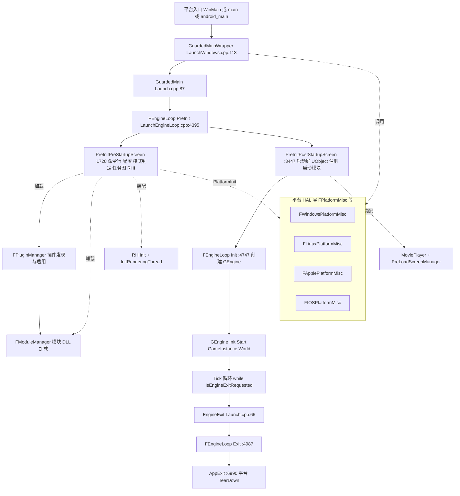

要点:
- 入口层每个平台一个文件:Windows `Source/Runtime/Launch/Private/Windows/LaunchWindows.cpp`(WinMain:317 → LaunchWindowsStartup:185 → GuardedMainWrapper:113);Linux `Private/Linux/LaunchLinux.cpp:14`(`main` → CommonUnixMain);Unix 共享 `Source/Runtime/Unix/UnixCommonStartup/Private/UnixCommonStartup.cpp:242`(CommonUnixMain);Android `Private/Android/LaunchAndroid.cpp:1026`(android_main);IOS `Private/IOS/LaunchIOS.cpp:728`(main → UIApplicationMain)。
- Program(无引擎目标)通过 `Source/Runtime/Launch/Public/RequiredProgramMainCPPInclude.h` 直接包含 LaunchEngineLoop.cpp 复用 AppInit/AppExit。
- 模块加载的"驱动者"是 FEngineLoop 的各 ELoadingPhase 调用点,真正干活的是 Projects(FPluginManager/FProjectManager→FModuleDescriptor::LoadModulesForPhase)与 Core(FModuleManager)。

## 18.3 类图

### 18.3.1 引擎循环与入口

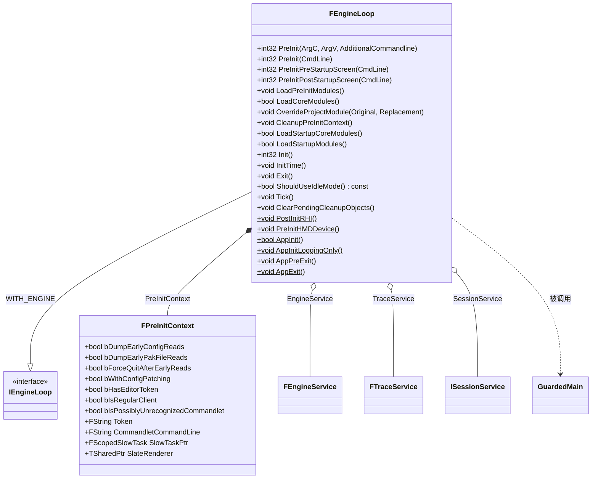

- `FEngineLoop` 定义于 `Source/Runtime/Launch/Public/LaunchEngineLoop.h:48`,方法行为 `Source/Runtime/Launch/Private/LaunchEngineLoop.cpp`(下文缩写 LEL)。
- `GuardedMain` 是 `Source/Runtime/Launch/Private/Launch.cpp:87` 的自由函数,由平台入口调用;`FEngineLoop GEngineLoop` 全局对象定义于 Launch.cpp:28。

### 18.3.2 插件/项目/模块系统

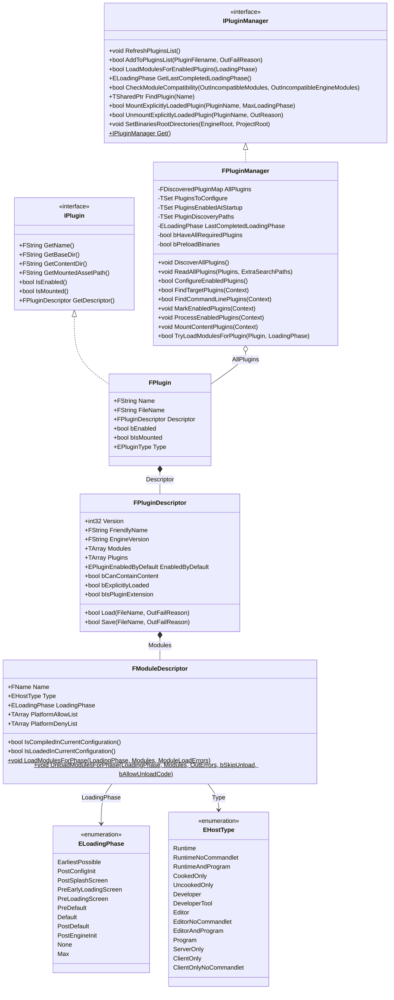

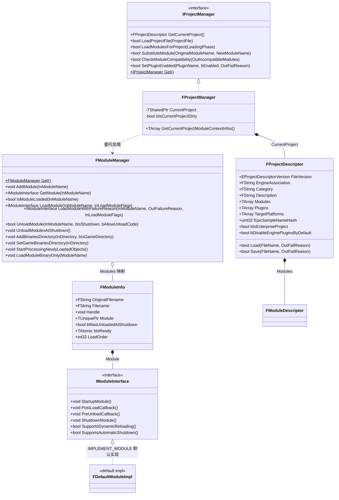

- `FModuleManager`:`Source/Runtime/Core/Public/Modules/ModuleManager.h:160` 起;`FModuleInfo` 内部类在同文件 616-655;`FDefaultModuleImpl` 在同文件 884,`IMPLEMENT_MODULE(FDefaultModuleImpl, Launch)` 见 Launch.cpp:24。
- `IProjectManager`:`Source/Runtime/Projects/Public/Interfaces/IProjectManager.h:70`;`FProjectManager`:`Source/Runtime/Projects/Private/ProjectManager.h`、实现 `Private/ProjectManager.cpp:18`。

### 18.3.3 启动屏(MoviePlayer/PreLoadScreen)

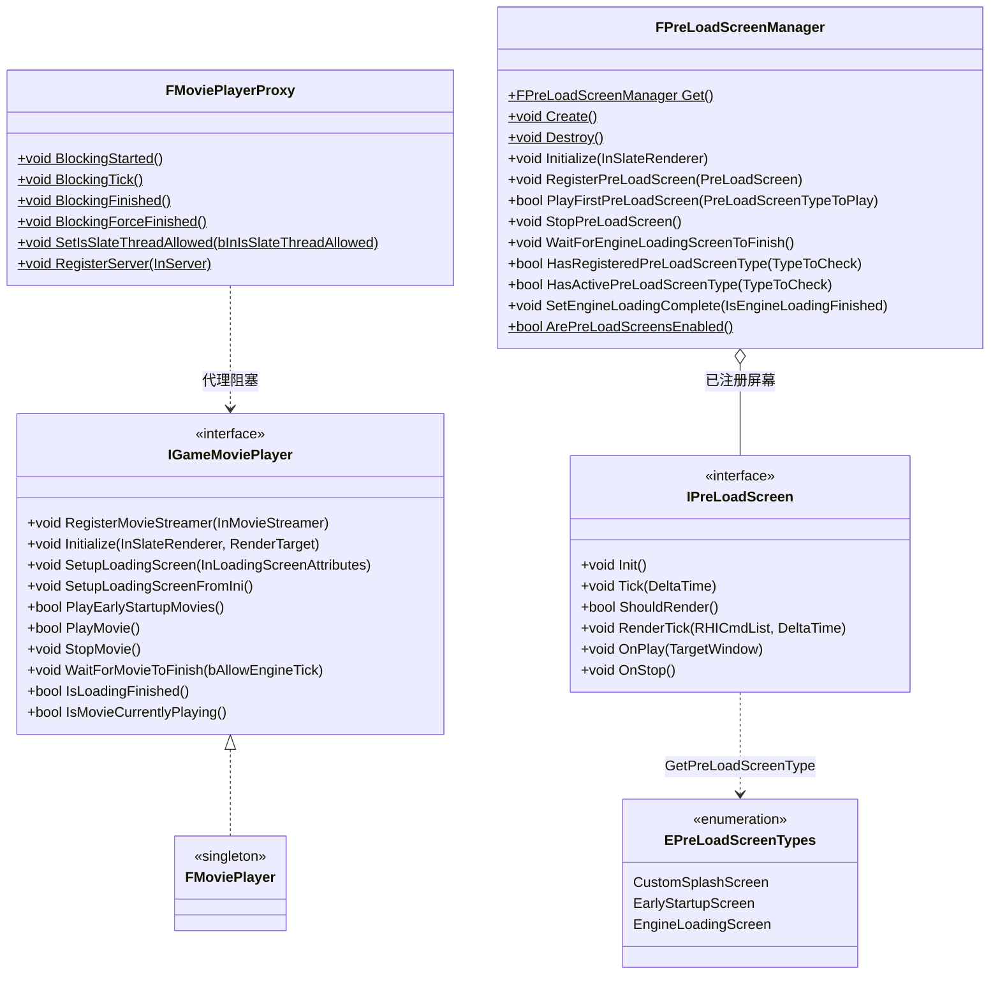

- `IGameMoviePlayer`:`Source/Runtime/MoviePlayer/Public/MoviePlayer.h:179`;`CreateMoviePlayer/DestroyMoviePlayer/GetMoviePlayer/IsMoviePlayerEnabled` 为同文件 288-299 行的自由函数。
- `FPreLoadScreenManager`:`Source/Runtime/PreLoadScreen/Public/PreLoadScreenManager.h:20`;`IPreLoadScreen`/`EPreLoadScreenTypes`:`Source/Runtime/PreLoadScreen/Public/PreLoadScreen.h:19/9`。

## 18.4 数据字典

### 18.4.1 ELoadingPhase::Type 全表(`Source/Runtime/Projects/Public/ModuleDescriptor.h:24-77`)

| 枚举值 | 触发加载的真实调用点(文件:行号) | 含义(头文件原文注释要点) |
|---|---|---|
| EarliestPossible | FEngineLoop::AppInit:`Source/Runtime/Launch/Private/LaunchEngineLoop.cpp:6564`(IProjectManager::LoadModulesForProject + IPluginManager::LoadModulesForEnabledPlugins) | 尽早加载,uplugin 可从 pak 读取;用于读文件所需的插件(压缩格式等) |
| PostConfigInit | AppInit:LEL:6809 | 配置系统初始化后立即加载,极底层钩子 |
| PostSplashScreen | PreInitPreStartupScreen:LEL:3366(非 DedicatedServer/Commandlet 分支)、LEL:3398(其它分支) | 系统闪屏之后渲染的第一屏前,钩入自定义闪屏 |
| PreEarlyLoadingScreen | PreInitPostStartupScreen:LEL:3510(客户端分支)、LEL:3617(服务器/命令let 分支)、LEL:3643(EarlyStartupScreen 期间新装插件补载) | CoreUObject 之前加载,手动 loading screen / chunk 补丁系统 |
| PreLoadingScreen | PreInitPostStartupScreen:LEL:3798 | 引擎完全初始化前、loading screen 触发前挂钩 |
| PreDefault | FEngineLoop::LoadStartupModules:LEL:4675 | 默认阶段之前 |
| Default | LoadStartupModules:LEL:4682 | 启动默认加载点(引擎 init 期间、游戏模块之后) |
| PostDefault | LoadStartupModules:LEL:4689 | 默认阶段之后 |
| PostEngineInit | 常规路径 FEngineLoop::Init:LEL:4863;命令let 路径 PreInitPostStartupScreen:LEL:4068-4069 | 引擎初始化完成后 |
| None | 无自动加载(仅显式 LoadModule) | 不自动加载 |
| Max | 哨兵 | — |

加载单调性由 FPluginManager::LoadModulesForEnabledPlugins 保证:不允许回退到更早阶段,也不允许跳阶段(`Source/Runtime/Projects/Private/PluginManager.cpp:2911-2934` 的 UE_CLOGF 校验)。

### 18.4.2 EHostType::Type(ModuleDescriptor.h:82-132,影响 IsLoadedInCurrentConfiguration)

Runtime / RuntimeNoCommandlet / RuntimeAndProgram / CookedOnly / UncookedOnly / Developer(已弃用)/ DeveloperTool / Editor / EditorNoCommandlet / EditorAndProgram / Program / ServerOnly / ClientOnly / ClientOnlyNoCommandlet。判定函数 `FModuleDescriptor::IsLoadedInCurrentConfiguration()` 声明于 ModuleDescriptor.h:242。

### 18.4.3 FPreInitContext(LaunchEngineLoop.h:19-43)

| 字段 | 类型 | 含义 | 源码位置 |
|---|---|---|---|
| bDumpEarlyConfigReads | bool | -DumpEarlyConfigReads 时转储早期配置读取 | LaunchEngineLoop.h:21 |
| bDumpEarlyPakFileReads | bool | -DumpEarlyPakFileReads 时转储 pak 读取 | :22 |
| bForceQuitAfterEarlyReads | bool | -ForceQuitAfterEarlyReads 转储后强退 | :23 |
| bWithConfigPatching | bool | WITH_CONFIG_PATCHING 编译期决定,重放 CVar 补丁 | :24 |
| bHasEditorToken | bool | 本次运行带 Editor token(UnrealEditor 模式) | :27 |
| bIsRegularClient | bool | 普通客户端(SetIsRunningAsRegularClient) | :28 |
| bIsPossiblyUnrecognizedCommandlet | bool | 首个非 - 参数疑似拼错的 commandlet | :31 |
| Token / CommandletCommandLine | FString | 待转发 token / commandlet 还原命令行 | :33-34 |
| SlowTaskPtr | FScopedSlowTask* | PreInit 进度条(PreInitPreStartupScreen:LEL:2951 创建) | :36 |
| SlateRenderer | TSharedPtr~FSlateRenderer~ | 阶段间持有的 Slate 渲染器 | :41 |

### 18.4.4 FModuleDescriptor(ModuleDescriptor.h:154-254 摘要)

| 字段 | 类型 | 含义 | 源码位置 |
|---|---|---|---|
| Name | FName | 模块名(不含平台/配置后缀) | :157 |
| Type | EHostType::Type | 宿主类型 | :160 |
| LoadingPhase | ELoadingPhase::Type | 启动加载阶段 | :163 |
| PlatformAllowList / PlatformDenyList | TArray~FString~ | 平台允许/拒绝列表 | :166-169 |
| PlatformArchitectureAllowList / DenyList | TMap~FString,TArray~FString~~ | 按 CPU 架构过滤 | :172-175 |
| TargetAllowList / DenyList | TArray~EBuildTargetType~ | 按目标类型过滤 | :178-181 |
| TargetConfigurationAllowList / DenyList | TArray~EBuildConfiguration~ | 按构建配置过滤 | :184-187 |
| ProgramAllowList / DenyList | TArray~FString~ | 按程序名过滤 | :190-193 |
| AdditionalDependencies | TArray~FString~ | UBT 附加构建依赖 | :202 |
| bHasExplicitPlatforms | bool | 空 AllowList 视为"无平台" | :205 |

### 18.4.5 FPluginDescriptor(PluginDescriptor.h:38-257 摘要)

| 字段 | 类型 | 含义 | 源码位置 |
|---|---|---|---|
| Version / VersionName | int32 / FString | 插件版本号/版本名 | :43-47 |
| FriendlyName / Description / Category | FString | 展示信息 | :50-56 |
| EngineVersion | FString | 兼容引擎版本(软校验) | :74 |
| SupportedTargetPlatforms | TArray~FString~ | 允许平台子集(打包 staging) | :81 |
| ParentPluginName | FString | 平台扩展父插件 | :87 |
| Modules | TArray~FModuleDescriptor~ | 插件模块表 | :90 |
| LocalizationTargets | TArray~FLocalizationTargetDescriptor~ | 本地化目标 | :93 |
| EnabledByDefault | EPluginEnabledByDefault | 默认启用(Unspecified/Enabled/Disabled,:28-33) | :124 |
| bCanContainContent / bCanContainVerse | bool | 可含内容/Verse 代码 | :127-130 |
| bInstalled / bIsHidden / bIsSealed / bNoCode | bool | 引擎外安装/隐藏/禁止被依赖/纯内容 | :139-151 |
| bExplicitlyLoaded | bool | 不自动加载,等 MountExplicitlyLoadedPlugin | :154 |
| bIsPluginExtension | bool | `<Parent>_<Platform>.uplugin` 平台扩展 | :160 |
| Plugins / DisallowedPlugins | TArray~FPluginReferenceDescriptor~ | 插件间依赖/互斥 | :174-177 |

### 18.4.6 FProjectDescriptor(ProjectDescriptor.h:42-207 摘要)

| 字段 | 类型 | 含义 | 源码位置 |
|---|---|---|---|
| FileVersion | EProjectDescriptorVersion::Type | 描述符版本(Latest=3) | :45 |
| EngineAssociation | FString | 关联引擎版本/安装标识 | :76 |
| Category / Description | FString | 项目浏览器信息 | :79-82 |
| Modules | TArray~FModuleDescriptor~ | 项目模块表(游戏主模块) | :85 |
| Plugins | TArray~FPluginReferenceDescriptor~ | 项目启用的插件引用 | :88 |
| TargetPlatforms | TArray~FName~ | 目标平台列表 | :91 |
| EpicSampleNameHash | uint32 | 示例项目签名哈希 | :94 |
| bIsEnterpriseProject | bool | 企业项目标记 | :103 |
| bDisableEnginePluginsByDefault | bool | 禁止引擎插件默认启用 | :106 |
| AdditionalPluginDirectories(私有) | TArray~FString~ | 额外插件搜索目录 | :193 |
| AdditionalRootDirectories(私有) | TArray~FString~ | 额外模块根目录 | :199 |

### 18.4.7 FModuleManager::FModuleInfo(ModuleManager.h:616-655)

| 字段 | 类型 | 含义 | 源码位置 |
|---|---|---|---|
| OriginalFilename / Filename | FString | 原始/当前 DLL 文件名 | :621-624 |
| Handle | void* | FPlatformProcess::GetDllHandle 句柄 | :627 |
| Module | TUniquePtr~IModuleInterface~ | 模块接口对象(生命周期归 ModuleManager) | :630 |
| bWasUnloadedAtShutdown | bool | 关闭期已卸载,禁止再次加载 | :633 |
| bIsReady | TAtomic~bool~ | 完全就绪(跨线程 load-acquire 读) | :636 |
| LoadOrder | int32 | 加载序号(卸载按逆序) | :639 |

### 18.4.8 其它关键枚举/结构

| 类型 | 取值 | 含义 | 源码位置 |
|---|---|---|---|
| EModuleLoadResult | Success, FileNotFound, FileIncompatible, CouldNotBeLoadedByOS, FailedToInitialize, NotLoadedByGameThread | 模块加载失败原因(LexToString 见 ModuleManager.cpp:951-963) | Source/Runtime/Core/Public/Modules/ModuleManager.h:43 |
| EPreLoadScreenTypes | CustomSplashScreen, EarlyStartupScreen, EngineLoadingScreen | 启动画面三类 | Source/Runtime/PreLoadScreen/Public/PreLoadScreen.h:9-14 |
| EPluginType | Engine, Enterprise, Project, External, Mod | 插件来源分类 | Source/Runtime/Projects/Public/Interfaces/IPluginManager.h:30-46 |
| EPluginExternalSource | ProjectDescriptor, CommandLine, Environment, Other | 外部插件目录来源 | 同上 :51-64 |
| FExternalPluginPath | Path + Source | 外部插件搜索路径及来源 | 同上 :69-83 |
| EPluginEnabledByDefault | Unspecified, Enabled, Disabled | uplugin EnabledByDefault 字段 | Source/Runtime/Projects/Public/PluginDescriptor.h:28-33 |
| EProjectDescriptorVersion | Invalid=0…Latest=3 | uproject 描述符版本 | Source/Runtime/Projects/Public/ProjectDescriptor.h:23-37 |
| ELauncherAction | AppLaunch, AppUpdateCheck, AppInstaller, AppVerifyInstallation | 拉起 Launcher 的动作 | Source/Runtime/Portal/LauncherCheck/Public/ILauncherCheckModule.h:15-24 |

## 18.5 接口清单

以下原型逐字抄自头文件(仅去掉 `*_API` 导出宏);线程约束列给出判定依据。

### 18.5.1 平台入口与守护函数

| 原型 | 功能 | 参数/返回 | 线程/调用时机 | 位置 |
|---|---|---|---|---|
| `int32 WINAPI WinMain(_In_ HINSTANCE hInInstance, _In_opt_ HINSTANCE hPrevInstance, _In_ char* pCmdLine, _In_ int32 nCmdShow)` | Windows GUI 入口,组装命令行并调用 LaunchWindowsStartup/LaunchWindowsShutdown | 返回进程错误码 | 进程主线程,OS 加载后 | Source/Runtime/Launch/Private/Windows/LaunchWindows.cpp:317 |
| `LAUNCH_API int32 GuardedMainWrapper( const TCHAR* CmdLine )` | 内层 SEH(`__try/__except`),崩溃时 ReportCrash | 同 GuardedMain | 主线程,被 LaunchWindowsStartup:277 调用 | LaunchWindows.cpp:113 |
| `int32 GuardedMain( const TCHAR* CmdLine )` | 引擎主流程:PreInit→Init→Tick 循环→(EditorExit) | CmdLine 命令行,返回错误码 | 主线程;`FTaskTagScope Scope(ETaskTag::EGameThread)`(Launch.cpp:91),记录 GGameThreadId(Launch.cpp:93) | Source/Runtime/Launch/Private/Launch.cpp:87 |
| `int CommonUnixMain(int argc, char *argv[], int (*RealMain)(const TCHAR * CommandLine), void (*AppExitCallback)())` | Linux/Mac 共享 main:早初始化、命令行重组、崩溃处理器、调 RealMain=GuardedMain 后回调 AppExit | 返回 ErrorLevel(可被 FPlatformMisc::HasOverriddenReturnCode 覆盖) | 主线程 | Source/Runtime/Unix/UnixCommonStartup/Private/UnixCommonStartup.cpp:242 |
| `int main(int argc, char *argv[])`(Linux) | 委托 CommonUnixMain(argc, argv, &GuardedMain, &LaunchUnix_FEngineLoop_AppExit) | 同上 | 主线程 | Source/Runtime/Launch/Private/Linux/LaunchLinux.cpp:14 |
| `void android_main(struct android_app* state)` | Android 入口:设 GGameThreadId、创建 AndroidEventThreadWorker 线程后调 AndroidMain | — | Android 主线程(FTaskTagScope EGameThread,LaunchAndroid.cpp:1027) | Source/Runtime/Launch/Private/Android/LaunchAndroid.cpp:1026 |
| `int main(int argc, char *argv[])`(IOS) | 重组命令行、等待调试器、设 EngineCrashHandler,进 UIApplicationMain(IOSAppDelegate) | — | 主线程 | Source/Runtime/Launch/Private/IOS/LaunchIOS.cpp:728 |
| `LAUNCH_API int32 EnginePreInit( const TCHAR* CmdLine )` / `int32 EngineInit()` / `LAUNCH_API void EngineTick( void )` / `LAUNCH_API void EngineExit( void )` | 对 GEngineLoop 四方法的薄封装 | — | 主线程 | Source/Runtime/Launch/Private/Launch.cpp:38/48/58/66 |

### 18.5.2 FEngineLoop(`Source/Runtime/Launch/Public/LaunchEngineLoop.h`,实现于 LEL)

| 原型 | 功能 | 参数/返回 | 线程/调用时机 | 位置(头:行) |
|---|---|---|---|---|
| `int32 PreInit(int32 ArgC, TCHAR* ArgV[], const TCHAR* AdditionalCommandline = nullptr)` | 由 argc/argv 组装命令行再转 PreInit(CmdLine)(LEL:1398) | 返回 0 成功 | 主线程 | :70 |
| `int32 PreInit(const TCHAR* CmdLine)` | ArraySlackTrackInit→FBootProfiling::InitCounters→依次调 PreInitPreStartupScreen/PreInitPostStartupScreen(LEL:4395-4422) | 同上 | 主线程 | :78 |
| `int32 PreInitPreStartupScreen(const TCHAR* CmdLine)` | 启动画面出现前的全部初始化(见 18.6.1) | 同上 | 主线程 | :81 |
| `int32 PreInitPostStartupScreen(const TCHAR* CmdLine)` | 启动画面期间的装配 + Commandlet 执行分支(见 18.6.1) | 同上 | 主线程 | :84 |
| `void LoadPreInitModules()` | 硬编码加载 Engine/Renderer/AnimGraphRuntime/SlateRHIRenderer/Landscape/RHICore/RenderCore/TextureCompressor/Virtualization/AudioEditor/AnimationModifiers(LEL:4442-4495) | 无 | 主线程 | :87 |
| `bool LoadCoreModules()` | RegisterModularObjectsProcessing + 加载 CoreUObject(LEL:4424-4434) | 返回是否成功 | 主线程 | :90 |
| `void OverrideProjectModule(const FString& InOriginalProjectModuleName, const FString& InReplacementProjectModuleName)` | 替换项目主模块名(LEL:1390) | — | 主线程,PreInit 前 | :93 |
| `void CleanupPreInitContext()` | 释放 PreInitContext.SlowTaskPtr/SlateRenderer(LEL:4437) | — | 主线程 | :96 |
| `bool LoadStartupCoreModules()` | 引擎自带启动模块(Core/Networking/Messaging/Slate/UMG/UnrealEd 等,LEL:4501-4666) | 返回是否成功 | 主线程 | :101 |
| `bool LoadStartupModules()` | 项目+插件 PreDefault/Default/PostDefault 三阶段(LEL:4669-4695) | 同上 | 主线程 | :104 |
| `virtual int32 Init() override` | 创建 GEngine、GEngine->Init/Start、PostEngineInit 模块(LEL:4747-4976) | 0 成功 | 主线程 | :111 |
| `void InitTime()` | 设置 MaxTickTime/MaxFrameCounter/FixedDeltaTime(-SECONDS=/-BENCHMARKSECONDS=/-FPS=,LEL:4698-4737) | — | 主线程,Init 内 | :114 |
| `void Exit()` | 全引擎逆序关闭(见 18.6.4) | — | 主线程,由 EngineExit 调 | :117 |
| `bool ShouldUseIdleMode() const` | 失焦/t.IdleWhenNotForeground 时空闲判定 | — | 主线程(Tick 内) | :120 |
| `virtual void Tick() override` | 单帧推进(见 18.6.3) | — | 主线程 | :123 |
| `virtual void ClearPendingCleanupObjects() override` | FlushRenderingCommands 后删除 PendingCleanupObjects(LEL:6200) | — | 主线程 | :126 |
| `static void PostInitRHI()` | RHIPostInit + 系统纹理渲染命令(LEL:7034) | — | 主线程发起,命令在渲染线程执行 | :131 |
| `static void PreInitHMDDevice()` | IHeadMountedDisplayModule::PreInit(-hmd=/-nohmd,LEL:7064) | — | 主线程 | :134 |
| `static bool AppInit()` | 配置系统/插件 EarliestPossible+PostConfigInit/栈回溯/OnInit(LEL:6518-6921) | 返回 false 启动失败 | 主线程 | :139 |
| `static void AppInitLoggingOnly()` | 只建日志设备后返回(错误退出路径,LEL:6513) | — | 主线程 | :142 |
| `static void AppPreExit()` | OnPreExit/OnExit、销毁 GIOThreadPool、Shader 编译器等(LEL:6923) | — | 主线程,守卫退出代码内 | :149 |
| `static void AppExit()` | 平台 TearDown、GConfig/GLog/国际化/Trace 关闭(LEL:6990,只执行一次) | — | 主线程,守卫块外 | :156 |
| `static void AppInitUpToSetupOutputDevices()` | BeginInitTextLocalization/PlatformPreInit/FPlatformOutputDevices::SetupOutputDevices(LEL:6439-6511) | — | 主线程 | :160 |

### 18.5.3 FModuleManager(`Source/Runtime/Core/Public/Modules/ModuleManager.h`,实现 Source/Runtime/Core/Private/Modules/ModuleManager.cpp)

| 原型 | 功能 | 参数/返回 | 线程约束 | 位置(头:行) |
|---|---|---|---|---|
| `static FModuleManager& Get()` | 单例 | 返回引用 | 任意线程;首次在主线程 | :179 |
| `void AddModule( const FName InModuleName )` | 登记模块名(不加载) | — | 主线程(ModuleManager.cpp:445) | :199 |
| `IModuleInterface* GetModule( const FName InModuleName )` | 取已加载模块 | 未加载返回 nullptr | 任意线程;非就绪模块仅 GameThread 可取(`ModuleInfo->bIsReady || IsInGameThread()`,ModuleManager.cpp:1507-1520) | :212 |
| `bool IsModuleLoaded( const FName InModuleName ) const` | O(1) 查询 | — | 任意线程 | :231 |
| `IModuleInterface* LoadModule( const FName InModuleName, ELoadModuleFlags InLoadModuleFlags = ELoadModuleFlags::None )` | 加载模块并 StartupModule | 失败返回 nullptr | 非 GameThread 时退化为 GetModule(GetOrLoadModule:ModuleManager.cpp:930-949) | :242 |
| `IModuleInterface& LoadModuleChecked( const FName InModuleName )` | 加载并断言成功 | 返回引用 | 同上 | :251 |
| `IModuleInterface* LoadModuleWithFailureReason( const FName InModuleName, EModuleLoadResult& OutFailureReason, ELoadModuleFlags InLoadModuleFlags = ELoadModuleFlags::None)` | 带失败原因加载:AddModule→(静态注册器或 FindModulePaths 找 DLL→GetDllHandle)→ProcessLoadedObjectsCallback→StartupModule→bIsReady=true | OutFailureReason 见 18.4.8 | GameThread(WarnIfItWasntSafeToLoadHere 警告,ModuleManager.cpp:1010-1030) | :274 |
| `IModuleInterface* GetOrLoadModule(const FName InModuleName, EModuleLoadResult& OutFailureReason, ELoadModuleFlags InLoadModuleFlags = ELoadModuleFlags::None)` | GetModule 命中即回;否则非 GameThread 返回 NotLoadedByGameThread | — | 已加载模块任意线程可取 | :353 |
| `bool UnloadModule( const FName InModuleName, bool bIsShutdown = false, bool bAllowUnloadCode = true )` | ShutdownModule→(允许时)FreeDllHandle | 返回是否成功 | GameThread | :306 |
| `void UnloadModulesAtShutdown()` | 收集 SupportsAutomaticShutdown 模块按 LoadOrder 逆序:先全体 PreUnloadCallback 再逐个 UnloadModule | — | `ensure(IsInGameThread())`(ModuleManager.cpp:1439) | :439 |
| `void AddBinariesDirectory(const TCHAR *InDirectory, bool bIsGameDirectory)` | 增加模块 DLL 搜索目录(插件 Binaries 目录由此登记,PluginManager.cpp:1856) | — | 主线程(启动期) | :463 |
| `void SetGameBinariesDirectory(const TCHAR* InDirectory)` | 设置游戏 Binaries 目录(LEL:2543) | — | 主线程 | :475 |
| `void StartProcessingNewlyLoadedObjects()` | 允许后续加载模块时处理新 UObject(LEL:3777) | — | 主线程 | :460 |
| `void LoadModuleBinaryOnly(FName ModuleName)` | 仅加载 DLL 不调 StartupModule(PreloadBinaries 优化,PluginManager.cpp:2901) | — | 主线程 | :468 |
| `TTSMulticastDelegateRegistration<void(FName ModuleName, EModuleChangeReason ChangeReason)>& OnModulesChanged()` | 模块增删通知(线程安全订阅,GameThread 广播) | — | 订阅任意线程 | :531 |

### 18.5.4 IModuleInterface 生命周期(`Source/Runtime/Core/Public/Modules/ModuleInterface.h`)

| 原型 | 功能 | 调用时机 | 位置 |
|---|---|---|---|
| `virtual void StartupModule()` | 模块业务初始化 | LoadModuleWithFailureReason 内(ModuleManager.cpp:1175 附近);DLL 静态构造后 | :49 |
| `virtual void PostLoadCallback()` | 加载后回调 | LoadModuleWithCallback 路径 | :68 |
| `virtual void PreUnloadCallback()` | 卸载前回调 | UnloadModulesAtShutdown 第一轮(ModuleManager.cpp:1487-1491) | :59 |
| `virtual void ShutdownModule()` | 模块反初始化 | UnloadModule / UnloadModulesAtShutdown 第二轮 | :79 |
| `virtual bool SupportsDynamicReloading()` | 是否支持热重载 | 热重载流程 | :88 |
| `virtual bool SupportsAutomaticShutdown()` | 关闭期是否自动卸载 | UnloadModulesAtShutdown 过滤 | :98 |
| `virtual bool IsGameModule() const` | 是否游戏模块 | 默认 FDefaultModuleImpl 返回 false | :108 |

### 18.5.5 项目/插件管理(IProjectManager / IPluginManager / FModuleDescriptor 静态)

| 原型 | 功能 | 参数/返回 | 线程 | 位置 |
|---|---|---|---|---|
| `static IProjectManager& Get()` | 单例 | — | 任意线程 | Source/Runtime/Projects/Public/Interfaces/IProjectManager.h:81 |
| `virtual bool LoadProjectFile( const FString& ProjectFile )` | 读 .uproject 到 FProjectDescriptor(ProjectManager.cpp:28-49) | 返回成功与否 | 主线程;PreInitPreStartupScreen:LEL:2517 调用 | IProjectManager.h:99 |
| `virtual bool LoadModulesForProject( const ELoadingPhase::Type LoadingPhase )` | 项目模块按阶段加载(FModuleDescriptor::LoadModulesForPhase + OnLoadingPhaseCompleteEvent,ProjectManager.cpp:51-107) | 返回成功 | 主线程 | :107 |
| `virtual bool SubstituteModule(const FString& OriginalModuleName, const FString& NewModuleName)` | 替换项目模块名(ProjectManager.cpp:109-125) | — | 主线程 | :116 |
| `virtual bool CheckModuleCompatibility(TArray<FString>& OutIncompatibleModules)` | 检查项目模块与当前引擎版本兼容性(ProjectManager.cpp:129-132) | — | 主线程(AppInit:LEL:6672) | :130 |
| `static void LoadModulesForPhase(ELoadingPhase::Type LoadingPhase, const TArray<FModuleDescriptor>& Modules, TMap<FName, EModuleLoadResult>& ModuleLoadErrors)` | 逐模块:`LoadingPhase == Descriptor.LoadingPhase && IsLoadedInCurrentConfiguration()` 时 LoadModuleWithFailureReason(ModuleDescriptor.cpp:779-806) | 失败表 | 主线程 | ModuleDescriptor.h:245 |
| `static void UnloadModulesForPhase(ELoadingPhase::Type LoadingPhase, const TArray<FModuleDescriptor>& Modules, TMap<FName, EModuleUnloadResult>& OutErrors, bool bSkipUnload = false, bool bAllowUnloadCode = true)` | 按阶段逆卸载 | — | 主线程 | ModuleDescriptor.h:248 |
| `static IPluginManager& Get()` | 单例(PluginManager.cpp:3010 构造 FPluginManager) | — | 任意线程 | IPluginManager.h:667 |
| `virtual void RefreshPluginsList()` | 保留已启用项后重扫(PluginManager.cpp:555-594) | — | 主线程 | :292 |
| `virtual bool LoadModulesForEnabledPlugins( const ELoadingPhase::Type LoadingPhase )` | ConfigureEnabledPlugins→TryLoadModulesForPlugin→(bPreloadedBinaries 时 LoadModuleBinaryOnly)→LastCompletedLoadingPhase 推进并广播(PluginManager.cpp:2842-2937) | 返回成功 | 主线程 | :314 |
| `virtual ELoadingPhase::Type GetLastCompletedLoadingPhase() const` | 已完成阶段 | — | 任意线程 | :317 |
| `virtual bool CheckModuleCompatibility( TArray<FString>& OutIncompatibleModules, TArray<FString>& OutIncompatibleEngineModules )` | 插件模块二进制兼容检查(AppInit:LEL:6675) | — | 主线程 | :385 |
| `virtual bool MountExplicitlyLoadedPlugin(const FString& PluginName, ELoadingPhase::Type MaxLoadingPhase = ELoadingPhase::Max)` | 显式挂载 bExplicitlyLoaded 插件(GameFeature 插件) | — | 主线程 | :556 |
| `virtual bool UnmountExplicitlyLoadedPlugin(const FString& PluginName, FText* OutReason)` | 卸载显式插件 | — | 主线程 | :588 |
| `virtual void SetBinariesRootDirectories(const FString& EngineBinariesRootDir, const FString& ProjectBinariesRootDir)` | pak 场景下外部 Binaries 根(LEL:2655) | — | 主线程 | :638 |
| `virtual void SetPreloadBinaries()` / `virtual bool GetPreloadBinaries()` | PostConfigInit 阶段预载所有插件 DLL 的开关(LEL:2656;PluginManager.cpp:2887-2905) | — | 主线程 | :644-645 |

### 18.5.6 启动屏接口

| 原型 | 功能 | 线程 | 位置 |
|---|---|---|---|
| `MOVIEPLAYER_API void CreateMoviePlayer()` / `MOVIEPLAYER_API void DestroyMoviePlayer()` | 创建/销毁电影播放器单例(PreInitPreStartupScreen:LEL:3319;Exit:LEL:5187) | 主线程 | Source/Runtime/MoviePlayer/Public/MoviePlayer.h:288/291 |
| `MOVIEPLAYER_API IGameMoviePlayer* GetMoviePlayer()` | 取单例(可能为 null) | 主线程为主,Tick 中多处调用 | 同上 :294 |
| `bool MOVIEPLAYER_API IsMoviePlayerEnabled()` | 电影播放器是否启用 | 主线程 | 同上 :299 |
| `virtual void SetupLoadingScreenFromIni()`(IGameMoviePlayer) | 从 ini 读启动电影配置(LEL:3567) | 主线程 | 同上 :242 |
| `virtual bool PlayEarlyStartupMovies()` | 播放早期启动电影(LEL:3579) | 主线程(渲染线程出帧) | 同上 :211 |
| `virtual void PlayMovie()` / `virtual void WaitForMovieToFinish(bool bAllowEngineTick = false)` | 播放/阻塞等待(LEL:3860/4893) | 主线程 | 同上 :222/230 |
| `static MOVIEPLAYERPROXY_API void BlockingForceFinished()`(FMoviePlayerProxy) | 强制结束电影阻塞(Tick 多处:LEL:5616/5908/6112) | 主线程 | Source/Runtime/MoviePlayerProxy/Public/MoviePlayerProxy.h:27 |
| `static PRELOADSCREEN_API FPreLoadScreenManager* Get()` / `static void Create()` / `static void Destroy()` | 单例管理(LEL:3325 创建;Exit:LEL:5014/5897 销毁) | 主线程 | Source/Runtime/PreLoadScreen/Public/PreLoadScreenManager.h:24-26 |
| `static PRELOADSCREEN_API bool ArePreLoadScreensEnabled()` | -preloadscreen 命令行决定(LEL:3322) | 主线程 | 同上 :63 |
| `PRELOADSCREEN_API bool PlayFirstPreLoadScreen(EPreLoadScreenTypes PreLoadScreenTypeToPlay)` | 播放某类第一个屏幕(LEL:3385/3551/3854) | 主线程 | 同上 :37 |
| `PRELOADSCREEN_API void WaitForEngineLoadingScreenToFinish()` | 阻塞等待引擎 loading 屏结束(LEL:4888/5873) | 主线程 | 同上 :46 |

### 18.5.7 支撑子系统接口(遥测/崩溃/基准/Portal/Bundle)

| 原型 | 功能 | 线程 | 位置 |
|---|---|---|---|
| `virtual bool StartSession(const TArray<FAnalyticsEventAttribute>& Attributes) = 0` 等纯虚(IAnalyticsProvider) | 遥测会话/事件抽象(EndSession/RecordEvent/FlushEvents/SetUserID…,IAnalyticsProvider.h:75-204) | 取决于实现 | Source/Runtime/Analytics/Analytics/Public/Interfaces/IAnalyticsProvider.h:51 |
| `virtual TSharedPtr<IAnalyticsProvider> CreateAnalyticsProvider(const FAnalyticsProviderConfigurationDelegate& GetConfigValue) const = 0`(IAnalyticsProviderModule) | 模块工厂 | 主线程 | …/Interfaces/IAnalyticsProviderModule.h:15 |
| `static STUDIOTELEMETRY_API FStudioTelemetry& Get()`(FStudioTelemetry) | 工作室遥测单例模块 | 主线程 | Source/Runtime/StudioTelemetry/Public/StudioTelemetry.h:34 |
| `STUDIOTELEMETRY_API bool StartSession()` / `STUDIOTELEMETRY_API void RecordEvent(const FString& EventName, const TArray<FAnalyticsEventAttribute>& Attributes = {})` | 会话/事件(FStudioTelemetry) | 主线程 | 同上 :46/55 |
| `virtual void StartHardwareSurvey(IAnalyticsProvider& AnalyticsProvider) = 0`(IHardwareSurveyModule) | 硬件调查 | 主线程(编辑器触发) | Source/Runtime/HardwareSurvey/Public/IHardwareSurveyModule.h:44 |
| `virtual void Run(FSynthBenchmarkResults& Out, bool bGPUBenchmark = true, float WorkScale = 10.0f) const = 0`(ISynthBenchmark) | CPU/GPU 合成基准 | 主线程发起,GPU 部分经渲染命令 | Source/Runtime/SynthBenchmark/Public/SynthBenchmark.h:21 |
| `virtual void ShowAdBanner( bool bShowOnBottomOfScreen, int32 adID ) = 0` 等(IAdvertisingProvider) | 广告横幅/插播(9 个纯虚) | 平台主线程 | Source/Runtime/Advertising/Advertising/Public/Interfaces/IAdvertisingProvider.h:12-20 |
| `class FCrashReportCoreModule : public IModuleInterface`(StartupModule/ShutdownModule) | 崩溃上报模块入口 | 主线程 | Source/Runtime/CrashReportCore/Public/CrashReportCoreModule.h:11 |
| `virtual double GetNumber(const FString& Name, double DefaultValue = 0.0) = 0` / `virtual void SetNumber(const FString& Name, double Value, uint32 Flags = 0)` 等(IPerfCounters) | 性能计数器读写/JSON 导出/直方图(PerfCountersModule.h:106-130) | 任意线程(内部加锁) | Source/Runtime/PerfCounters/Public/PerfCountersModule.h:47 |
| `static inline IPerfCountersModule& Get()`(IPerfCountersModule) | LoadModuleChecked 单例 | 主线程 | 同上 :228 |
| `static INSTALLBUNDLEMANAGER_API TSharedPtr<IInstallBundleManager> GetPlatformInstallBundleManager()` | 平台 Bundle 管理器(PreInitPostStartupScreen:LEL:3497) | 主线程 | Source/Runtime/InstallBundleManager/Public/InstallBundleManagerInterface.h:138 |
| `static INSTALLBUNDLEMANAGER_API FInstallBundleCompleteMultiDelegate InstallBundleCompleteDelegate` | Bundle 完成多播(LEL:3518 绑定 OnStartupContentMounted) | 广播主线程 | 同上 :131 |
| `static inline ILauncherCheckModule& Get()`(ILauncherCheckModule) | LoadModuleChecked 单例 | 主线程 | Source/Runtime/Portal/LauncherCheck/Public/ILauncherCheckModule.h |
| `virtual bool WasRanFromLauncher() const = 0` / `virtual bool RunLauncher(ELauncherAction Action, FString Payload = FString()) const = 0` | 启动器检查(PreInitPreStartupScreen:LEL:1870-1877) | 主线程 | 同上 |
| `virtual void Configure(const FString& ServiceName, const FWildcardString& ProductId, const FName& ServiceModule) = 0`(IPortalServiceLocator) | Portal 服务定位配置 | 主线程 | Source/Runtime/Portal/Services/Public/IPortalServiceLocator.h |
| `BUILDSETTINGS_API const TCHAR* GetEngineVersionString()` / `BUILDSETTINGS_API bool IsLicenseeVersion()` 等 | 编译期版本信息 | 任意线程(纯查询) | Source/Runtime/BuildSettings/Public/BuildSettings.h |

### 18.5.8 DeveloperSettings/EngineSettings 设置对象

- `UDeveloperSettings`(UCLASS(Abstract, MinimalAPI),`Source/Runtime/DeveloperSettings/Public/Engine/DeveloperSettings.h:21`):`GetContainerName()/GetCategoryName()/GetSectionName()` 虚函数(:29-31 附近),编辑器下 `FOnSettingsChanged& OnSettingChanged()`;派生类以 `config` UObject 形式在启动时从 ini 载入。同模块还有 `UDeveloperSettingsBackedByCVars`、`UPlatformSettings`/`UPlatformSettingsManager`。
- EngineSettings 模块(`Source/Runtime/EngineSettings/Classes/`)提供 7 个设置类:`UConsoleSettings`、`UGameMapsSettings`、`UGameNetworkManagerSettings`、`UGameSessionSettings`、`UGeneralEngineSettings`、`UGeneralProjectSettings`、`UHudSettings`。启动路径直接消费 `UGameMapsSettings` 的有:GameInstanceClass/GameInstanceClass 读取(`UGameEngine::Init`,Engine/Private/GameEngine.cpp:1262-1273)、DefaultMap 浏览(GameInstance.cpp:676-711)。

### 18.5.9 命令行处理相关自由函数(LaunchEngineLoop.cpp)

| 原型(去宏) | 功能 | 位置 |
|---|---|---|
| `bool LaunchSetGameName(const TCHAR *InCmdLine, FString& OutGameProjectFilePathUnnormalized)` | 从命令行首参数解析项目名/.uproject | LEL:666 |
| `bool LaunchCheckForFileOverride(const TCHAR* CmdLine, bool& OutFileOverrideFound)` | -ini:/-ddc=/-remotetextdump 等平台文件覆盖 | LEL:864 |
| `void LaunchCheckForCommandLineAliases(const FConfigFile& Config, TArray<FString>& PrevExpansions, bool& bChanged)` / `void LaunchCheckForCmdLineFile(TArray<FString>& PrevExpansions, bool& bChanged)` | 命令行别名/`@file` 展开 | LEL:1041/1093 |
| `void LaunchFixProjectPathCase()` / `void LaunchFixGameNameCase()` | 平台文件大小写修正 | LEL:773/783 |
| `bool LaunchHasIncompleteGameName()` / `void LaunchUpdateMostRecentProjectFile()` | GameAgnostic 编辑器补项目 | LEL:1205/1226 |
| `void InitializeStdOutDevice()` | -stdout 输出设备 | LEL:589 |
| `static TArray<FString> TokenizeCommandline(const TCHAR* CmdLine, bool bRetainQuotes)` / `static FString ExtractGameStringArgument(...)` | 模式判定用 tokenization | LEL:1605/1660 |

### 18.5.10 平台 HAL 适配类清单(Runtime/Core/Public/<Platform>/)

通用约定:每个平台目录提供 `F<Platform>PlatformXxx` 类,再以 typedef 映射到跨平台名 `FPlatformXxx`。下表为 5.8.3 实测的映射关系(按头文件 grep 汇总):

| 平台 | 目录 | 主要 F<Platform>* 类(→ 映射) |
|---|---|---|
| Windows | Source/Runtime/Core/Public/Windows/ | FWindowsPlatformMisc(→FPlatformMisc)、FWindowsPlatformProcess、FWindowsPlatformMemory、FWindowsPlatformMath、FWindowsPlatformTime、FWindowsPlatformTLS、FWindowsPlatformAtomics、FWindowsPlatformStackWalk、FWindowsPlatformString、FWindowsPlatformTypes、FWindowsPlatformAffinity(→FPlatformAffinityBase)、FWindowsPlatformCrashContext、FWindowsPlatformNamedPipe、FWindowsPlatformOutputDevices、FWindowsPlatformPerfCounters、FWindowsRecursiveMutex/FWindowsSharedMutex/FWindowsSystemWideMutex(→FPlatformRecursiveMutex/SharedMutex/SystemWideMutex) |
| Linux | Source/Runtime/Core/Public/Linux/ | FLinuxPlatformMisc(→FPlatformMisc)、FLinuxPlatformProcess(→FPlatformProcess)、FLinuxPlatformFile、FLinuxPlatformMemory、FLinuxPlatformMath、FLinuxPlatformTime、FLinuxPlatformTLS、FLinuxPlatformAtomics、FLinuxPlatformStackWalk、FLinuxPlatformString、FLinuxPlatformProperties、FLinuxPlatformCrashContext、FLinuxPlatformAffinity、FLinuxPlatformOutputDevices、FLinuxSemaphore |
| Unix(Linux/Mac 共用基类) | Source/Runtime/Core/Public/Unix/ | FUnixPlatformMemory(→FPlatformMemory,Linux 下)、FUnixPlatformStackWalk(→FPlatformStackWalk,Linux)、FUnixPlatformString(→FPlatformString)、FUnixPlatformTypes(→FPlatformTypes,Linux)、FUnixPlatformMisc、FUnixPlatformProcess、FUnixPlatformFile、FUnixPlatformMath、FUnixPlatformTime、FUnixPlatformTLS、FUnixPlatformAtomics、FUnixPlatformMutex、FUnixPlatformRunnableThread、FUnixPlatformOutputDevices、FUnixPlatformCrashContext、FUnixPlatformGuid、FUnixErrorOutputDevice |
| Apple(Mac/VisionOS 共用) | Source/Runtime/Core/Public/Apple/ | FApplePlatformMisc、FApplePlatformProcess、FApplePlatformMemory、FApplePlatformMath、FApplePlatformTime(→FPlatformTime)、FApplePlatformTLS(→FPlatformTLS)、FApplePlatformAtomics(→FPlatformAtomics)、FApplePlatformString(→FPlatformString)、FApplePlatformStackWalk(→FPlatformStackWalk)、FApplePlatformSymbolication(→FPlatformSymbolication)、FApplePlatformFile、FApplePlatformRunnableThread、FApplePlatformCrashContext、FApplePlatformAffinity |
| Android | Source/Runtime/Core/Public/Android/ | FAndroidPlatformMisc、FAndroidPlatformProcess(→FPlatformProcess)、FAndroidPlatformMemory(→FPlatformMemory)、FAndroidPlatformFile、FAndroidPlatformMath、FAndroidPlatformTime、FAndroidPlatformTLS、FAndroidPlatformAtomics、FAndroidPlatformStackWalk(→FPlatformStackWalk)、FAndroidPlatformString、FAndroidPlatformProperties(→FPlatformProperties)、FAndroidPlatformAffinity、FAndroidPlatformRunnableThread、FAndroidPlatformThermal、FAndroidErrorOutputDevice、FAndroidJava/FAndroidJniGameActivity(Java 桥) |
| IOS | Source/Runtime/Core/Public/IOS/ | FIOSPlatformMisc(→FPlatformMisc)、FIOSPlatformProcess(→FPlatformProcess)、FIOSPlatformMemory(→FPlatformMemory)、FIOSPlatformFile、FIOSPlatformMath、FIOSPlatformTime、FIOSPlatformTLS、FIOSPlatformTypes(→FPlatformTypes)、FIOSPlatformAffinity(→FPlatformAffinityBase)、FIOSPlatformProperties(→FPlatformProperties)、FIOSPlatformOutputDevices(→FPlatformOutputDevices)、FIOSPlatformCrashContext、FIOSPlatformStackWalk、IOSErrorOutputDevice、IOSCommandLineHelper |

启动路径上被 FEngineLoop 直接消费的 HAL 调用(节选,均在主线程):`FPlatformMisc::SetGracefulTerminationHandler`(LEL:1778/3966)、`FPlatformMisc::SetUTF8Output`(LEL:1792)、`FPlatformProcess::SetCurrentWorkingDirectoryToBaseDir`(LEL:1803/1946/6468)、`FPlatformApplicationMisc::CreateConsoleOutputDevice`(LEL:1884)、`FPlatformMisc::PlatformPreInit`/`FPlatformApplicationMisc::PreInit`(LEL:6454/6459)、`FPlatformMisc::PlatformInit`/`FPlatformApplicationMisc::Init`/`FPlatformMemory::Init`(LEL:2886-2890)、`FPlatformSplash::Show`(LEL:3114)、`FPlatformMisc::PlatformHandleSplashScreen`(LEL:3576/3600/3871)、`FPlatformApplicationMisc::PumpMessages`(LEL:5784)、`FPlatformMisc::PlatformTearDown`(LEL:7012)。

Engine/Platforms 目录(`Engine/Platforms/{Windows,Android,IOS,VisionOS}`)存放平台扩展(平台专属模块/隐私清单/部署描述),不属于本章节源码范围,仅在插件平台扩展(`<Parent>_<Platform>.uplugin`)合并逻辑中被间接涉及(PluginManager.cpp:947-1032)。

## 18.6 关键流程

### 18.6.1 main() → PreInit → Init 完整启动时序(真实调用顺序)

PreInit(CmdLine)(LEL:4395)内部只有两步:PreInitPreStartupScreen(4407)→ PreInitPostStartupScreen(4414)。以下按源码顺序列出两段内部的全部关键调用(省略日志与统计包装):

**A. PreInitPreStartupScreen(LEL:1728-3435)**

| # | 调用 | 行号 |
|---|---|---|
| 1 | FDelayedAutoRegisterHelper::RunAndClearDelayedAutoRegisterDelegates(StartOfEnginePreInit) | 1731 |
| 2 | FCsvProfiler::PreInit(CmdLine) | 1734 |
| 3 | GLog->SetCurrentThreadAsPrimaryThread() | 1742 |
| 4 | FPlatformProcess::SetCurrentWorkingDirectoryToBaseDir() | 1803 |
| 5 | FCommandLine::Set(CmdLine)(失败返回 -1) | 1808 |
| 6 | UE-CmdLineArgs 环境变量注入(FCommandLine::Append) | 1817-1827 |
| 7 | LaunchSetGameName() | 1838 |
| 8 | FTraceAuxiliary::Initialize/TryAutoConnect | 1846-1847 |
| 9 | FLowLevelMemTracker::ProcessCommandLine、FPlatformMisc::InitTaggedStorage(1024) | 1852/1861 |
| 10 | (WITH_LAUNCHERCHECK)ILauncherCheckModule::WasRanFromLauncher/RunLauncher | 1869-1878 |
| 11 | GScopedLogConsole = FPlatformApplicationMisc::CreateConsoleOutputDevice() | 1884 |
| 12 | -stdout → InitializeStdOutDevice() | 1892-1895 |
| 13 | LaunchCheckForFileOverride() | 2135 |
| 14 | FModuleManager::Get().AddExtraBinarySearchPaths() | 2146 |
| 15 | IFileManager::Get().ProcessCommandLineOptions() | 2153 |
| 16 | FPlatformFileManager::Get().InitializeNewAsyncIO() | 2159 |
| 17 | FileSystemReady 延迟委托 | 2163 |
| 18 | GGameThreadId 记录、SetThreadPriority(GetGameThreadPriority)、SetThreadAffinityMask(GetMainGameMask)、SetupGameThread | 2180-2185 |
| 19 | 模式判定:TokenizeCommandline/ExtractGameStringArgument;IsRunningDedicatedServer→SetIsRunningAsDedicatedServer;*Commandlet token/-run=→SetIsRunningAsCommandlet;UE_EDITOR 无 -game→SetIsRunningAsEditor;否则 SetIsRunningAsRegularClient(写 GIsClient/GIsServer/GIsEditor) | 2199-2434 |
| 20 | FMath::RandInit/SRandInit | 2466-2480 |
| 21 | PlatformFile 链 InitializeAfterProjectFilePath、LaunchFixProjectPathCase | 2496-2505 |
| 22 | IProjectManager::Get().LoadProjectFile(项目 Binaries 目录登记、SubstituteModule) | 2517-2534 |
| 23 | FModuleManager::SetGameBinariesDirectory、LaunchFixGameNameCase | 2543-2545 |
| 24 | AddShaderSourceDirectoryMapping(/Engine、/Project、/ShaderAutogen) | 2551-2577 |
| 25 | FTaskGraphInterface::Startup(NumberOfWorkerThreadsToSpawn) + AttachToThread(GameThread) | 2592-2593 |
| 26 | GThreadPool/GThreadPool/GLargeThreadPool/GBackgroundPriorityThreadPool 创建 | 2600-2647 |
| 27 | TaskGraphSystemReady 延迟委托 | 2650 |
| 28 | (pak 场景)IPluginManager::SetBinariesRootDirectories + SetPreloadBinaries | 2653-2657 |
| 29 | UE::Stats::FStats::Init、FThreadStats::StartThread、StatSystemReady 委托 | 2660-2665 |
| 30 | LoadCoreModules() → CoreUObject | 2672/4430 |
| 31 | InitializeRenderingCVarsCaching() | 2710 |
| 32 | FOodleDataCompression::StartupPreInit、FCompression::Init | 2734/2738 |
| 33 | LoadPreInitModules() | 2742/4442 |
| 34 | FCsvProfiler::Get()->Init、AppLifetimeEventCapture::Init | 2746/2750 |
| 35 | AppInit() 或 AppInitLoggingOnly()(见 B 段) | 2772-2783 |
| 36 | GLog->TryStartDedicatedPrimaryThread()(除非 -NoLogThread) | 2791 |
| 37 | GIOThreadPool->Create(NumberOfIOWorkerThreadsToSpawn, 96KB 栈, TPri_AboveNormal) | 2798-2804 |
| 38 | GSystemSettings.Initialize(bHasEditorToken) + ApplyCVarSettingsFromIni(RendererSettings/RendererOverrideSettings/StreamingSettings/GarbageCollectionSettings/NetworkSettings/CookerSettings) | 2814-2823 |
| 39 | UGameUserSettings::PreloadResolutionSettings()(非命令let 客户端) | 2832 |
| 40 | Scalability::InitScalabilitySystem、ConstructCompiledInObjects(UE_WITH_CONSTINIT_UOBJECT)、UDeviceProfileManager::InitializeCVarsForActiveDeviceProfile、Scalability::LoadState、GUseThreadedRendering=UseRenderThread() | 2841-2872 |
| 41 | FConfigCacheIni::LoadConsoleVariablesFromINI() | 2878 |
| 42 | FPlatformMisc::PlatformInit、FPlatformApplicationMisc::Init、FPlatformMemory::Init | 2886-2890 |
| 43 | AutoRTFM::InitializeForUE | 2896-2899 |
| 44 | UE::DerivedData::IoStore::InitializeIoDispatcher、FIoDispatcher::InitializePostSettings、LoadModule("IoStoreOnDemandCore"/"IoStoreOnDemand"/带宽模块) | 2905-2931 |
| 45 | FPlatformMisc::CommandLineCommands、InitGamePhys | 2956/3045 |
| 46 | 非 UE_EDITOR 构建下的延迟 commandlet 判定(FindFirstObject<UClass>)与 SetIsRunningAsRegularClient 收尾 | 2963-3011 |
| 47 | InitEngineTextLocalization、FSlateApplication::InitHighDPI、UStringTable::InitializeEngineBridge、FAudioThread::SetUseThreadedAudio | 3086-3102 |
| 48 | FPlatformSplash::Show + FSlateApplication::Create()(客户端/编辑器);否则 EKeys::Initialize + InitializeCoreStyle | 3108-3127 |
| 49 | FShaderParametersMetadataRegistration::CommitAll、FShaderTypeRegistration::CommitAll、FShaderParametersMetadata::InitializeAllUniformBufferStructs | 3148-3158 |
| 50 | PreInitHMDDevice() | 3163 |
| 51 | RHIInit(bHasEditorToken) → Source/Runtime/RHI/Private/DynamicRHI.cpp:291(PlatformCreateDynamicRHI→GDynamicRHI->Init) | 3171 |
| 52 | PipelineStateCache::Init、RenderUtilsInit | 3176/3183 |
| 53 | FShaderCodeLibrary::InitForRuntime、FShaderPipelineCache::Initialize | 3194/3204 |
| 54 | GetRendererModule、InitializeShaderTypes、CompileGlobalShaderMap(false) | 3279/3295/3307 |
| 55 | CreateMoviePlayer()、FPreLoadScreenManager::Create() | 3319/3325 |
| 56 | (PLATFORM_SUPPORTS_EARLY_MOVIE_PLAYBACK)PostInitRHI() + InitRenderingThread() | 3333-3336 |
| 57 | SlateRenderer 创建(SlateRHIRenderer 或 SlateNullRenderer)、FSlateApplication::InitializeRenderer、FEngineFontServices::Create | 3345-3360 |
| 58 | ELoadingPhase::PostSplashScreen(项目+插件) | 3366/3398 |
| 59 | FPreLoadScreenManager::Initialize + PlayFirstPreLoadScreen(CustomSplashScreen) | 3380-3386 |
| 60 | Verse 启动(VerseVM::Startup 或 FExecutionContext::Create) | 3428-3431 |

**B. FEngineLoop::AppInit 内部(LEL:6518-6921,由 A-35 调用)**

| # | 调用 | 行号 |
|---|---|---|
| 1 | AppInitUpToSetupOutputDevices():BeginInitTextLocalization→FPlatformMisc::PlatformPreInit→FPlatformApplicationMisc::PreInit→GSystemStartTime→SetCurrentWorkingDirectoryToBaseDir→IFileManager::ProcessCommandLineOptions→FPageAllocator::LatchProtectedMode→(Windows)日志目录→FPlatformOutputDevices::SetupOutputDevices | 6439-6511 |
| 2 | FConfigCacheIni::InitializeConfigSystem() | 6526 |
| 3 | (编辑器)FName::Reserve | 6532-6540 |
| 4 | UE::ConfigUtilities::ApplyCVarsFromBootHotfix | 6546 |
| 5 | FTraceAuxiliary::InitializePresets、IniSystemReady 延迟委托 | 6557-6559 |
| 6 | ELoadingPhase::EarliestPossible(项目+插件) | 6564 |
| 7 | FPlatformStackWalk::Init、CheckForPrintTimesOverride | 6574/6577 |
| 8 | (编辑器非 monolithic)AreRequiredPluginsAvailable、编辑器目标 receipt 匹配、LaunchCorrectEditorExecutable、CheckModuleCompatibility(Project+Plugin)、编译提示/CompileGameProject | 6580-6781 |
| 9 | FLogSuppressionInterface::ProcessConfigAndCommandLine | 6785 |
| 10 | ELoadingPhase::PostConfigInit(项目+插件) | 6809 |
| 11 | 远程调试提示、SILENT/UNATTENDED 标志、FApp::PrintStartupLogMessages、FMaintenance::DeleteOldLogs、FApp::InitializeSession | 6821-6879 |
| 12 | GColorList.CreateColorMap、FAutomationTestFramework::SetForceSmokeTests | 6903-6908 |
| 13 | FCoreDelegates::OnInit.Broadcast() | 6915 |

**C. PreInitPostStartupScreen(LEL:3447-4393)**

| # | 调用 | 行号 |
|---|---|---|
| 1 | (Windows)ImageNtHeader 判定 GIsConsoleExecutable | 3459-3472 |
| 2 | IInstallBundleManager::GetPlatformInstallBundleManager | 3497 |
| 3 | ELoadingPhase::PreEarlyLoadingScreen(客户端分支/服务器与命令let 分支) | 3510/3617 |
| 4 | InstallBundleCompleteDelegate.AddStatic(OnStartupContentMounted) | 3518-3520 |
| 5 | FPreLoadScreenManager::Initialize + PlayFirstPreLoadScreen(EarlyStartupScreen) | 3535-3551 |
| 6 | GetMoviePlayer()->SetupLoadingScreenFromIni + PlayEarlyStartupMovies(平台闪屏隐藏/恢复) | 3567-3595 |
| 7 | OnMountAllPakFiles.Execute(InstalledContent paks)、IPluginManager::RefreshPluginsList + PreEarlyLoadingScreen 补载 | 3630-3644 |
| 8 | DumpEarlyReads、HandleConfigReload(配置补丁重放) | 3646-3653 |
| 9 | FShaderCodeLibrary::OpenLibrary(项目 + 额外根)、FShaderPipelineCache::OpenPipelineFileCache | 3661-3668 |
| 10 | InitGameTextLocalization、FPackageName::RegisterShortPackageNamesForUObjectModules | 3685/3691 |
| 11 | FModuleManager::LoadModule("AssetRegistry")、IPackageResourceManager::Initialize、IBulkDataRegistry::Initialize(编辑器) | 3700-3709 |
| 12 | ProcessNewlyLoadedUObjects()(全部已加载类的 CDO/注册) | 3721 |
| 13 | (编辑器)GenerateShaderHeaders、UE::Virtualization::Initialize | 3732-3739 |
| 14 | UMaterialInterface::InitDefaultMaterials/AssertDefaultMaterialsExist/PostLoaded、IStreamingManager::Get | 3762-3771 |
| 15 | FModuleManager::Get().StartProcessingNewlyLoadedObjects() | 3777 |
| 16 | LoadStartupCoreModules() | 3785 |
| 17 | ELoadingPhase::PreLoadingScreen(项目+插件) | 3798 |
| 18 | Engine loading 屏初始化(FPreLoadScreenManager 或 GetMoviePlayer()->Initialize) | 3805-3827 |
| 19 | FPlatformApplicationMisc::PostInit | 3834 |
| 20 | (!PLATFORM_SUPPORTS_EARLY_MOVIE_PLAYBACK)PostInitRHI + InitRenderingThread | 3841-3844 |
| 21 | PlayFirstPreLoadScreen(EngineLoadingScreen) 或 GetMoviePlayer()->PlayMovie;PlatformHandleSplashScreen | 3849-3878 |
| 22 | LoadStartupModules()(PreDefault/Default/PostDefault,见 18.4.1) | 3896 |
| 23 | FlushAsyncLoading、GUObjectArray.CloseDisregardForGC、NotifyRegistrationComplete | 3914-3920 |
| 24 | 命令let 分支:StaticFindFirstObject 找 commandlet 类→CreateCustomEngine→GEngine 创建(编辑器:UEditorEngine+InitEditor:4019-4030;游戏:UEngine+Init:4037-4054)→OnPostEngineInit(4062)→PostEngineInit 模块(4068)→SetEngineStartupModuleLoadingComplete(4072)→GLog->EnableBacklog(false)(4076)→Commandlet->Main(4110)→错误汇总→fastexit/返回 | 3931-4262 |
| 25 | 普通客户端分支:bIsPossiblyUnrecognizedCommandlet 警告 | 4269-4277 |
| 26 | IsEngineExitRequested→GEngine->PreExit + AppPreExit 后返回 | 4282-4298 |
| 27 | LoadModule("ProfileVisualizer")、GetHighResScreenshotConfig().Init、PrecacheComputePipelineStatesForGlobalShaders、UE::RenderCommandPipe::Initialize | 4338-4353 |
| 28 | FAutomationTestFramework::RunSmokeTests、RHITests | 4376-4384 |
| 29 | PreInitContext.Cleanup() | 4389 |

**D. Init(LEL:4747-4976)**

| # | 调用 | 行号 |
|---|---|---|
| 1 | GEngine 创建:游戏读 [/Script/Engine.Engine] GameEngine 类名;编辑器读 UnrealEdEngine 类名(StaticLoadClass + NewObject) | 4766-4796 |
| 2 | GetMoviePlayer()->PassLoadingScreenWindowBackToGame、FPreLoadScreenManager::PassPreLoadScreenWindowBackToGame | 4802-4810 |
| 3 | GEngine->ParseCommandline() | 4814 |
| 4 | InitTime() | 4821 |
| 5 | GEngine->Init(this) → UGameEngine::Init(Source/Runtime/Engine/Private/GameEngine.cpp:1221):UEngine::Init→GameUserSettings Load/Apply→GameInstance=NewObject(InitializeStandalone:1262-1276)→MovieSceneCapture→ViewportClient=NewObject<UGameViewportClient>(1290)→CreateGameWindow/CreateGameViewport/SetupInitialLocalPlayer(1297-1316) | 4828 |
| 6 | FCoreDelegates::OnPostEngineInit.Broadcast()(旧+新) | 4835-4837 |
| 7 | SessionService(SessionServices 模块)->Start、EngineService=new FEngineService、TraceService=new FTraceService | 4843-4858 |
| 8 | ELoadingPhase::PostEngineInit(项目+插件) | 4863 |
| 9 | SetEngineStartupModuleLoadingComplete()、GLog->EnableBacklog(false) | 4871/4875 |
| 10 | GEngine->Start() → UGameEngine::Start(GameEngine.cpp:1334)→GameInstance->StartGameInstance()(:1338)→UGameInstance::StartGameInstance(Source/Runtime/Engine/Private/GameInstance.cpp:626)→Engine->Browse(默认地图/命令行地图,:687/:711)→World 加载与 GameMode | 4879 |
| 11 | FPreLoadScreenManager WaitForEngineLoadingScreenToFinish 或 GetMoviePlayer()->WaitForMovieToFinish | 4884-4893 |
| 12 | FTraceAuxiliary::EnableCommandlineChannels、Media 模块 SetTimeSource、AutomationWorker/AutomationController/SequenceRecorder 加载 | 4896-4923 |
| 13 | GIsRunning=true、FViewport::SetGameRenderingEnabled(true,3) | 4926-4931 |
| 14 | FCoreDelegates::StarvedGameLoop.BindStatic(GameLoopIsStarved)、FThreadHeartBeat::Get().Start() | 4936-4939 |
| 15 | FShaderPipelineCache::PauseBatching/ResumeBatching、OnFEngineLoopInitComplete.Broadcast() | 4941-4953 |
| 16 | EndOfEngineInit 延迟委托、FThreadHeartBeat/FGameThreadHitchHeartBeat InitSettings | 4968-4971 |

### 18.6.2 启动主路径流程图

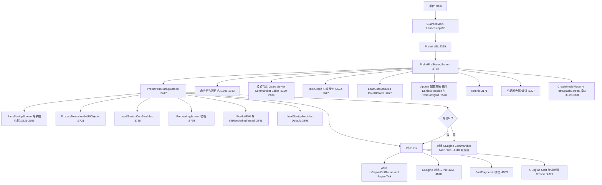

### 18.6.3 Tick 单帧调用顺序(LEL:5575-6197)

| # | 调用 | 行号 |
|---|---|---|
| 1 | BeginExitIfRequested、(测试退出设备) | 5588-5594 |
| 2 | FThreadHeartBeat::HeartBeat、FGameThreadHitchHeartBeat::FrameStart | 5600-5602 |
| 3 | LatchRenderThreadConfiguration;(-onethread)TickRenderingTickables | 5606-5613 |
| 4 | FMoviePlayerProxy::BlockingForceFinished | 5616 |
| 5 | IConsoleManager::CallAllConsoleVariableSinks | 5668 |
| 6 | FCoreDelegates::OnBeginFrame.Broadcast | 5682 |
| 7 | GLog->FlushThreadedLogs(Async) | 5688 |
| 8 | 基准帧数/时间上限退出判定 | 5692-5696 |
| 9 | GEngine->UpdateTimeAndHandleMaxTickRate(设置 FApp::CurrentTime/DeltaTime、限制帧率) | 5701 |
| 10 | ENQUEUE_RENDER_COMMAND(BeginFrame)→BeginFrameRenderThread(RHI 帧,GFrameNumberRenderThread++)、各 FScene StartFrame、RenderCommandPipe::StartRecording、动态分辨率 BeginFrame | 5714-5740 |
| 11 | GEngine->TickPerformanceMonitoring、(UPDATE_MALLOC_STATS)GMalloc->UpdateStats | 5747-5758 |
| 12 | UE::Stats::FStats::AdvanceFrame、CalculateFPSTimings、ENQUEUE_RENDER_COMMAND(ResetDeferredUpdates) | 5762-5775 |
| 13 | FPlatformApplicationMisc::PumpMessages(true) | 5784 |
| 14 | ShouldUseIdleMode 判定(可 Sleep 0.1s) | 5792-5797 |
| 15 | FPlatformFileManager::TickActivePlatformFile、FCoreDelegates::OnSamplingInput | 5828-5834 |
| 16 | SlateApp.PollGameDeviceState/FinishedInputThisFrame | 5844-5853 |
| 17 | GEngine->Tick(DeltaTime, bIdleMode)(World/GameInstance/GameMode/Actor/渲染代理生成) | 5859 |
| 18 | FPreLoadScreenManager WaitForEngineLoadingScreenToFinish/销毁 或 GetMoviePlayer()->WaitForMovieToFinish | 5866-5903 |
| 19 | FAssetCompilingManager::ProcessAsyncTasks、ProcessLocalPlayerSlateOperations、FSlateApplication::Tick(PlatformAndInput) | 5906-5921 |
| 20 | (复现录像)FExecuteConcurrentWithSlateTickTask 并发复制 | 5936-5973 |
| 21 | FSlateApplication::Tick(TimeAndWidgets)(Slate 布局绘制) | 5986-5992 |
| 22 | AutomationController/AutomationWorker Tick | 6024-6046 |
| 23 | 各 FScene EndFrame 渲染命令、RHITick(DeltaTime) | 6053-6064 |
| 24 | PendingCleanupObjects 轮转(GetPendingCleanupObjects) | 6079-6080 |
| 25 | FFrameEndSync::Sync(EndFrame)——GT 与 RT/RHI 线程帧尾同步 | 6084 |
| 26 | delete PreviousPendingCleanupObjects、DeleteLoaders、FTSTicker::GetCoreTicker().Tick、FThreadManager::Get().Tick、GEngine->TickDeferredCommands | 6095-6109 |
| 27 | MediaModule->TickPostRender、FCoreDelegates::OnEndFrame.Broadcast | 6117-6127 |
| 28 | GFrameCounter++ 并同步 GFrameCounterRenderThread(渲染命令) | 6131-6137 |
| 29 | UpdateCoreCsvStats_EndFrame、DumpGPU/DynamicResolution EndFrame、ENQUEUE_RENDER_COMMAND(EndFrame)→EndFrameRenderThread | 6144-6167 |
| 30 | CPU 利用率/UObject 数统计 | 6171-6177 |

### 18.6.4 退出流程

退出有两个触发源:主循环条件 `IsEngineExitRequested()`(GuardedMain while,Launch.cpp:190)与命令let 结束(PreInitPostStartupScreen:4262 直接 return,由 GuardedMain 的 `EngineLoopCleanupGuard` 析构保证 EngineExit 仍被调用,Launch.cpp:124-135)。

**FEngineLoop::Exit 顺序(LEL:4987-5228)**:FTSTicker::Reset(4995)→ClearPendingCleanupObjects(4997)→GIsRunning=0(4999)→PreLoadScreenManager 等待并 Destroy(5004-5014)→FVisualLogger TearDown(5018)→FAssetCompilingManager::Shutdown(5021)→delete EngineService/TraceService、SessionService->Stop(5025-5035)→GDistanceFieldAsyncQueue/GCardRepresentationAsyncQueue 删除(5037-5047)→FlushAsyncLoading(5053)→FEditorDelegates::OnEditorPreExit + GEngine->PreExit(5057-5066)→GEngine->ReleaseAudioDeviceManager(5070)→SetAsyncLoadingAllowed(false)(5080)→纹理流送 BlockTillAllRequestsFinished(5084-5091)→FAudioDeviceManager::Shutdown(5092)→FSlateApplication::Shutdown(5095)→FEngineFontServices::Destroy(5098)→UnloadModule("AssetTools"/"WorldBrowser")(5109-5112)→ClearMaterialPSORequests + PipelineStateCache::WaitForAllTasks(5117-5121)→AppPreExit(5123)→TermGamePhys(5125)→IPackageResourceManager::Shutdown + UnloadModule("AssetRegistry")(5133-5135)→ShutdownRenderingThread(5138)→FShaderPipelineCache::Shutdown(5141)→ShutdownGlobalShaderMap(5145)→FShaderCodeLibrary::Shutdown(5148)→IoDispatcher TearDown/Shutdown(5152-5159)→(编辑器)UE::Virtualization::Shutdown(5165)→FModuleManager::UnloadModulesAtShutdown(5182)→IStreamingManager::Shutdown(5185)→DestroyMoviePlayer(5187)→FThreadStats::StopThread(5191)→GThreadPool/GLargeThreadPool/GBackgroundPriorityThreadPool Destroy(5196-5211)→RHIExit(5213)→FTaskGraphInterface::Shutdown(5215)→FPlatformMisc::ShutdownTaggedStorage(5217)→(编辑器 Win)FWindowsPlatformPerfCounters::Shutdown(5220)→UE::Trace::Exit(5227)。

**AppExit(LEL:6990-7032)**:由平台 main 收尾调用(Windows:LaunchWindowsShutdown→AppExit,LaunchWindows.cpp:303-313;Unix:CommonUnixMain 的 AppExitCallback→LaunchUnix_FEngineLoop_AppExit,LaunchUnix.cpp:32-36):FPlatformApplicationMisc::TearDown→FPlatformMisc::PlatformTearDown→GConfig->Exit+delete→GLog->TearDown→FTextLocalizationManager/FInternationalization::TearDown→FTraceAuxiliary::Shutdown→AutoRTFM::Shutdown。

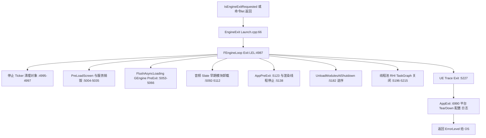

### 18.6.5 插件发现/启用解析/挂载流程(FPluginManager)

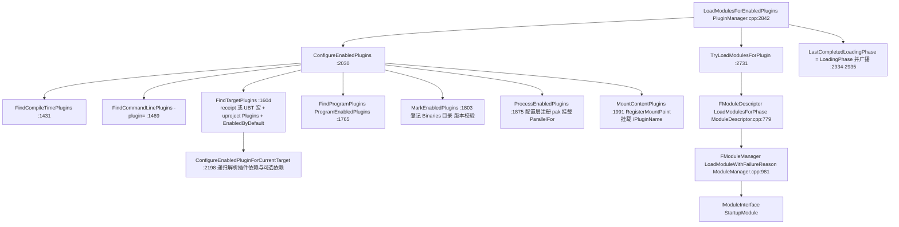

**插件发现(ReadAllPlugins,PluginManager.cpp:773-1056)的搜索顺序**:
1. 非编辑器构建先找 `<Project>/Plugins/*.upluginmanifest`(打包清单,免目录扫描,:782-786、840-893);
2. 无 manifest 时递归扫描引擎插件目录 `FPaths::GetExtensionDirs(FPaths::EngineDir(), "Plugins")`(:803-816);
3. 项目插件目录 `<Project>/Plugins`(:823-835,同名项目插件覆盖引擎插件);
4. `<Project>/Mods`(Mod 插件,:904)、uproject `AdditionalPluginDirectories`(External 插件,:911-919)、企业插件目录(:923-930);
5. 命令行 `-plugin=` 与 `UE_ADDITIONAL_PLUGIN_PATHS` 环境变量路径(DiscoverAllPlugins:753-758 注入 PluginDiscoveryPaths);
6. `<Parent>_<Platform>.uplugin` 平台扩展按模块名合并进父插件(:947-1032)。

**启用解析优先级(FindTargetPlugins:1604-1762)**:目标 receipt / UBT 编译宏(READ_TARGET_ENABLED_PLUGINS_FROM_RECEIPT 分支 :1614-1702)→ .uproject 的 Plugins 引用列表(:1721-1738,`bDisableEnginePluginsByDefault` 影响 EnabledByDefault 判定)→ uplugin 自身 EnabledByDefault(:1740-1758)。每个引用经 `ConfigureEnabledPluginForCurrentTarget`(:2198)递归拉入其依赖插件(FPluginReferenceDescriptor),可选依赖(bOptional)缺失时仅告警。

**挂载点**:ProcessEnabledPlugins 将插件 Binaries 目录登记进 FModuleManager(:1854-1857),`FConfigCacheIni::RegisterPlugin` 注册插件配置层(:1934),内容目录追加到 GEngineIni [Core.System] Paths(:1958-1961),插件自带 pak 在 cooked 构建 `<Plugin>/Content/Paks/<Platform>` 下通过 FCoreDelegates::MountPak 挂载(:1968-1986);MountContentPlugins 经 RegisterMountPointDelegate(CoreUObject 的 FPackageName 注册)把 `/PluginName/` 挂到 Content 目录(:2015-2019)。

### 18.6.6 运行模式分支(stateDiagram)

模式判定发生在 PreInitPreStartupScreen(LEL:2187-2434,详见 18.6.1 A-19),互斥全局量为 GIsClient/GIsServer/GIsEditor(+PRIVATE_GIsRunningCommandlet):

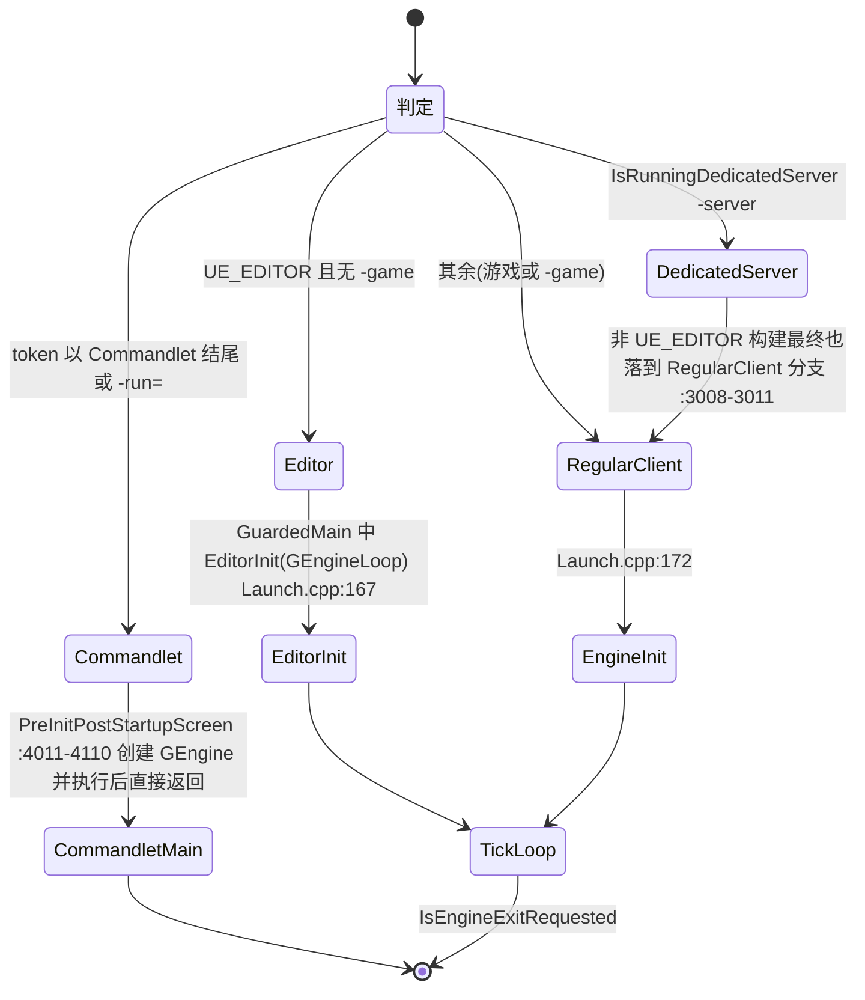

补充:Program 目标(IS_PROGRAM)没有 WITH_ENGINE 的 Tick 循环,仅复用 AppInit/AppExit(RequiredProgramMainCPPInclude.h);Dedicated Server 构建(UE_SERVER)跳过一切 `!UE_SERVER` 分支(无 Slate/电影/PreLoadScreen,LEL:3342/3604/3804/3848/6114)。

## 18.7 时序图

### 18.7.1 main() 到第一帧(Windows 游戏客户端)

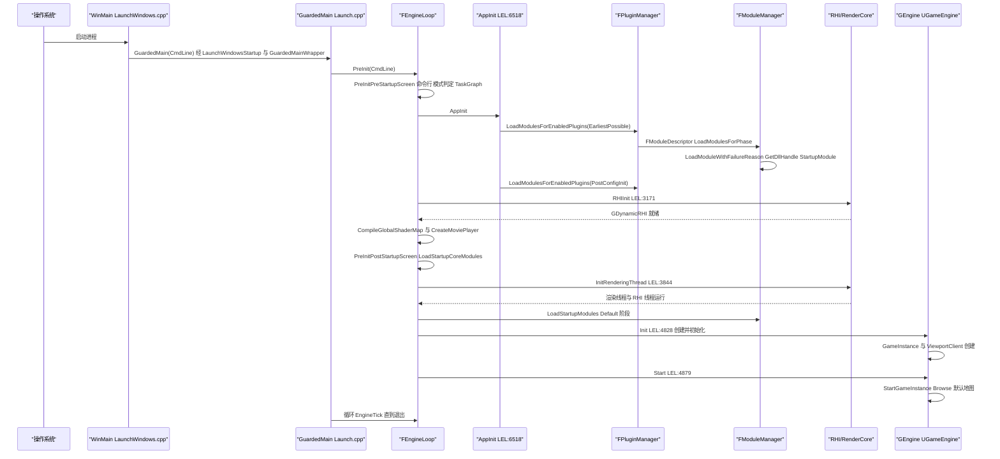

### 18.7.2 ELoadingPhase 各阶段的加载时序(项目+插件双通道)

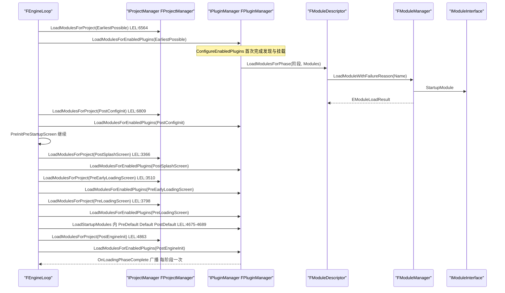

### 18.7.3 插件内容挂载时序

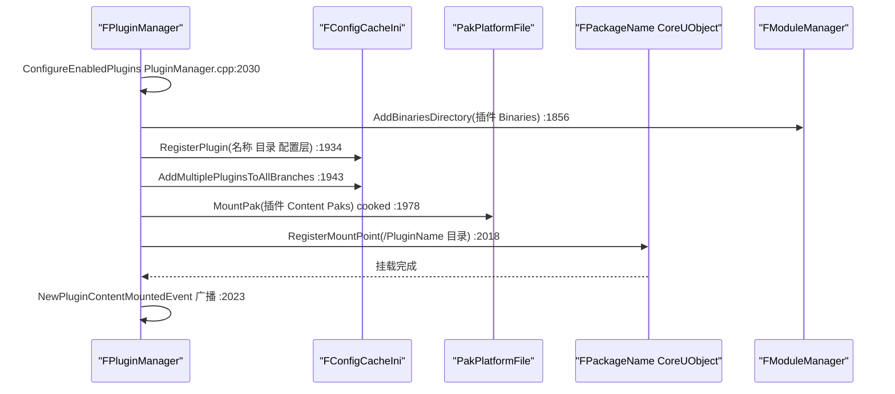

### 18.7.4 退出时序(Unix 路径)

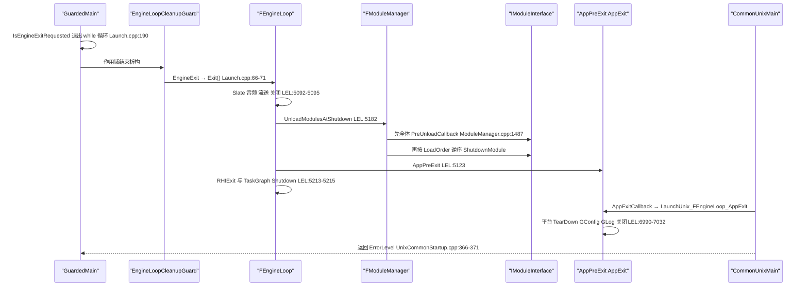

## 18.8 线程模型与同步

### 18.8.1 启动期线程创建顺序(GameThread=主线程,均在 PreInit 内)

| 顺序 | 线程/池 | 创建调用 | 位置 | 关键参数 |
|---|---|---|---|---|
| 0 | 主线程登记 | GGameThreadId=FPlatformTLS::GetCurrentThreadId | Launch.cpp:93、LEL:2180 | SetThreadPriority(FPlatformAffinity::GetGameThreadPriority())、SetThreadAffinityMask(GetMainGameMask()) LEL:2183-2184 |
| 1 | TaskGraph 工作线程(N 个) | FTaskGraphInterface::Startup(FPlatformMisc::NumberOfWorkerThreadsToSpawn()) | LEL:2592 | GameThread AttachToThread(ENamedThreads::GameThread) LEL:2593;Program 可 -ReduceThreadUsage 跳过 LEL:2583-2587 |
| 2 | GLargeThreadPool + GThreadPool(编辑器) | `GLargeThreadPool = new FQueuedLowLevelThreadPool(); GThreadPool = new FQueuedThreadPoolWrapper(GLargeThreadPool, NumThreadsInThreadPool)` | LEL:2617-2631 | 编辑器栈 1MB(L2613);专用服务器仅 1 池线程 |
| 3 | GBackgroundPriorityThreadPool | FQueuedThreadPool::Allocate + Create | LEL:2638-2645 | 2 线程(服务器 1),TPri_Lowest,"BackgroundThreadPool" |
| 4 | Stats 线程 | FThreadStats::StartThread | LEL:2662 | 仅 STATS 编译 |
| 5 | Android 事件线程 | pthread_create(AndroidEventThreadWorker) | LaunchAndroid.cpp:1045 | android_main 内,早于 AndroidMain |
| 6 | Log 专用主线程 | GLog->TryStartDedicatedPrimaryThread | LEL:2791 | -NoLogThread 禁用 |
| 7 | GIOThreadPool | FQueuedThreadPool::Allocate + Create | LEL:2798-2804 | NumberOfIOWorkerThreadsToSpawn,96KB 栈,TPri_AboveNormal,"IOThreadPool";服务器 2 线程 |
| 8 | 渲染线程 + RHI 线程 | InitRenderingThread → StartRenderingThread | LEL:3336 或 3844 → RenderCore/Private/RenderingThread.cpp:794/561 | check(IsInGameThread)(:563);FRHIThread::TargetMode 决定 DedicatedThread/Tasks/None(:588-600);-norhithread 关闭 RHI 线程(:798-802);GUseThreadedRendering 由 FPlatformMisc::UseRenderThread()+LatchRenderThreadConfiguration 决定(LEL:2869-2872、5606) |
| 9 | 音频线程开关 | FAudioThread::SetUseThreadedAudio(bUseThreadedAudio) | LEL:3094-3102 | 引擎 ini [Audio] UseAudioThread;线程实体由音频模块后续创建 |
| 10 | 心跳线程 | FThreadHeartBeat::Get().Start | LEL:4939 | Init 内;FGameThreadHitchHeartBeat::InitSettings LEL:4970-4971 |

### 18.8.2 线程归属与同步原语

| 对象/数据 | 所在线程 | 依据与同步 |
|---|---|---|
| FEngineLoop 全部阶段方法 | GameThread(主线程) | GuardedMain 的 FTaskTagScope(ETaskTag::EGameThread)(Launch.cpp:91);Tick 内大量 `check(IsInGameThread())` 风格代码(如 ProcessLocalPlayerSlateOperations 附近 LEL:5915 `check(!IsRunningDedicatedServer())`) |
| FModuleManager::Modules(FModuleMap) | 访问受 ModulesCriticalSection 保护;写操作(Load/Unload/AddModule)仅 GameThread | GetOrLoadModule 非 GameThread 返回 NotLoadedByGameThread(ModuleManager.cpp:935-949);FModuleInfo::bIsReady 为 TAtomic,GetModule 以 `bIsReady || IsInGameThread()` 放行(ModuleManager.cpp:1507-1520) |
| FPluginManager 状态 | GameThread;GetLocalizationPathsForEnabledPlugins 注释明确不能在 worker 线程触发 ConfigureEnabledPlugins(PluginManager.cpp:2951-2952) | ProcessEnabledPlugins 的 ParallelFor 使用 FCriticalSection ConfigCS/PluginPakCS(PluginManager.cpp:1907-1908、1955、1975) |
| OnModulesChanged 委托 | 订阅线程安全,GameThread 广播 | ModuleManager.h:521-531 声明注释 |
| 渲染命令(GRHICommandList) | GameThread 生产,渲染线程执行;RHI 命令由 FRHIThread 或 RT 内联执行 | Tick 内 ENQUEUE_RENDER_COMMAND(BeginFrame/EndFrame/FrameCounter)LEL:5714/6133/6163;IsRunningRHIInSeparateThread 判定 LEL:1523 |
| GT/RT 帧同步 | FFrameEndSync::Sync(FFrameEndSync::EFlushMode::EndFrame) | LEL:6084,每 Tick 一次 |
| 跨帧清理对象 | PendingCleanupObjects 每帧轮转,上帧对象在渲染命令 flush 后删除 | LEL:6079-6095、ClearPendingCleanupObjects LEL:6200 |
| 启动屏渲染 | PreLoadScreenManager 逻辑在 GameThread,渲染在 RT(StaticRenderTick_RenderThread) | PreLoadScreenManager.h:94-95 |
| 日志 | 多线程写 GLog;FlushThreadedLogs(Async) 每 Tick(LEL:5688);TryStartDedicatedPrimaryThread 后有专用线程(LEL:2786-2792) | — |
| 电影阻塞 | FMoviePlayerProxy::BlockingForceFinished 由 GameThread 在 Tick 三处调用(LEL:5616/5908/6112) | MoviePlayerProxy.h:27 |
| 崩溃处理 | 平台信号/SEH 上下文线程 | Windows 双层 __except(LaunchWindows.cpp:119-131、272-295);Unix FPlatformMisc::SetCrashHandler(CommonUnixCrashHandler)(UnixCommonStartup.cpp:318) |

## 18.9 配置与扩展点

### 18.9.1 命令行(节选,均在 PreInitPreStartupScreen 解析)

| 参数 | 作用 | 解析位置 |
|---|---|---|
| `-server` | DedicatedServer 模式 | IsRunningDedicatedServer 判定 LEL:2307 |
| `-game` | UnrealEditor 以游戏模式运行(token 移到尾部) | LEL:2387-2403 |
| `-run=XxxCommandlet` / 首 token 以 Commandlet 结尾 | 命令let 模式 | LEL:2318-2342 |
| `-waitforattach/-WaitForDebugger(-NoBreak 变体)` | 等待调试器 | Launch.cpp:100-114 |
| `-stdout` / `-UTF8Output` | 标准输出设备(UTF8Output 已弃用仅提示) | LEL:1892/1898-1902 |
| `-EnvAfterHere`+环境变量 `UE-CmdLineArgs` | 追加命令行 | LEL:1817-1827 |
| `-SECONDS=` / `-BENCHMARKSECONDS=` / `-FPS=` / `-BENCHMARK` | Tick 时长/帧数上限、固定帧率 | InitTime LEL:4707-4731、L2451 |
| `-Deterministic/-UseFixedTimeStep/-FixedSeed` | 固定时间步与随机种子 | LEL:2457-2463 |
| `-testexit=短语` | 日志匹配即退出 | LEL:1921-1932、Tick L5590-5594 |
| `-NoLogThread` | 禁用 Log 专用线程 | LEL:2789 |
| `-norhithread` / `-RenderOffScreen` / `-onethread` | RHI 线程关闭 / 离屏 / 单线程渲染 | RenderingThread.cpp:798;LEL:3111;GUseThreadedRendering L5609 |
| `-hmd=` / `-nohmd` / `-emulatestereo` | HMD 模块筛选 | PreInitHMDDevice LEL:7064-7114 |
| `-plugin=` / `UE_ADDITIONAL_PLUGIN_PATHS` | 外部插件目录 | PluginManager FPluginDiscoveryContext(PluginSystemDefs) |
| `-norecentproject` / `-BUILDMACHINE` / `-Multiprocess` | 编辑器最近项目/构建机/多进程抑制 | LEL:2440-2445、6490-6495、6869 |
| `-mallocframeprofiler` | malloc 帧剖析器 | LEL:1937-1941 |
| `-DumpEarlyConfigReads/-DumpEarlyPakFileReads/-ForceQuitAfterEarlyReads` | 早期 IO 剖析 | LEL:2680-2699、3646 |
| `-fastexit` | 命令let 跳过收尾 | LEL:4255-4259 |
| `-AllowCommandletRendering/-AllowCommandletAudio` | 命令let 渲染/音频 | LEL:2246-2247 |

### 18.9.2 ini/配置

| 位置 | 作用 | 消费点 |
|---|---|---|
| [/Script/Engine.Engine] GameEngine / EditorEngine / UnrealEdEngine | GEngine 类名 | Init LEL:4773/4786;命令let LEL:4018/4037 |
| [/Script/Engine.RendererSettings] 等 5 组 | CVar 项目设置 | LEL:2817-2823(ApplyCVarSettingsFromIni) |
| [Core.System] Paths | 内容/插件目录追加 | ProcessEnabledPlugins PluginManager.cpp:1958-1961 |
| [Plugins] ConfigFilesPluginsCannotOverride / ProgramEnabledPlugins / ProgramOptionalPlugins | 插件配置覆盖限制 / 程序插件 | PluginManager.cpp:1904-1905、1774-1795 |
| CommandLineAliases.ini(项目 Config) | 命令行别名 | LEL:2074-2107 |
| [/Script/BuildSettings.BuildSettings] DefaultEditorTarget | 编辑器目标 receipt 匹配 | LEL:6593 |
| [Audio] UseAudioThread | 音频线程 | LEL:3099 |
| [Engine.ErrorHandling] bPromptForRemoteDebugging(-OnEnsure) | 远程调试提示 | LEL:6823-6839 |
| [LogFiles] LogTimes | 日志时间格式(CVar log.Timestamp 映射) | LEL:6263-6320 |
| [AutomationTesting] bForceSmokeTests | 冒烟测试 | LEL:6906-6908 |
| MoviePlayerSettings(globalconfig,Source/Runtime/MoviePlayer/Public/MoviePlayerSettings.h:19) | 启动电影列表 | SetupLoadingScreenFromIni |
|uproject `AdditionalPluginDirectories`/`bDisableEnginePluginsByDefault` | 插件搜索与默认禁用 | ProjectDescriptor.h:106/193 |

### 18.9.3 委托/扩展点

| 委托 | 广播时机 | 声明位置 |
|---|---|---|
| FCoreDelegates::GetPreMainInitDelegate | GuardedMain 最早期(Launch.cpp:121) | Core/Misc/CoreDelegates.h |
| FDelayedAutoRegisterHelper 各阶段(StartOfEnginePreInit/FileSystemReady/TaskGraphSystemReady/StatSystemReady/IniSystemReady/EarliestPossiblePluginsLoaded/PreRHIInit/ShaderTypesReady/PreObjectSystemReady/ObjectSystemReady/EndOfEngineInit) | LEL 对应行(1731/2163/2650/2665/6559/6569/3166/3298/3716/3745/4968) | Core/Misc/DelayedAutoRegisterHelper.h |
| FCoreDelegates::OnInit / OnPostEngineInit(新 GetOnPostEngineInit)/ OnBeginFrame / OnEndFrame / OnPreExit / OnExit / OnFEngineLoopInitComplete / StarvedGameLoop | LEL:6915/4835-4837/5682/6127/6931/6940/4951/4936 | Core/Misc/CoreDelegates.h |
| FCoreDelegates::OnMountAllPakFiles / MountPak | EarlyStartupScreen 后挂 pak | LEL:3630-3644、PluginManager.cpp:1976 |
| IPluginManager::OnLoadingPhaseComplete / OnNewPluginMounted / OnNewPluginContentMounted | 每加载阶段 / 内容挂载 | IPluginManager.h:322/528/533 |
| IProjectManager::OnLoadingPhaseComplete | 项目模块每阶段 | IProjectManager.h:122 |
| FModuleManager::OnModulesChanged / OnProcessLoadedObjectsCallback | 模块增删 / 模块 UObject 处理 | ModuleManager.h:531/547 |
| IInstallBundleManager::InstallBundleCompleteDelegate(及 InitComplete/PausedBundle/Released/PatchCheck 等) | Bundle 生命周期 | InstallBundleManagerInterface.h:128-136 |
| IModularFeatures(HeadMountedDisplay) | PreInitHMDDevice 枚举 IHeadMountedDisplayModule | LEL:7064-7114 |
| ELoadingPhase/EHostType(.uplugin Modules 字段) | 插件声明式扩展 | ModuleDescriptor.h |
| MountExplicitlyLoadedPlugin/UnmountExplicitlyLoadedPlugin + bExplicitlyLoaded | GameFeature 插件运行期挂载 | IPluginManager.h:548-589 |

## 18.10 已知限制/未确认项

1. **FPlugin 内部字段未逐字引用**:FPlugin(PluginManager.cpp 内部类)的 `bEnabled/bIsMounted/Name/FileName/Descriptor/Type` 等成员通过其使用处(如 PluginManager.cpp:562、1866-1888、1994-2027)与 FPluginManager::FPluginDiscoveryContext 交互确认存在,但该类定义体(PluginManager.cpp 约 300-510 行区域)未逐行抄录,本章节类图仅示意性列出;精确字段以附录 `appendix/api/Runtime/Projects.md` 为准。
2. **ConfigureEnabledPluginForCurrentTarget 的依赖递归细节**(:2198-2360)与 ConfigureEnabledPluginForTarget(:2362)未逐行阅读,仅确认其由 FindTargetPlugins/FindCommandLinePlugins 调用并递归处理 FPluginReferenceDescriptor 依赖(含 bOptional 与 DisallowedPlugins 提示)。
3. **LaunchMac.cpp(Mac 入口)未阅读**:Mac 平台入口在 `Source/Runtime/Launch/Private/Mac/LaunchMac.cpp`,本章仅确认文件存在与 CommonUnixMain 的通用路径(Linux 路径已完整阅读);Mac 特有的 NSApplication 集成未验证。
4. **AndroidMain 内部流程未展开**:LaunchAndroid.cpp(2384 行)只阅读了 android_main(1026-1050)与事件线程创建;AndroidMain 内的 GameActivity 生命周期、暂停恢复路径未覆盖。
5. **FPreLoadScreenManager 的内部线程模型**:PreLoadSlateThreading.h(Slate 独立线程渲染启动屏)仅确认存在,`EarlyPlayFrameTick/GameLogicFrameTick/EarlyPlayRenderFrameTick` 的具体调度线程未逐行验证;已验证的是渲染回调 `StaticRenderTick_RenderThread` 名义上在渲染线程(PreLoadScreenManager.h:94)。
6. **PLATFORM_SUPPORTS_EARLY_MOVIE_PLAYBACK 的平台集合**未在源码中逐一列举(影响 PostInitRHI/InitRenderingThread 提前到 3333-3336 的平台列表),本章以两条分支并列呈现。
7. **MoviePlayer 后端插件**(WindowsMoviePlayer/AppleMoviePlayer/AndroidMoviePlayer/WebMMoviePlayer/PreLoadScreenMoviePlayer)只确认目录与 .uplugin(PreLoadScreenMoviePlayer.uplugin:RuntimeNoCommandlet + PreEarlyLoadingScreen 阶段),IMovieStreamer 实现细节未读。
8. **崩溃路径细节**:GuardedMainWrapper/Windows __except、CommonUnixCrashHandler 的调用链已验证,但 CrashReportCore 的上报流程(CrashUpload/各平台 ErrorReport)仅读了模块头,内部未展开。
9. **`Source/Runtime/Launch/Private/IOS/LaunchIOS.cpp` 的 VisionOS/KickoffWithCompositingLayer 部分**未阅读(与本章主线无关)。
10. **Engine/Platforms/{Windows,Android,IOS,VisionOS}** 目录未逐文件核对(18.5.10 已声明范围豁免)。
11. FEngineService/FTraceService/ISessionService(Init 内创建,LEL:4843-4858)属于 SessionServices/TraceServices 模块,本章节仅覆盖其在启动/退出的生命周期边界。

## 18.11 附录索引

本章覆盖模块对应的全量符号附录(相对本文档根 `docs/ue5.8.3/`):

| 模块 | 附录文件 |
|---|---|
| Launch | appendix/api/Runtime/Launch.md |
| Projects | appendix/api/Runtime/Projects.md |
| Core(FModuleManager/IModuleInterface/平台 HAL) | appendix/api/Runtime/Core.part01.md ~ Core.part03.md |
| UnixCommonStartup | appendix/api/Runtime/UnixCommonStartup.md |
| DeveloperSettings | appendix/api/Runtime/DeveloperSettings.md |
| EngineSettings | appendix/api/Runtime/EngineSettings.md |
| BuildSettings | appendix/api/Runtime/BuildSettings.md |
| PerfCounters | appendix/api/Runtime/PerfCounters.md |
| CrashReportCore | appendix/api/Runtime/CrashReportCore.md |
| Instrumentation | appendix/api/Runtime/Instrumentation.md |
| StudioTelemetry | appendix/api/Runtime/StudioTelemetry.md |
| Advertising | appendix/api/Runtime/Advertising.md |
| AndroidAdvertising / IOSAdvertising | appendix/api/Runtime/AndroidAdvertising.md、appendix/api/Runtime/IOSAdvertising.md |
| Analytics / AnalyticsCSV / AnalyticsET / AnalyticsHorde / AnalyticsLog / AnalyticsSwrve / AnalyticsVisualEditing | appendix/api/Runtime/Analytics.md、AnalyticsCSV.md、AnalyticsET.md、AnalyticsHorde.md、AnalyticsLog.md、AnalyticsSwrve.md、AnalyticsVisualEditing.md |
| HardwareSurvey | appendix/api/Runtime/HardwareSurvey.md |
| SynthBenchmark | appendix/api/Runtime/SynthBenchmark.md |
| PortalMessages / PortalProxies / PortalRpc / PortalServices | appendix/api/Runtime/PortalMessages.md、PortalProxies.md、PortalRpc.md、PortalServices.md |
| LauncherCheck / LauncherPlatform / LaunchDaemonMessages | appendix/api/Runtime/LauncherCheck.md、LauncherPlatform.md、LaunchDaemonMessages.md |
| InstallBundleManager | appendix/api/Runtime/InstallBundleManager.md |
| PreLoadScreen | appendix/api/Runtime/PreLoadScreen.md |
| MoviePlayer / MoviePlayerProxy | appendix/api/Runtime/MoviePlayer.md、appendix/api/Runtime/MoviePlayerProxy.md |
| PreLoadScreenMoviePlayer(插件) | appendix/api/Plugins/PreLoadScreenMoviePlayer.md |
| AnalyticsMulticast(插件,StudioTelemetry 关联) | appendix/api/Plugins/AnalyticsMulticast.md |
| RHI / RenderCore(启动路径消费) | appendix/api/Runtime/RHI.md、RenderCore.md |
| Engine(GGameEngine/UGameEngine/UGameInstance 边界) | appendix/api/Runtime/Engine.part01.md ~ Engine.part06.md |

模块元数据(路径/依赖/符号统计)来自 `appendix/modules.json`。

