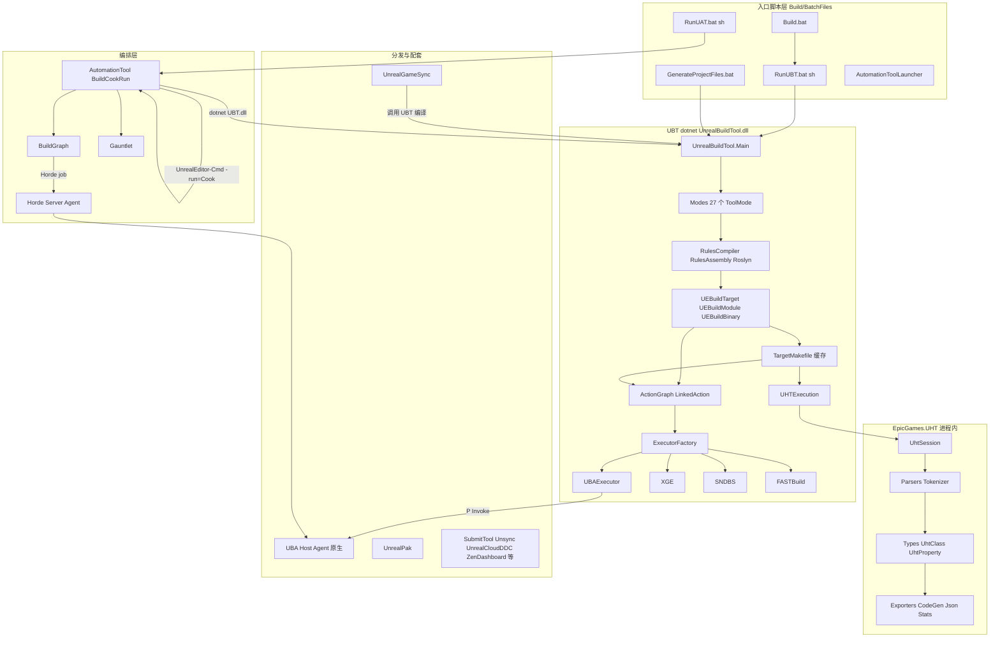
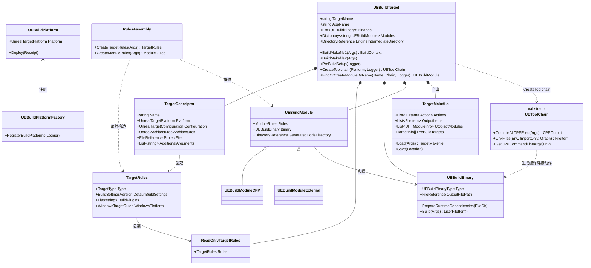
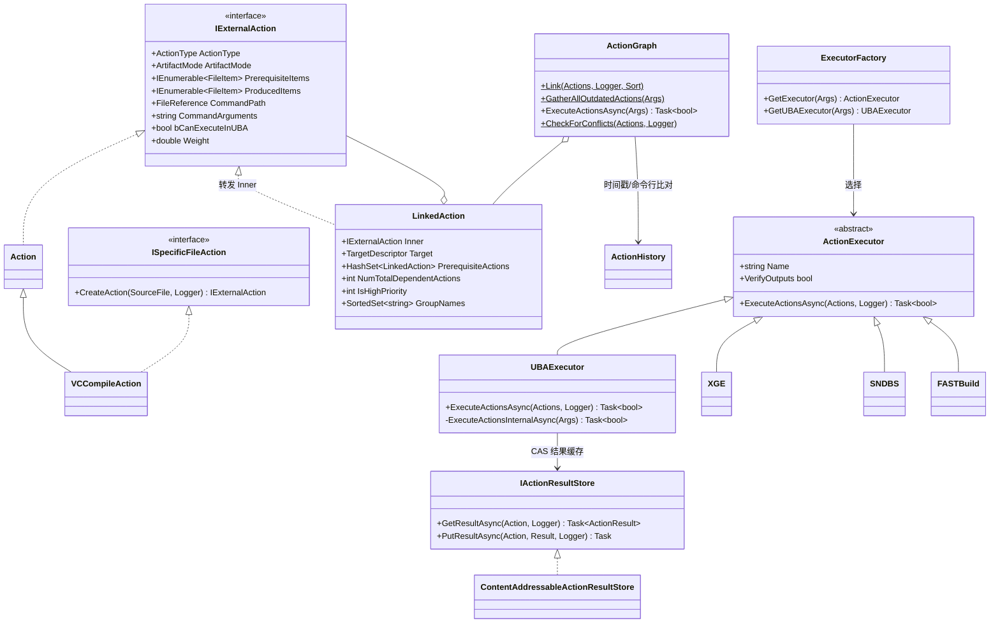
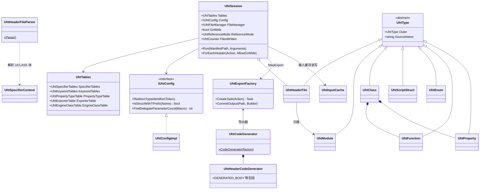
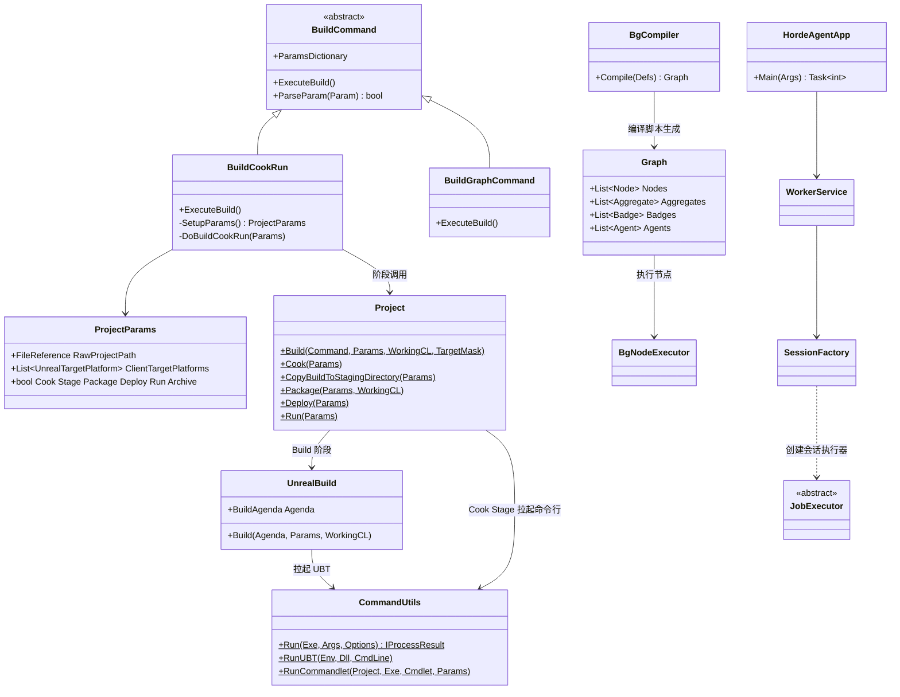

# 19 构建与工具链:UBT、UHT、UAT、BuildGraph、Horde、UBA、UGS

本章覆盖 UE 5.8.3 的整套构建工具链:`Engine/Source/Programs` 下的 UnrealBuildTool(UBT,301 个 .cs)、EpicGames.* 共享 C# 库(含 EpicGames.UHT)、AutomationTool(UAT)、UnrealBuildAccelerator(UBA)、Horde、UnrealGameSync(UGS)、UnrealVS、IncludeTool、UnrealPak、UnrealLightmass/UnrealSwarm、UnrealFrontend、UnrealInsights、SubmitTool、Unsync、UnrealCloudDDC、ZenDashboard,以及 `Engine/Build` 目录(Build.version、BatchFiles)与 BuildConfiguration 配置体系。

贯穿全章的几个关键事实(均逐一读自 5.8.3-release 源码):

- UHT 已不再是独立进程。`Engine/Programs/UnrealHeaderTool` 下只剩 `Config/DefaultEngine.ini`;UnrealHeaderTool 是 UBT 的一个进程内模式(`-Mode=UnrealHeaderTool`,Modes/UnrealHeaderToolMode.cs:618),UBT 在 BuildMakefile1 之后通过 `UnrealHeaderToolMode.ExecuteAsync` 直接调用 `EpicGames.UHT` 库的 `UhtSession.Run` 完成解析与代码生成(System/UHTExecution.cs:1476-1478)。
- 本地执行也走 UBA。5.8.3 的 `Executors/` 目录已无 LocalExecutor/ParallelExecutor;`ExecutorFactory.GetExecutor` 按 `RemoteExecutorPriority`(默认 `[XGE, SNDBS, FASTBuild, UBA]`)选择,最终兜底永远是 `UBAExecutor`,禁用 detour 时即等价于旧的本地并行执行(Configuration/BuildConfiguration.cs:47-55,Executors/ExecutorFactory.cs:23-60)。
- UBT 是 `dotnet UnrealBuildTool.dll` 进程:Build.bat 先确保 UBT 编译(`dotnet build/publish`),再 `dotnet %UBTPath% %*` 执行(Build/BatchFiles/Build.bat:48-79)。
- `EpicGames.Build.csproj` 的 RootNamespace 是 `UnrealBuildBase`(Shared/EpicGames.Build/EpicGames.Build.csproj:3),`Unreal`/`DirectoryItem`/`FileItem`/`Parallel2`/`Timeline`/`GlobalSingleInstanceMutex` 等基础设施都在该项目中;UBT 的 csproj 依赖为 EpicGames.Build/Core/Horde/IoHash/LogMatchers/OIDC/Serialization/UBA/UHT(UnrealBuildTool.csproj:56-64)。
- 规则文件(Target.cs/Build.cs)通过 Roslyn 动态编译:`RulesAssembly` 调 `DynamicCompilation.CompileAndLoadAssembly`(System/DynamicCompilation.cs:413,RulesAssembly.cs:195)。

源码根约定:路径相对 `$E`(即 `$UE/Engine`),`Source/Programs/` 前缀有时省略为程序名;行号基于 5.8.3-release 源码逐一核对。

## 19.1 职责、边界与模块清单

范围以 C# 程序为主,绝大多数没有 C++ Build.cs;"依赖"列对 C# 程序列 csproj 的 ProjectReference(已核对),对 C++ 程序列 Build.cs/Target.cs 名。

### 19.1.1 共享库 Shared/EpicGames.*(C#)

| 模块 | 路径 | 语言/入口 | 依赖 | 职责 |
|---|---|---|---|---|
| EpicGames.Core | Source/Programs/Shared/EpicGames.Core | C# 类库 | System.Text.Json 等 | 基础类型:FileReference/DirectoryReference/CommandLineArguments/BinaryArchive/CB 序列化封装、日志、ScheduleAsync、目录枚举缓存 |
| EpicGames.Build | Source/Programs/Shared/EpicGames.Build | C# 类库(RootNamespace=UnrealBuildBase) | EpicGames.Core | Unreal 路径常量(Unreal.cs)、DirectoryItem/FileItem/Parallel2/Timeline/GlobalSingleInstanceMutex/CompileScriptModules/Rules、SDK 描述(Platform/SDKCollection.cs)、Automation 命令行与进程单例 |
| EpicGames.UHT | Source/Programs/Shared/EpicGames.UHT | C# 类库 | EpicGames.Core | UHT 全部实现:Tokenizer/Parsers/Types/Tables/Specifiers/Exporters/Utils(UhtSession/UhtTables) |
| EpicGames.BuildGraph | Source/Programs/Shared/EpicGames.BuildGraph | C# 类库 | EpicGames.Core | BuildGraph 图模型与脚本字节码编译器:BgCompiler/BgInterpreter/BgOpcode、Graph/Node/Aggregate/Badge 定义(BgGraphDef 等 35 个 .cs) |
| EpicGames.Horde | Source/Programs/Shared/EpicGames.Horde | C# 类库 | EpicGames.Core/Perforce/Redis 等 | Horde 服务器 HTTP API 客户端:Agents/Jobs/Artifacts/Compute/Devices/Leases 等 |
| EpicGames.Perforce | Source/Programs/Shared/EpicGames.Perforce | C# 类库 | EpicGames.Core | Perforce 封装:IPerforceConnection/NativePerforceConnection(原生 dll)/PerforceChildProcess、托管工作区(Perforce.Managed) |
| EpicGames.IoHash | Source/Programs/Shared/EpicGames.IoHash | C# 类库 | — | IoHash/Blake3 哈希类型与工具(Blake3Hash.cs) |
| EpicGames.Serialization | Source/Programs/Shared/EpicGames.Serialization | C# 类库 | EpicGames.Core | Compact Binary(不透明引用/压缩缓冲)读写器 CbWriter/CbField/CbSerializer |
| EpicGames.Redis | Source/Programs/Shared/EpicGames.Redis | C# 类库 | StackExchange.Redis | Redis 连接池与类型化 key(RedisHashKey/RedisSortedSetKey 等) |
| EpicGames.OIDC | Source/Programs/Shared/EpicGames.OIDC | C# 类库 | — | OIDC 令牌管理:OidcTokenManager/HttpOidcAuthHandler/各平台 TokenStore |
| EpicGames.UBA | Source/Programs/Shared/EpicGames.UBA | C# 类库 | UBA 原生二进制 | UBA 原生 API 的 C# 绑定:IServer/ISessionServer/IScheduler/IStorageServer/ICacheClient(I*.cs + Impl/*.cs) |
| EpicGames.MsBuild | Source/Programs/Shared/EpicGames.MsBuild | C# 类库 | — | csproj 构建(CsProjBuilder)与 MSBuild 支持 |
| EpicGames.LogMatchers | Source/Programs/Shared/EpicGames.LogMatchers | C# 类库 | — | 构建日志匹配器(编译错误/内容/Crash/异常事件),UBT/UAT 共用 LogMatcherCollections.UBTMatchers |
| EpicGames.Slack | Source/Programs/Shared/EpicGames.Slack | C# 类库 | — | Slack 消息模型与 SlackClient |
| EpicGames.MongoDB | Source/Programs/Shared/EpicGames.MongoDB | C# 类库 | Mongo 驱动 | MongoDB 序列化辅助 |
| EpicGames.ProjectStore | Source/Programs/Shared/EpicGames.ProjectStore | C# 类库 | — | 项目存储类型与云存储 |
| EpicGames.Tracing | Source/Programs/Shared/EpicGames.Tracing | C# 类库 | — | chronon 追踪(uba trace)读写 |
| EpicGames.Oodle | Source/Programs/Shared/EpicGames.Oodle | C# 类库 | Oodle 原生 | Oodle 压缩绑定 |
| EpicGames.Analytics.Telemetry | Source/Programs/Shared/EpicGames.Analytics.Telemetry | C# 类库 | — | 遥测端点模型(UBT TelemetryService 使用) |
| 其余(Tests/Fixture/Benchmarks/Analytics.Generators/Analytics.PerformanceTrends/AspNet/ScriptBuild) | Source/Programs/Shared/* | C# | — | 上述库的单元测试、性能基准、ASP.NET 中间件与脚本编译辅助 |

### 19.1.2 UnrealBuildTool(UBT,Source/Programs/UnrealBuildTool,301 个 .cs)

| 子系统 | 路径 | 职责(核心文件) |
|---|---|---|
| 主入口 | UnrealBuildTool.cs | `UnrealBuildTool.Main`:解析全局参数、注册模式(反射扫描 IToolMode<> 实现)、XmlConfig、平台注册、单实例互斥、UBA trace 与 Timeline 收尾(UnrealBuildTool.cs:184-585) |
| Modes/ | Modes/(27 个模式 .cs) | 每个 UBT 子命令:Build/Clean/GenerateProjectFiles/QueryTargets/UnrealHeaderTool/JsonExport/WriteMetadata/IWYU/Analyze/ClRepro/Deploy/Execute/SetupPlatforms/ValidatePlatforms/Test/ReportBuildResults/PrintBuildGraphInfo/ProfileUnitySizes/FixIncludePaths/InlineGeneratedCpps/PipInstall/Query/ParseMsvcTimingInfo/AggregateClang 与 AggregateParsed TimingInfo/GenerateClangDatabase/WriteDocumentation |
| Configuration/Descriptors | Configuration/Descriptors/ | 描述符:TargetDescriptor/TargetInfo/OriginalTargetDescriptor、ProjectDescriptor、PluginDescriptor/PluginReferenceDescriptor、ModuleDescriptor、LocalizationDescriptor |
| Configuration/Rules | Configuration/Rules/ | TargetRules/ModuleRules(规则基类与全部属性)、ReadOnlyTargetRules、RulesCompiler/RulesAssembly/RulesScope/RulesDocumentation、BuildSystemContext、CppCompileWarnings、Test*Rules |
| Configuration/Ini、Xml | Configuration/Ini/、Configuration/Xml/ | ConfigCache/ConfigHierarchy/ConfigFile 等 ini 读取;XmlConfig/XmlConfigFile 属性与缓存(BuildConfiguration.xml) |
| Configuration 核心 | Configuration/UEBuild*.cs | UEBuildTarget(7115 行)、UEBuildModule(+CPP/External)、UEBuildBinary、UEBuildPlatform(+Factory)、UEBuildPlugin、UEBuildDeploy、UEBuildBundleResource、UEBuildFramework;CompileWarnings 过滤框架 |
| Actions/ | Actions/ | Action/LinkedAction/IExternalAction/ISpecificFileAction、ActionGraph(链接/过期判定/执行入口)、ActionGraphBuilder/TargetMakefileBuilder、ActionHistory、ActionMetrics/ActionResult(+Manifest)/ActionSerializer、ResultStore(IActionResultStore、ContentAddressableActionResultStore、NullActionResultStore) |
| Executors/ | Executors/ | ActionExecutor 基类、ExecutorFactory、XGE、SNDBS、Experimental/FASTBuild、UnrealBuildAccelerator/(UBAExecutor、UBAAgentCoordinator(+Horde)、UBAHordeSession、UnrealBuildAccelerator*Config)、ActionLogger |
| ToolChain/ | ToolChain/ | UEToolChain 抽象基类(CompileAllCPPFiles/LinkAllFiles 等)、ISPCToolChain、IWYUToolChain |
| Platform/ | Platform/{Windows,Microsoft,Linux,Mac,Apple,IOS,TVOS,Android,Clang} | 各平台 UEBuildPlatform/ToolChain/PlatformSDK/ProjectGenerator/Exports:VCToolChain/VCEnvironment/VCCompileAction、ClangToolChain(+Link)、LinuxToolChain、MacToolChain/ApplePortableToolChain、IOSToolChain、TVOSToolChain、AndroidToolChain、GDK/MSGaming、ResX 资源 |
| Preprocessor/ | Preprocessor/ | UBT 自带 C/C++ 预处理器(供 IWYU/自适应 Unity/IncludeTool 复用):Preprocessor/PreprocessorContext/PreprocessorExpression/TokenReader/SourceFile(Fragment/Markup) |
| ProjectFiles/ | ProjectFiles/ | ProjectFileGenerator 抽象与各 IDE 生成器:VisualStudio(VCProject)、VSCode、Rider、Xcode、Make、CMake、CLion、KDevelop、QMake、CodeLite、Eddie、AndroidStudio、VisualStudioWorkspace;Project/ProjectFile/ProjectTarget/PlatformProjectGenerator(Collection) |
| Storage/ | Storage/ | IStorageProvider + Impl/FileSystemStorageProvider:按 IoHash 寻址的动作结果缓存存储 |
| System/ | System/(44 个 .cs) | UHTExecution(UHT 清单/调用/时间戳)、ProtoExecution(protoc)、TargetMakefile、TargetReceipt、ModuleManifest、UEBuildTarget 依赖的 CppCompileEnvironment/LinkEnvironment、CppDependencyCache/CppIncludeParser/SourceFileMetadataCache/FileHashCache/FileMetadataPrefetch、Unity、HotReload(Live Coding)、PrecompiledHeader(Instance/Template/Manifest)、DynamicCompilation(Roslyn)、Telemetry、Timeline、JunkDeleter、InstalledPlatformInfo、Plugins、Utils、TopologicalSorter、VerseVMBytecodeGenerator 等 |

UBT 无 Build.cs;它是 csproj 工程,ProjectReference 见 19.1.1 末条说明。

### 19.1.3 AutomationTool(UAT)与 BuildGraph

| 模块 | 路径 | 语言/入口 | 职责 |
|---|---|---|---|
| AutomationTool 驱动 | Source/Programs/AutomationTool/Program.cs | C# `AutomationToolDriver.Program.Main` | 解析全局参数/命令、编译并加载脚本模块、反射调用 `AutomationTool.Automation.ProcessAsync`(Program.cs:375-546) |
| AutomationUtils.Automation | Source/Programs/AutomationTool/AutomationUtils/ | C# 脚本模块 | Automation.ProcessAsync 命令调度、BuildCommand 基类、CommandUtils/ProcessUtils、ProjectParams(3557 行)、UnrealBuild(BuildAgenda)、UBTUtils.RunUBT、CommandletUtils.RunCommandlet、Platform/DeploymentContext、Agent/Zen/MCPPublic 等 |
| Scripts(AutomationScripts.Automation) | Source/Programs/AutomationTool/Scripts/ | C# 脚本模块 | BuildCookRun、BuildProjectCommand(Project.Build)、CookCommand(Project.Cook)、CopyBuildToStagingDirectory(Project.CopyBuildToStagingDirectory/Stage)、DeployCommand、ArchiveCommand、RunCommand、BuildPlugin/BuildTarget/CryptoKeys/ExtractPaks/FixupRedirects/CleanFormalBuilds/Bisect/Turnkey 相关、BenchmarkBuild、Oplog |
| BuildGraph.Automation | Source/Programs/AutomationTool/BuildGraph/ | C# 脚本模块 | BuildGraph.cs(`BuildGraph` 命令)、BgGraphBuilder/BgNodeExecutor/BgTask/Task.cs、TempStorage、70 个 Tasks/*.cs(Command/Compile/Cook/Stage/Zip/Submit/Horde*/Docker*/Zen* 等) |
| Gauntlet.Automation | Source/Programs/AutomationTool/Gauntlet/ | C# 脚本模块 | 功能测试框架:Gauntlet.TestExecutor/TestGroup/Params、Framework(Account/Devices)、Unreal/(RunUnreal、BuildSource、Editor/Engine/Game 测试节点)、SelfTest |
| 平台自动化 | Source/Programs/AutomationTool/{Android,Apple,IOS,Linux,Mac,Microsoft,TVOS,Win,SteamDeck} | C# 脚本模块 | 各平台 PlatformParams/Stage/Deploy/Run 脚本(如 Android.Automation、Apple.Automation、Win.Automation) |
| 本地化 | Source/Programs/AutomationTool/{Localization,CrowdinLocalization,OneSkyLocalization,SmartlingLocalization,XLocLocalization} | C# 脚本模块 | 本地化导出/导入命令与各服务商对接 |
| 其他 | Source/Programs/AutomationTool/{CookedEditor,Insights,LiveLinkHub,LowLevelTests,Mutable,Turnkey} | C# 脚本模块 | CookedEditor 打包、Insights 采集、LiveLinkHub、低层测试、Mutable、Turnkey 平台内容获取 |
| AutomationToolLauncher | Source/Programs/AutomationToolLauncher | C# | UAT 启动器(RunUAT.bat 先编译再跳转执行) |
| AutomationTool.Tests | Source/Programs/AutomationTool.Tests | C# | UAT 脚本测试 |

### 19.1.4 UBA、Horde、UGS 及其余 Programs

| 程序 | 路径(相对 $E/Source/Programs) | 语言/入口 | 职责一句话 |
|---|---|---|---|
| UnrealBuildAccelerator | UnrealBuildAccelerator/ | C++(Target.cs:UbaCore/UbaHost/UbaAgent/UbaCli/UbaCacheService/UbaNinja/UbaObjTool/UbaVisualizer 等) | 分布式编译加速:Core(基础)、Common(Session/SessionServer/Scheduler/Storage/Network Tcp/Quic/Memory)、Host(UbaHost.exe 会话服务器)、Agent(UbaAgent.exe 代理)、Cli、CacheService(内容缓存)、Visualizer(时间线可视化)、Ninja/ObjTool 附加工具 |
| Horde | Horde/ | C#(HordeServer 为 ASP.NET) | 构建调度与 CI 服务端/代理:HordeServer(Startup.cs/ServerApp.cs、Accounts/Jobs(Agent API)/Storage/Compute/Dashboard)、HordeAgent(AgentApp.cs、WorkerService/SessionFactory/Leases)、Drivers/JobDriver(JobDriver.cs、Execution/{LocalExecutor,PerforceExecutor,WorkspaceExecutor,ConformExecutor,TestExecutor}、Parser)、HordeCmd、DashboardApp(前端) |
| UnrealGameSync | UnrealGameSync/ | C# WinForms(Program.cs) | 同步-编译-启动的桌面工具:UnrealGameSync 主程序(Launcher/Forms/AutomationServer/IssueMonitor)、UnrealGameSyncCmd、UnrealGameSyncShared、UnrealGameSyncAutomation、MetadataServer(用户偏好)、PostBadgeStatus、Installer |
| SlateUGS | SlateUGS | C++ | UGS 的 Slate UI 试验版(引擎内嵌界面) |
| UnrealVS | UnrealVS | C#(VSIX:UnrealVS.2022/UnrealVS.Shared) | Visual Studio 扩展:批量构建配置、UBT 命令行、FastBuild 按钮等 |
| UnrealVersionSelector | UnrealVersionSelector | C++(Win) | .uproject/.uplugin 文件关联与 shell 集成、版本选择与注册 |
| IncludeTool | IncludeTool/ | C++ | 独立头文件依赖分析/预处理工具(IncludeCycle/Preprocessor/CompileEnvironment/ManagedProcess),PCH/UBT 依赖分析实验场 |
| UnrealPak | UnrealPak | C++(UnrealPak.Target.cs) | .pak 打包/解包/压缩/加密/列表命令行工具 |
| UnrealLightmass | UnrealLightmass | C++ | 烘焙光照的独立进程(与编辑器 Swarm/MultiUser 无关,常由 Swarm 分发) |
| UnrealSwarm | UnrealSwarm | C++(Agent/AgentInterface/SwarmCommonUtils/SwarmCoordinatorInterface 等) | 分布式任务分发框架(SwarmCoordinator/SwarmAgent),光照与烘焙缓存分发 |
| UnrealFrontend | UnrealFrontend | C++ | 前端启动器壳:统一入口运行 ShaderCompileWorker/Swarm/UHT 等 |
| UnrealInsights | UnrealInsights | C++ | Unreal Insights(trace 可视化)独立程序壳 |
| UnrealInstrumentation | (Engine/Programs/UnrealInstrumentation) | C++ | 旧版 instrumentation 工具壳 |
| SubmitTool | SubmitTool | C#(Blazor,SubmitTool.Target.cs) | 提交前检查/CL 提交 Web 工具(依赖 Horde/Perforce) |
| Unsync | Unsync | C++(CMake + Unsync.Build.cs) | 增量内容同步工具(块级去重,替代部分 Perforce 场景);UnsyncUI 为其界面 |
| UnrealCloudDDC | UnrealCloudDDC | C# | 云端 DDC 服务(Composes/Helm/dockerfile,Benchmarks、Bootstrapping) |
| ZenDashboard | ZenDashboard | C++ | Zen 存储监控面板 |
| UnrealMultiUserServer / SlateServer | UnrealMultiUserServer、UnrealMultiUserSlateServer | C++ | Multi-User 会话服务器(控制台/Slate 版) |
| CrashReportClient / CrashReportClientEditor | CrashReportClient | C++ | 崩溃上报客户端(游戏/编辑器变体) |
| ShaderCompileWorker | ShaderCompileWorker | C++ | 着色器编译工作进程(被编辑器拉起,见第 08 章) |
| LiveCodingConsole | LiveCodingConsole | C++ | Live Coding 启动的控制台宿主 |
| BuildPatchTool | BuildPatchTool | C++ | Patch/ChunkData 生成命令行(启动器增量更新) |
| BuildStorageTool | BuildStorageTool | C++ | 构建产物存储(Zen/HTTP)工具 |
| ChaosVisualDebugger | ChaosVisualDebugger | C++ | Chaos 物理调试回放工具 |
| LowLevelTests | LowLevelTests | C++ | 底层单元测试执行器框架 |
| AutoRTFMTests | AutoRTFMTests | C++ | AutoRTFM 语义测试集 |
| UnrealRecoverySvc | UnrealRecoverySvc | C# | 编辑器崩溃后的工作恢复服务(Windows 服务) |
| UnrealVirtualizationTool | UnrealVirtualizationTool | C++ | 虚拟化(purge/attach)资产 blob 的命令行工具 |
| UbaVisualizer | (Engine/Programs/UbaVisualizer) | C++ | UBA 跟踪可视化独立版 |
| 其余(Source/Programs 下其他) | AutoRTFMTests…ZenOplogDiffTool | C++/C# | 辅助程序:BlankProgram/CmdLink/BenchmarkTool/BreakpadSymbolEncoder/DerivedDataTool/DumpSyms/DsymExporter/Enterprise(Datasmith)/EpicWebHelper/GitDependencies/GPUReshape/HeadlessChaos(Perf)/ImageValidator/InterchangeWorker/IoStoreOnDemand/IoStoreDependencyViewer/LinuxUEKernelTools/LiveLinkFbxProvider/LiveLinkHub/MassTests/NetworkProfiler/OidcToken/Online(Automation)/PlainPropsTests/ReplayServer/ReplicationSystemLowLevelTests/SwitchboardListener(+Helper)/SymsLibDump/TestPAL/TextureBuildWorker(+BaseTextureBuildWorker/DerivedDataBuildWorker/ShaderBuildWorker)/ToolMenusTests/TraceAnalyzer/TraceQuery/TraceTrimmer/UnrealAndroidFileTool/UnrealAssetStringify/UnrealControls/UnrealHitchParser/UnrealObjectPtrTool/UnrealPackageTool/UnrealToolbox(+Example)/UnrealTraceServer/UnrealWindowsForms/VirtualProduction/WebTests(Server Cpp/Py)/CSVTools 系列(CSVCollate/CsvConvert/CSVFilter/CsvInfo/CSVSplit/CSVStats-Core/CsvToSvgLib/CSVToSVG)/DatasmithCADWorker/GeometryProcessing/SlateViewer/SwitchboardListenerHelper/SblCore/SblSlate 等 |

### 19.1.5 Engine/Build 与配置体系

| 项 | 路径 | 说明 |
|---|---|---|
| Build.version | Build/Build.version | 引擎版本清单(MajorVersion=5、MinorVersion=8、PatchVersion=3、CompatibleChangelist=55116800、BranchName=UE5);UBT 的 System/BuildVersion.cs 读取,用于中间目录、变量展开 `EngineVersion`(BuildMode.GetTargetVariables) |
| BatchFiles | Build/BatchFiles/ | 跨平台批处理入口:Build.bat/BuildUBT.bat/RunUBT.bat(.sh)/RunUAT.bat(.sh/.command)/GenerateProjectFiles.bat/Clean.bat/Rebuild.bat/GetDotnetPath.bat/MSBuild.bat/RunDotnet.bat(.sh)/BuildThirdPartyLibs.bat/Rsync 等,Linux/Mac 子目录放平台脚本 |
| Build/Graph、*.xml | Build/InstalledEngineBuild.xml、BuildGraph 示例(EditorPerf.xml、InsightsTests.xml、LowLevelTests.xml、CompileShadersTest.xml、ShaderTypeRegressionTest.xml、Horde/BuildHorde.xml) | BuildGraph 编排定义样例 |
| JunkManifest.txt | Build/JunkManifest.txt | JunkDeleter 按平台清理不需要文件的清单(System/JunkDeleter.cs) |
| Target.cs.template | Build/Target.cs.template | 新建 Target 的模板 |
| BuildConfiguration | Engine/Saved/UnrealBuildTool/BuildConfiguration.xml(及用户/项目目录) | XmlConfig 体系的根配置:BuildConfiguration.cs 中的 `[XmlConfigFile]` 属性字段从这里读取(见 19.9) |
| 平台资源 | Build/{Android,IOS,Linux,Mac,Windows,TVOS,AndroidStudio} | 各平台打包资源(Windows/Resources/Default.rc2 由 UEBuildTarget.BuildMakefile2 编译进所有 DLL,UEBuildTarget.cs:3111) |
| Turnkey | Build/Turnkey | Turnkey 平台自动化数据 |

## 19.2 总体架构

工具链整体分为四层:入口脚本层(BatchFiles)、构建内核层(UBT+UHT+EpicGames.*)、编排层(UAT/BuildGraph/Horde)、分发与配套层(UBA/UGS/UnrealPak/…)。

UBT 内部数据流(TARGET.cs/Build.cs → 依赖图 → UHT manifest → UHT → Action 图 → 执行):

```mermaid
flowchart LR
    TD["TargetDescriptor 命令行"]
    RA["RulesAssembly 动态编译 TargetRules ModuleRules"]
    RO["ReadOnlyTargetRules"]
    UT["UEBuildTarget"]
    SETUP["PreBuildSetup SetupPlugins SetupGlobalEnvironment"]
    BM1["BuildMakefile1 生成 UHTModuleInfo 清单"]
    CG["RunCodeGen 进程内 UHT UhtSession.Run"]
    BM2["BuildMakefile2 SharedPCH Unity Compile Link 动作"]
    MF["TargetMakefile.UHT 清单落盘 + Save"]
    LG["LinkedAction 列表"]
    LINK["ActionGraph.Link 依赖闭包"]
    OUT["GatherAllOutdatedActions 过期判定"]
    HIST["ActionHistory"]
    EXEC2["Executor 执行 编译 链接"]
    DEPLOY["UEBuildPlatform.Deploy TargetReceipt"]
    TD-->RA-->RO-->UT-->SETUP-->BM1-->CG-->BM2-->MF
    MF-- 下次复用 -->TD
    BM2-->LG-->LINK-->OUT
    HIST-->OUT
    OUT-->EXEC2-->DEPLOY
```

要点说明:

- **规则即代码**:TargetRules/ModuleRules 由 RulesCompiler 找到全部 .Target.cs/.Build.cs 源文件,RulesAssembly 用 Roslyn 编成一个程序集(`DynamicCompilation.CompileAndLoadAssembly`,RulesAssembly.cs:195),再反射构造 TargetRules 并以 ReadOnlyTargetRules 只读视图交给每个 ModuleRules。
- **Makefile 即缓存**:TargetMakefile(CurrentVersion=37,System/TargetMakefile.cs:211)记录动作图与环境变量,`bUseUBTMakefiles=true`(BuildConfiguration.cs:112)时优先加载并用 `TargetMakefile.IsValidForSourceFiles` 校验(源码/环境/配置追踪 ConfigValueTracker),失效才重建。
- **UHT 与编译并行**:BuildMakefile1 之后 UHT 通过 `UHTExecution.ExecuteHeaderToolIfNecessary` 以 Task 形式启动,与 BuildMakefile2(Shared PCH/Unity/动作生成)并行,`WaitCodeGen` 收尾(UEBuildTarget.cs:2919-3069,BuildMode.cs:1399-1409)。
- **执行器只有四个**:XGE(Incredibuild)、SNDBS(Scalable Build)、FASTBuild(Experimental)、UBA;UBA 同时承担本地与远程(Executors/ExecutorFactory.cs:98-147)。
- **UAT 是脚本宿主**:UAT 编译并加载 `*.Automation.csproj` 脚本模块(AutomationUtils 必备),BuildCookRun 只是其中一个脚本命令,各阶段通过再拉起 UBT/编辑器命令行进程完成实际工作。

## 19.3 类图

### 19.3.1 UBT 构建内核(Configuration/)

每个类职责:TargetDescriptor 是命令行解析出的目标标识(Descriptors/TargetDescriptor.cs);TargetRules/ModuleRules 是用户脚本基类(Rules/);ReadOnlyTargetRules 是其只读包装供模块规则读取;RulesAssembly 是动态编译出的规则程序集;UEBuildTarget 汇总一切并产出 TargetMakefile;UEBuildModule(+CPP/External)对应一个 Build.cs 模块;UEBuildBinary 是链接产物(exe/dll/lib);UEBuildPlatform 每平台一个(由 UEBuildPlatformFactory 反射注册,UEBuildPlatform.cs:327-373);UEToolChain 是编译/链接命令行工厂。

### 19.3.2 Action 图与执行器(Actions/、Executors/)

LinkedAction 是给 IExternalAction 加图结构的包装(Action.cs:758-870):`PrerequisiteActions` 由 ActionGraph.Link 建立,`NumTotalDependentActions/IsHighPriority` 支撑执行排序(PCH 等长任务提前跑,Action.cs:859-868 的 Interlocked 计数)。ActionType 枚举:BuildProject/GatherModuleDependencies/CompileModuleInterface/Compile/CreateAppBundle/GenerateDebugInfo/Link/WriteMetadata/PostBuildStep/ParseTimingInfo(Action.cs:18-39)。

### 19.3.3 EpicGames.UHT

UhtSession.Run 的完整步骤序列(顺序即源码,UhtSession.cs:1428-1484):StepReadManifestFile → StepPrepareModules → StepPrepareHeaders → StepParseHeaders → StepWriteInputCache → StepPopulateTypeTable → StepResolveInvalidCheck → StepBindSuperAndBases → RecursiveStructCheck → StepResolveBases → StepResolveProperties → StepResolveFinal → StepResolveValidate → StepCollectReferences → StepLinkModules → TopologicalSortHeaderFiles → StepExport。

### 19.3.4 UAT / BuildGraph / Horde

BuildGraph 的脚本执行模型:BgCompiler 把 XML 中 `<Option>/<Node>/<Aggregate>` 等定义编译为自定义字节码(BgOpcode/BgBytecodeWriter),由 BgInterpreter 执行(条件/循环/属性求值),再由 BgGraphBuilder 展开成 Graph(节点含 70 种 Task);BgNodeExecutor 按依赖拓扑调度(可并行、可跨 Horde agent)。Horde 侧 JobDriver 收到作业后用 PerforceExecutor/WorkspaceExecutor 物化工作区并运行 BuildGraph(Drivers/JobDriver/Execution/)。

## 19.4 数据字典

### 19.4.1 TargetMakefile(System/TargetMakefile.cs:208-330)

| 字段 | 类型 | 含义 | 约束/取值 | 位置 |
|---|---|---|---|---|
| CurrentVersion | const int | 清单格式版本 | 37 | TargetMakefile.cs:211 |
| CreateTimeUtc/ModifiedTimeUtc | DateTime | 创建/修改时间 | UTC | :215-222 |
| Diagnostics | List~string~ | 每次构建前打印的工具链信息 | 由 UEToolChain.GetVersionInfo 填充 | :226 |
| ExternalMetadata | string | 平台自定义失效元数据 | UEBuildPlatform.GetExternalBuildMetadata | :231 |
| ExecutableFile/ReceiptFile | FileReference | 主输出与 .target.xml 收据路径 | BuildMakefile1 构造 | :236-241 |
| ProjectIntermediateDirectory(NoArch) | DirectoryReference | 中间目录 | 含/不含架构段 | :246-251 |
| TargetType | TargetType | Game/Editor/Client/Server/Program | 与 Rules 一致 | :256 |
| ConfigValueTracker | ConfigValueTracker | 记录读过的全部配置值,变更即失效 makefile | Ini 层 | :266 |
| bDeployAfterCompile | bool | 编译后自动 Deploy | TargetRules.bDeployAfterCompile | :270 |
| UbtPlugins/EnabledUbtPlugins/EnabledUhtPlugins | FileReference[] | 发现/启用的 .ubtplugin/.uhplugin | 插件目录扫描 | :275-287 |
| AdditionalArguments | string[] | 命令行附加参数,变更失效 | | :292 |
| UHTAdditionalArguments | string[] | 传给 UHT 的参数 | 如 NativePointerMemberBehaviorOverride | :297 |
| PreBuildScripts/PreBuildTargets | FileReference[]/TargetInfo[] | 预构建脚本/目标 | Utils.ExecuteCustomBuildSteps | :302-307 |
| Actions | List~IExternalAction~ | 全部动作 | 执行阶段转 LinkedAction | :315 |
| EnvironmentVariables | List~Tuple~ | 保存/恢复环境变量 | makefile 复用时还原 | :322 |
| OutputItems | List~FileItem~ | 目标全部输出物 | GatherOutputItems 并集 | :330 |
| UObjectModules/VNIModules | List~UHTModuleInfo~ | 需要 UHT/VNI 的模块清单 | UHTExecution.SetupUObjectModules | UEBuildTarget.cs:2840-2879 |
| UHTTargetSettings | UHTTargetSettings | UHT 设置快照 | EnableInputCacheRead/Write、CompiledInObjectFormat 等(UHTTypes.cs:172-194) | |

### 19.4.2 UHTManifest 与 UHTModuleInfo(Shared/EpicGames.Core/UHTTypes.cs:197-309,UBT 侧 System/UHTExecution.cs)

| 字段 | 类型 | 含义 | 位置 |
|---|---|---|---|
| UHTManifest.RootLocalPath | string | 引擎根本地路径 | UHTTypes.cs:283 |
| UHTManifest.TargetName | string | 目标名 | :288 |
| UHTManifest.ExternalDependenciesFile | string | 外部依赖清单路径,内容变更强制 UHT 重跑 | :293;UHTExecution.cs:1414-1419 |
| UHTManifest.TargetSettings | UHTTargetSettings | 设置快照(与 .uhtsettings 二进制比对) | :298;UHTExecution.cs:1363-1387 |
| UHTManifest.Modules | List~Module~ | 模块列表 | :303 |
| UHTManifest.UhtPlugins | List~string~ | .uhplugin 程序集 | :309 |
| Module.Name/ModuleType/OverrideModuleType | string/UHTModuleType/EPackageOverrideType | 模块名与类别(Program/EngineRuntime/EngineDeveloper/EngineEditor/EngineUncooked/GameRuntime/GameEditor/GameUncooked/PluginRuntime…) | :201-205;映射见 UHTExecution.cs:26-58 |
| Module.IncludePaths/OutputDirectory | List~string~/string | 生成 include 相对路径与输出目录 | :207-208 |
| Module.ClassesHeaders/PublicHeaders/InternalHeaders/PrivateHeaders | List~string~ | 四类含反射代码的头(决定生成 .gen.cpp 集) | :209-212 |
| Module.PublicDefines/ModuleDependencies | List~string~ | 宏定义与模块依赖 | :213-216 |
| Module.GeneratedCPPFilenameBase | string | 生成 cpp 基名(默认 模块名.gen.cpp) | :217 |
| Module.GeneratedCodeVersion | EGeneratedCodeVersion | 生成代码版本(V1/V2/V3/V4/V5) | :221 |
| Module.Verse* | string/List | Verse/VNI 相关路径 | :222-229 |
| Module.AlwaysExportStructs/Enums、AllowUETypesInNamespaces、MinimizeGeneratedIncludes | bool | 与 ModuleRules 同名属性一一对应 | :230-233 |
| UHTModuleInfo.GeneratedCodeDirectory | DirectoryReference | UBT 侧等价物,用于时间戳与缓存重置 | System/UHTExecution.cs |
| 生成文件名约定 | — | `模块名.init.gen.cpp`、`模块名Classes.h`、`头名.generated.h`、`头名.gen.cpp` | UHTExecution.cs:1200-1217 |

### 19.4.3 LinkedAction(Actions/Action.cs:758-870)与 ArtifactMode(Action.cs:45-70)

| 字段 | 类型 | 含义 |
|---|---|---|
| Inner | IExternalAction | 被包装的实际动作(可整体替换以追加参数,BuildMode.cs:634-637) |
| PrerequisiteActions | HashSet~LinkedAction~ | ActionGraph.Link 建立的生产者依赖 |
| NumTotalDependentActions | int | 传递依赖计数,Interlocked 递增,执行排序权重 |
| IsHighPriority | int | PCH 等长任务置 1 并向依赖传播 |
| SortIndex/GroupNames | int/SortedSet~string~ | 多目标合并时的外排序键与分组标签 |
| ArtifactMode | Flags | None=0 / Enabled=1<<0(可缓存)/ AbsolutePath=1<<1 / PropagateInputs=1<<2(PCH 输入传播给消费者) |

### 19.4.4 BuildConfiguration(Configuration/BuildConfiguration.cs)关键字段

| 字段 | 类型/默认 | 含义 | 位置 |
|---|---|---|---|
| RemoteExecutorPriority | string[] = [XGE, SNDBS, FASTBuild, UBA] | 执行器优先顺序 | :47 |
| bAllowUBAExecutor | bool = true | 允许 UBA | :55 |
| bAllowXGE/bAllowFASTBuild/bAllowSNDBS | bool = true | 各分布式后端开关 | :73-87 |
| bUseUBTMakefiles | bool = true | 使用 makefile 缓存 | :112 |
| MaxParallelActions | int = 0 | 本地并行上限(0=按核数/内存估计) | :120 |
| bAllCores | bool = false | 不保留物理核给系统 | :127 |
| bForceHeaderGeneration | bool = false | 强制 UHT 重跑 | :134 |
| bEnableUHTInputCache | bool = false | UHT 输入缓存(构建机默认开) | :141;UEBuildTarget.cs:2868-2870 |
| bAllowHotReloadFromIDE | bool = true | IDE 触发热重载 | :162 |
| bSkipRulesCompile/bForceRulesCompile | bool | 跳过/强制规则程序集编译 | :189-195 |
| bForceUnityBuild | bool? | 覆盖 unity 设置 | :272 |
| bParallelMakefileGeneration | bool = true | 多目标并行生成 makefile | :278 |
| bCompactOutput | bool | 紧凑输出(命令行且未重定向时) | :260 |

### 19.4.5 Build.version 与收据/清单

| 类型 | 字段 | 说明 |
|---|---|---|
| Build.version | MajorVersion=5, MinorVersion=8, PatchVersion=3, Changelist=0, CompatibleChangelist=55116800, IsLicenseeVersion=0, IsPromotedBuild=0, BranchName="UE5" | 引擎身份;UBT System/BuildVersion.cs 解析 |
| TargetReceipt(.target.xml) | TargetName/Platform/Configuration、BuildProducts、RuntimeDependencies、ExtraModules、Plugins | UEBuildTarget 写出;UAT Stage 读取决定拷什么(Scripts/CopyBuildToStagingDirectory.Automation.cs) |
| ModuleManifest(.modules) | ModuleName→文件路径表 | 用于运行时模块-文件对应(System/ModuleManifest.cs) |
| UBT 时间戳文件 | 目标名.uhttimestamps / .uhtpath / .uhtsettings | UHT 增量:生成文件时间戳、UHT 程序集路径、设置快照(UHTExecution.cs:1340-1412) |

## 19.5 接口清单

以下原型逐字摘自源码(仅去掉换行折叠为单行时保留原文参数名);`$E/Source/Programs/` 简写省略。线程约束列:UBT/UAT/UHT 均为 .NET 进程,"主线程"指执行 Main/ExecuteAsync 的线程,其余为 ThreadPool/Parallel2 工作线程。

### 19.5.1 UBT 入口与模式

| 原型 | 功能 | 线程/时机 | 位置 |
|---|---|---|---|
| `private static int Main(string[] ArgumentsArray)` | 解析全局参数、注册模式、XmlConfig、平台注册、互斥、执行模式、收尾(遥测/timeline/临时目录) | 进程主线程,启动即调用 | UnrealBuildTool/UnrealBuildTool.cs:184 |
| `abstract Task<int> ExecuteAsync(CommandLineArguments Arguments, ILogger Logger)`(IToolMode) | 模式入口契约 | 主线程 await | Modes/IToolMode.cs:70 |
| `static abstract string Name { get; }` / `static abstract ToolModeOptions Options { get; }`(IToolMode~TToolMode~) | 模式名(-Mode=Xxx)与所需初始化系统(XmlConfig/BuildPlatforms/SingleInstance/StartPrefetchingEngine/UseStartupTraceListener…) | 反射读取 | Modes/IToolMode.cs:83-88 |
| `public async Task<int> ExecuteAsync(CommandLineArguments Arguments, ILogger Logger)`(BuildMode) | 默认模式:解析 TargetDescriptor→CreateMakefiles→BuildAsync | 主线程 | Modes/BuildMode.cs:114 |
| `internal static async Task BuildAsync(List<(TargetDescriptor Descriptor, TargetMakefile Makefile)> Targets, BuildConfiguration BuildConfiguration, BuildOptions Options, FileReference? WriteOutdatedActionsFile, CppDependencyCache cppDependencyCache, ILogger Logger, string? ActionTypeFilter = null, ActionExecutor? executor = null)` | 单遍构建:合并动作图、过期判定、执行、部署 | 主线程;内部 Parallel2 并行 | Modes/BuildMode.cs:452 |
| `private static List<List<(TargetDescriptor descriptor, TargetMakefile makefile)>> CreateMakefiles(BuildConfiguration buildConfiguration, List<TargetDescriptor> descriptors, ISourceFileWorkingSet workingSet, ILogger logger, bool runInitScripts, bool skipPreBuildTargets, List<Task> outTasks, CppDependencyCache? cppDependencyCache, FileHashCache fileHashCache)` | makefile 生成编排:PreBuildTargets 循环(上限 20)、AppName 分组、中间目录分组、两阶段(BuildMakefile1/2)与 codegen 穿插 | 主线程调度,Parallel2.For/ForEach 并行 | Modes/BuildMode.cs:1116 |
| `internal static async Task<TargetMakefile> CreateMakefileAsync(BuildConfiguration BuildConfiguration, TargetDescriptor TargetDescriptor, ISourceFileWorkingSet WorkingSet, ILogger Logger)` | 供其他模式(UAT/Query)复用的单目标 makefile | 任意调用线程 | Modes/BuildMode.cs:1075 |
| `public Task<int> ExecuteAsync(CommandLineArguments Arguments, ILogger Logger)`(UnrealHeaderToolMode) | 进程内 UHT:构造 UhtConfigImpl/UhtTables/UhtSession 并 `Session.Run(ManifestPath, Arguments)` | 主线程;UHT 内部 GoWide 并行 | Modes/UnrealHeaderToolMode.cs:704 |

### 19.5.2 UEBuildTarget / 规则系统

| 原型 | 功能 | 线程/时机 | 位置 |
|---|---|---|---|
| `internal static (TargetRules, RulesAssembly) CreateRulesObject(TargetDescriptor Descriptor, bool bSkipRulesCompile, bool bForceRulesCompile, bool bUsePrecompiled, UnrealIntermediateEnvironment IntermediateEnvironment, ILogger Logger)` | 平台可用性检查→RulesCompiler.CreateTargetRulesAssembly→CreateTargetRules→安装版合法性校验 | CreateMakefiles 的 Parallel2 工作线程 | UnrealBuildTool/Configuration/UEBuildTarget.cs:1364 |
| `internal BuildContext BuildMakefile1(BuildConfiguration BuildConfiguration, TargetDescriptor TargetDescriptor, ILogger Logger, SourceFileMetadataCache MetadataCache)` | 阶段一:全局环境、二进制收集、makefile 骨架、UHT/VNI 模块收集(SetupUObjectModules)、GenerateHeaderFuncs | Parallel2 工作线程 | UEBuildTarget.cs:2755 |
| `internal void BuildMakefile2(ISourceFileWorkingSet WorkingSet, ILogger Logger, BuildContext context, FileHashCache fileHashCache, IEnumerable<FileReference>? customManifestFileNames = null)` | 阶段二:Shared PCH(FindSharedPCHs/CreateSharedPCHInstances)、默认资源、各 Binary.Build(并行)、makefile 保存与环境变量捕获 | Parallel2 工作线程 | UEBuildTarget.cs:3084 |
| `internal static void RunCodeGen(BuildConfiguration BuildConfiguration, List<CodeGenContext> contexts, ILogger Logger)` | 逐目标执行 GenerateHeaderFuncs,必要时启动 UHT Task(ExecuteHeaderToolIfNecessary)与 VNI Task;同名目标间增量复用 | 主线程调度,任务在 ThreadPool | UEBuildTarget.cs:2919 |
| `internal static void WaitCodeGen(List<CodeGenContext> contexts, bool prefetchAfterReset)` | 等待 UHT/VNI Task、重置生成目录缓存、可选预取 | 主线程 | UEBuildTarget.cs:3049 |
| `public UEToolChain CreateToolchain(UnrealTargetPlatform Platform, ILogger Logger)` | 按平台创建 ToolChain(VC/Clang/Apple/…,经 UEBuildPlatform.GetBuildPlatform) | BuildMakefile1 | UEBuildTarget.cs:3734 |
| `public void SetupGlobalEnvironment(UEToolChain ToolChain, CppCompileEnvironment GlobalCompileEnvironment, LinkEnvironment GlobalLinkEnvironment)` | 目标级宏/设置下发全局编译链接环境 | BuildMakefile1 | UEBuildTarget.cs:6167 |
| `public UEBuildModule FindOrCreateModuleByName(string ModuleName, string ReferenceChain, ILogger Logger)` | 按名解析模块(创建即执行其 ModuleRules 构造) | 模块图遍历 | UEBuildTarget.cs:6986 |
| `public static Assembly? CompileAndLoadAssembly(FileReference OutputAssemblyPath, IEnumerable<FileReference> SourceFileNames, ILogger Logger, IEnumerable<string>? ReferencedAssembies = null, IEnumerable<string>? PreprocessorDefines = null, bool DoNotCompile = false, bool ForceCompile = false, bool TreatWarningsAsErrors = false)`(DynamicCompilation) | Roslyn 编译规则/脚本源码并加载(带指纹缓存跳过) | 规则装配线程 | UnrealBuildTool/System/DynamicCompilation.cs:413 |
| `private static void RegisterPlatforms(bool bIncludeNonInstalledPlatforms, bool bHostPlatformOnly, string[] ArgumentsForPerPlatform, bool bArgumentsAreForUBT, ILogger Logger)`(UEBuildPlatform) | InstalledPlatformInfo 初始化→SDK 初始化→反射实例化全部 UEBuildPlatformFactory 并 RegisterBuildPlatforms | Main 启动期 | UnrealBuildTool/Configuration/UEBuildPlatform.cs:327 |

### 19.5.3 Action 图与执行器

| 原型 | 功能 | 线程/时机 | 位置 |
|---|---|---|---|
| `public static void Link(List<LinkedAction> Actions, ILogger Logger, bool Sort = true)`(ActionGraph) | 建立 ProducedItem→Action 映射、PrerequisiteActions、传递计数、环检测(DetectActionGraphCycles)、拓扑排序 | 构建主线程 | UnrealBuildTool/Actions/ActionGraph.cs:48 |
| `public static void GatherAllOutdatedActions(IReadOnlyList<LinkedAction> Actions, ActionHistory ActionHistory, ConcurrentDictionary<LinkedAction, bool> OutdatedActions, CppDependencyCache CppDependencies, bool bIgnoreOutdatedImportLibraries, ILogger Logger)` | 并行判定每个动作是否过期(命令行/时间戳/依赖清单)并沿图传播 | Parallel2.For 并行 | ActionGraph.cs:921 |
| `public static async Task ExecuteActionsAsync(BuildConfiguration BuildConfiguration, List<LinkedAction> ActionsToExecute, List<TargetDescriptor> TargetDescriptors, ILogger Logger, ActionExecutor? executor = null)` | 选择执行器并执行;0 动作时输出 up to date | 主线程 await | ActionGraph.cs:395 |
| `public static List<LinkedAction> GatherPrerequisiteActions(List<LinkedAction> Actions, HashSet<FileItem> OutputItems)` | 从目标输出物闭包收集需执行动作 | 构建主线程 | ActionGraph.cs:647 |
| `public static void DeleteOutdatedProducedItems(List<LinkedAction> OutdatedActions, ILogger Logger)` / `public static void CreateDirectoriesForProducedItems(List<LinkedAction> OutdatedActions)` | 删除陈旧产物、建输出目录 | 执行前 | ActionGraph.cs:948/966 |
| `public abstract Task<bool> ExecuteActionsAsync(IEnumerable<LinkedAction> ActionsToExecute, ILogger Logger)`(ActionExecutor) | 执行器契约;返回 false 即失败 | 每执行器一次 | Actions/ActionExecutor.cs:61 |
| `public ActionExecutor GetExecutor(BuildConfiguration buildConfiguration, int actionCount, IEnumerable<TargetDescriptor> targetDescriptors, ILogger logger)`(ExecutorFactory) | 依 RemoteExecutorPriority 与动作数阈值选执行器,兜底 UBA | 构建主线程 | Executors/ExecutorFactory.cs:23 |
| `public UBAExecutor GetUBAExecutor(BuildConfiguration buildConfiguration, IEnumerable<TargetDescriptor> targetDescriptors, ILogger logger)` | 构造 UBAExecutor;`bAllowUBAExecutor=false` 时仅关 detour(等价本地) | 构建主线程 | Executors/ExecutorFactory.cs:39 |
| `public override async Task<bool> ExecuteActionsAsync(IEnumerable<LinkedAction> inputActions, Microsoft.Extensions.Logging.ILogger logger)`(UBAExecutor) | 初始化缓存/协调器,调用 ExecuteActionsInternalAsync,收尾取消/关闭 | 主线程 await;原生调度线程池执行动作 | Executors/UnrealBuildAccelerator/UBAExecutor.cs:599 |
| `private async Task<bool> ExecuteActionsInternalAsync(ILogger logger, IEnumerable<LinkedAction> inputActions, IServer server, IStorageServer storage, ISessionServer session, IEnumerable<ICacheClient> cache)` | 建 IScheduler.CreateScheduler + ContentAddressableActionResultStore;SetProcessFinishedCallback 处理 Remote/Local/Native/Cache 四类完成与重试策略(0xC0000005 等回退本地);EnqueueProcess 入队;轮询 scheduler.IsEmpty | 主线程 + UBA 原生调度线程 | UBAExecutor.cs:881(入队 :1154,启动 :1124) |
| `internal const string ExecutorName = "UBA"` / `public static bool IsAvailable()` / `internal static int GetDefaultNumParallelProcesses(UnrealBuildAcceleratorConfig config, int maxLocalActions, bool bAllCores, ILogger logger)` | UBA 执行器名/可用性(检查原生二进制)/默认并行度计算 | 查询时同步调用 | UBAExecutor.cs:105-111/449 |

### 19.5.4 UHT 调用与库入口

| 原型 | 功能 | 线程/时机 | 位置 |
|---|---|---|---|
| `public static (Task run, Task timestamp) ExecuteHeaderToolIfNecessary(BuildConfiguration BuildConfiguration, FileReference? ProjectFile, TargetMakefile Makefile, string TargetName, ILogger Logger)`(UHTExecution) | 增量判定(.uhtsettings/.uhtpath/时间戳/外部依赖)→WriteUHTManifest→进程内运行 UnrealHeaderToolMode;返回运行 Task 与时间戳续延 Task | Task 在 ThreadPool,与 BuildMakefile2 并行 | UnrealBuildTool/System/UHTExecution.cs:1336 |
| `public static void WriteUHTManifest(TargetMakefile Makefile, string TargetName, FileReference ModuleInfoFileName, FileReference DepsFileName)` | 序列化 UHTManifest(JSON,重试 5 次) | UHT Task 内 | UHTExecution.cs:1180 |
| `public static void SetupUObjectModules(IEnumerable<UEBuildModuleCPP> ModulesToGenerateHeadersFor, UnrealTargetPlatform Platform, ProjectDescriptor? ProjectDescriptor, List<UHTModuleInfo> UObjectModules, List<UHTModuleHeaderInfo> UObjectModuleHeaders, DirectoryReference ExecutableDirectory, EGeneratedCodeVersion GeneratedCodeVersion, SourceFileMetadataCache MetadataCache)` | 从模块规则收集 UHT 需要的模块/头/定义信息 | BuildMakefile1 | UHTExecution.cs:499 |
| `public static void WaitForExecution(Task executionTask, TargetMakefile Makefile)` | 等待并 ResetCachedHeaderInfo | WaitCodeGen | UHTExecution.cs:1555 |
| `public void Run(string manifestFilePath, CommandLineArguments? arguments = null)`(UhtSession) | UHT 主流程(19.3.3 的 17 个 Step) | UHT Task | Shared/EpicGames.UHT/Utils/UhtSession.cs:1357 |
| `public void ForEachHeader(Action<UhtHeaderFile> action, bool allowGoWide)` | 遍历头文件执行委托,GoWide 时 Parallel2.ForEach | 解析/解析后各阶段 | UhtSession.cs:1525 |
| `public void RedirectTypeIdentifier(ref UhtToken Token)` / `public bool RedirectMetaDataKey(string Key, out string NewKey)` / `public int FindDelegateParameterCount(StringView DelegateMacro)` / `public bool IsExporterEnabled(string Name)`(IUhtConfig) | 类型/元数据重定向、委托参数数推断、导出器开关(ini `[UnrealHeaderTool]`) | 解析阶段 | EpicGames.UHT/Utils/UhtConfig.cs;实现 Modes/UnrealHeaderToolMode.cs:181-245 |
| `[UhtExporter(Name = "CodeGen", Description = "Standard UnrealEngine code generation", Options = UhtExporterOptions.Default, CppFilters = new string[] { "*.generated.cpp", "*.generated.*.cpp", "*.gen.cpp", "*.gen.*.cpp" }, HeaderFilters = new string[] { "*.generated.h" })] public static void CodeGenerator(IUhtExportFactory factory)` | 默认代码生成导出器(生成 .generated.h 与 .gen.cpp) | StepExport | EpicGames.UHT/Exporters/CodeGen/UhtCodeGenerator.cs:114-119 |

### 19.5.5 UAT / BuildGraph / Horde

| 原型 | 功能 | 线程/时机 | 位置 |
|---|---|---|---|
| `public static async Task<int> Main(string[] Arguments)`(AutomationToolDriver.Program) | 解析命令行/环境变量/-profile JSON,ProcessSingleton.RunSingleInstanceAsync(MainProc);MainProc 编译脚本模块并反射调 Automation.ProcessAsync | 进程主线程 | AutomationTool/Program.cs:375,468,545 |
| `protected void DoBuildCookRun(ProjectParams Params)`(BuildCookRun) | Build→Cook→CopyBuildToStagingDirectory(Stage)→Package→Archive→Deploy→Run→GetFile→可选 P4 提交 | 脚本主线程 | AutomationTool/Scripts/BuildCookRun.Automation.cs:251-275 |
| `public static void Build(BuildCommand Command, ProjectParams Params, int WorkingCL = -1, ProjectBuildTargets TargetMask = ProjectBuildTargets.All)`(Project) | 组 BuildAgenda(Editor/Client/Server/Program/UnrealPak/CrashReportClient/ShaderCompileWorker…),经 UnrealBuild.Build 拉起 UBT | Build 阶段 | Scripts/BuildProjectCommand.Automation.cs:60 |
| `public static void RunUBT(CommandEnvironment Env, FileReference UnrealBuildToolDll, string CommandLine)`(CommandUtils) | `dotnet UnrealBuildTool.dll <args> -log=…`,非零退出抛 AutomationException | Build 阶段子进程 | AutomationTool/AutomationUtils/UBTUtils.cs:45-66 |
| `public static void CookCommandlet(FileReference ProjectFile, string UnrealExe = null, string[] Maps = null, string[] Dirs = null, string InternationalizationPreset = "", string[] CulturesToCook = null, string TargetPlatform = "Windows", string Parameters = "-Unversioned")` | 拼 `-run=Cook -TargetPlatform=…` 参数 | Cook 阶段 | AutomationUtils/CommandletUtils.cs:60 |
| `public static void RunCommandlet(FileReference ProjectFile, string UnrealExe, string Commandlet, string Parameters, out string DestLogFile, uint ErrorLevel = 1)`(StartRunCommandlet/FinishRunCommandlet) | 以 UnrealEditor-Cmd 运行命令行:`"<project>" -run=<cmdlet> <params> -abslog=… -stdout -CrashForUAT -unattended -NoLogTimes` | 各阶段子进程 | AutomationUtils/CommandletUtils.cs:276-330 |
| `public static void CopyBuildToStagingDirectory(ProjectParams Params)`(Project) | Stage:按平台 StageFiles 收集可执行文件/非 UFO 内容/调试符号/清单 | Stage 阶段 | Scripts/CopyBuildToStagingDirectory.Automation.cs:7008 |
| `class BuildGraph : BuildCommand`(AutomationTool/BuildGraph/BuildGraph.cs) | `-BuildGraph` 命令:加载 XML,编译成 Graph,执行节点(BgNodeExecutor),产出报告(BgReport) | 脚本主线程 | AutomationTool/BuildGraph/BuildGraph.cs |
| `public static async Task<int> Main(string[] args)`(HordeAgent.AgentApp) | UBA/Horde 代理进程入口:WorkerService 维护会话(SessionFactory 创建 JobExecutor) | 各服务线程 | Horde/HordeAgent/AgentApp.cs:100 |
| HordeServer `Startup.cs`/`ServerApp.cs` | ASP.NET 服务:Agent 注册/心跳、作业 API、Storage/Compute/DDC、Dashboard(DashboardApp 前端) | ASP.NET 请求线程 | Horde/HordeServer/ |

### 19.5.6 UBA 原生侧关键接口(Host/Public/UbaHost.h:10-24 前向声明即其组件面)

| 组件 | 说明 | 位置 |
|---|---|---|
| SessionServer/StorageServer/NetworkServer/Scheduler/CacheClient | 会话服务器(进程调度与跟踪)、存储服务器(内容寻址)、网络服务器(Tcp/Quic/Memory 后端)、调度器、缓存客户端 | UnrealBuildAccelerator/Common/{UbaSessionServer,UbaStorageServer,UbaNetworkServer,UbaScheduler,UbaCacheClient}.cpp;Host/UbaHost.cpp 装配 |
| C# 绑定 IServer/ISessionServer/IScheduler/IStorageServer/ICacheClient/IProcess | EpicGames.UBA 逐一套 P/Invoke 包装,UBT UBAExecutor 直接消费 | Shared/EpicGames.UBA/{IServer,ISessionServer,IScheduler,IStorageServer,ICacheClient,IProcess}.cs + Impl/ |
| UbaDetours | Windows/macOS 拦截层:子进程文件 IO 重定向到会话,实现远程/缓存执行产物回收 | UnrealBuildAccelerator/Detours |
| 执行模式 ProcessExecutionType | Skip/Remote/Local/Native(不经 detour)/Cache 五类(UBAExecutor.cs:932-1047 switch) | 绑定枚举 |

### 19.5.7 ModuleRules 属性表(Configuration/Rules/ModuleRules.cs,节选全部关键公共属性,逐条核对行号)

| 属性 | 类型/默认 | 含义与取值 | 位置 |
|---|---|---|---|
| Type | ModuleType = CPlusPlus | CPlusPlus/External | :679 |
| Target | ReadOnlyTargetRules | 只读目标视图 | :674 |
| PCHUsage | PCHUsageMode 计算属性 | 未设且 `bEnableCppModules`→NoPCHs;BuildSettingsVersion≥V2→UseExplicitOrSharedPCHs;V2 前插件→UseSharedPCHs;否则 NoSharedPCHs | :775-795 |
| PrivatePCHHeaderFile / SharedPCHHeaderFile | string? | 私有 PCH(隐含不用共享 PCH)/ 本模块提供共享 PCH | :800-806 |
| ShortName | string? | 中间目录短名(解路径过长) | :811 |
| bTreatAsEngineModule | bool | 按引擎模块处理(定义/PCH/DebugGame 优化) | :853 |
| DefaultBuildSettings | BuildSettingsVersion(继承 Target) | V1/V2/V3/V4/V5 默认构建行为代际 | :908-913 |
| IncludeOrderVersion | EngineIncludeOrderVersion(继承 Target,引擎模块强制 Latest) | include 顺序代际 | :918-931 |
| bUseRTTI | bool | 开 RTTI | :929 |
| bEnableExceptions / bEnableObjCExceptions / bEnableObjCAutomaticReferenceCounting | bool | 异常/ObjC 异常/ARC | :967-979 |
| bCodeCoverage | bool | 覆盖率(OptimizeCode 强制 Never) | :945 |
| bEnableBufferSecurityChecks | bool = true | /GS | :962 |
| CppStandard / CStandard | CppStandardVersion? / CStandardVersion? | C++(Default/Cpp17/Cpp20/CppLatest)/C 标准 | :1501-1506 |
| MinCpuArchX64 / bMinCpuArchAPX | MinimumCpuArchitectureX64? / bool? | x86-64 基线/AVX10 APX | :951-957 |
| bWarningsAsErrors / CppCompileWarningSettings | bool / CppCompileWarnings(init) | 警告即错/逐警告级别 | :984-989 |
| bDisableStaticAnalysis / bStaticAnalyzerExtensions / StaticAnalyzerRulesets / StaticAnalyzerCheckers / StaticAnalyzerDisabledCheckers / StaticAnalyzerAdditionalCheckers / StaticAnalyzerPVSDisabledErrors | bool/HashSet | 静态分析(Clang/ clang-tidy / PVS)配置 | :994-1077 |
| bValidateFormatStrings / bValidateInternalApi / bValidateExperimentalApi | bool 计算属性 | UE_LOG 格式串校验;非引擎模块默认启用内部/实验 API 弃用警告 | :924-950(区间) |
| bUseUnity / bForceUnityBuild 相关:bMergeUnityFiles = true、UnityFileTypes = Cpp、MinSourceFilesForUnityBuildOverride = 0、MinFilesUsingPrecompiledHeaderOverride = 0、NumIncludedBytesPerUnityCPPOverride = 0 | bool/UnityFileType/int | Unity 构建调参(合并 unity 文件、unity 文件类型、进入 unity 的最小文件数、PCH 最小文件数、每 unity cpp 字节数) | :1078-1099 |
| bBuildLocallyWithSNDBS | bool | SNDBS 场景本地执行 | :1109 |
| IsRedistributableOverride / bLegalToDistributeObjectCode | bool?/bool | 可再分发物代码 | :1114-1121 |
| AllowedRestrictedFolders / AliasRestrictedFolders | List/Dictionary | 受限目录许可(licensees) | :1126-1131 |
| IWYUSupport | IWYUSupport = Full | KeepAll/KeepModules/Full(实验) | :1137 |
| bAddDefaultIncludePaths | bool = true | 追加默认 include 路径 | :1142 |
| bIgnoreUnresolvedSymbols / bPrecompile / bUsePrecompiled | bool | 链接宽松/预编译/使用预编译 | :1147-1157 |
| bAllowConfidentialPlatformDefines / bRequiresPlatformSDK | bool | 机密平台宏/需要 SDK | :1163-1168 |
| bInjectAutoRTFMAttributeDisables | bool | AutoRTFM 注入 | :1229 |
| bAlwaysExportStructs = true / bAlwaysExportEnums = true / bAllowUETypesInNamespaces = false / bMinimizeGeneratedIncludes = false | bool | UHT 行为开关(对应 UHTManifest.Module 同名) | :1234-1249 |
| PublicIncludePathModuleNames / PrivateIncludePathModuleNames | List~string~ | 只加 include 路径的模块依赖 | :1254-1264 |
| PublicDependencyModuleNames / PrivateDependencyModuleNames | List~string~ | 公有/私有链接依赖(触发 include 路径+库) | :1259-1270 |
| CircularlyReferencedDependentModules | HashSet~string~ | 循环依赖白名单 | :1276 |
| PublicSystemIncludePaths / PublicIncludePaths / InternalIncludePaths / PrivateIncludePaths | List~string~ | 四类 include 路径(System 用 -isystem) | :1281-1296 |
| PublicSystemLibraryPaths / PrivateRuntimeLibraryPaths / PublicRuntimeLibraryPaths | List~string~ | 库搜索路径 | :1301-1311 |
| PublicAdditionalLibraries / PublicPreBuildLibraries / PublicSystemLibraries | List~string~ | 附加 .lib/预链接库/系统库 | :1316-1348 |
| PublicFrameworks / PublicWeakFrameworks / PublicAdditionalFrameworks | List~string~ | macOS 框架 | :1353-1363 |
| AdditionalBundleResources | List~BundleResource~ | iOS/tvOS bundle 资源(ResourcePath/BundleContentsSubdir/bShouldLog) | :544-557,1368 |
| TypeLibraries | List~TypeLibrary~ | #import 类型库(FileName/Attributes/Header/Include) | :581-596,1373 |
| PublicDelayLoadDLLs | List~string~ | 延迟加载 DLL(配运行时 hook) | :1378 |
| PrivateDefinitions / PublicDefinitions | List~string~ | 宏定义 | :1383-1388 |
| AutoRTFMExternalMappingFiles | List~string~ | AutoRTFM 外部映射 | :1393 |
| DynamicallyLoadedModuleNames | List~string~ | 动态加载模块(不链接只声明) | :1419 |
| PrecompileForTargets | PrecompileTargetsType = Default | Any/Engine/Game/None | :1434 |
| ExternalDependencies | List~string~ | 触发重建的额外依赖 | :1439 |
| SubclassRules | List~string?~ | 平台扩展子类规则文件 | :1444 |
| bRequiresImplementModule | bool? | 强制 IMPLEMENT_MODULE | :1450 |
| VersePath / VerseScope | string?/VerseScope = PublicUser | Verse 模块路径/作用域 | :1462-1467 |
| bValidateCircularDependencies | bool = true | 校验循环依赖 | :1496 |
| ModuleSymbolVisibility | SymbolVisibility = Default | Default/Hidden(隐藏可见性) | :1518 |
| SwiftInteropHeader | string? | Swift 互操作头 | :1561 |
| FPassPlugins | List~string~ | FPass 插件 | :1567 |
| ExternalMetadata | ExternalModuleMetadata? | 外部构建系统元数据 | :1573 |
| FilesToGenerate / GenerateHeaderFuncs | Dictionary/List | 生成文件与头生成回调(UBT 目标代码生成) | :858;UEBuildTarget.cs:2884-2891 |
| OptimizeCode / OptimizationLevel / FPSemantics | CodeOptimization/OptimizationMode/FPSemanticsMode 计算属性 | 按 Target 的 Enable/DisableOptimizeCodeForModules 等解析 | :706-765 |
| SDKVersionRelevantPlatforms | List~UnrealTargetPlatform~ | SDK 覆盖时作为项目模块编译 | :863 |
| ForceIncludeFiles | List~string~ | 强制 include | :795 |

完整属性(含 Obsolete 部分)见附录 `appendix/api/CSharp/ModuleRules.md` 与 `UnrealBuildTool.md`。

### 19.5.8 TargetRules 属性表(Configuration/Rules/TargetRules.cs,节选关键公共属性)

| 属性 | 类型/默认 | 含义 | 位置 |
|---|---|---|---|
| Type | TargetType | Game/Editor/Client/Server/Program(嵌套常量别名 :582-602) | :556(区间) |
| DefaultBuildSettings | BuildSettingsVersion | V1…V5 | :740 |
| bUsesCEF3/bUsesSlate | bool;Slate 默认 true | Slate/CEF 依赖 | :777-782 |
| bUseStaticCRT / bDebugBuildsActuallyUseDebugCRT | bool | CRT 静态链接/Debug 用调试 CRT | :789-800 |
| bLegalToDistributeBinary | bool | 可再分发 | :807 |
| bAllowHotReload | bool 计算属性 | 热重载允许(Shipping 禁) | :824 |
| bBuildAllModules | bool | 构建全部引擎模块 | :836 |
| BuildPlugins/AdditionalPlugins/EnablePlugins/DisablePlugins/OptionalPlugins/InternalPluginDependencies | List~string~ | 插件集控制 | :847-889 |
| bRuntimeDependenciesComeFromBuildPlugins | bool | 运行时依赖来自 Build 插件 | :852 |
| bShouldCompileAsDLL | bool | 整目标单 DLL(模块化编辑器用) | :922 |
| GeneratedCodeVersion | EGeneratedCodeVersion = None | UHT 生成代码版本 | :942 |
| bUseVerseBPVM = true / bUseAutoRTFMCompiler 系列 | bool | Verse BPVM / AutoRTFM(bUseAutoRTFMVerifier、bAutoRTFMVerify、bAutoRTFMClosedStaticLinkage、bAutoRTFMRedirectionInstrumentation、bForceNoAutoRTFMCompiler) | :957-1010 |
| bCompileChaosVisualDebuggerSupport / bCompileRewindDebuggerSupport | bool 计算属性 | Chaos 调试支持 | :1030-1052 |
| bCompileAsioSSLSupport=false / bCompileICU=true / bCompileCEF3=true / bCompileISPC / bCompilePython=true / bEnableConfigSystem=true | bool | 三方功能裁剪 | :1074-1106 |
| bBuildEditor / bBuildRequiresCookedData / bBuildWithEditorOnlyData / bBuildDeveloperTools / bBuildTargetDeveloperTools | bool 计算属性 | 编辑器/烘焙数据/EditorOnly 数据/开发工具集 | :1179-1223 |
| bForceBuildTargetPlatforms / bForceBuildShaderFormats / bNeedsExtraShaderFormats | bool | 目标平台/着色器格式模块强制构建 | :1233-1248 |
| bCompileAgainstEngine / bCompileAgainstCoreUObject / bCompileAgainstApplicationCore / bCompileAgainstEditor | virtual bool | 引擎模块裁剪 | :1277-1395 |
| bEnableConstInitUObject | virtual bool | UHT ConstInit 编译内对象 | :1305 |
| bEnableTrace / bForceEnableTrace / bEnableTraceSecureConnection | virtual bool | Trace 裁剪 | :1327-1375 |
| bCompileRecast=true / bCompileNavmeshSegmentLinks=true / bCompileNavmeshClusterLinks=true / bCompileSpeedTree | bool | 导航/植被 | :1407-1431 |
| bForceEnableExceptions / bForceEnableObjCExceptions / bForceEnableRTTI | bool | 强制开异常/RTTI(压模块设置) | :1441-1461 |
| bUseInlining = true / bEnableStackProtection | bool | 内联/栈保护 | :1448/1479 |
| bWithClientCode / bWithServerCode | bool 计算属性 | Client/Server 代码裁剪 | :1485-1496 |
| bFNameOutlineNumber / bWithPushModel / bExcludeParallelIrisSupport=false | bool | FName 数字外置/PushModel/Iris 裁剪 | :1509-1535 |
| bCompileWithPluginSupport / bIncludePluginsForTargetPlatforms / bCompileWithAccessibilitySupport=true | bool | 插件支持/无障碍 | :1548-1565 |
| bWithPerfCounters / bWithLiveCoding | bool 计算属性 | 性能计数器/Live Coding 支持(Shipping 禁) | :1571-1587 |
| bUseLoggingInShipping / bUseConsoleInShipping / bLoggingToMemoryEnabled / bUseLauncherChecks / bUseChecksInShipping / bAllowProfileGPUInTest / bAllowProfileGPUInShipping | bool | Shipping 行为 | :1611-1646 |
| bTCHARIsUTF8 / bUseEstimatedUtcNow | bool | 字符编码/时间估算 | :1652-1659 |
| bCompileFreeType=true / bUseExecCommandsInShipping=true | bool | FreeType/执行命令 | :1666-1672 |
| bForceCompileDevelopmentAutomationTests / bForceCompilePerformanceAutomationTests / bForceDisableAutomationTests | bool | 自动化测试编译 | :1726-1736 |
| bEventDrivenLoader | bool 计算属性 | EDL | :1742 |
| bUseXGEController = true | bool | XGE 控制器 | :1754 |
| bIWYU / bIncludeHeaders / bHeadersOnly / bEnforceIWYU = true / bWarnAboutMonolithicHeadersIncluded | bool 计算属性 | IWYU 与头检查 | :1759-1787 |
| bHasExports | bool 计算属性 | dllexport | :1792 |
| bPrecompile | bool | 预编译目标 | :1803 |
| bIsBuildingConsoleApplication / bBuildAdditionalConsoleApp / bBuildConsoleAppOnly=false | bool | 控制台应用 | :1813-1829 |
| bDisableSymbolCache = true | bool | 符号缓存 | :1833 |
| bUseUnityBuild / bForceUnityBuild / bAlwaysUseUnityForGeneratedFiles=true / bUseAdaptiveUnityBuild=true / bAdaptiveUnityDisablesOptimizations / bAdaptiveUnityDisablesPCH / bAdaptiveUnityEnforceNullable | bool 计算属性 | Unity 构建(自适应=工作集文件单编) | :1838-1956 |
| bDisableMergingModuleAndGeneratedFilesInUnityFiles | string[]? | 生成文件不并入 unity 的模块 | :1867 |
| bRequireObjectPtrForAddReferencedObjects | bool 计算属性 | 强制 TObjectPtr | :1957 |
| bValidateFormatStrings / CppCompileWarningSettings / bWarningsAsErrors / bShowIncludes=false | bool/init | 警告与显示包含 | :1968-1994 |
| bRetainFramePointers(Override) | bool/bool? | 栈帧保留(默认按配置) | :1999-2013 |
| bUseFastMonoCalls = true / bDisableModuleNumIncludedBytesPerUnityCPPOverride / bStressTestUnity | bool | mono 调用/unity 压测 | :2021-2042 |
| bForceDebugInfo / bDisableDebugInfoForGeneratedCode / bOmitPCDebugInfoInDevelopment / bUsePDBFiles / bUsePCHFiles=true / bDeterministic / bUseVFS / bChainPCHs=false / bForceIncludePCHHeadersForGenCppFilesWhenPCHIsDisabled=true / bPreprocessOnly / bWithAssembly | bool | 调试信息/PCH/确定性/VFS | :2048-2213 |
| bAllowUbaCompression | bool | UBA 存储压缩 | :2222 |
| StaticAnalyzerPVSConfigs / bStaticAnalyzerProjectOnly=false / bStaticAnalyzerIncludeGenerated=false | List/bool | PVS 配置 | :2257-2272 |
| bForcePrecompiledHeaderForGameModules=true / bUseIncrementalLinking / bAllowLTCG / bPreferThinLTO=true / bThinLTODistributed / bPGOProfile / bPGOOptimize / bCodeCoverage / bSupportEditAndContinue / bOmitFramePointers=true / bCompressDebugFile=true | bool | 链接与优化(LTCG/ThinLTO/PGO) | :2287-2374 |
| bEnableCppModules | bool | C++20 模块(UE_ENABLE_CPP_MODULES,开启则默认 NoPCHs) | :2379;ModuleRules.cs:782 |
| bUseSharedPCHs=true / bUseShippingPhysXLibraries / bUseCheckedPhysXLibraries | bool | 共享 PCH/PhysX 变体 | :2400-2412 |
| bCheckLicenseViolations=true / bBreakBuildOnLicenseViolation=true | bool | 受限目录检查 | :2418-2424 |
| bCreateMapFile / bAllowRuntimeSymbolFiles=true | bool | map 文件/运行时符号 | :2431-2438 |
| bDeployAfterCompile / bAllowRemotelyCompiledPCHs / bUseHeaderUnitsForPch / bCheckSystemHeadersForModification | bool | 部署/远程 PCH/header units | :2465-2488 |
| bDisableLinking / bIgnoreBuildOutputs / bDisableEngineDeprecations / bFormalBuild / bFlushBuildDirOnRemoteMac / bPrintToolChainTimingInfo / bParseTimingInfoForTracing / bPublicSymbolsByDefault / bIdenticalCodeFolding | bool | 链接跳过/正式构建/ICF 等 | :2495-2548 |
| bDisableUnverifiedCertificates / bAllowGeneratedIniWhenCooked=true / bAllowNonUFSIniWhenCooked=true | bool | 证书/ini | :2576-2586 |
| bLegacyPublicIncludePaths / bLegacyParentIncludePaths | bool 计算属性 | 旧 include 语义 | :2591-2601 |
| CppStandardEngine / CppStandard | CppStandardVersion 计算属性 | 引擎/全部模块 C++ 标准(构建机强制 Latest) | :2614-2626 |
| bMinCpuArchAPX=false | bool | AVX10 | :2658 |
| BuildVersion | string? | 覆盖版本 | :2680 |
| LinkType | TargetLinkType 计算属性 | Monolithic/Modular(默认按目标类型) | :2686 |
| bStripExports / bMergeModules / bCheckDelegateLifetime / bMergeOnlyGameFeatures=true / bReportModuleMergingData=false | bool | 导出剥离/模块合并 | :2697-2763 |
| GlobalDefinitions | List~string~ | 全局宏 | :2778 |
| BuildSettingsVariables | Dictionary~string,string~ | 额外 makefile 失效变量 | :2790 |
| BuildEnvironment | TargetBuildEnvironment 计算属性 | Unique/Shared/Aggregated(跨项目共享中间产物) | :2843 |
| bOverrideBuildEnvironment / bAllowSDKOverrideModulesWithSharedEnvironment=false | bool | 覆盖共享环境 | :2877-2883 |
| DisableUnityBuildForModules / EnableOptimizeCodeForModules / DisableOptimizeCodeForModules / OptimizeForSizeModules / OptimizeForSizeAndSpeedModules | string[]? | 按模块名覆盖 unity/优化 | :2933-2959 |
| WindowsPlatform | WindowsTargetRules(init) | Windows 专属子规则(目标级 bEnableASLR/StripVSDebugInfo 等) | :2999 |
| GeneratedProjectName | string? | 项目文件生成名 | :2964 |
| bGenerateProjectFiles / bShouldTargetRulesTogglePlugins | bool 计算属性 | 生成工程文件场景 | :3666-3673 |
| bIsEngineInstalled | bool | 安装版引擎 | :3682 |

完整清单见附录 `appendix/api/CSharp/TargetRules.md`。

### 19.5.9 UHT specifier 清单(全部 handler 均在 EpicGames.UHT/Specifiers/,经 `[UhtSpecifier(Extends=…)]` 注册进 UhtSpecifierTables)

| 类别 | specifier(UCLASS/UENUM/USTRUCT/UINTERFACE/UPROPERTY/UFUNCTION/Meta 通用) |
|---|---|
| UCLASS(UhtClassSpecifiers) | NoExport, Intrinsic, ComponentWrapperClass, Within=, EditInlineNew, NotEditInlineNew, Placeable, NotPlaceable, DefaultToInstanced, HideDropdown, Hidden, DependsOn=, MinimalAPI, Const, Partial, PerObjectConfig, PerPlatformConfig, ConfigDoNotCheckDefaults, Abstract, Deprecated, Transient, NonTransient, Optional, CustomConstructor, Config=, DefaultConfig, GlobalUserConfig, ProjectUserConfig, EditorConfig=, ShowCategories=, HideCategories=, ShowFunctions=, HideFunctions=, SparseClassDataTypes=, ClassGroup=, AutoExpandCategories=, AutoCollapseCategories=, PrioritizeCategories=, DontAutoCollapseCategories=, CollapseCategories, DontCollapseCategories, AdvancedClassDisplay, ConversionRoot, NeedsDeferredDependencyLoading, MatchedSerializers, Interface, CustomFieldNotify |
| UFUNCTION(UhtFunctionSpecifiers) | BlueprintAuthorityOnly, BlueprintCallable, BlueprintCosmetic, BlueprintGetter, BlueprintImplementableEvent, BlueprintNativeEvent, BlueprintPure, BlueprintSetter, Client, CustomThunk, Exec, NetMulticast, Reliable, SealedEvent, Server, Remote, ServiceRequest, ServiceResponse, Unreliable, WithValidation, FieldNotify, BlueprintProtected, CommutativeAssociativeBinaryOperator, Expands, Verse |
| UENUM(UhtEnumSpecifiers) | Flags, MinimalAPI |
| USTRUCT(UhtScriptStructSpecifiers) | NoExport, Atomic, Immutable, HasDefaults, HasNoOpConstructor, IsAlwaysAccessible, IsCoreType, MinimalAPI |
| UINTERFACE(UhtInterfaceClassSpecifiers) | DependsOn, MinimalAPI, ConversionRoot |
| UPROPERTY 成员(UhtPropertyMemberSpecifiers) | EditAnywhere, EditInstanceOnly, EditDefaultsOnly, VisibleAnywhere, VisibleInstanceOnly, VisibleDefaultsOnly, BlueprintReadWrite, BlueprintReadOnly, BlueprintSetter, BlueprintGetter, Config, GlobalConfig, Localized, Transient, DuplicateTransient, TextExportTransient, NonPIETransient, NonPIEDuplicateTransient, Export, EditInline, NoClear, EditFixedSize, Replicated, ReplicatedUsing=, NotReplicated, RepRetry, Interp, NonTransactional, Instanced, BlueprintAssignable, BlueprintCallable, BlueprintAuthorityOnly, AssetRegistrySearchable, SimpleDisplay, AdvancedDisplay, SaveGame, SkipSerialization, ExperimentalOverridableLogic, ExperimentalAlwaysOverriden, ExperimentalNeverOverriden, ExperimentalExternalObjects, ForcePostConstructLink, Getter, Setter, FieldNotify |
| UPROPERTY 参数(UhtPropertyArgumentSpecifiers) | Const, Ref, NotReplicated, Required, Verse |
| Verse 声明(UhtFieldSpecifiers) | VerseCommon, VerseEnum, VerseScriptStruct, VerseClass, VerseInterface, VerseNativeInterface, VerseVModule |
| Meta/通用(UhtDefaultSpecifiers) | Meta=, DisplayName=, FriendlyName=, BlueprintInternalUseOnly, BlueprintInternalUseOnlyHierarchical, BlueprintType, NotBlueprintType, Blueprintable, NotBlueprintable, Category=, Experimental, EarlyAccessPreview, DocumentationPolicy=, SparseClassDataType=, StateStreamStaticState, StateStreamDynamicState, StateStreamHandle, DevelopmentStatus=, Units=, LongPathNameMetaData |

解析机制:`UhtSpecifierParser` 读 `UCLASS(...)`/`UPROPERTY(...)` 括号内 token,按 `UhtSpecifierValueType`(None/SingleString/…)取参后查表分发到上表 handler;未注册 specifier 默认转入 MetaData(除非表标记为必须显式)。属性类型(FBoolProperty/…,43 个 Types/Properties/*.cs)由 `UhtPropertyTypeTable` 的关键字表(`bool`、`int32`、`FVector`…)与引擎类表(UhtEngineClassTable)共同解析。

### 19.5.10 UHT 生成物结构(.generated.h / .gen.cpp)

- 每个含反射类型的头 `X.h` 生成 `X.generated.h` 与 `X.gen.cpp`;每个模块额外生成 `模块名.init.gen.cpp` 与 `模块名Classes.h`(UHTExecution.cs:1200-1217 的 GetGeneratedFileNames)。导出器过滤器即 `*.generated.cpp, *.generated.*.cpp, *.gen.cpp, *.gen.*.cpp, *.generated.h`(UhtCodeGenerator.cs:114-119)。
- `X.generated.h` 是宏拼接器:按宏段展开 `UhtHeaderCodeGenerator` 定义的块后缀常量(UhtHeaderCodeGenerator.cs:19-43):`GENERATED_BODY`(及 `GENERATED_BODY_LEGACY`、`GENERATED_UINTERFACE_BODY()`)、`PROLOG`、`INCLASS`/`INCLASS_NO_PURE_DECLS`、`INCLASS_IINTERFACE(…)`、`ACCESSORS`、`AUTOGETTERSETTER_DECLS`、`ARCHIVESERIALIZER`、`STANDARD_CONSTRUCTORS`/`ENHANCED_CONSTRUCTORS`、`RPC_WRAPPERS`/`RPC_WRAPPERS_NO_PURE_DECLS`、`VERSE_NATIVE_CALLABLE_WRAPPERS`、`CALLBACK_WRAPPERS`、`SPARSE_DATA`、`SPARSE_DATA_PROPERTY_ACCESSORS`、`FIELDNOTIFY`、`VINTERFACES`。源码里 `GENERATED_BODY()` 等占位宏由 `UhtMacroBlockEmitter`/`UhtMacroCreator`(Exporters/CodeGen/)在生成时替换为实现段。
- `X.gen.cpp` 含 `Z_Construct_UClass_…`/`Z_Registration_I…` 与 `StaticClass`/`StaticStruct` 特化、`GetPrivateStaticClass`、默认构造/析构模板,以及 `CompiledInObjectFormat`(Params/ConstInit)两种编译内对象布局(UhtCompiledInObjectFormat,UHTTypes.cs:172;TargetRules.bEnableConstInitUObject→ConstInit + GenerateEnumMaxValues,UEBuildTarget.cs:2861-2866)。
- `模块名.init.gen.cpp` 聚合模块内全部 `IMPLEMENT_MODULE`/类型注册表(`UhtPackageCodeGenerator`/`UhtStaticsEmitter` 输出)。
- 输出以临时文件写、后改名(RenameSource),并对未知历史产物按过滤器 Cull(CullOutputDirectory,UhtSession.cs:521-597);`-FailIfGeneratedCodeChanges` 时逐字节比对。

*(本章 19.6~19.11 续于 `19_build_system_uht_uat_part2.md`)*

## 19.11 附录索引(主文件)

本章覆盖模块对应的符号附录(相对 `docs/ue5.8.3/`):

- `appendix/api/CSharp/UnrealBuildTool.md`(UBT 301 文件/10927 符号)、`TargetRules.md`、`ModuleRules.md`、`ScriptGeneratorUbtPlugin.ubtplugin.md`
- `appendix/api/CSharp/EpicGames.Core.md`、`EpicGames.Build.md`、`EpicGames.UHT.md`、`EpicGames.BuildGraph.md`、`EpicGames.Horde.md`、`EpicGames.Perforce.md`、`EpicGames.Perforce.Managed.md`、`EpicGames.IoHash.md`、`EpicGames.Redis.md`、`EpicGames.OIDC.md`、`EpicGames.Serialization.md`、`EpicGames.UBA.md`、`EpicGames.MsBuild.md`、`EpicGames.Slack.md`、`EpicGames.LogMatchers.md`、`EpicGames.MongoDB.md`、`EpicGames.ProjectStore.md`、`EpicGames.Tracing.md`、`EpicGames.Analytics.Telemetry.md`、`EpicGames.AspNet.md`、`EpicGames.Oodle.md`、`EpicGames.Benchmarks.md`、`EpicGames.ScriptBuild.md`、`EpicGames.Serialization.Tests.md` 等
- `appendix/api/CSharp/AutomationTool.md`、`AutomationToolLauncher.md`、`BuildGraph.Automation.md`、`AutomationUtils.Automation.md`、`AutomationScripts.Automation.md`、`Gauntlet.Automation.md`、`Android.Automation.md`、`Apple.Automation.md`、`IOS.Automation` 相关、`Linux`/`Mac`/`TVOS`/`Win`/`SteamDeck`/`VisionOS` `.Automation.md`、`CrowdinLocalization.Automation.md`、`OneSkyLocalization.Automation.md`、`SmartlingLocalization.Automation.md`、`XLocLocalization.Automation.md`、`CookedEditor.Automation.md`、`AutomatedPerfTesting.Automation.md`、`Turnkey.Automation.md`、`LowLevelTests` 相关
- `appendix/api/CSharp/HordeAgent.md`、`HordeAgent.Tests` 相关、`Agent.md`、`AgentInterface.md`、`RemoteClient.md`、`RemoteWorker.md`、`HordeServer`(归入 `EpicGames.Horde.md`/`HordeAgent.md`)、`UnrealGameSync.md`、`UnrealGameSyncCmd.md`、`UnrealGameSyncShared.md`、`UnrealGameSyncAutomation.md`、`UGSCore.md`、`PostBadgeStatus.md`、`PartnerCenterTool.md`、`PerfreportTool.md`、`ReleaseNotes.md`、`RegressionsReport.md`
- `appendix/api/Programs/UbaCore.md`、`UbaHost.md`、`UbaAgent`(CSharp/HordeAgent.md)、`UbaCli.md`、`UbaCacheService.md`、`UbaCommon.md`、`UbaDetours.md`、`UbaNinja.md`、`UbaObjTool.md`、`UbaVersion.md`、`UbaVisualizer.md`
- `appendix/api/Programs/UnrealPak.md`、`UnrealLightmass.md`、`UnrealFrontend.md`、`UnrealInsights.md`、`UnrealVersionSelector.md`、`UnrealVirtualizationTool.md`、`UnrealMultiUserServer.md`、`UnrealMultiUserSlateServer.md`、`CrashReportClientEditor.md`、`ShaderCompileWorker`(Programs 附录缺,见 Runtime 附录跨引)、`BuildPatchTool.md`(`NoProject__Source__Programs__BuildPatchTool.md` 在 CSharp)、`Unsync.md`、`SubmitTool.md`、`ZenDashboard.md`、`LiveCodingConsole.md`、`ChaosVisualDebugger.md`、`SlateUGS.md`、`UnrealControls.md`、`UnrealToolbox.md`、`SwitchboardListenerHelper.md`、`DatasmithCADWorker.md` 等
- 其余 C# 辅助程序:`CompileTimeAnalyzer.md`、`CSVToSVG.md` 系列、`GitDependencies.md`、`OidcToken.md`、`ScriptGenerator` 相关、`UnrealVS.2022.md`、`UnrealWindowsForms.md`、`Unreal.TestAdapter.md`、`WebTestsServerPy.md` 等;C++ 辅助程序见 `appendix/api/Programs/`

续篇:`19_build_system_uht_uat_part2.md`(19.6 关键流程、19.7 时序图、19.8 线程模型与同步、19.9 配置与扩展点、19.10 已知限制/未确认项、19.11 附录索引续)。

