# 19 构建与工具链(续)——19.6~19.11

## 19.6 关键流程

### 19.6.1 Build.bat → UBT 全流程

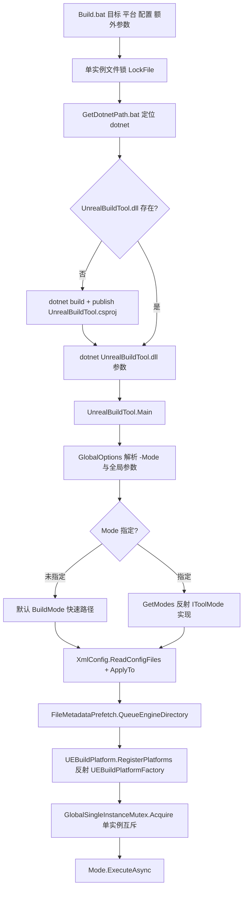

BuildMode 内部(P 为入口后的展开):

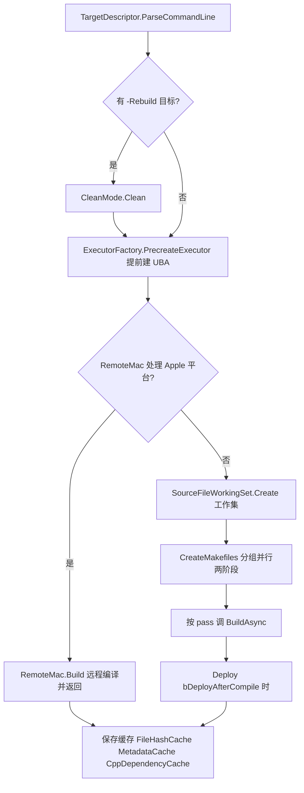

### 19.6.2 Makefile 生命周期(stateDiagram)

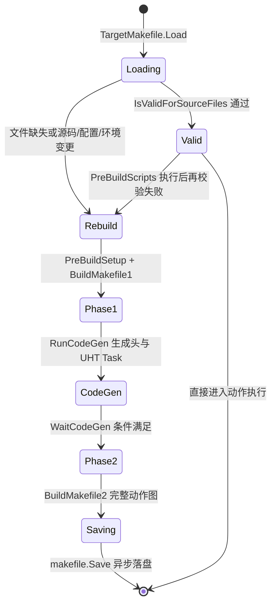

触发 Rebuild(失效)的判据(TargetMakefile.cs 与 BuildMode.cs:1092-1113):makefile 文件缺失/版本不同、`TargetMakefile.IsValidForSourceFiles` 检查的源文件时间戳与工作集状态、`ConfigValueTracker` 记录的 ini 值变化、`AdditionalArguments` 变化、`ExternalMetadata` 变化、UBT/UHT 程序集指纹(`.uhtpath`)变化。

### 19.6.3 UHT 解析与生成管线(flowchart,步骤序号即 UhtSession.Run 调用序)

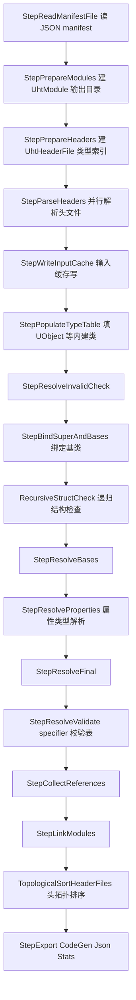

解析单元的并发:StepParseHeaders/各 Resolve 步骤经 `ForEachHeader(action, allowGoWide)` 执行,GoWide 时 `Parallel2.ForEach(_headerFiles, …)`(UhtSession.cs:1525-1554);错误经 `Try/TryHeader` 捕获为 UhtMessage,`HasErrors` 后续步骤整体跳过。

### 19.6.4 UAT BuildCookRun 各阶段与拉起的进程

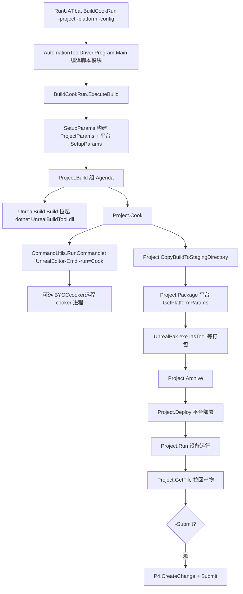

### 19.6.5 执行器选择与 UBA 执行流

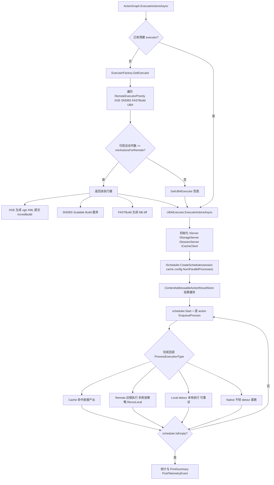

远程失败回退本地的具体规则(UBAExecutor.cs:941-998):无输出、exit 0xC0000005/0xC0000409/0xC0000602、日志含 ` C1001: `/`clang frontend command failed`/`cannot overwrite the original file`、9000-9999 UBA 错误码、或 `bForcedRetryRemote` → `ProcessFinishedResponse.RerunLocal`;本地失败在 `bAllowRetry && (bForcedRetry || 9000-9999)` 时先 detour 重试(≤3 次),再 `RerunNative`。

### 19.6.6 Live Coding / 热重载路径

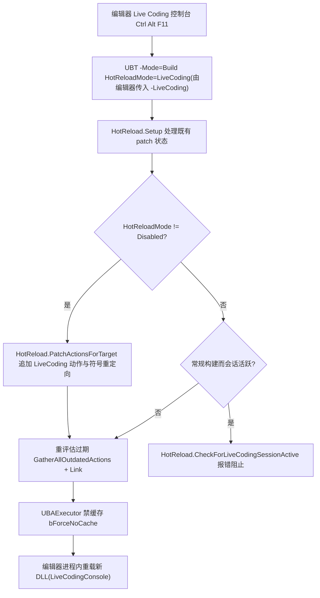

依据:System/HotReload.cs:221/270/612;BuildMode.cs:694-725 的 HotReload 分支与 LiveCoding 动作重评估;UBAExecutor.cs:601-606(HotReloadMode 时 `UBAConfig.bForceNoCache`)。

### 19.6.7 工程文件生成(-Mode=GenerateProjectFiles)

流程(GenerateProjectFilesMode.cs:67 起):解析 `-ProjectFiles -Project=… -Game` 参数 → `UEBuildTarget.Create` 逐目标建 makefile(仅元数据,`bSkipBuild`)→ `ProjectFileGenerator.Current` 聚合模块/目标/插件 → 按 `-VS2022/-VSCode/-Rider/-Xcode/-Makefile/-CMake/-CLion/-KDevelop/-QMake/-CodeLite/-Eddie/-AndroidStudio/-VSWorkspace` 选生成器写盘(PlatformProjectGeneratorCollection 挂平台专属文件,如 AndroidStudioProjectFileGenerator/WindowsProjectGenerator)。Rider 生成 `ToolchainInfo`(ProjectFiles/Rider/ToolchainInfo.cs)供其工具链探测;VS 生成 VCProject(.vcxproj)与解决方案(VisualStudioSolutionBuilder)。

## 19.7 时序图

### 19.7.1 Build.bat → UBT → UHT(进程内)→ UBA 编译链接

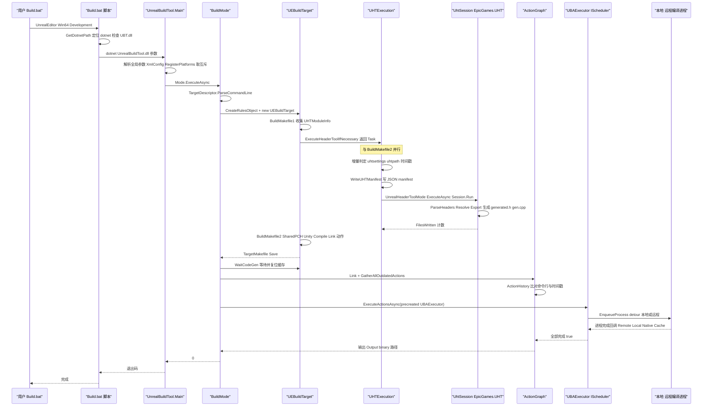

### 19.7.2 UAT BuildCookRun:Build/Cook/Stage/Package/Run 跨进程交互

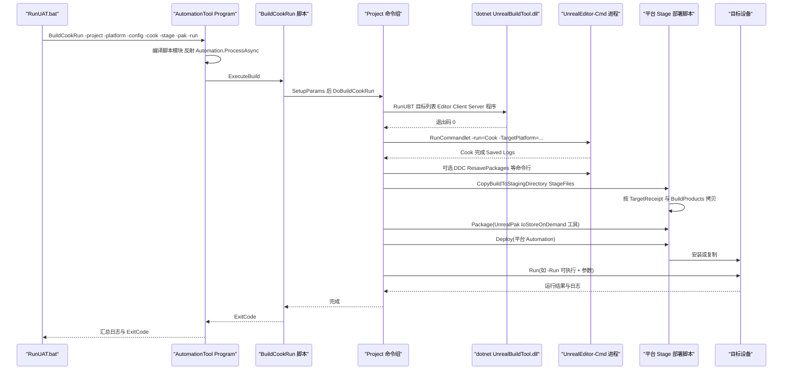

### 19.7.3 BuildGraph 作业经 Horde 分发执行

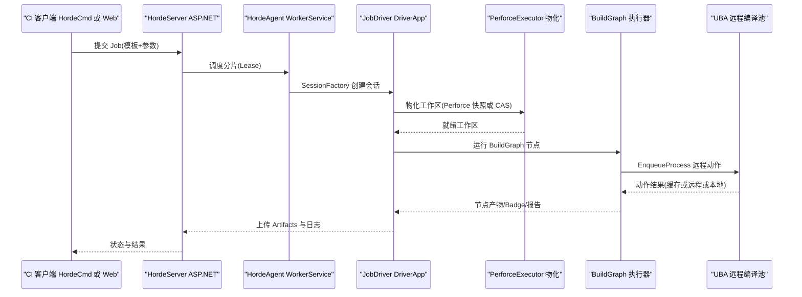

### 19.7.4 UGS:同步与 CIS 编译入口

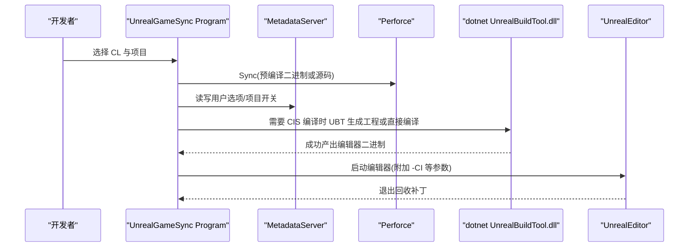

UGS 主程序为 WinForms(Program.cs,Launcher.cs 承载),可配置为从 Horde/共享缓存取预编译产物(ArtifactDownload.cs),并通过 AutomationServer 与编辑器内 UI 通信;UnrealGameSyncCmd 为命令行版。

## 19.8 线程模型与同步

UBT/UAT/UHT 均为 .NET 进程;此处"主线程"= 执行 Main/ExecuteAsync 的线程,其余为线程池(Parallel2 底层是 ThreadPool 的并行循环,Shared/EpicGames.Build/System/Parallel2.cs)。

| 位置 | 线程 | 同步原语/依据 |
|---|---|---|
| UnrealBuildTool.Main | 主线程 | `SingleInstanceMutex.Acquire/GlobalSingleInstanceMutex.AcquireNowOrThrow`(UnrealBuildTool.cs:442-449);`Log.EnableThreaded()`(:278)把日志写线程化 |
| CreateMakefiles 规则装配 | Parallel2.For 工作线程,helperCount = `bParallelMakefileGeneration ? -1 : 0`(BuildMode.cs:1120) | `lock(sourceFileMetadataCaches)`(:1181)、`lock(appNameTargetGroups)`(:1207);每线程创建 TargetRules,跨线程共享 RulesAssembly |
| makefile 预加载 | `Task.Run(LoadMakefile)`(BuildMode.cs:1163) | `preLoadedMakefiles` 字典 + lock(:1298-1316) |
| makefile 保存 | `Task.Run(makefile.Save)`(:1447-1451) | `ConcurrentDictionary<FileReference,Task> lastSaveMakefileTasks`(:1254);异常路径 Task.WaitAll 保证落盘 |
| UHT 执行 | `Task(runTask)` 在 ThreadPool;与 BuildMakefile2 并行(UEBuildTarget.cs:3032) | `runTask.Start()` + `ContinueWith(…, TaskScheduler.Current)` 写时间戳(UHTExecution.cs:1532-1545);`WaitCodeGen` 在 join 点 Wait(:3049-3069) |
| Binary/模块编译动作生成 | `Parallel2.ForEach(Binaries, …)`(UEBuildTarget.cs:3142-3147) | MakefileBuilder(TargetMakefileBuilder)串行化写入(IActionGraphBuilder) |
| 过期判定 | `Parallel2.ForEach(Actions, …)`(ActionGraph.cs:927-931) | `ConcurrentDictionary<LinkedAction,bool> OutdatedActions`;生产者-消费者闭包传播在 IsActionOutdatedDueToPrerequisites |
| 依赖计数 | 多线程 | `Interlocked.Increment/Exchange`(LinkedAction.IncrementDependentCount,Action.cs:859-868) |
| 执行 | 主线程 await ExecuteActionsAsync;UBA 原生 Scheduler 自有线程 | `CancellationTokenSource _cancellationSource`(UBAExecutor.cs:610/666);`ConcurrentBag<Task> resultStoreTasks`(:914);`lock(_sessionLock)`(:671) |
| 结果缓存写 | 后台 Task | ContentAddressableActionResultStore 经 IStorageProvider 事务流(Storage/IStorageProvider.cs) |
| 日志聚合 | 执行器回调线程 | `lock(Parser)` 的 WriteToolOutput/FlushToolOutput(ActionExecutor.cs:82-93) |
| UHT GoWide | Parallel2.ForEach per header(UhtSession.cs:1541-1546) | `_namespaces` 为 ConcurrentDictionary(:1625);错误计数 `Interlocked.CompareExchange/Increment`(UhtCounter :643-656);Export 输出 `Parallel2.ForEach(saves, RenameSource)`(:522-535) |
| UAT | 脚本主线程顺序执行各阶段 | 子进程经 ProcessUtils 异步 IProcessResult;`ProcessSingleton.RunSingleInstanceAsync` 保证同分支单实例(Program.cs:468);备注 `[STAThread]` 被显式禁止(Main 注释) |
| Horde Agent | 每会话独立执行线程 | ASP.NET/ASP.NET Core 托管;JobDriver 内 Executor 串行消费消息队列 |
| 构建机互斥 | 跨进程 | Build.bat 自身文件锁(Build.bat:18-33 `%tmp%` lock 文件重试)与 UBT GlobalSingleInstanceMutex 双层 |

跨线程数据所有权约定:TargetRules/ModuleRules 对象只在创建它的 makefile 线程上构造与消费;FileItem/DirectoryItem 的缓存信息由 `FileMetadataPrefetch`(System/FileMetadataPrefetch.cs)后台线程预热、`ResetCachedInfo()` 在 UHT/执行器写文件后复位(BuildMode.cs:578-582,846-852);`UnrealBuildTool.InitialEnvironment` 在 Main 早期快照(BuildMode.cs:122-126)。

## 19.9 配置与扩展点

本域无运行时 CVar;配置面由 XML/ini/命令行/环境变量/规则属性/插件六类构成。

### 19.9.1 BuildConfiguration.xml(XmlConfig 体系)

- 位置优先级:引擎/项目/用户目录下的 `UnrealBuildTool/BuildConfiguration.xml`(XmlConfig.ReadConfigFiles 带缓存,Configuration/Xml/XmlConfig.cs;入口 UnrealBuildTool.cs:323-335)。
- 可配置项即 `BuildConfiguration`(Configuration/BuildConfiguration.cs)与各执行器类上标 `[XmlConfigFile]` 的字段(如 XGE.cs:47-71 的 XGE 段)。执行器优先顺序 `RemoteExecutorPriority` 默认 `[XGE, SNDBS, FASTBuild, UBA]`(:47)。
- 命令行可覆盖:`Arguments.ApplyTo(BuildConfiguration)`(BuildMode.cs:153)。

### 19.9.2 UHT ini 与命令行

- `Engine/Programs/UnrealHeaderTool/Config/DefaultEngine.ini` 的 `[UnrealHeaderTool]` 段:TypeRedirects/MetadataRedirects、StructsWithNoPrefix、StructsWithTPrefix、Units、DelegateParameterCountStrings、DefaultGeneratedCodeVersion、NativePointerMemberBehavior(Engine/EnginePlugin/NonEngine 三级)、ObjectPtrMemberBehavior、MissingGeneratedHeaderIncludeBehavior、EnumUnderlyingTypeNotSet、AreRigVMUObjectPropertiesEnabled、ShowDeprecations、DocumentationPolicies、DefaultDocumentationPolicy(Modes/UnrealHeaderToolMode.cs:277-298;UhtConfigImpl)。
- 项目级 `/Script/Engine.ValkyrieMetaData` 段(ProjectSpecificConfigs,:304-322)。
- UHT 命令行(UnrealHeaderToolMode.UhtGlobalOptions):`-WarningsAsErrors -NoGoWide -WriteRef -VerifyRef -FailIfGeneratedCodeChanges -NoOutput -IncludeDebugOutput -NoDefaultExporters -EnableAllCodeGen -EnableInputCache(Read/Write) -ReportEmptyHeaders -<ExporterName>/-no<ExporterName>`(:527-603)。UBT 侧由 BuildConfiguration.bForceHeaderGeneration/bEnableUHTInputCache/bFailIfGeneratedCodeChanges 注入(UHTExecution.cs:1390,1441-1444,2868-2870)。

### 19.9.3 规则与脚本扩展

- **TargetRules/ModuleRules 属性**即第一扩展面(19.5.7/19.5.8 全表);平台子规则(WindowsTargetRules 等)通过 TargetRules 暴露。
- **平台扩展**:Engine/Platforms/<Platform>/Source 下的规则子类(ModuleRules.SubclassRules/PlatformDirectory,ModuleRules.cs:630-641)与 UBT Platform/ 下对应实现。
- **脚本模块**:UAT `*.Automation.csproj`(Program.cs MainProc 编译加载,`-ScriptsForProject=-ScriptDir=-AutomationProject=` 控制范围);项目可放自己的 Automation 脚本目录。
- **BuildGraph**:XML 定义 `<Option>/<Group>/<Node>/<Aggregate>/<Badge>/<Agent>` + 内嵌脚本(表达式由 BgInterpreter 执行);70 种内建 Task(AutomationTool/BuildGraph/Tasks/),Horde 上以 Agent 分组并行。
- **ubtplugin/uhplugin**:`.ubtplugin`(编译入 UBT)与 `.uhplugin`(编译入 UHT)程序集插件,Makefile.UbtPlugins/EnabledUhtPlugins 跟踪(TargetMakefile.cs:275-287),UHT 侧经 UhtTables.CheckForAttributes 扫描 `[UnrealHeaderTool]` 程序集扩充 specifier/导出器表(UhtTables.cs:75 起)。

### 19.9.4 Horde/UBA 配置

- HordeServer/HordeAgent/JobDriver 各自 `appsettings.json`(+Development/Local/Production 变体)与 ServerSettings/AgentSettings/DriverSettings;Horde 作业模板(gocloud schema)在 HordeServer/Configuration。BuildHorde.xml 是 Horde 自举 BuildGraph。
- UBA:UnrealBuildAcceleratorConfig/CacheConfig/HordeConfig(Executors/UnrealBuildAccelerator/*.cs,均 [XmlConfigFile]):bForceNoCache、bDisableRemote、bWriteToDisk、bAllowDetour、缓存服务地址、Horde 协调器等;`GetAppliedConfig(targetDescriptors)` 合并目标 `-EnableUBA…` 参数。环境变量如 `UBT_EXTRA_ARGS`(UnrealBuildTool.cs:154-158)、`UnrealBuildTool_SessionId`、`UnrealBuildTool_TMP`(:392-427)。

### 19.9.5 BatchFiles 环境开关

GetDotnetPath.bat 定位 .NET SDK(Build.bat 依赖);RunUAT.bat/RunUBT.sh 组装 `-ScriptsForProject` 等参数;`-NoCompile/-Compile/-CompileOnly` 控制 UAT 脚本编译;`-BuildMachine -P4 -NoP4 -Submit` 等全局参数(Program.cs:288-315)。

## 19.10 已知限制/未确认项

- **未在源码中确认/未深入**:SNDBS/XGE/FASTBuild 仅读了工厂与常量,未逐行核对其与外部服务的协议实现;Gauntlet 只核实了目录结构与 TestExecutor 存在,未展开断言/设备租用细节;UnrealSwarm/UnrealLightmass 间消息协议、Unsync 的块同步算法、BuildPatchTool 的 chunk 算法未展开(超出本章重点)。
- **UHT 属性类型表**未逐项列出 43 个 `Types/Properties/*.cs` 的语义(篇幅所限),仅给出容器(UhtPropertyTypeTable)与清单位置。
- **ModuleRules/TargetRules 表**为"全部关键属性"而非 100% 逐属性:两文件合计 6100+ 行,含大量平台子规则(WindowsTargetRules、AndroidTargetRules 等位于 TargetRules.cs 与各平台文件),仅 WindowsTargetRules 以入口形式提及;完整枚举以附录 CSharp/TargetRules.md、ModuleRules.md 为准。
- TargetRules 行号区间个别为估算(同一属性组内以首行标注),已尽量逐条核对;若与源码有 1-2 行偏差以源码为准。
- Horde Server 的具体 API 路由/数据库 schema 未逐个列出;UBA 原生层(UbaSessionServer/UbaScheduler)只给出组件面与调用关系,未深入其协议帧格式。
- `Engine/Programs/UnrealHeaderTool` 的 C++ 程序本体在 5.8.3 源码树中不存在(仅 Config),`Source/Programs/` 下亦无 UnrealHeaderTool 目录;UnrealFrontend/UnrealInsights 属于壳程序,其内部命令分发表未展开。
- 附录 `Programs/ShaderCompileWorker.md` 等个别程序在 Programs 附录目录未见对应文件(如 ShaderCompileWorker),已在 X.11 用跨附录说明;若附录后续补齐可直接替换引用。

## 19.11 附录索引(续)

见主文件 `19_build_system_uht_uat.md` 的 19.11 节;补充:

- UBT 测试:`appendix/api/CSharp/UnrealBuildTool.Tests` 相关、`NoModule` 段的 `BuildPatchTool`(CSharp/NoProject__Source__Programs__BuildPatchTool.md)。
- 平台 C# 规则:`appendix/api/CSharp/Android.Automation.md`、`Apple.Automation.md`、`TVOS.Automation.md`、`VisionOS.Automation.md`、`Win.Automation.md`、`SteamDeck.Automation.md`、`Linux.Automation.md`(如存在)、`IOS.Automation.md`。
- Horde 周边:`appendix/api/CSharp/EpicGames.Horde.md`(服务器客户端共库)、`HordeAgent.md`、`Agent.md`、`AgentInterface.md`、`RemoteWorker.md`、`RemoteClient.md`。
- UGS 周边:`appendix/api/CSharp/UnrealGameSync.md`、`UnrealGameSyncCmd.md`、`UnrealGameSyncShared.md`、`UnrealGameSyncAutomation.md`、`UGSCore.md`、`SlateUGS.md`(Programs)、`PostBadgeStatus.md`。
- UAT 脚本全集:`appendix/api/CSharp/AutomationScripts.Automation.md`、`AutomationUtils.Automation.md`、`Gauntlet.Automation.md`、`BuildGraph.Automation.md` 及各 `*.Automation.md`。

