# 20 资产与打包:AssetRegistry/Cook/Pak/IoStore/Zen/Interchange/Virtualization

本章覆盖 UE 5.8.3 中"资产从编辑器到运行时"的完整链路:资产登记(AssetRegistry)、烹饪(UnrealEd Cooker 与 UCookOnTheFlyServer)、包写出(IPackageWriter 体系:LooseCookedPackageWriter/FZenStoreWriter/FIoStoreWriterContext)、打包与容器(PakFile 的 .pak、Core/IO 的 .utoc/.ucas 与 IoDispatcher、Zen 存储服务、IoStore On Demand)、运行时加载(CoreUObject 的 AsyncLoading2/Zen 加载器、FPackageStore)、内容分发(InstallBundleManager、ChunkDownloader、GooglePAD、HTTPChunkInstaller、MobilePatchingUtils、PlatformDLC、BuildPatchServices)、导入管线(Interchange 全家、Datasmith、ImageWriteQueue)与载荷虚拟化(Virtualization),以及 UnrealPak/BuildPatchTool/IoStoreDependencyViewer/UnrealVirtualizationTool 等程序。DerivedDataCache 只做交叉引用(见 09 章)。

贯穿全章的几个关键事实(均逐一读自 5.8.3-release 源码):

- IoDispatcher 是一个专职调度线程:名称 `IoDispatcher`、优先级 `TPri_AboveNormal`(IoDispatcher.cpp:865),单线程 `Run()` 循环只做三件事——`ProcessIncomingRequests`(把等待队列按优先级分发给后端 `ResolveIoRequests`)、`ProcessCompletedRequests`(收割后端完成队列并回调)、以及调度器过载时回撤解压任务(IoDispatcher.cpp:1062-1092)。解压本身在 `FIoDispatcherChunkBlockDecoder` 的 TaskGraph 任务(`ETaskPriority::BackgroundNormal`)中完成(IoDispatcher.cpp:489)。
- FFileIoStore(PakFile 模块内实现文件后端)自身也有一条 `IoService` 线程(TPri_AboveNormal, IoDispatcherFileBackend.cpp:1396),负责真实文件读、按压缩块去重合并(`FFileIoStoreRequestTracker`)与散射(scatter)。
- 5.8 的 FIoStoreEnvironment 已被标 `UE_DEPRECATED(5.8)`(IoDispatcher.h:74);`FPackageStore` 的头文件也已从 Core 迁到 CoreUObject(IO/PackageStore.h:9 的 UE_DEPRECATED_HEADER(5.6))。
- EDL(事件驱动加载器)线程名仍为 `FAsyncLoadingThread`(AsyncLoading2.cpp:11342),包状态机共 21 个状态(`EAsyncPackageLoadingState2`,AsyncLoading2.cpp:3408)。
- Cooker 的三种 PackageWriter 落点:`FLooseCookedPackageWriter`(散文件 .uasset/.ubulk)、`FIoStoreWriterContext`→`.utoc/.ucas` 容器、`FZenStoreWriter`(Zen 存储服务,cook 端口默认 8558,ZenServerInterface.h:34)。
- AssetRegistry 扫描由两条 `TPri_BelowNormal` 后台线程完成:`FAssetDataDiscovery`(目录发现,AssetDataGatherer.cpp:1945)与 `FAssetDataGatherer`(读包,AssetDataGatherer.cpp:4260);编辑器还有发现缓存(AssetDataGathererDiscoveryCache)与按包缓存(DiskCachedAssetData)两级磁盘缓存。
- .pak 挂载与 .utoc 挂载是同一事务:`FPakPlatformFile::Mount(FPakMountArgs)` 先构造 `FPakFile` 读 trailer 与索引,再把同名 `.utoc` 交给 `IoDispatcherFileBackend->Mount(...)`(IPlatformFilePak.cpp:6016-6140);密钥未就绪时 pak 进入 `PendingEncryptedPakFiles` 延迟挂载,状态码 `EIoErrorCode::PendingEncryptionKey`。

源码根约定:路径相对 `$E`(`$UE/Engine`),行号基于 5.8.3-release 逐一核对;`$E/Source/Editor/UnrealEd/Private/Cooker/` 简写为 `Cooker/`。

## 20.1 职责、边界与模块清单

### 20.1.1 Runtime 模块

| 模块 | 路径 | Build.cs 主要依赖 | 职责 |
|---|---|---|---|
| AssetRegistry | Source/Runtime/AssetRegistry | Private: Core, CoreUObject, TraceLog, ApplicationCore, Projects, TelemetryUtils, PakFile | 资产登记表:扫描 .uasset 生成 FAssetData/依赖图,序列化 AssetRegistry.bin |
| Core(IO 部分) | Source/Runtime/Core/Public/IO | — | FIoChunkId/FIoHash/FIoDispatcher/FIoDirectoryIndex/容器头与 .utoc 读写结构 |
| CoreUObject(打包相关) | Source/Runtime/CoreUObject | Core | FAssetData/ARFilter/FPackageStore/FZenPackageSummary/AsyncLoading2(EDL)/IPackageWriter |
| PakFile | Source/Runtime/PakFile | Private: Core, CoreUObject, TraceLog;Public: RSA | .pak 运行时(FPakPlatformFile/FPakFile)+ IoStore 文件后端 FFileIoStore + FFilePackageStoreBackend |
| Experimental/IoStore/OnDemandCore | Source/Runtime/Experimental/IoStore/OnDemandCore | Core, CoreUObject | FOnDemandToc(.iotoc)格式与按需块索引 |
| Experimental/IoStore/OnDemand | Source/Runtime/Experimental/IoStore/OnDemand | OnDemandCore, HTTP… | 按需下载后端(安装/流式两种模式)与 HTTP IoDispatcher 后端 |
| Experimental/IoStore/HttpClient | Source/Runtime/Experimental/IoStore/HttpClient | Core | IoStore HTTP(Zen 客户端)读取通用库 |
| CookOnTheFly | Source/Runtime/CookOnTheFly | Core | 运行时侧 CookOnTheFly 客户端连接(TCP/平台协议传输、ECookOnTheFlyMessage) |
| NetworkFile | Source/Runtime/NetworkFile | Core | FNetworkPlatformFile:通过网络文件服务器读未打包/散文件 |
| NetworkFileSystem | Source/Runtime/NetworkFileSystem | Core | INetworkFileServer/INetworkFileSystemModule:网络文件服务器抽象(CookOnTheFly 供包端) |
| SandboxFile | Source/Runtime/SandboxFile | Core | IPlatformFileSandboxWrapper:沙箱路径重定向(工程名/平台子目录) |
| StreamingFile | Source/Runtime/StreamingFile | Core | StreamingNetworkPlatformFile:流式网络平台文件层 |
| StorageServerClient | Source/Runtime/StorageServerClient | Core, CoreUObject | 连接 DPC 存储服务的平台文件与 IoDispatcher/PackageStore 后端 + 本地块缓存 |
| InstallBundleManager | Source/Runtime/InstallBundleManager | Core | IInstallBundleManager:按 bundle 拉起/释放内容(对接 pakchunk/OnDemand/平台商店) |
| ImageWriteQueue | Source/Runtime/ImageWriteQueue | Core | IImageWriteQueue:异步图像写盘任务队列(截图、离屏输出) |
| Interchange/Core | Source/Runtime/Interchange/Core | Core, CoreUObject | Translator/Pipeline/Factory 基类、节点容器、任务系统 |
| Interchange/Engine | Source/Runtime/Interchange/Engine | InterchangeCore | UInterchangeManager 单例、导入任务(解析/管线/建对象)与结果委托 |
| Datasmith/DatasmithCore | Source/Runtime/Datasmith/DatasmithCore | Core | Datasmith 场景/网格/材质中间模型与 XML 序列化 |
| Online/BuildPatchServices | Source/Runtime/Online/BuildPatchServices | Core, HTTP… | 补丁/安装器:清单(manifest)、差量、下载装配、校验 |

### 20.1.2 Developer 模块

| 模块 | 路径 | 依赖(节选) | 职责 |
|---|---|---|---|
| IoStoreUtilities | Source/Developer/IoStoreUtilities | Core, CoreUObject, Zen | 容器写出:FIoStoreWriterContext(.utoc/.ucas)、FZenStoreWriter、IPackageStoreWriter、ZenStoreHttpClient、CookArtifactReader |
| PakFileUtilities | Source/Developer/PakFileUtilities | Core | .pak 打包辅助(Tracked writes/压缩加密参数) |
| Zen | Source/Developer/Zen | Core | Zen 存储服务客户端(IZenClient/池、服务设置/自动拉起,默认端口 8558) |
| ZenOplogUtils | Source/Developer/ZenOplogUtils | Core, Zen | 读 Zen oplog 生成 Manifest/快照/差异(增量 cook 分析) |
| CookMetadata | Source/Developer/CookMetadata | Core | CookMetadata.csv/.json 插件体积统计(EPluginSizeTypes/FCookMetadataState) |
| CookedEditor | Source/Developer/CookedEditor | Core, CoreUObject | 烹饪版编辑器的包管理器与目标平台设置(CookedEditorPackageManager) |
| CookOnTheFlyNetServer | Source/Developer/CookOnTheFlyNetServer | Core, CookOnTheFly | CookOnTheFly 网络服务端(TCPServer/平台协议,向客户端供包) |
| FileUtilities | Source/Developer/FileUtilities | Core | Zip 归档读写(FZipArchiveReader/Writer) |
| DirectoryWatcher | Source/Developer/DirectoryWatcher | Core | IDirectoryWatcher 目录变更通知(AssetRegistry 增量扫描依赖) |
| DesktopPlatform | Source/Developer/DesktopPlatform | Core | 桌面平台对话框/文件选择/Slate 窗口接入 |
| SourceControl | Source/Developer/SourceControl | Core | ISourceControlModule/Provider 抽象(Perforce/Git 插件实现) |
| Localization | Source/Developer/Localization | Core | 本地化命令/target(gather/import/export)数据模型 |
| LocalizationService | Source/Developer/LocalizationService | Core | 本地化数据源码管理抽象 |
| S3Client | Source/Developer/S3Client | HTTP… | S3 协议客户端(UnrealCloudDDC/Zen 远端用) |
| TurnkeyIO | Source/Developer/TurnkeyIO | Core | Turnkey 构建信息 IO 消息 |
| Virtualization | Source/Developer/Virtualization | Core | Epic 默认虚拟化系统 FVirtualizationManager 与 DDC/文件/源码管理后端 |

### 20.1.3 Editor 模块与程序

| 模块 | 路径 | 职责 |
|---|---|---|
| UnrealEd(Cooker 子系统) | Source/Editor/UnrealEd/Private/Cooker + Classes/CookOnTheSide | UCookOnTheFlyServer 全部烹饪调度(请求/加载/保存/多进程/GC/增量)、FAssetRegistryGenerator、ShaderLibraryCooking |
| UnrealEd(Commandlets) | Classes/Commandlets/CookCommandlet.h 等 | UCookCommandlet(命令行 cook 入口)、UnrealPak 相关 commandlet |
| 程序 UnrealPak | Source/Programs/UnrealPak | .pak/.utoc 命令行工具(创建/列表/提取/加密签名) |
| 程序 BuildPatchTool | Source/Programs/BuildPatchTool | 生成补丁清单/差量数据(BuildPatchServices 离线工具) |
| 程序 IoStoreDependencyViewer | Source/Programs/IoStoreDependencyViewer | 可视化 .utoc/容器 chunk 依赖与分区 |
| 程序 UnrealPackageTool | Source/Programs/UnrealPackageTool | .uasset/包检查工具 |
| 程序 UnrealVirtualizationTool | Source/Programs/UnrealVirtualizationTool | 命令行虚拟化 payload 推/拉/校验 |
| 程序 ZenDashboard / ZenLaunch / ZenOplogDiffTool | Source/Programs/Zen* | Zen 服务看板、启动器、oplog 差异 |
| 程序 DatasmithCADWorker / DatasmithSDK | Source/Programs/Enterprise/Datasmith | CAD 转换进程与 SDK |

### 20.1.4 Plugins(运行时分发与导入)

| 模块 | 路径 | 职责 |
|---|---|---|
| ChunkDownloader | Plugins/Runtime/ChunkDownloader | FChunkDownloader:HTTP 分块(pakchunk)下载 + 挂载 |
| GooglePAD | Plugins/Runtime/GooglePAD | Google Play Asset Delivery(AssetPack)接入 |
| HTTPChunkInstaller | Plugins/Runtime/HTTPChunkInstaller | HTTP 云端 chunk 安装器(IPlatformFile 安装模拟) |
| MobilePatchingUtils | Plugins/Runtime/MobilePatchingUtils | 移动端补丁库(BuildPatchServices 的运行时封装) |
| PlatformDLC | Plugins/Experimental/PlatformDLC | 平台 DLC 文件层(PlatformDLCPlatformFile 重定向) |
| Interchange 导入器族 | Plugins/Interchange/Runtime/Source/* | Common(节点)/Nodes/FactoryNodes/Pipelines/Dispatcher/Messages/Fbx 解析器/各格式 Import(OpenUSD、AxF、OpenVDB 等) |
| Importers(旧导入) | Plugins/Importers 等 | 传统 UFactory 导入器(与 Interchange 并存) |
| Datasmith 族 | Plugins/Enterprise/Datasmith* | Datasmith 导入器/翻译器(FBX/CAD/VRED/DeltaGen/MVR/Wire/PLMXML)、DatasmithRuntime、DatasmithInterchange 桥 |
| IoStoreInsights | Plugins/IoStoreInsights | IoStore 加载/容器 Insights 追踪分析 |

## 20.2 总体架构

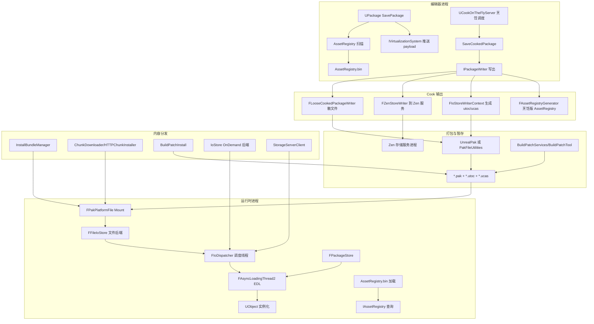

要点:

- **两条持久化主线**:Legacy(PakFile,文件名寻址,`FPakEntry`)与 IoStore(ChunkId 寻址,`.utoc/.ucas`)。运行时 IoStore 是主路径,PakFile 层负责挂载事务与非 IoStore 文件访问;两者在 `FPakPlatformFile::Mount` 中合一。
- **两条 cook 输出落点**:ZenStore(Zen 存储服务,增量 cook 的 oplog;编辑器/PF&D 场景)与本地容器/散文件(打包发布场景)。选择由 `ECookByTheBookOptions::ZenStore` 与 `-zenstore` 决定(CookOnTheFlyServer.h:103)。
- **运行时读取统一走 FIoDispatcher**:文件(.ucas)、HTTP(OnDemand)、DPC 存储服务(StorageServerClient)都实现 `IIoDispatcherBackend`,按挂载优先级依次 Resolve(IoDispatcher.cpp:1024-1036)。

## 20.3 类图

### 20.3.1 AssetRegistry(扫描与状态)

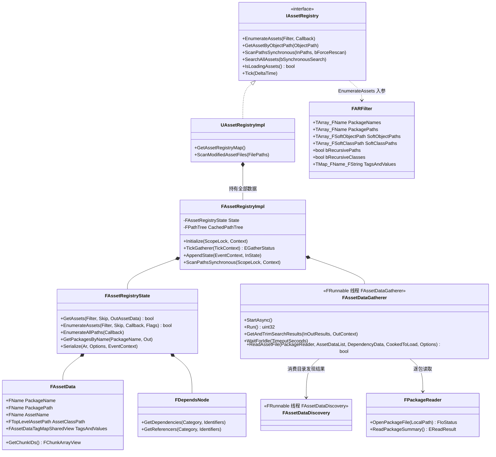

类职责:

- `UAssetRegistryImpl`(AssetRegistry/Private/AssetRegistry.h:24):UObject 外壳,实现 `IAssetRegistry`,提供接口级读写锁(`FInterfaceReadScopeLock`)。
- `FAssetRegistryImpl`(AssetRegistryImpl.h:201):全部状态与逻辑持有者,"非常线程安全:const 函数必须在读锁内、非 const 必须在写锁内"(注释 AssetRegistryImpl.h:197-200)。
- `FAssetRegistryState`(AssetRegistryState.h:185):磁盘缓存/烹饪缓存的可序列化状态(FAssetData 集合、依赖图 DependsNode、路径树)。
- `FAssetDataGatherer`(AssetDataGatherer.h:174):FRunnable 扫描线程;`TickInternal` 可被后台线程或同步调用方复用(AssetDataGatherer.h:361)。
- `FPackageReader`(Private/PackageReader.cpp):仅读包头/名称表/AssetRegistry 数据段,不构造 UObject。

### 20.3.2 Core/IO:IoDispatcher 与后端

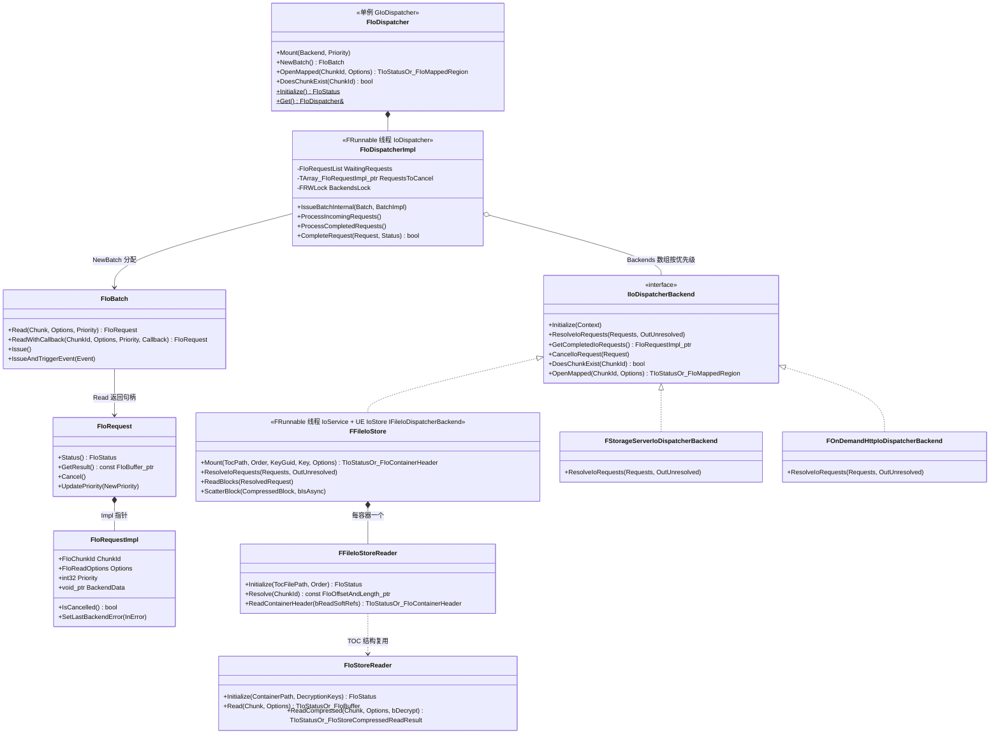

类职责:

- `FIoDispatcher`(IoDispatcher.h:296):对外门面;`Initialize/InitializePostSettings/Shutdown` 管理全局单例 `GIoDispatcher`(IoDispatcher.cpp:43)。
- `FIoDispatcherImpl`(IoDispatcher.cpp:472):调度线程本体;后端列表 `TArray<TTuple<int32, TSharedRef<IIoDispatcherBackend>>>` 用 LowerBound 按优先级插入(IoDispatcher.cpp:642-659)。
- `FIoRequestImpl`(IoDispatcherBackend.h:22):引用计数对象(`RefCount` 原子),`ErrorCode` 原子 CAS 保证只完成一次(IoDispatcher.cpp:917-921),`LastBackendError` 表达取消/失败。
- `FFileIoStore`(IoDispatcherFileBackend.h:123):实现 `UE::IoStore::IFileIoDispatcherBackend`(FIoDispatcherBackend.h 之外的文件 IO 后端接口);持有请求分配器、块缓存(`FFileIoStoreBlockCache`)、压缩上下文池。
- `FIoStoreReader`(IoDispatcher.h:556):工具型读取器(非运行时),UnrealPak/IoStoreDependencyViewer 使用。

### 20.3.3 PackageStore 与加载器

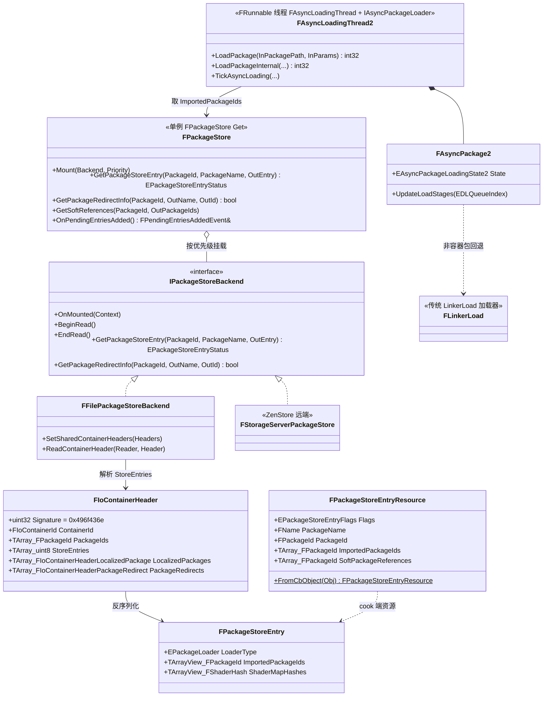

类职责:

- `FPackageStore`(CoreUObject/Public/Serialization/PackageStore.h:230):包元数据(导入表/ShaderMap 引用)查找服务;读取需 `FPackageStoreReadScope`(同文件 :272)聚合 `BeginRead/EndRead`。
- `FPackageStoreEntry`(:39)按后端区分加载器:`EPackageLoader::Zen`(IoDispatcher)或 `LinkerLoad`(散文件,PackageStore.h:18-22)。
- `FIoContainerHeader`(Core/Public/IO/IoContainerHeader.h:109):每个容器的包索引与重定向表,由 ContainerHeader chunk(`CreateContainerHeaderChunkId`,IoChunkId.h:214)读出。
- `FAsyncLoadingThread2`(AsyncLoading2.cpp:4730):EDL;`GetLoaderType()` 返回 `ELoaderType::ZenLoader`(同文件 :4745-4748)。

### 20.3.4 PackageWriter 体系(cook 写出)

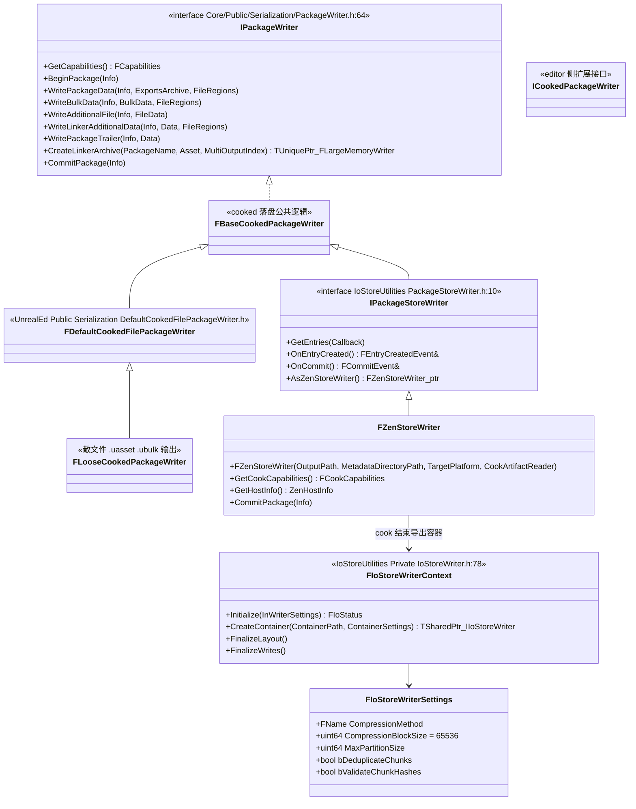

类职责:

- `IPackageWriter`:SavePackage 期间回调的写出接口;事务序为 `BeginPackage → WritePackageData/WriteBulkData/WriteAdditionalFile/WriteLinkerAdditionalData/WritePackageTrailer → CommitPackage`(EWriteOptions 见 PackageWriter.h:117-125)。
- `FZenStoreWriter`(IoStoreUtilities/Public/ZenStoreWriter.h:55):`GetCookCapabilities().HeaderFormat == EPackageHeaderFormat::ZenPackageSummary`(ZenStoreWriter.h:111),即 Zen 输出使用 Zen 包头而非 Linker 头。
- `FIoStoreWriterContext`(IoStoreWriter.h:78):多容器并行写(`FIoStoreTocResource::Write` 最终落 .utoc,IoStore.h:307);Patch-in-place/Dedup 等布局参数都在 `FIoStoreWriterSettings`(IoStoreWriter.h:13-46)。

### 20.3.5 Cooker 调度与多进程

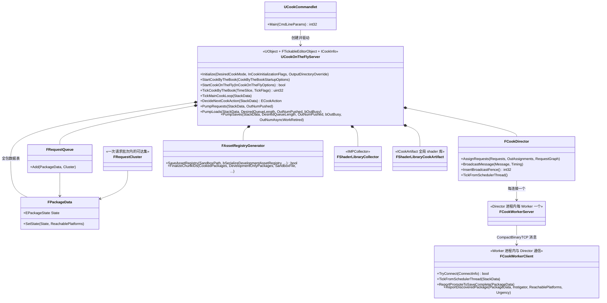

类职责:

- `UCookOnTheFlyServer`(Classes/CookOnTheSide/CookOnTheFlyServer.h:~300):五种 cook 模式的统一调度器(`ECookMode`:CookOnTheFly/CookOnTheFlyFromTheEditor/CookByTheBookFromTheEditor/CookByTheBook/CookWorker,:118-134)。
- `FPackageData`(Cooker/CookPackageData.h):每个包的烹饪状态机载体(`EPackageState`:Idle/Request/AssignedToWorker/Load/SaveActive/SaveStalledRetracted/SaveStalledAssignedToWorker,CookTypes.h:155-193)。
- `FCookDirector`(Cooker/CookDirector.h:73)与 `FCookWorkerClient`(Cooker/CookWorkerClient.h:36):MPCook 的 Director/Worker 协议,消息用 `UE::CompactBinaryTCP::FMarshalledMessage`(CookWorkerClient.h:125-130)。
- `UE::Cook::FPlatformData`(Cooker/CookPlatformManager.h:34):每个烹饪平台一份的会话级数据(TargetPlatform 指针、该平台的 `FAssetRegistryGenerator`、DevelopmentSaveOptions、沙箱初始化标志);线程约束见结构注释(:27-33,scheduler 线程写/读锁读)。
- 增量 cook:Zen 输出下由 oplog 的 bUpToDate 判定(`IPackageStoreWriter::FOplogCookInfo`,PackageStoreWriter.h:25-36);`FIncrementalValidatePackageWriter`(Cooker/IncrementalValidatePackageWriter.h:14,继承 `FDiffPackageWriter`)在增量命中时对新旧写出做差分校验。

### 20.3.6 PakFile(.pak 运行时)

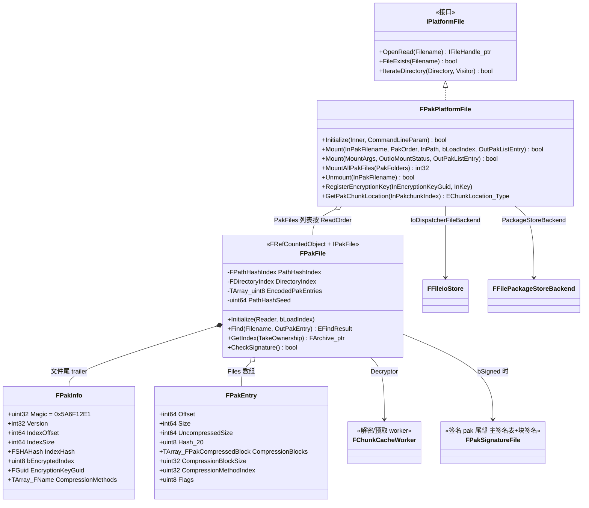

类职责:

- `FPakPlatformFile`(IPlatformFilePak.h:1926):平台文件栈中的 pak 层;`LowerLevel` 指向底层文件系统(:1964),挂载表 `TArray<FPakListEntry> PakFiles`(:1966),加密未就绪表 `PendingEncryptedPakFiles`(:1968)。
- `FPakFile`(:761):单个 .pak 的索引容器;5.8 有三套索引:PathHashIndex(哈希→FPakEntryLocation)、FDirectoryIndex(目录树)、可选 FDirectoryTreeIndex(:840-842)。
- `FPakInfo`(:147)/`FPakEntry`(:405):文件尾/条目磁盘结构(见 20.4 数据字典)。

### 20.3.7 Interchange 导入管线

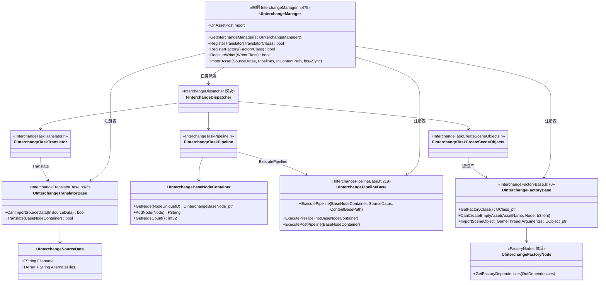

类职责:

- `UInterchangeManager`:单例;导入流程 = Translator(把源文件翻译为节点图)→ Pipeline(节点图加工、产出 FactoryNode)→ Factory(在 GameThread 创建/复用 UObject)(注释见 InterchangePipelineBase.h:212-215、InterchangeFactoryBase.h:66)。
- `UInterchangeBaseNodeContainer`:统一节点图,按 UniqueID 索引,线程安全锁内部维护。
- Datasmith 走两条路:传统 `DatasmithImporter`(UFactory 系)与 `DatasmithInterchange`(Translator 桥接,Plugins/Experimental/Enterprise/DatasmithInterchange)。

### 20.3.8 Virtualization 与 ImageWriteQueue

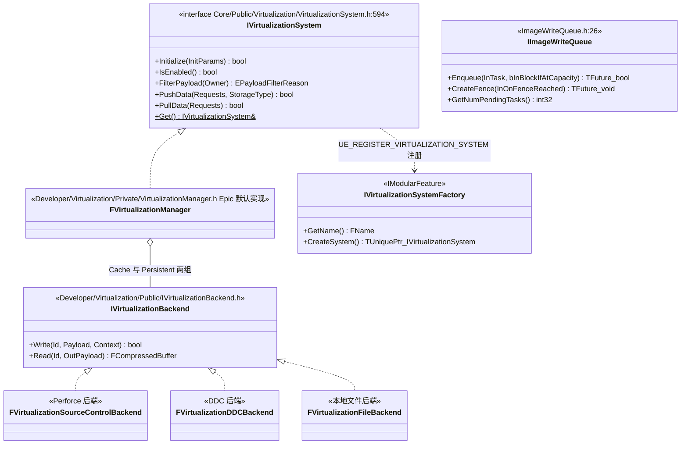

类职责:

- `IVirtualizationSystem`:payload 以 `FIoHash`(Blake3,20 字节)为标识;`EStorageType` 分 Cache/Persistent 两组后端,语义差异见接口注释(VirtualizationSystem.h:660-668:Cache 至少一个成功,Persistent 必须全部成功)。
- 载荷读写发生在保存/提交(`PushData`)与加载(`PullData`,编辑器内读 .umeembed 脱敏包时)两条路径。

## 20.4 数据字典

### 20.4.1 FAssetData(AssetData.h:163-232)

| 字段 | 类型 | 含义 | 取值/约束 | 源码位置 |
|---|---|---|---|---|
| PackageName | FName | 完整长包名 | 如 /Game/Path/Package | AssetData.h:189 |
| PackagePath | FName | 包所在目录 | /Game/Path | :193 |
| AssetName | FName | 资产名(不含包名) | — | :196 |
| AssetClass | FName | 短类名(已弃用) | UE_DEPRECATED(5.1) | :200 |
| AssetClassPath | FTopLevelAssetPath | 类路径 | 如 /Script/Engine.StaticMesh | :203 |
| PackageFlags | uint32 | 包标志 | PKG_ 位标志 | :210 |
| OptionalOuterPath | FName | 非顶层资产的外层路径(编辑器) | WITH_EDITORONLY_DATA | :222 |
| TagsAndValues | FAssetDataTagMapSharedView | 搜索标签键值(共享引用计数) | — | :227 |
| TaggedAssetBundles | TSharedPtr~FAssetBundleData~ | AssetBundles 标签(独立于 TagsAndValues) | — | :232 |
| ChunkArrayRegistryHandle | FChunkArrayRegistryHandle | ChunkID 数组的注册表句柄(省内存) | FSetElementId | :206 |

### 20.4.2 FAssetRegistrySerializationOptions(AssetRegistryState.h:60-124,节选)

| 字段 | 类型 | 含义 | 默认 |
|---|---|---|---|
| bSerializeAssetRegistry | bool | 是否写 AssetRegistry | false |
| bSerializeDependencies | bool | 是否写依赖(硬+软) | false |
| bSerializePackageData | bool | 是否写 FAssetPackageData | false |
| bFilterAssetDataWithNoTags | bool | 过滤无标签资产(省内存) | false |
| bKeepDevelopmentAssetRegistryTags | bool | 保留 cooker DevelopmentAssetRegistry 专用标签(仅 cooker 置 true) | false |
| CookFilterlistTagsByClass | TMap~FTopLevelAssetPath,TSet~FName~~ | 按类的标签允许/拒绝表 | — |
| CookTagsAsName / CookTagsAsPath | TSet~FName~ | 值以 FName / FRegistryExportPath 存储 | — |

序列化版本由 `FAssetRegistryVersion::Type` 枚举控制(AssetData.h:70-114,当前 Latest=MemoryMappedTagDataStore),自定义版本 GUID 见 :117。

### 20.4.3 .pak 磁盘结构(FPakInfo/FPakEntry)

FPakInfo(IPlatformFilePak.h:147-363)位于文件尾,序列化大小由版本决定(:219-227):

| 字段 | 类型 | 含义 | 取值/约束 |
|---|---|---|---|
| Magic | uint32 | 魔数 | PakFile_Magic = 0x5A6F12E1(:152) |
| Version | int32 | 版本 | 1..12,Latest=PakFile_Version_Utf8PakDirectory(:162-181) |
| IndexOffset / IndexSize | int64 | 索引偏移/大小 | — |
| IndexHash | FSHAHash | 索引 SHA1 | 校验索引完整性 |
| bEncryptedIndex | uint8 | 索引是否加密 | Version≥4 才有 |
| EncryptionKeyGuid | FGuid | 加密密钥 GUID | Version≥7 |
| CompressionMethods | TArray~FName~ | 压缩方法表 | 序列化为 5×32 字节定长(:157-158, :300-327) |

FPakEntry(IPlatformFilePak.h:405-469)每文件一条(修改会破坏全量补丁,注释 :394-404):

| 字段 | 类型 | 含义 |
|---|---|---|
| Offset | int64 | 数据在 pak 内偏移 |
| Size / UncompressedSize | int64 | 磁盘/解压后大小 |
| Hash | uint8[20] | 文件 SHA1 |
| CompressionBlocks | TArray~FPakCompressedBlock~ | 压缩块起止(相对数据区,Version≥5 相对) |
| CompressionBlockSize | uint32 | 块大小(默认 MaxChunkDataSize=64KB,:154) |
| CompressionMethodIndex | uint32 | 压缩方法索引(0=None) |
| Flags | uint8 | Flag_Encrypted=0x01, Flag_Deleted=0x02(:407-409) |

索引有三种形态并存:PathHashIndex(uint64 哈希→FPakEntryLocation)、FullDirectoryIndex(目录树)、EncodedPakEntries(紧编码 FPakEntry 字节,FPakFile :853-857)。

### 20.4.4 .utoc 磁盘结构(Core/Internal/IO/IoStore.h)

FIoStoreTocHeader(IoStore.h:43-80):

| 字段 | 类型 | 含义 | 取值 |
|---|---|---|---|
| TocMagic | uint8[16] | 魔数 | "-==--==--==--==-"(:45) |
| Version | uint8 | EIoStoreTocVersion | Initial..ReplaceIoChunkHashWithIoHash(:25-38) |
| TocEntryCount | uint32 | chunk 条目数 | — |
| TocCompressedBlockEntryCount | uint32 | 压缩块数 | — |
| CompressionMethodNameCount/Length | uint32 | 方法名个数/长度(32) | — |
| CompressionBlockSize | uint32 | 压缩块大小 | 通常 64KB |
| DirectoryIndexSize | uint32 | 目录索引大小 | — |
| PartitionCount / PartitionSize | uint32 / uint64 | 分卷数/单卷上限 | `_s1.ucas` 分卷 |
| ContainerId | FIoContainerId | 容器 ID | — |
| EncryptionKeyGuid | FGuid | 加密密钥 GUID | — |
| ContainerFlags | EIoContainerFlags | Compressed/Encrypted/Signed/Indexed/OnDemand(IoDispatcher.h:435-444) | — |
| TocChunkPerfectHashSeedsCount / TocChunksWithoutPerfectHashCount | uint32 | 完美哈希种子数/溢出数 | — |

条目区(紧随 Header,FIoStoreTocResource :277-312):`ChunkIds[TocEntryCount](FIoChunkId×12)` → `ChunkOffsetLengths(FIoOffsetAndLength)` → `ChunkPerfectHashSeeds` → `ChunkIndicesWithoutPerfectHash` → `CompressionBlocks(FIoStoreTocCompressedBlockEntry×12)` → 压缩方法名 → 签名(FSHAHash SignatureHash + ChunkBlockSignatures)→ DirectoryIndexBuffer → ChunkMetas。

FIoStoreTocCompressedBlockEntry(:105-164):12 字节位打包——5 字节 Offset(40bit)、3×(24bit)压缩大小/解压大小+1 字节压缩方法索引(SizeBits=24, OffsetBits=40)。

FIoStoreTocEntryMeta(:94-100):`FIoHash ChunkHash`(源数据哈希)+ Flags(Compressed/MemoryMapped)。

目录索引(Core/Internal/IO/IoDirectoryIndex.h):`FIoDirectoryIndexEntry{Name, FirstChildEntry, NextSiblingEntry, FirstFileEntry}`(:21-28)+ `FIoFileIndexEntry{Name, NextFileEntry, UserData}`(:31-37)+ 字符串表,挂在 TOC 的 DirectoryIndexBuffer。

### 20.4.5 FIoChunkId 布局(IoChunkId.h)

12 字节定长(`uint8 Id[12]`,:155),`GetChunkType()` 取 `Id[11]`(:132-135):

| 字节 | 含义 |
|---|---|
| [0..7] | uint64 ChunkId(通常是 FPackageId 值) |
| [8..9] | uint16 ChunkIndex(网络序;bulkdata 为 MultiOutputIndex) |
| [10] | uint8 ChunkGroup(仅 bulkdata:FBulkDataCookedIndex) |
| [11] | EIoChunkType |

EIoChunkType(:27-44):Invalid=0, ExportBundleData=1, BulkData=2, OptionalBulkData=3, MemoryMappedBulkData=4, ScriptObjects=5, ContainerHeader=6, ExternalFile=7, ShaderCodeLibrary=8, ShaderCode=9, PackageStoreEntry=10, DerivedData=11, EditorDerivedData=12, PackageResource=13。构造函数:`CreateIoChunkId`(:160)、`CreateBulkDataIoChunkId`(:189)、`CreatePackageDataChunkId`(:208)、`CreateExternalFileChunkId`(按文件名哈希,:211)、`CreateContainerHeaderChunkId`(:214)。

FIoHash(IoHash.h):20 字节 Blake3(类 FBlake3 的 FIoHashBuilder,:188);FIoContainerId(IoContainerId.h:17)为 uint32 域。

### 20.4.6 FIoContainerHeader(IoContainerHeader.h:109-127)

| 字段 | 类型 | 含义 |
|---|---|---|
| (匿名枚举 Signature) | — | 0x496f436e(:113) |
| ContainerId | FIoContainerId | 容器 ID |
| PackageIds | TArray~FPackageId~ | 容器内全部包 |
| StoreEntries | TArray~uint8~ | FFilePackageStoreEntry[](ImportedPackages+ShaderMapHashes 的 CArrayView 序列化,:43-47) |
| OptionalSegmentPackageIds / OptionalSegmentStoreEntries | TArray | 可选段(编辑器数据) |
| RedirectsNameMap | TArray~FDisplayNameEntryId~ | 重定向名表 |
| LocalizedPackages | TArray~FIoContainerHeaderLocalizedPackage~ | 本地化包映射(:58-64) |
| PackageRedirects | TArray~FIoContainerHeaderPackageRedirect~ | 包重定向(:49-56) |
| SoftPackageReferences | FIoContainerHeaderSoftPackageReferences | 去重软引用包 ID 表(:71-86) |

版本 `EIoContainerHeaderVersion`:Initial=0 … SoftPackageReferencesOffset=5(:96-107)。

### 20.4.7 ZenPackage/EDL 磁盘结构(AsyncLoading2.h)

FZenPackageSummary(:302-316):`bHasVersioningInfo`、`HeaderSize`、`Name`、`PackageFlags`,以及 ImportMapOffset/ExportMapOffset/ExportBundleEntriesOffset/DependencyBundleHeadersOffset/DependencyBundleEntriesOffset/ImportedPublicExportHashesOffset/ImportedPackageNamesOffset 七个段偏移。

| 结构 | 字段(节选) | 位置 |
|---|---|---|
| FExportMapEntry | CookedSerialOffset, CookedSerialSize, ObjectName(FMappedName), OuterIndex, ClassIndex, SuperIndex, TemplateIndex, PublicExportHash, ObjectFlags, FilterFlags | :377-392 |
| FExportBundleEntry | LocalExportIndex, CommandType(Create/Serialize) | :327-339 |
| FDependencyBundleHeader | FirstEntryIndex, EntryCount[2][2] | :348-353 |
| FDependencyBundleEntry | LocalImportOrExportIndex | :341-346 |
| FBulkDataMapEntry | SerialOffset, DuplicateSerialOffset, SerialSize, Flags, CookedIndex(uint8) | :404-414 |
| FScriptObjectEntry | Mapped(FMappedName), GlobalIndex, OuterIndex, CDOClassIndex | :356-370 |
| FPackageObjectIndex | 62bit 索引 + 2bit 类型(Export/ScriptImport/PackageImport/Null) | :58-77 |

EZenPackageVersion(:271-280):Initial → DataResourceTable → ImportedPackageNames → ExportDependencies(Latest)。

### 20.4.8 IoStore On Demand 目录(.iotoc,OnDemandCore/Public/IO/OnDemandToc.h)

| 结构 | 字段 | 含义 |
|---|---|---|
| FOnDemandTocHeader(:68-81) | Magic=0x6f6e64656d616e64("ondemand"), Version(EOnDemandTocVersion), Flags(EOnDemandTocFlags: InstallOnDemand/StreamOnDemand,:46-53), BlockSize, CompressionFormat, ChunksDirectory, HostGroupName | 文件头 |
| FOnDemandTocEntry(:87-97) | Hash(FIoHash), ChunkId, RawSize, EncodedSize, BlockOffset(~0 无本地块), BlockCount | 每 chunk 一条 |
| FOnDemandTocContainerEntry(:100-113) | ContainerId, ContainerName, EncryptionKeyGuid, Entries, BlockSizes, BlockHashes, Header, UTocHash, ContainerFlags | 每容器一节 |
| FTocMeta(:57-65) | EpochTimestamp, BuildVersion, TargetPlatform | 构建元信息 |
| FOnDemandTocSentinel(:117-125) | 16 字节 "-[]--[]--[]--[]-" | 定界 |

### 20.4.9 FIoRequestImpl(IoDispatcherBackend.h:22-140)

| 字段 | 类型 | 归属线程 | 含义 |
|---|---|---|---|
| NextRequest | FIoRequestImpl* | 后端自由使用 | 链表/完成队列 |
| BackendData | void* | 后端自由使用 | 后端私有数据(FFileIoStore 存 ResolvedRequest 指针) |
| ChunkId / Options | FIoChunkId / FIoReadOptions | 提交线程写 | 目标与范围 |
| Priority | TSAN_ATOMIC(int32) | 任意(原子) | EIoDispatcherPriority |
| Backend / Batch | 指针 | 仅调度线程 | 所属后端/批次 |
| Buffer | TOptional~FIoBuffer~ | 后端写、调用方读 | 结果 |
| Callback | FIoReadCallback | 提交线程写 | 完成回调(完成时被清空) |
| RefCount | TAtomic~uint32~ | 原子 | 引用计数 |
| ErrorCode | TAtomic~EIoErrorCode~ | 原子 CAS 一次 | 终态(CompleteRequest:913-921 保证只完成一次) |
| LastBackendError | EIoErrorCode | 后端写 | 取消/失败标志(IsCancelled 即等于 Cancelled) |

### 20.4.10 Cooker 状态枚举

EPackageState(CookTypes.h:155-193):`Idle / Request / AssignedToWorker / Load / SaveActive / SaveStalledRetracted / SaveStalledAssignedToWorker`;属性位 EPackageStateProperty(InProgress/Loading/Saving/AssignedToWorkerProperty,:199-215);加载子状态 EPreloaderState(Inactive/PendingKick/ActivePreload/ReadyForLoad,:225-233)。

EAsyncPackageLoadingState2(AsyncLoading2.cpp:3408-3430,21 个状态):NewPackage → WaitingForIo → ProcessPackageSummary → ProcessDependencies → WaitingForDependencies → DependenciesReady → CreateExports → WaitingForImportDependencies → ResolveImports → PreloadExports → WaitingForExternalReads → ExportsDone → PostLoad → DeferredPostLoad → DeferredPostLoadDone → Finalize → PostLoadInstances → CreateClusters → Complete → DeferredClearImportedPackages → DeferredDelete。

## 20.5 接口清单

### 20.5.1 AssetRegistry

| 原型 | 功能 | 参数/返回 | 线程约束 | 位置 |
|---|---|---|---|---|
| `virtual bool EnumerateAssets(const FARFilter& Filter, TFunctionRef<bool(const FAssetData&)> Callback, EEnumerateAssetsFlags InEnumerateFlags = EEnumerateAssetsFlags::None) const = 0` | 按过滤枚举资产 | Filter 组件间 AND、组件内 OR | 读锁内,任意线程 | IAssetRegistry.h:394 |
| `virtual FAssetData GetAssetByObjectPath(const FName ObjectPath, bool bIncludeOnlyOnDiskAssets = false) const = 0` | 单资产查询 | 返回 FAssetData | 读锁内 | IAssetRegistry.h:401 |
| `virtual void ScanPathsSynchronous(const TArray<FString>& InPaths, bool bForceRescan = false, bool bIgnoreDenyListScanFilters = false) = 0` | 同步扫描路径 | — | 任意线程(写锁接管) | IAssetRegistry.h:793 |
| `virtual void SearchAllAssets(bool bSynchronousSearch) = 0` | 全库扫描 | 同步/异步 | 异步在后台线程 | IAssetRegistry.h:809 |
| `virtual bool IsLoadingAssets() const = 0` | 是否仍在扫描 | — | 任意线程 | IAssetRegistry.h:1025 |
| `virtual void Tick(float DeltaTime) = 0` | 泵后台结果 | — | GameThread(UAssetRegistryImpl 注册的 tick) | IAssetRegistry.h:1041 |
| `void GetAndTrimSearchResults(UE::AssetDataGather::FResults& InOutResults, UE::AssetDataGather::FResultContext& OutContext)` | 取走扫描结果 | 转移所有权 | TickGatherer 调用线程 | AssetDataGatherer.h:225 |
| `bool FAssetRegistryState::GetAssets(const FARCompiledFilter& Filter, const TSet<FName>& PackageNamesToSkip, TArray<FAssetData>& OutAssetData, bool bSkipARFilteredAssets = false) const` | 状态内过滤查询 | — | const,读侧 | AssetRegistryState.h:233 |

### 20.5.2 Core/IO(IoDispatcher 与容器读取)

| 原型 | 功能 | 参数/返回 | 线程约束 | 位置 |
|---|---|---|---|---|
| `static CORE_API FIoStatus Initialize()` / `static CORE_API FIoDispatcher& Get()` | 初始化/取单例 | — | 启动期 GameThread | IoDispatcher.h:326, :329 |
| `CORE_API void Mount(TSharedRef<IIoDispatcherBackend> Backend, int32 Priority = 0)` | 挂后端 | 按 Priority 降序 | `check(IsInGameThread())`(IoDispatcher.cpp:644) | IoDispatcher.h:311 |
| `CORE_API FIoBatch NewBatch()` | 新建批次 | — | 任意线程 | IoDispatcher.h:313 |
| `CORE_API FIoRequest Read(const FIoChunkId& Chunk, FIoReadOptions Options, int32 Priority)` | 声明读请求 | 返回句柄 | 任意线程(异步句柄) | IoDispatcher.h:236 |
| `CORE_API void Issue()` / `IssueAndTriggerEvent(FEvent* Event)` | 提交批次 | — | 任意线程 | IoDispatcher.h:239-242 |
| `CORE_API const FIoBuffer* GetResult() const` / `CORE_API void Cancel()` | 取结果/取消 | 状态 EIoErrorCode | 完成(取消可并发) | IoDispatcher.h:190-192 |
| `CORE_API TIoStatusOr<FIoMappedRegion> OpenMapped(const FIoChunkId& ChunkId, const FIoReadOptions& Options)` | mmap 读取 | 仅 MemoryMapped chunk | 任意线程 | IoDispatcher.h:315 |
| `virtual void ResolveIoRequests(FIoRequestList Requests, FIoRequestList& OutUnresolved) = 0` | 后端解析请求 | 侵入式链表 | 仅 IoDispatcher 线程(接口注释 :180-188) | IoDispatcherBackend.h:208 |
| `virtual FIoRequestImpl* GetCompletedIoRequests() = 0` | 返回完成链 | 后端触发唤醒回调 | 仅 IoDispatcher 线程 | IoDispatcherBackend.h:214 |
| `[[nodiscard]] CORE_API FIoStatus Initialize(FStringView ContainerPath, const TMap<FGuid, FAES::FAESKey>& InDecryptionKeys)` | 工具型容器读取器 | — | 任意线程(工具) | IoDispatcher.h:562 |
| `[[nodiscard]] CORE_API static FIoStatus Write(const TCHAR* TocFilePath, FIoStoreTocResource& TocResource, uint32 CompressionBlockSize, uint64 MaxPartitionSize, const FIoContainerSettings& ContainerSettings)` | 写 .utoc | 返回状态 | cook 工具线程 | IoStore.h:307 |

### 20.5.3 PackageStore 与 EDL

| 原型 | 功能 | 参数/返回 | 线程约束 | 位置 |
|---|---|---|---|---|
| `COREUOBJECT_API static FPackageStore& Get()` | 单例 | — | 启动后任意 | PackageStore.h(CoreUObject):233 |
| `COREUOBJECT_API void Mount(TSharedRef<IPackageStoreBackend> Backend, int32 Priority = 0)` | 挂后端 | — | GameThread | PackageStore.h:236 |
| `COREUOBJECT_API EPackageStoreEntryStatus GetPackageStoreEntry(FPackageId PackageId, FName PackageName, FPackageStoreEntry& OutPackageStoreEntry)` | 查包条目 | None/Missing/NotInstalled/Pending/Ok(:31-37) | 读作用域内(EDL 线程为主) | PackageStore.h:239 |
| `COREUOBJECT_API TConstArrayView<uint32> GetSoftReferences(FPackageId PackageId, TConstArrayView<FPackageId>& OutPackageIds)` | 软引用表 | — | 读作用域内 | PackageStore.h:245 |
| `int32 LoadPackageInternal(const FPackagePath& InPackagePath, FName InCustomName, TUniquePtr<FLoadPackageAsyncDelegate>&& InCompletionDelegate, TSharedPtr<FLoadPackageAsyncProgressDelegate> InProgressDelegate, EPackageFlags InPackageFlags, int32 InPIEInstanceID, int32 InPackagePriority, const FLinkerInstancingContext* InInstancingContext, uint32 InLoadFlags)` | 入队异步加载 | 返回 RequestId | 任意线程(PackageRequestQueue 为 MPSC) | AsyncLoading2.cpp:12645 |
| `IAsyncPackageLoader* MakeAsyncPackageLoader2(FIoDispatcher& InIoDispatcher)` | 创建 EDL(导出符号) | — | 启动期 | AsyncLoading2.h:435 |

### 20.5.4 Cooker(UnrealEd)

| 原型 | 功能 | 参数/返回 | 线程约束 | 位置 |
|---|---|---|---|---|
| `UNREALED_API void Initialize(ECookMode::Type DesiredCookMode, ECookInitializationFlags InCookInitializationFlags, const FString& OutputDirectoryOverride = FString())` | 初始化 cook 模式 | — | GameThread | CookOnTheFlyServer.h:741 |
| `UNREALED_API void StartCookByTheBook(const FCookByTheBookStartupOptions& CookByTheBookStartupOptions)` | 启动按册烹饪 | 目标平台/地图/目录/文化 | GameThread | CookOnTheFlyServer.h:763 |
| `UNREALED_API uint32 TickCookByTheBook(const float TimeSlice, ECookTickFlags TickFlags = ECookTickFlags::None)` | 泵 cook 循环 | 返回状态位 | GameThread(命令行/编辑器 tick) | CookOnTheFlyServer.h:795 |
| `ECookAction DecideNextCookAction(UE::Cook::FTickStackData& StackData)` | 调度决策 | Done/Request/Load/Save/Poll/WaitForAsync…(:513-526) | cook 调度线程 | CookOnTheFlyServer.h:528 |
| `virtual void BeginPackage(const FBeginPackageInfo& Info) = 0` | 包写出事务开始 | PackageName/LooseFilePath | cook 保存线程(SaveQueue) | PackageWriter.h:109 |
| `virtual void WritePackageData(const FPackageInfo& Info, FLargeMemoryWriter& ExportsArchive, const TArray<FFileRegion>& FileRegions) = 0` | 写导出数据 | HeaderSize/ChunkId/MultiOutputIndex | 同上 | PackageWriter.h:162 |
| `virtual void CommitPackage(FCommitPackageInfo&& Info) = 0` | 提交(FCommitAttachmentInfo 附件) | ECommitStatus/EWriteOptions | 同上 | PackageWriter.h:145 |
| `IOSTOREUTILITIES_API FZenStoreWriter(const FString& OutputPath, const FString& MetadataDirectoryPath, const ITargetPlatform* TargetPlatform, TSharedRef<UE::Cook::ICookArtifactReader> CookArtifactReader)` | Zen 写出器构造 | — | cook 进程 | ZenStoreWriter.h:59 |
| `virtual void GetEntries(TFunction<void(TArrayView<const FPackageStoreEntryResource>, TArrayView<const FOplogCookInfo>)>&&) = 0` | 导出全部包条目(oplog) | — | cook 收尾 | PackageStoreWriter.h:41 |

### 20.5.5 PakFile 运行时

| 原型 | 功能 | 参数/返回 | 线程约束 | 位置 |
|---|---|---|---|---|
| `PAKFILE_API virtual bool Initialize(IPlatformFile* Inner, const TCHAR* CommandLineParam) override` | 平台文件层初始化 | — | 启动 GameThread | IPlatformFilePak.h:2204 |
| `PAKFILE_API bool Mount(const FPakMountArgs& MountArgs, FIoStatus* OutIoMountStatus = nullptr, FPakListEntry* OutPakListEntry = nullptr)` | 挂载 pak(+同名 utoc) | 失败时 OutIoMountStatus 给 EIoErrorCode | GameThread | IPlatformFilePak.h:2246(实现 IPlatformFilePak.cpp:6016) |
| `PAKFILE_API int32 MountAllPakFiles(const TArray<FString>& PakFolders)` | 批量挂载 | 返回挂载数 | GameThread | IPlatformFilePak.h:2250 |
| `PAKFILE_API void RegisterEncryptionKey(const FGuid& InEncryptionKeyGuid, const FAES::FAESKey& InKey)` | 注册 AES 密钥并触发延迟挂载 | — | GameThread | IPlatformFilePak.h:2077 |
| `PAKFILE_API EChunkLocation::Type GetPakChunkLocation(int32 InPakchunkIndex) const` | chunk 是否本地可用 | DoesNotExist/NotAvailable/LocalFast | 任意(挂载表锁) | IPlatformFilePak.h:2118 |
| `virtual TIoStatusOr<FIoContainerHeader> Mount(const TCHAR* InTocPath, int32 Order, const FGuid& EncryptionKeyGuid, const FAES::FAESKey& EncryptionKey, UE::IoStore::ETocMountOptions Options) override` | FFileIoStore 挂 utoc | 返回容器头 | GameThread(FPakPlatformFile::Mount 调用链) | IoDispatcherFileBackend.h:132-137 |

### 20.5.6 Interchange / Virtualization / 分发

| 原型 | 功能 | 线程约束 | 位置 |
|---|---|---|---|
| `static UE_API UInterchangeManager& GetInterchangeManager()` | 单例 | GameThread | InterchangeManager.h:494 |
| `UE_API bool RegisterTranslator(const UClass* TranslatorClass)` / `RegisterFactory` / `RegisterWriter` | 注册翻译器/工厂/写出器 | GameThread(模块启动) | InterchangeManager.h:544, :553, :562 |
| `UE_API virtual bool CanImportSourceData(const UInterchangeSourceData* InSourceData) const` | 翻译器认领源文件 | 任意(选择线程) | InterchangeTranslatorBase.h:66 |
| `virtual bool Translate(UInterchangeBaseNodeContainer& BaseNodeContainer) const` | 生成节点图 | 后台任务线程 | InterchangeTranslatorBase.h:98 |
| `virtual void ExecutePipeline(UInterchangeBaseNodeContainer* BaseNodeContainer, const TArray<UInterchangeSourceData*>& SourceDatas, const FString& ContentBasePath)` | 管线加工 | 后台任务线程 | InterchangePipelineBase.h:603 |
| `virtual UClass* GetFactoryClass() const` / `virtual UObject* ImportSceneObject_GameThread(const FImportSceneObjectsParams& Arguments)` | 工厂类/建对象 | GameThread(名字即约束) | InterchangeFactoryBase.h:79, :256 |
| `virtual bool Initialize(const FInitParams& InitParams) = 0` / `virtual bool PushData(TArrayView<FPushRequest> Requests, EStorageType StorageType) = 0` / `virtual bool PullData(TArrayView<FPullRequest> Requests) = 0` | 虚拟化系统初始化/推/拉 | 保存/加载路径(多线程安全要求见 GetAnalyticsRecordEvent 注释 :576-578) | VirtualizationSystem.h:613, :669, :717 |
| `virtual TFuture<bool> Enqueue(TUniquePtr<IImageWriteTaskBase>&& InTask, bool bInBlockIfAtCapacity = true) = 0` | 图像写任务入队 | 线程安全(注释 :28) | ImageWriteQueue.h:34 |
| `TValueOrError<FInstallBundleRequestInfo, EInstallBundleResult> RequestUpdateContent(TArrayView<const FName> BundleNames, EInstallBundleRequestFlags Flags, …) = 0` | 请求安装 bundle | GameThread 为主 | InstallBundleManagerInterface.h:161 |

## 20.6 关键流程

### 20.6.1 全链路主路径(.uasset → UObject)

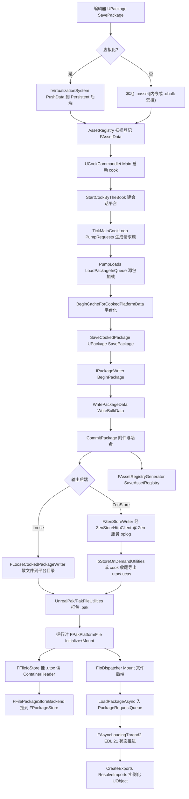

### 20.6.2 Cook 主循环调度(DecideNextCookAction)

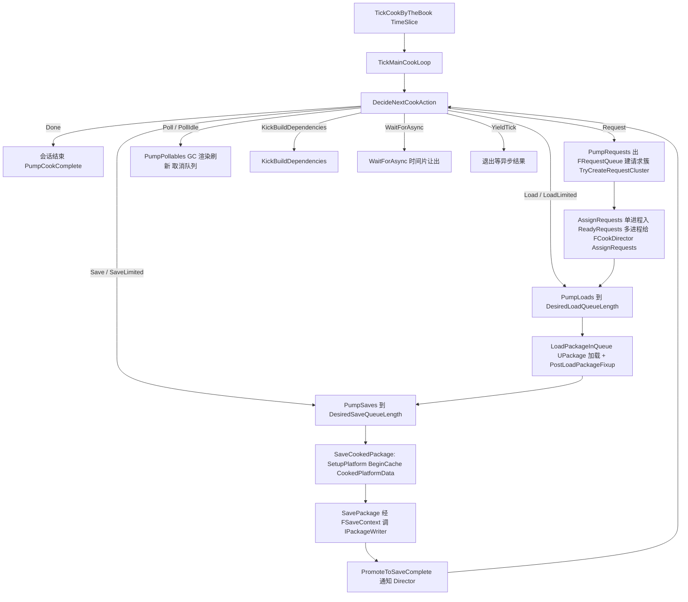

要点:队列水位由 `MaxPreloadAllocated/DesiredSaveQueueLength/DesiredLoadQueueLength/RequestBatchSize/LoadBatchSize` 控制(CookOnTheFlyServer.h:402-421);MPCook 时包状态 `AssignedToWorker/SaveStalled*` 由 Director 回撤与重指派(CookTypes.h:168-193)。

### 20.6.3 pak/utoc 挂载(含延迟加密)

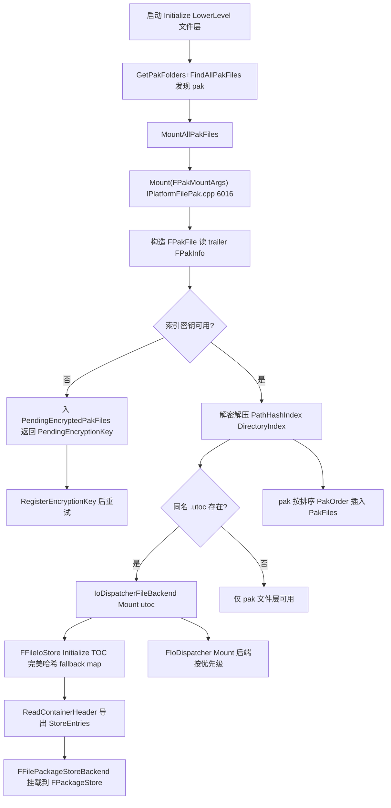

签名 pak:`FPakFile::SetupSignedPakReader`(IPlatformFilePak.h:918)+ `FPakSignatureFile`(主签名表+块签名,:2685)校验;`bMountFailOnMissingUtoc`(IPlatformFilePak.h:2089)控制 utoc 缺失是否报错。

### 20.6.4 AssetRegistry 扫描(编辑器)

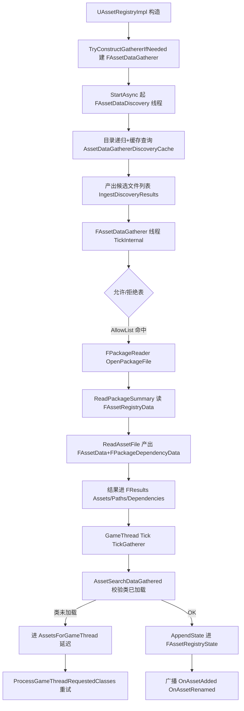

同步路径:`ScanPathsSynchronous` 会 `PrioritizeSearchPath` + 把扫描转移到调用线程(AssetDataGatherer.h:243-248);cooker 在扫描完成后 `ClearCache` 释放缓存(AssetDataGatherer.h:241)。

### 20.6.5 IoDispatcher 请求状态机

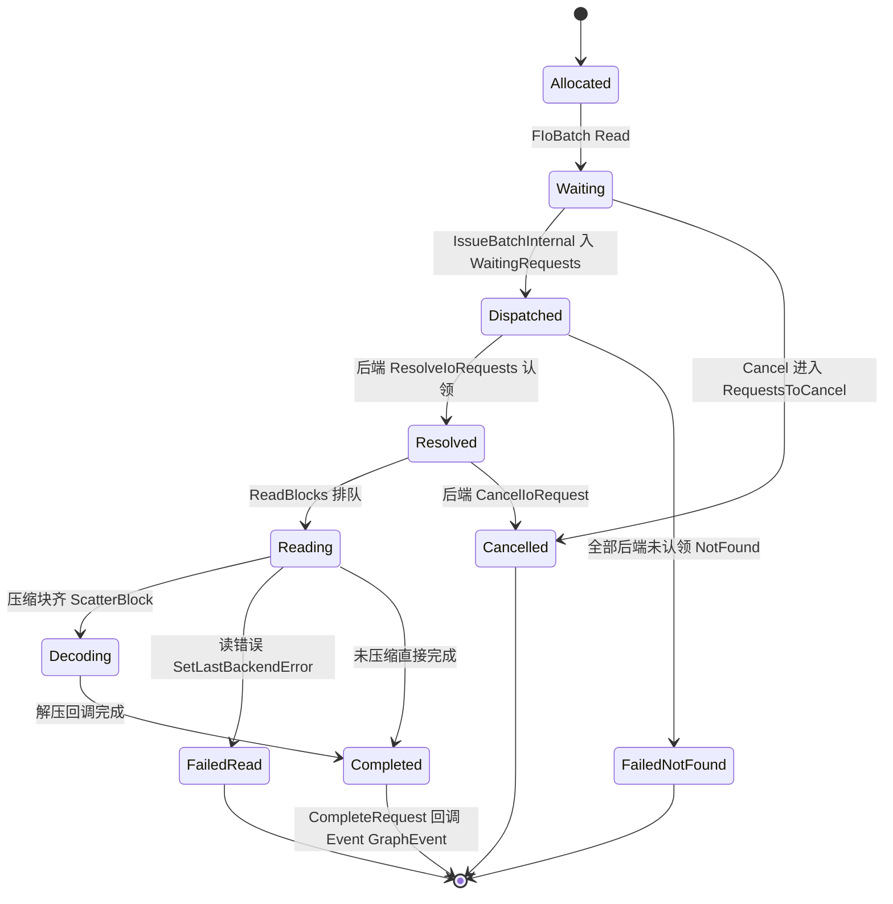

判定依据:`IssueBatchInternal`(IoDispatcher.cpp:746)、`ProcessIncomingRequests`(:951-1055)、`CompleteRequest` 的 ErrorCode CAS(:913-948);取消链 `Cancel→RequestsToCancel→CompleteRequest(Cancelled)`(:579-591)。

## 20.7 时序图

### 20.7.1 Cook 保存(cook 进程 → Zen/文件输出)

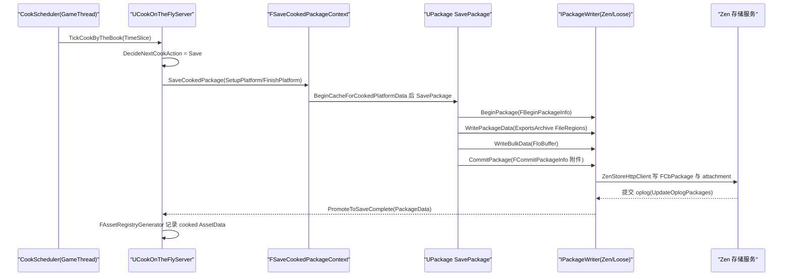

### 20.7.2 运行时异步加载(EDL 主路径)

```mermaid
sequenceDiagram
    participant GT as "GameThread"
    participant ALT as "FAsyncLoadingThread2"
    participant PS as "FPackageStore"
    participant IO as "FIoDispatcher 线程"
    participant FS as "FFileIoStore(IoService 线程)"
    participant CAS as "ucas/utoc"
    GT->>ALT: LoadPackageAsync(PackagePath)
    ALT->>ALT: LoadPackageInternal 入 PackageRequestQueue NotifyOne
    ALT->>PS: GetPackageStoreEntry(PackageId)
    PS-->>ALT: ImportedPackageIds LoaderType=Zen
    ALT->>IO: NewBatch Read(ExportBundleData chunk)
    IO->>FS: ResolveIoRequests 完美哈希 Resolve
    FS->>CAS: ReadBlocks 读压缩块
    FS->>FS: 解密 解压 ScatterBlock
    FS-->>IO: GetCompletedIoRequests
    IO-->>ALT: 完成回调 FIoBuffer
    ALT->>ALT: ProcessPackageSummary 解析 FZenPackageSummary
    ALT->>IO: 递归导入包请求 ImportDependencies
    ALT->>ALT: CreateExports ResolveImports PreloadExports
    ALT->>GT: CreateClusters PostLoad 回调与完成委托
    GT->>GT: UObject 就绪
```

### 20.7.3 pak/utoc 挂载

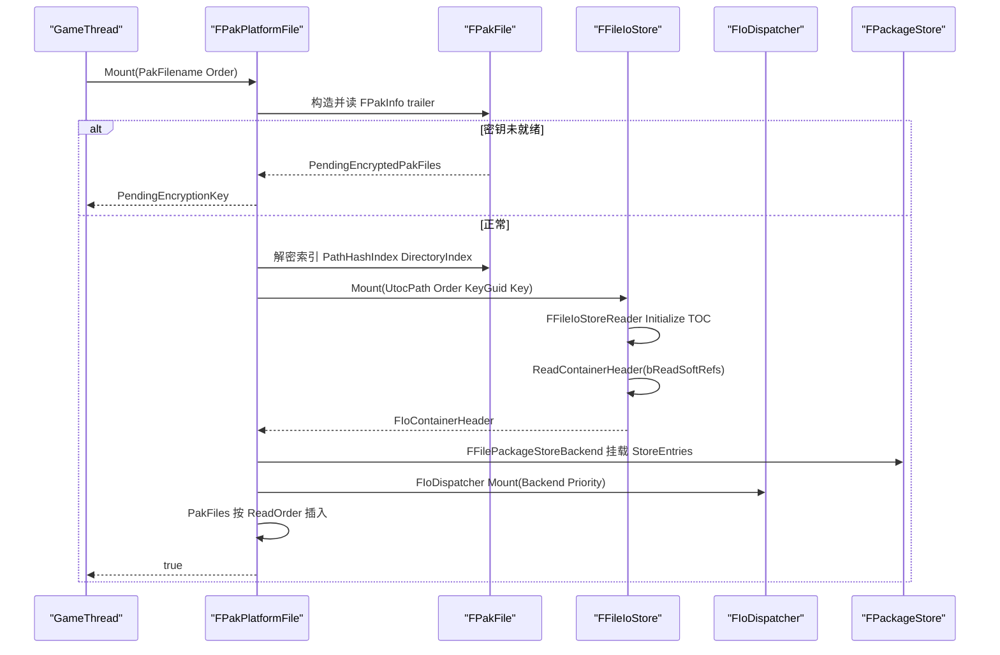

### 20.7.4 Interchange 导入

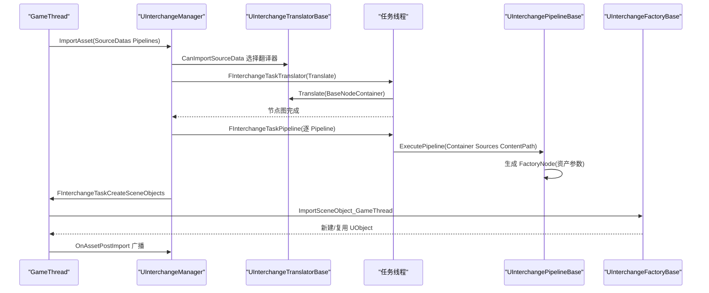

### 20.7.5 MPCook Director/Worker

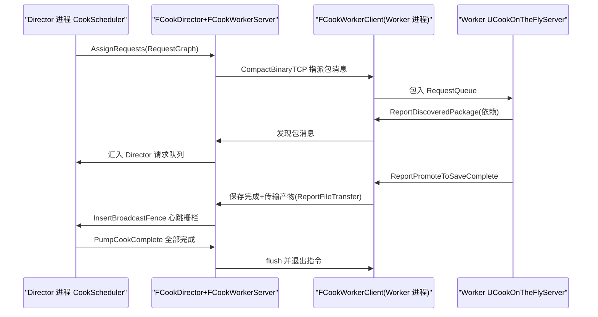

## 20.8 线程模型与同步

| 线程/执行体 | 名称/优先级 | 创建点 | 职责与关键同步 |
|---|---|---|---|
| IoDispatcher 调度线程 | `IoDispatcher` / TPri_AboveNormal / 亲和性 `FPlatformAffinity::GetIoDispatcherThreadMask()` | IoDispatcher.cpp:865 | `Run` 循环 = 等 `DispatcherEvent` → ProcessIncomingRequests/ProcessCompletedRequests(IoDispatcher.cpp:1062-1092);锁:`WaitingMutex`(等待队列)、`UpdateMutex`(取消/重优先级队列)、`BackendsLock`(FRWLock);后端约定见 IoDispatcherBackend.h:180-188 |
| 解压 worker | TaskGraph `ETaskPriority::BackgroundNormal`,数量 `GIoDispatcherDecompressionWorkerCount` | FIoDispatcherChunkBlockDecoder::Initialize(IoDispatcher.cpp:489) | 调度器过载时由 IoDispatcher 线程 `TryRetactAndExecuteDecodeTasks` 回撤执行(:1080-1083) |
| 文件 IO 后端线程 | `IoService` / TPri_AboveNormal | IoDispatcherFileBackend.cpp:1396 | FFileIoStore::Run:块读取、签名校验、散射;完成链 `CompletedRequestsHead/Tail`;`DecompressedBlocksCritical` 保护就绪解压块 |
| EDL 加载线程 | `FAsyncLoadingThread` / TPri_Normal | AsyncLoading2.cpp:11342 | FAsyncLoadingThread2::Run;入队 `PackageRequestQueue`(MPSC)+ `AltZenaphore.NotifyOne`(LoadPackageInternal:12693);GameThread 侧 `MainThreadWakeEvent`;完成回调经 `ConditionalProcessCallbacks` 在 GameThread 广播(`CompletedUPackagesForBroadcast`) |
| 资产发现线程 | `FAssetDataDiscovery` / TPri_BelowNormal | AssetDataGatherer.cpp:1945 | 目录扫描;结果经发现队列交 Gatherer |
| 资产收集线程 | `FAssetDataGatherer` / TPri_BelowNormal | AssetDataGatherer.cpp:4260 | TickInternal 读包;`TickLock`/`ResultLock` 两把锁(头文件注释 :353-361);GameThread 接管模式 `IsGameThreadTakeOverGatherEachTick` |
| Cook 调度线程 | 所在进程 GameThread(命令行主循环或 FTickableEditorObject::Tick) | CookOnTheFlyServer.h:695 | TickMainCookLoop;PackageData 状态由调度线程独占写;网络 Pump 在 TickFromSchedulerThread(CookDirector.h:105) |
| Zen HTTP 客户端 | `IZenClientPool`(默认池大小 8) | Zen/Internal/ZenClient.h:64 | websocket/CB 请求流;由 FZenStoreHttpClient(IoStoreUtilities/Internal)在 cook 线程使用 |
| ImageWriteQueue | 任务池,并发 `ImageWriteQueue.MaxConcurrency` | ImageWriteQueue 模块 | Enqueue/CreateFence 线程安全(ImageWriteQueue.h:28-33);完成回调主线程 |
| StorageServerClient | 内建 HTTP 客户端线程池 + 本地 CacheJournal | StorageServerClient/Private | FStorageServerIoDispatcherBackend 实现 IIoDispatcherBackend;请求经 zenyte 服务协议 |

跨线程所有权规则要点:

- `FIoRequestImpl` 全生命周期引用计数;`ErrorCode` 原子 CAS 确保只完成一次(IoDispatcher.cpp:917);取消只能在完成前生效。
- `FAssetRegistryImpl` 的接口级锁由 `UAssetRegistryImpl` 持有(`FInterfaceWriteScopeLock` 传入 Initialize,AssetRegistryImpl.h:210);State 内 const 方法要求读锁。
- EDL 的包状态机只允许 ALT 与 GameThread 两端推进(字段注释 [ASYNC/GAME THREAD],AsyncLoading2.cpp:4757-4781);`EAsyncLoadingProgress` 回调顺序 Started→Read→Serialized→FullyLoaded(:4067-4074)。
- Cooker 的 FPackageData 状态迁移发生在调度线程;Worker 上的变更必须以 `ESendFlags` 决定是否发消息给 Director(CookOnTheFlyServer.h:601-608)。

## 20.9 配置与扩展点

- **IoDispatcher CVar**(`gi.*`/`iodispatcher.*`,IoDispatcherConfig.h:10-21):`GIoDispatcherBufferSizeKB/BufferAlignment/BufferMemoryMB`、`GIoDispatcherDecompressionWorkerCount`、`GIoDispatcherCacheSizeMB`、`GIoDispatcherSortRequestsByOffset`、`GIoDispatcherMaxForwardSeekKB`、`GIoDispatcherTocsEnablePerfectHashing`、`GIoDispatcherMaxConsecutiveDecompressionJobs`、`GIoDispatcherMaxResolveBatchSize` 等;命令行 `-forcegenericio` 强制泛型后端(IoDispatcher.cpp:509)。
- **PakFile CVar/委托**:`pak.ReaderReleaseDelay`(IPlatformFilePak.cpp:5869);`FCoreDelegates::GetPakEncryptionKeyDelegate/GetPakSigningKeysDelegate`;`FPakSetIndexSettingsDelegate` 决定运行时是否保留完整目录(IPlatformFilePak.h:140);`-lookloosefirst`(:1984)。
- **AssetRegistry ini**:`[AssetRegistry]` 节驱动 `FAssetRegistrySerializationOptions`(AssetRegistryState.h:57-59);命令行 `-NoAssetRegistryCacheWrite`;预制品路径 `Project/AssetRegistry.bin`、编辑器 `EditorClientAssetRegistry.bin`(ARLoader.cpp:80-82);cooker 的 `DevelopmentAssetRegistry.bin`(AssetRegistry.cpp:453)。
- **Virtualization ini**:`[Core.ContentVirtualization] SystemName=Off/Default/<注册名>`(VirtualizationSystem.h:583-592);自定义系统用 `UE_REGISTER_VIRTUALIZATION_SYSTEM` 宏注册工厂(:854)。
- **Zen**:连接/自动拉起由 `FServiceSettings`(`[Zen]` ini 与 `-ZenLocal=…` 命令行,端口默认 8558,ZenServerInterface.h:33-37、:84-118)。
- **Cook 扩展点**:`ICookPackageSplitter`(按类拆包,接口 Public/CookPackageSplitter.h:37,注册表 CookOnTheFlyServer.h:442);`IMPCollector`/`ICookArtifact`(MPCook 消息与全局工件,CookOnTheFlyServer.h:716-720);`UE::Cook::IDeterminismHelper` 确定性辅助;`FPakPlatformFile::HandleMountPakDelegate`(IPlatformFilePak.h:2036)/`MountPaksEx` 动态挂载。
- **Interchange**:模块启动调用 `RegisterTranslator/RegisterFactory/RegisterWriter`;蓝图管线经 `ScriptedExecutePipeline`(InterchangePipelineBase.h:255-260);`UInterchangeProjectSettings` 控制导入行为。
- **分发插件**:`ChunkDownloader`(`FChunkDownloader::Initialize(PlatformName, TargetDownloadsInFlight)`,ChunkDownloader.h:50)、GooglePAD/HTTPChunkInstaller 均以 `FPakPlatformFile::HandleMountPakDelegate` 或自身 chunk 安装接口接入;BuildPatchServices 由 `FBuildPatchServicesModule` + `BuildPatchInstall` API 驱动。

## 20.10 已知限制/未确认项

- Zen 存储服务本体(存储域、oplog 存储引擎)在 5.8.3 源码树中以独立服务二进制分发,`Engine/Source` 内只有客户端与工具(Zen/ZenOplogUtils/ZenDashboard/ZenLaunch);oplog 的服务端写路径未在源码中确认,本章仅描述 FZenStoreWriter/客户端侧行为与 ZenOplogUtils 的读取侧。
- `FStorageServerClient` 的内部 HTTP 客户端(BuiltInHttpClient)与 DPC "zenyte" 协议细节未逐行展开;类名与线程模型来自 Internal/Private 头文件导出符号。
- BuildPatchServices、Datasmith 各翻译器、Localization/SourceControl/DesktopPlatform/S3Client/TurnkeyIO 属"覆盖到位、深度止于模块级":清单与职责已核,字段级数据字典未展开(篇幅所限,符号见附录)。
- UnrealPak 程序 5.8 的命令行解析主干(UnrealPak.cpp)未逐行引用行号;其能力(创建/提取/加密/签名/-compress)以 PakFileUtilities/IoStoreUtilities 的实现为准。
- `FIoDirectoryIndexReader::Initialize` 的加密目录索引路径与 `ETocMountOptions::WithSoftReferences` 的精确位组合已读到声明,但未逐一构造样例验证。
- StorageServer 的 FStorageServerPackageStore(CookOnTheFlyPackageStore.h)与 FFilePackageStoreBackend 的可选段(编辑器数据)交互规则,仅按 FPackageStoreEntry 的编辑器字段注释转述(PackageStore.h:57-77)。
- CookOnTheFly 网络协议(Runtime/CookOnTheFly 的 ECookOnTheFlyMessage 与 Developer/CookOnTheFlyNetServer)只给出模块与传输形态(TCP/平台协议),消息字段未逐一列出。

## 20.11 附录索引

| 模块 | 附录文件(相对 `docs/ue5.8.3/appendix/api/`) |
|---|---|
| AssetRegistry | Runtime/AssetRegistry.md |
| Core(IO 部分) | Runtime/Core.part01.md ~ Core.part03.md |
| CoreUObject(打包相关) | Runtime/CoreUObject.part01.md ~ Runtime/CoreUObject.part02.md |
| PakFile | Runtime/PakFile.md |
| IoStore OnDemand | Runtime/IoStoreOnDemand.md、Runtime/IoStoreOnDemandCore.md |
| IoStore HttpClient | Runtime/IoStoreHttpClient.md |
| CookOnTheFly | Runtime/CookOnTheFly.md |
| CookOnTheFlyNetServer | Developer/CookOnTheFlyNetServer.md |
| NetworkFile / NetworkFileSystem | Runtime/NetworkFile.md、Runtime/NetworkFileSystem.md |
| SandboxFile / StreamingFile | Runtime/SandboxFile.md、Runtime/StreamingFile.md |
| StorageServerClient | Runtime/StorageServerClient.md、Runtime/StorageServerClientDebug.md |
| InstallBundleManager | Runtime/InstallBundleManager.md |
| ImageWriteQueue | Runtime/ImageWriteQueue.md |
| Interchange | Runtime/InterchangeCore.md、Runtime/InterchangeEngine.md、Plugins/InterchangeCommon.md、Plugins/InterchangeNodes.md、Plugins/InterchangeFactoryNodes.md、Plugins/InterchangePipelines.md、Plugins/InterchangeDispatcher.md、Plugins/InterchangeMessages.md、Plugins/InterchangeFbxParser.md、Plugins/InterchangeImport.md、Plugins/InterchangeEditor*.md、Plugins/InterchangeOpenUSDImport.md 等 |
| Datasmith | Runtime/DatasmithCore.md、Plugins/DatasmithImporter.md、Plugins/DatasmithTranslator.md、Plugins/DatasmithContent.md、Plugins/DatasmithFBXTranslator.md、Plugins/DatasmithCADTranslator.md、Plugins/DatasmithInterchange.md、Plugins/DatasmithRuntime.md、Programs/DatasmithCADWorker.md、Programs/DatasmithSDK.md、Developer/DatasmithFacade.md 等 |
| IoStoreUtilities / PakFileUtilities | Developer/IoStoreUtilities.md、Developer/PakFileUtilities.md |
| Zen 族 | Developer/Zen.md、Developer/ZenOplogUtils.md、Editor/ZenEditor.md、Programs/ZenDashboard.md、Programs/ZenLaunch.md、Programs/ZenOplogDiffTool.md |
| CookMetadata / CookedEditor | Developer/CookMetadata.md、Developer/CookedEditor.md |
| FileUtilities / DirectoryWatcher | Developer/FileUtilities.md、Developer/DirectoryWatcher.md |
| DesktopPlatform / SourceControl / Localization | Developer/DesktopPlatform.md、Developer/SourceControl.md、Developer/Localization.md、Developer/LocalizationService.md |
| S3Client / TurnkeyIO | Developer/S3Client.md、Developer/TurnkeyIO.md |
| Virtualization | Developer/Virtualization.md、Editor/VirtualizationEditor.md |
| UnrealEd(Cooker/Commandlets) | Editor/UnrealEd.part01.md ~ UnrealEd.part02.md |
| BuildPatchServices | Runtime/BuildPatchServices.md |
| 分发插件 | Plugins/ChunkDownloader.md、Plugins/GooglePAD.md、Plugins/HTTPChunkInstaller.md、Plugins/MobilePatchingUtils.md、Plugins/PlatformDLC.md、Plugins/GDKPlatformDLC.md |
| 程序 | Programs/UnrealPak.md、Programs/BuildPatchTool.md、Programs/IoStoreDependencyViewer.md、Programs/UnrealPackageTool.md、Programs/UnrealVirtualizationTool.md、Programs/InterchangeWorker.md |
| DDC(交叉引用) | Developer/DerivedDataCache.md(详见 09 章) |
| IoStoreInsights | Plugins/IoStoreInsights.md |
