# 21 蓝图与脚本:Blueprint VM/Kismet 编译器/Python/Verse

本章覆盖蓝图脚本栈的完整链路:CoreUObject 中的蓝图虚拟机(FFrame/EExprToken/GNatives/ProcessEvent)、Engine 中的蓝图运行时资产(UBlueprint/UBlueprintGeneratedClass)与 Kismet 函数库、编辑器侧的图编辑与 Kismet 编译器(含 Reinstancing)、以及三条脚本旁路:Python(PythonScriptPlugin)、Verse(VerseCompiler/uLang + CoreUObject/VerseVM)、以及支撑脚本寻址的 UniversalObjectLocator、ScriptableToolsFramework、JsonBlueprintUtilities、Blutility、BlueprintEditorLibrary 等。所有结论均来自对 5.8.3 源码的实读,引用格式为 `路径:行号`(相对 `$E`)。

## 21.1 职责、边界与模块清单

| 模块名 | 路径 | Build.cs 依赖(Public/Private 摘录) | 职责一句话 |
|---|---|---|---|
| CoreUObject(VM 部分) | Source/Runtime/CoreUObject | P: Core, CorePrecise, Json, TraceLog | 蓝图字节码执行引擎:FFrame 执行栈、EExprToken 指令集、GNatives 原生指令表、ProcessEvent/ProcessInternal 入口 |
| CoreUObject(VerseVM 部分) | Source/Runtime/CoreUObject/Public/VerseVM | 同上(`WITH_VERSE_VM` 编译门控) | Verse 虚拟机:VValue 值表示、FOp 指令流、FContext、VHeap 与 Verse↔UObject 互操作类型(UVerseClass/UVerseStruct) |
| Engine(蓝图运行时) | Source/Runtime/Engine/Classes/Engine/Blueprint*.h、Classes/Kismet/ | P: CoreUObject, JsonUtilities, FieldNotification 等 | 蓝图资产 UBlueprint/UBlueprintGeneratedClass、动态委托绑定、SCS/组件模板、UberGraphFrame 持久帧、全部 Kismet 函数库 |
| UniversalObjectLocator | Source/Runtime/UniversalObjectLocator | P: Core, CoreUObject, HTTP | 与序列化格式无关的对象稳定寻址(fragment 链)与同步/异步解析 |
| VerseCompiler(uLang) | Source/Runtime/VerseCompiler | P: Core, uLangCore, uLangJSON | Verse 语言编译器前端+后端:Parser→SemanticAnalyzer→IR→Assembler 五段可插拔工具链 |
| uLangCore/uLangJSON/uLangUE | Source/Runtime/Solaris/* | P: Core(, AutoRTFM) | uLang 基础库(CSharpMix 语法树 Vst、JSON 诊断输出、UE 侧初始化 uLangUE::Initialize) |
| JsonUtilities | Source/Runtime/JsonUtilities | P: Core, CoreUObject, Json | FJsonObjectConverter:UStruct↔JsonObject 反射序列化,供 JsonBlueprintUtilities 使用 |
| BlueprintGraph | Source/Editor/BlueprintGraph | P: Core, CoreUObject, Engine, InputCore, Slate | 蓝图图节点层:UK2Node 全家(114 个节点类)、UEdGraphSchema_K2 连接规则、节点孵化器与编译期节点处理器(FNodeHandlingFunctor) |
| KismetCompiler | Source/Editor/KismetCompiler | Pvt: BlueprintGraph, CoreUObject, Engine, Kismet, UnrealEd | 图→字节码编译器:FKismetCompilerContext/函数上下文/FBPTerminal 中间表示/FKismetCompilerVMBackend 代码生成 |
| Kismet | Source/Editor/Kismet | Pvt: BlueprintGraph, KismetCompiler, GraphEditor, UnrealEd 等 | 蓝图编辑器(FBlueprintEditor)、FBlueprintCompilationManager 编译编排与 16 阶段流水线、FBlueprintEditorUtils |
| KismetWidgets | Source/Editor/KismetWidgets | Pvt: BlueprintGraph, Slate, UnrealEd | 蓝图相关 Slate 部件:SPinTypeSelector、SScrubControlPanel、SSingleObjectDetailsPanel、CreateBlueprintFromActorDialog |
| GraphEditor | Source/Editor/GraphEditor | Pvt: BlueprintGraph, Kismet, KismetWidgets, PropertyEditor | 通用图编辑 UI:SGraphEditor/SGraphPanel/SGraphNode 系列及 Kismet 专用节点/Pin 部件(KismetNodes/KismetPins) |
| Blutility | Source/Editor/Blutility | P: EditorSubsystem, MainFrame | 编辑器工具蓝图:UEditorUtilityWidget(蓝图编辑器 Script Tools)、UAssetActionUtility/UActorActionUtility、UEditorUtilitySubsystem |
| BlueprintEditorLibrary | Source/Editor/BlueprintEditorLibrary | P: BlueprintGraph, Core | 蓝图工具函数库 UBlueprintEditorLibrary(供 Python/蓝图对蓝图资产做编辑操作) |
| UMGEditor | Source/Editor/UMGEditor | Pvt: Blutility, Kismet, GraphEditor | UWidgetBlueprint/UEditorUtilityWidgetBlueprint 的宿主编辑器(蓝图编辑器在 Widget 蓝图上的特化) |
| PythonScriptPlugin | Plugins/Experimental/PythonScriptPlugin/Source/PythonScriptPlugin | P: Core, CoreUObject, Engine, ToolMenus | Python3 嵌入:unreal 模块类型注册(FPyWrapperTypeRegistry)、GIL 管理、双向调用、远程执行、stub 生成 |
| JsonBlueprintUtilities | Plugins/JsonBlueprintUtilities/Source/JsonBlueprintUtilities | P: Core, CoreUObject, Engine | UJsonBlueprintFunctionLibrary:蓝图直接读写 FJsonObjectWrapper(To String/From String 等) |
| ScriptableToolsFramework | Plugins/Runtime/ScriptableToolsFramework/Source/ScriptableToolsFramework | P: CoreUObject, InteractiveToolsFramework, UMG, ModelingComponents | 用蓝图子类定义建模交互工具(UScriptableInteractiveTool 等 34 个反射类) |
| EditorScriptableToolsFramework / ScriptableToolsEditorMode | Plugins/Editor/ScriptableToolsEditorMode/Source/* | P: ScriptableToolsFramework, UnrealEd | 脚本化工具的编辑器模式挂载与注册(UEdMode 模式工具集) |

## 21.2 总体架构

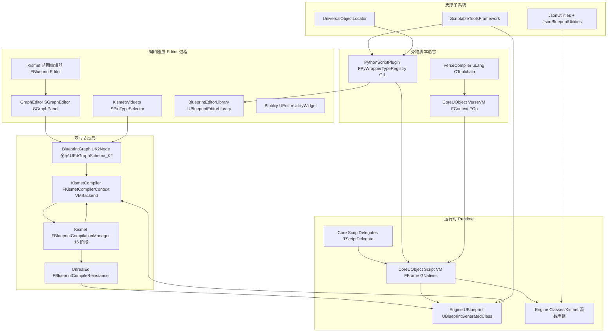

分层说明(自上而下):

1. **编辑器层**:`FBlueprintEditor`(Source/Editor/Kismet/Public/BlueprintEditor.h:189)聚合 GraphEditor 的 SGraphEditor 显示 UEdGraph;KismetWidgets 提供引脚类型选择等复用控件;Blutility/BlueprintEditorLibrary 是"用蓝图/Python 自动化编辑器"的出口。
2. **图与节点层**:BlueprintGraph 定义节点语义(UK2Node 子类),KismetCompiler 把节点图编译成中间语句(FBlueprintCompiledStatement)再由 FKismetCompilerVMBackend 发射字节码;Kismet 模块内的 FBlueprintCompilationManager 负责依赖排序、骨架类、Reinstancer 协调(阶段划分见 BlueprintCompilationManager.cpp:83-98)。
3. **运行时**:UBlueprint 是资产,UBlueprintGeneratedClass(`*_C`)是编译产物 UClass,字节码存在每个 UFunction::Script(TArray&lt;uint8&gt;)中,由 CoreUObject 的 VM 解释执行;Engine/Classes/Kismet 下 26 个头文件提供全部蓝图节点背后的 C++ 实现。
4. **旁路脚本**:Python 通过 FPyWrapperTypeRegistry 在启动时为全部反射类型生成 Python 类型,调用经 UObject::ProcessEvent 进 VM;Verse 由 uLang 编译到 VVM 字节码,通过 UVerseClass/UVerseStruct 与 UObject 反射互通。
5. **支撑**:UOL 提供字符串化对象定位(Python `unreal.ObjectRef`、LevelSequence 绑定),JsonBlueprintUtilities/JsonUtilities 提供 JSON 往返,ScriptableToolsFramework 用蓝图定义建模工具。

## 21.3 类图

### 21.3.1 蓝图资产与生成类(运行时,Engine 模块)

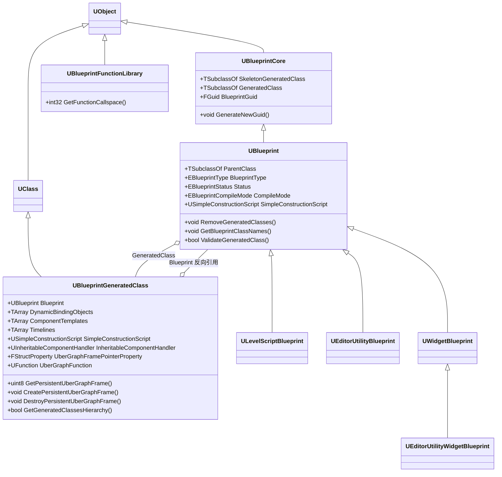

- `UBlueprintCore`(Source/Runtime/Engine/Classes/Engine/BlueprintCore.h:13)持有两个类指针:骨架类(改变量/函数签名即重建)与全量生成类。
- `UBlueprint`(Blueprint.h:402)是蓝图资产本体;`UBlueprintGeneratedClass`(BlueprintGeneratedClass.h:435 起)是编译出的 UClass,额外承载 SCS、组件模板、Timeline、动态委托绑定对象与 UberGraph 持久帧属性。
- `UEditorUtilityWidgetBlueprint`(Blutility/Classes/EditorUtilityWidgetBlueprint.h:39)是 Blutility 的入口资产类型,继承自 UMG 的 UWidgetBlueprint。

### 21.3.2 蓝图 VM 执行核心(CoreUObject)

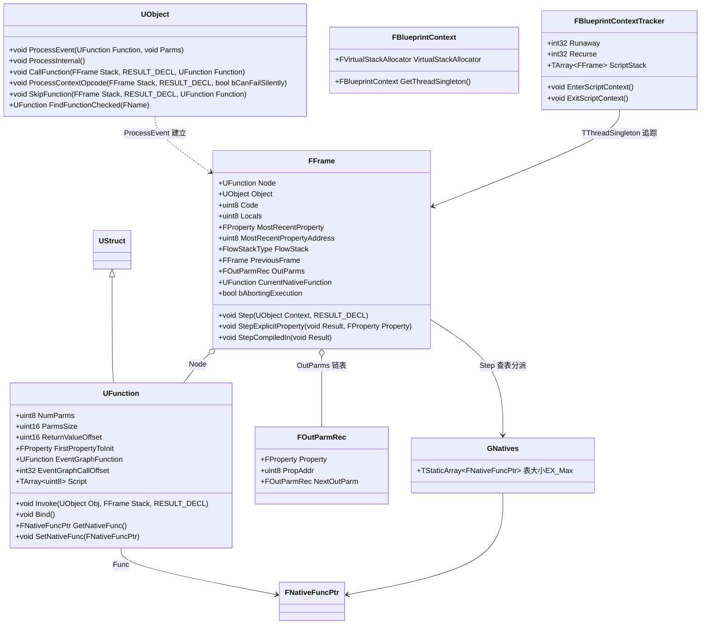

- `FFrame`(Source/Runtime/CoreUObject/Public/UObject/Stack.h:113)是 VM 的一个栈帧,`Code` 指向 `Node->Script` 字节流的当前指令;`Step`(ScriptCore.cpp:555)即"取 1 字节 opcode 并调用 `GNatives[B]`"。
- `UFunction::Func`(Class.h:2602)对原生函数是 exec thunk、对脚本函数统一绑定为 `&UObject::ProcessInternal`(Class.cpp:7688)。
- `FBlueprintContext`/`FBlueprintContextTracker` 均为线程单例(Script.h:74、471),支撑 VM 多线程执行与失控循环检测。

### 21.3.3 Kismet 编译器与编译编排(Editor)

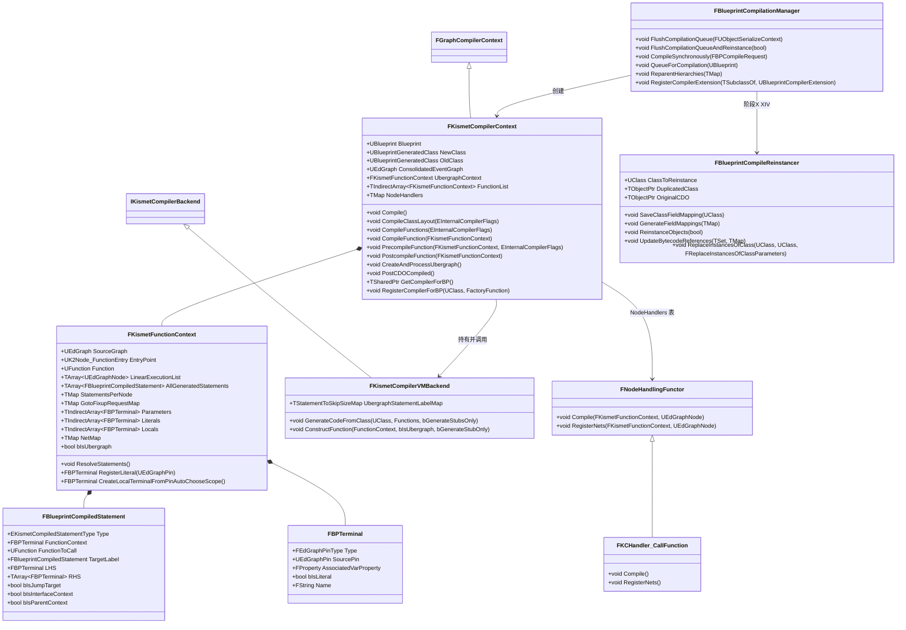

- `FKismetCompilerContext`(Source/Editor/KismetCompiler/Public/KismetCompiler.h:78)是编译器中枢,`friend struct FBlueprintCompilationManagerImpl`(KismetCompiler.h:687)。
- `FKismetFunctionContext`(KismetCompiledFunctionContext.h:39)对应"一个 UFunction 的编译状态":线性执行序列、每节点语句集、引脚→终端(Net)映射。
- `FBlueprintCompilationManager`(Kismet/Public/BlueprintCompilationManager.h:38)是静态编排器;`FBlueprintCompileReinstancer` 实际位于 UnrealEd 模块(UnrealEd/Public/Kismet2/KismetReinstanceUtilities.h:107),承担旧类→新类替换。

### 21.3.4 UK2Node 节点家族(BlueprintGraph,114 个节点类按语义分组)

```mermaid
classDiagram
    class UEdGraphNode
    class UK2Node {
        +void ExpandNode(FKismetCompilerContext, UEdGraph)
        +bool IsNodePure()
        +void GetMenuActions(FBlueprintActionDatabaseRegistrar)
        +UBlueprint GetBlueprint()
        +void ReconstructNode()
    }
    class UK2Node_CallFunction {
        +FSimpleMemberReference TargetFunction
        +void SetFromFunction(UFunction)
        +bool IsNodePure()
    }
    class UK2Node_CallParentFunction
    class UK2Node_CallArrayFunction
    class UK2Node_CallDelegateOnMember
    class UK2Node_Variable
    class UK2Node_VariableGet
    class UK2Node_VariableSet
    class UK2Node_Event {
        +TWeakObjectPtr UFunction
    }
    class UK2Node_CustomEvent
    class UK2Node_InputActionEvent
    class UK2Node_ComponentBoundEvent
    class UK2Node_FunctionEntry
    class UK2Node_FunctionResult
    class UK2Node_Tunnel
    class UK2Node_MacroInstance
    class UK2Node_Composite
    class UK2Node_DynamicCast
    class UK2Node_ClassDynamicCast
    class UK2Node_IfThenElse
    class UK2Node_ExecutionSequence
    class UK2Node_MakeArray
    class UK2Node_MakeMap
    class UK2Node_BreakStruct
    class UK2Node_MakeStruct
    class UK2Node_BaseAsyncTask
    class UK2Node_AsyncAction
    class UK2Node_Timeline
    class UK2Node_CreateDelegate
    class UK2Node_AddDelegate
    class UK2Node_AssignDelegate
    class UK2Node_EditablePinBase
    class UK2Node_BaseMCDelegate
    UK2Node_CallFunction <|-- UK2Node_CallParentFunction
    UK2Node_CallFunction <|-- UK2Node_CallArrayFunction
    UK2Node_CallFunction <|-- UK2Node_CallDelegateOnMember
    UK2Node_Variable <|-- UK2Node_VariableGet
    UK2Node_Variable <|-- UK2Node_VariableSet
    UK2Node_EditablePinBase <|-- UK2Node_Event
    UK2Node_EditablePinBase <|-- UK2Node_Tunnel
    UK2Node_Event <|-- UK2Node_CustomEvent
    UK2Node_Event <|-- UK2Node_InputActionEvent
    UK2Node_Event <|-- UK2Node_ComponentBoundEvent
    UK2Node_Tunnel <|-- UK2Node_MacroInstance
    UK2Node <|-- UK2Node_Composite
    UK2Node <|-- UK2Node_DynamicCast
    UK2Node_DynamicCast <|-- UK2Node_ClassDynamicCast
    UK2Node <|-- UK2Node_IfThenElse
    UK2Node <|-- UK2Node_ExecutionSequence
    UK2Node <|-- UK2Node_MakeArray
    UK2Node <|-- UK2Node_BreakStruct
    UK2Node <|-- UK2Node_MakeStruct
    UK2Node_BaseAsyncTask <|-- UK2Node_AsyncAction
    UK2Node <|-- UK2Node_Timeline
    UK2Node_BaseMCDelegate <|-- UK2Node_AddDelegate
    UK2Node_AddDelegate <|-- UK2Node_AssignDelegate
    UEdGraphNode <|-- UK2Node
```

- 全部 114 个 K2Node 头文件位于 `Source/Editor/BlueprintGraph/Classes/`(K2Node_*.h),上图仅收录代表性继承链;完整清单见附录 BlueprintGraph.md。
- `UK2Node_CallFunction`(K2Node_CallFunction.h:48)是"蓝图调用任意 UFUNCTION"的节点,其编译期行为由 `FKCHandler_CallFunction`(BlueprintGraph/Public/CallFunctionHandler.h:24)实现。
- 节点分组速览:函数调用(Call*系列)、变量存取(Variable*/Self/Literal)、事件与入口(Event/CustomEvent/Input*/BoundEvent/FunctionEntry)、流程控制(IfThenElse/Sequence/Switch*/DoOnceMultiInput/MultiGate)、字面量与容器(MakeArray/MakeMap/MakeSet/BitmaskLiteral/EnumLiteral)、转换(DynamicCast/ClassDynamicCast/ObjToInterface 系)、委托(CreateDelegate/Add/Assign/Remove/Clear/CallDelegate)、异步(BaseAsyncTask/AsyncAction/SpawnActor)、宏与隧道(Tunnel/MacroInstance/Composite)、Timeline。

### 21.3.5 Python↔UObject 绑定(PythonScriptPlugin)

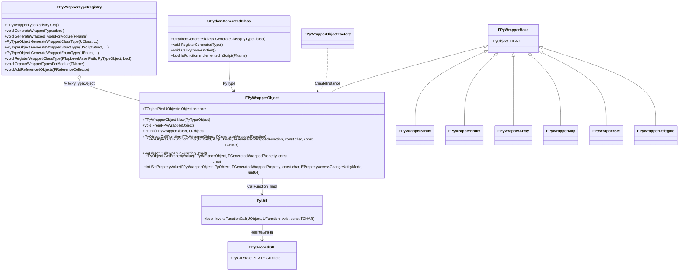

- 每个 `FPyWrapperObject` 实例持有一个 `TObjectPtr<UObject>`(PyWrapperObject.h:25),即 Python 对象是 UObject 的轻量句柄而非拷贝;由 `FPyWrapperTypeRegistry::AddReferencedObjects` 保证 GC 可达(PyWrapperTypeRegistry.h:381)。
- Python 类继承 UObject 类时由 `UPythonGeneratedClass::GenerateClass`(PyWrapperObject.cpp:2105)动态生成 UClass,并把 Python 函数注册为 native thunk `UPythonGeneratedClass::CallPythonFunction`(PyWrapperObject.cpp:1640)。

### 21.3.6 Verse 编译器与 VerseVM

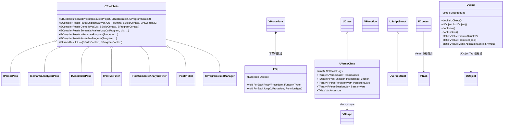

- `CToolchain`(Source/Runtime/VerseCompiler/Public/uLang/Toolchain/Toolchain.h:149)是五段式编译管线:Parse(Vst 语法树)→ PostVstFilters → SemanticAnalysis → PostSemanticAnalysisFilters/PostIrFilters → Assembler(生成 VVM 字节码);各段接口在 `uLang/CompilerPasses/` 下。
- VerseVM 全部位于 `Source/Runtime/CoreUObject/Public/VerseVM/`(138 个头文件),受 `WITH_VERSE_VM` 门控(VVMVerse.h:14),默认 UE 构建不启用(见 21.10)。
- `UVerseClass`(VVMVerseClass.h:135,`UCLASS(MinimalAPI, within=Package, Config=Engine)`)让 Verse 类成为反射系统里的 UClass,成员含 SolClassFlags、TaskClasses(每个协程对应一个 task 类)、InitInstanceFunction、PersistentVars/SessionVars(VVMVerseClass.h:251-269);`UVerseStruct`(VVMVerseStruct.h:33)对应 UScriptStruct;互操作构造函数在 `VVMUECodeGen.h:42-64`。

## 21.4 数据字典

### 21.4.1 EExprToken 蓝图字节码指令全表

来源:Source/Runtime/CoreUObject/Public/UObject/Script.h:193-313(枚举值即字节码字节)。逐项含义(注释为源码原文翻译):

| 指令 | 值 | 含义/操作数布局 |
|---|---|---|
| EX_LocalVariable | 0x00 | 局部变量引用,后跟 FProperty 指针 |
| EX_InstanceVariable | 0x01 | 对象实例变量,后跟 FProperty 指针 |
| EX_DefaultVariable | 0x02 | 类默认对象(CDO)上下文的变量 |
| EX_Return | 0x04 | 函数返回,后跟返回值表达式 |
| EX_Jump | 0x06 | 无条件跳转到 CodeSkipSizeType 偏移 |
| EX_JumpIfNot | 0x07 | 条件为假时跳转,操作数:条件表达式+偏移 |
| EX_Assert | 0x09 | 断言(蓝图 Assert 节点) |
| EX_Nothing | 0x0B | 空操作(亦是语句终结符) |
| EX_NothingInt32 | 0x0C | 带 int32 参数的 NOP(脚本反汇编调试用) |
| EX_Let | 0x0F | 任意大小值赋给变量(先目标后源表达式) |
| EX_BitFieldConst | 0x11 | 按 FProperty 对单个 bit 赋值 |
| EX_ClassContext | 0x12 | 类 CDO 上下文表达式 |
| EX_MetaCast | 0x13 | 元类转换(Cast&lt;T&gt; 类常量转换) |
| EX_LetBool | 0x14 | 布尔变量赋值 |
| EX_EndParmValue | 0x15 | 可选参数默认值结束 |
| EX_EndFunctionParms | 0x16 | 函数调用参数列表结束 |
| EX_Self | 0x17 | Self 对象 |
| EX_Skip | 0x18 | 可跳过表达式(记录跳过字节数) |
| EX_Context | 0x19 | 经对象上下文调用(目标为 NULL 时抛 Accessed None),操作数:上下文表达式+skip 偏移+RValue 属性+调用表达式 |
| EX_Context_FailSilent | 0x1A | 同上但上下文 NULL 时静默跳过(仅无输出/返回值的函数) |
| EX_VirtualFunction | 0x1B | 虚函数调用,后跟函数 FName,运行期按对象类 FindFunctionChecked 解析 |
| EX_FinalFunction | 0x1C | 预绑定(final)函数调用,后跟 UFunction 指针 |
| EX_IntConst | 0x1D | int32 常量 |
| EX_FloatConst | 0x1E | float 常量 |
| EX_StringConst | 0x1F | ANSI 字符串常量(以 0 结尾) |
| EX_ObjectConst | 0x20 | UObject 常量(ScriptPointerType) |
| EX_NameConst | 0x21 | FName 常量(FScriptName) |
| EX_RotationConst | 0x22 | FRotator 常量(3×double) |
| EX_VectorConst | 0x23 | FVector 常量(3×double,LWC) |
| EX_ByteConst | 0x24 | byte 常量 |
| EX_IntZero / EX_IntOne | 0x25/0x26 | 0 / 1 整数常量(紧凑编码) |
| EX_True / EX_False | 0x27/0x28 | 布尔常量 |
| EX_TextConst | 0x29 | FText 常量(前导 EBlueprintTextLiteralType) |
| EX_NoObject | 0x2A | None 对象常量 |
| EX_TransformConst | 0x2B | FTransform 常量 |
| EX_IntConstByte | 0x2C | 1 字节 int 常量 |
| EX_NoInterface | 0x2D | 空接口常量 |
| EX_DynamicCast | 0x2E | 安全动态类转换(Cast 节点) |
| EX_StructConst | 0x2F | 任意 UStruct 常量(属性值序列,EX_EndStructConst 结束) |
| EX_EndStructConst | 0x30 | 结构常量结束 |
| EX_SetArray | 0x31 | 设置任意数组(元素序列+EX_EndArray) |
| EX_EndArray | 0x32 | 数组字面量结束 |
| EX_PropertyConst | 0x33 | FProperty 常量 |
| EX_UnicodeStringConst | 0x34 | UTF-16 字符串常量 |
| EX_Int64Const | 0x35 | int64 常量 |
| EX_UInt64Const | 0x36 | uint64 常量 |
| EX_DoubleConst | 0x37 | double 常量 |
| EX_Cast | 0x38 | 转换操作码,后跟 ECastToken 子码 |
| EX_SetSet/EX_EndSet | 0x39/0x3A | set 容器构造 |
| EX_SetMap/EX_EndMap | 0x3B/0x3C | map 容器构造 |
| EX_SetConst/EX_EndSetConst | 0x3D/0x3E | set 字面量 |
| EX_MapConst/EX_EndMapConst | 0x3F/0x40 | map 字面量 |
| EX_Vector3fConst | 0x41 | float3(vector<float>) 常量 |
| EX_StructMemberContext | 0x42 | 结构成员上下文(寻址结构内属性) |
| EX_LetMulticastDelegate | 0x43 | 多播委托赋值 |
| EX_LetDelegate | 0x44 | 单播委托赋值 |
| EX_LocalVirtualFunction | 0x45 | 本地(非网络)虚函数快速调用 |
| EX_LocalFinalFunction | 0x46 | 本地(非网络)final 函数快速调用 |
| EX_LocalOutVariable | 0x48 | 局部输出(引用传递)参数 |
| EX_DeprecatedOp4A | 0x4A | 已弃用 |
| EX_InstanceDelegate | 0x4B | 委托/函数对象的 const 引用 |
| EX_PushExecutionFlow | 0x4C | 压入 FlowStack 地址(不跳转) |
| EX_PopExecutionFlow | 0x4D | 从 FlowStack 弹出并继续 |
| EX_ComputedJump | 0x4E | 跳到 int 表达式指定的地址(SwitchValue) |
| EX_PopExecutionFlowIfNot | 0x4F | 条件为假时弹出执行流 |
| EX_Breakpoint | 0x50 | 断点(编辑器外等同 EX_Nothing) |
| EX_InterfaceContext | 0x51 | 经原生接口变量调用 |
| EX_ObjToInterfaceCast | 0x52 | 对象引用→接口 |
| EX_EndOfScript | 0x53 | 脚本最后字节 |
| EX_CrossInterfaceCast | 0x54 | 接口→接口 |
| EX_InterfaceToObjCast | 0x55 | 接口→对象 |
| EX_WireTracepoint / EX_Tracepoint | 0x5A/0x5E | 仪器化追踪点(编辑器外为 NOP) |
| EX_SkipOffsetConst | 0x5B | CodeSkipSizeType 常量 |
| EX_AddMulticastDelegate | 0x5C | 委托数组添加目标(Bind/BindDynamic) |
| EX_ClearMulticastDelegate | 0x5D | 清空多播委托 |
| EX_LetObj | 0x5F | 对象引用赋值 |
| EX_LetWeakObjPtr | 0x60 | 弱对象指针赋值 |
| EX_BindDelegate | 0x61 | 绑定对象+函数名到单播委托 |
| EX_RemoveMulticastDelegate | 0x62 | 从多播委托移除目标 |
| EX_CallMulticastDelegate | 0x63 | 调用(广播)多播委托 |
| EX_LetValueOnPersistentFrame | 0x64 | 写 UberGraph 持久帧变量 |
| EX_ArrayConst / EX_EndArrayConst | 0x65/0x66 | 数组字面量 |
| EX_SoftObjectConst | 0x67 | TSoftObjectPtr 常量 |
| EX_CallMath | 0x68 | 静态纯函数直接调用(数学库等,无上下文检查),后跟 UFunction 指针 |
| EX_SwitchValue | 0x69 | 按值选择(SwitchValue 节点) |
| EX_InstrumentationEvent | 0x6A | 仪器化事件(剖析) |
| EX_ArrayGetByRef | 0x6B | 按引用取数组元素 |
| EX_ClassSparseDataVariable | 0x6C | 稀疏类数据变量 |
| EX_FieldPathConst | 0x6D | TFieldPath 常量 |
| EX_AutoRtfmTransact | 0x70 | AutoRTFM:后续代码进入事务 |
| EX_AutoRtfmStopTransact | 0x71 | AutoRTFM:中止/冲破事务 |
| EX_AutoRtfmAbortIfNot | 0x72 | AutoRTFM:条件为假则中止事务 |
| EX_AutoRtfmAbort | 0x73 | AutoRTFM:中止事务 |
| EX_Max | 0xFF | GNatives 表大小上界 |

配套子表 `ECastToken`(Script.h:322-331):CST_ObjectToInterface=0x00、CST_ObjectToBool=0x01、CST_InterfaceToBool=0x02、CST_DoubleToFloat=0x03、CST_FloatToDouble=0x04,由 `GCasts` 表分派(ScriptCore.cpp:914)。文本字面量子类型 `EBlueprintTextLiteralType`(Script.h:334-348):Empty/LocalizedText/LocalizedTextWithNotes/InvariantText/LiteralString/StringTableEntry。

### 21.4.2 VM 关键结构字段

**FFrame**(Stack.h:113-156):

| 字段 | 类型 | 含义 | 源码位置 |
|---|---|---|---|
| Node | UFunction* | 当前执行的函数 | Stack.h:117 |
| Object | UObject* | 执行上下文对象(自) | Stack.h:118 |
| Code | uint8* | 当前指令指针,指向 Node->Script 内部 | Stack.h:119(构造时 `Code(InNode->Script.GetData())`,Stack.h:305) |
| Locals | uint8* | 参数+局部变量帧内存 | Stack.h:120 |
| MostRecentProperty / MostRecentPropertyAddress / MostRecentPropertyContainer | FProperty*/uint8*/uint8* | 最近一次表达式求值触及的属性/地址/容器(out 参数回写依赖) | Stack.h:122-124 |
| FlowStack | TArray&lt;CodeSkipSizeType,TInlineAllocator&lt;8&gt;&gt; | EX_PushExecutionFlow 的返回地址栈(隧道 EndOfThread) | Stack.h:127 |
| PreviousFrame | FFrame* | 调用者帧 | Stack.h:130 |
| OutParms | FOutParmRec* | 输出参数链表 | Stack.h:133 |
| PropertyChainForCompiledIn | FField* | C++ 调用原生函数时替代字节码的参数链 | Stack.h:136 |
| CurrentNativeFunction | UFunction* | 当前执行的原生函数 | Stack.h:139 |
| bArrayContextFailed / bAbortingExecution | bool | 数组上下文失败标志 / 中止执行标志(异常传播) | Stack.h:148-151 |

**UFunction 内存布局**(Class.h:2571-2602):

| 字段 | 类型 | 含义 |
|---|---|---|
| NumParms | uint8 | 参数个数 |
| ParmsSize | uint16 | 参数总大小(字节) |
| ReturnValueOffset | uint16 | 返回值在参数缓冲中的偏移(MAX_uint16 表示无返回值) |
| RPCId / RPCResponseId | uint16 | 网络服务调用配对 id |
| FirstPropertyToInit | FProperty* | 首个需构造的参数/局部属性链表头(PostConstructLink) |
| EventGraphFunction / EventGraphCallOffset | UFunction*/int32 | UE_BLUEPRINT_EVENTGRAPH_FASTCALLS:事件桩直接跳入 UberGraph 的目标函数与状态偏移(Class.h:2587-2593) |
| Script | TArray&lt;uint8&gt;(UStruct 成员) | 字节码本体 |
| Func | FNativeFuncPtr(私有) | 绑定的原生函数指针:脚本函数=ProcessInternal,native=NativeFunctionLookupTable 命中项 |

**常量**:MAX_STRING_CONST_SIZE=1024(Script.h:42)、MAX_SIMPLE_RETURN_VALUE_SIZE=64(Script.h:47,VM 丢弃简单返回值用)、`VariableSizeType`=uint16(Script.h:53)、`CodeSkipSizeType`=uint32(Script.h:68,`SCRIPT_LIMIT_BYTECODE_TO_64KB=0`)、GMaximumScriptLoopIterations=1000000(ScriptCore.cpp:107)。

**EFunctionFlags 蓝图相关位**(Script.h:132-173,全 32 位见源码):FUNC_Exec=0x200、FUNC_Native=0x400、FUNC_Event=0x800、FUNC_Static=0x2000、FUNC_UbergraphFunction=0x8000、FUNC_MulticastDelegate=0x10000、FUNC_Delegate=0x100000、FUNC_HasOutParms=0x400000、FUNC_HasDefaults=0x800000、FUNC_BlueprintCallable=0x4000000、FUNC_BlueprintEvent=0x8000000、FUNC_BlueprintPure=0x10000000、FUNC_Const=0x40000000。组合宏 FUNC_FuncInherit/FUNC_FuncOverrideMatch/FUNC_NetFuncFlags(Script.h:184-187)。

### 21.4.3 编译器中间表示

**EKismetCompiledStatementType**(BlueprintCompiledStatement.h:10-101,全部枚举):KCST_Nop、KCST_CallFunction、KCST_Assignment、KCST_CompileError、KCST_UnconditionalGoto、KCST_PushState、KCST_GotoIfNot、KCST_Return、KCST_EndOfThread、KCST_Comment、KCST_ComputedGoto、KCST_EndOfThreadIfNot、KCST_DebugSite、KCST_CastObjToInterface、KCST_DynamicCast、KCST_ObjectToBool、KCST_AddMulticastDelegate、KCST_ClearMulticastDelegate、KCST_WireTraceSite、KCST_BindDelegate、KCST_RemoveMulticastDelegate、KCST_CallDelegate、KCST_CreateArray、KCST_CrossInterfaceCast、KCST_MetaCast、KCST_AssignmentOnPersistentFrame、KCST_CastInterfaceToObj、KCST_GotoReturn、KCST_GotoReturnIfNot、KCST_SwitchValue、KCST_DoubleToFloatCast、KCST_FloatToDoubleCast,以及仪器化扩展 KCST_InstrumentedEvent/…Stop/…PureNodeEntry/…WireEntry/…WireExit/…StatePush/…StateRestore/…StateReset/…StateSuspend/…StatePop/…TunnelEndOfThread,容器扩展 KCST_ArrayGetByRef/KCST_CreateSet/KCST_CreateMap。

**FBlueprintCompiledStatement**(BlueprintCompiledStatement.h:104-157):Type、FunctionContext(调用目标对象终端,NULL=Self)、FunctionToCall、TargetLabel+UbergraphCallIndex(latent/ubergraph 修补)、LHS/RHS(赋值目标/调用实参终端列表)、bIsJumpTarget、bIsInterfaceContext、bIsParentContext、ExecContext(WireTrace 关联 Exec 引脚)、Comment。

**FBPTerminal**(BPTerminal.h):Type(FEdGraphPinType)、AssociatedVarProperty(关联属性)、bIsLiteral、Name、InlineGeneratedParameter(内联生成参数语句)等——编译器把"引脚 Net"具体化为文字或存储位置(KismetCompiledFunctionContext.h:198-207 RegisterLiteral)。

### 21.4.4 蓝图状态与类型枚举(Engine)

| 枚举 | 取值 | 含义 | 源码位置 |
|---|---|---|---|
| EBlueprintStatus | BS_Unknown / BS_Dirty / BS_Error / BS_UpToDate / BS_BeingCreated / BS_UpToDateWithWarnings | 编译状态机,UBlueprint::Status | Blueprint.h:41-56 |
| EBlueprintType | BPTYPE_Normal / Const / MacroLibrary / Interface / LevelScript / FunctionLibrary | 蓝图类型(决定编辑器与编译行为) | Blueprint.h:61-77 |
| EKismetCompileType | SkeletonOnly / Full / StubAfterFailure / BytecodeOnly | 单次编译目标(Cpp 项随 nativization 移除) | Blueprint.h:81-91 |
| EBlueprintCompileMode | Default / Development / FinalRelease | 编译模式(开发期插桩 vs 最终版) | Blueprint.h:103-108 |
| EInternalCompilerFlags | PostponeLocalsGenerationUntilPhaseTwo / PostponeDefaultObjectAssignmentUntilReinstancing / SkipRefreshExternalBlueprintDependencyNodes | 编译管理器与上下文之间的内部相位标志 | KismetCompiler.h:66-74 |
| ECompilationManagerJobType | Normal / SkeletonOnly / RelinkOnly | 编译队列中的作业类别 | BlueprintCompilationManager.cpp:493-497 |
| EBlueprintCompileReinstancerFlags | BytecodeOnly / AutoInferSaveOnCompile / AvoidCDODuplication / UseDeltaSerialization | 重实例化器行为标志 | KismetReinstanceUtilities.h:18-26 |
| ETerminalSpecification | TS_Unspecified / TS_Literal / TS_ForcedShared | 终端共享策略 | KismetCompiledFunctionContext.h:29-34 |

### 21.4.5 脚本委托(Core/Public/UObject/ScriptDelegates.h)

| 类型/成员 | 说明 | 源码位置 |
|---|---|---|
| `typedef TScriptDelegate&lt;&gt; FScriptDelegate`(CoreUObject 侧别名) | 单播动态委托(蓝图可见) | CoreUObject/Public/UObject/ScriptDelegateFwd.h:20 |
| TScriptDelegate::Object / FunctionName | 绑定的 UObject(弱引用)+ FName 函数名 | ScriptDelegates.h:487 起 |
| TScriptDelegate::BindUFunction(UObject*, const FName&) | 绑定 | ScriptDelegates.h:583 |
| TScriptDelegate::ProcessDelegate&lt;UObjectTemplate&gt;(void* Parameters) | 执行:FindFunctionChecked 后直接调 ObjectPtr->ProcessEvent(Function, Parameters) | ScriptDelegates.h:983-1018(ProcessEvent 调用在 1016) |
| TMulticastScriptDelegate::InvocationList | TArray&lt;UnicastDelegateType&gt; 调用列表 | ScriptDelegates.h:1103 |
| TMulticastScriptDelegate::ProcessDelegate(void*) | 拷贝调用列表后逐个 ProcessDelegate,随后 CompactInvocationList;旧名 ProcessMulticastDelegate 已弃用(5.8) | ScriptDelegates.h:1429-1459、1463 |
| FDelegateProperty / FMulticastDelegateProperty | 反射属性,提供 AddDelegate/RemoveDelegate 等虚接口 | CoreUObject/Public/UObject/UnrealType.h:6487、6614-6624 |

蓝图委托的字节码侧操作:EX_BindDelegate/EX_AddMulticastDelegate/EX_RemoveMulticastDelegate/EX_ClearMulticastDelegate/EX_CallMulticastDelegate(见 21.4.1);编译器对应 KCST_BindDelegate/KCST_AddMulticastDelegate/KCST_RemoveMulticastDelegate/KCST_ClearMulticastDelegate/KCST_CallDelegate。动画/网络等运行时通过 UBlueprintGeneratedClass::DynamicBindingObjects(UDynamicBlueprintBinding,BlueprintGeneratedClass.h:470)在实例化时自动完成事件绑定。

### 21.4.6 VerseVM 值与指令集

**VValue**(Source/Runtime/CoreUObject/Public/VerseVM/VVMValue.h:52):单个 uint64 `EncodedBits` 位标记编码——int32/float/bool/rational/char 直接内联,UObject 指针带 `UObjectTag`(`IsUObject()`/`AsUObject()` 直接 BitCast,VVMValue.h:213-222),其余指向堆 cell(VArray/VMap/VObject/VFunction/VProcedure 等)。关键方法:FromInt32/FromBool/Melt(冻结值熔解,VVMValue.h:121)。

**EOpcode 指令集全集**(由 `VerseVMBytecodeGenerator.cs` 在构建期生成 `VVMBytecodeOps.gen.h`,枚举定义于 VVMBytecode.h:28-35;下表 90 个指令均逐字取自 Source/Programs/UnrealBuildTool/System/VerseVMBytecodeGenerator.cs 的 Inst() 表):

| 分组 | 指令 |
|---|---|
| 快速失败/容错 | CanFastAppendToArrayFastFail, FastAppendToArray, MutableAdd, Err, Tracepoint |
| 数据搬运 | Move, MoveTrailed, MoveNonComparable, Reset, ResetNonTrailed |
| 控制流 | Jump, JumpIfInitialized, Switch, EndTask, Yield, JumpIfDefaultSubObject |
| 快速失败分支(带比较语义) | ArrayIndexFastFail, TypeCastFastFail, QueryFastFail, LtFastFail, LteFastFail, GtFastFail, GteFastFail, EqFastFail, NeqFastFail |
| 失败上下文/任务 | BeginFailureContext, EndFailureContext, EndFastFailureContext, SelfTask, BeginTask, CallTask, BeginAwait, AwaitSuccess, EndAwait, BeginBatch, EndBatch |
| 调用/返回 | Call, CallWithSelf, Return, ReturnTrailed, ResumeUnwind |
| 引用单元 | NewRef, NewPersistentOrSessionWeakMapRef, RefGet, RefSet, RefSetLive, RefCallDomain |
| 冻结语义 | Freeze, Melt |
| 容器 | Length, CallSet, CallSetLive, NewArray, NewMutableArray, NewMutableArrayWithCapacity, ArrayAdd, InPlaceMakeImmutable, NewOption, NewMap, MapKey, MapValue |
| 类与模块 | NewClass, BindNativeClass, ConstructNativeDefaultObject, LoadImport, BeginModule, EndModule, EndModuleData |
| 字段/作用域 | LoadFieldFromSuper, UnifyField, InitializeVar, SetField, SetFieldLive, UnifyNativeObject, UnwrapNativeConstructorWrapper, NewScope, NewFunction, LoadParentScope, LoadCapture |
| UObject 互操作 | NewObject, NewObjectICClass(内联缓存类) |
| 剖析 | BeginProfileBlock, EndProfileBlock, LoadConstructor |

寄存器约定(VVMBytecode.h:164-192):`FRegisterIndex::SELF`=0、`SCOPE`=1、参数从 2 开始;操作数角色 EOperandRole=Use/Immediate/ClobberDef/UnifyDef(VVMBytecode.h:130-136);指令流按 8 字节对齐(OpAlignment=alignof(void*),VVMBytecode.h:272);`FLabelOffset` 为相对字节偏移的跳转目标(VVMBytecode.h:316);`FUnwindEdge` 描述 unwind 区间(VVMBytecode.h:334)。分支/终局判定见 IsBranch/IsTerminal/MightFallThrough(VVMBytecode.h:39-127)。

### 21.4.7 Python 与 UOL 数据结构

| 结构 | 关键字段/方法 | 含义 | 源码位置 |
|---|---|---|---|
| FPyWrapperBase | PyObject_HEAD | 所有 Unreal 包装 Python 对象的公共头 | PythonScriptPlugin/Private/PyWrapperBase.h:24 |
| FPyWrapperObjectMetaData | Class(UClass*)、TypeRegistryName | PyTypeObject 与 UClass 的桥 | PyWrapperObject.h:107 |
| FPyWrapperTypeRegistry | PyTypeMap(TMap&lt;FTopLevelAssetPath,PyTypeObject*&gt;)、ClassReferenceMap 等 | 全局单例:类型生成/注册/查询、模块脏通知 | PyWrapperTypeRegistry.h:358-477 |
| FPythonCommandEx(FPythonCommand) | Command/CommandType/LogOutput/SuccessInfo/ErrorInfo… | 一次 Python 命令执行描述(枚举 EPythonCommandType) | PythonScriptPlugin/Public/PythonScriptTypes.h |
| UPythonScriptPluginSettings | AdditionalPaths、bDeveloperMode、bRemoteExecution、RemoteExecutionMulticastBindAddress/GroupEndpoint/… | 插件配置(config=EditorIni) | PythonScriptPlugin/Private/PythonScriptPluginSettings.h:71-136 |
| FUniversalObjectLocator | Fragments(TArray&lt;FFragment&gt;) | 对象地址=fragment 链,从最具体到最不具体 | UniversalObjectLocator/Public/UniversalObjectLocator.h:55-160 |
| FResolveParams(EResolveType) | SyncFind/SyncLoad/SyncUnload/AsyncFind/AsyncLoad/… | 解析模式参数 | UniversalObjectLocatorResolveParams.h |
| FUniversalObjectLocator::FResolveResult | 对象或 Future、解析标志 | Resolve 返回值(可携带 TFuture 异步结果) | UniversalObjectLocator.h:70 附近 |

## 21.5 接口清单

以下原型逐字抄自头文件(去除 `*_API` 宏),路径相对 `$E`。线程约束列:GT=GameThread(判定依据随注)、AT=任意线程(有防护)。

### 21.5.1 蓝图 VM 核心(CoreUObject)

| 原型 | 功能/参数返回 | 线程/重入约束 | 位置 |
|---|---|---|---|
| `void UObject::ProcessEvent( UFunction* Function, void* Parms )` | 所有脚本事件/函数调用总入口:分配/初始化局部帧→建 FFrame→`Function->Invoke`。返回值与 out 参数写回 Parms | AT;`checkf(!IsUnreachable())`、`checkf(!FUObjectThreadContext::Get().IsRoutingPostLoad)`(ScriptCore.cpp:2059-2061),不能与 GC 标记阶段并发 | ScriptCore.cpp:2055 |
| `void FFrame::Step(UObject* Context, RESULT_DECL)` | 执行 1 条指令:`GNatives[*Code++](Context,*this,RESULT_PARAM)` | AT(VM 内部) | Stack.h:192 / ScriptCore.cpp:555 |
| `void FFrame::StepExplicitProperty(void*const Result, FProperty* Property)` | 无字节码(C++ 直调)时按属性链取参;CPF_OutParm 时查 OutParms 链取地址 | AT | Stack.h:198 / ScriptCore.cpp:561 |
| `void FFrame::StepCompiledIn(void* Result)` / `TNativeType& StepCompiledInRef&lt;TProperty,TNativeType&gt;(void*const)` | C++ 调 UFUNCTION 时参数解码(无 Code 时走 PropertyChainForCompiledIn) | AT | Stack.h:202-207、496 |
| `void UFunction::Invoke(UObject* Obj, FFrame& Stack, RESULT_DECL)` | 调用 Func 指针;接口类先 `Obj->GetInterfaceAddress` 换址;TGuardValue 设置 CurrentNativeFunction | AT | Class.h:2632 / Class.cpp:7584 |
| `void UFunction::Bind()` | 非 FUNC_Native 统一 `Func=&UObject::ProcessInternal`;native 查 `OwnerClass->NativeFunctionLookupTable` | GT 为主(类加载/编译期) | Class.cpp:7679 |
| `void UObject::CallFunction( FFrame& Stack, RESULT_DECL, UFunction* Function )` | EX_Virtual/FinalFunction 的字节码级调用:native 判 callspace 后 Invoke;脚本函数走 ProcessScriptFunction | AT | ScriptCore.cpp:1133 |
| `template&lt;typename Exec&gt; void ProcessScriptFunction(UObject* Context, UFunction* Function, FFrame& Stack, RESULT_DECL, Exec ExecFtor)` | 从调用方字节码逐参 Step 求值、构造被调帧,交 ExecFtor(ProcessInternal 或 ProcessLocalScriptFunction)执行 | AT(文件内静态模板) | ScriptCore.cpp:975 |
| `void ProcessLocalScriptFunction(UObject* Context, FFrame& Stack, RESULT_DECL)` | 字节码解释主循环:`while (*Stack.Code != EX_Return) Stack.Step(...)`,含失控/递归检测 | AT | ScriptCore.cpp:1226 |
| `DEFINE_FUNCTION(UObject::ProcessInternal)`(即 `void UObject::ProcessInternal(UObject* Context, FFrame& Stack, RESULT_DECL)`) | 脚本函数统一 native thunk:判 CLASS_NewerVersionExists→GetFunctionCallspace→Remote 则 CallRemoteFunction→Local 则 ProcessLocalScriptFunction | AT | ScriptCore.cpp:1364 |
| `void UObject::ProcessContextOpcode( FFrame& Stack, RESULT_DECL, bool bCanFailSilent )` | EX_Context/EX_Context_FailSilent 语义:求值上下文对象,无效则按 skip 偏移清结果并抛 Accessed None | AT | ScriptCore.cpp:3163 |
| `DEFINE_FUNCTION(UObject::execCallMathFunction)` | EX_CallMath:直接 `Function->GetNativeFunc()(CDO, Stack, RESULT)`,跳过上下文检查与网络 | AT | ScriptCore.cpp:1108 |
| `DEFINE_FUNCTION(UObject::execVirtualFunction)` / `execFinalFunction` / `execLocalVirtualFunction` / `execLocalFinalFunction` | 4 种调用指令 thunk:按名字/指针解析 UFunction 后 CallFunction/ProcessLocalFunction | AT | ScriptCore.cpp:3293/3300/3307/3314 |
| `COREUOBJECT_API uint8 GRegisterNative(int32 NativeBytecodeIndex, const FNativeFuncPtr& Func)` | 启动期把 exec thunk 写入 GNatives[i] | 静态初始化期(先于引擎初始化) | ScriptCore.cpp:895 |
| `typedef void (*FNativeFuncPtr)(UObject* Context, FFrame& TheStack, RESULT_DECL)` | exec 函数统一签名 | — | CoreNative.h:19 |
| `static void FNativeFunctionRegistrar::RegisterFunction(class UClass* Class, const ANSICHAR* InName, FNativeFuncPtr InPointer)` | 把 C++ UFUNCTION thunk 写入 UClass::NativeFunctionLookupTable | 静态初始化期 | CoreNative.h:43 |
| `static FBlueprintCoreDelegates::FOnScriptDebuggingEvent FBlueprintCoreDelegates::OnScriptException` 等 | OnScriptException/OnScriptProfilingEvent/OnToggleScriptProfiler 三个全局多播;`ThrowScriptException`/`InstrumentScriptEvent`/`SetScriptMaximumLoopIterations` | 广播线程=触发线程(VM 内任意线程) | Script.h:453-463 |
| `FBlueprintContextTracker::EnterScriptContext/ExitScriptContext/EnforceScriptTimeLimit` | 每线程脚本进出与超时;`OnEnterScriptContext` 委托"可能在任意线程被调用"(源码原文) | TThreadSingleton | Script.h:471-548 |

### 21.5.2 蓝图编译器(KismetCompiler/Kismet/UnrealEd)

| 原型 | 功能 | 线程约束 | 位置 |
|---|---|---|---|
| `void FKismetCompilerContext::Compile()` | 编译入口:`CompileClassLayout(None)` 后 `CompileFunctions(None)`(实现处) | GT(编译全程持锁,见下) | KismetCompiler.h:232 / KismetCompiler.cpp:5459 |
| `void CompileClassLayout(EInternalCompilerFlags InternalFlags)` | 生成骨架/新类布局:CreateSchema→CleanAndSanitizeClass→CreateClassVariablesFromBlueprint→CreateFunctionList 等(Stage XII) | GT | KismetCompiler.h:218 / KismetCompiler.cpp:4749 |
| `void CompileFunctions(EInternalCompilerFlags InternalFlags)` | 遍历 FunctionList 执行 PrecompileFunction/CompileFunction/PostcompileFunction;内建 `FKismetCompilerVMBackend Backend_VM(Blueprint, Schema, *this)` 并调 `Backend_VM.GenerateCodeFromClass(NewClass, FunctionList, bGenerateStubsOnly)`(Stage XIII) | GT | KismetCompiler.h:221 / KismetCompiler.cpp:4964、5145 |
| `virtual void PrecompileFunction(FKismetFunctionContext& Context, EInternalCompilerFlags InternalFlags)` | 首相:校验/复制图/剪枝/调度线性执行序/建 UFunction(无代码) | GT | KismetCompiler.h:567 |
| `virtual void CompileFunction(FKismetFunctionContext& Context)` | 中相:按 LinearExecutionList 逐节点调 `NodeHandlers.FindRef(Node->GetClass())->Compile(...)`,产出 FBlueprintCompiledStatement;调试模式插 KCST_DebugSite/KCST_Comment | GT | KismetCompiler.h:581 / KismetCompiler.cpp:2710 |
| `virtual void PostcompileFunction(FKismetFunctionContext& Context)` | 末相:goto 修补(`ResolveGotoFixups`)、`ResolveStatements`(排序+合并相邻跳转)与交叉引用修补 | GT | KismetCompiler.h:587 |
| `void CreateAndProcessUbergraph()` | 合并所有事件图页为单一 UberGraph 函数 `ExecuteUbergraph_&lt;BP名&gt;`(GetUbergraphCallName,KismetCompiler.h:516) | GT | KismetCompiler.h:551 |
| `static TSharedPtr<FKismetCompilerContext> GetCompilerForBP(UBlueprint* BP, FCompilerResultsLog& InMessageLog, const FKismetCompilerOptions& InCompileOptions)` / `static void RegisterCompilerForBP(UClass* BPClass, CompilerContextFactoryFunction FactoryFunction)` | 编译器工厂注册(AnimBP/WidgetBP/LevelBP 等特化编译器由此挂入) | GT | KismetCompiler.h:301-302 |
| `void FKismetCompilerVMBackend::GenerateCodeFromClass(UClass* SourceClass, TIndirectArray<FKismetFunctionContext>& Functions, bool bGenerateStubsOnly=false)` | 后端:对每个函数 ConstructFunction→FScriptBuilderBase 发射字节码到 UFunction::Script | GT | KismetCompiler/Private/KismetCompilerBackend.h:40 |
| `static void FBlueprintCompilationManager::FlushCompilationQueue(FUObjectSerializeContext* InLoadContext)` | 冲洗编译队列,执行 Stage I~XVI(实现在 Kismet/Private/BlueprintCompilationManager.cpp 的 FlushCompilationQueueImpl,内 `FScopeLock ScopeLock(&Lock)`,BlueprintCompilationManager.cpp:679) | GT(FScopeLock+GCompilingBlueprint) | BlueprintCompilationManager.h:50 |
| `static void FBlueprintCompilationManager::FlushCompilationQueueAndReinstance(const bool bFindAndReplaceCDOReferences = false)` | 冲洗并完成重实例化(编译加载路径收尾) | GT | BlueprintCompilationManager.h:55 |
| `static void FBlueprintCompilationManager::CompileSynchronously(const FBPCompileRequest& Request)` | 立即编译单个蓝图(编辑器按 Compile 按钮),触发完整 find-and-replace | GT | BlueprintCompilationManager.h:62 / cpp:342 |
| `static void FBlueprintCompilationManager::QueueForCompilation(UBlueprint* BP)` / `NotifyBlueprintLoaded(UBlueprint*)` | 入队(加载时编译) | GT | BlueprintCompilationManager.h:67-72 |
| `static void FBlueprintCompilationManager::ReparentHierarchies(const TMap<UClass*, UClass*>& OldClassToNewClass)` | 批量把子类重挂到新父类并触发重实例化 | GT | BlueprintCompilationManager.h:89 |
| `static void FBlueprintCompilationManager::RegisterCompilerExtension(TSubclassOf<UBlueprint> BlueprintType, UBlueprintCompilerExtension* Extension)` | 注册按蓝图类型激活的编译扩展 | GT | BlueprintCompilationManager.h:97 |
| `void FBlueprintCompileReinstancer::ReinstanceObjects(bool bForceAlwaysReinstance = false)` | 重实例化 ClassToReinstance 的全部实例(内联 ReinstanceInner/ReinstanceFast) | GT | KismetReinstanceUtilities.h:198 |
| `void FBlueprintCompileReinstancer::UpdateBytecodeReferences( TSet<UBlueprint*>& OutDependentBlueprints, TMap<FFieldVariant, FFieldVariant>& OutFieldMapping)` | 依 FieldMapping 重写依赖蓝图字节码中的旧字段引用 | GT | KismetReinstanceUtilities.h:201 |
| `static void FBlueprintCompileReinstancer::ReplaceInstancesOfClass(UClass* OldClass, UClass* NewClass, const FReplaceInstancesOfClassParameters& Params)` | 通用类实例替换(核心静态;批量版 BatchReplaceInstancesOfClass) | GT | KismetReinstanceUtilities.h:228、231 |
| `static UClass* FBlueprintCompileReinstancer::MoveCDOToNewClass(UClass* OwnerClass, const TMap<UClass*, UClass*>& OldToNewMap, bool bAvoidCDODuplication)` | 安全搬运 CDO,配合 `MoveDependentSkelToReinst` 把 SKEL 类挪到 REINST_ 前缀类 | GT | KismetReinstanceUtilities.h:234、242 |
| `static void FBlueprintCompileReinstancer::CopyPropertiesForUnrelatedObjects(UObject* OldObject, UObject* NewObject, bool bClearExternalReferences, bool bForceDeltaSerialization = false, bool bOnlyHandleDirectSubObjects = false, TMap<UObject*, UObject*>* OldToNewInstanceMap = nullptr, const TMap<UClass*,UClass*>* OldToNewClassMap = nullptr)` | 非同构对象间属性拷贝(CPUFO) | GT | KismetReinstanceUtilities.h:316 |
| `void FKismetFunctionContext::ResolveStatements()` | 链接 goto、语句排序、MergeAdjacentStates 合并(私有三步公开包装) | GT | KismetCompiledFunctionContext.h:325 |
| `static FCompilerResultsLog&` 相关 `FCompilerResultsLog`(Kismet2/CompilerResultsLog.h) | 编译诊断收集,错误即中止该 BP | GT | — |

### 21.5.3 编译期节点处理(BlueprintGraph)

| 原型 | 功能 | 位置 |
|---|---|---|
| `class FKCHandler_CallFunction : public FNodeHandlingFunctor`(完整类) | UK2Node_CallFunction 的编译器:RegisterNets 建 Self/参数/返回终端;Compile 为每个上下文终端生成一条 `Statement.Type=KCST_CallFunction;Statement.FunctionToCall=Function;Statement.RHS=RHSTerms`(CallFunctionHandler.cpp:583-591),并处理 UberGraph/latent 修补(GotoFixupRequestMap) | CallFunctionHandler.h:24 / CallFunctionHandler.cpp:1041 |
| `class FKCHandler_Event` / `FKCHandler_FunctionEntry` / `FKCHandler_MathExpression`(EventEntryHandler.h 等) | 事件/函数入口/数学表达式节点的编译处理 | BlueprintGraph/Public/*.h(4 个 Handler 头) |
| `virtual void UK2Node::ExpandNode(class FKismetCompilerContext& CompilerContext, UEdGraph* SourceGraph)` | 展开节点为更原语节点(默认仅日志) | K2Node.h:295 |
| `virtual bool UK2Node::IsNodePure() const` | 纯节点判定(默认 false;CallFunction 按函数 FUNC_BlueprintPure) | K2Node.h:244 |
| `UEdGraphSchema_K2` 静态引脚类别 `PC_Exec/PC_Boolean/PC_Byte/PC_Class/PC_Int/PC_Int64/PC_Real/PC_Name/PC_Delegate/PC_Object/PC_Interface/PC_String/PC_Text/PC_Struct/PC_Wildcard`、`PSC_Self/PSC_Index/PSC_Bitmask`、引脚名 `PN_Execute/PN_Then` | 连接与类型系统 | EdGraphSchema_K2.h:392-423 |

### 21.5.4 蓝图运行时(Engine)

| 原型 | 功能 | 线程约束 | 位置 |
|---|---|---|---|
| `void UBlueprint::GetBlueprintClassNames(FName& GeneratedClassName, FName& SkeletonClassName, FName NameOverride = NAME_None) const` | 计算生成类命名:`<名>_C`、`SKEL_<名>`、CDO `Default__<名>_C` | 任意(纯函数) | Blueprint.h:817 |
| `ENGINE_API void UBlueprint::RemoveGeneratedClasses()` | 编译失败/销毁时回收生成类 | GT | Blueprint.h:934 |
| `static ENGINE_API bool UBlueprint::ValidateGeneratedClass(const UClass* InClass)` | 校验 NewClass 与 Blueprint 匹配 | GT | Blueprint.h:806 |
| `ENGINE_API virtual uint8* UBlueprintGeneratedClass::GetPersistentUberGraphFrame(UObject* Obj, UFunction* FuncToCheck) const override` | 取(或由父类递归取)UberGraph 持久帧;VM 的 ProcessEvent/ProcessScriptFunction 据此判定 bUsePersistentFrame | 任意(构造/执行期) | BlueprintGeneratedClass.h:626 / BlueprintGeneratedClass.cpp:1882 |
| `ENGINE_API virtual void CreatePersistentUberGraphFrame(UObject* Obj, bool bCreateOnlyIfEmpty = false, bool bSkipSuperClass = false, UClass* OldClass = nullptr) const` / `DestroyPersistentUberGraphFrame(...)` | 实例化/重实例化时创建/销毁持久帧(属性 UberGraphFrame) | GT(对象生命周期) | BlueprintGeneratedClass.h:627-628 |
| `static ENGINE_API bool UBlueprintGeneratedClass::GetGeneratedClassesHierarchy(const UClass* InClass, TArray<const UBlueprintGeneratedClass*>& OutBPGClasses)` | 自上而下收集 BP 类谱系(SCS/CPUFO 用) | 任意 | BlueprintGeneratedClass.h:542 |
| `ENGINE_API virtual int32 UBlueprintFunctionLibrary::GetFunctionCallspace(UFunction* Function, FFrame* Stack) override` | 转发 `GEngine->GetGlobalFunctionCallspace(Function, this, Stack)` | AT | BlueprintFunctionLibrary.h:15 / BlueprintFunctionLibrary.cpp:18 |
| `TScriptDelegate::void BindUFunction( UObject* InObject, const FName& InFunctionName )` / `bool IsBound() const` / `FName GetFunctionName() const` | 蓝图委托绑定/查询 | AT(内部弱引用+读写 scope) | ScriptDelegates.h:583/597/968 |
| `template <class UObjectTemplate> void TScriptDelegate::ProcessDelegate( void* Parameters ) const` | 单播执行(终点 ProcessEvent) | AT | ScriptDelegates.h:983 |
| `void TMulticastScriptDelegate::ProcessDelegate(void* Parameters) const`(旧名 ProcessMulticastDelegate 于 5.8 弃用) | 多播广播:拷贝 InvocationList 逐项调用后 CompactInvocationList | AT | ScriptDelegates.h:1429、1463 |

**UberGraph 持久帧机制**:蓝图事件图编译成单个 `ExecuteUbergraph_<BP>` 函数(FUNC_UbergraphFunction),其局部变量必须跨"每次事件进入"存活,故每个实例在 `UberGraphFramePointerProperty`(FStructProperty,类型 FPointerToUberGraphFrame)指向的堆内存上保存状态(BlueprintGeneratedClass.h:86-111、498);事件桩函数通过 `EventGraphFunction/EventGraphCallOffset` 直接把入口偏移写进状态参数实现 fastcall(ScriptCore.cpp:2131-2146)。

### 21.5.5 Kismet 函数库全表分组(Engine/Classes/Kismet,26 个头文件)

统计为各头文件内 `UFUNCTION` 出现次数(UFUNCTION 计数,2026-10 实测 grep):

| 分组 | 库(基类均为 UBlueprintFunctionLibrary) | UFUNCTION 数 | 代表职责 |
|---|---|---|---|
| 数学 | UKismetMathLibrary(KismetMathLibrary.h:189)、UBlueprintSpringMathLibrary(103)、UImportanceSamplingLibrary(9) | 741+103+9 | 全部运算符/三角/随机/插值/比较节点;弹簧物理;重要性采样 |
| 系统 | UKismetSystemLibrary(KismetSystemLibrary.h:102) | 295 | PrintString、DrawDebug*、LineTrace*/SweepTrace*、碰撞查询、模块加载、延迟、进程信息 |
| 游戏玩法 | UGameplayStatics(GameplayStatics.h:51) | 142 | 打开关卡、生成 Actor、游戏模式/玩家状态/控制器访问、伤害、保存游戏 |
| 容器 | UKismetArrayLibrary(32)、UBlueprintMapLibrary(13)、UBlueprintSetLibrary(16)、UBlueprintInstancedStructLibrary(8) | 69 | 数组/映射/集合/InstancedStruct 的泛型 Add/Remove/Find/Sort(Wildcard 定制 thunk) |
| 文本与本地化 | UKismetStringLibrary(77)、UKismetTextLibrary(53)、UKismetStringTableLibrary(13)、UKismetInternationalizationLibrary(16) | 159 | 字符串格式化/转换、FText 本地化、字符串表 |
| 路径与平台 | UBlueprintPathsLibrary(82)、UBlueprintPlatformLibrary(11) | 93 | 各类目录路径、平台启动 URL/屏幕信息 |
| 输入与渲染 | UKismetInputLibrary(53)、UKismetRenderingLibrary(36)、UKismetMaterialLibrary(5) | 94 | 输入枚举映射、Draw Material/Texture 到渲染目标、材质参数集 |
| 数据表 | UDataTableFunctionLibrary(28) | 28 | DataTable 行读取/导出 |
| 其他 | UKismetGuidLibrary(7)、UKismetNodeHelperLibrary(13) | 20 | GUID 生成;枚举显示名(编译器辅助) |
| 异步基类 | UBlueprintAsyncActionBase(BlueprintAsyncActionBase.h:19,BLUEPRINT_ASYNC_NODE 宏配合)、UBlueprintFunctionLibrary 本体 | — | 异步节点基类(Activate/BeginDestroy) |

代表原型(逐字):`static ENGINE_API void PrintString(const UObject* WorldContextObject, const FString& InString = FString("Hello"), bool bPrintToScreen = true, bool bPrintToLog = true, FLinearColor TextColor = FLinearColor(0.0, 0.66, 1.0), float Duration = 2.f, const FName Key = NAME_None);`(KismetSystemLibrary.h:566)——蓝图节点上的白色 exec 引脚即 WorldContextObject 隐式引脚。

这些库在 VM 中被 EX_CallMath(静态 final native 且无网络/通配参数;纯与非纯函数同样适用,纯函数仅作为表达式内联编译)或 EX_Context+EX_FinalFunction 调用,详见 21.6.2;`IsCallEditableInEventGraph` 等编辑器扩展在 Editor 侧。

### 21.5.6 Python 绑定(PythonScriptPlugin)

| 原型 | 功能 | 线程约束 | 位置 |
|---|---|---|---|
| `virtual bool ExecPythonCommand(const TCHAR* InPythonCommand) = 0` / `virtual bool ExecPythonCommandEx(FPythonCommandEx& InOutPythonCommand) = 0` | 模块接口:执行 Python 命令/带输出对象版本 | GT(见 InvokeFunctionCall) | PythonScriptPlugin/Public/IPythonScriptPlugin.h:54、60 |
| `static FPyWrapperTypeRegistry& FPyWrapperTypeRegistry::Get()` | 单例 | 任意(内部有锁的注册表,GIL 保护) | PyWrapperTypeRegistry.h:378 |
| `void GenerateWrappedTypes(bool bAllowMultithreadedGeneration = false)` / `void GenerateWrappedTypesForModule(const FName ModuleName)` | 为全部/某模块反射类型生成 PyTypeObject(可多线程生成) | 主初始化 GT;多线程生成仅类型构造 | PyWrapperTypeRegistry.h:403-406 |
| `PyTypeObject* GenerateWrappedClassType(const UClass* InClass, FGeneratedWrappedTypeReferences& OutGeneratedWrappedTypeReferences, TSet<FName>& OutDirtyModules, const EPyTypeGenerationFlags InGenerationFlags = EPyTypeGenerationFlags::None)` | 生成类包装(Struct/Enum/Delegate 同型接口) | GIL 下 | PyWrapperTypeRegistry.h:436 |
| `void RegisterWrappedClassType(const FSoftObjectPath& ClassName, PyTypeObject* PyType, const bool InDetectNameConflicts = true)` / `UnregisterWrappedClassType(...)` | 注册/注销 `unreal.<模块>.<类>` | GIL 下 | PyWrapperTypeRegistry.h:439-442 |
| `bool PyUtil::InvokeFunctionCall(UObject* InObj, const UFunction* InFunc, void* InBaseParamsAddr, const TCHAR* InErrorCtxt)`(PyUtil 命名空间) | Python→UObject 调用唯一通道:`if (!IsInGameThread())` 抛 RuntimeError;`FEditorScriptExecutionGuard`;`Py_BEGIN_ALLOW_THREADS` 释放 GIL 后 `InObj->ProcessEvent((UFunction*)InFunc, InBaseParamsAddr)`;`Py_END_ALLOW_THREADS` 重新取 GIL | **GT 硬约束**(PyUtil.cpp:611) | PyWrapperObject 系 / PyUtil.cpp:606-650 |
| `static PyObject* FPyWrapperObject::CallFunction(FPyWrapperObject* InSelf, PyObject* InArgs, PyObject* InKwds, const PyGenUtil::FGeneratedWrappedFunction& InFuncDef, const char* InPythonFuncName)`(及 61-97 行 6 个重载/Impl) | 生成的 `unreal.Object.method` 通用入口:参数转换→InvokeFunctionCall→返回值转换 | GT(经 InvokeFunctionCall) | PyWrapperObject.h:61-97 |
| `static PyObject* FPyWrapperObject::GetPropertyValue(FPyWrapperObject* InSelf, const PyGenUtil::FGeneratedWrappedProperty& InPropDef, const char* InPythonAttrName)` / `static int SetPropertyValue(...)` | 属性描述符 get/set(支持 PreEdit/PostEdit 通知模式) | GT | PyWrapperObject.h:49-52 |
| `UPythonGeneratedClass* UPythonGeneratedClass::GenerateClass(PyTypeObject* InPyType)` | Python 类定义→UClass:FPythonGeneratedClassBuilder 建 UFunction/属性,`NewClass->AddNativeFunction(*FuncName.ToString(), &UPythonGeneratedClass::CallPythonFunction)` | GT(编辑器启动/类定义时) | PyWrapperObject.cpp:2105、1640 |
| `DEFINE_FUNCTION(UPythonGeneratedClass::CallPythonFunction)`(UObject→Python 回调 thunk) | 在 GIL 下以 `FPyWrapperObjectFactory` 包装 Self,调 `PyGenUtil::InvokePythonCallableFromUnrealFunctionThunk(PySelf, FuncDef->PyFunction.GetPtr(), Func, Context, Stack, RESULT_PARAM)`(PyWrapperObject.cpp:2259) | VM 调用线程 + GIL | PyWrapperObject.cpp:2218-2265 |
| `class FPyScopedGIL { FPyScopedGIL() : GILState(PyGILState_Ensure()) {} ~FPyScopedGIL() { PyGILState_Release(GILState); } }`(逐字节选) | GIL 作用域守卫;另有 `TPyAutoGILPtr`(可在无 GIL 线程安全析构的 TPyPtr 包装) | 任意线程配对使用 | PyGIL.h |
| `FPythonScriptRemoteExecution`(含 CommandConnection/BroadcastConnection) | 多播 UDP 发现 + TCP 命令通道的远程执行;由 `FTSTicker::GetCoreTicker().AddTicker(...)` 在主循环 Tick(PythonScriptPlugin.cpp:1376-1379),HandleMessage 派发 `FPythonCommandEx` | GT(Ticker) | PythonScriptRemoteExecution.cpp:448-520、PythonScriptPlugin.cpp:1376 |

### 21.5.7 Verse(VerseCompiler / VerseVM)

| 原型 | 功能 | 线程约束 | 位置 |
|---|---|---|---|
| `SBuildResults CToolchain::BuildProject(const CSourceProject& SourceProject, const SBuildContext& BuildContext, const SProgramContext& ProgramContext)` | 编译整个 Verse 项目(源文件集合)→Vst→语义→IR→汇编→(可选)链接 | 调用方线程(uLang 内部无 UE 线程约束;引擎内通常在 TaskGraph/专用线程) | uLang/Toolchain/Toolchain.h:155 |
| `ECompilerResult CToolchain::ParseSnippet(const Verse::Vst::TNodeRef<Verse::Vst::Snippet>& OutVst, const CUTF8String& TextSnippet, const SBuildContext& BuildContext, const uint32_t VerseVersion = Verse::Version::Default, const uint32_t UploadedAtFNVersion = VerseFN::UploadedAtFNVersion::Latest)` | 单段文本→Vst 语法树 | 同上 | Toolchain.h:165 |
| `ECompilerResult CToolchain::SemanticAnalyzeVst(TOptional<TSRef<CSemanticProgram>>& OutProgram, const Verse::Vst::TNodeRef<Verse::Vst::Project>& Vst, ...)` | 语义分析(类型/作用域/效果推断) | 同上 | Toolchain.h:184 |
| `ECompilerResult CToolchain::IrGenerateProgram(const TSRef<CSemanticProgram>& Program, ...)` / `ECompilerResult CToolchain::AssembleProgram(...)` | IR 生成 / 汇编为 VVM 字节码 | 同上 | Toolchain.h:197、205 |
| `ECompilerResult CToolchain::ExtractLocalization(...)` / `ELinkerResult Link(...)` | 本地化提取 / 链接(预留) | 同上 | Toolchain.h:189、210 |
| `class UVerseClass : public UClass`(`UCLASS(MinimalAPI, within = Package, Config = Engine)`) | Verse 类的反射投影:持有 Verse 侧 member function thunk 表;`VVMVerseClass.h` 还声明 UVerseStruct 的伴生结构 | GT(UObject 规则) | VVMVerseClass.h:135 |
| `COREUOBJECT_API void RegisterVerseCallableThunks(UClass* Class, const FVerseCallableThunk* InThunks, uint32 InNumThunks)` | 把 Verse 可调用函数注册为 UFunction thunk(反射集成) | 类注册期 | VVMUECodeGen.h:64 |
| `COREUOBJECT_API void ConstructUVerseClass(UClass*& OutClass, const UECodeGen_Private::FVerseClassParams& Params)` / `ConstructUVerseFunction(UFunction** SingletonPtr, const UECodeGen_Private::FVerseFunctionParams& Params)` | UHT 代码生成辅助:构造 UVerseClass/UFunction 常量初始化 | 静态注册期 | VVMUECodeGen.h:60-61 |
| `UObject* VValue::AsUObject() const { checkSlow(IsUObject()); return BitCast<UObject*>(EncodedBits & ~UObjectTag); }`(逐字) | Verse 值直接位转换 UObject 指针(互操作零拷贝) | VM 执行线程 | VVMValue.h:215 |
| `void uLangUE::Initialize()` / `DeInitialize()` | uLang 在 UE 进程的全局初始化 | 启动一次 | Solaris/uLangUE/Public/ULangUE.h:8-9 |

### 21.5.8 支撑子系统(UOL / Blutility / BlueprintEditorLibrary / ScriptableTools / Json)

| 原型 | 功能 | 线程约束 | 位置 |
|---|---|---|---|
| `UNIVERSALOBJECTLOCATOR_API FResolveResult FUniversalObjectLocator::Resolve(const FResolveParams& Params) const` | 逐 fragment 反向解析(自最具体到最不具体),返回对象或 Future | 任意线程(解析模式决定;Sync* 版本阻塞) | UniversalObjectLocator/Public/UniversalObjectLocator.h:70 |
| `UNIVERSALOBJECTLOCATOR_API UObject* SyncFind(UObject* Context = nullptr) const` / `SyncLoad(...)` / `SyncUnload(...)` / `AsyncFind/AsyncLoad/AsyncUnload` | 同步找/同步加载(阻塞)/异步版本(返回携带 TFuture 的结果) | SyncLoad 阻塞调用线程;Async 走后台 | UniversalObjectLocator.h:79-124 |
| `UNIVERSALOBJECTLOCATOR_API void ToString(FStringBuilderBase& OutString) const` / `FParseStringResult TryParseString(FStringView InString, const FParseStringParams& InParams)` / `static FUniversalObjectLocator FromString(FStringView InString, const FParseStringParams& InParams)` | 序列化为 `Type:Payload:Type:Payload...` 形态字符串/反解析 | 任意 | UniversalObjectLocator.h:141-160 |
| `class UEditorUtilityWidget : public UUserWidget, public IAssetRegistryTagProviderInterface` | 蓝图编辑器 Utility Widget 基类 | GT(UMG) | Blutility/Classes/EditorUtilityWidget.h:27 |
| `class UEditorUtilityWidgetBlueprint : public UWidgetBlueprint` / `class UEditorUtilityBlueprint : public UBlueprint` | 编辑器工具资产类型(工具面板/ Mashup 蓝图) | GT | EditorUtilityWidgetBlueprint.h:39 / EditorUtilityBlueprint.h:20 |
| `UE_API UEditorUtilityWidget* UEditorUtilitySubsystem::SpawnAndRegisterTab(class UEditorUtilityWidgetBlueprint* InBlueprint)`(及 GetID/WithId/FindUtilityWidgetFromBlueprint/GetTabIDFromBlueprint 系列) | 运行 Utility Widget 并注册 Tab | GT | Blutility/Public/EditorUtilitySubsystem.h:85-136 |
| `class UEditorUtilityLibrary : public UBlueprintFunctionLibrary` | 选中资产/Actor 操作工具函数库 | GT(编辑器) | EditorUtilityLibrary.h:147 |
| `class UBlueprintEditorLibrary : public UBlueprintFunctionLibrary`(BlueprintEditorLibrary.h:88) | 对蓝图资产编程操作:新建变量/函数/图、CompileBlueprint、ConformWorldOriginOffsets 等(152 个 UFUNCTION,统计见 modules.json) | GT | Source/Editor/BlueprintEditorLibrary/Public/BlueprintEditorLibrary.h |
| `class UScriptableInteractiveTool`(ScriptableToolsFramework,34 个 UCLASS 之一,配套 BaseTools/Behaviors/Drawing/Tags/Utility 子目录) | 以蓝图子类实现交互建模工具(OnTick/OnClick 等事件) | GT(编辑器交互) | Plugins/Runtime/ScriptableToolsFramework/Source/ScriptableToolsFramework/Public/ScriptableInteractiveTool.h |
| `class UScriptableToolsEditorMode`(ScriptableToolsEditorMode 插件) | 把脚本工具集挂进编辑器建模模式(UEdMode) | GT | Plugins/Editor/ScriptableToolsEditorMode/Source/ScriptableToolsEditorMode |
| `class JSONBLUEPRINTUTILITIES_API UJsonBlueprintFunctionLibrary final : public UBlueprintFunctionLibrary` | 蓝图 JSON 读写(JsonObjectWrapper To/From String 等 9 个 UFUNCTION),底层 FJsonObjectConverter(JsonUtilities 模块) | GT | JsonBlueprintUtilities/Public/JsonBlueprintFunctionLibrary.h:12-13 |
| Editor 侧 UI:`class FBlueprintEditor : public IBlueprintEditor, public FGCObject, public FNotifyHook, ...`(BlueprintEditor.h:189)、`SGraphEditor/SGraphPanel/SGraphNode`(GraphEditor/Public/SGraph*.h)、`SPinTypeSelector/SScrubControlPanel/SSingleObjectDetailsPanel`(KismetWidgets/Public) | 蓝图编辑器宿主与通用图 UI 部件 | GT(Slate) | 见对应头文件 |

## 21.6 关键流程

### 21.6.1 蓝图编译全流程(FBlueprintCompilationManager 16 阶段)

阶段名逐字取自 Source/Editor/Kismet/Private/BlueprintCompilationManager.cpp:83-98 注释块:

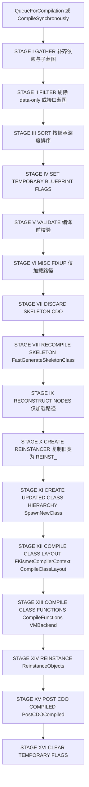

要点(均对应源码):Stage VIII 用 `FBlueprintCompilationManagerImpl::FastGenerateSkeletonClass`(BlueprintCompilationManager.cpp:201)只建变量/签名,保证函数签名先于函数体一致;Stage X 创建 `FBlueprintCompileReinstancer::Create`(KismetReinstanceUtilities.h:184)并把旧类改名 `REINST_` 前缀;Stage XII/XIII 分别调用 `CompileClassLayout`/`CompileFunctions`(KismetCompiler.cpp:4749、编译器实例在 cpp:4964 创建 VMBackend);Stage XIV 调 `ReinstanceObjects`;`CompileSynchronouslyImpl`(BlueprintCompilationManager.cpp:342)在队列冲洗后立即执行"昂贵 find-and-replace"(FlushCompilationQueueAndReinstance)。

### 21.6.2 UFUNCTION 蓝图调用真实执行路径(重点)

编译期与运行期合起来的一条链:

```mermaid
flowchart LR
    A["蓝图节点 UK2Node_CallFunction 引脚连接"]
    B["FKCHandler_CallFunction Compile 生成 KCST_CallFunction 语句"]
    C["FKismetFunctionContext ResolveStatements 排序修 goto"]
    D["FKismetCompilerVMBackend EmitFunctionCall 判定调用形态"]
    E{"bMathCall = Static Final Native 且非网络 且非通配参数"}
    F["Writer EX_CallMath"]
    G["Writer EX_FinalFunction 或 EX_LocalFinalFunction"]
    H["Writer EX_VirtualFunction 或 EX_LocalVirtualFunction 后跟 FName"]
    I["EX_Context 包裹 非 math 调用"]
    J["参数 EmitTerm 序列 EX_EndFunctionParms 结束"]
    K["UFunction Script 字节码"]
    L["运行时 ProcessEvent 或上层脚本 Step"]
    M["FFrame Step 取 opcode"]
    N["GNatives EX_CallMath execCallMathFunction"]
    O["GNatives EX_VirtualFunction execVirtualFunction"]
    P["UObject CallFunction 判 FunctionCallspace"]
    Q["UFunction Invoke 调 Func"]
    R["exec UKismetMathLibrary execLineTraceSingle 等"]
    T["脚本函数 Func ProcessInternal"]
    U["ProcessLocalScriptFunction 解释循环"]
    A --> B --> C --> D --> E
    E -->|是| F
    E -->|否| I --> G
    E -->|否| H
    F --> J
    G --> J
    H --> J
    J --> K --> L --> M
    M -->|0x68| N --> Q
    M -->|0x1B| O --> P -->|Local| Q
    P -->|Remote| P2["CallRemoteFunction RPC"]
    Q -->|FUNC_Native| R
    Q -->|脚本| T --> U
```

关键源码锚点:

1. **编译判定**:KismetCompilerVMBackend.cpp:1331-1343——`bFinalFunction = FUNC_Final || bIsParentContext`;`bMathCall = bFinalFunction && HasAllFunctionFlags(FUNC_Static|FUNC_Final|FUNC_Native) && !NetFuncFlags && !UInterface 外层 && !HasWildcardParams && !跨平台构建目标不支持`;`bLocalScriptFunction = !FUNC_Native && 无网络标志`。指令发射在 cpp:1365-1394(`Writer << EX_CallMath/EX_LocalFinalFunction/EX_FinalFunction/EX_LocalVirtualFunction/EX_VirtualFunction`),参数逐个 `EmitTerm(Term, FuncParamProperty)`,最后 `Writer << EX_EndFunctionParms`(cpp:1438)。
2. **运行分派**:`FFrame::Step` 读 1 字节并 `GNatives[B](Context,*this,RESULT_PARAM)`(ScriptCore.cpp:555-559);GNatives 是 `TStaticArray<FNativeFuncPtr, EX_Max>`,初值全为 `execUndefined`(ScriptCore.cpp:104),由 `IMPLEMENT_VM_FUNCTION(EX_CallMath, execCallMathFunction)` 等静态注册(cpp:162-164 宏,1131、3298 等展开)。
3. **EX_CallMath 快路径**:`execCallMathFunction` 取 `NewContext = Function->GetOuterUClassUnchecked()->GetDefaultObject(false)` 后直接 `(*Func)(NewContext, Stack, RESULT_PARAM)`(ScriptCore.cpp:1108-1130),完全不做上下文对象存在性检查,因此编译器只对满足 `FUNC_Static|FUNC_Final|FUNC_Native` 且无网络标志、无通配参数的函数使用该指令(cpp:1331-1343)。有目标对象的调用由 `FContextEmitter::StartContext` 包一层上下文指令:类上下文发 `EX_ClassContext`(cpp:354-356);对象上下文按 `bUnsafeToSkip`(函数有输出值)与 ini `[Kismet] bCanSuppressAccessViolation` 选择 `EX_Context`(NULL 时抛 Accessed None)或 `EX_Context_FailSilent`(静默跳过)(cpp:360-368);接口调用再包 `EX_InterfaceContext`(cpp:370-373)。
4. **EX_VirtualFunction**:`execVirtualFunction` → `P_THIS->CallFunction(Stack, RESULT_PARAM, P_THIS->FindFunctionChecked(Stack.ReadName()))`(ScriptCore.cpp:3293-3297);`CallFunction` 中 native 函数判 callspace(Remote 则打包参数 `CallRemoteFunction` 后回滚 Code 再本地执行,ScriptCore.cpp:1149-1199),最终 `Function->Invoke(this, Stack, RESULT_PARAM)`(cpp:1198)。
5. **脚本函数**:`UFunction::Bind` 把 Func 统一指到 `UObject::ProcessInternal`(Class.cpp:7688);`ProcessInternal` 再判 callspace 后进 `ProcessLocalScriptFunction` 的解释循环(ScriptCore.cpp:1364-1394、1226-1325)。
6. **C++ 直接调用蓝图函数**(含委托)同样汇入 `UObject::ProcessEvent`(ScriptCore.cpp:2055):它负责局部帧分配(FUNC_UbergraphFunction 时改用持久帧,cpp:2151-2154)、参数拷贝、OutParms 链构造(cpp:2184-2219)、局部属性初始化(cpp:2222-2227)、`Function->Invoke`(cpp:2232)与析构/出参回拷(cpp:2234-2248)。

### 21.6.3 编译后 Reinstancing(类替换)流程

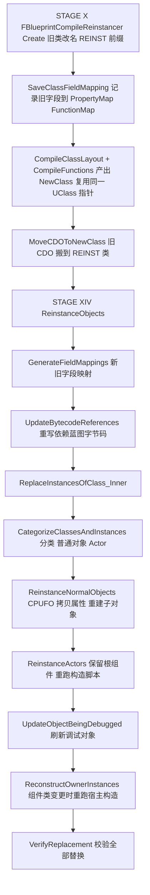

- 蓝图编译**复用同一 `UBlueprintGeneratedClass*`**(FReplaceInstancesOfClassParameters::bReplaceReferencesToOldClasses 注释,KismetReinstanceUtilities.h:70-76),REINST_ 类只是旧布局的"影子",用于承接未及时替换的引用与 CDO。
- 字段级修补:`GenerateFieldMappings`+`UpdateBytecodeReferences` 处理"函数改名/参数变化导致依赖蓝图字节码指向旧 UFunction/FProperty"的问题(KismetReinstanceUtilities.h:195-201),这也是 Stage I 要把依赖蓝图拉进编译队列的原因(BlueprintCompilationManager.cpp:719-745)。
- Actor 重实例化保持场景状态:`ShouldPreserveRootComponentOfReinstancedActor`、`ReplacementActors`/`OwnersToRerunConstructionScript`(KismetReinstanceUtilities.h:301、333-351)。

### 21.6.4 Python↔UObject 双向调用流程

```mermaid
flowchart TD
    subgraph PY2UE["Python 调用 UObject 方法"]
        PA["py 调 obj.Method args"]
        PB["FPyWrapperObject CallFunction_Impl Py 线程持有 GIL"]
        PC["PyConversion 参数 FProperty 级转换到参数缓冲"]
        PD["PyUtil InvokeFunctionCall"]
        PE{"IsInGameThread"}
        PF["抛 RuntimeError 拒绝"]
        PG["FEditorScriptExecutionGuard 放行编辑器执行"]
        PH["Py_BEGIN_ALLOW_THREADS 释放 GIL"]
        PI["UObject ProcessEvent 进蓝图 VM 或 native"]
        PJ["Py_END_ALLOW_THREADS 取回 GIL"]
        PK["返回值 PyObject 化"]
    end
    subgraph UE2PY["UObject 蓝图 调用 Python 实现"]
        UA["蓝图 K2Node_CallFunction 调用 Python 类的方法"]
        UB["字节码 EX_CallMath 或 EX_FinalFunction"]
        UC["UFunction Invoke 其 Func 为 CallPythonFunction"]
        UD["DEFINE_FUNCTION UPythonGeneratedClass CallPythonFunction"]
        UE["FPyScopedGIL 取 GIL"]
        UF["FPyWrapperObjectFactory 包装 P_THIS_OBJECT 为 Py 对象"]
        UG["PyGenUtil InvokePythonCallableFromUnrealFunctionThunk"]
        UH["Stack.Step 语义读取参数 转 PyObject"]
        UI["执行 Python 函数 结果写回 RESULT_PARAM"]
    end
    PA --> PB --> PC --> PD --> PE
    PE -->|否| PF
    PE -->|是| PG --> PH --> PI --> PJ --> PK
    UA --> UB --> UC --> UD --> UE --> UF --> UG --> UH --> UI
```

- 两个方向都以 `UObject::ProcessEvent`/UFunction thunk 为唯一咽喉,保证 Python 与蓝图/C++ 共享同一调用语义与网络/上下文规则。
- `CallPythonFunction` 的源码注释强调"必须等 thunk 完成才能返回",否则字节码栈推进量会错(PyWrapperObject.cpp:2220)。

## 21.7 时序图

### 21.7.1 蓝图调用原生 UFUNCTION(例:UKismetSystemLibrary::PrintString,静态 native final 函数被发射为 EX_CallMath,判定条件见 21.6.2 第 1 条)

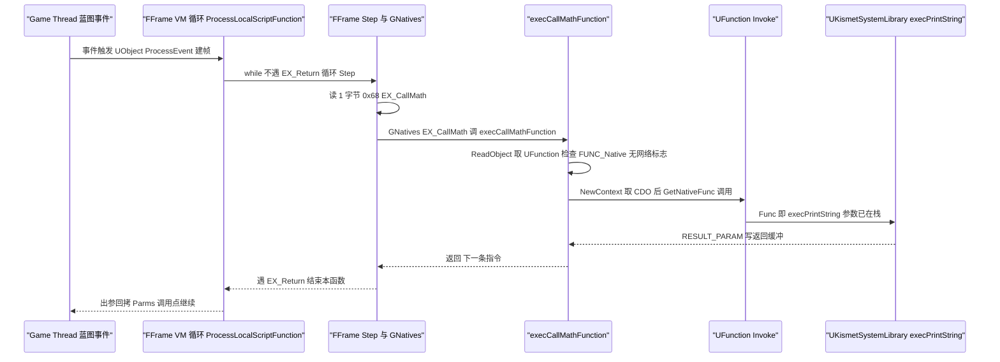

### 21.7.2 虚函数调用蓝图重写(例:BlueprintNativeEvent 被蓝图覆盖,EX_VirtualFunction)

```mermaid
sequenceDiagram
    participant CPP as "C++ 调用 ReceiveTick"
    participant PE as "UObject ProcessEvent"
    participant FRAME as "FFrame 新栈帧"
    participant INVOKE as "UFunction Invoke ProcessInternal"
    participant LOOP as "ProcessLocalScriptFunction"
    participant CT as "FBlueprintContextTracker"
    CPP->>PE: ProcessEvent FindFunction 命中蓝图版 UFunction
    PE->>CT: EnterScriptContext 追踪入口
    PE->>PE: UE_BLUEPRINT_EVENTGRAPH_FASTCALLS 事件桩直接改指 EventGraphFunction 与偏移
    PE->>FRAME: 分配 UberGraph 持久帧或局部帧 拷参数 建 OutParms
    PE->>INVOKE: Function Invoke
    INVOKE->>LOOP: Func ProcessInternal 判 callspace Local
    LOOP->>LOOP: Step 循环遇 EX_VirtualFunction
    LOOP->>LOOP: execVirtualFunction FindFunctionChecked 按实例类解析
    LOOP->>LOOP: CallFunction 递归进入被调函数帧
    LOOP-->>INVOKE: EX_Return 返回表达式求值
    INVOKE-->>PE: 结果写 ReturnValueAddress
    PE->>CT: ExitScriptContext
    PE-->>CPP: 返回
```

### 21.7.3 编辑器蓝图编译与重实例化(用户点击 Compile)

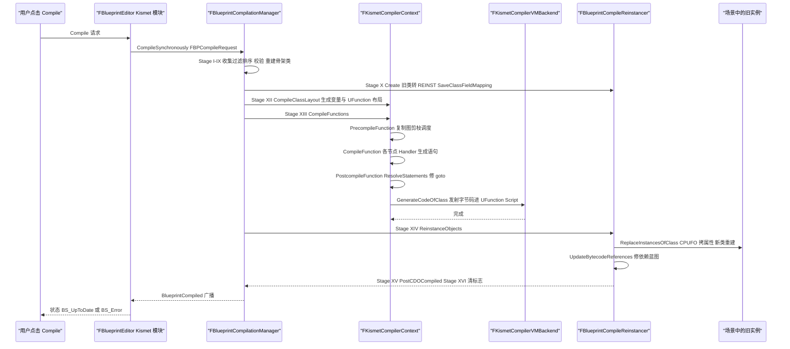

### 21.7.4 Python 交互执行(控制台 `py` 命令到 UObject 再回调 Python)

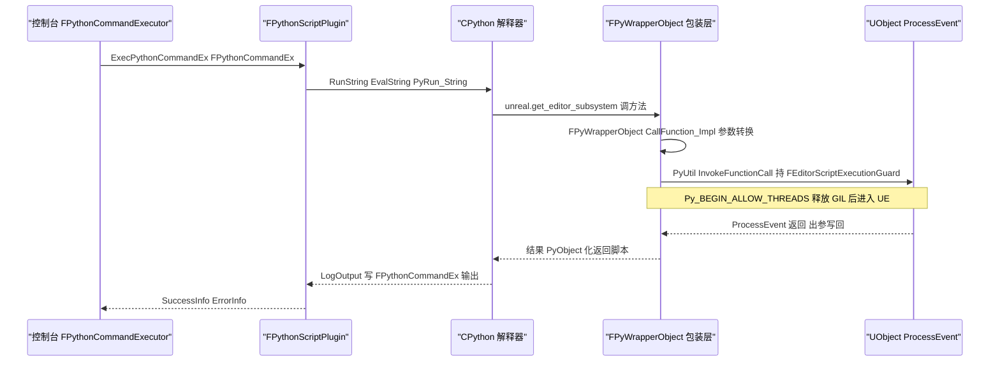

## 21.8 线程模型与同步

| 执行体 | 线程 | 依据与机制 |
|---|---|---|
| 蓝图 VM(ProcessLocalScriptFunction/FFrame::Step) | 任意线程 | VM 状态全部线程局部:`FBlueprintContext::GetThreadSingleton()`(Script.h:78,Process 内使用于 ScriptCore.cpp:2156)、`FBlueprintContextTracker` 为 `TThreadSingleton`(Script.h:471)、`GTopTrackingStackFrame` 是 `thread_local`(ScriptCore.cpp:109)。唯一硬约束:目标对象不得处于 GC unreachable、不得在 PostLoad 路由中(ScriptCore.cpp:2059-2061 的 checkf) |
| ProcessEvent 从 C++/网络/TaskGraph 进入 | 调用者线程;典型 GameThread(Actor 事件),任务图后台线程调用仅当对象安全 | ScriptCore.cpp:2058-2060 注释明确"off-GameThread 调用必须保证不与 GC 分析并发" |
| 失控循环/递归保护 | 每线程独立计数 | `CheckRunaway()` 每 256 次分支做一次 `EnforceScriptTimeLimit`(ScriptCore.cpp:113-124);`GScriptRecurseLimit`、`GMaximumScriptLoopIterations=1000000`(ScriptCore.cpp:107、1241、1268) |
| GNatives/GCasts 表 | 只读(启动后) | `constinit TStaticArray`,静态初始化期经 GRegisterNative/GRegisterCast 填充(ScriptCore.cpp:104、895、914),之后无写 |
| Kismet 编译 + Reinstancing | GameThread 独占 | `FlushCompilationQueueImpl` 持 `FScopeLock ScopeLock(&Lock)`(BlueprintCompilationManager.cpp:679)、`TGuardValue<bool> GuardTemplateNameFlag(GCompilingBlueprint, true)`(cpp:691);Reinstancer 遍历并替换 UObject,必须与 GC/编辑器串行 |
| Python 解释器 | 任意线程 + GIL 串行 | `FPyScopedGIL`(PyGIL.h,PyGILState_Ensure/Release);`TPyAutoGILPtr` 供"可能在无 GIL 线程析构"的闭包使用。**跨入 UE API 必须在 GameThread**:`PyUtil::InvokeFunctionCall` 首行 `if (!IsInGameThread())` 抛 RuntimeError(PyUtil.cpp:611-616),并在 ProcessEvent 期间 `Py_BEGIN_ALLOW_THREADS` 释放 GIL 以避免死锁(cpp:645-647) |
| Python 远程执行 | 网络 IO 在 GameThread Ticker 中轮询 | `FTSTicker::GetCoreTicker().AddTicker` 驱动 `FPythonScriptRemoteExecution::Tick`(PythonScriptPlugin.cpp:1376-1379、1734-1740),命令 socket 收包后同帧在 GT 执行 |
| VerseVM | 多线程协程(task),`FContext` 线程局部 | `VVMThreadLocalContextHolder.h`;Script.h 前向声明 `namespace verse { class task; }`(Script.h:20)且 FBlueprintContextTracker 声明 `friend verse::task`(Script.h:547),说明 Verse task 与蓝图 VM 共享失控追踪。AutoRTFM 事务指令 EX_AutoRtfm*(Script.h:308-311)参与 AutoRTFM 运行时 |
| 生成期多线程 | Python 类型生成可并发 | `GenerateWrappedTypes(bool bAllowMultithreadedGeneration)`(PyWrapperTypeRegistry.h:403) |

跨线程数据所有权:UBlueprint/UBlueprintGeneratedClass/UFunction 及其 Script 缓冲在编辑器中由编译锁保护、运行期视为不可变;UberGraph 持久帧属于单个对象实例(逐实例堆内存);FPyWrapperTypeRegistry 持有的 PyTypeObject 由 FGCObject::AddReferencedObjects 保活(PyWrapperTypeRegistry.h:381);GNatives 由静态初始化写、之后只读。

## 21.9 配置与扩展点

**配置(ini/CVar/设置)**

| 配置 | 位置 | 作用 |
|---|---|---|
| `[Kismet] ScriptStackOnWarnings`(GEngineIni)/ 命令行 `-SCRIPTSTACKONWARNINGS` | ShowKismetScriptStackOnWarnings(ScriptCore.cpp:590-608) | 脚本警告时打印蓝图调用栈 |
| `[Kismet] bCanSuppressAccessViolation`(GEngineIni) | FContextEmitter::StartContext(KismetCompilerVMBackend.cpp:360-368) | 编译期决定对象上下文 NULL 用 EX_Context_FailSilent(抑制)还是 EX_Context(报错);函数带输出值时强制后者 |
| `GMaximumScriptLoopIterations`(默认 1000000,可被 `FBlueprintCoreDelegates::SetScriptMaximumLoopIterations` 覆盖) | ScriptCore.cpp:107、Script.h:462 | 失控循环阈值 |
| `UBlueprint(config=Engine)`:`bRecompileOnLoad`、`CompileMode`(Development/FinalRelease) | Blueprint.h:419-420、504 | 加载即重编译、插桩级别 |
| `UVerseClass(Config=Engine)` | VVMVerseClass.h:135 | Verse 类的引擎配置挂载点 |
| `UPythonScriptPluginSettings`(config=EditorIni):`AdditionalPaths`、`bDeveloperMode`、`bRemoteExecution`、`RemoteExecutionMulticastBindAddress/GroupEndpoint/SendBufferSizeBytes` 等 | PythonScriptPluginSettings.h:71-136 | Python 路径/开发者模式/远程执行开关与端点 |
| `SCRIPT_LIMIT_BYTECODE_TO_64KB`(编译期开关,默认 0 即 CodeSkipSizeType=uint32) | Script.h:63-69 | 字节码 64KB 限制(历史兼容) |
| `UE_BLUEPRINT_EVENTGRAPH_FASTCALLS`、`UE_USE_VIRTUAL_STACK_ALLOCATOR_FOR_SCRIPT_VM`(默认 0)、`DO_BLUEPRINT_GUARD` | Stack.h:18-20、Script.h:466 | 持久帧 fastcall、虚拟栈分配器、脚本防护编译开关 |

**扩展点**

| 扩展点 | 注册接口 | 典型使用者 |
|---|---|---|
| 蓝图类型特化编译器 | `FKismetCompilerContext::RegisterCompilerForBP(UClass*, CompilerContextFactoryFunction)`(KismetCompiler.h:302) | UAnimBlueprint、UWidgetBlueprint、ULevelScriptBlueprint、URigVMBlueprint(其编译管理器为 friend,cpp:688) |
| 编译扩展 | `FBlueprintCompilationManager::RegisterCompilerExtension(TSubclassOf&lt;UBlueprint&gt;, UBlueprintCompilerExtension*)` | 各类 CompilerExtension(增删函数/属性) |
| 编译前后广播 | `FKismetCompilerContext::OnPreCompile / OnPostCompile / OnPreCompileBlueprint`(静态,KismetCompiler.h:207-209)、`FOnFunctionListCompiled`、`UBlueprint::FCompiledEvent` | 热重载、AssetValidator |
| 脚本异常/剖析钩子 | `FBlueprintCoreDelegates::OnScriptException / OnScriptProfilingEvent / OnToggleScriptProfiler`(Script.h:453-457) | 蓝图调试器、Insights |
| VM 进出通知 | `FBlueprintContextTracker::OnEnterScriptContext / OnExitScriptContext`(Script.h:521、525,源码注明"could be called on any thread") | Python/Lua 上下文追踪 |
| 节点菜单/孵化 | `UK2Node::GetMenuActions`、BlueprintNodeSpawner 家族(BlueprintGraph/Public/Blueprint*NodeSpawner.h)、FBlueprintActionDatabase | 第三方节点包 |
| Python 内联结构与类型工厂 | `FPyWrapperTypeRegistry::RegisterInlineStructFactory(TSharedRef&lt;const IPyWrapperInlineStructFactory&gt;)`(PyWrapperTypeRegistry.h:397)、`OnModuleDirtied` | FVector 等内联类型、模块热重载 |
| uLang 编译器插件 | `uLang::Toolchain::ModularFeatureManager` + `IParserPass/ISemanticAnalyzerPass/IAssemblerPass/IPostVstFilter/IPostSemanticAnalysisFilter/IPostIrFilter` 接口(CompilerPasses/*.h) | 自定义诊断/优化/打包 pass |
| UOL fragment 类型 | `IUniversalObjectLocatorModule` 与 FFragmentTypeHandle(UniversalObjectLocatorFragmentType*.h),Engine 提供 Asset/Subobject/DirectPath 等 fragment(UniversalObjectLocators/Public/*) | Sequencer 绑定、Python `unreal.ObjectRef` |
| 图编辑 UI 定制 | GraphEditor 的 SGraphNode 派生 + NodeFactory、ConnectionDrawingPolicy(BlueprintConnectionDrawingPolicy.h) | 蓝图执行流连线动画 |

## 21.10 已知限制/未确认项

1. **VerseVM 默认不启用**:`WITH_VERSE_VM` 由 UBT 目标规则 `bUseVerseVM`(Source/Programs/UnrealBuildTool/Configuration/Rules/ReadOnlyTargetRules.cs:135)决定,常规 UE 发行版构建不含 VerseVM;本章 VerseVM 小节基于源码静态阅读,未在启用 Verse 的运行环境中实测。UEFN 侧的 Verse 资产管线(Snippet 编排、发布)不在本仓库,相关集成未在源码中确认。
2. **`VVMBytecodeOps.gen.h` 为构建期生成文件**,仓库中不存在;EOpcode 全表(21.4.6)取自生成器 Source/Programs/UnrealBuildTool/System/VerseVMBytecodeGenerator.cs 的 Inst() 表,指令语义按其参数角色与 VVMBytecode.h 的 IsBranch/IsTerminal 归类,未逐条对照 VM 解释器实现(VVMExecutionContext.cpp 未逐行阅读)。
3. **Verse 运行时入口未确认**:本仓库未找到"从 UE 编辑器/游戏触发 Verse 编译与执行"的完整调用链(VerseCompiler 的 CToolchain 在引擎内的调用方);`verse::task` 与蓝图 VM 的交互仅由 Script.h:20/547 的友元声明佐证。
4. **BlueprintRuntime 模块**(UBlueprintExtension 宿主,Kismet 动态加载)在模块清单中未单列,其职责(编译期扩展挂载)已在 21.9 RegisterCompilerExtension 覆盖。
5. **Kismet/GraphEditor 的 UI 细节**(FBlueprintEditor 各 Tab、SNodePanel 布局、Slate 渲染)仅概述;蓝图书签/断点编辑器状态机(BlueprintDebugger)未展开。
6. **UK2Node 114 个类未逐一描述**,21.3.4 只给代表性继承链,完整清单以附录 BlueprintGraph.md 为准。
7. **蓝图 nativization 已移除**(EKismetCompileType 注释 "Cpp type was removed with BP nativization",Blueprint.h:89),不再存在 C++ 转译路径。
8. Python 嵌入的 **CPython 具体版本号**未在所读文件中确认(ThirdParty/Python3 目录未检查),仅确认基于 Python3 C API(PyGILState_Ensure 等)。
9. **`UBlueprintGeneratedClass` 序列化/加载细节**(Linker 对 GeneratedClass 的重定向、bHasBeenRegenerated 生命周期)未深入;LevelScriptBlueprint 的特殊编译路径未展开。
10. ScriptDisassembler 模块(KismetCompiler 依赖)只用于字节码反汇编展示,未展开。

## 21.11 附录索引

本章覆盖模块与全量符号附录文件(相对本文件 `../appendix/api/<Tier>/`):

| Tier | 模块 | 附录文件 |
|---|---|---|
| Runtime | CoreUObject(含 Script VM 与 VerseVM) | `Runtime/CoreUObject.part01.md`、`Runtime/CoreUObject.part02.md` |
| Runtime | Engine(蓝图运行时 + Classes/Kismet 函数库) | `Runtime/Engine.part01.md` ~ `Runtime/Engine.part06.md` |
| Runtime | UniversalObjectLocator | `Runtime/UniversalObjectLocator.md` |
| Runtime | VerseCompiler(uLang) | `Runtime/VerseCompiler.md` |
| Runtime | uLangCore / uLangJSON / uLangUE | `Runtime/uLangCore.md`、`Runtime/uLangJSON.md`、`Runtime/uLangUE.md` |
| Runtime | JsonUtilities | `Runtime/JsonUtilities.md` |
| Runtime | UMG(UUserWidget,供 EditorUtilityWidget 继承) | `Runtime/UMG.md` |
| Editor | BlueprintGraph | `Editor/BlueprintGraph.md` |
| Editor | KismetCompiler | `Editor/KismetCompiler.md` |
| Editor | Kismet | `Editor/Kismet.md` |
| Editor | KismetWidgets | `Editor/KismetWidgets.md` |
| Editor | GraphEditor | `Editor/GraphEditor.md` |
| Editor | Blutility | `Editor/Blutility.md` |
| Editor | BlueprintEditorLibrary | `Editor/BlueprintEditorLibrary.md` |
| Editor | UMGEditor | `Editor/UMGEditor.md` |
| Plugins | PythonScriptPlugin | `Plugins/PythonScriptPlugin.md` |
| Plugins | JsonBlueprintUtilities / JsonBlueprintGraph | `Plugins/JsonBlueprintUtilities.md`、`Plugins/JsonBlueprintGraph.md` |
| Plugins | ScriptableToolsFramework | `Plugins/ScriptableToolsFramework.md` |
| Plugins | EditorScriptableToolsFramework / ScriptableToolsEditorMode | `Plugins/EditorScriptableToolsFramework.md`、`Plugins/ScriptableToolsEditorMode.md` |

辅助附录(交叉索引):`Editor/JsonUtilitiesEditor.md`、`Editor/UniversalObjectLocatorEditor.md`、`Editor/ScriptableEditorWidgets.md`。FBlueprintCompileReinstancer 所属 UnrealEd 模块(Kismet2/KismetReinstanceUtilities.h)的符号见 `Editor/UnrealEd.part01.md`、`Editor/UnrealEd.part02.md`;模块元数据见 `appendix/modules.json`。

> 说明:本章正文中的"逐字原型"均省略了 `*_API` 导出宏,其余与头文件一致;行号基于 5.8.3-release 源码树。
