# 22 编辑器核心:UnrealEd/LevelEditor/ContentBrowser/PropertyEditor/PIE/Transactor

本章覆盖 UE 5.8.3 编辑器进程(UnrealEditor 目标)的核心模块:`Source/Editor` 下 UnrealEd 与其牵引的 UI/框架/资产编辑器模块、`Source/Developer` 下编辑器直接依赖的工具模块、`Engine/Plugins/Editor` 全部插件、`Engine/Plugins/Developer` 全部插件,以及 Commandlet 体系。除特别注明外,路径均相对 `$E`(即 `Engine/`),"文件:行号" 以 5.8.3-release 源码为准。

编辑器进程的顶层驱动关系(细节见 22.2/22.6):`Runtime/Launch/Private/Launch.cpp:167` 的 `EditorInit(GEngineLoop)`(`Source/Editor/UnrealEd/Private/UnrealEdGlobals.cpp:229`)→ `UEditorEngine::Init`(`Source/Editor/UnrealEd/Classes/Editor/EditorEngine.h:904`)→ `UUnrealEdEngine::Init` → `FUnrealEdMisc::OnInit` 加载默认地图 → `IMainFrameModule::CreateDefaultMainFrame` 创建主窗口。PIE、事务(Transactor)、属性编辑(PropertyEditor)、保存(SavePackage)四条主链路分别见 22.6/22.7。

## 22.1 职责、边界与模块清单

### 22.1.1 引擎与框架核心模块

| 模块 | 路径($E 下) | Build.cs 依赖(Public/Private 摘要) | 职责一句话 |
|---|---|---|---|
| UnrealEd | Source/Editor/UnrealEd | Public: AssetDefinition, Engine, Slate, EditorFramework, AssetTools, ToolMenusEditor, StatusBar, SourceControl 等;Private: AssetRegistry 等(UnrealEd.Build.cs:52 起) | 编辑器引擎本体:UEditorEngine/UUnrealEdEngine、选择集、PIE、事务、UFactory 导入、关卡工具、Commandlet 集中地 |
| EditorFramework | Source/Editor/EditorFramework | Public: UnrealEd 反向依赖由 UnrealEd 声明 | 编辑器模式(EdMode)内建注册、资产编辑器通用工具、FEditorDelegates 之外的框架辅助类 |
| EditorSubsystem | Source/Editor/EditorSubsystem | — | 提供 `UEditorSubsystem : UDynamicSubsystem` 基类(Source/Editor/EditorSubsystem/Public/EditorSubsystem.h:20) |
| LevelEditor | Source/Editor/LevelEditor | Public: UnrealEd, PropertyEditor, Slate 等 | 关卡编辑器主 Tab:四视口 SLevelViewport、大纲联动、细节面板宿主、模式工具栏 |
| MainFrame | Source/Editor/MainFrame | Public: UnrealEd, Slate, SlateCore 等 | 编辑器根窗口 SWindow、布局持久化、项目浏览器/启动对话框、MRU 列表 |
| ToolMenus(Developer) | Source/Developer/ToolMenus | — | UToolMenus 菜单框架:RegisterMenu/AddMenuExtension,取代旧 MultiBoxExtender |
| ToolMenusEditor | Source/Editor/ToolMenusEditor | — | UToolMenus 的编辑器侧封装(菜单编辑对话框、扩展点显隐) |
| StatusBar | Source/Editor/StatusBar | — | 关卡编辑器底部状态条(IStatusBarModule,含进度与通知区域) |
| WorkspaceMenuStructure | Source/Editor/WorkspaceMenuStructure | — | 全局菜单命名空间结构(FWorkspaceMenuStructureModule),供各模块挂接菜单 |
| EditorStyle | Source/Editor/EditorStyle | — | 编辑器样式集与 FAppStyle(Private/EditorStyleModule.cpp:14 FEditorStyleModule) |
| EditorWidgets | Source/Editor/EditorWidgets | — | 通用编辑器控件(STimelineCurve、文件列表等,FEditorWidgetsModule) |
| EditorConfig | Source/Editor/EditorConfig | — | 编辑器配置读写服务(FEditorConfigModule,EditorPerProjectUserSettings 的结构化存取) |
| Settings(Developer) | Source/Developer/Settings | — | ISettingsModule:设置项容器注册(RegisterSettings,ISettingsModule.h:49) |
| SettingsEditor(Developer) | Source/Developer/SettingsEditor | — | 设置编辑页控件与模型(ISettingsEditorModule.h:19) |
| EditorSettingsViewer | Source/Editor/EditorSettingsViewer | — | "编辑器偏好设置"页面的容器注册与生成 |
| ProjectSettingsViewer | Source/Editor/ProjectSettingsViewer | — | "项目设置"页面的容器注册与生成(Private/ProjectSettingsViewerModule.cpp:57) |
| ConfigEditor | Source/Editor/ConfigEditor | — | 配置文件(.ini)分级查看/比较 UI |

### 22.1.2 内容与资产模块

| 模块 | 路径 | 职责一句话 |
|---|---|---|
| ContentBrowser | Source/Editor/ContentBrowser | 资产浏览器 UI 与单例 API(FContentBrowserModule/IContentBrowserSingleton.h:608) |
| ContentBrowserData | Source/Editor/ContentBrowserData | 资产/文件夹数据抽象层(IContentBrowserDataModule + UContentBrowserDataSubsystem,支撑外部内容挂载) |
| AssetDefinition | Source/Editor/AssetDefinition | 每资产类的定义对象 UAssetDefinition(AssetDefinition.h:455)+ UAssetDefinitionRegistry(AssetDefinitionRegistry.h:18):显示名/图标/打开行为 |
| AssetTools(Developer) | Source/Developer/AssetTools | IAssetTools 资产操作(创建/复制/重命名/导出/注册 IAssetTypeActions,IAssetTools.h:293/389/451/551) |
| CollectionManager(Developer) | Source/Developer/CollectionManager | 资产集合(Collection)管理:FCollectionManagerModule/ICollectionContainer(Public/CollectionManagerModule.h) |
| PropertyEditor | Source/Editor/PropertyEditor | 属性/细节面板框架:IDetailsView、IPropertyHandle、FPropertyNode、定制点注册(PropertyEditorModule.h:284/301/373) |
| DetailCustomizations | Source/Editor/DetailCustomizations | 引擎内建类型(Actor、PrimitiveComponent、WorldSettings 等)的细节面板定制(FDetailCustomizationsModule) |
| SceneOutliner | Source/Editor/SceneOutliner | 场景大纲(Actor 树)控件与列扩展(FSceneOutlinerModule) |
| ClassViewer | Source/Editor/ClassViewer | 类选择器对话框(FClassViewerModule) |
| StructViewer | Source/Editor/StructViewer | 结构体选择器对话框(FStructViewerModule) |
| GraphEditor | Source/Editor/GraphEditor | 通用节点图控件 SGraphEditor(FGraphEditorModule),供蓝图/材质/Sequencer 复用 |
| Kismet | Source/Editor/Kismet | 蓝图编辑器 FBlueprintEditor 与 FBlueprintEditorModule,含编译入口 UI |
| KismetCompiler | Source/Editor/KismetCompiler | 蓝图编译器骨架(FKismetCompilerContext 等) |
| BlueprintGraph | Source/Editor/BlueprintGraph | 蓝图节点/引脚类型与图表 schema |
| AnimGraph | Source/Editor/AnimGraph | 动画蓝图图表节点 |
| SubobjectDataInterface / SubobjectEditor | Source/Editor/... | 组件/子对象树数据抽象与编辑 UI |
| UndoHistory(Developer) / UndoHistoryEditor | Source/Developer/UndoHistory、Source/Editor/UndoHistoryEditor | 事务缓冲区可视化(SUndoHistory 读取 UTransBuffer;Developer 侧为公共数据,Editor 侧为 UI) |

### 22.1.3 关卡/视口/内容创作工具模块

| 模块 | 路径 | 职责一句话 |
|---|---|---|
| PlacementMode | Source/Editor/PlacementMode | 放置模式面板(最近放置/资产目录,IPlacementModeModule) |
| ViewportInteraction | Source/Editor/ViewportInteraction | 视口交互公共层(UViewportWorldInteraction、gizmo/transformer) |
| ViewportSnapping | Source/Editor/ViewportSnapping | 视口吸附设置与公共实现 |
| VREditor | Source/Editor/VREditor | VR 编辑器模式(IVREditorModule,由 LoadDefaultEditorModules 强制加载,EditorEngine.cpp:1609) |
| LandscapeEditor | Source/Editor/LandscapeEditor | 地形编辑工具(ILandscapeEditorModule) |
| FoliageEdit | Source/Editor/FoliageEdit | 植被编辑工具(IFoliageEditModule) |
| MeshPaint | Source/Editor/MeshPaint | 网格体顶点色绘制(IMeshPaintModule) |
| ClothPainter | Source/Editor/ClothPainter | 布料绘制(FClothPaintingModule,LoadModuleChecked 强制加载) |
| GeometryMode/ModelingToolsEditorMode 等(Plugins) | Plugins/Editor | 见 22.1.6 |
| ActorPickerMode | Source/Editor/ActorPickerMode | 属性中"拾取 Actor"的临时编辑器模式(FActorPickerModeModule) |
| SceneDepthPickerMode | Source/Editor/SceneDepthPickerMode | 场景深度拾取临时模式 |
| AnimationEditMode | Source/Editor/AnimationEditMode | 动画编辑模式(在视口内编辑动画资产) |
| MergeActors | Source/Editor/MergeActors | Actor 合并工具(IMergeActorsModule) |
| Layers | Source/Editor/Layers | 旧版图层浏览器(Layers) |
| DataLayerEditor / WorldPartitionEditor | Source/Editor/... | 数据层编辑与世界分区编辑器 UI |
| WorldBrowser | Source/Editor/WorldBrowser | 旧版关卡浏览器(流送关卡管理) |
| LevelInstanceEditor | Source/Editor/LevelInstanceEditor | 关卡实例(编辑内嵌套关卡)编辑支持 |
| NewLevelDialog | Source/Editor/NewLevelDialog | 新建关卡对话框 |
| PackagesDialog | Source/Editor/PackagesDialog | 保存/检出确认对话框 |
| StatsViewer | Source/Editor/StatsViewer | Stats Viewer(Primitive/Lighting 等统计页,FStatsViewerModule) |
| PixelInspector | Source/Editor/PixelInspector | 像素检查器(FPixelInspectorModule,EditorEngine Tick 中读取回读,EditorEngine.cpp:2328) |
| GameProjectGeneration | Source/Editor/GameProjectGeneration | .uproject 生成/升级/模板创建(FGameProjectGenerationModule) |
| SourceControlWindows | Source/Editor/SourceControlWindows | 源码控制 UI(检出/提交对话框,ISourceControlWindowsModule) |
| SourceControlWindowExtender | Source/Editor/SourceControlWindowExtender | 源码控制窗口扩展(把菜单/视图挂进 SCC 窗口) |
| TurnkeySupport | Source/Editor/TurnkeySupport | Turnkey 设备SDK/平台自动准备(ITurnkeySupportModule,Public/Interfaces/ITurnkeySupportModule.h) |
| UATHelper | Source/Editor/UATHelper | 以通知驱动方式启动 UAT 进程(IUATHelperModule.h:14,CreateUatTask) |
| AdvancedPreviewScene | Source/Editor/AdvancedPreviewScene | 资产预览场景基类(FAdvancedPreviewSceneModule) |

### 22.1.4 资产编辑器模块(职责 + 入口类 + 注册方式)

资产编辑器的统一注册方式(源码验证,见 22.6/22.7):`UAssetEditorSubsystem::OpenEditorForAsset`(Private/Subsystems/AssetEditorSubsystem.cpp:505)按资产 UClass 从 `FAssetToolsModule.Get().GetAssetTypeActionsForClass()` 取 `IAssetTypeActions`,再调 `AssetTypeActions->OpenAssetEditor(...)`(AssetEditorSubsystem.cpp:586);无 Actions 时退回 `FSimpleAssetEditor::CreateEditor`(AssetEditorSubsystem.cpp:599)。各模块在 StartupModule 中通过 `IAssetTools::RegisterAssetTypeActions`(Developer/AssetTools/Public/IAssetTools.h:293)注册自己的 FAssetTypeActions_Xxx;新体系则通过 `UAssetDefinitionRegistry`/各模块的 `UAssetDefinition` 子类提供元数据。注意:并非所有编辑器宿主都派生自 `FAssetEditorToolkit`(如 FPersonaAssetEditorToolkit 派生自 FWorkflowCentricApplication,FStaticMeshEditor/FMaterialEditor 自实现各自接口),但均经 `IAssetTypeActions::OpenAssetEditor` 创建并被 `UAssetEditorSubsystem` 统一登记管理。

| 模块 | 入口模块类 | 编辑器 Toolkit 类(代表) | 注册方式 |
|---|---|---|---|
| StaticMeshEditor | IStaticMeshEditorModule | FStaticMeshEditor(实现 IStaticMeshEditor,StaticMeshEditor/Private/StaticMeshEditor.h:43) | AssetTypeActions(引擎 StaticMeshActions,EngineAssetDefinitions 插件参与) |
| MaterialEditor | IMaterialEditorModule | FMaterialEditor(实现 IMaterialEditor,MaterialEditor/Private/MaterialEditor.h:223) | FMaterialTypeActions 等,AssetTypeActions |
| TextureEditor | ITextureEditorModule | FTextureEditor | FTextureAssetTypeActions |
| Persona(动画) | FPersonaModule | FPersonaAssetEditorToolkit(Persona/Public/PersonaAssetEditorToolkit.h:17)+ IPersonaToolkit | FAssetTypeActions_AnimSequence 等 |
| SkeletalMeshEditor / SkeletonEditor | ISkeletalMeshEditorModule / ISkeletonEditorModule | FSkeletalMeshEditor(实现 ISkeletalMeshEditor,SkeletalMeshEditor/Private/SkeletalMeshEditor.h:54)/ FSkeletonEditor | AssetTypeActions(配合 Persona) |
| PhysicsAssetEditor | IPhysicsAssetEditorModule | FPhysicsAssetEditor(PhysicsAssetEditor/Private/PhysicsAssetEditor.h) | FAssetTypeActions_PhysicsAsset |
| AnimationBlueprintEditor | FAnimationBlueprintEditorModule | FAnimationBlueprintEditor(实现 IAnimationBlueprintEditor,AnimationBlueprintEditor/Private/AnimationBlueprintEditor.h:95) | 蓝图 AssetTypeActions(带 Persona 宿主) |
| AnimationEditor | IAnimationEditorModule | FAnimationEditor | AssetTypeActions |
| Sequencer | ISequencerModule | FSequencer(Sequencer/Private,前向声明见 CurveEditorCommandBinder.h:11)+ ISequencer 公共接口 | Sequencer 的 AssetTypeActions(关卡序列/Sequence) |
| SequencerCore / SequencerWidgets / SequenceRecorder / SequenceRecorderSections | FSequencerCoreModule 等 | — | Sequencer 家族支撑库 |
| UMGEditor | IUMGEditorModule | FWidgetBlueprintEditor | FAssetTypeActions_WidgetBlueprint |
| Kismet(蓝图) | FBlueprintEditorModule | FBlueprintEditor | FAssetTypeActions_Blueprint |
| CurveAssetEditor | FCurveAssetEditorModule | FCurveAssetEditor | FAssetTypeActions_Curve |
| CurveEditor | FCurveEditorModule(控件) | SCurveEditor | 曲线控件库,供多编辑器嵌入 |
| DataTableEditor | FDataTableEditorModule | FDataTableEditor | FAssetTypeActions_DataTable |
| StringTableEditor | FStringTableEditorModule | FStringTableEditor | AssetTypeActions |
| FontEditor | IFontEditorModule | FFontEditor | AssetTypeActions |
| CurveTableEditor / DistCurveEditor / MirrorDataTableEditor / PListEditor | 对应 Module | 对应 FAssetEditorToolkit 子类 | AssetTypeActions |
| AudioEditor | FAudioEditorModule(FAudioEditorModule 在 UnrealEd 依赖表中,EditorEngine.cpp:1538) | FSoundCueEditor 等 | AssetTypeActions(SoundCue/Wave) |
| Blutility(编辑器工具) | FBlutilityModule | UEditorUtilityBlueprint 的编辑器 | AssetTypeActions + MenuEntries |
| MovieSceneTools | FMovieSceneToolsModule | — | Sequencer 支撑(轨迹绘制/片段工具) |
| MaterialEditor 关联:MaterialGraph | — | SGraphEditor 复用 | 材质图表 |
| EditorInteractiveToolsFramework | FEditorInteractiveToolsFrameworkModule | UEdModeInteractiveToolsContext | 交互工具框架(EdMode + ToolsContext) |
| MeshPaint/ClothPainter(见 22.1.3) | — | — | 模式面板 |
| UVEditor / StaticMeshEditorModeling 等(Plugins) | Plugins/Editor | — | 见 22.1.6 |

### 22.1.5 Developer 相关模块(编辑器进程内使用)

| 模块 | 路径 | 入口 | 职责一句话 |
|---|---|---|---|
| DesktopPlatform | Source/Developer/DesktopPlatform | FDesktopPlatformModule | 平台对话框(打开/保存文件、消息框),IDesktopPlatform |
| MessageLog | Source/Developer/MessageLog | FMessageLogModule(MessageLogModule.h:14) | 消息日志页注册与打开(OpenMessageLog:64),FMessageLog 面板 |
| OutputLog | Source/Developer/OutputLog | FOutputLogModule(OutputLogModule.h:41) | 输出日志页 SOutputLog(过滤器、命令行输入) |
| SlateReflector | Source/Developer/SlateReflector | ISlateReflectorModule(ISlateReflectorModule.h:25) | Widget Reflector/调试工具 |
| Settings | Source/Developer/Settings | ISettingsModule(ISettingsModule.h:16) | 设置容器/分类/节注册(RegisterSettings:49) |
| SettingsEditor | Source/Developer/SettingsEditor | ISettingsEditorModule(ISettingsEditorModule.h:19) | 设置页控件(SSettingsEditor) |
| SessionFrontend | Source/Developer/SessionFrontend | ISessionFrontendModule(ISessionFrontendModule.h:14) | Session Frontend 页(会话/启动器/自动化) |
| LauncherServices | Source/Developer/LauncherServices | ILauncherServicesModule(ILauncherServicesModule.h:23) | 启动器配置/设备代理/ILauncherWorker(GetProfileManager:61),PIE via Launcher 用到 |
| DeviceManager | Source/Developer/DeviceManager | IDeviceManagerModule(IDeviceManagerModule.h:17) | 设备管理器页 SDeviceManager |
| TargetDeviceServices | Source/Developer/TargetDeviceServices | ITargetDeviceServicesModule(ITargetDeviceServicesModule.h:13) | 基于消息总线的目标设备服务管理器(GetDeviceServiceManager:32) |
| AutomationWindow | Source/Developer/AutomationWindow | IAutomationWindowModule(IAutomationWindowModule.h:19) | 自动化测试窗口 UI |
| AutomationController | Source/Developer/AutomationController | IAutomationControllerModule(IAutomationControllerModule.h:33) | 自动化测试控制器(发现/排队/执行) |
| AutomationDriver | Source/Developer/AutomationDriver | IAutomationDriverModule(IAutomationDriverModule.h:11) | 自动化输入驱动(CreateDriver:24/29) |
| FunctionalTesting | Source/Developer/FunctionalTesting | IFunctionalTestingModule | 功能测试关卡基类/Runner 支持(为 UnrealEd 依赖,EditorEngine Build.cs Public: FunctionalTesting) |
| LogVisualizer | Source/Developer/LogVisualizer | ILogVisualizer(ILogVisualizer.h:9,IModularFeature) | Log Visualizer 页(可视化日志,LoadModule 于 EditorEngine.cpp:1601) |
| AssetTools / CollectionManager / ToolMenus / Settings / UndoHistory | 见 22.1.1/22.1.2 | — | 同上 |

### 22.1.6 Plugins/Editor 全部插件(目录 $E/Plugins/Editor)

| 插件 | 职责一句话 |
|---|---|
| AssetManagerEditor | 资产管理器(引用树/审计)UI 与 Asset Manager 设置页 |
| AssetReferenceRestrictions | 资产引用合法性规则(PrimaryAssetId 规则集合与校验 UI) |
| AssetRegistryExport | 资产注册表导出 UI |
| AssetSearch | 内容浏览器全文搜索索引与搜索框 |
| BlueprintHeaderView | 蓝图头视图(只读代码视图) |
| BlueprintMaterialTextureNodes | 蓝图材质/贴图节点库 |
| ChangelistReview | Changelist Review 页(审阅待提交资产) |
| ColorGrading | Color Grading 色彩分级面板(视口) |
| ConsoleVariablesEditor | 控制台变量编辑器页 |
| ContentBrowser(插件版) | 内容浏览器插件变体(ContentBrowserAssetSearch/拖拽等扩展) |
| CryptoKeys | 项目加密密钥生成/打包密钥管理 |
| CurveEditorTools | 曲线编辑器扩展工具(重采样等) |
| DataValidation | 资产校验框架(UObject 验证器 + 自动化测试) |
| DisplayClusterLaunch | nDisplay 启动配置辅助 |
| EditorDebugTools | 编辑器调试工具(调试菜单) |
| EditorScriptingUtilities | 编辑器脚本化 API(资产/关卡操作蓝图库) |
| EditorSysConfigAssistant | 系统配置助手(推荐设置) |
| EngineAssetDefinitions | 引擎内建资产的 UAssetDefinition 注册地 |
| FacialAnimation | 面部动画资产导入/编辑(FacialAnimationBulkData) |
| GameplayTagsEditor | GameplayTag 编辑器(标签树/选择器) |
| GeometryMode | 几何体编辑模式(Brush 编辑、EdModeGeometry) |
| GuidedTutorials | 引导教程框架(旧版教程系统) |
| ImageWidgets | 图像媒体查看/墙控件(SImgMedia) |
| LandscapePatch | 地形 Patch 工具(编辑模式扩展) |
| LiveUpdateForSlate | Slate 实时刷新(热重载支持) |
| Localization | 本地化 Dashboard/命令执行支撑(配合 LocalizationDashboard 模块) |
| MacGraphicsSwitching | Mac 显卡切换支持 |
| MakeCookedEditorAsDLC | 把编辑器作为 DLC 打包的工具 |
| MaterialAnalyzer | 材质分析器(指令/纹理统计) |
| MaterialAssetWizard | 材质创建向导 |
| MaterialValidation | 材质校验(规则检查) |
| MeshLODToolset | 网格 LOD 工具 |
| MobileLauncherProfileWizard | 移动启动配置向导 |
| ModelingToolsEditorMode | 建模模式(网格体编辑框架,UEdMode) |
| ModelViewViewModelPreview | MVVM 预览(UMG ViewModel) |
| ObjectMixer | Object Mixer(批量属性编辑面板) |
| PluginBrowser | 插件浏览器页 |
| ProxyLODPlugin | ProxyLOD 网格简化(外部工具封装) |
| SampleToolsEditorMode | 示例:自定义 EdMode 工具集 |
| ScriptableToolsEditorMode | 脚本化工具编辑模式 |
| SequencerAnimTools | Sequencer 动画工具(重定时等) |
| SpeedTreeImporter | SpeedTree 导入器 |
| StaticMeshEditorModeling | 静态网格编辑器的建模工具集成 |
| StylusInput | Stylus(压感笔)输入 |
| UMGWidgetPreview | UMG 控件预览工具 |
| UVEditor | UV 编辑器 |
| WaveformEditor | 波形资产编辑器 |
| WorldPartitionHLODUtilities | 世界分区 HLOD 构建工具 UI |

注:上表按 `$E/Plugins/Editor` 目录 49 个插件逐一列出(Plugins/Editor/ContentBrowser 为内容浏览器插件变体,与 Source/Editor/ContentBrowser 并存)。

### 22.1.7 Plugins/Developer 全部插件(目录 $E/Plugins/Developer)

| 插件 | 职责一句话 |
|---|---|
| Concert(家族:ConcertMain/ConcertApp/ConcertSync/ConcertUI/ConcertInsights/ConcertScripting) | Multi-User 协作:Concert 会话(Concert/ConcertClient/ConcertServer/ConcertTransport)、同步(ConcertSync)、UI、Insights 分析、脚本接口 |
| PerforceSourceControl | Perforce 源码控制提供者(ISourceControlProvider 实现) |
| GitSourceControl | Git 提供者 |
| PlasticSourceControl | Plastic/Unity VCS 提供者 |
| SubversionSourceControl | SVN 提供者 |
| OneSkyLocalizationService | OneSky 本地化服务提供者 |
| VisualStudioSourceCodeAccess | Visual Studio 代码访问器(ISourceCodeAccessor) |
| VisualStudioCodeSourceCodeAccess | VS Code 访问器 |
| RiderSourceCodeAccess | Rider 访问器 |
| CLionSourceCodeAccess / CodeLiteSourceCodeAccess / KDevelopSourceCodeAccess / N10XSourceCodeAccess / XCodeSourceCodeAccess / NullSourceCodeAccess | CLion/CodeLite/KDevelop/N10X/Xcode/空实现访问器 |
| ProjectLauncher | 项目启动器(LauncherServices/LegacyProjectLauncher 的 UI 前身,Session Frontend 启动页) |
| PixWinPlugin | Windows PIX GPU 捕获 |
| RenderDocPlugin | RenderDoc 集成 |
| XcodeGPUDebuggerPlugin | Xcode GPU 调试 |
| DumpGPUServices | GPU 转储服务 |
| GPUReshape | GPU 指令注入/重排(着色器拦截) |
| ShaderToolkit | 着色器开发辅助(hlsl 工具) |
| AnimationSharing | 动画共享运行时(Editor 侧仅构建支持) |
| BlankPlugin / UObjectPlugin / Sandbox / PluginUtils / DirectoryPlaceholder / NamingTokens / PropertyAccessNode / FieldNotificationTrace / TraceSourceFiltering | 示例/工具类插件(NamingTokens 命名令牌、PropertyAccessNode 蓝图节点、TraceSourceFiltering Trace 过滤等) |
| TextureFormatOodle | Oodle 纹理格式(开发期回退) |

Plugins Tier 的完整符号清单(含以上每个插件的所有类)见 22.11 附录索引。

## 22.2 总体架构

编辑器进程是"单 GameThread 主循环 + Slate UI + 多 World 上下文"的结构。`UEditorEngine` 继承 `UEngine`,持有全部 `FWorldContext`(编辑器世界 + N 个 PIE 世界);`UUnrealEdEngine` 在其上补齐关卡编辑行为与自动保存。UI 层由 MainFrame 根窗口 → LevelEditor 主 Tab → 各 DockTab(视口/大纲/细节/内容浏览器)构成;扩展统一走 UEditorSubsystem、FEditorModeRegistry、UToolMenus、IAssetTypeActions/UAssetDefinition、委托广播五条通道。

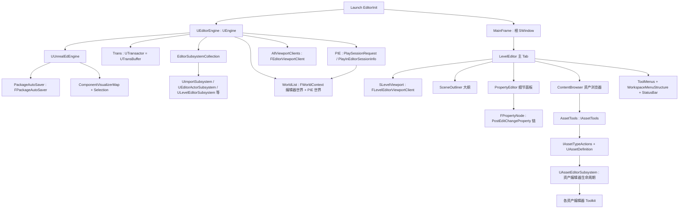

分层说明:

- **引擎层**:`UEditorEngine::Init`(EditorEngine.cpp:1283)完成核心初始化(选择集、ActorFactory 扫描、Trans 创建、默认模块加载);`UEditorEngine::Tick`(EditorEngine.cpp:1752)是编辑器帧的心脏,内部依次 Tick TimerManager、StaticTick(异步加载)、FTickableEditorObject、资产注册表、编辑器世界、PIE 世界、视口客户端(顺序见 22.6.2)。
- **框架/UI 层**:MainFrame 拥有根窗口与布局(`CreateDefaultMainFrame`,MainFrameModule.cpp:314);LevelEditor 提供关卡编辑主界面;ToolMenus/StatusBar/WorkspaceMenuStructure 是跨模块 UI 基础设施。
- **内容层**:ContentBrowser(数据来自 AssetRegistry + ContentBrowserData 抽象),操作经 AssetTools 分发到 IAssetTypeActions/UAssetDefinition,再由 UAssetEditorSubsystem 打开具体编辑器。
- **会话层**:PIE 状态全部收敛在 `UEditorEngine` 的 `PlaySessionRequest`/`PlayInEditorSessionInfo`/`SlatePlayInEditorMap` 三份数据(见 22.4),世界本体放在 Engine 层的 WorldList。

## 22.3 类图

### 22.3.1 编辑器引擎与事务系统

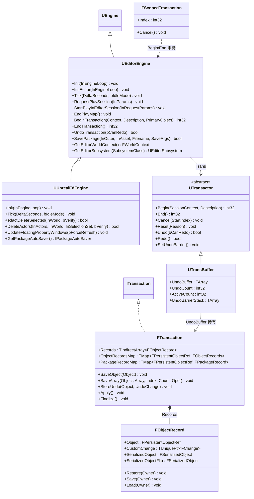

`UEditorEngine`(`UCLASS(config=Engine, transient)`,EditorEngine.h:399)持有关键成员:`Trans`(TObjectPtr&lt;UTransactor&gt;,EditorEngine.h:415)、`PlayWorld`/`EditorWorld`(519/557)、`SlatePlayInEditorMap`(582)、`AllViewportClients`(2883)、`EditorSubsystemCollection`(3413)。`UTransBuffer` 是引擎内唯一的 `UTransactor` 实现,由 `UEditorEngine::CreateTrans`(Private/EditorServer.cpp:1251)在 Init 时创建。

### 22.3.2 资产编辑器与属性编辑框架

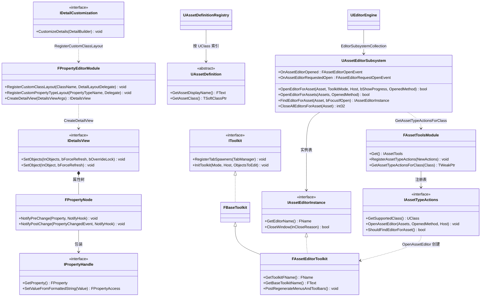

关系说明:`FAssetEditorToolkit : IAssetEditorInstance, FBaseToolkit`(UnrealEd/Public/Toolkits/AssetEditorToolkit.h:115-117,FBaseToolkit 实现 IToolkit);`IAssetEditorInstance` 定义于 UnrealEd/Public/Subsystems/AssetEditorSubsystem.h:55。`UAssetEditorSubsystem::OpenEditorForAsset` 的分发逻辑在 Private/Subsystems/AssetEditorSubsystem.cpp:505-625;`FPropertyNode::NotifyPostChange`(PropertyEditor/Private/PropertyNode.cpp:3337)是属性修改进入 UObject 世界的唯一通道。

### 22.3.3 PIE 会话相关类

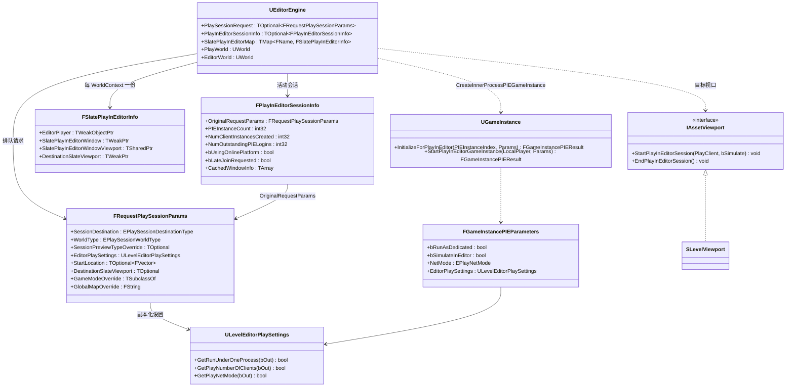

`SLevelViewport::StartPlayInEditorSession/EndPlayInEditorSession`(LevelEditor/Public/SLevelViewport.h:122-123)实现 `IAssetViewport` 接口,使 PIE 可以寄宿在关卡编辑器视口内(Play In Viewport)而不是新窗口。

## 22.4 数据字典

### 22.4.1 PIE 参数与会话信息(Source/Editor/UnrealEd/Public/PlayInEditorDataTypes.h)

| 字段 | 类型 | 含义 | 取值/约束 | 源码位置 |
|---|---|---|---|---|
| EPlaySessionDestinationType | enum class : uint8 | 会话目的地 | InProcess / NewProcess / Launcher | PlayInEditorDataTypes.h:95 |
| EPlaySessionWorldType | enum class : uint8 | PIE 还是 SIE | PlayInEditor(生成 PlayerController)/ SimulateInEditor(不生成) | PlayInEditorDataTypes.h:105 |
| EPlaySessionPreviewType | enum class : uint8 | 预览类型 | NoPreview / MobilePreview / VulkanPreview(5.7 弃用)/ VRPreview | PlayInEditorDataTypes.h:114 |
| FRequestPlaySessionParams.SessionDestination | EPlaySessionDestinationType | 启动位置 | 默认 InProcess | PlayInEditorDataTypes.h:153 |
| FRequestPlaySessionParams.EditorPlaySettings | TObjectPtr&lt;ULevelEditorPlaySettings&gt; | 本会话设置副本 | nullptr 表示用 CDO,RequestPlaySession 中被 StaticDuplicateObjectEx 复制(PlayLevel.cpp:996-1000) | PlayInEditorDataTypes.h:162 |
| FRequestPlaySessionParams.DestinationSlateViewport | TOptional&lt;TWeakPtr&lt;IAssetViewport&gt;&gt; | 寄宿关卡视口 | 仅 InProcess 有效;首个实例消费后被清空(PlayLevel.cpp:3105) | PlayInEditorDataTypes.h:174 |
| FRequestPlaySessionParams.LauncherTargetDevice | TOptional&lt;FLauncherDeviceInfo&gt; | 目标设备 | Launcher 时必设(RequestPlaySession check,PlayLevel.cpp:1008-1011) | PlayInEditorDataTypes.h:180 |
| FPlayInEditorSessionInfo.PIEInstanceCount | int32 | 已开 PIE 实例数 | 含进程内专用服务器 | PlayInEditorDataTypes.h:245 |
| FPlayInEditorSessionInfo.NumOutstandingPIELogins | int32 | 等待登录实例数 | 归零时触发 OnAllPIEInstancesStarted(PlayLevel.cpp:1662-1671) | PlayInEditorDataTypes.h:257 |
| FSlatePlayInEditorInfo | USTRUCT | 每个 PIE WorldContext 的 Slate 数据 | 含浮窗/寄宿视口/EditorPlayer | PlayInEditorDataTypes.h:12 |
| FGameInstancePIEParameters | struct(Runtime) | 传给 GameInstance 的 PIE 参数 | bRunAsDedicated/bSimulateInEditor/NetMode | Runtime/Engine/Classes/Engine/GameInstance.h:102 |

### 22.4.2 事务系统(Transactor.h / EditorTransaction.cpp)

| 字段 | 类型 | 含义 | 取值/约束 | 源码位置 |
|---|---|---|---|---|
| FTransaction.Records | TIndirectArray&lt;FObjectRecord&gt; | 本事务的全部对象记录(含数组/自定义变更) | Apply 按方向遍历 | Transactor.h:272 |
| FTransaction.ObjectRecordsMap | TMap&lt;FPersistentObjectRef, FObjectRecords&gt; | 非数组记录索引,防重复序列化 | SaveObject 先查此表 | Transactor.h:275 |
| FTransaction.PackageRecordMap | TMap&lt;FPersistentObjectRef, FPackageRecord&gt; | 包脏状态记录 | DirtyFenceCount + bWasDirty,Apply 时恢复(EngineTransaction.cpp:825-845) | Transactor.h:278 |
| FTransaction.Id / OperationId | FGuid / FGuid | 事务/操作唯一标识 | BeginOperation/EndOperation 维护 | Transactor.h:281/288 |
| FTransaction.bFlip / Inc | bool / int32 | 应用方向 | Inc=1 Redo,-1 Undo;Finalize 后 bFlip 生效 | Transactor.h:300/304 |
| FObjectRecord.SerializedObject / SerializedObjectFlip | FSerializedObject | 序列化状态与翻转(重做)状态 | FObjectRecord::FWriter/FReader 写读 | Transactor.h:125/127 |
| FObjectRecord.bWantsBinarySerialization | bool | 二进制或 tagged 序列化 | 默认 true(更紧凑) | Transactor.h:121 |
| UTransBuffer.UndoBuffer | TArray&lt;TSharedRef&lt;FTransaction&gt;&gt; | 撤销缓冲 | 序列化于 EditorTransaction.cpp:1203 | EditorTransaction.cpp(成员声明见类) |
| UTransBuffer.UndoCount | int32 | 已撤销数量 | UndoBuffer.Num()-UndoCount 为可撤销数 | Undo() 中 ++UndoCount,EditorTransaction.cpp:1632 |
| UTransBuffer.ActiveCount / ActiveRecordCounts | int32 / TArray&lt;int32&gt; | 嵌套计数 | End 在 1 时才 Finalize | EditorTransaction.cpp:1299-1358 |
| UTransBuffer.UndoBarrierStack | TArray&lt;int32&gt; | 撤销屏障 | PIE 起止 Set/RemoveUndoBarrier(PlayLevel.cpp:2972/677) | EditorTransaction.cpp:1584 |
| UTransactor(抽象)接口 | — | Begin/End/Cancel/Reset/Undo/Redo/CanUndo/CanRedo/SetUndoBarrier 等 | PURE_VIRTUAL | Transactor.h:526-665 |
| FTransactionContext | struct | Id+OperationId+Title+Context+PrimaryObject | 事件广播载体 | Transactor.h:376-379 |

### 22.4.3 编辑器杂项关键数据

| 字段/类型 | 含义 | 源码位置 |
|---|---|---|
| UEditorEngine.Trans | TObjectPtr&lt;UTransactor&gt;,即 UTransBuffer | EditorEngine.h:415 |
| UEditorEngine.ObjectsThatExistInEditorWorld | FUObjectAnnotationSparseBool,PIE 对象在编辑器世界的对应标记(PostCreatePIEWorld 填充,PlayLevel.cpp:2426-2429) | EditorEngine.h:751 |
| UUnrealEdEngine.PackageToNotifyState | TMap&lt;TWeakObjectPtr&lt;UPackage&gt;, uint8&gt;,脏包的 SCC 提示状态机,枚举 EPackageNotifyState:NS_Updating…NS_PendingWarning | UnrealEdEngine.h:150/38-51 |
| UUnrealEdEngine.PackageAutoSaver | TUniquePtr&lt;IPackageAutoSaver&gt; = FPackageAutoSaver | UnrealEdEngine.h:929 |
| FEditorModeID = FName; FBuiltinEditorModes::EM_None / EM_Default | 编辑器模式标识与内建默认模式 | EditorFramework/Public/EditorModes.h:16-22 |
| UCommandlet.HelpDescription / IsServer / ShowProgress / logToConsole | 命令行小程的元数据与行为开关 | Runtime/Engine/Classes/Commandlets/Commandlet.h:46-88 |
| UFactory.bCreateNew / Formats / SupportedClass / bText | 工厂能力位:能否新建、支持的文件格式 | Classes/Factories/Factory.h |
| UEditorEngine.bAllowMultiplePIEWorlds | globalconfig,是否允许进程内多 PIE 世界(默认 true,EditorEngine.h:529) | EditorEngine.h:529 |

## 22.5 接口清单

以下原型逐字摘自头文件(去掉 *_API 宏),线程约束列中 GT=GameThread。

### 22.5.1 UEditorEngine(Source/Editor/UnrealEd/Classes/Editor/EditorEngine.h)

| 原型 | 功能 | 参数/返回 | 线程 | 位置 |
|---|---|---|---|---|
| `virtual void Init(IEngineLoop* InEngineLoop) override;` | 编辑器引擎初始化(绑定委托→InitEditor→CreateTrans→LoadDefaultEditorModules→Cleanse) | — | GT(引擎初始化期) | EditorEngine.h:904(实现 EditorEngine.cpp:1283) |
| `void InitEditor(IEngineLoop* InEngineLoop);` | Init 的主体:DDC 执行器、选择集、ActorFactory 扫描、TimerManager 创建 | — | GT | EditorEngine.h:997(实现 EditorEngine.cpp:961) |
| `virtual void Tick(float DeltaSeconds, bool bIdleMode) override;` | 编辑器帧:顺序见 22.6.2 | — | GT(check GWorld) | EditorEngine.h:907(实现 EditorEngine.cpp:1752) |
| `void RequestPlaySession(const FRequestPlaySessionParams& InParams);` | 排队一次 Play 请求(下一 Tick 生效),复制 EditorPlaySettings | — | GT | EditorEngine.h:1817(实现 PlayLevel.cpp:985) |
| `void StartQueuedPlaySessionRequest();` | 执行排队请求(不可在事务中调用) | — | GT | EditorEngine.h:1868(实现 PlayLevel.cpp:1099) |
| `virtual void StartPlayInEditorSession(FRequestPlaySessionParams& InRequestParams);` | 启动进程内 PIE/SIE 会话 | — | GT | EditorEngine.h:3167(实现 PlayLevel.cpp:2575) |
| `virtual void CreateNewPlayInEditorInstance(FRequestPlaySessionParams &InRequestParams, const bool bInDedicatedInstance, const EPlayNetMode InNetMode);` | 创建一个 PIE 实例(客户端或进程内专用服) | — | GT | EditorEngine.h:3177(实现 PlayLevel.cpp:1786) |
| `virtual UWorld* CreatePIEWorldByDuplication(FWorldContext &WorldContext, UWorld* InWorld, FString &PlayWorldMapName) override;` | 复制编辑器世界得到 PIE 世界 | 返回新 UWorld | GT | EditorEngine.h:916(实现 PlayLevel.cpp:2313) |
| `virtual void PostCreatePIEWorld(UWorld* InWorld) override;` | InitWorld + 标注 ObjectsThatExistInEditorWorld | — | GT | EditorEngine.h:917(实现 PlayLevel.cpp:2404) |
| `virtual UGameInstance* CreateInnerProcessPIEGameInstance(FRequestPlaySessionParams& InParams, const FGameInstancePIEParameters& InPIEParameters, int32 InPIEInstanceIndex);` | 创建 GameInstance/视口/LocalPlayer 并 StartPlayInEditorGameInstance | 返回 UGameInstance | GT | EditorEngine.h:3153(实现 PlayLevel.cpp:2995) |
| `virtual void EndPlayMap();` | 结束全部 PIE 世界并清理(bIsEndingPlay 防重入) | — | GT | EditorEngine.h:1900(实现 PlayLevel.cpp:224) |
| `virtual void TeardownPlaySession(FWorldContext &PieWorldContext);` | 拆除单个 PIE 世界(视口销毁、EndPlay、CleanupWorld) | — | GT | EditorEngine.h:1905(实现 PlayLevel.cpp:721) |
| `void RequestEndPlayMap();` | 排队结束请求(缓存相机位置) | — | GT | EditorEngine.h:1874(实现 PlayLevel.cpp:1400) |
| `virtual int32 BeginTransaction(const TCHAR* TransactionContext, const FText& Description, UObject* PrimaryObject) override;` | 开启事务(CanTransact 检查后 Trans->Begin) | 返回计数索引 | GT | EditorEngine.h:1062(实现 EditorServer.cpp:1086) |
| `virtual int32 EndTransaction() override;` | 结束事务(ActiveCount 减到 0 时 Finalize) | — | GT | EditorEngine.h:1065(实现 EditorServer.cpp:1113) |
| `bool UndoTransaction(bool bCanRedo = true); bool RedoTransaction();` | 撤销/重做当前事务 | 返回是否成功 | GT | EditorEngine.h:1068-1069(实现 EditorServer.cpp:1306/1317) |
| `bool SavePackage(UPackage* InOuter, UObject* InAsset, const TCHAR* Filename, const FSavePackageArgs& SaveArgs);` | UPackage::Save 的编辑器包装(SCC 自动 add) | 返回成功与否 | GT | EditorEngine.h:2317(实现 EditorEngine.cpp:4887) |
| `FSavePackageResultStruct Save(UPackage* InOuter, UObject* InAsset, const TCHAR* Filename, const FSavePackageArgs& SaveArgs);` | BeginEditorSave→UPackage::Save→EndEditorSave | — | GT | EditorEngine.h:2320(实现 EditorEngine.cpp:4808) |
| `UE::Tasks::TTask<FSavePackageResultStruct> SaveAsync(UPackage* InOuter, UObject* InAsset, const TCHAR* Filename, const FSavePackageArgs& SaveArgs);` | 异步保存(BeginEditorSave/EndEditorSave 均为 GameThreadHiPri 任务) | 返回 Task | 触发 GT,任务在任务系统 | EditorEngine.h:2328(实现 EditorEngine.cpp:4835) |
| `virtual void PostEditChangeProperty(FPropertyChangedEvent& PropertyChangedEvent) override;` | 引擎自身配置变化处理 | — | GT | EditorEngine.h:898(实现 EditorEngine.cpp:2725) |
| `void EditObject( UObject* ObjectToEdit );` | 打开对象对应资产编辑器(转发 UAssetEditorSubsystem) | — | GT | EditorEngine.h:2264 |

### 22.5.2 事务系统(Transactor.h / EditorTransaction.cpp / ScopedTransaction.h / Obj.cpp)

| 原型 | 功能 | 线程 | 位置 |
|---|---|---|---|
| `virtual int32 Begin( const TCHAR* SessionContext, const FText& Description );`(UTransactor) | 开启/嵌套一个撤销事务 | GT | Transactor.h:526 |
| `virtual int32 End();` | 关闭事务(仅 ActiveCount==1 时 Finalize) | GT | Transactor.h:535 |
| `virtual void Cancel( int32 StartIndex = 0 );` | 取消当前事务(整体取消,部分取消仅告警) | GT | Transactor.h:542,实现 EditorTransaction.cpp:1411 |
| `virtual void Reset( const FText& Reason );` | 清空撤销缓冲 | GT | Transactor.h:547,实现 EditorTransaction.cpp:1373 |
| `virtual bool Undo(bool bCanRedo = true);` | 应用撤销(跳过 Expired 事务) | GT | Transactor.h:658,实现 EditorTransaction.cpp:1615 |
| `virtual bool Redo();` | 应用重做 | GT | Transactor.h:665,实现 EditorTransaction.cpp:1682 |
| `virtual void SetUndoBarrier(); / RemoveUndoBarrier(); / ClearUndoBarriers();` | 撤销屏障(UndoBarrierStack) | GT | Transactor.h:634-644 |
| `virtual void SaveObject( UObject* Object ) override;`(FTransaction) | 把对象当前状态序列化进事务(重复 SaveObject 只计数) | GT | Transactor.h:350,实现 EditorTransaction.cpp:701 |
| `virtual void SaveArray( UObject* Object, FScriptArray* Array, int32 Index, int32 Count, int32 Oper, int32 ElementSize, uint32 ElementAlignment, STRUCT_DC DefaultConstructor, STRUCT_AR Serializer, STRUCT_DTOR Destructor ) override;` | 记录脚本数组片段(PIE 包内对象跳过) | GT | Transactor.h:351,实现 EditorTransaction.cpp:722 |
| `virtual void StoreUndo( UObject* Object, TUniquePtr<FChange> UndoChange );` | 记录自定义可逆变更(FChange) | GT | Transactor.h:352,实现 EditorTransaction.cpp:745 |
| `virtual void Apply() override;` | 按方向恢复/翻转对象状态,先恢复包脏标记 | GT | Transactor.h:366,实现 EditorTransaction.cpp:814 |
| `virtual void Finalize() override;` | 事务结束时生成 diff(计算哪些属性真的变了) | GT | Transactor.h:371,实现 EditorTransaction.cpp:1023 |
| `UNREALED_API FScopedTransaction(const TCHAR* TransactionContext, const FText& SessionName, UObject* PrimaryObject, const bool bShouldActuallyTransact = true);` | RAII 事务;析构 End | GT | ScopedTransaction.h:24 |
| `bool UObject::Modify( bool bAlwaysMarkDirty=true );` | 对象进入事务缓冲的入口:CanModify 检查(GameThread、非加载中)后 SaveToTransactionBuffer + BroadcastOnObjectModified | GT(CanModify 中显式 IsInGameThread,Obj.cpp:1641-1651) | Runtime/CoreUObject/Private/UObject/Obj.cpp:1652 |
| `bool UEditorEngine::CanTransact();` | Trans 存在且不在包加载/PostLoad 路由中 | GT | EditorServer.cpp:1104 |
| `bool UEditorEngine::Exec_Transaction(const TCHAR* Str, FOutputDevice& Ar);` | 控制台撤销/重做子命令(解析 `REDO`/`UNDO`) | GT | EditorServer.cpp:5543 |

### 22.5.3 编辑器模式与视口(EditorModeManager.h / Tools/UEdMode.h / EditorViewportClient.h)

| 原型 | 功能 | 线程 | 位置 |
|---|---|---|---|
| `void SetDefaultMode( const FEditorModeID DefaultModeID );`(FEditorModeTools) | 设置默认模式(模式清空后回落) | GT | EditorModeManager.h:53 |
| `void AddDefaultMode( const FEditorModeID DefaultModeID );` | 增加默认模式(多模式并存) | GT | EditorModeManager.h:60 |
| `bool ActivateMode( FEditorModeID InID, bool bToggle = false );` | 激活模式(经 FEditorModeRegistry 工厂创建 UEdMode) | GT | EditorModeManager.h:90 |
| `void DeactivateMode(FEditorModeID InID);` | 反激活模式 | GT | EditorModeManager.h:97 |
| `FEdMode* GetActiveMode( FEditorModeID InID );` | 取活动模式实例 | GT | EditorModeManager.h:155 |
| `class UEdMode : public UObject`(声明) | 编辑器模式 UObject 基类(5.8 中即任务书所称 UEditorModeBase 的对应物,5.8 无 UEditorModeBase 类名) | GT | Tools/UEdMode.h:75 |
| `UNREALED_API class FEditorModeTools& GLevelEditorModeTools();` | 全局关卡模式工具单例(Internal::FLevelEditorModeTools,UnrealEdGlobals.cpp:193 创建) | GT | Public/Editor.h:761 |
| `UNREALED_API virtual void Draw(const FSceneView* View,FPrimitiveDrawInterface* PDI) override;`(FEditorViewportClient) | 视口绘制(辅助线/选中效果) | GT(渲染回调) | EditorViewportClient.h:613 |
| `UNREALED_API virtual bool InputKey(const FInputKeyEventArgs& EventArgs) override;` | 键盘输入入口 | GT | EditorViewportClient.h:627 |
| `UNREALED_API virtual void ProcessClick(FSceneView& View, HHitProxy* HitProxy, FKey Key, EInputEvent Event, uint32 HitX, uint32 HitY);` | 点击命中处理(HitProxy 分发) | GT | EditorViewportClient.h:673 |
| `UNREALED_API virtual void Tick(float DeltaSeconds);` | 视口客户端 Tick(由 UEditorEngine::Tick 驱动,EditorEngine.cpp:2263) | GT | EditorViewportClient.h:815 |
| `int32 AddViewportClients(FEditorViewportClient* ViewportClient);`(UEditorEngine) | 注册视口客户端并广播列表变化 | GT | EditorEngine.h:729 |

### 22.5.4 资产/导入/保存(FileHelpers.h / Factory.h / AssetEditorSubsystem.h / AssetDefinition.h / IAssetTools.h / PackageAutoSaver.h)

| 原型 | 功能 | 线程 | 位置 |
|---|---|---|---|
| `static UNREALED_API UWorld* LoadMap(const FString& Filename);`(UEditorLoadingAndSavingUtils) | 打开地图(无对话框版本) | GT | FileHelpers.h:64 |
| `static UNREALED_API bool SavePackages(const TArray<UPackage*>& PackagesToSave, bool bOnlyDirty);` | 批量保存包 | GT | FileHelpers.h:86 |
| `static UNREALED_API bool SaveDirtyPackages(const bool bSaveMapPackages, const bool bSaveContentPackages);` | 保存脏包(重载含 bPromptUserToSave 等 7 参版本,FileHelpers.h:401) | GT | FileHelpers.h:108 |
| `void FEditorFileUtils::LoadDefaultMapAtStartup();` | 启动时加载默认地图(编辑器最后一张地图/默认地图) | GT | FileHelpers.cpp:5267 |
| `UNREALED_API virtual bool FactoryCanImport(const FString& Filename);`(UFactory) | 是否支持导入该文件 | GT | Factory.h:65 |
| `UNREALED_API virtual UObject* FactoryCreateFile(UClass* InClass, UObject* InParent, FName InName, EObjectFlags Flags, const FString& Filename, const TCHAR* Parms, FFeedbackContext* Warn, bool& bOutOperationCanceled);`(UFactory) | 从文件导入对象(默认读入内存转 FactoryCreateBinary) | GT | Factory.h:103 |
| `virtual UObject* FactoryCreateNew(UClass* InClass, UObject* InParent, FName InName, EObjectFlags Flags, UObject* Context, FFeedbackContext* Warn, FName CallingContext)` | 从零新建资产 | GT | Factory.h:117 |
| `UNREALED_API bool OpenEditorForAsset(UObject* Asset, const EToolkitMode::Type ToolkitMode = EToolkitMode::Standalone, TSharedPtr<IToolkitHost> OpenedFromLevelEditor = TSharedPtr<IToolkitHost>(), const bool bShowProgressWindow = true, EAssetTypeActivationOpenedMethod OpenedMethod = EAssetTypeActivationOpenedMethod::Edit);`(UAssetEditorSubsystem) | 打开资产编辑器(按 IAssetTypeActions 分发) | GT | AssetEditorSubsystem.h:132 |
| `UNREALED_API int32 CloseAllEditorsForAsset(UObject* Asset);` | 关闭某资产的全部编辑器(EndPlayMap 中对 PIE 对象调用,PlayLevel.cpp:437) | GT | AssetEditorSubsystem.h:170 |
| `virtual FText GetAssetDisplayName() const PURE_VIRTUAL(UAssetDefinition::GetAssetDisplayName, ...)`(UAssetDefinition,PURE_VIRTUAL 实体略) | 资产显示名 | GT | AssetDefinition.h:469 |
| `virtual TSoftClassPtr<UObject> GetAssetClass() const PURE_VIRTUAL(UAssetDefinition::GetAssetClass, ...)`(同上,实体略) | 该定义对应的资产类 | GT | AssetDefinition.h:480 |
| `virtual void RegisterAssetTypeActions(const TSharedRef<IAssetTypeActions>& NewActions) = 0;`(IAssetTools) | 注册资产类型动作(资产编辑器注册主通道) | GT | IAssetTools.h:293 |
| `virtual void CreateAssetsFrom(TConstArrayView<UObject*> SourceObjects, UClass* CreateAssetType, const FString& DefaultSuffix, TFunctionRef<UFactory*(UObject*)> FactoryConstructor, FName CallingContext = NAME_None) = 0;` | 用工厂从源对象批量创建资产 | GT | IAssetTools.h:389 |
| `virtual void UpdateAutoSaveCount(const float DeltaSeconds) override;`(FPackageAutoSaver) | 累计自动保存计时 | GT(UUnrealEdEngine::Tick 调用,UnrealEdEngine.cpp:552) | PackageAutoSaver.h:33 |
| `virtual bool AttemptAutoSave(const bool bForceAutoSave = false) override;`(FPackageAutoSaver) | 尝试触发自动保存(时间到/强制,PIE 前等) | GT | PackageAutoSaver.h:40,由 UnrealEdEngine.cpp:570 调用 |
| `virtual void OfferToRestorePackages() override;` | 崩溃后恢复自动保存包对话框 | GT | PackageAutoSaver.h:44 |

### 22.5.5 Commandlet 体系全表

基类 `UCommandlet`(Runtime/Engine/Classes/Commandlets/Commandlet.h:40,`class UCommandlet : public UObject`):入口为 `virtual int32 Main(const FString& Params) { return 0; }`(Commandlet.h:103),进程内可覆写 `virtual void CreateCustomEngine(const FString& Params) {}`(Commandlet.h:179)创建自定义引擎;调用形式为 `可执行文件 包名.命令let名 参数`(头注释)。命令let 绝大多数以 `UnrealEditor-Cmd.exe` 运行,共享编辑器模块。下表穷举 `$E/Source` 下全部 Commandlet 类(每行一类;位置为相对 `$E` 的头文件目录):

| Commandlet | 职责 | 位置 |
|---|---|---|
| UCommandlet | 基类:HelpDescription/IsServer/ShowProgress 元数据 + Main 虚函数 | Runtime/Engine/Classes/Commandlets/Commandlet.h |
| UPluginCommandlet | 枚举/校验插件(供构建脚本使用) | Runtime/Engine/Classes/Commandlets/PluginCommandlet.h |
| USmokeTestCommandlet | 冒烟测试命令let | Runtime/Engine/Classes/Commandlets/SmokeTestCommandlet.h |
| UCookCommandlet | 按目标平台烹饪(Cook-on-the-book) | Editor/UnrealEd/Classes/Commandlets/CookCommandlet.h |
| UBaseIteratePackagesCommandlet | 遍历包命令let 的公共基类 | .../BaseIteratePackagesCommandlet.h |
| UResavePackagesCommandlet | 重存包(版本升级/压缩/选项过滤) | .../ResavePackagesCommandlet.h |
| ULoadPackageCommandlet | 加载包做校验(链接器测试) | .../LoadPackageCommandlet.h |
| UDiffAssetsCommandlet | 资产差异比较(供 P4V 集成) | .../DiffAssetsCommandlet.h |
| UDiffFilesCommandlet | 文件差异比较 | .../DiffFilesCommandlet.h |
| UDiffCookCommandlet | 比较两次 Cook 输出 | .../DiffCookCommandlet.h |
| UDiffAssetRegistriesCommandlet | 比较两份资产注册表 | .../DiffAssetRegistriesCommandlet.h |
| UImportAssetsCommandlet | 无头批量导入资产 | Editor/UnrealEd/Public/Commandlets/ImportAssetsCommandlet.h |
| UCompileAllBlueprintsCommandlet | 编译全部蓝图 | Editor/UnrealEd/Public/Commandlets/CompileAllBlueprintsCommandlet.h |
| UDumpAssetRegistryCommandlet | 导出资产注册表 | .../DumpAssetRegistryCommandlet.h |
| UAssetRegistryDumpCommandlet | 导出资产注册表(另一变体) | .../AssetRegUtilCommandlet.h(同文件组) |
| UAssetSizeQueryCommandlet | 查询资产磁盘/内存尺寸 | .../AssetSizeQueryCommandlet.h |
| UAssetRegUtilCommandlet | 资产注册表工具(列举/校验) | .../AssetRegUtilCommandlet.h |
| UDerivedDataCacheCommandlet | DDC 填充/验证/淘汰 | .../DerivedDataCacheCommandlet.h |
| UDDCCleanupCommandlet | DDC 清理 | .../DDCCleanupCommandlet.h |
| UCookShadersCommandlet / UCookGlobalShadersCommandlet / UCopyNaniteFallbackSettingsToRayTracingProxyCommandlet | 着色器烹饪/全局着色器烹饪/Nanite 回退设置拷贝 | .../CookShadersCommandlet.h 等 |
| UCompileShadersTestBedCommandlet / UDebugShaderCompileJobCommandlet | 着色器编译测试/单个编译任务调试 | .../CompileShadersTestBedCommandlet.h 等 |
| UIoStoreCommandlet / UChunkAssignerCommandlet / UExportPakDependenciesCommandlet / UGenerateAssetManifestCommandlet | IoStore 打包/分块/依赖导出/资产清单 | .../IoStoreCommandlet.h 等 |
| UUnrealPakCommandlet | Pak 打包(UnrealPak 的命令let 实现) | .../UnrealPakCommandlet.h |
| UFileServerCommandlet | 文件服务器(网络文件传输) | .../FileServerCommandlet.h |
| UEditorDomainSaveCommandlet | EditorDomain 保存服务(编辑器/Cook 客户端用) | .../EditorDomainSaveCommandlet.h |
| UFixupNeedsLoadForEditorGameCommandlet | 修补 NeedsLoadForEditorGame 标记 | .../FixupNeedsLoadForEditorGameCommandlet.h |
| USavePackageUtilitiesCommandlet | 包保存工具(慢任务/告警路径验证) | .../SavePackageUtilitiesCommandlet.h |
| UExternalActorsCommandlet / UConvertLevelsToExternalActorsCommandlet | 外部 Actor 体系检查/关卡转换 | .../ExternalActorsCommandlet.h 等 |
| UWorldPartitionBuilderCommandlet / UWorldPartitionConvertCommandlet / UWorldPartitionDataLayerToAssetCommandlet | 世界分区构建器宿主/转换/DataLayer→资产 | .../WorldPartitionBuilderCommandlet.h 等 |
| UMakeBinaryConfigCommandlet | 生成二进制配置 | .../MakeBinaryConfigCommandlet.h |
| UUpdateGameProjectCommandlet | 升级游戏工程 | .../UpdateGameProjectCommandlet.h |
| UWrangleContentCommandlet | 内容清理/搬移工具 | .../WrangleContentCommandlet.h |
| UCompressAnimationsCommandlet / UParticleSystemAuditCommandlet / UFixSoundWaveTimecodeInfoCommandlet / USwapSoundForDialogueInCuesCommandlet / UPopulateDialogueWaveFromCharacterSheetCommandlet / UAudioMixerCommandlet / UListMaterialsUsedWithMeshEmittersCommandlet | 动画压缩/粒子审计/声波时间码修复/对白替换/对白波填充/音频混音器无头测试/网格发射器材质统计 | 对应同名 .h |
| UDumpMaterialInfo / UDumpMaterialExpressionsCommandlet / UDumpMaterialExpressionInfo / UDumpMaterialShaderTypes / UDumpLightFunctionMaterialInfo / UMaterialLayerUsageCommandlet / USubstrateCommandlet | 材质信息/表达式/着色类型/灯光函数材质/材质层用量/Substrate 工具 | 对应同名 .h |
| UDumpBlueprintsInfoCommandlet / UGenerateBlueprintAPICommandlet | 蓝图信息导出/蓝图 API 生成 | 对应同名 .h |
| UDumpHiddenCategoriesCommandlet / UDumpArchetypeInfoCommandlet | 隐藏类别/原型信息导出 | 对应同名 .h |
| UPkgInfoCommandlet | 包信息(PrintImporter/序列化统计) | .../PkgInfoCommandlet.h |
| UStaticMeshMinLodCommandlet / ULandscapeGrassTypeCommandlet | 静态网格 MinLOD 修补/地形草类型处理 | 对应同名 .h |
| UReplaceAssetsCommandlet / UReplaceActorCommandlet | 用外部(熟)资产/新 Actor 类替换 | .../ReplaceAssetsCommandlet.h 等 |
| UListStaticMeshesImportedFromSpeedTreesCommandlet | SpeedTree 导入网格统计 | 对应同名 .h |
| UGatherTextCommandletBase / UGatherTextCommandlet / UGatherTextFromAssetsCommandlet / UGatherTextFromMetadataCommandlet / UGatherTextFromSourceCommandlet / UGenerateGatherManifestCommandlet / UGenerateGatherArchiveCommandlet / UGenerateTextLocalizationResourceCommandlet / UGenerateTextLocalizationReportCommandlet / UImportLocalizedDialogueCommandlet / UImportDialogueScriptCommandlet / UExportDialogueScriptCommandlet / UInternationalizationExportCommandlet / UInternationalizationConditioningCommandlet / UFixConflictingLocalizationKeys / UStabilizeLocalizationKeys / UDetectOrphanedLocalizedAssetsCommandlet / UExtractLocResCommandlet | 本地化全家桶:GatherText 主控(读配置调用其余)、按资产/元数据/源码收集、清单/归档/资源/报告生成、对白导入导出、国际化导出与条件化、键冲突修复/稳定化、孤儿资产检测、LocRes 提取 | .../GatherTextCommandletBase.h 等 |
| UGenerateDistillFileSetsCommandlet | 蒸馏文件集生成(控制台平台) | .../GenerateDistillFileSetsCommandlet.h |
| UTextAssetCommandlet | 文本资产测试工具 | .../TextAssetCommandlet.h |
| USummarizeTraceCommandlet / USummarizeTraceEditorWorkflowsCommandlet | Trace 会话汇总统计 | 对应同名 .h |
| UBatchProcessCommandlet / UBatchWorkerCommandlet | 批处理/工作进程协调(构建脚本用) | Editor/Kismet/Private/Commandlets/(BatchProcessCommandlet.h) |
| UCheckAndroidDeviceProfileCommandlet | Android 设备描述校验 | Editor/DeviceProfileServices/Public/CheckAndroidDeviceProfileCommandlet.h |
| UVirtualizationEditor 系列:UVirtualizeProjectCommandlet / URehydrateProjectCommandlet / UCheckForVirtualizedContentCommandlet / UValidateVirtualizedContentCommandlet / UGeneratePayloadManifestCommandlet / UGenerateMountPointPayloadManifestCommandlet / UPrecachePayloadsCommandlet / UDumpPackagePayloadInfoCommand | 虚拟化(payload 迁移)项目工具族 | Editor/VirtualizationEditor/Private/*.h |

> 注:`Editor/UnrealEd/Classes/Commandlets` 下的 75 个头文件按目录穷举如上;`Runtime/Engine/Classes/Commandlets` 含基类与 Plugin/SmokeTest;其余目录(Kismet/DeviceProfileServices/VirtualizationEditor)单独列出。未在头文件注释中给出用途的条目,其描述依据类名与所在 cpp 行为概括,细节以各自 cpp 为准。

## 22.6 关键流程

### 22.6.1 编辑器启动(UnrealEd 加载 → EditorEngine Init → MainFrame → LevelEditor → 默认关卡)

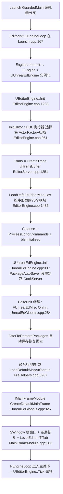

要点(均已读源码验证):`GEditor = this` 在 `UEditorEngine::Init` 内、`InitEditor` 调用之前赋值(EditorEngine.cpp:1348);默认模块表内含 MainFrame/ContentBrowser/AssetTools/PropertyEditor/DetailCustomizations/LevelEditor 等固定顺序(EditorEngine.cpp:1488-1562),随后再加载 `*RuntimeSettings`、`*PlatformEditor` 通配模块与 LogVisualizer/HotReload/ViewportInteraction/VREditor(1596-1609);启动地图优先取命令行首 token,否则当 `ULevelEditorLoadingSavingSettings::LoadLevelAtStartup != None` 时 `LoadDefaultMapAtStartup`(UnrealEdMisc.cpp:411-434);MainFrame 若布局损坏会回退代码内默认布局并递归重建(MainFrameModule.cpp:679-692)。

### 22.6.2 编辑器 Tick 次序(UEditorEngine::Tick,EditorEngine.cpp:1752-2521)

```mermaid
flowchart TD
    T0["清 ObjectsModifiedThisFrame WorldList Reserve"] --> T1["CallAllConsoleVariableSinks"]
    T1 --> T2["FRemoteConfigAsyncTaskManager Tick + CleanupGameViewport + ConditionallyBuildStreamingData"]
    T2 --> T3["TimerManager Tick + StaticTick 异步加载 非统一时间预算"]
    T3 --> T4["后台节流 : 无焦点时给视口加 RealtimeOverride"]
    T4 --> T5["FTickableEditorObject TickObjects + 资产注册表 Tick + SourceCodeAccess Tick + DirectoryWatcher Tick"]
    T5 --> T6["编辑器世界 Tick LEVELTICK_ViewportsOnly 或 TimeOnly :1967"]
    T6 --> T7["无 PIE 时 流送体积预视 UpdateLevelStreaming :2052"]
    T7 --> T8["处理排队 PlaySessionRequest 或 PIE/SIE 切换 + LateJoin :2062-2075"]
    T8 --> T9["PIE 世界循环 : SetPlayInEditorWorld → TickWorldTravel → World Tick LEVELTICK_All → GameViewport Tick :2117-2203"]
    T9 --> T10["FTickableGameObject TickObjects + Media TickPostEngine"]
    T10 --> T11["EditorWorldExtensionsManager Tick + 各 ViewportClient Tick + CommitModelSurfaces :2242-2297"]
    T11 --> T12["SendAllEndOfFrameUpdates + 视口绘制 : UpdateSingleViewportClient 按焦点/父子序 :2334-2381"]
    T12 --> T13["ISourceControl Tick + PIE GameViewport Draw + RedrawViewports + UpdateLevelStreaming :2409-2455"]
    T13 --> T14["IStreamingManager Tick + AudioDeviceManager 更新 + TickPoolElements 渲染命令"]
    T14 --> T15["bEndPlayMapThisFrame → EndPlayMap :2505 + 资产/性能分析 + BroadcastPostEditorTick"]
```

`UUnrealEdEngine::Tick`(UnrealEdEngine.cpp:541)在其后追加:自动保存计数(PIE/自动化时暂停)、首帧 `FEditorDelegates::DisplayLoadErrors`、`AttemptAutoSave`、`AttemptModifiedPackageNotification`(SCC 检出提示)与 `UpdateBuildLighting`。

### 22.6.3 PIE 启动主路径

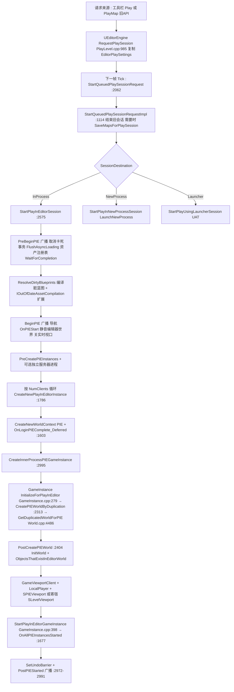

多客户端规则(源码):`GetRunUnderOneProcess=false` 或 NumClients>1 或 NetMode==PIE_Client 时按"独立进程"处理并强制先保存地图(PlayLevel.cpp:1159-1188);实例 0 在需要时被强制为 ListenServer,后续实例改 PIE_Client(2902-2918);SIE 被强制 Standalone+单客户端(2759-2763)。SIE 与 PIE 的切换由 `ToggleBetweenPIEandSIE` 完成,请求在 Tick 中消费(2066-2069)。

世界复制的两个入口:持久关卡走 `UEditorEngine::CreatePIEWorldByDuplication`(PlayLevel.cpp:2313)→ `UWorld::GetDuplicatedWorldForPIE`(Runtime/Engine/Private/World.cpp:4486,`StaticDuplicateObjectEx` + `EDuplicateMode::PIE` + `PPF_DuplicateForPIE`,PIE 包前缀 `UWorld::BuildPIEPackagePrefix`);流送关卡在 PIE 中按需复制走 `UWorld::DuplicateWorldForPIE(PackageName, OwningWorld)`(World.cpp:4507,按编辑器关卡包查世界并转换 PIE 包名),受 `ULevelEditorPlaySettings::bPreferToStreamLevelsInPIE` 影响(UnrealEdEngine.cpp:972-975 的 PreferToStreamLevelsInPIE)。

### 22.6.4 PIE 结束(EndPlayMap,PlayLevel.cpp:224-708)

流程:PrePIEEnded 广播 → 恢复最小化窗口/清 PIE 包名映射 → 记录选中 Actor → 全部反选 → EndPIE + OnPIEEnded 广播 → 对每个 PIE WorldContext 调 `TeardownPlaySession`(721:销毁视口/SWindow、逐 LocalPlayer 销毁 PlayerController/Pawn、`PlayWorld->EndPlay(EEndPlayReason::EndPlayInEditor)`、GameInstance->Shutdown、`CleanupWorld`、恢复 GWorld 为 EditorWorld、`RestoreScene`)→ 移除 WorldContext → 关闭编辑 PIE 对象的资产编辑器(437)→ `MarkObjectsPendingKill` + 强制 GC → PIE 泄漏引用检测(FReferenceChainSearch,538)→ 生成 PIE Note Actor(589)→ 恢复实时视口/EnableWorldSwitchCallbacks(false) → `RemoveUndoBarrier`(677)→ 恢复编辑器选中 → `ShutdownPIE` 广播。

### 22.6.5 SavePackage 流程

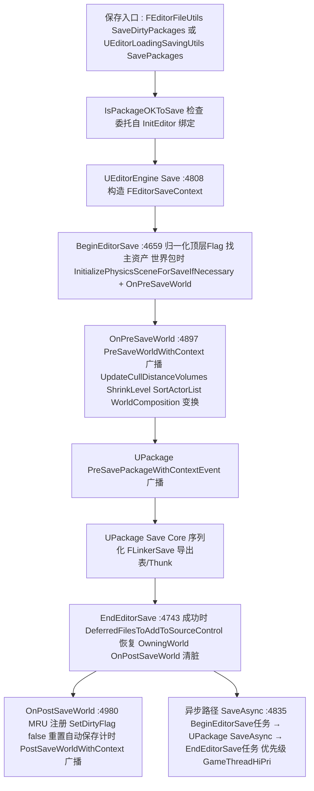

### 22.6.6 属性编辑链路(PostEditChangeProperty)

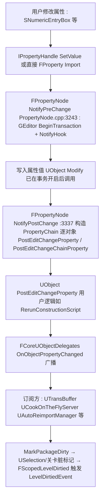

## 22.7 时序图

### 22.7.1 PIE 启动完整时序(跨 UnrealEd/Engine/GameInstance/Slate)

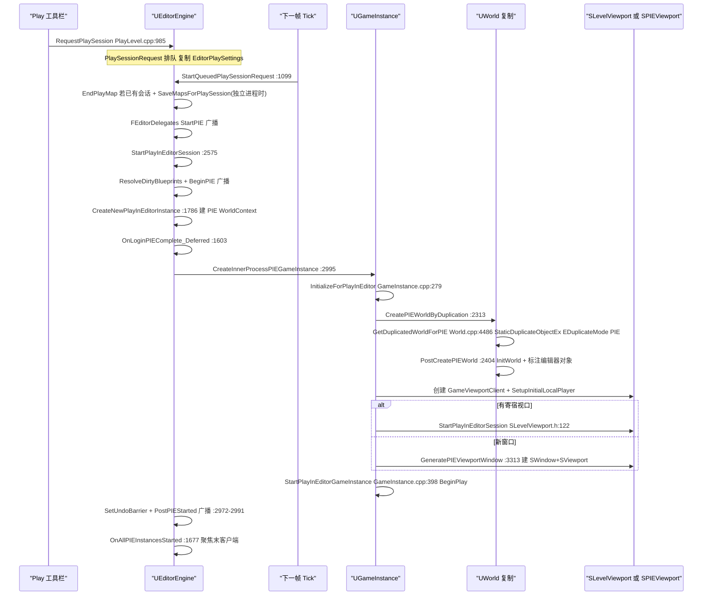

### 22.7.2 事务记录与撤销(Modify→SaveObject→Undo)

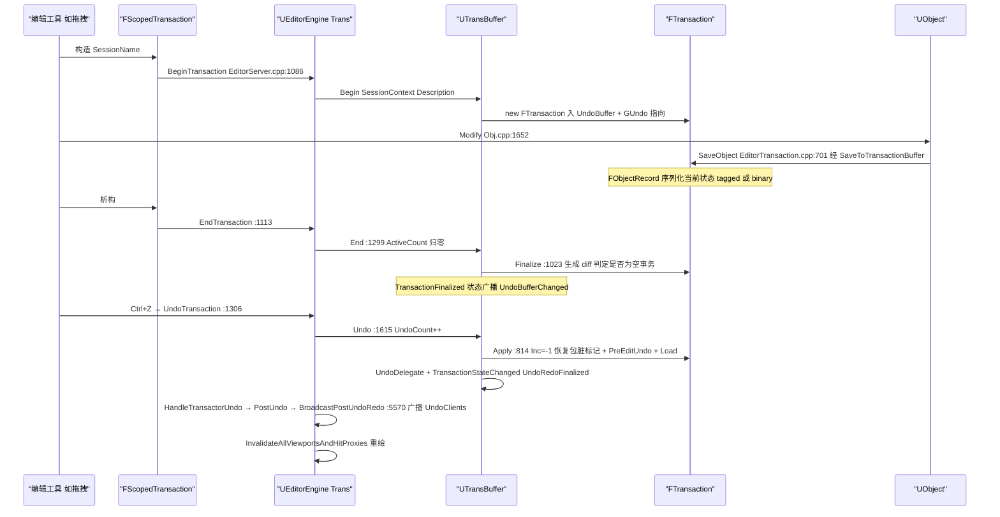

### 22.7.3 属性编辑到对象世界(IDetailsView→PostEditChangeProperty)

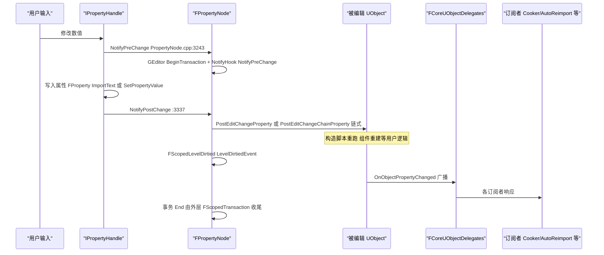

### 22.7.4 资产打开链路(ContentBrowser 双击→编辑器)

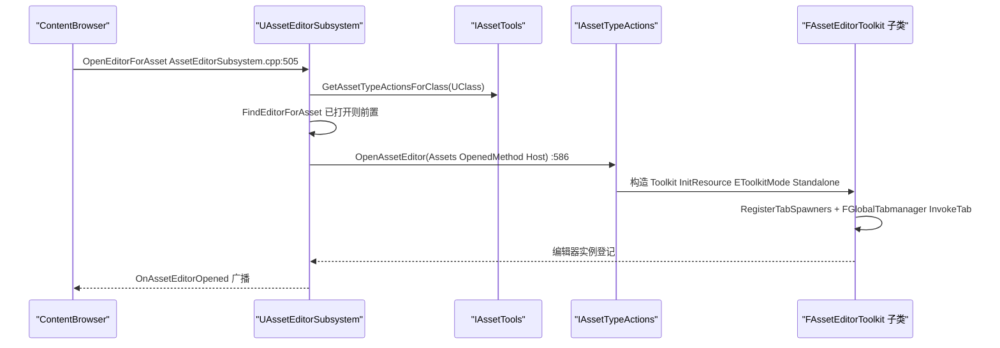

## 22.8 线程模型与同步

- **GameThread 独占的编辑器状态**:`UEditorEngine::Tick`、全部 PIE 启停、事务缓冲(`UObject::CanModify` 显式 `IsInGameThread()`,Obj.cpp:1650)、`FEditorModeTools`/UEdMode、属性面板链路、自动保存均在 GameThread。依据:EditorEngine.cpp:1752 起直接访问 GWorld/GEditor;PlayLevel.cpp 全部函数只被 Tick/命令回调调用。
- **GWorld 切换**:PIE 世界 Tick、视口 Tick、消息泵(`OnPreWindowsMessage`/`OnPostWindowsMessage`,UnrealEdEngine.cpp:814-836)通过 `SetPlayInEditorWorld`/`RestoreEditorWorld` 临时切换 GWorld 与 `GIsPlayInEditorWorld`;PIE 浮窗还通过 `SWindow::SetOnWorldSwitchHack`(OnSwitchWorldForSlatePieWindow,PlayLevel.cpp:3352-3354)在 Slate 事件前后换世界。
- **异步保存**:`UEditorEngine::SaveAsync`(EditorEngine.cpp:4835)把 BeginEditorSave/EndEditorSave 拆成 UE::Tasks 任务,优先级 `EExtendedTaskPriority::GameThreadHiPri`;`FSavePackageArgs`(如 SavePackageContext/ArchiveCookData)须保证任务期间存活(头文件注释)。
- **渲染线程交互**:视口无效化时由 EditorEngine.cpp:2394-2401 的 `ENQUEUE_RENDER_COMMAND(FlushPendingDeleteRHIResources_NonRealtime)` 刷渲染资源;TickPoolElements 同样是渲染命令(2497-2502)。
- **源码控制/消息总线**:SCC 状态更新为异步命令(`ISourceControlModule::Get().GetProvider().Execute(..., EConcurrency::Asynchronous, ...)`,UnrealEdEngine.cpp:662),回调回到 GameThread 更新 `PackageToNotifyState`;TargetDeviceServices/SessionFrontend/Concert 建立在消息总线(ThreadSafe 消息处理线程)上,UI 侧仍回 GameThread。
- **后台线程相关**:DDC 后台执行器(InitDerivedDataBuildRemoteExecutor,EditorEngine.cpp:965-973)、PIE 在线登录回调经 `SetTimerForNextTick` 延迟回主线程(PlayLevel.cpp:1600)、目录监视器 Tick 于 GameThread(EditorEngine.cpp:1948)但其 IO 在后台。
- **FTS 多播**:蓝图编译事件 `FBlueprintPreCompileEvent` 等为 TS 委托(EditorEngine.h:754-768),允许工作线程触发编译通知。

## 22.9 配置与扩展点

### 22.9.1 控制台变量(CVar)

| CVar | 作用 | 位置 |
|---|---|---|
| `TransBuffer.DumpObjectMap` | 每次事务写对象映射转储(调试) | EditorTransaction.cpp:1292 |
| `r.DontLimitOnBattery` | 笔记本电池下编辑器限 60fps 的豁免(EditorEngine.cpp:2554-2558) | EditorEngine.cpp:2554 |
| `ToolMenus.Edit` | 打开菜单编辑模式 | EditorEngine.cpp:1161-1184 |
| `GInvalidateHitProxiesEachSIEFrameCVar`(SIE 命中代理每帧失效开关) | SIE 视口交互命中刷新 | EditorEngine.cpp:2647 |
| `r.PostProcessing.PropagateAlpha` | 影响 PIE 视口 alpha 忽略策略 | PlayLevel.cpp:3377 |

### 22.9.2 配置文件(节选)

| ini | 用途 | 依据 |
|---|---|---|
| `[/Script/UnrealEd.EditorExperimentalSettings]` `bEnableEditToolMenusUI` | 菜单编辑 UI | EditorEngine.cpp:1187 |
| `[/Script/UnrealEd.EditorLoadingSavingSettings]`(类) | 自动保存间隔/提示检出/启动加载关卡(LoadLevelAtStartup) | FileHelpers/UnrealEdMisc.cpp:423 |
| `[/Script/UnrealEd.EditorEngine]` `bAllowMultiplePIEWorlds`(globalconfig) | 进程内多 PIE 世界 | EditorEngine.h:529 |
| `[/Script/Engine.LevelEditorPlaySettings]` | PIE 网络/客户端数/窗口尺寸(PlaySettings 被 RequestPlaySession 复制) | Classes/Settings/LevelEditorPlaySettings.h |
| `[AssetEditorSubsystem]` `OpenAssetsAtExit/CleanShutdown/DebuggerAttached` | 退出前打开资产恢复 | AssetEditorSubsystem.cpp:1018-1039 |
| `[UnrealEd]` `PackagesToBeFullyLoadedAtStartup`(config 数组) | 启动全量加载包 | UnrealEdEngine.h:117 + UnrealEdEngine.cpp:145-153 |
| `GEditorLayoutIni`(布局) | 主窗口 Tab 布局持久化 | MainFrameModule.cpp:662/986 |

### 22.9.3 委托/事件(编辑器生命周期)

| 委托 | 广播点 | 位置 |
|---|---|---|
| `FEditorDelegates::StartPIE/PreBeginPIE/BeginPIE/PostPIEStarted/PrePIEEnded/EndPIE/ShutdownPIE/PausePIE/ResumePIE/SingleStepPIE/CancelPIE` | PIE 生命周期(布尔参数 = 是否 SIE) | Editor.cpp:112-124;广播于 PlayLevel.cpp:1190/2584/2644/2991/235/306/707 |
| `FEditorDelegates::OnEditorBoot / OnEditorLoadDefaultStartupMap` | 编辑器启动里程碑(可否载默认图) | Editor.cpp:183-184;UnrealEdMisc.cpp:421 |
| `FCoreUObjectDelegates::OnObjectPropertyChanged / BroadcastOnObjectModified` | 属性修改通知链 | PropertyNode.cpp:3337 / Obj.cpp:1681 |
| `UTransBuffer::TransactionStateChangedDelegate / UndoBufferChangedDelegate / UndoDelegate / RedoDelegate` | 事务状态与缓冲变化(UndoHistory UI 监听) | EditorTransaction.cpp(Undo :1663 等) |
| `UAssetEditorSubsystem::OnAssetEditorOpened / OnAssetEditorRequestedOpen` | 资产编辑器打开 | AssetEditorSubsystem.h:221-225 |
| `UPackage::PreSavePackageWithContextEvent / FEditorDelegates::PreSaveWorldWithContext/PostSaveWorldWithContext` | 保存链路挂钩 | EditorEngine.cpp:4740/4913/5065 |
| Modular Features `IPIEAuthorizer`、`UE::PIE::IOutOfDateAssetCompilation` | PIE 预检扩展(禁止 PIE/编译过期资产) | PlayLevel.cpp:2616/2688 |

### 22.9.4 模块接口与扩展机制

- **UEditorSubsystem**(`Source/Editor/EditorSubsystem/Public/EditorSubsystem.h:20`,继承 UDynamicSubsystem):`EditorSubsystemCollection.Initialize(this)` 在 `UEditorEngine::InitializeObjectReferences`(EditorEngine.cpp:1253)初始化;`GetEditorSubsystem&lt;T&gt;()` 取用。
- **编辑器模式**:`FEditorModeRegistry`(Public/EditorModeRegistry.h:83)注册工厂;`GLevelEditorModeTools()` 全局实例;UEdMode 可声明 ToolsContext(EditorInteractiveToolsFramework)。
- **资产编辑器三通道**:旧 `IAssetTools::RegisterAssetTypeActions`(IAssetTools.h:293)→ 新 `UAssetDefinitionRegistry`(AssetDefinitionRegistry.h:18)→ `UAssetEditorSubsystem::GetDebugObjectDelegateForClass` 调试对象(AssetEditorSubsystem.cpp:797)。
- **属性定制**:`FPropertyEditorModule::RegisterCustomClassLayout/RegisterCustomPropertyTypeLayout`(PropertyEditorModule.h:284/301);引擎内建定制在 DetailCustomizations 与 UUnrealEdEngine::Init 中注册(UnrealEdEngine.cpp:179-210)。
- **菜单**:UToolMenus(Developer/ToolMenus/Public/ToolMenus.h:100,`Get()`/`RegisterMenu`:161)。
- **Modular Features**:`IPIEAuthorizer`、`UE::PIE::IOutOfDateAssetCompilation`、`IEditorMainFrameProvider`(MainFrameModule.cpp:376-389,可整体替换主框架)。
- **导入扩展**:UFactory 子类(自动扫描注册到 ActorFactories 的只有 UActorFactory;UFactory 由各模块经 `FAssetToolsModule::Get().RegisterAssetTypeActions` 间接暴露)、`UImportSubsystem` 广播重导入。

## 22.10 已知限制/未确认项

1. **UEditorModeBase 类名**:任务书提及的 `UEditorModeBase` 在 5.8.3 源码中不存在;对应职责由 `UEdMode`(Source/Editor/UnrealEd/Public/Tools/UEdMode.h:75)承担,已按 UEdMode 撰写。
2. **Commandlet 职责描述**:表中约半数 Commandlet 头文件无文档注释,其一行职责依据类名/所属 cpp 概括,未逐个通读 75 个 cpp 实现;用途如需精确措辞请以对应 cpp 为准。
3. **插件行级描述**:22.1.6/22.1.7 的每个插件只给出单行职责,来源为插件目录 `.uplugino` 描述与模块名,未逐一深入每个插件的全部类;完整符号见附录索引。
4. **MainFrame 启动对话框**(项目选择)在无项目文件时才走 ProjectDialogProvider 分支,该分支未逐行阅读。
5. **PlayLevelNewProcess.cpp / PlayLevelViaLauncher.cpp** 仅确认入口函数(`LaunchNewProcess`、`StartPlayUsingLauncherSession`)与调用点,未展开其内部 UAT 命令行拼接细节。
6. **Concert 家族**:仅确认 Plugins/Developer/Concert 下 ConcertMain(Concert/ConcertClient/ConcertServer/ConcertTransport)、ConcertSync、ConcertUI、ConcertInsights、ConcertScripting、ConcertApp 的目录结构,未深入多用户同步协议。
7. **EditorDomainSaveCommandlet、ZenEditor、DerivedDataEditor** 等 DDC/EditorDomain 相关模块只在启动流程中出现,内部实现不在本章范围。
8. 附录 `appendix/api/Editor/EditorFramework.md` 等文件中存在少量与源码目录差异(如 PixelInspectorModule.md),本章以实际源码路径为准。

## 22.11 附录索引

本章覆盖模块与附录文件(相对 `docs/ue5.8.3/appendix/api/`)对照。完整符号清单以附录为准;附录未覆盖时标注"目录级"。

| 模块/插件 | 附录文件 |
|---|---|
| UnrealEd | Editor/UnrealEd.part01.md、Editor/UnrealEd.part02.md |
| LevelEditor / MainFrame / ContentBrowser / ContentBrowserData | Editor/LevelEditor.md、Editor/MainFrame.md、Editor/ContentBrowser.md、Editor/ContentBrowserData.md |
| PropertyEditor / DetailCustomizations / SceneOutliner / ClassViewer / StructViewer / GraphEditor | Editor/PropertyEditor.md、Editor/DetailCustomizations.md、Editor/SceneOutliner.md、Editor/ClassViewer.md、Editor/StructViewer.md、Editor/GraphEditor.md |
| EditorFramework / EditorSubsystem / EditorStyle / EditorWidgets / EditorConfig | Editor/EditorFramework.md、Editor/EditorSubsystem.md、Editor/EditorStyle.md、Editor/EditorWidgets.md、Editor/EditorConfig.md |
| ToolMenus / ToolMenusEditor / StatusBar / WorkspaceMenuStructure | Developer/ToolMenus.md、Editor/ToolMenusEditor.md、Editor/StatusBar.md、Editor/WorkspaceMenuStructure.md |
| Settings / SettingsEditor / EditorSettingsViewer / ProjectSettingsViewer / ConfigEditor | Developer/Settings.md、Developer/SettingsEditor.md、Editor/EditorSettingsViewer.md、Editor/ProjectSettingsViewer.md、Editor/ConfigEditor.md |
| UndoHistory / UndoHistoryEditor / SourceControlWindows / SourceControlWindowExtender | Developer/UndoHistory.md、Editor/UndoHistoryEditor.md、Editor/SourceControlWindows.md、Editor/SourceControlWindowExtender.md |
| GameProjectGeneration / StatsViewer / PlacementMode / TurnkeySupport / UATHelper | Editor/GameProjectGeneration.md、Editor/StatsViewer.md、Editor/PlacementMode.md、Editor/TurnkeySupport.md、Editor/UATHelper.md |
| ViewportInteraction / ViewportSnapping / VREditor / LandscapeEditor / FoliageEdit | Editor/ViewportInteraction.md、Editor/ViewportSnapping.md、Editor/VREditor.md、Editor/LandscapeEditor.md、Editor/FoliageEdit.md |
| AssetDefinition / AssetTools / CollectionManager | Editor/AssetDefinition.md、Developer/AssetTools.md、Developer/CollectionManager.md |
| 资产编辑器(StaticMeshEditor、MaterialEditor、TextureEditor、Persona、Sequencer、UMGEditor、Kismet、KismetCompiler、BlueprintGraph、AnimGraph、AnimationEditor、AnimationBlueprintEditor、SkeletalMeshEditor、SkeletonEditor、PhysicsAssetEditor、CurveAssetEditor、CurveEditor、DataTableEditor、StringTableEditor、FontEditor、AudioEditor、MovieSceneTools、AdvancedPreviewScene、MeshPaint、ClothPainter、MergeActors、ActorPickerMode、SceneDepthPickerMode、AnimationEditMode、EditorInteractiveToolsFramework、Blutility 等) | Editor/ 下同名 .md(如 Editor/StaticMeshEditor.md、Editor/MaterialEditor.md、Editor/TextureEditor.md、Editor/Persona.md、Editor/Sequencer.md、Editor/UMGEditor.md、Editor/Kismet.md 等) |
| DesktopPlatform / MessageLog / OutputLog / SlateReflector / SessionFrontend / LauncherServices / DeviceManager / TargetDeviceServices / AutomationWindow / AutomationController / AutomationDriver / FunctionalTesting / LogVisualizer | Developer/DesktopPlatform.md、Developer/MessageLog.md、Developer/OutputLog.md、Developer/SlateReflector.md、Developer/SessionFrontend.md、Developer/LauncherServices.md、Developer/DeviceManager.md、Developer/TargetDeviceServices.md、Developer/AutomationWindow.md、Developer/AutomationController.md、Developer/AutomationDriver.md、Developer/FunctionalTesting.md、Developer/LogVisualizer.md |
| Plugins/Editor 全部 | Plugins/ 下与插件同名 .md(AssetManagerEditor.md、AssetReferenceRestrictions.md、AssetRegistryExport.md、AssetSearch.md、BlueprintHeaderView.md、BlueprintMaterialTextureNodes.md、ChangelistReview.md、ColorGrading.md、ConsoleVariablesEditor.md、CryptoKeys.md、CurveEditorTools.md、DataValidation.md、DisplayClusterLaunch.md、EditorDebugTools.md、EditorScriptingUtilities.md、EditorSysConfigAssistant.md、EngineAssetDefinitions.md、FacialAnimation.md、GameplayTagsEditor.md、GeometryMode.md、GuidedTutorials.md、ImageWidgets.md、LandscapePatch.md、LiveUpdateForSlate.md、Localization.md、MacGraphicsSwitching.md、MakeCookedEditorAsDLC.md、MaterialAnalyzer.md、MaterialAssetWizard.md、MaterialValidation.md、MeshLODToolset.md、MobileLauncherProfileWizard.md、ModelingToolsEditorMode.md、ModelViewViewModelPreview.md、ObjectMixer.md、PluginBrowser.md、ProxyLODPlugin.md、SampleToolsEditorMode.md、ScriptableToolsEditorMode.md、SequencerAnimTools.md、SpeedTreeImporter.md、StaticMeshEditorModeling.md、StylusInput.md、UMGWidgetPreview.md、UVEditor.md、WaveformEditor.md、WorldPartitionHLODUtilities.md 等) |
| Plugins/Developer 全部 | Plugins/ 下同名 .md(Concert 家族 Concert.md、ConcertSyncClient.md 等;PerforceSourceControl.md、GitSourceControl.md、PlasticSourceControl.md、SubversionSourceControl.md、OneSkyLocalizationService.md;VisualStudioSourceCodeAccess.md、VisualStudioCodeSourceCodeAccess.md、RiderSourceCodeAccess.md、CLionSourceCodeAccess.md、KDevelopSourceCodeAccess.md、N10XSourceCodeAccess.md、XCodeSourceCodeAccess.md、NullSourceCodeAccess.md;ProjectLauncher.md、PixWinPlugin.md、RenderDocPlugin.md、XcodeGPUDebuggerPlugin.md、DumpGPUServices.md、GPUReshape.md、ShaderToolkit.md、NamingTokens.md、PropertyAccessNode.md、TraceSourceFiltering.md、TextureFormatOodle.md 等) |
| Commandlet 体系 | Editor/UnrealEd.part01.md(UCommandlet 派生类集中于 UnrealEd)、Runtime/Engine(Commandlet 基类,见附录 Runtime/Engine*) |

> 附录目录 `appendix/api/Plugins/` 与 `appendix/api/Developer/`、`appendix/api/Editor/` 的确切文件名以该目录实际列表为准(本表给出主干映射)。

