# 23 诊断与质量:Trace/Insights、Stats/CSV、日志、崩溃、自动化测试

本章覆盖 UE 5.8.3 引擎的诊断与质量保障子系统:进程内数据采集(TraceLog、Stats、CSV Profiler、日志、LLM、内存泄漏检测)、崩溃捕获与上报(CrashContext、CrashReportCore/CrashReportClient)、自动化测试(AutomationTest/AutomationWorker/AutomationController、CQTest、FunctionalTesting、Gauntlet),以及离线分析与可视化工具链(TraceServices/TraceAnalysis/TraceInsights、UnrealInsights、UnrealTraceServer、CSV 工具族)。所有结论均直接读自 `$UE` 源码,源码路径相对 `$E = Engine/`。

## 23.1 职责、边界与模块清单

表中"依赖"列取自各模块 `*.Build.cs` 的 `PublicDependencyModuleNames`(空表示仅私依赖或由上层 Target 决定);路径相对 `$E`。VisualLogger/FVisualLogger 位于 Engine 模块内,CrashContext 位于 Core 模块内,故无独立附录文件。

| 模块 | 路径 | 依赖(Public) | 职责一句话 |
|---|---|---|---|
| TraceLog | Source/Runtime/TraceLog | (Core) | UE::Trace 底层:C 宏生成事件、TLS 写缓冲、块池、worker 线程、TCP/文件/回调输出 |
| Core(TraceAuxiliary) | Source/Runtime/Core(/ProfilingDebugging) | AtomicQueue, TraceLog | FTraceAuxiliary:解析命令行/ini 驱动 Trace 启停、频道预设、TraceServer 拉起 |
| Core(ProfilingDebugging 其余) | Source/Runtime/Core | — | CsvProfiler、MetadataTrace、LoadTimeTracker、CpuProfilerTrace、MemoryTrace 等 trace 生产者 |
| Core(Stats) | Source/Runtime/Core | — | STATS 宏、FThreadStats 采集、FStatsThread 聚合、stat 控制台命令 |
| Core(Logging) | Source/Runtime/Core | — | ELogVerbosity/FLogCategoryBase/UE_LOG/FOutputDevice/FOutputDeviceRedirector(含日志线程) |
| Core(CrashContext) | Source/Runtime/Core | — | FGenericCrashContext/FUnixCrashContext/FWindowsPlatformCrashContext 与信号/SEH 处理 |
| Core(LLM) | Source/Runtime/Core | — | FLowLevelMemTracker:低层内存跟踪(TLS 标签栈、ELLMTag) |
| Core(MallocLeakDetection) | Source/Runtime/Core | — | FMallocLeakDetection:malloc 泄漏调用栈转储 |
| CrashReportCore | Source/Runtime/CrashReportCore | Analytics, AnalyticsET, Core, CrashDebugHelper, HTTP, Json, XmlParser | 崩溃报告解析与上传(Receiver/DataRouter) |
| AutomationTest | Source/Runtime/AutomationTest | CoreUObject | 引擎侧测试基础设施(AutomationState、平台/排除列表) |
| AutomationMessages | Source/Runtime/AutomationMessages | AutomationTest, CoreUObject | Controller↔Worker 的消息总线结构体(FAutomationWorkerFindWorkers 等) |
| AutomationWorker | Source/Runtime/AutomationWorker | Core | FAutomationWorkerModule:测试执行端(消息端点 + 每帧 Tick) |
| VisualLog(Engine 内) | Source/Runtime/Engine/Public/VisualLogger | — | FVisualLogger 与 UE_VLOG_* 宏:对象可视化日志 |
| GameplayDebugger | Source/Runtime/GameplayDebugger | Core, CoreUObject, Engine | 游戏内调试叠加层(类别复制到客户端绘制) |
| AutomationController | Source/Developer/AutomationController | AutomationTest, Core, CoreUObject | IAutomationControllerManager:发现/调度测试、聚合结果 |
| AutomationDriver | Source/Developer/AutomationDriver | — | IAutomationDriverModule:模拟输入驱动测试(Slate 控件定位) |
| AutomationWindow | Source/Developer/AutomationWindow | AutomationController, Core | AutomationDriver 的窗口/控件查找后端 |
| CQTest | Source/Developer/CQTest | DeveloperSettings | 新一代测试框架(TEST 宏、FTestRunner、匹配器) |
| FunctionalTesting | Source/Developer/FunctionalTesting | — | AFunctionalTest:关卡内功能测试 Actor |
| LowLevelTestsRunner | Source/Developer/LowLevelTestsRunner | — | 无引擎依赖的底层测试执行器(RunTests 入口) |
| TraceAnalysis | Source/Developer/TraceAnalysis | — | FAnalysisSession/IAnalyzer:离线分析引擎 |
| TraceServices | Source/Developer/TraceServices | Cbor, Core, CoreUObject, SymsLib, TraceAnalysis | IAnalysisService + 各 Provider(Timing/Counters/Net/Memory 等) |
| TraceInsights | Source/Developer/TraceInsights | TraceInsightsCore, TraceServices, TraceAnalysis 等 | UnrealInsights 前端主体(IUnrealInsightsModule、Timing/Memory 视图) |
| TraceInsightsCore | Source/Developer/TraceInsightsCore | TraceServices, SlateCore 等 | Insights 前端核心(会话视图基类、存储) |
| TraceInsightsFrontend | Source/Developer/TraceInsightsFrontend | TraceServices, TraceAnalysis 等 | Insights 前端独立进程外壳 |
| TraceTools | Source/Developer/TraceTools | — | 供 Insights/工具复用的 trace 客户端辅助(trace 会话连接、文件 IO) |
| LogVisualizer | Source/Developer/LogVisualizer | — | VisualLog 数据的编辑器浏览器(ILogVisualizer) |
| ProfileVisualizer | Source/Developer/ProfileVisualizer | — | 旧版 Stats 文件可视化(SProfileVisualizer) |
| CSVUtils | Source/Developer/CSVUtils | — | CsvUtils 命名空间:CSV 文件合并/过滤辅助 |
| ScreenShotComparison | Source/Developer/ScreenShotComparison | Core | 自动化截图对比(FAutomationScreenshotComparison) |
| ScreenShotComparisonTools | Source/Developer/ScreenShotComparisonTools | Core, CoreUObject | 截图对比的命令行/批处理工具 |
| MessageLog | Source/Developer/MessageLog | — | FMessageLogModule/IMessageLogListing/FTokenizedMessage 编辑器消息日志 |
| OutputLog | Source/Developer/OutputLog | — | 编辑器输出日志面板(SOutputLog、过滤器) |
| CrashDebugHelper | Source/Developer/CrashDebugHelper | Core | FCrashDebugHelperModule:把崩溃调用栈符号化为可读报告 |
| UnrealInsights(程序) | Source/Programs/UnrealInsights | — | Insights 桌面程序:GEngineLoop.PreInit + TraceInsights 前端 |
| UnrealTraceServer(程序) | Source/Programs/UnrealTraceServer | — | 本地 Trace 服务器:Recorder(1981)+ Store(1989) |
| TraceAnalyzer(程序) | Source/Programs/TraceAnalyzer | — | 把 .utrace 流导出为文本(ConvertToText) |
| TraceQuery(程序) | Source/Programs/TraceQuery | — | 按事件查询 trace 流 |
| TraceTrimmer(程序) | Source/Programs/TraceTrimmer | — | 裁剪 trace 流(去尾部/保留时间窗) |
| NetworkProfiler(程序) | Source/Programs/NetworkProfiler | — | 旧网络分析器(C# WinForms) |
| CSVTools(程序族) | Source/Programs/CSVTools | — | CsvConvert/CsvStats/CSVToSVG/CSVToTelemetry/PerfReportTool 等 C# 工具 |
| BenchmarkTool(程序) | Source/Programs/BenchmarkTool | — | C++ 微基准程序(BenchmarkTool.cpp) |
| CrashReportClient(程序) | Source/Programs/CrashReportClient | — | 崩溃上报 UI 进程(FCrashReportClient + SCrashReportClient) |
| LowLevelTests(程序族) | Source/Programs/LowLevelTests | — | FoundationTests/MathCoreTests/StateStreamTests:LowLevelTestsRunner 的宿主程序 |
| Gauntlet(程序) | Source/Programs/AutomationTool/Gauntlet | — | C# 设备/集群级测试编排框架(Gauntlet.TestExecutor) |
| TraceUtilities(插件) | Plugins/TraceUtilities/Source/TraceUtilities | Core | UTraceUtilLibrary:蓝图可调的 Trace 启停/快照;InsightsEditor 模块 |
| ChaosVD(插件族) | Plugins/ChaosVD + Runtime/ChaosVD* | ChaosVD:Core | Chaos 物理调试:录制(ChaosVDRuntime/TraceBasedDebuggers)+ 回放 UI |
| MemoryUsageQueries(插件) | Plugins/MemoryUsageQueries | Core, CoreUObject | 按 Package 查询资产内存占用(GetMemoryUsage*) |
| WorldMetrics(插件) | Plugins/WorldMetrics(WorldMetricsCore/CsvMetrics/WorldMetricsTest) | WorldMetricsCore:CoreUObject | UWorldMetricsSubsystem:场景 Actor 指标采集与 CSV 输出 |
| Insights 家族(插件) | GameplayInsights、SlateInsights、AudioInsights(+Runtime/Editor)、ChaosInsights(Analysis/UI)、MassInsights(Analysis/UI)、NiagaraInsights、IoStoreInsights、RenderGraphInsights(+RenderTrace)、HttpInsights、ConcertInsights*、UdpMessagingInsights、WorldStreamingInsights、NetworkPredictionInsights、AudioModulationInsights、FieldNotificationTrace(+Editor) | 各异 | 各子系统注册 Trace 事件/分析 Provider/Insights 视图扩展 |
| Performance(插件族) | PerformanceMonitor、EditorPerformance、PerformanceCaptureCore(+Editor/Workflow/Runtime)、MetaHumanPerformance | PerformanceMonitor:Core,CoreUObject,Engine,InputCore,RHI,RenderCore | 性能监控与捕获工作流(帧率/卡顿上报、MetaHuman 捕获分析) |
| Analytics(全家) | Runtime/Analytics{,ET,CSV,Log,Swrve,VisualEditing,Horde} + TelemetryUtils;Plugins: AnalyticsMulticast(+Editor)、AnalyticsBlueprintLibrary、InterchangeAnalytics;另 Engine 内 PerfCounters/StudioTelemetry | Analytics:Core | IAnalyticsProvider 接口与各后端(ET/CSV/日志/Swrve/Horde/多播) |

## 23.2 总体架构

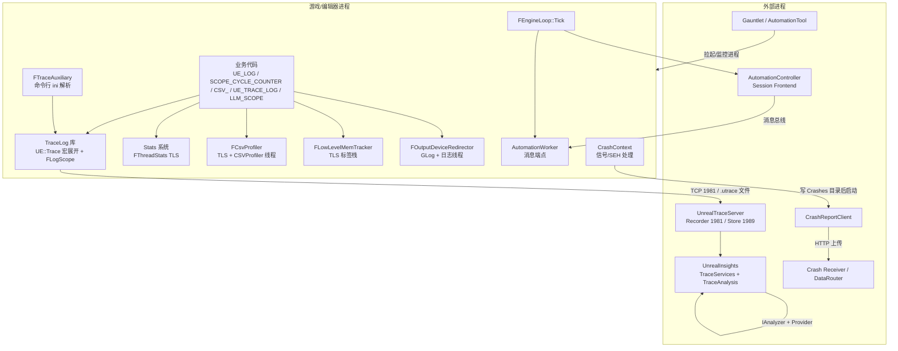

分层要点(均以源码为准):

- **采集层(进程内、任意线程热路径)**:TraceLog 宏(`UE_TRACE_LOG*`)、Stats 宏(`SCOPE_CYCLE_COUNTER` 等)、CSV 宏、`UE_LOG`、`LLM_SCOPE` 全部设计为零锁、可完全编译剔除。TraceLog 在 shipping 下默认关闭(`UE_TRACE_ENABLED` 在 `UE_BUILD_SHIPPING` 为 0,Trace/Config.h:11-24),Stats 由 `STATS`/`UE_USE_LIGHTWEIGHT_STATS` 三档控制(Stats/Stats.h:25-29、454、599)。
- **汇聚层(进程内后台线程)**:TraceLog 的 "TraceWorker" 线程(Writer.cpp:1122)、CSV 的 "CSVProfiler" 线程(CsvProfiler.cpp:3262)、日志系统的主日志线程(OutputDeviceRedirector.cpp:135-198)、Stats 的 `GStatsPipe` 任务管道(StatsSystemTypes.cpp:50)。
- **工具层(独立进程)**:UnrealTraceServer 常驻接收/存储 trace;UnrealInsights 加载 TraceServices/TraceAnalysis 离线分析;CrashReportClient 由崩溃进程显式拉起并上传;Gauntlet(AutomationTool)负责编排多设备测试。

## 23.3 类图

### 23.3.1 TraceLog:事件写入与输出

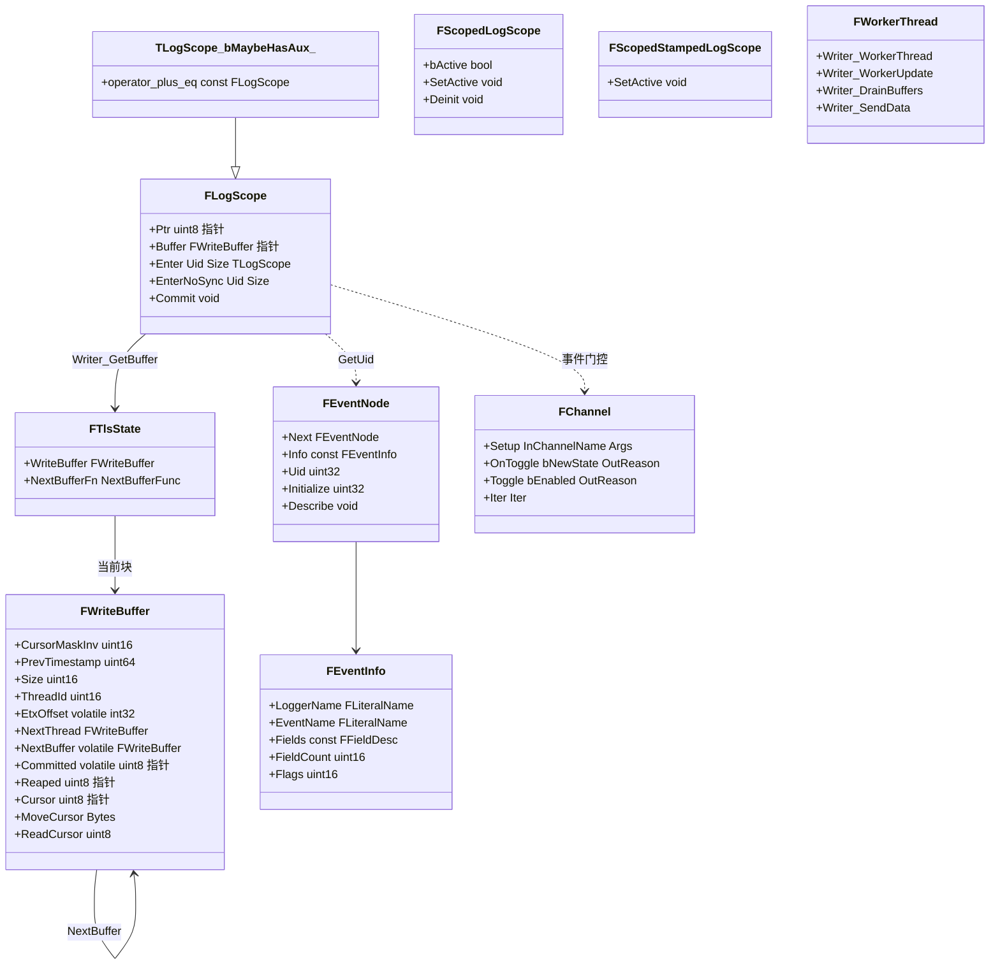

说明:宏 `UE_TRACE_EVENT_BEGIN` 在使用点生成 `F##Logger##Event##Fields` 结构(字段布局编译期已知)与静态 `FEventNode`(`Detail/Trace.h:77-175`);`UE_TRACE_LOG` 展开为 `if (通道启用) if (auto LogScope = FLogScope::Enter<...>()) ... LogScope += LogScope`(`Detail/Trace.h:177-192`)。`FWriteBuffer` 各字段职责见 23.4;`EtxOffset`/`NextBuffer`/`Committed` 是生产者-消费者共享字段(`Writer.inl:12-35`)。类图中 `TLogScope_bMaybeHasAux_` 表示模板 `TLogScope<bool bMaybeHasAux>`;`Writer_*` 为 Writer.cpp/TlsBuffer.cpp 中的自由函数族(非类),此处归并为伪类展示其协作。

### 23.3.2 Stats:采集与聚合

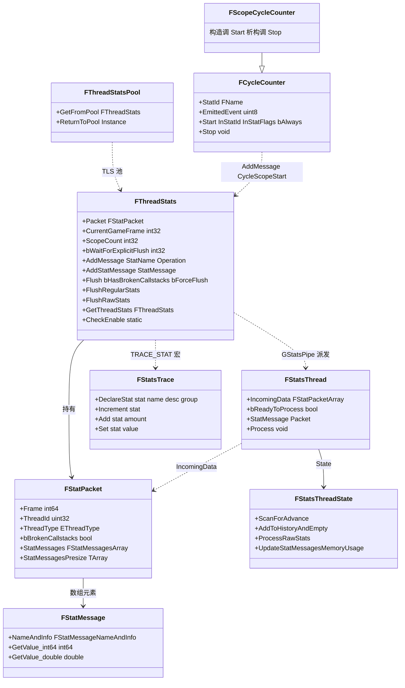

`FCycleCounter`(Stats/StatsSystemTypes.h:1496-1613)持有 `FName StatId` 与 `uint8 EmittedEvent`(NamedEvent/TraceEvent/ThreadStatsEvent 三标志位,1499-1504):`Start(TStatId, EStatFlags, bool bAlways, FSourceLocation)` 按条件同时发出平台 NamedEvent(`FPlatformMisc::BeginNamedEvent`)、`FCpuProfilerTrace::OutputBeginDynamicEventWithId`(CpuChannel 启用时)与 `FThreadStats::AddMessage(StatName, EStatOperation::CycleScopeStart)`(1524-1554);`Stop` 对应收尾(1590-1604)。`FScopeCycleCounter`(StatsSystemTypes.h:1627)构造即 Start、析构 Stop。计数类宏(`INC_DWORD_STAT_BY` 等)直接 `FThreadStats::AddMessage(StatName, EStatOperation::Add, ...)`(Stats/Stats.h:270-281)。`STATS=0` 时这些宏全部为空宏(Stats/Stats.h:646-711)。

### 23.3.3 崩溃上下文与上报

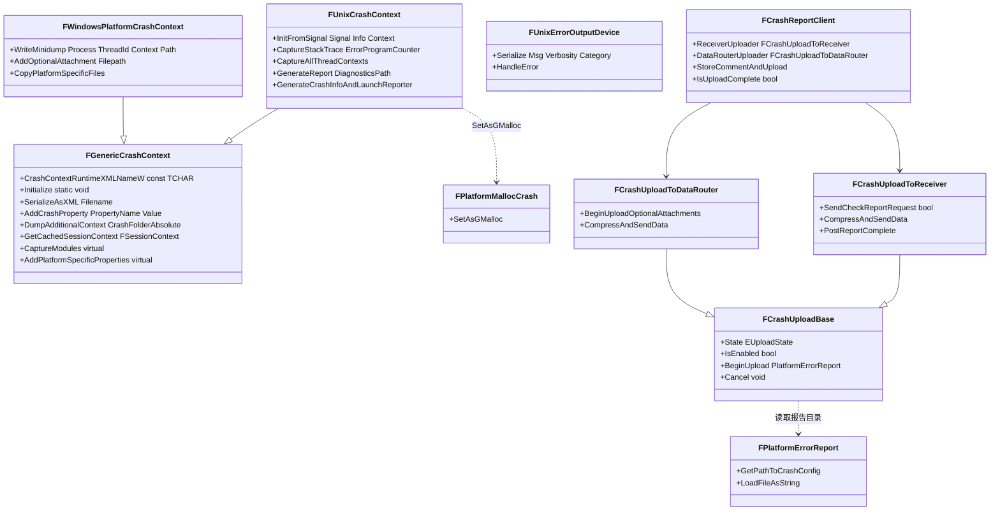

`FPlatformCrashContext` 是 `HAL/PlatformCrashContext.h` 对各平台的别名(Unix/Linux 用 `FUnixCrashContext`,见 UnixPlatformCrashContext.cpp:117/126;Windows 用 `FWindowsPlatformCrashContext`)。`FGenericCrashContext` 的静态常量与初始化接口见 GenericPlatformCrashContext.h:412-545;`FPlatformErrorReport`/`FGenericErrorReport` 属 CrashReportCore(CrashReportCore/Public/PlatformErrorReport.h、GenericErrorReport.h:19)。

### 23.3.4 自动化测试框架

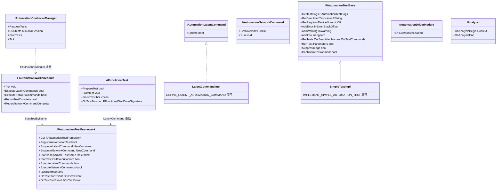

`SimpleTestImpl`/`LatentCommandImpl` 为宏生成类的占位:IMPLEMENT_SIMPLE_AUTOMATION_TEST_PRIVATE 生成派生类并实现 `GetTestFlags/GetTests/RunTest/GetTestSourceFileName`(AutomationTest.h:4121-4153);`DEFINE_LATENT_AUTOMATION_COMMAND` 生成实现 `IAutomationLatentCommand::Update` 的类(AutomationTest.h:3796-3804)。Worker 与 Controller 之间通过 `AutomationMessages` 的结构体消息(如 `FAutomationWorkerRunTests`)经消息总线交互(AutomationWorkerModule.cpp:130-152)。

### 23.3.5 日志与分析接口

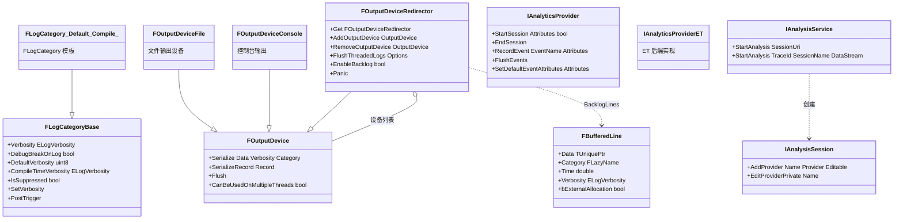

`FLogCategory<ELogVerbosity InDefaultVerbosity, ELogVerbosity InCompileTimeVerbosity>` 是把编译期常量注入基类构造的模板(Logging/LogCategory.h:85-104);`IAnalysisService`/`IAnalysisSession` 位于 TraceServices(AnalysisService.h:23-48、Model/AnalysisSession.h:73-144);`IAnalyticsProvider` 位于 Runtime/Analytics(Interfaces/IAnalyticsProvider.h:51-149)。

## 23.4 数据字典

### 23.4.1 TraceLog

| 字段/类型 | 类型 | 含义 | 取值/约束 | 位置 |
|---|---|---|---|---|
| FWriteBuffer.CursorMaskInv | uint16 | 游标掩码取反,用于对齐移动 | 初始化为 `~0`/块大小掩码 | Trace/Detail/Writer.inl:25 |
| FWriteBuffer.PrevTimestamp | uint64 | 该线程上一个事件的时间戳,做 delta 压缩 | 写线程独占 | Writer.inl:26 |
| FWriteBuffer.Size | uint16 | 块数据区大小(字节) | = `UE_TRACE_BLOCK_SIZE`(4 KiB) | Writer.inl:27;Trace/Config.h:146-148 |
| FWriteBuffer.ThreadId | uint16 | 本块所属 trace 线程号 | 首块分配时 `Writer_GetThreadId()` | Writer.inl:28;TlsBuffer.cpp:128 |
| FWriteBuffer.EtxOffset | int32 volatile | 块结束偏移;负值=仍在写,>=Committed 表示已换块 | 生产者 release 写,消费者 acquire 读 | Writer.inl:29;TlsBuffer.cpp:158 |
| FWriteBuffer.NextThread | FWriteBuffer* | 活跃线程链表链接 | 仅 worker 线程访问 | Writer.inl:30 |
| FWriteBuffer.NextBuffer | FWriteBuffer* volatile | 同线程下一块链 | 生产者 release 写 | Writer.inl:31;TlsBuffer.cpp:155 |
| FWriteBuffer.Committed | uint8* volatile | 已提交数据末尾 | release 写(LogScope::Commit) | Writer.inl:32;LogScope.inl:27-30 |
| FWriteBuffer.Reaped / Cursor | uint8* | worker 已收割位置 / 写游标 | 各自线程独占 | Writer.inl:33-34 |
| FTlsState.WriteBuffer | FWriteBuffer* | 当前线程写块;初始 `&GNullWriteBuffer` | thread_local GTlsState | Writer.inl:61-64;TlsBuffer.cpp:48-49 |
| FTlsState.NextBufferFn | NextBufferFunc* | 换块函数重定向(重定向作用域/OnConnect 队列) | 空则用默认 | Writer.inl:60-64;TlsBuffer.cpp:166-175 |
| FEventInfo.Flags | 枚举位 | Important/MaybeHasAux/NoSync/Definition8-64/MaybeImportant | EventNode.h:20-32 | Trace/Detail/EventNode.h:17-39 |
| EKnownEventUids | — | EnterScope/LeaveScope/AuxDataTerminal/Flag_TwoByteUid 等内建 uid | 协议内部(LogScope.inl:119、148、177) | Protocols/Protocol0-7.h(由 Protocol.h 引入) |
| ETransport | 枚举 | Raw=1/Packet=2/TidPacket=3/TidPacketSync=4(Active) | 当前 v7 协议 | Trace/Detail/Transport.h:11-19 |
| ETransportTid.Events | 0 | 事件数据流 | 协议保留 | Transport.h:22-32 |
| ETransportTid.Internal(Importants) | 1 | 内部/重要(缓存)事件 | 同上 | Transport.h:25-26 |
| ETransportTid.Bias..End | 2..0x3ff0 | 线程号区间 | 高两位为包标记 | Transport.h:27-29 |
| ETransportTid.Sync | 0x3fff | 同步包(Writer_SendSync) | Writer.cpp:761 | Transport.h:31 |
| FTidPacketBase.EncodedMarker | 0x8000 | LZ4 压缩包标记位 | PacketSize/ThreadId 16 位 | Transport.h:40-52 |
| FInitializeDesc.TailSizeBytes | uint32 | 尾部环形缓冲默认大小 | 默认 `4<<20`,FTraceAuxiliary 覆盖为 `32<<20` | Trace/Trace.h:149;TraceAuxiliary.cpp:2422 |
| FInitializeDesc.BlockPoolMaxSize | uint32 | 块池上限 | 默认 `79<<20`(Config.h:139-141) | Trace.h:151 |
| FInitializeDesc.bUseWorkerThread / bUseImportantCache | bool | 是否创建 worker/重要事件缓存 | 编辑器/程序=是;游戏端按需 | Trace.h:152-153;TraceAuxiliary.cpp:2435-2445 |
| FStatistics.CacheUsed 等 | uint32/uint64 | 重要事件缓存/块池/发送字节等遥测 | GetStatistics 输出 | Trace.h:237-252 |
| EMessageType | 枚举 | VeryVerbose..Log..WarningStart(4)..ErrorStart(0x10)..FatalStart(0x40) | SetMessageCallback 回调 | Trace/Trace.h:97-128 |
| GControlPort | uint16 | 控制通道监听端口 | 1985(写死) | Private/Trace/Control.cpp:57 |
| Writer_SendTo 默认端口 | uint32 | trace 数据 TCP 端口 | 1981(`Port ? Port : 1981`) | Writer.cpp:1353 |
| StorePort / RecorderPort | int32 | UnrealTraceServer 存储/录制端口 | 1989 / 1981 | Programs/UnrealTraceServer/src/StoreSettings.h:14-15 |

### 23.4.2 Stats / CSV / LLM

| 字段/类型 | 类型 | 含义 | 取值/约束 | 位置 |
|---|---|---|---|---|
| FThreadStats.Packet | FStatPacket | 本线程待发送消息包 | TLS 持有 | Stats/StatsSystemTypes.h:1183 |
| FThreadStats.ScopeCount | int32 | 当前 cycle 计数器嵌套深度 | 0 时触发 Flush | StatsSystemTypes.h:1191 |
| FThreadStats.bWaitForExplicitFlush | int32 | 游戏线程显式 flush 门 | ExplicitFlush 维护 | StatsSystemTypes.h:1193;1206-1218 |
| FThreadStats.MemoryMessageScope | int32 | 内存消息防递归守卫 | AddStatMessage 内 | StatsSystemTypes.h:1198 |
| FThreadStats.TlsSlot | uint32 | 指向 FThreadStats 的 TLS 槽 | FPlatformTLS | StatsSystemTypes.h:1150 |
| FThreadStats.bPrimaryEnable | bool | 总使能(PrimaryEnableCounter>0 等) | CheckEnable 计算 | StatsSystemTypes.cpp:1030-1044 |
| FThreadStats.bIsRawStatsActive | bool | 原始 stats 模式(低内存直转储) | `stat raw` 类命令 | StatsSystemTypes.h:1160 |
| FStatPacket.Frame | int64 | 包所属帧号 | ScanForAdvance/DetectAndUpdateCurrentGameFrame 赋值 | Stats/StatsSystemTypes.h:1044 |
| FStatPacket.ThreadId / ThreadType | uint32 / EThreadType | 来源线程 | Other 类型帧号由 GT 拉齐 | StatsSystemTypes.h:1046-1048 |
| FStatPacket.StatMessages | FStatMessagesArray | 消息数组 | 预分配 StatMessagesPresize | StatsSystemTypes.h:1052-1054 |
| EStatOperation | 枚举 | AdvanceFrameEventRenderThread/EndOfPipe、CycleScopeStart/End、SpecialMessageMarker、Set、Clear、Add、Subtract、ChildrenStart/End/Leaf、MaxVal、Mask=0xf | 打包进 NameAndInfo 低 4 位 | StatsSystemTypes.h:227-255 |
| FStatsThread 聚合阈值 | 常量 | 常规:5ms 或 16 包;Raw:24MB 或 16 包 | MaxIncomingPackets=16 | StatsSystemTypes.cpp:896-918 |
| GStatsPipe | UE::Tasks::FPipe | stats 消息单线程管道 | 全局,串行化 FStatsThread::StatMessage | StatsSystemTypes.cpp:50;1084-1091 |
| ECsvCustomStatOp | 枚举类 | Set/Min/Max/Accumulate | CSV_CUSTOM_STAT_* 第三参 | ProfilingDebugging/CsvProfiler.h:219-225 |
| ELLMTag | 枚举(uint8,LLM_TAG_TYPE) | 由 `LLM_ENUM_GENERIC_TAGS` 宏表经 `LLM_ENUM(Enum,Str,Stat,Group,Parent) Enum,` 生成(Untagged、Total、通用组、平台/项目扩展段) | LowLevelMemTracker.h:94;169;290-294 |
| ELLMTagSet | enum class : uint8 | None、Assets、AssetClasses、UObjectClasses、CodeOrContent…(`-llmtagsets=` 启用) | LowLevelMemTracker.h:124-140 |
| ELLMTracker | enum class : uint8 | Platform(内核页级,VirtualAlloc/mmap)、Default(FMalloc 逻辑分配)、Max | LowLevelMemTracker.h:104-116 |
| LLM_MEMORY_OVERHEAD | 宏 | LLM 自身预留内存 | 600 MiB | LowLevelMemTracker.h:99 |

### 23.4.3 日志与崩溃

| 字段/类型 | 类型 | 含义 | 取值/约束 | 位置 |
|---|---|---|---|---|
| FLogCategoryBase.Verbosity | ELogVerbosity::Type | 运行时可用级别 | clamp 到编译期级别 | Logging/LogCategory.h:72;59 |
| FLogCategoryBase.DebugBreakOnLog | bool | 命中该级别时断点 | `Log category break` 命令 | LogCategory.h:74 |
| FLogCategoryBase.CompileTimeVerbosity | const | 编译期上限 | DECLARE_LOG_CATEGORY_EXTERN 第三参 | LogCategory.h:78 |
| ELogVerbosity | 枚举 | NoLogging=0、Fatal、Error、Warning、Display、Log、Verbose、VeryVerbose;VerbosityMask=15 | SetColor/BreakOnLog 为标志位 | Logging/LogVerbosity.h:14+ |
| FOutputDeviceRedirectorState.BufferedItems | TMpscQueue | 非主线程日志项的无锁队列 | 主线程消费 | Misc/OutputDeviceRedirector.cpp:143-145 |
| .BufferedOutputDevices / UnbufferedOutputDevices | TArray | 需主线程串行 / 调用线程直接输出的设备 | FRWLock OutputDevicesLock | OutputDeviceRedirector.cpp:148-151 |
| .BacklogLines | TArray<FBufferedLine> | 设备注册前的积压日志 | AddOutputDevice 时回放 | OutputDeviceRedirector.cpp:154-156 |
| .Thread / ThreadWakeEvent / ThreadIdleEvent | FThread / FEventCount | 可选专用日志线程与唤醒事件 | TryStartThread | OutputDeviceRedirector.cpp:160-167 |
| .FenceCreateIndex / FenceCompleteIndex | atomic uint64 | 日志栅栏序号 | CreateFence/WaitFence | OutputDeviceRedirector.cpp:170-173;620-643 |
| .PrimaryThreadId / PanicThreadId | atomic uint32 | 主日志线程 / Panic 线程 | Panic() 设置后者 | OutputDeviceRedirector.cpp:181-186 |
| .bEnableBacklog | bool | 是否保留积压 | 默认 `!IS_PROGRAM` | OutputDeviceRedirector.cpp:191 |
| FBufferedLine | 结构 | Data/Category/Time/Verbosity/bExternalAllocation | 积压行单元 | Misc/OutputDeviceRedirector.h:27-34 |
| ECrashContextType | 枚举类 | Crash、Assert、Ensure、Stall、GPUCrash、Hang、OutOfMemory、AbnormalShutdown、VerseRuntimeError | 序列化进 CrashContext.runtime.xml | GenericPlatform/GenericPlatformCrashContext.h:111-123 |
| FUnixCrashContext.Signal | int32 | 触发信号号 | CrashSignal 属性 | UnixPlatformCrashContext.cpp:600-615 |
| UnixCrashReporterTracker | 静态 | ensure 报告并发槽(槽状态 CAS) | 上限 MaxProcessSlots,等待 45s | UnixPlatformCrashContext.cpp:840-925 |
| FCrashReportCoreConfig.CrashReportReceiverIP / DataRouterURL | FString | 上报目标地址 | ini `CrashReportClient` 节 | CrashReportCore/Public/CrashReportCoreConfig.h:70-73;169-172 |
| FWindowsPlatformCrashContext::GCrashReportingThread | TOptional<FCrashReportingThread> | 专用崩溃报告线程 | CreateThread + THREAD_PRIORITY_BELOW_NORMAL | WindowsPlatformCrashContext.cpp:1399-1402;1728 |

## 23.5 接口清单

原型逐字取自头文件(仅去掉 `*_API` 宏;模板参数与默认参保持原样)。"线程"列标注调用约束及依据。

### 23.5.1 UE::Trace 公共 API(TraceLog)

| 原型 | 功能与返回 | 线程/时机 | 位置 |
|---|---|---|---|
| `void Initialize(const FInitializeDesc& Desc)` | 初始化库(尾缓冲/重要缓存/worker 线程/会话 GUID/回调) | 引导期,FTraceAuxiliary::Initialize 内 | Trace/Trace.h:285;Private/Trace/Writer.cpp:1237(Writer_Initialize) |
| `void StartWorkerThread()` | 无 worker 模式下手动启动 | 任意线程一次 | Trace.h:290;Writer.cpp:1122 |
| `void Exit() / void Shutdown()` | 进程退出通知 / 彻底关闭并释放 | 退出期 | Trace.h:296;302 |
| `void Panic()` | 灾难态:静音全部通道禁用 trace | Trace 内部错误路径 | Trace.h:308 |
| `void Update()` | 无 worker 线程时手动泵(单线程互斥,GUpdateInProgress CAS) | 单线程轮询 | Trace.h:314;Writer.cpp:1291 |
| `bool SendTo(const TCHAR* Host, uint32 Port=0, uint16 Flags=FSendFlags::None)` | 输出到远端(Port=0 → 1981);设置 pending handle 由 worker 接管 | 任意线程;连接在 worker 内完成 | Trace.h:330;Writer.cpp:1343-1359 |
| `bool WriteTo(const TCHAR* Path, uint16 Flags=FSendFlags::None)` | 输出到 .utrace 文件 | 同上 | Trace.h:339;Writer.cpp:1361+ |
| `bool RelayTo(UPTRINT InHandle, IoWriteFunc WriteFunc, IoCloseFunc CloseFunc, uint16 Flags = FSendFlags::None)` | 输出重定向到用户回调 | 同上 | Trace.h:349 |
| `bool WriteSnapshotTo(const TCHAR* Path, uint32 MaxTailSize = 0)` | 立即落盘尾部缓冲+重要事件 | 任意线程(取内部锁) | Trace.h:356 |
| `bool SendSnapshotTo(const TCHAR* Host, uint32 Port, uint32 MaxTailSize = 0)` | 同上但发送到主机 | 同上 | Trace.h:364 |
| `bool IsTracing() / bool IsTrailing()` | 是否有输出 / 是否仅尾部缓存 | 任意线程 | Trace.h:371;387 |
| `bool Stop()` | 停止当前输出 | 任意线程 | Trace.h:394 |
| `bool ToggleChannel(const TCHAR* ChannelName, bool bEnabled)` | 开关频道,返回最终态 | 任意线程 | Trace.h:409 |
| `void ThreadRegister(const TCHAR* Name, uint32 SystemId, int32 SortHint)` | 线程注册(本线程 trace 必需) | 每线程一次(线程入口) | Trace.h:431;FRunnableThread 中调用 |
| `FChannel* FindChannel(const TCHAR* ChannelName)` | 按名查频道对象 | 任意线程 | Trace.h:450 |
| `void GetStatistics(FStatistics& Out)` | 取遥测 | 任意线程 | Trace.h:320 |

宏族:`UE_TRACE_EVENT_BEGIN/_FIELD/_END`、`UE_TRACE_LOG`、`UE_TRACE_LOG_SCOPED(_T)(_CONDITIONAL)`、`UE_TRACE_CHANNEL(_DEFINE/_EXTERN)`、`UE_TRACE_LOG_DEFINITION`、shipping 子集 `UE_TRACE_MINIMAL_*`(Trace.h:576-622)。`UE_TRACE_LOG` 的求值路径:`TRACE_PRIVATE_LOG_PRELUDE`(通道位测试 → `LogScopeType::Enter<...>()`)→ 字段流式 `<<`(FFieldSet::Impl 即 memcpy / aux data)→ `LogScope += LogScope` 提交(`Detail/Trace.h:177-224`;`LogScope.inl:284-338;343-433`)。

### 23.5.2 FTraceAuxiliary(Core)

| 原型 | 功能 | 线程/时机 | 位置 |
|---|---|---|---|
| `static void Initialize(const TCHAR* CommandLine)` | 引导:解析 `-trace*` 参数、组频道、调 UE::Trace::Initialize;仅允许一次(checkf) | 启动早期(进程内一次) | ProfilingDebugging/TraceAuxiliary.h:268;Private/.../TraceAuxiliary.cpp:2351-2540 |
| `static void InitializePresets(const TCHAR* CommandLine)` | 预设频道延迟注册(动态模块加载后) | 启动后 | TraceAuxiliary.h:274 |
| `static bool Start(EConnectionType Type, const TCHAR* Target, const TCHAR* Channels = TEXT("default"), FOptions* Options = nullptr, const FLogCategoryAlias& LogCategory = LogCore)` | 启动 File/Network/Relay 输出并启用频道 | 任意线程(`Trace.Start` 控制台命令也走这里) | TraceAuxiliary.h:152 |
| `static bool Stop()` | 停止输出 | 任意线程 | TraceAuxiliary.h:230 |
| `static bool WriteSnapshot(const TCHAR* FilePath, uint32 MaxTailSize = 0)` | 落盘快照 | 任意线程 | TraceAuxiliary.h:253 |
| `static bool IsConnected() / static bool IsConnected(FGuid& OutSessionGuid, FGuid& OutTraceGuid)` | 连接状态 | 任意线程 | TraceAuxiliary.h:330;338 |
| `static ETraceSystemStatus GetTraceSystemStatus()` | trace 系统总体状态 | 任意线程 | TraceAuxiliary.h:363 附近 |
| `FTraceServerControls::Start()/Stop()` | 拉起/停止本机 UnrealTraceServer(Windows fork 命令 / Linux 二进制) | UE_TRACE_SERVER_LAUNCH_ENABLED(桌面且非 shipping/程序) | TraceAuxiliary.h:418-447;TraceAuxiliary.cpp:2778-2890 |

### 23.5.3 Stats / CSV / LLM / 内存泄漏

| 原型 | 功能 | 线程/时机 | 位置 |
|---|---|---|---|
| `static inline void AddMessage(FName InStatName, EStatOperation::Type InStatOperation)` | 时钟类消息入口(ScopeStart/End);`WillEverCollectData() && IsThreadingReady()` 检查后进 TLS | 任意线程(热路径) | Stats/StatsSystemTypes.h:1324-1332 |
| `template <typename TValue> inline void AddMessageInner(FName, EStatOperation::Type, TValue Value, bool bIsCycle = false)` | 非 clock 消息;同时 TRACE_STAT_SET/ADD 转发到 trace | 任意线程 | StatsSystemTypes.h:1249-1272 |
| `CORE_API void Flush(bool bHasBrokenCallstacks = false, bool bForceFlush = false)` | 按帧变化/显式 flush 条件把 Packet 派发到 GStatsPipe | 任意线程(ScopeCount==0 时自动) | StatsSystemTypes.h:1227;Private/.../StatsSystemTypes.cpp:1094-1150 |
| `static CORE_API void CheckEnable()` | 重算 bPrimaryEnable | 使能条件变化时 | StatsSystemTypes.h:1206 |
| `static CORE_API void CheckForCollectingStartupStats()` | 解析 `-StatCmds=`/`-LoadTimeStats`/`-LoadTimeFile` | GT 启动早期 | StatsSystemTypes.h:1236;StatsSystemTypes.cpp:1205-1252 |
| `static void Shutdown()` | 线程退出:Flush(true) 后归还 TLS 到池 | 线程退出钩子 | StatsSystemTypes.h:1311-1322 |
| `CORE_API void FCsvProfiler::BeginStat(const char* StatName, uint32 CategoryIndex, const char* NamedEventName = nullptr)` / `EndStat` | CSV 作用域开始/结束 | 任意线程(CSV_SCOPED 宏) | ProfilingDebugging/CsvProfiler.h:430-433 |
| `CORE_API static void RecordCustomStat(const char* StatName, uint32 CategoryIndex, float Value, const ECsvCustomStatOp CustomStatOp)`(及 int32/double/FName 重载) | 记录自定义 CSV 值 | 任意线程 | CsvProfiler.h:438-443 |
| `CORE_API static void SetMetadata(const TCHAR* Key, const TCHAR* Value)` | 写 CSV 元数据(捕获头) | 捕获开始前后 | CsvProfiler.h:457 |
| `static CORE_API void FStatsTrace::DeclareStat(const FName& Stat, const ANSICHAR* Name, const TCHAR* Description, const ANSICHAR* Group, bool IsFloatingPoint, bool IsMemory, bool ShouldClearEveryFrame)` | 向 trace 声明 stat | 首次使用(TLS 惰性) | Stats/StatsTrace.h:23 |
| `FLowLevelMemTracker& Get()`(inline)→ `static CORE_API FLowLevelMemTracker& Construct()` | 单例 | 任意线程(首参惰性构造) | HAL/LowLevelMemTracker.h:540-548 |
| `CORE_API void OnLowLevelAlloc(ELLMTracker Tracker, const void* Ptr, uint64 Size, ELLMTag DefaultTag = ELLMTag::Untagged, ELLMAllocType AllocType = ELLMAllocType::None, bool bTrackInMemPro = true)` / `OnLowLevelFree` | malloc 钩子记账 | 任意线程(FMalloc 内部调用,须无锁) | LowLevelMemTracker.h:573-597 |
| `CORE_API void ProcessCommandLine(const TCHAR* CmdLine)` | 解析 `-LLM*` 参数启停 | main 之后一次 | LowLevelMemTracker.h:558 |
| `CORE_API void UpdateStatsPerFrame(const TCHAR* LogName=nullptr)` / `Tick()` | 每帧发布 stats/内部更新 | GameThread(帧末) | LowLevelMemTracker.h:637-641 |
| `CORE_API bool Exec(const TCHAR* Cmd, FOutputDevice& Ar)` | `llm` 控制台命令 | GameThread | LowLevelMemTracker.h:645 |
| `CORE_API int32 DumpOpenCallstacks(const TCHAR* FileName, const FMallocLeakReportOptions& Options = FMallocLeakReportOptions())` | 导出未释放分配调用栈 | 任意(建议停机时) | HAL/MallocLeakDetection.h:190 |
| `CORE_API void GetOpenCallstacks(TArray<CallstackHashType>& OutCallstacks, SIZE_T& OutTotalSize, const FMallocLeakReportOptions& Options = ...)` | 枚举活跃调用栈 | 同上 | MallocLeakDetection.h:222 |
| 宏 `LLM_SCOPE(Tag)` / `LLM_PLATFORM_SCOPE(Tag)` / `LLM_TAGSET_SCOPE(Tag, TagSet)` / `LLM_SCOPED_PAUSE_TRACKING(AllocType)` | TLS 标签栈 RAII | 任意线程 | LowLevelMemTracker.h:351-401 |
| 宏 `LLM(x)` / `LLM_IF_ENABLED(x)` / `LLM_IS_ENABLED()` | 条件编译开关 | — | LowLevelMemTracker.h:339-341 |
| 宏 `CSV_CUSTOM_STAT(Category,StatName,Value,Op)` / `CSV_SCOPED` / `csvprofile` 控制台命令 | CSV 采样入口 | 任意线程 / GameThread 命令 | CsvProfiler.h:90-172;Private/.../CsvProfiler.cpp:1117-1121 |

### 23.5.4 日志(UE_LOG 家族)

| 原型/宏 | 功能 | 线程/时机 | 位置 |
|---|---|---|---|
| 宏 `UE_LOG(CategoryName, Verbosity, Format, ...)` | 条件格式化日志:`UE_PRIVATE_LOG` → `BasicLog<Verbosity>(TStaticBasicLogRecord, &Category, ...)`;Fatal 走 `BasicFatalLog(WithProgramCounter)` | 任意线程;Fatal 经 GError | Logging/LogMacros.h:278-283、327+ |
| 宏 `DECLARE_LOG_CATEGORY_EXTERN(CategoryName, DefaultVerbosity, CompileTimeVerbosity)` / `DEFINE_LOG_CATEGORY(CategoryName)` | 声明/定义 `FLogCategory##Name` | 全局静态构造注册到抑制系统 | LogCategory.h:133;140 |
| `struct FLogCategoryBase` 构造/析构 | 向 FLogSuppressionImplementation 注册/注销 | 静态构造期 | LogCategory.h:30-42 |
| `UE_FORCEINLINE_HINT bool IsSuppressed(ELogVerbosity::Type VerbosityLevel) const` | 编译期+运行期两级过滤(全内联) | 任意线程 | LogCategory.h:45-48 |
| `void SetVerbosity(ELogVerbosity::Type Verbosity)` / `void PostTrigger(ELogVerbosity::Type)` | 运行时改级别 / 断点与触发 | GameThread 命令/任意 | LogCategory.h:51;59 |
| `static CORE_API FOutputDeviceRedirector* Get()` | GLog 单例 | 任意线程 | Misc/OutputDeviceRedirector.h:63 |
| `CORE_API void AddOutputDevice(FOutputDevice* OutputDevice)` / `RemoveOutputDevice` | 注册输出设备(注册时回放 backlog) | 任意线程(写锁) | OutputDeviceRedirector.h:70;77;Private/.../OutputDeviceRedirector.cpp:749-767 |
| `CORE_API void FlushThreadedLogs(EOutputDeviceRedirectorFlushOptions Options = None)` | 冲刷缓冲日志(可异步) | 帧末 GameThread | OutputDeviceRedirector.h:88 |
| `CORE_API bool EnableBacklog(bool bEnable)` | 开关积压 | 启动期 | OutputDeviceRedirector.h:103 |
| `CORE_API void Serialize(const TCHAR* Data, ELogVerbosity::Type Verbosity, const FName& Category) final` / `SerializeRecord(const UE::FLogRecord& Record) final` | 主入口:主线程直写 BufferedOutputDevices,否则入 MPSC 队列唤醒日志线程 | 任意线程 | OutputDeviceRedirector.h:124-144;Private/.../OutputDeviceRedirector.cpp:860-886 |
| `CORE_API void Panic()` | 崩溃态:设 PanicThreadId,绕过缓冲直写 | 崩溃线程 | OutputDeviceRedirector.h:169;UnixPlatformCrashContext.cpp:994 |
| `struct FLogTrace`:`OutputLogCategory(...)`/`OutputLogMessageSpec(...)`/`OutputLogMessage(LogPoint, Types...)` | 日志镜像到 trace LogChannel(格式化参数编码) | BasicLog 内(热路径) | Logging/LogTrace.h:38-57;Private/.../StructuredLog.cpp:1274-1294 |
| `UE::Logging::Private::BasicLog/BasicFatalLog(WithProgramCounter)`(显式实例化) | 宏最终落点:构造 FLogRecord → GLog->SerializeRecord + LogTrace | 调用线程 | Logging/LogMacros.h:167-170;StructuredLog.cpp:1672+ |

### 23.5.5 崩溃处理与上报

| 原型 | 功能 | 线程/时机 | 位置 |
|---|---|---|---|
| `void FDebug::ProcessFatalError(void* ProgramCounter)` | fatal check/fatal log 汇入点:`GError->SetErrorProgramCounter` + `GError->Logf(GErrorHist)` | 出错线程 | Private/Misc/AssertionMacros.cpp:814-821 |
| `void FUnixErrorOutputDevice::Serialize(const TCHAR* Msg, ELogVerbosity::Type Verbosity, const class FName& Category)` | GError 实现:`UE_DEBUG_BREAK`、置 GIsCriticalError、`ReportAssert`(GIsGuarded)或 `HandleError` | 出错线程 | Private/Unix/UnixErrorOutputDevice.cpp:24-81 |
| `void ReportAssert(const TCHAR* ErrorMessage, void* ProgramCounter)` | 置 TLS `GCrashErrorMessage/GCrashErrorProgramCounter/GCrashErrorType=Assert` 后 `FPlatformMisc::RaiseException(1)`(触发 SIGTRAP) | 出错线程 | Private/Unix/UnixPlatformStackWalk.cpp:1129-1139 |
| `void FUnixPlatformMisc::SetCrashHandler(void (* CrashHandler)(const FGenericCrashContext & Context))` | 安装信号处理(SIGQUIT/SIGABRT/SIGILL/SIGFPE/SIGBUS/SIGSEGV/SIGSYS/SIGTRAP,`SA_SIGINFO\|SA_RESTART\|SA_ONSTACK`),其余信号忽略,主线程备用栈 | 必须在 GameThread 调用(内部 checkf) | Private/Unix/UnixPlatformCrashContext.cpp:1224-1312 |
| `void PlatformCrashHandler(int32 Signal, siginfo_t* Info, void* Context)` | 真·信号入口:停心跳、切 `FPlatformMallocCrash::SetAsGMalloc()`、构造 FUnixCrashContext、调用 GCrashHandlerPointer 或 DefaultCrashHandler | 崩溃线程(async-signal-safe 要求) | UnixPlatformCrashContext.cpp:1059-1109 |
| `void DefaultCrashHandler(const FUnixCrashContext & Context)` | CaptureStackTrace/CaptureAllThreadContexts、`GLog->Panic()`、`GError->HandleError()`、`GenerateCrashInfoAndLaunchReporter()` | 崩溃线程 | UnixPlatformCrashContext.cpp:980-1007 |
| `void FUnixCrashContext::GenerateCrashInfoAndLaunchReporter() const` | 建 `Saved/Crashes/<type>info-<proj>-pid-<guid>`、DumpAdditionalContext、Diagnostics.txt、CrashContext.runtime.xml、复制日志(>100MB 跳过/磁盘<250MB 跳过)、拉起 CrashReportClient、fatal 等待至 8 分钟、恢复默认信号并 `raise(Signal)` | 崩溃线程 | UnixPlatformCrashContext.cpp:617-975 |
| `CORE_API virtual void SerializeAsXML( const TCHAR* Filename ) const` | 崩溃上下文序列化 XML | 崩溃线程 | GenericPlatform/GenericPlatformCrashContext.h:573 |
| `template<typename Type> void AddCrashProperty(const TCHAR* PropertyName, const Type& Value) const` | 追加崩溃属性(内部公共缓冲) | 崩溃线程 | GenericPlatformCrashContext.h:582-584 |
| `CORE_API static void DumpAdditionalContext(const TCHAR* CrashFolderAbsolute, const FAdditionalCrashContextParams& Params)` | 触发所有 `FOnAddCrashAdditionalData`/引擎数据提供者落盘 | 崩溃线程 | GenericPlatformCrashContext.h:666-667 |
| `CORE_API static void Initialize()` | 预取平台崩溃时不可得的数据 | 启动期一次 | GenericPlatformCrashContext.h:478 |
| `LONG WINAPI EngineUnhandledExceptionFilter(LPEXCEPTION_POINTERS ExceptionInfo)`(Windows) | SEH 兜底:`ReportCrash` → GCrashReportingThread 事件 → ReportCrashUsingCrashReportClient;`WINDOWS_USE_WER` 时 `EXCEPTION_CONTINUE_SEARCH` | 崩溃线程投递、报告线程处理 | Private/Windows/WindowsPlatformCrashContext.cpp:1808-1823;1826-1850 |
| `class FCrashReportClient : public TSharedFromThis<FCrashReportClient>`(成员 `FCrashUploadToReceiver ReceiverUploader`、`FCrashUploadToDataRouter DataRouterUploader`) | CRC 进程主对象:读取报告目录、UI、上传 | CRC 进程主线程 | Programs/CrashReportClient/Private/CrashReportClient.h:59;200-203 |
| `void FCrashUploadToReceiver::BeginUpload(const FPlatformErrorReport& PlatformErrorReport)` / `FCrashUploadToDataRouter::BeginUpload(...)` | 压缩并 POST 上传(Receiver 走 HTTP 问答式,DataRouter 单包) | CRC 进程(HTTP 异步回调) | Runtime/CrashReportCore/Public/CrashUpload.h:157-255 |

### 23.5.6 自动化测试

| 原型 | 功能 | 线程/时机 | 位置 |
|---|---|---|---|
| `static CORE_API FAutomationTestFramework& Get()` | 框架单例 | 任意线程(注册)/GT(执行) | Misc/AutomationTest.h:998;Private/Misc/AutomationTest.cpp:363+ |
| `CORE_API bool RegisterAutomationTest( const FString& InTestNameToRegister, FAutomationTestBase* InTestToRegister )` | 注册测试(静态构造的宏实例) | 任意线程 | AutomationTest.h:1019 |
| `CORE_API void EnqueueLatentCommand(TSharedPtr<IAutomationLatentCommand> NewCommand)` | 入队跨帧命令 | GT(RunTest 内) | AutomationTest.h:1086 |
| `CORE_API void EnqueueNetworkCommand(TSharedPtr<IAutomationNetworkCommand> NewCommand)` | 入队网络(多角色)命令 | GT | AutomationTest.h:1093 |
| `CORE_API void StartTestByName( const FString& InTestToRun, const int32 InRoleIndex, const FString& InFullTestPath )` | 清空队列→PrepForAutomationTests→InternalStartTest | GT | AutomationTest.h:1123;AutomationTest.cpp:616-664 |
| `CORE_API bool StopTest( FAutomationTestExecutionInfo& OutExecutionInfo )` | InternalStopTest + ConcludeAutomationTests | GT | AutomationTest.h:1130;AutomationTest.cpp:666-676 |
| `CORE_API bool ExecuteLatentCommands()` / `ExecuteNetworkCommands()` | 逐帧泵 latent(队首未完成即 break)/网络命令 | GT(每帧) | AutomationTest.cpp:679-735 |
| `CORE_API void LoadTestModules()` | 按需加载 `[/Script/Engine.AutomationTestSettings] EngineTestModules` | 测试发现前 | AutomationTest.cpp:751+ |
| `virtual void GetTests(TArray<FString>& OutBeautifiedNames, TArray <FString>& OutTestCommands) const = 0` | 枚举子测试(Complex 测试展开变体) | 发现期(GT) | AutomationTest.h:2645 |
| `virtual bool RunTest(const FString& Parameters)=0` | 测试体;经宏实现 | GT | AutomationTest.h:2653 |
| `CORE_API virtual void AddError( const FString& InError, int32 StackOffset = 0 )` / AddWarning/AddInfo/AddEvent | 汇报结果条目 | GT(或测试线程经事件) | AutomationTest.h:1658-1688 |
| `virtual EAutomationTestFlags GetTestFlags() const = 0` | 应用上下文+过滤位(SmokeFilter/EngineFilter/ProductFilter/PerfFilter/StressFilter/NegativeFilter) | — | AutomationTest.h:1618;宏 static_assert 4121-4141 |
| 宏 `IMPLEMENT_SIMPLE_AUTOMATION_TEST( TClass, PrettyName, TFlags )` / `IMPLEMENT_COMPLEX_AUTOMATION_TEST` / `IMPLEMENT_NETWORKED_AUTOMATION_TEST(TClass, PrettyName, TFlags, NumParticipants)` / `IMPLEMENT_CUSTOM_SIMPLE_AUTOMATION_TEST` / `IMPLEMENT_BDD_AUTOMATION_TEST` | 生成派生类并静态注册 | 文件作用域 | AutomationTest.h:4297-4332 |
| 宏 `DEFINE_LATENT_AUTOMATION_COMMAND(CommandName)`(及 ONE/TWO_PARAMETER 变体) | 声明 `class CommandName : public IAutomationLatentCommand`(Update 跨帧返回 false 未完) | 文件作用域 | AutomationTest.h:3796-3830 |
| `virtual bool Tick()`(IAutomationControllerModule) | 控制端调度:向各设备集群派发测试 | 编辑器 GT | Developer/AutomationController/Public/IAutomationControllerManager.h:203;LaunchEngineLoop.cpp:6024-6034 |
| `void FAutomationWorkerModule::Tick()` | 每帧:ExecuteLatentCommands→网络命令节拍→ReportTestComplete→MessageEndpoint->ProcessInbox | 游戏/编辑器 GT | Runtime/AutomationWorker/Private/AutomationWorkerModule.cpp:65-97;LaunchEngineLoop.cpp:6036-6046 |
| `virtual void RunTests( const bool bIsLocalSession = false )` / `RequestTests()` / `StopTests()`(IAutomationControllerManager) | 控制端生命周期 | 编辑器 GT | IAutomationControllerManager.h:180-190 |
| `int RunTests(int argc, const char* argv[])`(LowLevelTestsRunner) | 底层测试程序入口(无引擎) | 进程主线程 | Developer/LowLevelTestsRunner/Public/TestRunner.h:56 |
| `class AFunctionalTest : public AActor`(委托 `FFunctionalTestDoneSignature`) | 关卡功能测试基类(PrepareTest/StartTest/FinishTest) | GT(世界内) | Developer/FunctionalTesting/Classes/FunctionalTest.h:246-249 |
| Gauntlet `public class TestExecutor`(C#)/Framework 文件族 | 设备级编排:Build/Rn/结果聚合 | AutomationTool 进程 | Programs/AutomationTool/Gauntlet/Framework/Gauntlet.TestExecutor.cs:59 |

### 23.5.7 离线分析与其余诊断子系统

| 原型 | 功能 | 线程/时机 | 位置 |
|---|---|---|---|
| `virtual TSharedPtr<const IAnalysisSession> StartAnalysis(const TCHAR* SessionUri) = 0` / `StartAnalysis(uint32 TraceId, const TCHAR* SessionName, TUniquePtr<UE::Trace::IInDataStream>&& DataStream)` | 从文件/流启动分析(工作线程解析) | Insights 进程(分析在后台线程) | Developer/TraceServices/Public/TraceServices/AnalysisService.h:39;48 |
| `virtual void AddProvider(const FName& Name, TSharedPtr<IProvider> Provider, TSharedPtr<IEditableProvider> EditableProvider = nullptr)` | 会话注册 Provider(TimingProfiler/Counters/Net/Memory/Allocations/Log/…) | 分析线程(会话写锁) | TraceServices/Public/TraceServices/Model/AnalysisSession.h:128 |
| `class IAnalyzer`:`OnAnalysisBegin(const FOnAnalysisContext& Context)` / `OnAnalysisEnd()` / 事件回调 | 分析插件接口(Insights 内所有 Provider 的构建端) | 分析线程 | Developer/TraceAnalysis/Public/Trace/Analyzer.h:28;339;345 |
| `class IUnrealInsightsModule : public IModuleInterface`:`GetInsightsManager()` / `GetAnalysisSession() const` | Insights 前端模块入口 | Insights/编辑器 GT | Developer/TraceInsights/Public/Insights/IUnrealInsightsModule.h:206;252;259 |
| `class IAutomationDriverModule`(Developer/AutomationDriver/Public/IAutomationDriverModule.h:11) + `IAutomationWindowModule`(AutomationWindow/Public/IAutomationWindowModule.h:19) | 自动化驱动输入/窗口控件查找 | 编辑器 GT | 同左 |
| `class FVisualLogger : public FOutputDevice`(Engine 内);宏 `UE_VLOG/UE_VLOG_SEGMENT/UE_VLOG_LOCATION/...` | 可视化日志(CategorizedLogfImpl/SphereLogfImpl 等静态实现) | GT(带 `IsRecording()` 前置) | Runtime/Engine/Public/VisualLogger/VisualLogger.h:223-245;43-64 |
| `class FMessageLogModule : public IModuleInterface`:`GetLogListing(const FName& LogName)` / `CreateLogListing(...)` / `CreateLogListingWidget(...)` | 编辑器消息日志列表服务 | 编辑器 GT | Developer/MessageLog/Public/MessageLogModule.h:14-81 |
| `class FGameplayDebuggerCategory : public FGameplayDebuggerAddonBase`:`DrawCategory(APlayerController*, FGameplayDebuggerCanvasContext&)` / `OnDataPackReplicated(int32)` | 游戏内调试类别(服务端采集→复制→客户端绘制) | 采集:任意逻辑线程;绘制:GT | Runtime/GameplayDebugger/Public/GameplayDebuggerCategory.h:48-102 |
| `namespace CsvUtils`(Developer/CSVUtils/Public/CSVProfilerUtils.h:8) | CSV 后处理辅助(合并/过滤) | 编辑器/工具 | 同左 |
| `MEMORYUSAGEQUERIES_API bool GetMemoryUsage(const IMemoryUsageInfoProvider* MemoryUsageInfoProvider, const FString& PackageName, uint64& OutExclusiveSize, uint64& OutInclusiveSize, FOutputDevice* ErrorOutput = GLog)`(+Combined/Shared/Unique 变体) | 按 Package 查询资产内存 | 命令行/编辑器 | Plugins/MemoryUsageQueries/Source/MemoryUsageQueries/Public/MemoryUsageQueries.h:23-29 |
| `class UTraceUtilLibrary : public UBlueprintFunctionLibrary`:`StartTraceToFile(const FString& FileName, const TArray<FString>& Channels)`、`StartTraceSendTo(...)`、`ToggleChannel(const FString& ChannelName, bool enabled)` 等 UFUNCTION | 蓝图/关卡脚本驱动 trace | GT | Plugins/TraceUtilities/Source/TraceUtilities/Public/TraceUtilLibrary.h:11-37 |
| `class IAnalyticsProvider`(纯虚):`StartSession`/`EndSession`/`RecordEvent`/`FlushEvents`/`SetDefaultEventAttributes` | 遥测后端接口(ET/CSV/Log/Swrve/Horde/Multicast 均实现) | 任意线程(实现内部串行化) | Runtime/Analytics/Analytics/Public/Interfaces/IAnalyticsProvider.h:51-149 |
| `class FChaosVDModule : public IModuleInterface` | ChaosVD 回放前端模块 | 编辑器 GT | Plugins/ChaosVD/Source/ChaosVD/Public/ChaosVDModule.h:25 |
| `class ICrashDebugHelper` / `class FCrashDebugHelperModule : public IModuleInterface` | 崩溃调用栈符号化辅助 | 编辑器/工具 | Developer/CrashDebugHelper/Public/CrashDebugHelperModule.h:8-23 |
| `class FMetadataTrace`:`CORE_API static uint32 SaveStack()`;宏 `UE_TRACE_METADATA_SCOPE(ScopeName, ChannelExpr)`/`UE_TRACE_METADATA_SAVE_STACK()`;`class FMetadataRestoreScope(uint32 InSavedMetadataIdentifier)` | 元数据栈(资产/对象归因)跨线程保存恢复 | 任意线程 | ProfilingDebugging/MetadataTrace.h:39-77 |
| `class FLoadTimeTracker`:`CORE_API void ReportScopeTime(double ScopeTime, const FName ScopeLabel)`、`DumpHighLevelLoadTimes() const`、`StartAccumulatedLoadTimes()/StopAccumulatedLoadTimes()` | 装载耗时统计与转储 | 任意线程(内部聚合) | ProfilingDebugging/LoadTimeTracker.h:34-90 |
| `class UWorldMetricsSubsystem`(与 `class UWorldMetricCollection`、`class UWorldMetricsActorTracker`、`class UWorldMetricsExtension`) | WorldMetrics 插件入口:注册 tracker/extension 采集场景指标 | GameThread | Plugins/WorldMetrics/Source/WorldMetricsCore/Public/WorldMetricsSubsystem.h;WorldMetricCollection.h:13;WorldMetricsActorTracker.h;WorldMetricsExtension.h:66 |
| `class FCrashDescription`(CrashReportCore)与 `FCrashReportCoreConfig` | 崩溃描述字段与 CRC 配置(ReceiverIP/DataRouterURL) | CRC 进程 | Runtime/CrashReportCore/Public/CrashDescription.h;CrashReportCoreConfig.h |
| CQTest `#define TEST(_TestName, _TestDir)`(及匹配器/命令/组件族) | CQTest 测试声明宏 | 测试体 GT | Developer/CQTest/Public/CQTest.h:315 |

## 23.6 关键流程

### 23.6.1 Trace 引导与自动启动(FTraceAuxiliary)

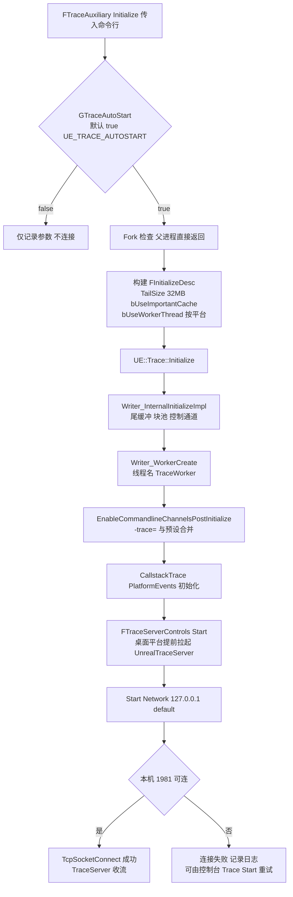

依据:`TraceAuxiliary.cpp:2231-2244`(初始化入口)、`2361-2369`(初始化早期 `FTraceServerControls::Start()`,可被 `-notraceserver`/`-buildmachine` 禁止)、`2422-2488`(Desc 组装与 `UE::Trace::Initialize`)、`2504-2545`(CallstackTrace/PlatformEvents 初始化)、`2745-2766`(自动启动 `Start(EConnectionType::Network, TEXT("127.0.0.1"), ...default)`)、`2787/2887`(Win/Linux 拉起 TraceServer);`Writer.cpp:1153-1200`(InitializeImpl)与 `1122-1126`(WorkerCreate)。

### 23.6.2 TraceLog worker 线程更新循环

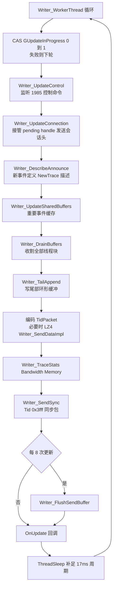

依据:`Writer.cpp:1046-1068`(WorkerUpdateInternal 顺序)、`1075-1086`(CAS 互斥)、`1088-1104`(worker 主循环与 `GSleepTimeInMS`,默认 `UE_TRACE_WRITER_SLEEP_MS=17`,Config.h:153-155)、`TlsBuffer.cpp:203-334`(DrainBuffers 两步法:先数块后收割,retire 归还块池)、`Control.cpp:261-286`(UpdateControl)。

### 23.6.3 Linux/Unix 崩溃处理主路径

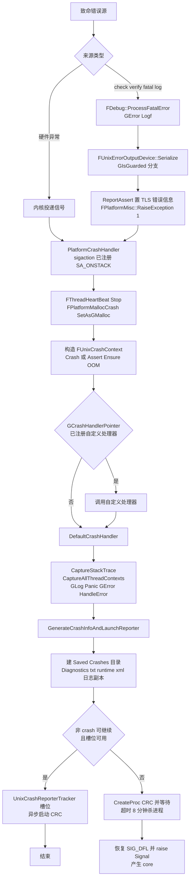

依据:`AssertionMacros.cpp:814-821`、`UnixErrorOutputDevice.cpp:24-81`、`UnixPlatformStackWalk.cpp:1129-1139`、`UnixPlatformCrashContext.cpp:1050-1107`(PlatformCrashHandler)、`980-1007`(DefaultCrashHandler)、`617-975`(GenerateCrashInfoAndLaunchReporter:目录 715、日志限额 733-812、CRC 参数 828-866、ensure 槽位 869-925、fatal 等待/重发 930-972)。

### 23.6.4 Stats 帧采集与聚合

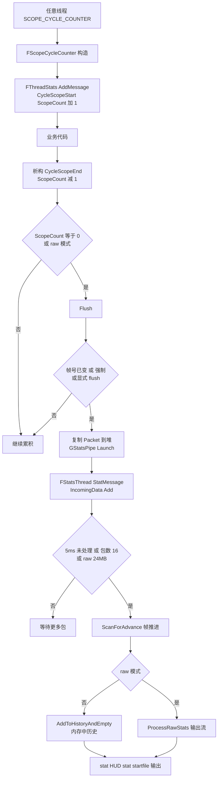

依据:`Stats/Stats.h:221-236`(SCOPE_CYCLE_COUNTER 展开)、`StatsSystemTypes.h:1275-1310`(AddMessageInner 时钟分支)、`StatsSystemTypes.cpp:1094-1150`(FlushRegularStats 条件)、`1084-1091`(GStatsPipe 派发)、`877-940`(FStatsThread::StatMessage/Process 阈值)。

## 23.7 时序图

### 23.7.1 Trace 事件从业务线程到 Insights

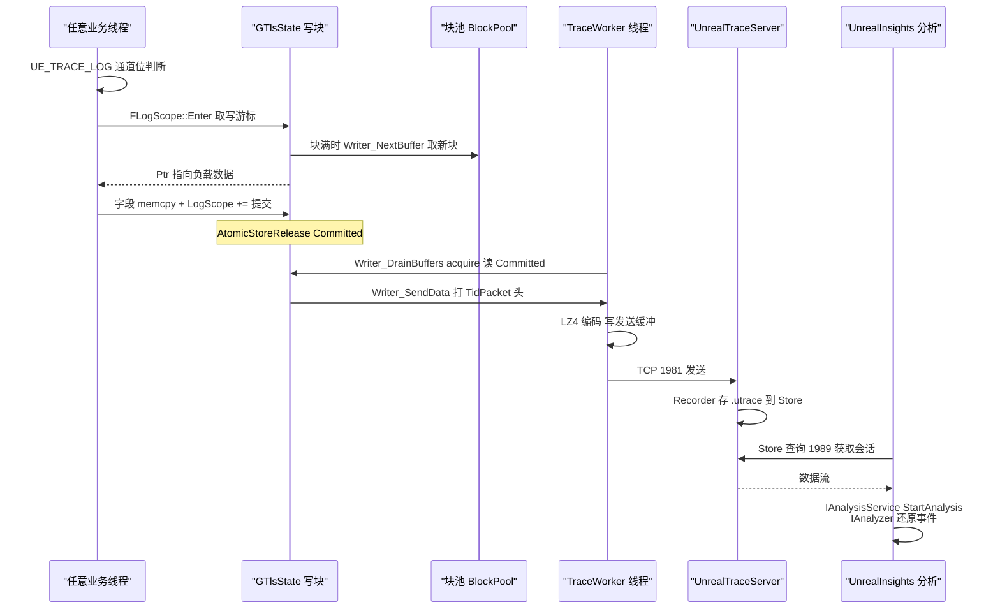

### 23.7.2 自动化测试 Controller 与 Worker

```mermaid
sequenceDiagram
    participant FE as "Session Frontend Controller"
    participant BUS as "消息总线"
    participant W as "游戏进程 Worker"
    participant FW as "FAutomationTestFramework"
    participant LOOP as "FEngineLoop Tick"
    FE->>BUS: FAutomationWorkerFindWorkers 发布
    BUS->>W: HandleFindWorkersMessage
    W-->>FE: FindWorkersResponse 设备信息
    FE->>W: FAutomationWorkerRequestTests
    W-->>FE: FAutomationWorkerSingleTestReply 逐项<br/>RequestTestsReplyComplete 收尾
    FE->>W: FAutomationWorkerRunTests TestName
    W->>FW: StartTestByName RoleIndex
    FW->>FW: PrepForAutomationTests InternalStartTest
    FW->>FW: RunTest Parameters
    Note over FW: 测试内 EnqueueLatentCommand 入队
    LOOP->>W: 每帧 Tick
    W->>FW: ExecuteLatentCommands
    FW-->>W: 全部完成返回 true
    W-->>FE: FAutomationWorkerRunTestsReply 执行信息
    FE->>FE: 聚合结果 OnTestEndEvent
```

依据:`AutomationWorkerModule.cpp:130-152`(端点订阅)、`280-312`(FindWorkers→SendWorkerFound)、`622-700`(HandleRunTestsMessage→StartTestByName)、`65-97`(Tick 顺序);`AutomationTest.cpp:616-664、679-703`;`LaunchEngineLoop.cpp:6036-6046`。

### 23.7.3 崩溃上报(Unix 路径)

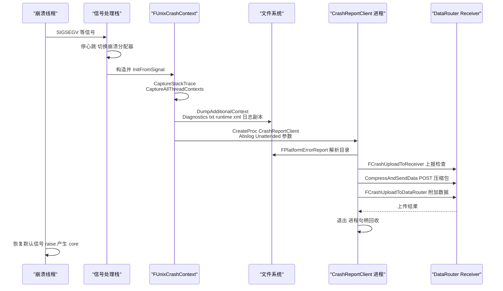

### 23.7.4 UE_LOG 的输出路径与线程模型

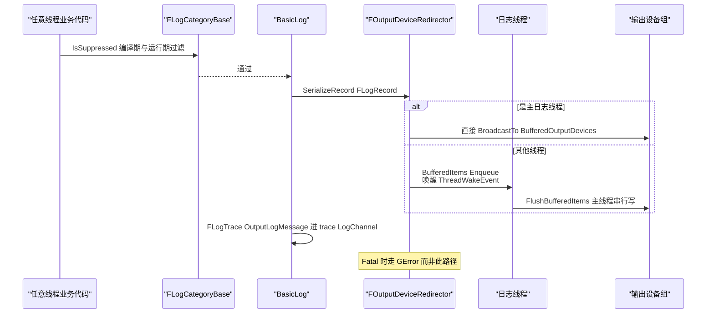

依据:`LogMacros.h:327+`(UE_PRIVATE_LOG)、`StructuredLog.cpp:1672`(BasicLog)与 `1436`(`(OutputDevice ? OutputDevice : GLog)->SerializeRecord(Record)`)、`OutputDeviceRedirector.cpp:860-886`(主线程直写/入队分支)。

## 23.8 线程模型与同步

| 子系统 | 线程 | 同步原语 | 依据 |
|---|---|---|---|
| TraceLog 事件写入 | **任意业务线程**(每线程 TLS `GTlsState`,TlsBuffer.cpp:49) | 无锁:块内字段单线程写;跨线程只通过 `Committed`/`EtxOffset`/`NextBuffer` 的 release/acquire(Writer.inl:29-32);新线程块用 `GNewThreadList` 的 CAS push(TlsBuffer.cpp:135-142) | `LogScope.inl:27-42;115-125` |
| TraceLog 内存分配 | 业务线程(取块)+ worker(归还) | 块池原子计数 `GPoolTotalAllocated >= GPoolMaxSize` 限流(BlockPool.cpp:194);上限只在 worker 运行时生效(Writer_SetBlockPoolLimit,Writer.cpp worker 内调用) | `BlockPool.cpp:41-67` |
| TraceLog worker | 专用线程 "TraceWorker"(`ThreadCreate("TraceWorker", Writer_WorkerThread)`,Writer.cpp:1122),循环补足 17ms | `GUpdateInProgress` CAS 保证单写者(Writer.cpp:1075-1086);pending 输出用 `GPendingWriterLock` + release 写 handle(Writer.cpp:1313-1330) | Writer.cpp:1088-1126 |
| TraceLog 控制通道 | worker 内 accept/recv(非阻塞) | `EControlState` 状态机;命令表哈希分发(`SendTo`/`Stop`/`ToggleChannels`) | Control.cpp:57;288-329 |
| 重要事件缓存 | 写线程填充,worker 归档 | 共享缓冲原子游标 | `Writer_InitializeCache/Writer_UpdateSharedBuffers`(Writer.cpp:53-55) |
| Stats 采集 | **任意线程**(TLS FThreadStats,池化 FThreadStatsPool) | `PrimaryEnableCounter` 等原子;bPrimaryEnable 变更经 `PrimaryDisableChangeTagLock` | StatsSystemTypes.h:1142-1160;StatsSystemTypes.cpp:1030-1044 |
| Stats 聚合 | `GStatsPipe`(UE::Tasks::FPipe,单线程执行;不支持多线程时退化为 GameThread 任务) | Pipe 串行化;`FStartupMessages` 自带临界区 | StatsSystemTypes.cpp:50;1084-1091;917-927 |
| Stats 帧推进 | GameThread/RenderThread 显式 flush | `GameThreadStatsFrame` 原子供 Other 线程对齐 | StatsSystemTypes.cpp:1031-1050 |
| CSV Profiler | 业务线程 TLS 写;"CSVProfiler" 处理线程(FRunnable,TaskGraphBackgroundTaskMask 亲和性,`FForkProcessHelper::CreateForkableThread`) | 线程安全计数 StopCounter;`CVarCsvProcessingThreadTimeBetweenUpdates` 节拍;可 `csvProfilerHighPriority` 提优先级 | CsvProfiler.cpp:3262-3306 |
| 日志 | 主日志线程(默认=首个线程,可选专用 `FThread`)+ 各调用线程 | `TMpscQueue<FOutputDeviceItem>` 无锁队列;`FEventCount` 三事件;`FRWLock` 设备列表;fence 序号等待;Panic 线程旁路 | OutputDeviceRedirector.cpp:135-198;488-567;620-643 |
| LLM | **任意线程**(TLS 标签栈,位于 FMalloc 路径,禁止分配) | TLS + 原子统计;`LLM_SCOPED_PAUSE_TRACKING` 抑制重入 | LowLevelMemTracker.h:351-401 |
| 自动化 latent 命令 | **GameThread**(FEngineLoop 每帧调用 IAutomationWorkerModule::Tick) | 队列 + `GIsAutomationTesting` 全局;消息端点 `.WithInbox()` 缓冲到 Tick 处理 | LaunchEngineLoop.cpp:6036-6046;AutomationWorkerModule.cpp:124-160 |
| 自动化控制端 | 编辑器 GT(LaunchEngineLoop.cpp:6024-6034 Tick) | 结果队列+设备集群状态 | IAutomationControllerManager.h:202-203 |
| 崩溃(Unix) | 崩溃线程(signal handler,备用栈 SA_ONSTACK) | `FPlatformMallocCrash` 替换 GMalloc;静态缓冲 `GErrorHist`;ensure 并发用 UnixCrashReporterTracker CAS 槽 | UnixPlatformCrashContext.cpp:1224-1312;840-925 |
| 崩溃(Windows) | 崩溃线程置事件 `IE_Crash`,专用 `FCrashReportingThread`(THREAD_PRIORITY_BELOW_NORMAL)处理;崩溃线程 `WaitUntilCrashIsHandled` 等待(默认超时见 `GetCrashTimeoutSeconds`) | 事件句柄数组 + `ReportCrashCallCount` 原子只做一次 minidump | WindowsPlatformCrashContext.cpp:1399-1402;1510-1524;1826-1850 |
| TraceAnalysis/TraceServices | Insights 进程的分析线程(`StartAnalysis` 后台) | 会话读写锁(`IAnalysisSession` 写需 `EditProviderPrivate`) | Model/AnalysisSession.h:128-144 |

跨线程数据所有权总结:TraceLog 中**写线程拥有 Cursor/Reaped 之前的区域**,worker 只收割 `Committed` 之前的部分并在 `EtxOffset` 变非负后归还块;Stats 中**业务线程拥有 FStatPacket 直到 SendMessage_Async**,此后归 GStatsPipe 执行线程;日志中**记录对象入队后归日志线程**;崩溃路径所有运行时结构只读访问,新内存一律走崩溃分配器。

## 23.9 配置与扩展点

### Trace

- 命令行(由 `FTraceAuxiliary::Initialize` 解析,TraceAuxiliary.cpp:2378+):`-trace=<channels>`、`-tracehost=<host>`、`-tracefile=<path>`、`-tracetailmb=<MB>`(2458-2461)、`-tracethreadsleeptime=`(2463)、`-tracenocache`(2426)、`-traceautostart=0/1`(2378)、`-notraceserver`/`-buildmachine`(禁止拉起本机 TraceServer,2361-2369);安全 trace 相关(SecureInitialize)。
- ini:`[Trace.Config]`(GTraceConfigSection,TraceAuxiliary.cpp:258)含 `TailSizeBytes`、线程睡眠等(TraceAuxiliarySetupInitFromConfig:1499-1521)。
- 控制台命令/控制通道:`Trace.Start`、`Trace.Stop`、`Trace.Snapshot`、`Trace.Bookmark`、`Trace.ToggleChannel` 等(TraceAuxiliary.cpp:1900+ 命令注册);运行中进程的 TCP 控制端口 1985(Control.cpp:57),Insights 通过它执行 `SendTo/Stop/ToggleChannels`(Control.cpp:288-329)。
- 扩展点:`UE_TRACE_EVENT_BEGIN`/`UE_TRACE_CHANNEL` 宏族新增事件与频道;`SetMessageCallback`/`SetUpdateCallback` 订阅库级事件;`RelayTo` 自定义传输;`UE::Trace::SecureInitialize`+`SecureSendTo` 加密通道(TRACE_PRIVATE_ALLOW_SECURE_TRACING)。Insights 侧扩展 = 在 TraceAnalysis 里实现 `IAnalyzer` 并在 TraceServices 注册 Provider(各 *Insights 插件即此模式)。

### Stats / CSV / LLM

- `stat` 命令族:`stat <group>`、`stat group enable/disable <name>`、`stat startfile/stopfile`(StatsFile 输出)、`stat dumpsum -start -ms=250 -num=240`、`stat raw`(bIsRawStatsActive);启动期可用 `-StatCmds=a,b,c`、`-LoadTimeStats`、`-LoadTimeFile`(StatsSystemTypes.cpp:1205-1252)。
- 编译开关:`STATS`、`UE_USE_LIGHTWEIGHT_STATS`(Stats.h:25-29;454-599)、`USE_LIGHTWEIGHT_STATS_FOR_HITCH_DETECTION`(599)。
- CSV:`csvprofile start/stop`(`HandleCSVProfileCommand`,CsvProfiler.cpp:1050-1121)、`CSV_PROFILER_STATS`、CVar `CVarCsvProcessingThreadTimeBetweenUpdates`、`csvProfilerHighPriority`;`FCsvProfiler::SetMetadata` 写捕获元数据。
- LLM:`-LLM`(默认无此参数即禁用)、`-NOLLM`、`-LLMCSV`(LLM.cpp:2319-2325,ProcessCommandLineInner)、`-LLMTAGSETS=assets,assetclasses,uobjectclasses,codeorcontent`(LLM.cpp:2387-2400,ELLMTagSet::Max==5);`FLowLevelMemTracker::Exec`(`llm` 命令);平台/项目自定义标签 `RegisterPlatformTag/RegisterProjectTag`(LowLevelMemTracker.h:615-616)。

### 崩溃与日志

- ini(`GEngineIni` 的 `[CrashReportClient]`):`bImplicitSend`、`bAgreeToCrashUpload`、`bSendUnattendedBugReports`(EditorSettingsIni `/Script/UnrealEd.CrashReportsPrivacySettings`)、`bStartCRCFromEngineHandler`(UnixPlatformCrashContext.cpp:625-665;856-861);`FCrashReportCoreConfig` 读 `CrashReportReceiverIP`/`DataRouterURL`(CrashReportCoreConfig.h:169-172)。
- CRC 命令行:`-Abslog=`、`-Unattended`、`-ImplicitSend`、`-NoAnalytics`、`-CleanCrashReports`(UnixPlatformCrashContext.cpp:828-866)。
- 扩展点:`FPlatformMisc::SetCrashHandler(自定义处理函数)`(Unix:1224;Windows:`FPlatformCrashContext::Initialize` 相关);`FOnAddCrashAdditionalData`/`DumpAdditionalContext`(GenericPlatformCrashContext.h:664-667);`FCoreDelegates::OnHandleSystemError`/`OnShutdownAfterError`(UnixErrorOutputDevice.cpp:95-116);Windows `SetUnhandledExceptionFilter(EngineUnhandledExceptionFilter)`(WindowsPlatformCrashContext.cpp:1452)与 `WINDOWS_USE_WER`。
- 日志:类别运行时改级别(`Log category <name> <verbosity>`、ini `[/Script/Engine.Engine]` 日志配置)、`-Log`、`-abslog=`;`FOutputDeviceRedirector::EnableBacklog`;设备动态增删。

### 自动化测试

- 命令行:`-ExecCmds="Automation RunTests <filter>"`、`-TestExit="Automation Test Queue Empty"`、`-unattended`、`-NULLRHI`、`-DeviceTag=`(AutomationWorkerModule.cpp:160);Controller 侧 `-AutomationDeviceFilter` 等。
- ini:`[/Script/Engine.AutomationTestSettings]` 的 `EngineTestModules` 数组(按需加载测试模块,AutomationTest.cpp:751+)与排除列表(Runtime/AutomationTest/Public/AutomationTestExcludelist.h)。
- 扩展点:实现 `FAutomationTestBase` 派生(宏即注册);`DEFINE_LATENT_AUTOMATION_COMMAND` 跨帧命令;`IAutomationNetworkCommand` 多设备命令;截图对比回调 `FAutomationTestFramework::OnScreenshotCompared/OnScreenshotComparisonReport`;CQTest 的 `TEST()`/匹配器;Gauntlet 的 C# `TestExecutor`/自定义 TestNode。

## 23.10 已知限制/未确认项

- **VisualLogger 归属**:FVisualLogger 位于 Engine 模块(`Runtime/Engine/Public/VisualLogger/VisualLogger.h`),非独立模块,故附录无 VisualLog.md;其内部 `FVisualLogDevice`/`IVisualLogWriter` 层级只读了头文件前段,设备链与 .vlog 序列化细节未逐行核对。
- **Windows SEH 路径**:WindowsPlatformCrashContext.cpp(2097 行)只精读了入口/线程模型/关键函数(`EngineUnhandledExceptionFilter`、`ReportCrash`、`FCrashReportingThread`、`CreateCrashReportClientPath`),minidump 写入细节(`WriteMinidump`)与 crash monitor(ReportCrashForMonitor/管道协议)未逐行展开。
- **TraceLog 细节**:LZ4 编码路径(Private/Trace/LZ4 与 `Writer_SendDataImpl`)、Tail.cpp 尾缓冲环形结构、Secure 传输、`TRACE_PRIVATE_ALLOW_IMPORTANTS` 共享缓冲实现只读了接口级;协议头常量(`EKnownEventUids` 具体数值)在 Protocols/Protocol0-7.h 中,本章只引用了使用点。
- **UnrealTraceServer**:C++ 程序(Main.cpp/Recorder.cpp/Store.cpp)只确认端口(1981/1989)、模块构成(CBOR 服务、TraceRelay、CrashHandler)与启动参数(`--port`/`--recport`/`--storedir`),存储布局与外观(spawn)流程未深入。
- **Gauntlet**:为 C# 工程,modules.json 无记录;只确认目录结构(Framework/Unreal/Platform/Editor/SelfTest)与 `TestExecutor`(Gauntlet.TestExecutor.cs:59),具体 TestNode 生命周期未展开。
- **NetworkProfiler/CSVTools** 为 C# 解决方案,仅确认存在与目录(CSVTools 含 CsvConvert/CsvStats/CSVToSVG/CSVToTelemetry/PerfReportTool/RegressionsReport),内部流程未读。
- **内存分析**:5.8.3 源码中已无 `FStatsMallocProfilerProxy` 类定义(仅 StatsSystemTypes.h:1142 残留 friend 声明),基于 Stats 的 malloc profiler 已移除;现行内存路径是 MemoryTrace(trace)与 FMallocLeakDetection,后者只读了头文件接口。
- **Insights 家族插件**(GameplayInsights/SlateInsights/AudioInsights/ChaosInsights/MassInsights/NiagaraInsights/IoStoreInsights/RenderGraphInsights/HttpInsights/ConcertInsights*/UdpMessagingInsights/WorldStreamingInsights/NetworkPredictionInsights/AudioModulationInsights/FieldNotificationTrace)按模块清单覆盖,各自的 Analyzer/Provider 实现未逐个阅读,行为以 TraceServices 框架推论。
- **ProfileVisualizer/LogVisualizer/OutputLog/MessageLog/ScreenShotComparison/CSVUtils/CrashDebugHelper/LowLevelTestsRunner/BenchmarkTool/ChaosVD/WorldMetrics/PerformanceCapture 族/MetaHumanPerformance/Analytics 各后端**:本章只到模块级+关键入口接口,UI 层与后端协议细节未展开。
- `EAutomationTestFlags` 的具体数值枚举体未抄录(仅从宏 static_assert 确认过滤位取值集合);`EThreadType`、`FStatMessagesArray` 等周边类型未列入数据字典。
- FStatsThreadState 的内部历史结构(`NonStackStats`/`StackStats` 树、`AddToHistoryAndEmpty` 的完整合并算法)只确认入口与职责,未逐行核对。

## 23.11 附录索引

本章节覆盖模块对应的完整符号清单见下(路径相对 `docs/ue5.8.3/`):

| Tier | 模块 | 附录文件 |
|---|---|---|
| Runtime | TraceLog | appendix/api/Runtime/TraceLog.md |
| Runtime | Core(Stats/Logging/ProfilingDebugging/LLM/CrashContext/MallocLeakDetection) | appendix/api/Runtime/Core.part01.md ~ Core.part03.md |
| Runtime | CrashReportCore | appendix/api/Runtime/CrashReportCore.md |
| Runtime | AutomationTest | appendix/api/Runtime/AutomationTest.md |
| Runtime | AutomationMessages | appendix/api/Runtime/AutomationMessages.md |
| Runtime | AutomationWorker | appendix/api/Runtime/AutomationWorker.md |
| Runtime | GameplayDebugger | appendix/api/Runtime/GameplayDebugger.md |
| Runtime | ChaosVDData / ChaosVDRuntime | appendix/api/Runtime/ChaosVDData.md / ChaosVDRuntime.md |
| Runtime | TraceBasedDebuggers / TraceBasedDebuggersAnalysis | appendix/api/Runtime/TraceBasedDebuggers.md / TraceBasedDebuggersAnalysis.md |
| Runtime | Analytics / AnalyticsET / AnalyticsCSV / AnalyticsLog / AnalyticsSwrve / AnalyticsVisualEditing / AnalyticsHorde / TelemetryUtils / PerfCounters / StudioTelemetry | appendix/api/Runtime/Analytics*.md / TelemetryUtils.md / PerfCounters.md / StudioTelemetry.md |
| Runtime | Engine(VisualLogger) | appendix/api/Runtime/Engine.part01.md ~ part06.md |
| Developer | AutomationController / AutomationDriver / AutomationWindow | appendix/api/Developer/AutomationController.md / AutomationDriver.md / AutomationWindow.md |
| Developer | CQTest / FunctionalTesting / LowLevelTestsRunner | appendix/api/Developer/CQTest.md / FunctionalTesting.md / LowLevelTestsRunner.md |
| Developer | TraceAnalysis / TraceServices / TraceInsights / TraceInsightsCore / TraceInsightsFrontend / TraceTools | appendix/api/Developer/TraceAnalysis.md / TraceServices.md / TraceInsights.md / TraceInsightsCore.md / TraceInsightsFrontend.md / TraceTools.md |
| Developer | LogVisualizer / ProfileVisualizer / CSVUtils / MessageLog / OutputLog / CrashDebugHelper | appendix/api/Developer/LogVisualizer.md / ProfileVisualizer.md / CSVUtils.md / MessageLog.md / OutputLog.md / CrashDebugHelper.md |
| Developer | ScreenShotComparison / ScreenShotComparisonTools | appendix/api/Developer/ScreenShotComparison.md / ScreenShotComparisonTools.md |
| Developer | SessionServices / SessionMessages(Controller 通信面) | appendix/api/Runtime/SessionServices.md / SessionMessages.md |
| Programs | UnrealInsights / TraceAnalyzer / TraceQuery / TraceTrimmer / BenchmarkTool / CSVToTelemetry / CrashReportClientEditor | appendix/api/Programs/UnrealInsights.md / TraceAnalyzer.md / TraceQuery.md / TraceTrimmer.md / BenchmarkTool.md / CSVToTelemetry.md / CrashReportClientEditor.md |
| Programs | UnrealTraceServer / NetworkProfiler / CrashReportClient / LowLevelTests(FoundationTests 等)/ Gauntlet | 附录无 C# 程序清单(C# Tier 仅部分程序),符号级索引不可用,见 X.10 |
| Plugins | TraceUtilities / InsightsEditor | appendix/api/Plugins/TraceUtilities.md / InsightsEditor.md |
| Plugins | ChaosVD / ChaosVDBlueprint / ChaosVDBuiltInExtensions | appendix/api/Plugins/ChaosVD.md / ChaosVDBlueprint.md / ChaosVDBuiltInExtensions.md |
| Plugins | MemoryUsageQueries / WorldMetricsCore / CsvMetrics / WorldMetricsTest | appendix/api/Plugins/MemoryUsageQueries.md / WorldMetricsCore.md / CsvMetrics.md / WorldMetricsTest.md |
| Plugins | GameplayInsights / SlateInsights / AudioInsights / AudioInsightsRuntime / AudioInsightsEditor / ChaosInsightsAnalysis / ChaosInsightsUI / MassInsightsAnalysis / MassInsightsUI / NiagaraInsights / IoStoreInsights / RenderGraphInsights / RenderTrace / RenderTraceInsights / HttpInsights / ConcertInsightsClient / ConcertInsightsCore / ConcertInsightsServer / ConcertInsightsVisualizer / UdpMessagingInsights / WorldStreamingInsights / NetworkPredictionInsights / AudioModulationInsights / FieldNotificationTrace / FieldNotificationTraceEditor | appendix/api/Plugins/ 对应同名 .md |
| Plugins | PerformanceMonitor / EditorPerformance / PerformanceCaptureCore / PerformanceCaptureCoreEditor / PerformanceCaptureWorkflow / PerformanceCaptureWorkflowRuntime / MetaHumanPerformance | appendix/api/Plugins/PerformanceMonitor.md / EditorPerformance.md / PerformanceCaptureCore.md / PerformanceCaptureCoreEditor.md / PerformanceCaptureWorkflow.md / PerformanceCaptureWorkflowRuntime.md / MetaHumanPerformance.md |
| Plugins | AnalyticsMulticast / AnalyticsMulticastEditor / AnalyticsBlueprintLibrary / InterchangeAnalytics | appendix/api/Plugins/AnalyticsMulticast.md / AnalyticsMulticastEditor.md / AnalyticsBlueprintLibrary.md / InterchangeAnalytics.md |
