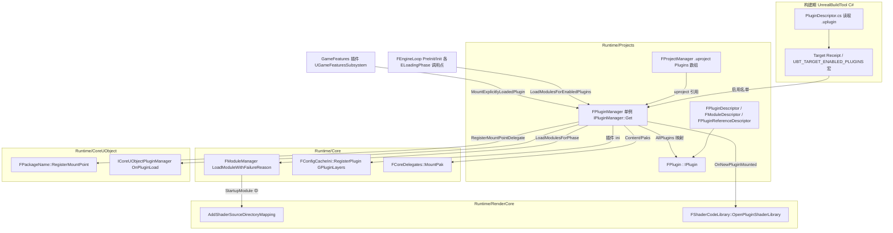
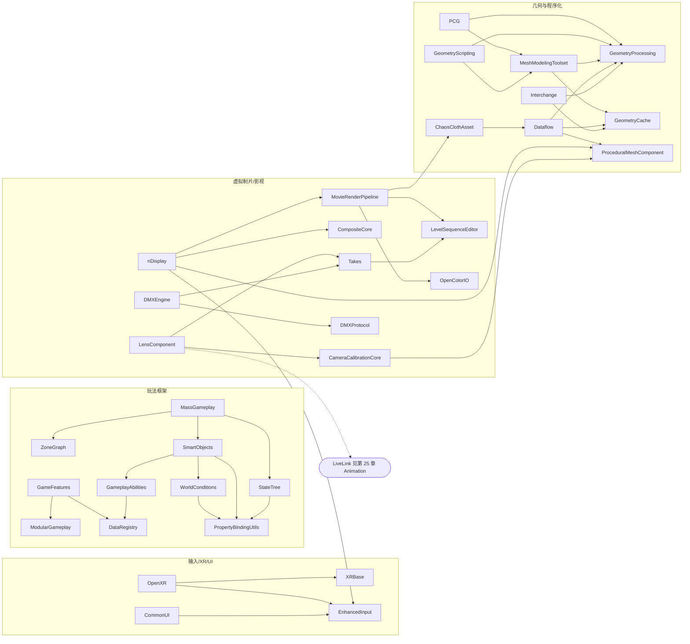
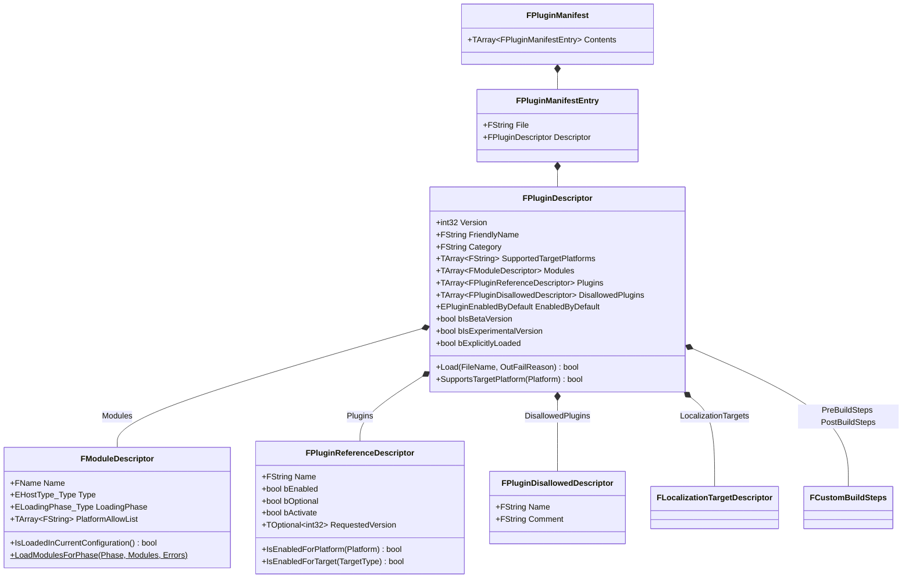
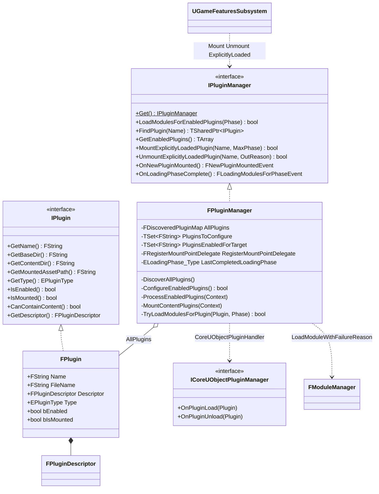
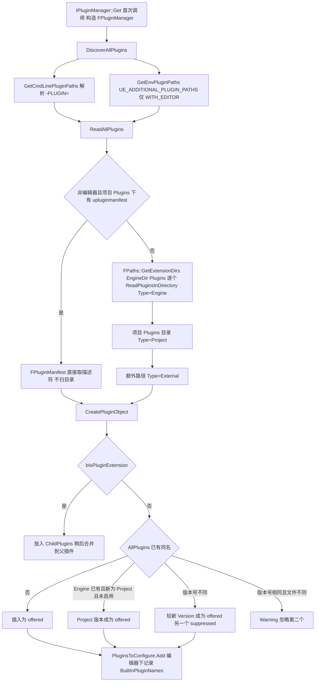
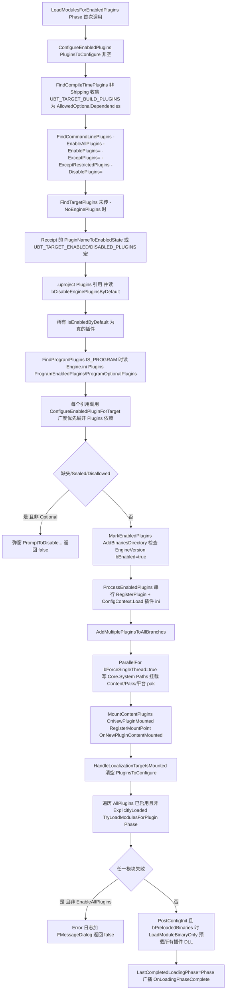
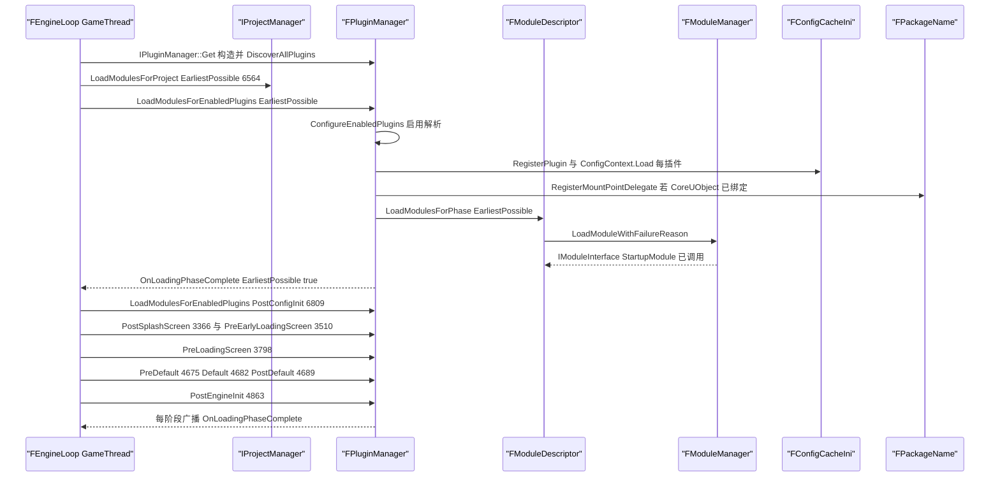
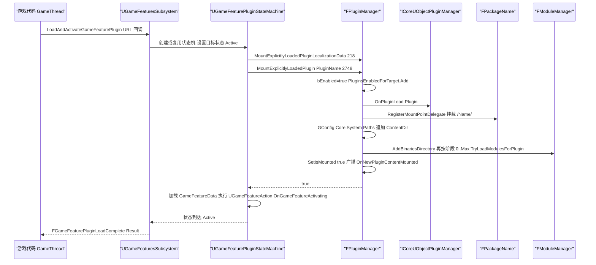
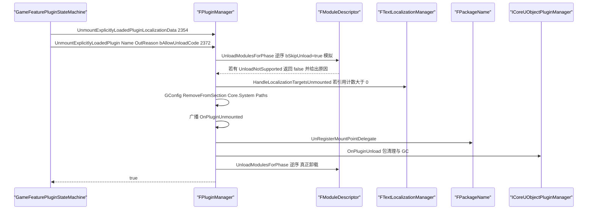
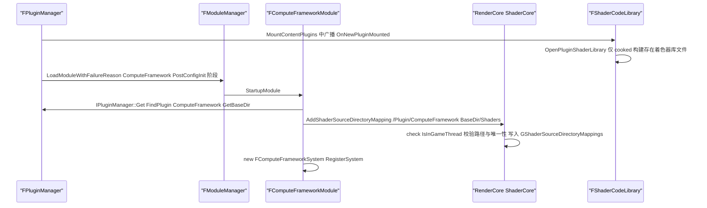

# 24 插件体系与运行时插件目录(第 1 部分)

本章分两半。前半(24.2~24.9)是插件机制:`.uplugin` 描述符字段全表、`FPluginManager` 的发现/启用解析/挂载、Content/Config/Shaders 挂载、模块 `Type`+`LoadingPhase` 调度、插件依赖与平台白名单、Experimental/Beta 标识。全部结论取自 `Source/Runtime/Projects`(以及它调用的 Core/CoreUObject/RenderCore 入口)源码。后半(24.1 统计、24.12 全量表、24.13 模块索引)逐一整理任务书指定的 `$E/Plugins` 一级目录下的全部插件,每个插件一行。

枚举方法:对 `$E/Plugins` 递归 `find -name "*.uplugin"` 共 895 个;去掉第 25 章负责的 12 个一级目录(Experimental/Editor/Developer/Animation/FX/Media/Online/Enterprise/MetaHuman/Mutable/NNE/Importers,合计 547 个)后,本章覆盖 **348 个插件,774 条模块声明(774 个唯一模块名)**,其中 7 个插件没有代码模块。348 个描述符全部被容错 JSON 解析器成功解析(去 BOM、去 `//` 与 `/* */` 注释、去尾逗号),0 个失败。

范围说明:任务书列出的 `Importers`、`MetaHuman`、`Mutable`、`NNE`、`Online` 已由第 25 章覆盖,本章不重复。`Microsoft` 在 5.8.3 中不是 `$E/Plugins` 的一级目录,实际位于 `Runtime/Microsoft`(已计入 Runtime)、`Online/Microsoft` 与 `Experimental/Microsoft`(第 25 章)。另外磁盘上有 12 个任务书未列出、也不属于第 25 章的一级目录(`AutomationControllerRpc`、`ChaosCloth`、`ChaosClothAsset`、`ChaosClothAssetDataflowNodes`、`ChaosClothAssetEditor`、`ChaosClothAssetEditorCore`、`ChaosClothAssetUsdDataflowNodes`、`ChaosInsights`、`ChaosOutfitAsset`、`ChaosVD`、`IoStoreInsights`、`MassInsights`,各 1 个插件)。为了保证"895 = 第 24 章 + 第 25 章",本章一并收录(见 24.12 末尾的数量核对)。

文件拆分:
- 主文件(本文件):24.1~24.11,以及 24.12.0 文件索引和 24.12.3 数量核对。
- `24_plugins_catalog_runtime_part2.md`:24.12.1 按字母序全量插件表第 1~175 行。
- `24_plugins_catalog_runtime_part3.md`:24.12.2 全量插件表第 176~348 行。
- `24_plugins_catalog_runtime_part4.md`:24.13 模块 → Build.cs 依赖 → 附录索引(774 行)。

## 24.1 职责、边界与模块清单

### 24.1.1 插件机制涉及的引擎模块

| 模块 | 路径(相对 `$E`) | Build.cs 中的 Public/Private 依赖 | 职责一句话 |
|---|---|---|---|
| Projects | Source/Runtime/Projects | Public:Core、Json;Private:DesktopPlatform(仅当 `Target.Type == Editor && BuildEnvironment == Shared && LinkType != Monolithic`,同时定义 `READ_TARGET_ENABLED_PLUGINS_FROM_RECEIPT=1`)| `.uplugin`/`.uproject` 描述符模型,`IPluginManager`/`FPluginManager` 发现、启用、挂载,`FModuleDescriptor::LoadModulesForPhase` 按阶段加载 |
| Core(ModuleManager/ConfigCacheIni/Paths)| Source/Runtime/Core | (见附录 Core) | `FModuleManager::LoadModuleWithFailureReason`/`AddBinariesDirectory` 实际加载 DLL;`FConfigCacheIni::RegisterPlugin` 与 `GPluginLayers` 做插件 ini 分层 |
| CoreUObject(PackageName)| Source/Runtime/CoreUObject | Private 依赖含 Projects | `FLongPackagePathsSingleton::OnCoreUObjectInitialized` 把 `FPackageName::RegisterMountPoint` 绑定到 `IPluginManager::SetRegisterMountPointDelegate`,让 `/PluginName/` 映射到 `<Plugin>/Content` |
| RenderCore(ShaderCore/ShaderCodeLibrary)| Source/Runtime/RenderCore | Private 依赖含 Projects | `AddShaderSourceDirectoryMapping` 供插件注册 `/Plugin/<Name>` 虚拟着色器目录;`OnNewPluginMounted` 回调打开插件着色器库 |
| GameFeatures(插件)| Plugins/Runtime/GameFeatures | Public:Core、CoreUObject、DataRegistry、DeveloperSettings、Engine、ModularGameplay;Private 含 Projects、PluginUtils、PakFile、InstallBundleManager 等 14 个 | `ExplicitlyLoaded` 插件的主要使用者:通过状态机调用 `MountExplicitlyLoadedPlugin`/`UnmountExplicitlyLoadedPlugin` 实现运行时热插拔 |
| UnrealBuildTool(C#)| Source/Programs/UnrealBuildTool/Configuration/Descriptors/PluginDescriptor.cs | — | 构建期读取同一份 `.uplugin`(字段名与 C++ 侧一致),决定编译哪些模块并把启用列表写入 `UBT_TARGET_ENABLED_PLUGINS` 宏或 Target Receipt |

### 24.1.2 本章插件分类统计(按一级目录)

数据来自 348 个 `.uplugin` 的静态解析。“默认启用”= `"EnabledByDefault": true`(引擎插件未写该字段时按 `FPlugin::IsEnabledByDefault` 视为不启用,见 24.4.4);“Beta”= `IsBetaVersion`;“Exp”= `IsExperimentalVersion`。类型缩写:R=Runtime、E=Editor、U=UncookedOnly、RnC=RuntimeNoCommandlet、E+P=EditorAndProgram、R+P=RuntimeAndProgram、DT=DeveloperTool、EnC=EditorNoCommandlet、CnC=ClientOnlyNoCommandlet、C=ClientOnly。

| 一级目录 | 插件数 | 模块数 | 无代码 | 默认启用 | Beta | Exp | 模块类型分布 |
|---|---|---|---|---|---|---|---|
| 2D | 1 | 5 | 0 | 1 | 0 | 0 | E 4 R 1 |
| AI | 6 | 16 | 0 | 2 | 1 | 3 | R 10 U 3 E 2 DT 1 |
| AudioGameplay | 1 | 2 | 0 | 0 | 1 | 0 | R 1 E 1 |
| AudioGameplayVolume | 1 | 2 | 0 | 0 | 1 | 0 | R 1 E 1 |
| AudioInsights | 1 | 2 | 0 | 1 | 0 | 0 | E+P 1 EnC 1 |
| AudioInsightsRuntime | 1 | 1 | 0 | 1 | 0 | 0 | R 1 |
| AudioModulationInsights | 1 | 1 | 0 | 1 | 0 | 0 | E+P 1 |
| AutomationControllerRpc | 1 | 1 | 0 | 0 | 0 | 1 | R 1 |
| BaseMaterial | 1 | 0 | 1 | 1 | 1 | 0 | — |
| BlueprintFileUtils | 1 | 1 | 0 | 0 | 0 | 0 | R 1 |
| Bridge | 1 | 2 | 0 | 1 | 0 | 0 | E 2 |
| Cameras | 3 | 5 | 0 | 3 | 1 | 1 | E 2 R 2 U 1 |
| ChaosCloth | 1 | 2 | 0 | 1 | 0 | 0 | R 1 E 1 |
| ChaosClothAsset | 1 | 3 | 0 | 0 | 0 | 0 | R 2 E 1 |
| ChaosClothAssetDataflowNodes | 1 | 1 | 0 | 0 | 0 | 0 | E 1 |
| ChaosClothAssetEditor | 1 | 0 | 1 | 0 | 0 | 0 | — |
| ChaosClothAssetEditorCore | 1 | 2 | 0 | 0 | 0 | 0 | E 2 |
| ChaosClothAssetUsdDataflowNodes | 1 | 1 | 0 | 0 | 0 | 0 | E 1 |
| ChaosInsights | 1 | 2 | 0 | 1 | 1 | 0 | E+P 2 |
| ChaosOutfitAsset | 1 | 3 | 0 | 0 | 1 | 0 | R 2 E 1 |
| ChaosVD | 1 | 3 | 0 | 1 | 1 | 0 | E+P 2 R+P 1 |
| Chooser | 1 | 6 | 0 | 0 | 0 | 0 | R 2 U 2 E 2 |
| CmdLinkServer | 1 | 1 | 0 | 1 | 0 | 0 | E 1 |
| Compositing | 8 | 11 | 2 | 0 | 4 | 1 | R 7 E 4 |
| Compression | 1 | 1 | 0 | 1 | 0 | 0 | R 1 |
| Dataflow | 1 | 3 | 0 | 1 | 0 | 0 | R 2 E 1 |
| DataflowVolumetricPlugin | 1 | 2 | 0 | 0 | 0 | 0 | E 2 |
| DerivedDataBuildController | 1 | 1 | 0 | 1 | 0 | 1 | E 1 |
| DiscoveryBeaconReceiver | 1 | 1 | 0 | 0 | 0 | 0 | R 1 |
| EnhancedInput | 1 | 3 | 0 | 1 | 0 | 0 | R 1 U 1 E 1 |
| Fab | 1 | 1 | 0 | 1 | 0 | 0 | E 1 |
| FastBuildController | 1 | 1 | 0 | 0 | 0 | 0 | U 1 |
| GameInputWindows | 1 | 1 | 0 | 0 | 1 | 0 | RnC 1 |
| Interchange | 7 | 21 | 0 | 3 | 0 | 4 | R 14 E 7 |
| IoStoreInsights | 1 | 1 | 0 | 1 | 0 | 0 | E+P 1 |
| JsonBlueprintUtilities | 1 | 2 | 0 | 0 | 1 | 0 | R 1 U 1 |
| LightWeightInstancesEditor | 1 | 1 | 0 | 0 | 1 | 0 | R 1 |
| MassInsights | 1 | 2 | 0 | 1 | 1 | 0 | E+P 2 |
| MemoryUsageQueries | 1 | 1 | 0 | 0 | 0 | 0 | R 1 |
| MeshPainting | 1 | 2 | 0 | 1 | 0 | 0 | E 2 |
| Messaging | 4 | 4 | 0 | 2 | 1 | 0 | U 1 E+P 1 R 1 R+P 1 |
| MovieScene | 11 | 23 | 0 | 3 | 7 | 2 | R 12 E 9 U 2 |
| NetcodeUnitTest | 2 | 2 | 0 | 0 | 0 | 0 | U 2 |
| PCG | 1 | 3 | 0 | 1 | 0 | 0 | R 2 E 1 |
| PCGInterops | 3 | 4 | 0 | 0 | 3 | 0 | R 2 E 2 |
| Performance | 3 | 3 | 0 | 1 | 0 | 2 | R 2 E 1 |
| Portal | 1 | 1 | 0 | 1 | 0 | 0 | R 1 |
| Protocols | 1 | 2 | 0 | 0 | 0 | 1 | R 1 E 1 |
| RenderGraphInsights | 1 | 1 | 0 | 1 | 0 | 0 | E+P 1 |
| RenderTraceInsights | 1 | 1 | 0 | 1 | 0 | 0 | E+P 1 |
| RPCBase | 1 | 1 | 0 | 0 | 0 | 0 | R 1 |
| Runtime | 152 | 308 | 0 | 34 | 35 | 18 | R 183 E 70 U 31 RnC 18 DT 2 R+P 1 E+P 1 CnC 1 C 1 |
| ScriptPlugin | 1 | 2 | 0 | 0 | 0 | 0 | R 1 E 1 |
| Slate | 2 | 2 | 0 | 0 | 0 | 0 | E+P 1 R 1 |
| SubtitlesAndClosedCaptions | 1 | 2 | 0 | 0 | 1 | 0 | R 1 U 1 |
| Tests | 17 | 17 | 2 | 1 | 3 | 2 | E 8 DT 6 R 2 U 1 |
| TextureGraph | 1 | 5 | 0 | 0 | 0 | 0 | E 3 R 2 |
| TraceUtilities | 1 | 3 | 0 | 1 | 0 | 0 | EnC 2 R 1 |
| UbaController | 1 | 1 | 0 | 1 | 0 | 1 | E 1 |
| VirtualProduction | 79 | 265 | 1 | 0 | 36 | 6 | R 120 E 111 U 26 R+P 6 DT 1 RnC 1 |
| Web | 1 | 2 | 0 | 0 | 0 | 1 | R 1 U 1 |
| WorldMetrics | 1 | 3 | 0 | 1 | 0 | 1 | R+P 3 |
| WorldStreamingInsights | 1 | 1 | 0 | 0 | 0 | 1 | E+P 1 |
| XGEController | 1 | 1 | 0 | 1 | 0 | 0 | U 1 |
| **合计(64 个目录)** | **348** | **774** | **7** | **75** | **102** | **46** | R 388 E 249 U 75 RnC 20 E+P 15 R+P 12 DT 10 EnC 3 CnC 1 C 1 |

注:`Runtime` 目录下有 128 个二级子目录,含嵌套插件共 152 个(例如 `Runtime/AR/*`、`Runtime/Database/*`、`Runtime/PacketHandlers/*`、`Runtime/Windows/*`、`Runtime/Microsoft/*`、`Runtime/Steam/*`、`Runtime/Nvidia/*` 等多插件分组)。

### 24.1.3 按 `.uplugin` `Category` 字段统计(53 个类别)

| Category | 插件数 | 默认启用 | Beta | Exp | 代表插件 |
|---|---|---|---|---|---|
| Virtual Production | 60 | 0 | 26 | 6 | AccumulationDOF、ActorModifier、Avalanche、RemoteControl、nDisplay 系外围 |
| Audio | 26 | 8 | 12 | 4 | AudioGameplay、AudioModulation、Metasound、Harmonix、Synthesis |
| Other | 18 | 6 | 10 | 1 | BaseMaterial、CmdLinkServer、Fab、LightWeightInstancesEditor |
| Testing | 18 | 2 | 3 | 5 | AutomationControllerRpc、AutomatedPerfTesting、CQTest、RHITests |
| Gameplay | 16 | 1 | 6 | 5 | GameFeatures、GameplayAbilities、DataRegistry、ModularGameplay |
| Editor | 15 | 8 | 7 | 1 | Bridge、Dataflow、MeshPainting、ActorSequence |
| Misc | 12 | 1 | 3 | 1 | nDisplay、LiveLinkOverNDisplay、AESGCMHandlerComponent、DTLSHandlerComponent |
| Messaging | 11 | 2 | 2 | 0 | UdpMessaging、TcpMessaging、DiscoveryBeaconReceiver、MessagingDebugger |
| Rendering | 11 | 3 | 4 | 2 | OpenColorIO、MovieRenderPipeline、CinematicPrestreaming |
| Virtual Reality | 11 | 0 | 3 | 1 | OpenXR、HPMotionController、MixedRealityCaptureFramework |
| Physics | 10 | 2 | 3 | 0 | ChaosCloth、ChaosClothAsset、ChaosOutfitAsset |
| Insights | 9 | 5 | 2 | 1 | ChaosInsights、IoStoreInsights、MassInsights、RenderGraphInsights |
| AI | 8 | 2 | 1 | 5 | AISupport、EnvironmentQueryEditor、HTNPlanner、MLAdapter |
| Importers | 8 | 4 | 0 | 4 | Interchange、InterchangeAssets、InterchangeEditor、InterchangeOpenUSD |
| Input Devices | 8 | 1 | 3 | 0 | GameInput、GameInputWindows、MIDIDevice、OSC |
| Compositing | 7 | 0 | 3 | 1 | Composite、CompositeCore、Composure |
| Mobile / Platform / Android | 6 / 6 / 3 | 2 / 0 / 3 | 0 / 1 / 1 | 0 | LocationServices*、MSGameStore、GDK*、AndroidPermission、GooglePAD |
| Augmented Reality / Device Profile Selectors | 5 / 5 | 0 / 5 | 0 | 0 | AppleARKit、GoogleARCore、*DeviceProfileSelector |
| Networking / Online Platform | 5 / 5 | 0 / 2 | 0 | 1 / 0 | NetcodeUnitTest、MultiServerReplication、ChunkDownloader、Firebase |
| Analytics / Build Distribution / Database | 4 / 4 / 4 | 0 / 3 / 0 | 0 | 0 / 2 / 0 | AnalyticsMulticast、UbaController、XGEController、SQLiteCore |
| Media Players / Performance / Runtime / UI | 4 / 4 / 4 / 4 | 4 / 0 / 2 / 0 | 0 / 1 / 1 / 1 | 0 | WindowsMoviePlayer、SignificanceManager、MsQuic、CommonUI、ModelViewViewModel |
| Animation / Cameras / Experimental / Geometry | 3 / 3 / 3 / 3 | 0 / 3 / 1 / 0 | 1 / 1 / 2 / 1 | 0 / 1 / 0 / 0 | Chooser、GameplayCameras、SceneState、GeometryScripting、HairStrands |
| Blueprints / Input / Scripting / Text | 2 / 2 / 2 / 2 | 0 / 2 / 0 / 0 | 1 / 0 / 1 / 0 | 0 / 0 / 0 / 1 | JsonBlueprintUtilities、EnhancedInput、SequencerScripting、Text3D |
| 其余 14 个类别(各 1 个)| 14 | 3 | 2 | 3 | 2D(Paper2D)、Advertising(IOSTapJoy)、Android Background Service、Compression(OodleNetwork)、Computer Vision(OpenCV)、Dataflow、Engine(MemoryUsageQueries)、Examples(ScriptPlugin)、Gameplay Streaming(GeForceNOWWrapper)、IOT(MQTT)、Mixed Reality(XRVisualization)、PreLoadScreenMoviePlayer、Profiling(WorldMetrics)、Web(HttpBlueprint) |
| (未填 Category)| 3 | 0 | 0 | 1 | LevelStreamingPersistence、VerseModuleIndependenceA/B |

### 24.1.4 模块 Type × LoadingPhase 交叉统计(774 条模块声明)

| Type \ Phase | EarliestPossible | PostConfigInit | PreEarlyLoadingScreen | PreLoadingScreen | PreDefault | Default | PostDefault | PostEngineInit | None | 合计 |
|---|---|---|---|---|---|---|---|---|---|---|
| Runtime | 1 | 51 | 0 | 2 | 75 | 247 | 6 | 5 | 1 | 388 |
| Editor | 2 | 0 | 0 | 0 | 1 | 205 | 8 | 30 | 3 | 249 |
| UncookedOnly | 2 | 0 | 0 | 0 | 15 | 49 | 5 | 4 | 0 | 75 |
| RuntimeNoCommandlet | 0 | 9 | 2 | 4 | 0 | 4 | 0 | 1 | 0 | 20 |
| EditorAndProgram | 0 | 0 | 0 | 0 | 0 | 15 | 0 | 0 | 0 | 15 |
| RuntimeAndProgram | 0 | 0 | 0 | 0 | 1 | 11 | 0 | 0 | 0 | 12 |
| DeveloperTool | 0 | 0 | 0 | 0 | 1 | 9 | 0 | 0 | 0 | 10 |
| EditorNoCommandlet | 0 | 0 | 0 | 0 | 0 | 3 | 0 | 0 | 0 | 3 |
| ClientOnlyNoCommandlet | 1 | 0 | 0 | 0 | 0 | 0 | 0 | 0 | 0 | 1 |
| ClientOnly | 0 | 0 | 0 | 0 | 0 | 1 | 0 | 0 | 0 | 1 |
| 合计 | 6 | 60 | 2 | 6 | 93 | 544 | 19 | 40 | 4 | 774 |

其中 36 条模块声明没写 `LoadingPhase`,按 `FModuleDescriptor` 构造默认值 `ELoadingPhase::Default` 计入(ModuleDescriptor.h:209)。本范围没有使用 `PostSplashScreen`、`CookedOnly`、`Developer`、`ServerOnly`、`Program`。
- 6 个 `EarliestPossible` 模块是 4 个分布式编译控制器(DerivedDataBuildController、FastBuildController、UbaController、XGEController)、`MemoryUsageQueries`、`GeForceNOWWrapper`。它们必须在着色器编译/内存统计初始化之前注册 ModularFeature。
- 4 个 `None` 模块(AndroidDeviceProfileSelector、AndroidDeviceProfileCommandlets、IOSPreviewDeviceProfileSelector、NetworkPredictionExtrasLatentLoad)只能由代码显式 `LoadModule`。
- 模块级 `PlatformAllowList` 出现在 170 条声明中,平台计数:Win64 157、Linux 113、Mac 73、Android 29、IOS 18、LinuxArm64 3、TVOS 2、VisionOS 1。

## 24.2 总体架构

### 24.2.1 插件系统分层

要点(均已在源码中核实):
- `IPluginManager::Get()` 返回函数内静态 `FPluginManager`(Private/PluginManager.cpp:3010-3015)。构造函数立即调用 `DiscoverAllPlugins()`,并把 `GetLocalizationPathsForEnabledPlugins` 注册到 `FCoreDelegates::GatherAdditionalLocResPathsCallback`(PluginManager.cpp:533-540)。
- Projects 只依赖 Core/Json,本身拿不到 CoreUObject 的包路径功能。内容挂载通过两个委托反向注入:CoreUObject 的 `FLongPackagePathsSingleton::OnCoreUObjectInitialized` 调用 `SetRegisterMountPointDelegate`/`SetUnRegisterMountPointDelegate`(Source/Runtime/CoreUObject/Private/Misc/PackageName.cpp:187-194)。同样,`UE::PluginManager::Private::SetCoreUObjectPluginManager` 注入 `ICoreUObjectPluginManager`(Projects/Internal/ICoreUObjectPluginManager.h:12-25)。
- 着色器目录不由 PluginManager 自动挂载。插件模块在 `StartupModule` 中自行调用 `AddShaderSourceDirectoryMapping`,例如 `ComputeFrameworkModule.cpp:23-24` 用 `IPluginManager::Get().FindPlugin(TEXT("ComputeFramework"))->GetBaseDir()` 拼出 `Shaders` 目录并映射为 `/Plugin/ComputeFramework`。
- 构建期与运行期读同一份 `.uplugin`。UBT 决定编译哪些模块,并把启用/禁用列表写入宏 `UBT_TARGET_ENABLED_PLUGINS`/`UBT_TARGET_DISABLED_PLUGINS`(Projects.Build.cs 的非共享构建分支),或者写入 Target Receipt(共享 Editor 构建,`READ_TARGET_ENABLED_PLUGINS_FROM_RECEIPT=1`)。

### 24.2.2 本章插件依赖层次图(`.uplugin` `Plugins` 数组,节选 36 个高入度插件)

本章 348 个插件共声明 577 条插件依赖,其中只有 2 条带 `"Optional": true`,没有一条写 `"Enabled": false`。按被依赖次数排序,前几名是 ProceduralMeshComponent 11、GeometryProcessing 10、Takes 10、EnhancedInput 9、OpenXR 9、CameraCalibrationCore 8、StateTree/GeometryCache/Dataflow/Interchange/LevelSequenceEditor/GeometryScripting/XRBase/nDisplay/RemoteControl 各 7。下图只画这些核心插件之间的边(箭头 = "依赖于");跨到第 25 章目录的依赖(如 LiveLink 13 次、EditorScriptingUtilities 9 次、MediaIOFramework 6 次)以虚线节点表示。

注:`MovieRenderPipeline → ChaosClothAsset` 取自 `MovieScene/MovieRenderPipeline/MovieRenderPipeline.uplugin:47`。虚线节点 LiveLink 代表跨章依赖:本章共有 13 个插件依赖 LiveLink(LensComponent 为其一)。

## 24.3 类图

### 24.3.1 描述符模型(Projects/Public)

- `FPluginDescriptor`(PluginDescriptor.h:38-257):一个 `.uplugin` 文件的完整内存映像。在 `WITH_EDITOR` 下还会缓存原始 JSON(`CachedJson`),让 `UpdatePluginFile` 回写时保留未知字段。
- `FModuleDescriptor`(ModuleDescriptor.h:154-254):一个代码模块。决定它在什么宿主(`EHostType`)、什么阶段(`ELoadingPhase`)、什么平台/目标/程序上编译和加载。
- `FPluginReferenceDescriptor`(PluginReferenceDescriptor.h:26-130):`.uplugin`/`.uproject` 的 `Plugins` 数组元素,表示"引用另一个插件",带平台/目标过滤与版本请求。
- `FPluginDisallowedDescriptor`(PluginDisallowedDescriptor.h:14):`DisallowedPlugins` 元素,依赖解析时如果出现在依赖链中就报 `DisallowedDependency`。
- `FPluginManifest`/`FPluginManifestEntry`(PluginManifest.h:16-34):非编辑器构建中的 `*.upluginmanifest`。有它时 `ReadAllPlugins` 不再递归扫描目录(PluginManager.cpp:780-795)。

### 24.3.2 运行时管理器

- `IPlugin`(IPluginManager.h:110-278):对外暴露的只读插件视图,`TSharedFromThis`。
- `FPlugin`(Private/PluginManager.h:15-151):唯一实现,`final`。`bEnabled`/`bIsMounted` 是位域。注释说明 ExplicitlyLoaded 插件可能"已 enabled 但未 mounted"(PluginManager.h:36-43)。
- `IPluginManager`(IPluginManager.h:284-668):纯虚接口,单例。
- `FPluginManager`(Private/PluginManager.h:157-439):`AllPlugins` 类型为 `TMap<FString, TArray<TSharedRef<FPlugin>>>`(PluginManager.h:257),同名插件的多个版本放在同一数组中,区分 offered 与 suppressed。
- `ICoreUObjectPluginManager`(Projects/Internal/ICoreUObjectPluginManager.h:12-23):CoreUObject 注入的回调,用于插件卸载时的包清理与 GC 抑制。
- `UGameFeaturesSubsystem`(Plugins/Runtime/GameFeatures/Source/GameFeatures/Public/GameFeaturesSubsystem.h:466):`UEngineSubsystem`,由 `GameFeaturePluginStateMachine.cpp:2748/2763` 调 `MountExplicitlyLoadedPlugin`。

## 24.4 数据字典

### 24.4.1 `.uplugin` 顶层字段全表(`UE::Projects::Private::Read`,Private/PluginDescriptor.cpp:259-414)

字段名用 RapidJSON 的 `FindMemberCaseInsensitive` 做**大小写不敏感**匹配(Private/RapidJsonPluginLoading.cpp:15-30,所有 `TryGet*Field` 都经过它)。所以本范围 `VerseModuleIndependenceA/B.uplugin` 里写成小写开头的 `builtInAutoActivate` 也能被 GameFeatures 侧读到(GameFeatures 自己用 `FJsonObject::TryGetBoolField`,见 24.10)。"本章出现次数"是 348 个描述符中写了该字段的文件数。

| 字段 | 类型 → 成员 | 含义 | 取值/约束 | 本章出现次数 | 源码位置 |
|---|---|---|---|---|---|
| FileVersion(旧名 PluginFileVersion)| int32 → `EPluginDescriptorVersion` | 描述符格式版本 | 必填;只能在 `Invalid(0) < v ≤ Latest`,`Latest = ProjectPluginUnification = 3`,否则返回错误 "File does not have a valid 'FileVersion' number." | 348(=3:301,=1:47)| PluginDescriptor.cpp:61-72、263-278 |
| Version | int32 → `Version` | 单调递增的内部版本号 | 同名插件多版本时用于选择较新版本(`CreatePluginObject`)| 348 | PluginDescriptor.h:43;PluginManager.cpp:1310-1335 |
| VersionName | FString | 展示用版本串 | 任意 | 347 | PluginDescriptor.h:47 |
| FriendlyName / Description | FString | 展示名 / 描述 | 任意 | 347 / 348 | PluginDescriptor.h:50-53 |
| Category(旧名 CategoryPath)| FString | 插件浏览器类别 | 两端多余引号会被剥离(PluginDescriptor.cpp:291-297)| 346 | PluginDescriptor.cpp:286-297 |
| CreatedBy / CreatedByURL / DocsURL / MarketplaceURL / SupportURL | FString | 元信息 | 可选 | 346 / 346 / 324 / 323 / 309 | PluginDescriptor.h:59-71 |
| EngineVersion | FString | 兼容的引擎版本 | 不匹配时 `IsPluginCompatible` 失败,弹窗询问是否继续(PluginManager.cpp:1860)| 0 | PluginDescriptor.h:74 |
| DeprecatedEngineVersion | FString | 标记废弃 | 挂载时 `CheckForDeprecatedPlugin` 打 Display 日志 | 1(LightWeightInstancesEditor = "5.8")| PluginManager.cpp:61-67 |
| EditorCustomVirtualPath | FString | 内容浏览器中 `/All/Plugins/<此路径>/<PluginName>` 的虚拟分组 | 可选 | 1(WorldMetrics)| PluginDescriptor.h:76-77 |
| SupportedTargetPlatforms | string[] | 插件级平台子集,同时控制暂存 `.uplugin` 与内容 | `SupportsTargetPlatform`:空数组 = 全平台,除非 `HasExplicitPlatforms`(PluginDescriptor.cpp:764-774)| 40 | PluginDescriptor.h:79-81 |
| SupportedPrograms | string[] | 允许加载此插件的 Program 目标 | `TargetType == Program` 且不在列表中就跳过(PluginManager.cpp 依赖解析)。`CanBeUsedWithUnrealHeaderTool=true` 会追加 `UnrealHeaderTool` | 42(LiveLinkHub 22、UnrealInsights 14 …)| PluginDescriptor.cpp:307、381-384 |
| bIsPluginExtension | bool | 平台扩展子插件 | `CreatePluginObject` 中归入 `ChildPlugins`,之后合并进父插件 | 0 | PluginManager.cpp:1265-1270 |
| Modules | object[] → `FModuleDescriptor` | 代码模块列表 | 见 24.4.2;解析错误会让整个描述符失败 | 343 | PluginDescriptor.cpp:310-313 |
| LocalizationTargets | object[] → `FLocalizationTargetDescriptor` | 本地化目标(Name/LoadingPolicy/ConfigGenerationPolicy)| LoadingPolicy:Never/Always/Editor/Game/PropertyNames/ToolTips | 2(AndroidBackgroundService、HTTPChunkInstaller)| LocalizationDescriptor.h:19-31、90-100 |
| VersePath / VerseScope / VerseVersion | FString / `EVerseScope::Type` / uint32 | Verse 根路径、可见性、语言版本 | VerseScope:PublicAPI/InternalAPI/PublicUser/InternalUser,非法值报错;VerseVersion 必须为数字 | 2 | PluginDescriptor.cpp:320-350;VerseScope.h:14-20 |
| EnableSceneGraph / EnableSceneGraphAnimation / EnableVerseAssetReflection / EnableIAD / EnableIAS | bool | Verse/SceneGraph/安装包相关开关 | `bEnableIAS` 默认 true,其余默认 false | 0 | PluginDescriptor.h:108-121 |
| EnabledByDefault | bool → `EPluginEnabledByDefault` | 是否默认启用 | 缺省 = `Unspecified`;true → Enabled,false → Disabled(PluginDescriptor.cpp:361-365)| 256(true 75、false 181)| PluginDescriptor.h:28-33 |
| CanContainContent | bool | 是否挂载 `Content/` | true 时注册 `/<Name>/` 挂载点并加入 `[Core.System] Paths` | 339(true 167)| PluginManager.cpp:1953-1961 |
| CanContainVerse | bool | 是否含 Verse | 与 Content 一样触发挂载点 | 2 | PluginManager.cpp:2010 |
| NoCode / NoGameFeatureContent | bool | 禁止含代码 / GFP 只能含 GameFeatureData | — | 0 | PluginDescriptor.h:151、163 |
| IsBetaVersion / IsExperimentalVersion | bool | UI 标记 Beta / Experimental | 只影响插件浏览器展示与提示,不影响加载 | 297(true 102)/ 126(true 46)| PluginDescriptor.h:132-136 |
| Installed | bool | 安装在引擎之上(如 Fab/商城)| — | 324(true 0)| PluginDescriptor.h:139 |
| RequiresBuildPlatform | bool | 平台目录下的插件编译时需要对应平台 SDK | — | 9 | PluginDescriptor.h:141-142 |
| Hidden | bool → `bIsHidden` | 插件浏览器中隐藏 | — | 21(true 19)| PluginDescriptor.cpp:375 |
| Sealed | bool → `bIsSealed` | 禁止其它插件依赖它 | 依赖链命中时报 `PluginSealed` | 0 | PluginManager.cpp:2563-2568 |
| ExplicitlyLoaded | bool | 不自动挂载/加载,忽略 LoadingPhase,等显式 Mount | 被 `ProcessEnabledPlugins`、`MountContentPlugins`、`LoadModulesForEnabledPlugins` 全部跳过 | 2(VerseModuleIndependenceA/B)| PluginDescriptor.h:153-154 |
| HasExplicitPlatforms | bool | 空的 SupportedTargetPlatforms 视为"无平台",由平台扩展补充 | — | 2 | PluginDescriptor.h:156-157 |
| PreBuildSteps / PostBuildSteps | object → `FCustomBuildSteps` | 每个宿主平台的构建前/后命令 | 只在 `WITH_EDITOR \|\| IS_PROGRAM` 时读取 | 0 | PluginDescriptor.cpp:386-389;CustomBuildSteps.h:16-30 |
| Plugins | object[] → `FPluginReferenceDescriptor` | 插件依赖 | 见 24.4.3 | 202 个文件、577 条 | PluginDescriptor.cpp:391-395 |
| DisallowedPlugins | string[] 或 object[] → `FPluginDisallowedDescriptor` | 禁止依赖的插件 | 兼容字符串数组旧格式(PluginDescriptor.cpp:397-412)| 0 | PluginDisallowedDescriptor.h:14-31 |

本范围还出现了 Projects 不读取的字段:插件级 `PlatformAllowList`(ActorModifier、ActorModifierCore)、`PythonRequirements`(OpenCV,由 PythonScriptPlugin 的 PipInstall 读取)、`IsHidden`(Interchange,正确字段名应为 `Hidden`)、`bRequiresBuildPlatform`(GameInputWindows,正确字段名应为 `RequiresBuildPlatform`)、`builtInAutoActivate`(GameFeatures 读取)。详见 24.10。

### 24.4.2 `Modules[]` 元素字段(`UE::Projects::Private::Read(…, FModuleDescriptor&)`,Private/ModuleDescriptor.cpp:162-250)

| 字段 | 类型 → 成员 | 含义 | 取值/约束 | 本章出现次数 | 源码位置 |
|---|---|---|---|---|---|
| Name | string → FName | 模块名(与 `<Name>.Build.cs` 对应)| 必填,缺失报 "Found a 'Module' entry with a missing 'Name' field" | 774 | ModuleDescriptor.cpp:165-170 |
| Type | string → `EHostType::Type` | 宿主类型 | 必填;`FromString` 返回 `Max` 时报 "unrecognized module Type" | 774 | ModuleDescriptor.cpp:173-184 |
| LoadingPhase | string → `ELoadingPhase::Type` | 启动加载阶段 | 可选,默认 Default;非法值报错 | 738 | ModuleDescriptor.cpp:186-194 |
| PlatformAllowList / PlatformDenyList(旧名 WhitelistPlatforms / BlacklistPlatforms)| string[] | 平台白/黑名单 | 白名单非空(或 `HasExplicitPlatforms`)时只在名单内平台编译 | 170 / 11 | ModuleDescriptor.cpp:197-199、524 |
| PlatformArchitectureAllowList / DenyList | "Platform:Arch" 字符串数组 → TMap | 平台架构过滤 | 不含 `:` 时报 "unrecognized Platform:Architecture pair" | 0 / 8 | ModuleDescriptor.cpp:220-250 |
| TargetAllowList / TargetDenyList(旧名 WhitelistTargets / BlacklistTargets)| `EBuildTargetType`[] | Game/Server/Client/Editor/Program | — | 4 / 30 | ModuleDescriptor.cpp:202-203 |
| TargetConfigurationAllowList / DenyList | `EBuildConfiguration`[] | Debug/Development/Shipping… | — | 0 / 4 | ModuleDescriptor.cpp:206-207 |
| ProgramAllowList / ProgramDenyList(旧名 WhitelistPrograms / BlacklistPrograms)| string[] | Program 目标白/黑名单 | Program 目标下白名单非空时**只看白名单**,忽略 Type(ModuleDescriptor.cpp:653-657)| 53(其中 8 处拼写为 `ProgramAllowlist`,靠大小写不敏感匹配仍然有效)| ModuleDescriptor.cpp:210-211 |
| GameTargetAllowList / GameTargetDenyList | string[] | 按目标名过滤非 Program 目标 | 比较对象是 `UE_APP_NAME` | 0 | ModuleDescriptor.cpp:217-218、667-677 |
| AdditionalDependencies | string[] | 额外构建依赖 | — | 0 | ModuleDescriptor.cpp:214 |
| HasExplicitPlatforms | bool | 空白名单 = 无平台 | — | 2 | ModuleDescriptor.cpp:199 |

`EHostType::Type` 的运行时语义(`FModuleDescriptor::IsLoadedInCurrentConfiguration`,ModuleDescriptor.cpp:638-776),括号内为本章模块数:

| 值 | 加载条件(源码判定)| 本章 |
|---|---|---|
| Runtime | `(WITH_ENGINE \|\| WITH_PLUGIN_SUPPORT) && !IS_PROGRAM` | 388 |
| RuntimeNoCommandlet | 同上且 `!IsRunningCommandlet()` | 20 |
| RuntimeAndProgram | `WITH_ENGINE \|\| WITH_PLUGIN_SUPPORT` | 12 |
| CookedOnly / UncookedOnly | `FPlatformProperties::RequiresCookedData()` 为真 / 为假 | 0 / 75 |
| Developer(已废弃)| `WITH_EDITOR \|\| IS_PROGRAM` | 0 |
| DeveloperTool | `WITH_UNREAL_DEVELOPER_TOOLS` | 10 |
| Editor / EditorNoCommandlet | `WITH_EDITOR && GIsEditor`(后者再加 `!IsRunningCommandlet()`)。非 UE_EDITOR 构建中 `ensure(LoadingPhase != PostConfigInit && != EarliestPossible)` | 249 / 3 |
| EditorAndProgram | WITH_EDITOR 时取 `GIsEditor`;IS_PROGRAM 时为 true | 15 |
| Program | `WITH_PLUGIN_SUPPORT && IS_PROGRAM` | 0 |
| ServerOnly | `!FPlatformProperties::IsClientOnly()` | 0 |
| ClientOnly / ClientOnlyNoCommandlet | `!IsRunningDedicatedServer()`(后者再加 `!IsRunningCommandlet()`)| 1 / 1 |

注意:本范围有 2 个 `Editor` 与 2 个 `UncookedOnly` 模块使用 `EarliestPossible`(4 个分布式编译控制器)。在非 UE_EDITOR 的 WITH_EDITOR 构建中,这会命中上表中的 `ensure`(依据 ModuleDescriptor.cpp:726-729)。实际运行是否触发未验证,列入 24.10。

`ELoadingPhase::Type`(ModuleDescriptor.h:24-60)枚举顺序为 EarliestPossible、PostConfigInit、PostSplashScreen、PreEarlyLoadingScreen、PreLoadingScreen、PreDefault、Default、PostDefault、PostEngineInit、None、Max。`FEngineLoop` 中的调用点见 24.6.2,与第 18 章 18.4.1 一致。

### 24.4.3 `Plugins[]` 引用元素字段(`FPluginReferenceDescriptor`,Private/PluginReferenceDescriptor.cpp:128-185)

| 字段 | 类型 | 含义 | 约束 | 源码位置 |
|---|---|---|---|---|
| Name | string | 被引用插件名 | 必填 | PluginReferenceDescriptor.cpp:132-136 |
| Enabled | bool | 启用(true)或在 .uproject 中显式禁用(false)| 必填,缺失报 "Plugin references must have an 'Enabled' field" | :138-141 |
| Optional | bool | 找不到时静默忽略 | 本章 8 处显式写出,其中 2 处为 true(MovieRenderPipeline→LevelSequenceEditor、MSGameOSSSelector→OnlineSubsystemGDK)| :144 |
| Activate | bool | GameFeature 激活父插件时是否连带激活此依赖 | — | :146;PluginReferenceDescriptor.h:37-38 |
| Description / MarketplaceURL | string | 未安装时给用户的提示 | — | :149-150 |
| PlatformAllowList / PlatformDenyList(旧名 Whitelist/BlacklistPlatforms)| string[] | 引用级平台过滤 | `IsEnabledForPlatform`:白名单非空(或 HasExplicitPlatforms)且不含当前平台则不启用(:41-61)| :153-154 |
| TargetConfigurationAllowList/DenyList、TargetAllowList/DenyList | enum[] | 配置/目标过滤 | — | :157-162 |
| TargetsToExplicitlyLoad | `EBuildTargetType`[] | 对指定目标覆盖为显式加载 | — | :165 |
| SupportedTargetPlatforms / HasExplicitPlatforms | string[] / bool | 从被引用描述符复制的平台集 | — | :168-169 |
| Version | int32 → `TOptional RequestedVersion` | 请求特定版本 | `Enabled=false` 时不允许写 Version | :172-179 |

本章 577 条引用中使用的子字段:Name 577、Enabled 577、TargetAllowList 25、PlatformAllowList 11、SupportedTargetPlatforms 8、Optional 8、TargetConfigurationDenyList 1。

### 24.4.4 运行时枚举与状态

| 类型 | 值 | 含义 | 源码位置 |
|---|---|---|---|
| `EPluginLoadedFrom` | Engine、Project | 插件来源(只区分两类)| IPluginManager.h:18-25 |
| `EPluginType` | Engine、Enterprise、Project、External、Mod | 发现时的类型。Enterprise 插件在非 `bIsEnterpriseProject` 项目中会被跳过 | IPluginManager.h:30-46;PluginManager.cpp 依赖解析 |
| `EPluginExternalSource` | ProjectDescriptor、CommandLine、Environment、Other | External 插件路径来源:`.uproject AdditionalPluginDirectories` / `-PLUGIN=` / 环境变量 `UE_ADDITIONAL_PLUGIN_PATHS`(仅 WITH_EDITOR,Windows 用 `;`、其它平台用 `:` 分隔)| IPluginManager.h:51-64;PluginManager.cpp:71-95、112-147 |
| `EPluginEnabledByDefault` | Unspecified、Enabled、Disabled | `FPlugin::IsEnabledByDefault`:Enabled → Project 插件恒为 true,Engine 插件取 `bAllowEnginePluginsEnabledByDefault`(受 `.uproject bDisableEnginePluginsByDefault` 与 Receipt 属性控制);Disabled → false;Unspecified → 仅 Project 插件为 true | PluginDescriptor.h:28-33;PluginManager.cpp:421-435 |
| `EPluginDescriptorVersion` | Invalid 0、Initial 1、NameHash 2、ProjectPluginUnification 3(=Latest)| 描述符版本 | Private/PluginDescriptor.cpp:61-72 |
| `EConfigurePluginResultCode`(匿名命名空间)| PluginMissing、PluginSealed、DisallowedDependency、Unset | 依赖解析失败原因,决定弹出哪个对话框(PromptToDisableMissingPlugin/SealedPlugin/DisalowedPlugin)| PluginManager.cpp:504-511 |
| `FPlugin` 状态位 | `bEnabled : 1`、`bIsMounted : 1` | enabled = 通过启用解析;mounted = 内容已注册、模块已安排加载 | Private/PluginManager.h:33-43 |
| `EBuiltInAutoState`(GameFeatures)| Invalid、Installed、Registered、Loaded、Active | 由 `.uplugin` 中 `BuiltInInitialFeatureState`(字符串)或 `BuiltInAutoRegister`/`BuiltInAutoLoad`/`BuiltInAutoActivate`(bool,默认 true)推导 | GameFeaturesSubsystem.h:231-238;GameFeaturesSubsystem.cpp:5045-5100 |

## 24.5 接口清单

所有路径相对 `$E`。线程约束的判定依据写在对应格内。Projects 自身的 `FPluginManager` 没有任何锁(唯一例外是 `ProcessEnabledPlugins` 内部的局部 `FCriticalSection`),它的公共入口只能在 GameThread 上串行调用。依据有三点。第一,`FModuleManager::GetOrLoadModule` 在非 GameThread 上对未加载的模块直接返回 `EModuleLoadResult::NotLoadedByGameThread`(Source/Runtime/Core/Private/Modules/ModuleManager.cpp:930-944)。第二,`LoadModuleWithFailureReason` 内部的 `ensureMsgf(IsInGameThread())` 被注释掉了(同文件 :1028-1032),所以实际的单线程约束靠调用方保证。第三,`GetLocalizationPathsForEnabledPlugins` 的注释明确说不能从 worker 线程触发 `ConfigureEnabledPlugins`(PluginManager.cpp:2951-2952)。

### 24.5.1 `IPluginManager`(Source/Runtime/Projects/Public/Interfaces/IPluginManager.h)

| 原型 | 功能 | 参数与返回 | 线程/重入约束 | 位置 |
|---|---|---|---|---|
| `static IPluginManager& Get();` | 取单例(首次调用时构造 `FPluginManager` 并执行 `DiscoverAllPlugins`)| — | 函数内 static,首次初始化由 C++11 保证线程安全;之后的使用只在 GameThread | IPluginManager.h:667;PluginManager.cpp:3010 |
| `virtual void RefreshPluginsList() = 0;` | 重新扫描磁盘,只保留已启用的插件,新发现的加入 `PluginsToConfigure` | — | GameThread;启动期在挂载安装包 pak 后被 LEL 调用(LaunchEngineLoop.cpp:3642)| :292 |
| `virtual bool AddToPluginsList(const FString& PluginFilename, FText* OutFailReason = nullptr) = 0;` | 只加入单个插件,比 Refresh 快 | 返回 false = 描述符读取失败;平台扩展插件不允许 | GameThread | :299 |
| `virtual bool RemoveFromPluginsList(const FString& PluginFilename, FText* OutFailReason = nullptr) = 0;` | 从列表移除单个插件 | 已启用的不能移除 | GameThread | :306 |
| `virtual bool LoadModulesForEnabledPlugins( const ELoadingPhase::Type LoadingPhase ) = 0;` | 首次调用时先执行 `ConfigureEnabledPlugins`,再对每个已启用、非 ExplicitlyLoaded 插件调用 `TryLoadModulesForPlugin` | 返回 false = 缺少必需插件或模块加载失败;每次调用都会广播 `OnLoadingPhaseComplete` | GameThread;阶段不能回退也不能跳过(PluginManager.cpp:2911-2931 的两处 `UE_CLOGF` Error)| :314;实现 PluginManager.cpp:2842-2937 |
| `virtual ELoadingPhase::Type GetLastCompletedLoadingPhase() const = 0;` | 已完成的最高阶段 | 初始为 `ELoadingPhase::None` | 任意线程读(无锁,值只在 GameThread 写)| :317 |
| `virtual FLoadingModulesForPhaseEvent& OnLoadingPhaseComplete() = 0;` | `DECLARE_EVENT_TwoParams(IPluginManager, FLoadingModulesForPhaseEvent, ELoadingPhase::Type, bool)` | (阶段, 成功) | 在 GameThread 广播 | :322-323 |
| `virtual void GetLocalizationPathsForEnabledPlugins( TArray<FString>& OutLocResPaths ) = 0;` | 收集已启用插件的 `Content/Localization/<Target>` 路径 | 输出数组 | 绑定到 `FCoreDelegates::GatherAdditionalLocResPathsCallback`,可能被本地化系统调用;函数刻意不触发 Configure | :330 |
| `virtual void SetRegisterMountPointDelegate( const FRegisterMountPointDelegate& Delegate ) = 0;` | 注入内容挂载回调 `DECLARE_DELEGATE_TwoParams(FRegisterMountPointDelegate, const FString&, const FString&)` | (RootPath "/Name/", ContentDir) | CoreUObject 初始化时在 GameThread 调用一次 | :333-341 |
| `virtual void SetUnRegisterMountPointDelegate( const FRegisterMountPointDelegate& Delegate ) = 0;` | 注入卸载回调 | 同上 | 同上 | :349 |
| `virtual bool AreRequiredPluginsAvailable() = 0;` | 必需插件是否全部可用(内部调用 `ConfigureEnabledPlugins`)| bool | GameThread | :356 |
| `virtual bool CheckModuleCompatibility( TArray<FString>& OutIncompatibleModules, TArray<FString>& OutIncompatibleEngineModules ) = 0;` | 非单体构建下检查插件 DLL 与引擎版本是否兼容 | 两个输出列表 | GameThread | :385 |
| `virtual TSharedPtr<IPlugin> FindPlugin(const FStringView Name) = 0;` | 按名查找已发现的插件(无论是否启用)| 找不到返回 null | GameThread(读 `AllPlugins`,无锁)| :393 |
| `virtual TSharedPtr<IPlugin> FindPluginFromPath(const FString& PluginPath) = 0;` | 按 `/PluginName/...` 包路径反查 | — | 同上 | :396 |
| `virtual TSharedPtr<IPlugin> FindEnabledPlugin(const FStringView Name) = 0;` | 只查已启用的 | — | 同上 | :404 |
| `virtual bool CanEnablePluginInCurrentTarget(const FStringView Name) = 0;` | 是否在 `PluginsEnabledForTarget` 中 | — | 同上 | :413 |
| `virtual TArray<TSharedRef<IPlugin>> GetEnabledPlugins() = 0;` | 全部已启用插件 | 拷贝数组 | 同上 | :428 |
| `virtual TArray<TSharedRef<IPlugin>> GetEnabledPluginsWithContent() const = 0;` | 已启用且 `CanContainContent` | — | 同上 | :435 |
| `virtual TArray<TSharedRef<IPlugin>> GetDiscoveredPlugins() = 0;` | 所有已发现插件(offered 版本)| — | 同上 | :454 |
| `virtual TSharedPtr<IPlugin> GetModuleOwnerPlugin(FName ModuleName) const = 0;` | 模块 → 所属插件 | 依赖 `ModuleNameToPluginMap`(只在 `WITH_EDITOR` 下维护)| 同上 | :474 |
| `virtual bool AddPluginSearchPath(const FString& ExtraDiscoveryPath, bool bRefresh = true) = 0;` | 追加外部搜索目录(`EPluginExternalSource::Other`)| `bRefresh` 为真时立即 Refresh | GameThread | :486 |
| `virtual FNewPluginMountedEvent& OnNewPluginCreated() / OnNewPluginMounted() / OnNewPluginContentMounted() / OnPluginEdited() / OnPluginUnmounted() = 0;` | `DECLARE_EVENT_OneParam(IPluginManager, FNewPluginMountedEvent, IPlugin&)` 五个事件 | IPlugin& | 在 GameThread 广播;`OnNewPluginMounted` 在注册挂载点**之前**触发,`OnNewPluginContentMounted` 在之后(PluginManager.cpp:2010-2025)| :518-543 |
| `virtual void MountNewlyCreatedPlugin(const FString& PluginName) = 0;` | 编辑器"新建插件"向导创建后立即挂载 | — | GameThread | :548 |
| `virtual bool MountExplicitlyLoadedPlugin(const FString& PluginName, ELoadingPhase::Type MaxLoadingPhase = ELoadingPhase::Max) = 0;` | 挂载 `ExplicitlyLoaded` 插件:enable → 挂载内容 → 加载 `[0, MaxLoadingPhase)` 中除 None 外的所有阶段的模块 | 插件不存在或不是 ExplicitlyLoaded 时返回 false | GameThread(期间调 `GWarn->BeginSlowTask`)| :556;PluginManager.cpp:3309-3321、3530-3615 |
| `virtual bool UnmountExplicitlyLoadedPlugin(const FString& PluginName, FText* OutReason, bool bAllowUnloadCode) = 0;` | 先模拟卸载收集错误 → 卸本地化 → 移除内容路径并广播 Unmounted → CoreUObject OnPluginUnload → 真正卸载模块(从高阶段到低阶段)| 不是 ExplicitlyLoaded 时返回 false 并给出原因 | GameThread | :588-589;PluginManager.cpp:3650-3740 |
| `virtual bool MountExplicitlyLoadedPluginLocalizationData(const FString& PluginName, TUniqueFunction<void(bool bLoadedLocalization, const FString& PluginName)>&& Notification = nullptr) = 0;` | 引用计数式挂载本地化数据 | 回调通知 | GameThread;GameFeatures 状态机在 GameFeaturePluginStateMachine.cpp:218 调用 | :570 |
| `virtual bool GetPluginDependencies(const FString& PluginName, TArray<FPluginReferenceDescriptor>& PluginDependencies) = 0;` | 读取描述符的 `Plugins` 数组 | — | GameThread | :594 |
| `virtual FName PackageNameFromModuleName(FName ModuleName) = 0;` | 模块名 → `/Script/<Module>` | — | 任意 | :601 |
| `virtual void SetBinariesRootDirectories(const FString& EngineBinariesRootDir, const FString& ProjectBinariesRootDir) = 0;` / `virtual void SetPreloadBinaries() = 0;` | pak 场景下指定二进制根目录 / 在 PostConfigInit 预加载全部插件 DLL(`LoadModuleBinaryOnly`)| — | 启动期 GameThread | :638-645;PluginManager.cpp:2886-2905 |
| `virtual FLeakedPackagesFoundEvent& OnLeakedPackagesFound() = 0;` | 卸载插件后检测到包泄漏 | `FLeakedPackageCountPerPluginMap` | GameThread | :657-658 |

### 24.5.2 `IPlugin`(IPluginManager.h:110-278)

| 原型 | 功能 | 参数与返回 | 线程/重入约束 | 位置 |
|---|---|---|---|---|
| `virtual const FString& GetName() const = 0;` | 插件名(= `.uplugin` 文件名去扩展名)| — | 只读,任意线程 | :121 |
| `virtual const FString& GetFriendlyName() const = 0;` | FriendlyName | — | 同上 | :126 |
| `virtual const FString& GetDescriptorFileName() const = 0;` | `.uplugin` 完整路径 | — | 同上 | :133 |
| `virtual FString GetBaseDir() const = 0;` | 插件根目录(着色器目录通常是 `GetBaseDir()/Shaders`)| — | 同上 | :140 |
| `virtual TArray<FString> GetExtensionBaseDirs() const = 0;` | 平台扩展子插件目录 | — | 同上 | :147 |
| `virtual FString GetContentDir() const = 0;` | `FPaths::GetPath(FileName) / "Content"` | — | 同上 | :154;PluginManager.cpp:406-409 |
| `virtual FString GetMountedAssetPath() const = 0;` | `"/" + Name + "/"` | — | 同上 | :161;PluginManager.cpp:411-419 |
| `virtual EPluginType GetType() const = 0;` | Engine/Enterprise/Project/External/Mod | — | 同上 | :168 |
| `virtual bool IsEnabled() const = 0;` / `virtual bool IsMounted() const = 0;` | 两个状态位 | — | GameThread 写、读无锁 | :175、189 |
| `virtual bool IsEnabledByDefault(bool bAllowEnginePluginsEnabledByDefault) const = 0;` | 规则见 24.4.4 | — | 只读 | :182 |
| `virtual bool IsHidden() const = 0;` / `CanContainContent()` / `CanContainVerse()` | 描述符标志 | — | 只读 | :196-210 |
| `virtual EPluginLoadedFrom GetLoadedFrom() const = 0;` | Engine/Project | — | 只读 | :253 |
| `virtual const FPluginDescriptor& GetDescriptor() const = 0;` | 完整描述符 | — | 只读 | :260 |
| `virtual bool UpdateDescriptor(const FPluginDescriptor& NewDescriptor, FText& OutFailReason) = 0;` | 编辑器修改描述符并写回文件,广播 `OnPluginEdited` | — | GameThread | :269 |

### 24.5.3 描述符与模块静态函数

| 原型 | 功能 | 参数与返回 | 线程/重入约束 | 位置 |
|---|---|---|---|---|
| `bool Load(const FString& FileName, FText* OutFailReason = nullptr);` | 读文件并解析。若绑定了 `CustomPluginDescriptorReaderDelegate`,优先走自定义读取器 | false = 文件不存在或 JSON/字段非法 | 无共享状态,任意线程(`FindPluginsInDirectory` 的访问器标记 `EDirectoryVisitorFlags::ThreadSafe`)| PluginDescriptor.h:201;PluginDescriptor.cpp:99-112 |
| `bool Read(const FString& Text, FText* OutFailReason = nullptr);` | 从字符串解析(RapidJSON)| — | 同上 | PluginDescriptor.h:210 |
| `bool UpdatePluginFile(const FString& FileName, FText* OutFailReason = nullptr) const;` | 保留未知字段回写 | — | 编辑器 GameThread | :243 |
| `bool SupportsTargetPlatform(const FString& Platform) const;` | 插件级平台判定 | — | 任意 | :252;PluginDescriptor.cpp:764-774 |
| `DECLARE_DELEGATE_RetVal_FourParams(bool, FPluginDescriptorReaderDelegate, const TCHAR*, FText*, TSharedPtr<FJsonObject>&, bool&);` + `static FPluginDescriptorReaderDelegate CustomPluginDescriptorReaderDelegate;` | 全局钩子:自定义来源(例如加密或远端)的描述符读取 | 最后一个参数 OutRetryWithNative 为 true 时回退到原生读取 | 需在发现之前绑定 | PluginDescriptor.h:255-256 |
| `static void LoadModulesForPhase(ELoadingPhase::Type LoadingPhase, const TArray<FModuleDescriptor>& Modules, TMap<FName, EModuleLoadResult>& ModuleLoadErrors);` | 对 `LoadingPhase == Descriptor.LoadingPhase && IsLoadedInCurrentConfiguration()` 且尚未加载的模块调用 `FModuleManager::LoadModuleWithFailureReason` | 失败项写入 map | GameThread | ModuleDescriptor.h:245;ModuleDescriptor.cpp:779-806 |
| `static void UnloadModulesForPhase(ELoadingPhase::Type LoadingPhase, const TArray<FModuleDescriptor>& Modules, TMap<FName, EModuleUnloadResult>& OutErrors, bool bSkipUnload = false, bool bAllowUnloadCode = true);` | 按阶段卸载;`bSkipUnload` 只做模拟以收集错误 | — | GameThread | ModuleDescriptor.h:248;ModuleDescriptor.cpp:808 |
| `bool IsCompiledInConfiguration(const FString& Platform, EBuildConfiguration Configuration, const FString& TargetName, EBuildTargetType TargetType, bool bBuildDeveloperTools, bool bBuildRequiresCookedData, const FString& Architecture = FString()) const;` | 构建期判定(平台/架构/目标/配置/程序白黑名单)| — | 任意 | ModuleDescriptor.h:236;ModuleDescriptor.cpp:521 |
| `bool IsLoadedInCurrentConfiguration() const;` | 运行期判定(EHostType 语义见 24.4.2)| — | 任意(读全局状态 `GIsEditor` 等)| ModuleDescriptor.h:242;ModuleDescriptor.cpp:638-776 |
| `ELoadingPhase::Type FromString( const TCHAR *Text );` / `const TCHAR* ToString( const ELoadingPhase::Type Value );` | 字符串互转;非法返回 `Max` | — | 任意 | ModuleDescriptor.h:68、76 |
| `bool IsEnabledForPlatform(const FString& Platform) const;` / `bool IsEnabledForTarget(EBuildTargetType TargetType) const;` / `bool IsEnabledForTargetConfiguration(EBuildConfiguration Configuration) const;` / `bool IsSupportedTargetPlatform(const FString& Platform) const;` | 引用级过滤 | — | 任意 | PluginReferenceDescriptor.h:88-97 |

### 24.5.4 与插件挂载协作的外部入口

| 原型 | 功能 | 参数与返回 | 线程/重入约束 | 位置 |
|---|---|---|---|---|
| `extern void AddShaderSourceDirectoryMapping(const FString& VirtualShaderDirectory, const FString& RealShaderDirectory);` | 把插件 `Shaders/` 映射为虚拟路径(惯例 `/Plugin/<Name>`)| 虚拟路径必须以 `/` 开头、不以 `/` 结尾、不含 `.`,不能重复;真实目录必须存在 | `check(IsInGameThread())`;cooked 平台或 `!AllowShaderCompiling()` 时直接返回 | Source/Runtime/RenderCore/Public/ShaderCore.h:1654;Private/ShaderCore.cpp:4218-4245 |
| `static TRefCountPtr<UE::PackageName::IMountPoint> RegisterMountPoint(const FString& RootPath, const FString& ContentPath);` | 注册 `/Name/` → `<Plugin>/Content/` | 返回挂载点句柄;PluginManager 侧经 `RegisterMountPointForPluginManager` 包装丢弃返回值(PackageName.cpp:182-185)| 由 PluginManager 通过委托在 GameThread 调用 | Source/Runtime/CoreUObject/Public/Misc/PackageName.h:331 |
| `static void UnRegisterMountPoint(const FString& RootPath, const FString& ContentPath);` | 反注册 | — | 同上 | PackageName.h:347 |
| `void AddBinariesDirectory(const TCHAR *InDirectory, bool bIsGameDirectory);` | 把 `<Plugin>/Binaries/<Platform>` 加入 DLL 搜索路径(仅非单体、非 merged 构建)| — | GameThread | Source/Runtime/Core/Public/Modules/ModuleManager.h:463;PluginManager.cpp:1854-1856 |
| `IModuleInterface* LoadModuleWithFailureReason( const FName InModuleName, EModuleLoadResult& OutFailureReason, ELoadModuleFlags InLoadModuleFlags = ELoadModuleFlags::None);` | 实际加载模块并调用 `StartupModule` | 失败原因 FileNotFound/FileIncompatible/CouldNotBeLoadedByOS/FailedToInitialize 映射为 PluginManager 的 LOCTEXT 对话框(PluginManager.cpp:2744-2770)| GameThread | ModuleManager.h:274 |
| `static void RegisterPlugin(FName PluginName, const FString& PluginDir, const TArray<FString>& ChildPluginDirs, DynamicLayerPriority Priority, bool bIncludePluginNameInBranchName);` + `static void AddMultiplePluginsToAllBranches(const TArray<FName>& PluginName, FConfigModificationTracker* ModificationTracker=nullptr);` | 注册插件 ini 层并把插件的 ini 修改应用到所有分支 | — | 在 ProcessEnabledPlugins 的串行段调用 | Source/Runtime/Core/Public/Misc/ConfigCacheIni.h:2002、2005;PluginManager.cpp:1934-1943 |
| `static TDelegate<IPakFile*(const FString&, int32)> MountPak;`(`FCoreDelegates::MountPak`)| 挂载 `<Plugin>/Content/Paks/<Platform>/*.pak` | 未绑定时打 Warning | 在 `PluginPakCS` 锁内执行 | Source/Runtime/Core/Public/Misc/CoreDelegates.h:121;PluginManager.cpp:1966-1985 |
| `void LoadAndActivateGameFeaturePlugin(const FString& PluginURL, const FGameFeaturePluginLoadComplete& CompleteDelegate);` | GameFeature 插件异步加载并激活(内部最终调用 `MountExplicitlyLoadedPlugin`)| URL 形如 `file:<path>.uplugin` | GameThread,异步状态机 | Plugins/Runtime/GameFeatures/Source/GameFeatures/Public/GameFeaturesSubsystem.h:621 |
| `void UnloadGameFeaturePlugin(const FString& PluginURL, bool bKeepRegistered = false);` / `void DeactivateGameFeaturePlugin(const FString& PluginURL);` | 反向流程 | — | 同上 | GameFeaturesSubsystem.h:647、652 |

## 24.6 关键流程

### 24.6.1 发现(`FPluginManager::DiscoverAllPlugins` → `ReadAllPlugins` → `CreatePluginObject`)

`FindPluginsInDirectory`(PluginManager.cpp:1120-1230)用自定义的目录访问器。在同一目录中找到第一个 `.uplugin` 就停止向下递归,并且跳过名为 `Content` 的子目录。所以**插件内部不能再嵌套插件**。本范围 348 个插件路径两两互不嵌套(脚本已检查),与此一致。

### 24.6.2 启用解析与挂载(`ConfigureEnabledPlugins`,PluginManager.cpp:2030-2085)

依赖展开的过滤顺序(`ConfigureEnabledPluginForTarget`,PluginManager.cpp:2362-2600),对队列中的每个引用依次检查:
1. 引用级 `IsEnabledForPlatform`/`IsEnabledForTargetConfiguration`/`IsEnabledForTarget`;不满足则忽略。
2. 引用级 `IsSupportedTargetPlatform`;只有在 `bLoadPluginsForTargetPlatforms` 为假时检查。`LOAD_PLUGINS_FOR_TARGET_PLATFORMS` 由 `Target.bIncludePluginsForTargetPlatforms` 决定(Projects.Build.cs)。
3. `RequestedVersion` 选择版本。
4. 找不到插件时,Optional 引用忽略,否则报 `PluginMissing`。
5. `FPlatformMisc::ShouldDisablePluginAtRuntime`。
6. 插件级 `SupportsTargetPlatform`。
7. Program 目标的 `SupportedPrograms`。
8. Enterprise 插件需要 `bIsEnterpriseProject`。
9. 单体/merged 构建下,Optional 插件的模块必须真实存在。
10. 非 Shipping 下,Optional 插件必须在 `AllowedOptionalDependencies` 中。
11. 遍历该插件的 `Plugins`:命中 `bIsSealed` 报 `PluginSealed`,命中 `DisallowedPlugins` 报 `DisallowedDependency`,其余新出现的加入队列。
12. 把插件加入 `EnabledPlugins`。

### 24.6.3 Content / Config / Shaders 挂载规则

| 资源 | 条件 | 机制 | 源码 |
|---|---|---|---|
| Content | `CanContainContent` 或 `CanContainVerse` | `RegisterMountPointDelegate("/<Name>/", "<PluginDir>/Content")` → `FPackageName::RegisterMountPoint`;`CanContainContent` 时还把 ContentDir 追加到 `GEngineIni [Core.System] Paths` | PluginManager.cpp:1953-1961、2008-2025 |
| Pak | cooked 平台且 `CanContainContent` | 递归查找 `<Content>/Paks/<FPlatformProperties::PlatformName()>/*.pak`,逐个调用 `FCoreDelegates::MountPak.Execute(PakPath, 0)`,记入 `PluginsWithPakFile` | PluginManager.cpp:1966-1985 |
| Config | 每个已启用、非 ExplicitlyLoaded 插件(无论是否有 Config 目录)| `FConfigCacheIni::RegisterPlugin(Name, BaseDir, ExtensionBaseDirs, EnginePlugin/ProjectPlugin 优先级)` + `FConfigContext::ReadIntoGConfig().Load(Name)`。插件分层 `GPluginLayers`:`{ENGINE}/Config/PluginBase.ini` → `{PLUGIN}/Config/Base{TYPE}.ini`(5.8 废弃)→ `{PLUGIN}/Config/Default{TYPE}.ini` → `{PLUGIN}/Config/{TYPE}.ini`(5.8 废弃)→ `{PLUGIN}/Config/{PLATFORM}/{PLATFORM}{TYPE}.ini` → `{PROJECT}/Config/Default{TYPE}.ini` → 项目平台层。修改其它 ini 用 `GPluginModificationLayers`(`{PLUGIN}/Config/{TYPE}.ini`,例如 Plugin/Config/Engine.ini)| PluginManager.cpp:1925-1943;Source/Runtime/Core/Public/Misc/ConfigHierarchy.h:52-83 |
| Shaders | 由插件模块自行处理 | `StartupModule` 中调用 `AddShaderSourceDirectoryMapping("/Plugin/<Name>", GetBaseDir()/Shaders)`。本范围 24 个插件有 `Shaders/` 目录,每个都至少有 1 个 `.cpp` 调用了该函数(脚本 grep 核实)。着色器库(cook 产物)由 RenderCore 订阅 `OnNewPluginMounted` 后执行 `FShaderCodeLibrary::OpenPluginShaderLibrary` | ShaderCore.cpp:4218;ShaderCodeLibrary.cpp:2161-2167、2274 |
| Binaries | 有 Modules 且非单体/非 merged 构建 | `FModuleManager::AddBinariesDirectory("<PluginDir>/Binaries/<Subdir>", bIsGameDirectory)` | PluginManager.cpp:1847-1857 |
| Localization | `LocalizationTargets` 非空且非 ExplicitlyLoaded | `PluginLocalizationUtils::GetLocalizationPathsForPlugin` → `FTextLocalizationManager::HandleLocalizationTargetsMounted` | PluginManager.cpp:1866-1869、2070-2073 |

本范围有 Config 目录的插件 93 个,有 Shaders 目录的 24 个(Composite、CompositeCore、LensDistortion、OpenCVLensDistortion、OpenColorIO、InterchangeAssets、PCG、AppleARKit、ComputeFramework、HairStrands、RenderTrace、WarpUtils、nDisplay、RHITests、TextureGraph、AccumulationDOF、Avalanche、CameraCalibrationCore、DMXPixelMapping、DynamicMaterial、GeometryMask、RivermaxCore、TextureShare、ViewportWidgetOverlay)。本地源码树中 `$E/Plugins` 下没有任何 `Content/` 目录或 `.uasset` 文件(脚本检查结果为 0;这份 5.8.3 源码只含代码与描述符,二进制内容未随附)。因此 167 个 `CanContainContent: true` 插件的实际内容挂载无法在本地验证,见 24.10。

### 24.6.4 异常路径

- 描述符解析失败(FileVersion 越界、Module 缺 Name/Type、非法 Type/LoadingPhase、非法 VerseScope、引用缺 Enabled):`ReadPluginsInDirectory` 打 `UE_LOGF(LogPluginManager, Error, "Failed to load Plugin (%ls); %ls")` 后跳过该插件,其它插件照常处理(PluginManager.cpp:1103-1114)。
- 依赖缺失/Sealed/Disallowed:`ConfigureEnabledPluginForCurrentTarget` 在非单体且非 `FApp::IsUnattended()` 时弹窗提示禁用(`PromptToDisableMissingPlugin`/`PromptToDisableSealedPlugin`/`PromptToDisableDisalowedPlugin`,PluginManager.cpp:2622-2686),整个 `ConfigureEnabledPlugins` 返回 false。LEL 随后因 `LoadModulesForEnabledPlugins` 失败而退出启动。
- 引擎版本不兼容:`PromptToLoadIncompatiblePlugin` 让用户选择是否跳过(PluginManager.cpp:1859-1863、2709)。
- 模块加载失败:根据 `EModuleLoadResult` 生成本地化提示,第一个失败就停止(每个插件只报一次);`-EnableAllPlugins` 时降为 Display 日志并继续(PluginManager.cpp:2774-2788)。
- 阶段顺序违规:回退或跳阶段时打 Error 日志,不中断(PluginManager.cpp:2911-2931)。

## 24.7 时序图

### 24.7.1 启动期:FEngineLoop 驱动插件分阶段加载

调用点行号均为 `Source/Runtime/Launch/Private/LaunchEngineLoop.cpp`(与第 18 章 18.7.2 一致)。

说明:在 `ConfigureEnabledPlugins` 首次执行时(EarliestPossible 阶段),CoreUObject 往往还没有初始化,`RegisterMountPointDelegate` 尚未绑定。代码里 `MountContentPlugins` 对此用的是 `ensure(RegisterMountPointDelegate.IsBound())`(PluginManager.cpp:2015)。当时内容挂载点如何补登记(例如 `FLongPackagePathsSingleton` 初始化时回放已启用插件),本章没有逐行追踪,列入 24.10。

### 24.7.2 运行期:GameFeature 插件显式挂载

### 24.7.3 运行期:显式卸载(`UnmountExplicitlyLoadedPlugin`)

### 24.7.4 插件着色器目录注册(以 ComputeFramework 为例)

## 24.8 线程模型与同步

| 对象/活动 | 线程 | 同步手段 | 依据 |
|---|---|---|---|
| `FPluginManager` 全部状态(`AllPlugins`、`PluginsToConfigure`、`PluginsEnabledForTarget`、事件)| GameThread(启动期即主线程)| 无成员锁;靠单线程调用约定 | Private/PluginManager.h:380-437 不含任何锁成员;LEL 在主线程按阶段调用 |
| 描述符读取 `FPluginDescriptor::Load` | TaskGraph 工作线程(`ParallelFor(TEXT("ReadPluginsInDirectory.PF"), N, 1, ..., EParallelForFlags::Unbalanced)`)| 每个文件写入独立的 `FLoadContext`;`CreatePluginObject` 在调用线程串行执行 | PluginManager.cpp:1079-1091、1096-1115 |
| 目录扫描 `FindPluginsInDirectory` | 调用线程 | 访问器标记 `EDirectoryVisitorFlags::ThreadSafe` | PluginManager.cpp:1132-1135 |
| ProcessEnabledPlugins 第二段(写 `[Core.System] Paths`、挂载 pak)| 写法是 `ParallelFor(Num, Body, true)`,第三参数 `bForceSingleThread = true`,所以实际只在调用线程执行 | `FCriticalSection ConfigCS` 保护 GConfig 写入,`PluginPakCS` 保护 `MountPak` 与 `PluginsWithPakFile` | PluginManager.cpp:1907-1908、1946、1989(源码注释说明因难以追踪的问题暂时禁用并行);ParallelFor.h:481 |
| 模块加载 `LoadModuleWithFailureReason` / `StartupModule` | GameThread | 非 GameThread 的 `GetOrLoadModule` 返回 `NotLoadedByGameThread` | ModuleManager.cpp:930-944 |
| `AddShaderSourceDirectoryMapping` | GameThread | `check(IsInGameThread())` | ShaderCore.cpp:4220 |
| 本地化路径回调 `GetLocalizationPathsForEnabledPlugins` | 可能被本地化系统在其它上下文调用 | 刻意不调用 `ConfigureEnabledPlugins`,只读 `AllPlugins` | PluginManager.cpp:2949-2965 |
| GameFeatures 状态机 | GameThread(异步步骤通过 Tick/回调推进)| 状态机内部;卸载时可用 `SuppressPluginUnloadGC`/`ResumePluginUnloadGC` 合并 GC | IPluginManager.h:650-651;ICoreUObjectPluginManager.h:18-22 |

跨线程数据所有权:`TSharedRef<FPlugin>` 由 `AllPlugins` 持有。对外的 `TSharedPtr<IPlugin>` 只用于读取描述符与路径;`bEnabled`/`bIsMounted` 位域只在 GameThread 写。

## 24.9 配置与扩展点

### 24.9.1 命令行与环境变量(Projects 解析)

| 开关 | 作用 | 源码 |
|---|---|---|
| `-PLUGIN=<path/X.uplugin>`(可多次)| 把其所在目录加入 External 搜索路径(`EPluginExternalSource::CommandLine`)| PluginManager.cpp:112-134 |
| 环境变量 `UE_ADDITIONAL_PLUGIN_PATHS` | 额外搜索路径(仅 WITH_EDITOR;Windows 用 `;`,其它平台用 `:`)| PluginManager.cpp:71-95 |
| `-EnableAllPlugins` | 启用所有已发现插件;加载失败降为 Display 日志 | PluginManager.cpp:1538 |
| `-ExceptPlugins=a,b,list.txt,Wild*` / `-ExceptRestrictedPlugins` | 与 EnableAllPlugins 配合排除插件;支持 `.txt` 列表文件与 `*?` 通配(ParsePluginsList,PluginManager.cpp:1473-1534);Restricted 判据为路径含 `/Restricted/` | PluginManager.cpp:1559-1567 |
| `-EnablePlugins=` / `-DisablePlugins=` | 额外启用/禁用列表,语法同上 | PluginManager.cpp:1546、1587 |
| `-NoEnginePlugins` | 跳过 FindTargetPlugins(Receipt、uproject、EnabledByDefault 全部不处理)| PluginManager.cpp:1607 |

### 24.9.2 ini / 构建配置

| 配置 | 作用 | 源码 |
|---|---|---|
| `Engine.ini [Plugins] ConfigFilesPluginsCannotOverride`(BaseEngine.ini:3757-3759 默认为 `EditorPerProjectUserSettings`)| 插件不得通过 `Config/<Type>.ini` 覆盖这些 ini | PluginManager.cpp:1904-1905 |
| `Engine.ini [Plugins] ProgramEnabledPlugins` / `ProgramOptionalPlugins` | Program 目标用 ini 启用插件 | PluginManager.cpp:1765-1797 |
| `[/Script/BuildSettings.BuildSettings] DefaultEditorTarget` | 共享编辑器构建下选择要读取的 Target Receipt | PluginManager.cpp:1376-1380 |
| `.uproject` `Plugins[]` / `bDisableEnginePluginsByDefault` / `AdditionalPluginDirectories` / `bIsEnterpriseProject` | 项目级启用、禁止引擎默认启用、额外目录、Enterprise 插件资格 | PluginManager.cpp:1720-1735、2515 |
| UBT `TargetRules.EnablePlugins` / `DisablePlugins` / `BuildPlugins` / `OptionalPlugins` / `bAllowEnginePluginsEnabledByDefault` / `bIncludePluginsForTargetPlatforms` | 写入 `UBT_TARGET_ENABLED_PLUGINS`/`UBT_TARGET_DISABLED_PLUGINS`/`UBT_TARGET_BUILD_PLUGINS` 宏或 Receipt 的 `PluginNameToEnabledState`/`bAllowEnginePluginsEnabledByDefault` 属性;后者决定 `LOAD_PLUGINS_FOR_TARGET_PLATFORMS` | Source/Programs/UnrealBuildTool/Configuration/Rules/TargetRules.cs:847-884、1554;Projects.Build.cs |
| 插件 ini 分层 `GPluginLayers` / `GPluginModificationLayers` | 见 24.6.3 | ConfigHierarchy.h:52-83 |

CVar:Projects 模块没有定义任何 `TAutoConsoleVariable`/`FAutoConsoleCommand`(对 PluginManager.cpp 执行 grep 无命中)。

### 24.9.3 扩展点

- 委托/事件:`OnNewPluginCreated`/`OnNewPluginMounted`/`OnNewPluginContentMounted`/`OnPluginEdited`/`OnPluginUnmounted`、`OnLoadingPhaseComplete`、`OnLeakedPackagesFound`、`GetExplanationForUnavailablePackageWithPluginInfoDelegate`(IPluginManager.h:359-366,给"找不到包"的报错追加插件信息)。
- 描述符读取钩子:`FPluginDescriptor::CustomPluginDescriptorReaderDelegate`。
- CoreUObject 注入:`UE::PluginManager::Private::SetCoreUObjectPluginManager(ICoreUObjectPluginManager&)`。
- 平台裁剪:`FPlatformMisc::ShouldDisablePluginAtRuntime(PluginName)`;平台扩展子插件(`bIsPluginExtension` + `FPaths::GetExtensionDirs`,即 `Engine/Platforms/
/Plugins/...`)。全源码树还有 6 个 `.uplugin` 位于 `Engine/Platforms`(Android 2、IOS 1、VisionOS 3),不在 `Engine/Plugins` 的 895 个之内。
- GameFeature 描述符扩展字段:`BuiltInInitialFeatureState`、`BuiltInAutoRegister`/`BuiltInAutoLoad`/`BuiltInAutoActivate`(GameFeaturesSubsystem.cpp:5045-5100)。
- 插件内的标准扩展方式:`IModuleInterface::StartupModule` 中注册 ModularFeature(例如 4 个分布式编译控制器在 EarliestPossible 注册)、`AddShaderSourceDirectoryMapping`、`UDeveloperSettings` 子类等。

## 24.10 已知限制/未确认项

1. 任务书范围与磁盘不一致。`Microsoft` 不是一级目录(实际为 `Runtime/Microsoft`,已计入 Runtime)。另有 12 个一级目录(ChaosCloth 系 6 个、ChaosInsights、ChaosOutfitAsset、ChaosVD、AutomationControllerRpc、IoStoreInsights、MassInsights)不在任务书中,也不在第 25 章中,为满足 895 的核对已并入本章。`Importers/MetaHuman/Mutable/NNE/Online` 按任务书注释归第 25 章。
2. 核心类列为启发式结果:脚本扫描每个模块 `Public/`、`Classes/`(缺省时才扫 `Private/`、`Internal/`)中 `class X : public Y` 形式的声明,按名称特征打分取前 3 个。它们都是真实存在的类名,但"最核心"的判断没有逐个人工审读。有 12 个插件为"—":7 个无代码模块的插件,以及 DerivedDataBuildController、InterchangeAssets、IOSTapJoy、WinVirtualKeyboard、CameraCalibrationML。后 5 个的头文件中没有可匹配的类声明(实现位于 `.cpp`,或模块只含资产/平台桩代码)。
3. "一句话职责"取自 `.uplugin` `Description` 原文,有 18 个插件的描述为空(表中注明"描述符未提供描述"),`ZoneGraph` 的描述是 "Description missing."。没有为这些插件补写自拟描述。
4. 附录未收录模块共 35 个(主要是测试模块,另有 `Soundscape`/`SoundscapeEditor`,其目录名为 `SoundScape`,大小写不一致;以及 `HairStrandsRuntime`、`IOSTapJoy`、`WinVirtualKeyboard`、`DMXProtocolSACN`、`RivermaxMediaFactory` 等)。原因推测是附录抽取器没有解析到公共头,或目录名大小写不匹配,未逐一确认。part4 中这些模块的依赖列为空。
5. 非标准/拼写有误的描述符字段:插件级 `PlatformAllowList`(ActorModifier、ActorModifierCore)不在 `FPluginDescriptor` 的读取范围内,运行期不生效(平台过滤实际由模块级与引用级字段承担)。`Interchange` 的 `IsHidden`、`GameInputWindows` 的 `bRequiresBuildPlatform` 同样不会被 Projects 读取(大小写不敏感只能挽救大小写差异,挽救不了名字不同)。`ProgramAllowlist`(8 处)因大小写不敏感匹配仍然有效。`builtInAutoActivate`(VerseModuleIndependenceA/B)由 GameFeatures 用 `FJsonObject::TryGetBoolField` 读取,该 API 是否大小写不敏感未在本章确认;而这两个插件本身是 `ExplicitlyLoaded` 的 Verse 测试夹具。
6. 在 4 个分布式编译控制器上,`Editor`/`UncookedOnly` 类型与 `EarliestPossible` 阶段组合。在非 `UE_EDITOR` 的 WITH_EDITOR 程序中会命中 `IsLoadedInCurrentConfiguration` 的 `ensure`(只对 Editor/EditorNoCommandlet/EditorAndProgram,UncookedOnly 不受影响)。实际运行中是否出现未验证。
7. 首次 `ConfigureEnabledPlugins`(EarliestPossible)时,`RegisterMountPointDelegate` 可能尚未被 CoreUObject 绑定(`ensure` 会触发)。之后如何为已启用插件补注册挂载点(CoreUObject `FLongPackagePathsSingleton` 或 `UE::CoreUObject::Private::PluginHandler::Install`),本章未逐行追踪。
8. 本地源码树中 `Engine/Plugins` 下没有 `Content/` 目录和 `.uasset`。167 个 `CanContainContent: true` 插件的实际内容、`Content/Paks` 挂载与插件着色器库(`.ushaderbytecode`)都无法在本地验证。
9. `Runtime/Microsoft` 等分组下的平台插件(GDK/MSGamingSupport)的 `PlatformAllowList` 仅按描述符记录,平台扩展(`Engine/Platforms/*/Plugins`)的合并效果未展开。
10. 已深入章节的交叉引用由脚本生成:某插件的路径(`Plugins/<rel>/`)或插件名/模块名作为表格首列出现在其它章节中即视为已覆盖,共标注 100 个插件。可能有漏标(章节只在正文中提到)或粒度不准(章节只覆盖其中一个模块)。
11. 依赖层次图只画核心插件之间的边;完整依赖见 part2/part3 的"插件依赖"列(超过 6 项时截断为"等 N 个")。模块级 Build.cs 依赖见 part4(每列最多 8 项)。

## 24.11 附录索引

| 范围 | 附录文件(相对本章) |
|---|---|
| Projects(插件/项目描述符与管理器)| ../appendix/api/Runtime/Projects.md |
| Core(ModuleManager、ConfigCacheIni、ConfigHierarchy、CoreDelegates、Paths)| ../appendix/api/Runtime/Core.part01.md、../appendix/api/Runtime/Core.part02.md 等分片 |
| CoreUObject(PackageName 挂载点)| ../appendix/api/Runtime/CoreUObject.part01.md 等分片 |
| RenderCore(AddShaderSourceDirectoryMapping、ShaderCodeLibrary)| ../appendix/api/Runtime/RenderCore.md |
| GameFeatures / ModularGameplay | ../appendix/api/Plugins/GameFeatures.md、../appendix/api/Plugins/ModularGameplay.md |
| 本章 348 个插件的 774 个模块 | 逐模块映射见 `24_plugins_catalog_runtime_part4.md`(739 个已收录,35 个未收录)|
| 模块元数据(含 deps)| ../appendix/modules.json |

相关章节:第 18 章(启动、`ELoadingPhase` 调用点、FModuleManager)、第 19 章(UBT 对 `.uplugin` 的构建期处理)、第 20 章(Pak/IoStore 挂载、Interchange)、第 25 章(其余 12 个目录 547 个插件,含 Online/MetaHuman/Mutable/NNE/Importers)。

## 24.12 全量插件表索引与数量核对

### 24.12.0 文件索引

- [24_plugins_catalog_runtime_part2.md](24_plugins_catalog_runtime_part2.md):全量插件表 1/2,第 1~175 个(AccumulationDOF ~ LiveLinkFreeD)。
- [24_plugins_catalog_runtime_part3.md](24_plugins_catalog_runtime_part3.md):全量插件表 2/2,第 176~348 个。
- [24_plugins_catalog_runtime_part4.md](24_plugins_catalog_runtime_part4.md):24.13 模块 → Build.cs Public/Private 依赖 → 附录文件(774 行,按一级目录分组)。

全量表的每一行包含:插件名、FriendlyName、Category、路径、模块列表(Type/LoadingPhase/模块 PlatformAllowList)、标识(默认启用/Beta/Exp/Hidden/ExplicitlyLoaded/Deprecated/STP/PAL)、插件依赖、核心类、一句话职责(+ 交叉引用)。

### 24.12.3 数量核对

| 项 | 数量 |
|---|---|
| `$E/Plugins` 下全部 `.uplugin`(`find -name "*.uplugin"`)| 895 |
| 第 25 章 12 个目录:Experimental 287 + Editor 52 + Developer 48 + Animation 38 + FX 11 + Media 49 + Online 33 + Enterprise 12 + MetaHuman 9 + Mutable 1 + NNE 2 + Importers 5 | 547 |
| 本章覆盖(64 个一级目录,其中 Runtime 152、VirtualProduction 79、Tests 17、MovieScene 11、Compositing 8、Interchange 7、AI 6、Messaging 4,其余 56 个目录各 1~3 个)| 348 |
| **本章 348 + 第 25 章 547** | **895,与全量一致,差异 0** |

本章表格行数核对:part2 共 175 行 + part3 共 173 行 = 348 行,与描述符数一致;每个 `.uplugin` 恰好出现一次(按相对路径去重校验)。全源码树另有 27 个 `.uplugin` 不在 `Engine/Plugins` 下(`Engine/Platforms` 6 个、`Engine/Source/Developer` 1 个、`Samples/Games/Lyra` 20 个),不属于两章的统计口径。
