# 25 插件目录(第 2 部分:Experimental/Editor/Developer/Animation/FX/Media/Online/Enterprise)

本章逐一整理 `$E/Plugins` 下 12 个一级目录的全部插件:`Experimental`、`Editor`、`Developer`(含 Concert 家族)、`Animation`、`FX`、`Media`、`Online`、`Enterprise`、`MetaHuman`、`Mutable`、`NNE`、`Importers`。枚举方法为 `find <目录> -name "*.uplugin"`(含任意深度子目录),共 **547 个插件、996 个代码模块声明**,其中 22 个插件不声明任何代码模块(纯内容/脚本插件,表中标注"无代码模块")。每个插件一行,按插件名字母序排列;职责一栏为描述符 `.uplugin` 中 `Description` 字段的原文(个别过长的截断,空描述者注明)。

与第 24 章(插件目录第 1 部分,覆盖 `Runtime` 等其余一级目录)的分工:`Runtime` 下插件本章不重复收录,仅在架构图中作为交叉引用出现。对已有专题章节深入分析的插件(如 Niagara、Control Rig、LiveLink、Sequencer 家族、Metasound、PCG、Interchange 等),本章保持一行条目并标注"见专题章节";本章自身深入的主题为:Online 双接口体系(OSSv1 `IOnlineSubsystem` / OSSv2 `UE::Online::IOnlineServices`)、EOS/Steam 集成、Concert/Multi-User 协作、nDisplay 集群通信、Mutable(CustomizableObject 编译与运行时生成)、NNE 接口与各运行时、Datasmith/VariantManager、MetaHuman、Importers。

插件深度小节(25.2~25.9)中的所有结论均来自对下列源码文件的亲自阅读,行号即引用位置;表格中"模块/类型"列直接取自 `.uplugin` 的 `Modules` 数组。

## 25.1 职责、边界与模块清单

### 25.1.1 分类统计

| 一级目录 | 插件数 | 代码模块数 | 无代码模块插件 | 默认启用插件 | 模块类型分布(模块个数) |
|---|---|---|---|---|---|
| Experimental | 287 | 469 | 18 | 26 | Runtime 205、Editor 199、UncookedOnly 41、RuntimeAndProgram 15、RuntimeNoCommandlet 3、EditorAndProgram 2、DeveloperTool 2、ClientOnly 1、ClientOnlyNoCommandlet 1 |
| Editor | 52 | 66 | 1 | 28 | Editor 53、EditorNoCommandlet 5、UncookedOnly 4、Runtime 3、EditorAndProgram 1 |
| Developer | 48 | 63 | 1 | 22 | UncookedOnly 26、Editor 16、Runtime 11、DeveloperTool 4、EditorAndProgram 3、EditorNoCommandlet 2、Program 1 |
| Animation | 38 | 79 | 1 | 12 | Runtime 35、Editor 27、UncookedOnly 15、EditorAndProgram 2 |
| FX | 11 | 22 | 0 | 5 | Runtime 12、Editor 8、UncookedOnly 1、EditorAndProgram 1 |
| Media | 49 | 127 | 0 | 7 | Runtime 60、Editor 35、RuntimeNoCommandlet 31、UncookedOnly 1 |
| Online | 33 | 43 | 0 | 6 | Runtime 31、RuntimeNoCommandlet 7、ClientOnly 2、ClientOnlyNoCommandlet 2、UncookedOnly 1 |
| Enterprise | 12 | 47 | 0 | 3 | Editor 29、Runtime 18 |
| MetaHuman | 9 | 58 | 1 | 1 | Editor 38、Runtime 20 |
| Mutable | 1 | 5 | 0 | 0 | Runtime 2、UncookedOnly 2、Editor 1 |
| NNE | 2 | 3 | 0 | 1 | Runtime 2、RuntimeAndProgram 1 |
| Importers | 5 | 14 | 0 | 1 | Editor 11、Runtime 2、UncookedOnly 1 |
| **合计** | **547** | **996** | **22** | **112** | Editor 417、Runtime 401、UncookedOnly 92、RuntimeNoCommandlet 41、RuntimeAndProgram 16、EditorAndProgram 9、EditorNoCommandlet 7、DeveloperTool 6、ClientOnly 3、ClientOnlyNoCommandlet 3、Program 1 |

模块类型缩写(取自 `.uplugin` `Modules[].Type`):`R`=Runtime、`E`=Editor、`U`=UncookedOnly、`RnC`=RuntimeNoCommandlet、`EnC`=EditorNoCommandlet、`C`=ClientOnly、`CnC`=ClientOnlyNoCommandlet、`R+P`=RuntimeAndProgram、`E+P`=EditorAndProgram、`DT`=DeveloperTool、`P`=Program。"默认启用"为 `EnabledByDefault: true`。

各目录的 Build.cs 依赖不逐插件列出(可在 25.11 附录索引指向的模块附录中查到每个模块的 `deps`);关键模块的依赖在深度小节文字中说明,例如 `OnlineSubsystem` 的 Public 依赖为 `Json`/`CoreOnline`/`OnlineBase`/`SignalProcessing`(Source/OnlineSubsystem.Build.cs),`CustomizableObject` 的 Public 依赖含 `Slate`/`Core`/`Engine`/`SkeletalMerging`/`ClothingSystemRuntimeCommon`/`GameplayTags`/`MutableRuntime`/`AnimGraphRuntime`(Source/CustomizableObject/CustomizableObject.Build.cs)。本章"路径"列均相对 `$E/Plugins`。

### 25.1.2 Editor(52 个插件,按字母序)

| 插件 | 路径 | 代码模块 | 类型 | 默认启用 | 职责 |
|---|---|---|---|---|---|
| AssetManagerEditor | Editor/AssetManagerEditor | AssetManagerEditor | U | 是 | Editor UI and utilities for managing and auditing Assets on disk |
| AssetReferenceRestrictions | Editor/AssetReferenceRestrictions | AssetReferenceRestrictions | E | — | Apply project-specific restrictions to how content in different folders or plugins can be referenced |
| AssetRegistryExport | Editor/AssetRegistryExport | AssetRegistryExport | E | — | Asset Registry Export(描述符未提供描述) |
| AssetSearch | Editor/AssetSearch | AssetSearch | EnC | — | Asset Search(描述符未提供描述) |
| BlueprintHeaderView | Editor/BlueprintHeaderView | BlueprintHeaderView | E | 是 | A tool to help convert Blueprint Classes to Native C++. |
| BlueprintMaterialTextureNodes | Editor/BlueprintMaterialTextureNodes | BlueprintMaterialTextureNodes | U | — | Adds blueprint editor-only nodes for reading textures and render targets as well as creating and modifiying... |
| ChangelistReview | Editor/ChangelistReview | ChangelistReview | E | 是 | Review source control changelists |
| ColorGrading | Editor/ColorGrading | ColorGradingEditor | E | 是 | Adds a panel with detailed color grading controls |
| ConsoleVariables | Editor/ConsoleVariablesEditor | ConsoleVariablesEditor,ConsoleVariablesEditorRuntime | R+U | 是 | Save, load and control Console Variables (cvars) from this panel using Slate. |
| ContentBrowserAliasDataSource | Editor/ContentBrowser/ContentBrowserAliasDataSource | ContentBrowserAliasDataSource | E | — | Data Source plugin providing allowing Content Browser items to appear in other directories other than their... |
| ContentBrowserAssetDataSource | Editor/ContentBrowser/ContentBrowserAssetDataSource | ContentBrowserAssetDataSource | E | 是 | Data Source plugin providing Asset Data to the Content Browser |
| ContentBrowserClassDataSource | Editor/ContentBrowser/ContentBrowserClassDataSource | ContentBrowserClassDataSource | E | 是 | Data Source plugin providing Class Data to the Content Browser |
| ContentBrowserFileDataSource | Editor/ContentBrowser/ContentBrowserFileDataSource | ContentBrowserFileDataSource | E+P | — | Data Source plugin providing loose file support for the Content Browser |
| CryptoKeys | Editor/CryptoKeys | CryptoKeys,CryptoKeysOpenSSL | E | 是 | CryptoKeys(描述符未提供描述) |
| CurveEditorTools | Editor/CurveEditorTools | CurveEditorTools | E | 是 | This provides a default set of editing tools for the Curve Editor. |
| DataValidation | Editor/DataValidation | DataValidation | E | 是 | Editor UI and utilities for running data validation |
| DisplayClusterLaunch | Editor/DisplayClusterLaunch | DisplayClusterLaunchEditor | E | — | Launch local nDisplay nodes with ease. |
| EditorDebugTools | Editor/EditorDebugTools | EditorDebugTools | E | 是 | EditorDebugTools(描述符未提供描述) |
| EditorScriptingUtilities | Editor/EditorScriptingUtilities | EditorScriptingUtilities | E | — | Helper functions to script your own UE editor functionalities with Blueprint or other scripting tools. |
| EditorSysConfigAssistant | Editor/EditorSysConfigAssistant | EditorSysConfigAssistant | E | — | Editor utility for offering system configuration suggestions |
| EngineAssetDefinitions | Editor/EngineAssetDefinitions | EngineAssetDefinitions | E | 是 | Engine Asset Definitions(描述符未提供描述) |
| FacialAnimation | Editor/FacialAnimation | FacialAnimation,FacialAnimationEditor | E+R | 是 | Bulk importer for facial animation curves and audio. Imports facial animation curve tables (from FBX) into... |
| GameplayTagsEditor | Editor/GameplayTagsEditor | GameplayTagsEditor | U | 是 | GameplayTagsEditor provides blueprint nodes and editor UI to enable the use of GameplayTags for tagging assets... |
| GeometryMode | Editor/GeometryMode | GeometryMode,BspMode,TextureAlignMode | E | 是 | Geometry and BSP editing |
| GuidedTutorials | Editor/GuidedTutorials | IntroTutorials | E | — | Adds classes and content that support running guided tutorials within the editor UI. |
| ImageWidgets | Editor/ImageWidgets | ImageWidgets | E | — | Generic Slate widgets for displaying images and image-like content, and content related to images. |
| LandscapePatch | Editor/LandscapePatch | LandscapePatch,LandscapePatchEditorOnly | E+R | — | Support for adding landscape patches- components that can be attached to meshes to affect the landscape as the... |
| LightMixer | Editor/ObjectMixer/LightMixer | LightMixer | E | 是 | Edit any properties of scene lights in a spreadsheet format! |
| LiveUpdateForSlate | Editor/LiveUpdateForSlate | LiveUpdateForSlate | E | — | Refreshes the editor layout and tabs when Live Coding is complete |
| MacGraphicsSwitching | Editor/MacGraphicsSwitching | MacGraphicsSwitching | E | 是 | Provides support for switching between multiple graphics devices on macOS. |
| MakeCookedEditorAsDLC | Editor/MakeCookedEditorAsDLC | — | 无代码模块 | — | This plugin is used in conjunction with the MakeCookedEditor UAT script to generate a cooked editor as a DLC... |
| MaterialAnalyzer | Editor/MaterialAnalyzer | MaterialAnalyzer | E | 是 | Analyzer to discover possible memory savings in material shaders. |
| MaterialAssetWizard | Editor/MaterialAssetWizard | MaterialAssetWizard | E | 是 | Enables new factories for Materials and Material Instances. Requires setting Tagged Asset Browser Configuration... |
| MaterialValidation | Editor/MaterialValidation | MaterialValidation | E | — | Additional validation options for materials. |
| MeshLODToolset | Editor/MeshLODToolset | MeshLODToolset | E | — | A set of modules implementing 3D mesh LOD creation |
| MobileLauncherProfileWizard | Editor/MobileLauncherProfileWizard | MobileLauncherProfileWizard | E | 是 | Wizard for mobile packaging scenarios |
| ModelingToolsEditorMode | Editor/ModelingToolsEditorMode | ModelingToolsEditorMode | E | — | Modeling Tools Mode includes a suite of interactive tools for creating and editing meshes in the Editor |
| ModelViewViewModelPreview | Editor/ModelViewViewModelPreview | ModelViewViewModelPreview | E | — | A plugin to support UMG MVVM within the UMG Widget Preview plugin. |
| ObjectMixer | Editor/ObjectMixer/ObjectMixer | ObjectMixerEditor | E | 是 | Edit any properties of scene objects in a spreadsheet format! |
| PluginBrowser | Editor/PluginBrowser | PluginBrowser | E | 是 | User interface for managing installed plugins and creating new ones. |
| PortableObjectFileDataSource | Editor/Localization/PortableObjectFileDataSource | PortableObjectFileDataSource | E | 是 | Data Source plugin providing portable object (PO) file support for the Content Browser |
| ProxyLODPlugin | Editor/ProxyLODPlugin | ProxyLODMeshReduction | E | — | A plugin to generate Proxy LOD systems. |
| SampleToolsEditorMode | Editor/SampleToolsEditorMode | SampleToolsEditorMode | E | — | Sample Tools Mode includes a set of sample Tools demonstrating capabilities of the Interactive Tools Framework |
| ScriptableToolsEditorMode | Editor/ScriptableToolsEditorMode | ScriptableToolsEditorMode | E | — | Editor Mode for Scriptable Tools |
| SequencerAnimTools | Editor/SequencerAnimTools | SequencerAnimTools | E | 是 | Animation Tools For Sequencer and Control Rig |
| SpeedTreeImporter | Editor/SpeedTreeImporter | SpeedTreeImporter | E | 是 | An importer for SpeedTree runtime files. |
| StaticMeshEditorModeling | Editor/StaticMeshEditorModeling | StaticMeshEditorModeling | E | — | Enable a Modeling Tools Tab in the Static Mesh Editor |
| StylusInput | Editor/StylusInput | StylusInput,StylusInputDebugWidget,StylusInputMac,StylusInputRealTimeStylus,StylusInputWintab | E+EnC | — | Support for advanced stylus and tablet inputs such as pressure, stylus and tablet buttons, and pen angles. |
| UMGWidgetPreview | Editor/UMGWidgetPreview | UMGWidgetPreview | E | 是 | Quickly preview and debug UMG widgets without running PIE. |
| UVEditor | Editor/UVEditor | UVEditor,UVEditorTools,UVEditorToolsEditorOnly | E | 是 | Asset editor for modifying the UV mapping of a mesh |
| WaveformEditor | Editor/WaveformEditor | WaveformEditor,WaveformEditorWidgets,WaveformTransformations,WaveformTransformationsWidgets | E | — | Editor tool for waveforms |
| WorldPartitionHLODUtilities | Editor/WorldPartitionHLODUtilities | WorldPartitionHLODUtilities | E | 是 | Editor utility classes & HLOD layer asset types |

Editor 目录补充:`ContentBrowser/` 子目录的 4 个数据源插件(ContentBrowserAssetDataSource 等)是内容浏览器插件化数据源体系的一部分;`ObjectMixer/` 提供 Outliner 式批量属性编辑器;`MakeCookedEditorAsDLC` 为纯构建辅助插件(无代码模块)。

### 25.1.3 Developer(48 个插件,按字母序,含 Concert 家族 15 个与 Sandbox 2 个)

| 插件 | 路径 | 代码模块 | 类型 | 默认启用 | 职责 |
|---|---|---|---|---|---|
| AnimationSharing | Developer/AnimationSharing | AnimationSharing,AnimationSharingEd | E+R | 是 | Plugin to create Shared Animation systems using the Leader-Follower pose functionality |
| BlankPlugin | Developer/BlankPlugin | BlankPlugin | R | — | An example of a minimal plugin. This can be used as a starting point when creating your own plugin. |
| CLionSourceCodeAccess | Developer/CLionSourceCodeAccess | CLionSourceCodeAccess | U | 是 | Allows access to source code in CLion. |
| CodeLiteSourceCodeAccess | Developer/CodeLiteSourceCodeAccess | CodeLiteSourceCodeAccess | U | 是 | Allows access to source code in CodeLite. |
| ConcertClientSharedSlate | Developer/Concert/ConcertUI/ConcertClientSharedSlate | ConcertClientSharedSlate | U | — | Contains UI that is shared by client UI modules only |
| ConcertInsightsClient | Developer/Concert/ConcertInsights/ConcertInsightsClient | ConcertInsightsClient | E | — | Extends status bar so you can start a synchronized trace on all connected Concert endpoints. |
| ConcertInsightsCore | Developer/Concert/ConcertInsights/ConcertInsightsCore | ConcertInsightsCore | E+P | — | Shared logic for starting synchronized tracing |
| ConcertInsightsServer | Developer/Concert/ConcertInsights/ConcertInsightsServer | ConcertInsightsServer | P | — | Listens for requests of clients to start synchronized tracing, which is initiated in the ConcertInsightsClient... |
| ConcertInsightsVisualizer | Developer/Concert/ConcertInsights/ConcertInsightsVisualizer | ConcertInsightsVisualizer | E+P | — | Analyses and provides visualization widgets for Concert message types in Unreal Insights. |
| ConcertMain | Developer/Concert/ConcertMain | Concert,ConcertClient,ConcertServer,ConcertTransport | U | — | Allow collaborative multi-users sessions in the Editor |
| ConcertReplicationScripting | Developer/Concert/ConcertScripting/ConcertReplicationScripting | ConcertReplicationScripting,ConcertReplicationScriptingEditor | E+R | — | Exposes Concert Replication types for scripting, e.g. in Blueprints |
| ConcertSharedSlate | Developer/Concert/ConcertUI/ConcertSharedSlate | ConcertSharedSlate | U | — | Contains UI that is shared for server and client UI modules |
| ConcertSyncClient | Developer/Concert/ConcertSync/ConcertSyncClient | ConcertSyncClient | U | — | Client plugin to enables multi-users editor sessions when connecting to a Concert Server |
| ConcertSyncCore | Developer/Concert/ConcertSync/ConcertSyncCore | ConcertSyncCore | U | — | Shared plugin for Concert Sync client and server plugins |
| ConcertSyncServer | Developer/Concert/ConcertSync/ConcertSyncServer | ConcertSyncServer | U | — | Server plugin to enables multi-users editor sessions |
| ConcertSyncTest | Developer/Concert/ConcertSync/ConcertSyncTest | ConcertSyncTest | U | — | Plugin to enables multi-users tests |
| DirectoryPlaceholder | Developer/DirectoryPlaceholder | DirectoryPlaceholder | E | — | Adds a lightweight Directory Placeholder asset type, which can be added to otherwise empty folders in order to... |
| DisasterRecoveryClient | Developer/Concert/ConcertApp/DisasterRecoveryClient | DisasterRecoveryClient | EnC | — | Track changes in the Editor to allow recovery in the event of a crash |
| DumpGPUServices | Developer/DumpGPUServices | DumpGPUServices | R | 是 | Implements automatic upload services for the DumpGPU command. |
| FieldNotificationTrace | Developer/FieldNotificationTrace | FieldNotificationTrace,FieldNotificationTraceEditor | E+R | — | Add support to trace field notification object. |
| FileSandbox | Developer/Sandbox/FileSandbox | FileSandboxCore,FileSandboxUI | E+U | — | Core functionality for sandboxing files in the editor. |
| GitSourceControl | Developer/GitSourceControl | GitSourceControl | E | 是 | Git source control management |
| GPUReshape | Developer/GPUReshape | GPUReshape | DT | 是 | GPU Reshape editor integration |
| KDevelopSourceCodeAccess | Developer/KDevelopSourceCodeAccess | KDevelopSourceCodeAccess | U | 是 | Allows access to source code in KDevelop. |
| MultiUserClient | Developer/Concert/ConcertApp/MultiUserClient | MultiUserClient,MultiUserClientLibrary,MultiUserReplicationEditor | E+R+U | — | Allow collaborative multi-users sessions in the Editor |
| MultiUserServer | Developer/Concert/ConcertApp/MultiUserServer | MultiUserServer | U | — | Visualizes the multi-user server |
| N10XSourceCodeAccess | Developer/N10XSourceCodeAccess | N10XSourceCodeAccess | U | 是 | Allows access to source code in the 10X Editor . |
| NamingTokens | Developer/NamingTokens | NamingTokens,NamingTokensUI,NamingTokensUncookedOnly,NamingTokensEditor | E+R+U | — | Define tokens which can be recognized during string evaluation. |
| NullSourceCodeAccess | Developer/NullSourceCodeAccess | NullSourceCodeAccess | U | 是 | Allows access to c++ projects while only looking for clang++ |
| OneSkyLocalizationService | Developer/OneSkyLocalizationService | OneSkyLocalizationService | E | — | OneSky localization service |
| PerforceSourceControl | Developer/PerforceSourceControl | PerforceSourceControl | U | 是 | Perforce source control management |
| PixWinPlugin | Developer/PixWinPlugin | PixWinPlugin | DT | 是 | PIX on Windows graphics debugger integration. |
| PlasticSourceControl | Developer/PlasticSourceControl | PlasticSourceControl | U | 是 | Unity Version Control (formerly Plastic SCM) |
| PluginUtils | Developer/PluginUtils | PluginUtils | E | 是 | Helpers to create and edit plugins. Used by Plugin Browser. |
| ProjectLauncher | Developer/ProjectLauncher | ProjectLauncher,CommonLaunchExtensions | E | 是 | Configure custom project launch profiles. |
| PropertyAccessNode | Developer/PropertyAccessNode | PropertyAccessNode | U | 是 | Blueprint node that allows access to properties via a property path |
| RenderDocPlugin | Developer/RenderDocPlugin | RenderDocPlugin | DT | 是 | RenderDoc graphics debugger/profiler integration. |
| RiderSourceCodeAccess | Developer/RiderSourceCodeAccess | RiderSourceCodeAccess | EnC | 是 | Allows access to source code in Rider. |
| SandboxedEditing | Developer/Sandbox/SandboxedEditing | SandboxedEditing | E | — | Allows editing of files in sandbox enviroments. Edited files can be persisted into your main project files. |
| ShaderToolkit | Developer/ShaderToolkit | ShaderAuditCore,ShaderAudit | E+E+P | — | A suite of tools to analyze your projects build and shaders to help reduce shader and material permutations. |
| SubversionSourceControl | Developer/SubversionSourceControl | SubversionSourceControl | U | 是 | Subversion source control management |
| TextureFormatOodle | Developer/TextureFormatOodle | — | 无代码模块 | — | Deprecated Oodle Texture plugin, now built into Engine |
| TraceSourceFilters | Developer/TraceSourceFiltering | SourceFilteringTrace,SourceFilteringCore,SourceFilteringEditor | E+R | — | Source data filtering for Unreal Insights. |
| UObjectPlugin | Developer/UObjectPlugin | UObjectPlugin | R | 是 | An example of a plugin which declares its own UObject type. This can be used as a starting point when creating... |
| VisualStudioCodeSourceCodeAccess | Developer/VisualStudioCodeSourceCodeAccess | VisualStudioCodeSourceCodeAccess | U | 是 | Allows access to source code in Visual Studio Code. |
| VisualStudioSourceCodeAccess | Developer/VisualStudioSourceCodeAccess | VisualStudioSourceCodeAccess | U | 是 | Allows access to source code in Visual Studio. |
| XcodeGPUDebuggerPlugin | Developer/XcodeGPUDebuggerPlugin | XcodeGPUDebuggerPlugin | DT | — | Xcode GPU debugger integration. |
| XCodeSourceCodeAccess | Developer/XCodeSourceCodeAccess | XCodeSourceCodeAccess | U | 是 | Allows access to source code in XCode. |

Developer 目录说明:本目录由四类插件构成——(1)源码控制提供者 `GitSourceControl`/`PerforceSourceControl`/`PlasticSourceControl`/`SubversionSourceControl`(各后端模块,宿主接口为引擎 `ISourceControlModule`,Source/Developer/SourceControl/Public/ISourceControlModule.h);(2)IDE/SourceCodeAccess 提供者 `VisualStudioSourceCodeAccess`/`VisualStudioCodeSourceCodeAccess`/`RiderSourceCodeAccess`/`XCodeSourceCodeAccess`/`CLionSourceCodeAccess`/`CodeLiteSourceCodeAccess`/`KDevelopSourceCodeAccess`/`N10XSourceCodeAccess`/`NullSourceCodeAccess`(实现 `ISourceCodeAccessor : public IModularFeature`,Source/Developer/SourceCodeAccess/Public/ISourceCodeAccessor.h:11);(3)图形调试器集成 `RenderDocPlugin`/`PixWinPlugin`/`XcodeGPUDebuggerPlugin`(类型 DeveloperTool);(4)协作栈 `Concert/`(树状子目录 15 个插件:ConcertMain、ConcertSyncClient/Core/Server/Test、ConcertApp 的 MultiUserClient/MultiUserServer/DisasterRecoveryClient、ConcertInsights 4 个、ConcertUI 2 个、ConcertScripting)。`Sandbox/FileSandbox`、`Sandbox/SandboxedEditing` 为沙盒化编辑支持。Concert 通信架构见 25.2.3,时序图见 25.7.4。

### 25.1.4 Animation(38 个插件,按字母序)

| 插件 | 路径 | 代码模块 | 类型 | 默认启用 | 职责 |
|---|---|---|---|---|---|
| ACLPlugin | Animation/ACLPlugin | ACLPlugin,ACLPluginEditor | E+R | 是 | Use the Animation Compression Library (ACL) to compress AnimSequences. |
| AnimationData | Animation/AnimationData | AnimationData | U | 是 | Animation Data |
| AnimationLocomotionLibrary | Animation/AnimationLocomotionLibrary | AnimationLocomotionLibraryRuntime,AnimationLocomotionLibraryEditor | R+U | — | Collection of techniques for driving locomotion animations |
| AnimationModifierLibrary | Animation/AnimationModifierLibrary | AnimationModifierLibrary | U | 是 | Collection of Animation Modifiers |
| AnimationWarping | Animation/AnimationWarping | AnimationWarpingRuntime,AnimationWarpingEditor | R+U | — | Framework for animation and pose warping. This plugin includes Stride, Orientation, and Slope Warping alongside... |
| AnimatorKit | Animation/AnimatorKit | AnimatorKitSettings | E | 是 | Utilities for Animating in Unreal with Sequencer |
| BlendSpaceMotionAnalysis | Animation/BlendSpaceMotionAnalysis | BlendSpaceMotionAnalysis | E | 是 | Allows analysis of locomotion/root motion properties in blend spaces |
| BlendStack | Animation/BlendStack | BlendStack,BlendStackEditor | R+U | — | Blend Stack API |
| ChaosClothGenerator | Animation/MLDeformer/ChaosClothGenerator | ChaosClothGenerator | E | — | Chaos Cloth Data Generator for ML Deformer |
| ChaosFleshGenerator | Animation/MLDeformer/ChaosFleshGenerator | ChaosFleshGenerator | E | — | Chaos Flesh Data Generator for ML Deformer |
| ControlRig | Animation/ControlRig | ControlRig,ControlRigDeveloper,ControlRigEditor | E+R+U | 是 | Framework for animation driven by user controls. |
| ControlRigModules | Animation/ControlRigModules | — | 无代码模块 | 是 | Modules for Control Rig |
| ControlRigSpline | Animation/ControlRigSpline | ControlRigSpline | R | 是 | Allows creation and use of splines for Control Rig |
| DeformerGraph | Animation/DeformerGraph | OptimusSettings,OptimusCore,OptimusDeveloper,OptimusEditor | E+R+U | — | Editor for creating GPU mesh deformation graphs |
| DNACalib | Animation/DNACalib | DNACalibLib,DNACalibLibTest,DNACalibModule | R | — | DNA Calibration tool plugin |
| EaseCurveTool | Animation/EaseCurveTool | EaseCurveTool | E | 是 | Sequencer / Curve Editor tool to ease tangents between keyframes using custom preset libraries |
| GameplayInsights | Animation/GameplayInsights | GameplayInsights,GameplayInsightsEditor,RewindDebugger,RewindDebuggerVLog,RewindDebuggerRuntime,RewindDebuggerVLogRuntime | E+E+P+R | — | Allows debugging of animation systems via Unreal Insights |
| GeneSplicer | Animation/GeneSplicer | GeneSplicerLib,GeneSplicerLibTest,GeneSplicerModule | R | — | GeneSplicer plugin for facial animation |
| IKRig | Animation/IKRig | IKRig,IKRigDeveloper,IKRigEditor,IKRigUAF | E+R+U | 是 | IK Rig(描述符未提供描述) |
| LiveLink | Animation/LiveLink | LiveLink,LiveLinkComponents,LiveLinkEditor,LiveLinkGraphNode,LiveLinkMovieScene,LiveLinkSequencer,LiveLinkMultiUser | E+R+U | — | LiveLink allows streaming of animated data into Unreal Engine |
| LiveLinkCurveDebugUI | Animation/LiveLinkCurveDebugUI | LiveLinkCurveDebugUI | R | — | Allows Viewing LiveLink Curve Debug Information |
| LiveLinkDevice | Animation/LiveLinkDevice | LiveLinkDevice | E | — | Provides interfaces and base classes for implementing Live Link Hub devices |
| LiveLinkExampleDevice | Animation/LiveLinkExampleDevice | LiveLinkExampleDevice | E | — | An example device implementation using the Live Link Hub device interface |
| LiveLinkGenericRecordingDevice | Animation/LiveLinkGenericRecordingDevice | LiveLinkGenericRecordingDevice | E | — | Provides a generic recording device that can be used by Python scripts for Live Link Hub. It is hidden by... |
| LiveLinkHub | Animation/LiveLinkHub | LiveLinkHub,LiveLinkHubEditor,LiveLinkHubMessaging | E+E+P+R | — | LiveLink Hub allows streaming of animated data into Unreal Engine or UEFN |
| LiveLinkUnrealDevice | Animation/LiveLinkUnrealDevice | LiveLinkUnrealDevice | E | — | Live Link Hub device providing Take Recorder automation. Must be enabled in both Live Link Hub and Unreal Editor. |
| MLDeformerFramework | Animation/MLDeformer/MLDeformerFramework | MLDeformerFramework,MLDeformerFrameworkEditor | E+R | — | Machine Learning Mesh Deformer Framework |
| MotionWarping | Animation/MotionWarping | MotionWarping | R | — | Motion Warping(描述符未提供描述) |
| NearestNeighborModel | Animation/MLDeformer/NearestNeighborModel | NearestNeighborModel,NearestNeighborModelEditor | E+R | — | Nearest Neighbor Model for the ML Deformer Framework. This model has been deprecated. Please use the Detail... |
| NeuralMorphModel | Animation/MLDeformer/NeuralMorphModel | NeuralMorphModel,NeuralMorphModelEditor | E+R | — | Neural Morph Model for the ML Deformer Framework |
| PerformanceCaptureCore | Animation/PerformanceCaptureCore | PerformanceCaptureCore,PerformanceCaptureCoreEditor | E+R | — | Performance Capture Core Actor and Component Classes |
| PhysicsControl | Animation/PhysicsControl | PhysicsControl,PhysicsControlUncookedOnly,PhysicsControlEditor | E+R+U | — | Physically control static and skeletal meshes through the Physics Control Component and the Rigid Body With... |
| PoseSearch | Animation/PoseSearch | PoseSearch,PoseSearchEditor | R+U | — | Framework for indexing and searching pose features. Used in techniques such as Motion Matching. |
| RigLogic | Animation/RigLogic | RigLogicLib,RigLogicLibTest,RigLogicModule,RigLogicDeveloper,RigLogicEditor | E+R+U | — | RigLogic Plugin for Facial Animation |
| SkeletalMeshModelingTools | Animation/SkeletalMeshModelingTools | SkeletalMeshModelingTools | E | 是 | Create skeletons, paint skin weights and edit skeletal meshes. |
| StreamingADA | Animation/AudioDrivenAnimation/StreamingADA | SpeechAnimationSolver | R | — | Streaming Audio Driven Animation |
| TweeningUtils | Animation/TweeningUtils | TweeningUtils,TweeningUtilsEditor | E+R | 是 | Algorithms and widgets useful for inbetweening. |
| VertexDeltaModel | Animation/MLDeformer/VertexDeltaModel | VertexDeltaModel,VertexDeltaModelEditor | E+R | — | Vertex Delta Model for the ML Deformer Framework |

Animation 目录说明:核心家族为 `ControlRig`(模块 ControlRig/ControlRigDeveloper/ControlRigEditor,专题章节深入)、`IKRig`、`PoseSearch`(Motion Matching)、`LiveLink` 及 LiveLink Hub 设备生态(`LiveLinkDevice`/`LiveLinkExampleDevice`/`LiveLinkUnrealDevice`/`LiveLinkGenericRecordingDevice`)、`MLDeformer` 框架及其 4 个模型插件(`VertexDeltaModel`/`NearestNeighborModel`/`NeuralMorphModel`/`ChaosClothGenerator`+`ChaosFleshGenerator`,NNE 推理在动画压缩/变形中的应用)、`RigLogic`/`DNACalib`/`GeneSplicer`(与 MetaHuman 面部动画相关的 Epic 授权库)。`BlendStack`、`AnimationWarping`、`MotionWarping`、`AnimationLocomotionLibrary` 为运行时动画工具库。

### 25.1.5 FX(11 个插件,按字母序)

| 插件 | 路径 | 代码模块 | 类型 | 默认启用 | 职责 |
|---|---|---|---|---|---|
| Cascade | FX/Cascade | Cascade | E | 是 | Editor for (legacy) Cascade effect systems. Cascade assets can still run in a game with this plugin disabled. |
| CascadeToNiagaraConverter | FX/CascadeToNiagaraConverter | CascadeToNiagaraConverter | E | — | Add support for scriptable conversion of Cascade Systems to Niagara Systems. |
| ExampleCustomDataInterface | FX/ExampleCustomDataInterface | ExampleCustomDataInterface | R | — | This plugin contains C++ example content that shows how to write your own data interface for Niagara. Check out... |
| Niagara | FX/Niagara | NiagaraCore,Niagara,NiagaraAnimNotifies,NiagaraShader,NiagaraVertexFactories,NiagaraBlueprintNodes,NiagaraEditor,NiagaraEditorWidgets | E+R+U | 是 | Niagara effect systems. |
| NiagaraFluids | FX/NiagaraFluids | NiagaraFluids | R | — | Fluid simulation toolkit for Niagara |
| NiagaraInsights | FX/NiagaraInsights | NiagaraInsights | E+P | 是 | Niagara Unreal Insights Debugging and Performance |
| NiagaraMRQ | FX/NiagaraMRQ | NiagaraMRQ | R | — | Contains a data interface that can be used to read Movie Render Queue information in Niagara simulations. |
| NiagaraNanite | FX/NiagaraNanite | NiagaraNaniteEditor,NiagaraNanite,NiagaraNaniteShader | E+R | — | Adds a new renderer for rendering Nanite geometry. |
| NiagaraPreviewContent | FX/NiagaraPreviewContent | NiagaraPreviewContent | E | 是 | Contains movie files used in Niagara |
| NiagaraSimCaching | FX/NiagaraSimCaching | NiagaraSimCaching,NiagaraSimCachingEditor | E+R | 是 | Adds support for recording and playing back Niagara simulations in sequencer via take recorder |
| NiagaraUIRenderer | FX/NiagaraUIRenderer | NiagaraUIRenderer,NiagaraUIRendererEditor | E+R | — | Renders Niagara CPU particle systems inside Slate/UMG widgets using a dedicated UI sprite renderer. |

FX 目录说明:`Niagara` 为主体(9 个模块:NiagaraCore、Niagara、NiagaraAnimNotifies、NiagaraShader、NiagaraVertexFactories、NiagaraBlueprintNodes、NiagaraEditor、NiagaraEditorWidgets),详见 FX 专题章节;`NiagaraNanite` 为 Nanite 粒子渲染器(NiagaraNanite/NiagaraNaniteEditor/NiagaraNaniteShader);`NiagaraSimCaching` 提供模拟录制回放;`Cascade` 为遗留粒子编辑器;`ExampleCustomDataInterface` 为自定义数据接口示例插件。

### 25.1.6 Media(49 个插件,按字母序)

| 插件 | 路径 | 代码模块 | 类型 | 默认启用 | 职责 |
|---|---|---|---|---|---|
| AjaMedia | Media/AjaMedia | AjaCore,AjaMedia,AjaMediaOutput,AjaMediaFactory,AjaMediaFactory,AjaMediaEditor | E+R+RnC | — | Implements input and output using AJA Capture cards. |
| AndroidCamera | Media/AndroidCamera | AndroidCamera,AndroidCameraEditor,AndroidCameraFactory,AndroidCameraFactory | E+RnC | — | Implements camera preview using the Android Camera library. |
| AndroidMedia | Media/AndroidMedia | AndroidMedia,AndroidMediaEditor,AndroidMediaFactory,AndroidMediaFactory | E+RnC | 是 | Implements a media player using the Android Media library. |
| AppleProResDecoderElectra | Media/AppleProResDecoderElectra | AppleProResDecoderElectra | R | — | Implements video playback of Apple ProRes encoded videos. Apple ProRes is a high quality, lossy video... |
| AppleProResMedia | Media/AppleProResMedia | AppleProResMedia | R | — | Implements video playback and the export of the Apple ProRes Codec. Apple ProRes is a high quality, lossy video... |
| APVDecoderElectra | Media/APVDecoderElectra | APVDecoderElectra | R | — | OpenAPV video decoder |
| AudioCaptureTimecodeProvider | Media/AudioCaptureTimecodeProvider | AudioCaptureTimecodeProvider | R | — | Decodes an LTC signal (linear timcode) from a live audio capture device (ie. the computer audio jack). |
| AV1DecoderElectra | Media/AV1DecoderElectra | AV1DecoderElectra | R | — | Enables decoding of AV1 encoded videos with the Electra media player |
| AvfMedia | Media/AvfMedia | AvfMedia,AvfMediaEditor,AvfMediaFactory,AvfMediaFactory,AvfMediaCapture | E+RnC | 是 | Implements a media player using Apple AV Foundation. |
| AvidDNxHDDecoderElectra | Media/AvidDNxHDDecoderElectra | AvidDNxHDDecoderElectra | R | — | Avid DNxHD® video decoder |
| AvidDNxMedia | Media/AvidDNxMedia | AvidDNxMedia | R | — | Implements video export using Avid DNx Codecs. |
| BinkMedia | Media/BinkMedia | BinkMediaPlayer,BinkMediaPlayerEditor | E+R | — | Implements a media player using Bink. |
| BlackmagicMedia | Media/BlackmagicMedia | BlackmagicCore,BlackmagicMedia,BlackmagicMediaOutput,BlackmagicMediaFactory,BlackmagicMediaFactory,BlackmagicMediaEditor | E+R+RnC | — | Implements input and output using Blackmagic Capture cards. |
| D3D12VideoDecodersElectra | Media/D3D12VideoDecodersElectra | D3D12VideoDecodersElectra | R | — | Uses GPU vendor provided accelerators under Direct3D 12 Video |
| ElectraCDM | Media/ElectraCDM | ElectraCDM | RnC | — | Content Decryption Module for Electra Player Media Playback |
| ElectraCodecs | Media/ElectraCodecs | ElectraDecoders,ElectraCodecFactory,ElectraCodecFactory | E+RnC | — | Codecs for use with Electra player. |
| ElectraPlayer | Media/ElectraPlayer | ElectraPlayerPluginHandler,ElectraPlayerRuntime,ElectraPlayerPlugin,ElectraPlayerFactory,ElectraPlayerFactory,ElectraProtron,ElectraProtronFactory,ElectraProtronFactory | E+RnC | — | Cross platform media player for local files and internet streaming. Also provides optimized local mp4 file only... |
| ElectraSubtitles | Media/ElectraSubtitles | ElectraSubtitles | RnC | — | Subtitle Decoder Module for Electra Player Media Playback |
| ElectraUtil | Media/ElectraUtil | ElectraBase,ElectraSamples,ElectraHTTPStream | RnC | — | Reusable Base Components for Electra Player Media Playback |
| FlacDecoderElectra | Media/FlacDecoderElectra | FlacDecoderElectra | R | — | Implements FLAC audio playback with the Electra media player |
| HAPDecoderElectra | Media/HAPDecoderElectra | HAPDecoderElectra | R | — | Implements video playback of the HAP Codec. HAP is a high performance, high resolution codec that runs on the GPU. |
| HAPMedia | Media/HAPMedia | HAPMedia | R | — | Implements video playback of the HAP Codec. HAP is a high performance, high resolution codec that runs on the GPU. |
| HardwareEncoders | Media/HardwareEncoders | EncoderAMF,EncoderNVENC | R | — | Adds support of hardware encoders to AVEncoder |
| ImgMedia | Media/ImgMedia | ImgMedia,ImgMediaEditor,ImgMediaEngine,ImgMediaFactory,ImgMediaFactory,OpenExrWrapper,ExrReaderGpu | E+R+RnC | 是 | Implements a media player for image sequences in EXR and other formats. |
| LinearTimecode | Media/LinearTimecode | LinearTimecode | R | — | Component to read a linear timecode from a media source. Does not use synchronization mechanism. |
| MediaCompositing | Media/MediaCompositing | MediaCompositing,MediaCompositingEditor | E+R | 是 | Actors, components and Sequencer extensions for compositing media |
| MediaFrameworkUtilities | Media/MediaFrameworkUtilities | MediaFrameworkUtilities,MediaFrameworkUtilitiesEditor | E+R | — | This plugin provides utility assets and actors designed to simplify the Media Framework setup. It includes... |
| MediaIOFramework | Media/MediaIOFramework | MediaIOCore,MediaIOEditor,GPUTextureTransfer | E+R | — | Media Framework classes to support Professional Media IO used by the Virtual Production industry. |
| MediaMovieStreamer | Media/MediaMovieStreamer | MediaMovieStreamer | R | — | Movie Streamer using MediaFramework. |
| MediaPlate | Media/MediaPlate | MediaPlate,MediaPlateEditor | E+R | 是 | Actor that can play media. |
| MediaPlayerEditor | Media/MediaPlayerEditor | MediaPlayerEditor | E | 是 | Content Editor for MediaPlayer Assets. |
| MediaProfile | Media/MediaProfile | MediaProfile,MediaProfileEditor | E+R | — | This plugin contains the Media Profile asset and related entities, which help manage media sources and outputs |
| MediaViewer | Media/MediaViewer | MediaViewer | E | — | Media viewer to display and compare media. |
| MfMedia | Media/MfMedia | MfMedia,MfMediaEditor,MfMediaFactory,MfMediaFactory | E+RnC | — | Implements a media player using the Microsoft Media Foundation framework. Requires Xbox One or Windows 7 and... |
| MJPEGDecoderElectra | Media/MJPEGDecoderElectra | MJPEGDecoderElectra | R | — | Implements video playback of MotionJPEG encoded video files |
| MP4Utilities | Media/MP4Utilities | MP4Utilities,MP4Boxes,MP4Muxer | R | — | Provides helpers to work with mp4 files |
| NDIMedia | Media/NDIMedia | NDIMedia,NDIMediaEditor,NDIMediaRendering | E+R | — | Implements media source and media output using NDI protocol |
| NVDECElectra | Media/NVDECElectra | NVDECElectra | R | — | Adds codecs from the NVIDIA Media Codec SDK for use with Electra. Which codecs are supported depends on your... |
| OpusDecoderElectra | Media/OpusDecoderElectra | OpusDecoderElectra | R | — | Implements Opus audio playback with the Electra media player |
| PixelCapture | Media/PixelCapture | PixelCapture,PixelCaptureShaders | R | — | Framework for capturing pixel buffers in other formats while allowing for disconnected produce/consume rates. |
| PixelStreaming | Media/PixelStreaming | PixelStreaming,PixelStreamingServers,PixelStreamingEditor,PixelStreamingBlueprint,PixelStreamingBlueprintEditor,PixelStreamingHMD,PixelStreamingInput | E+R+U | — | Streaming of Unreal Engine audio and rendering to WebRTC-compatible media players such as a web browsers. |
| PixelStreaming2 | Media/PixelStreaming2 | PixelStreaming2Core,PixelStreaming2,PixelStreaming2Settings,PixelStreaming2RTC,PixelStreaming2Servers,PixelStreaming2Editor,PixelStreaming2HMD,PixelStreaming2Input | E+R | — | Streaming of Unreal Engine audio and rendering to WebRTC-compatible media players such as a web browsers. |
| RTSPMedia | Media/RTSPMedia | RTSPMedia,RTSPMediaEditor | E+R | — | Real-time media streaming via the RTSP protocol |
| TimecodeSynchronizer | Media/TimecodeSynchronizer | TimecodeSynchronizer,TimecodeSynchronizerEditor | E+R | — | This plugin has been deprecated and will be removed in a future engine version. Please update your project to... |
| TmvMedia | Media/TmvMedia | TmvMedia,TmvMediaEditor,TmvMediaShaders,ApvMedia,TmvMediaMp4Utils | E+R | — | Framework for tiled-mipmap video (TMV) playback, includes transcoding tools. Implemented using Advanced... |
| TmvMediaUtils | Media/TmvMediaUtils | MovieRenderPipelineTmvEncoder | R | — | Additional tools for the tiled-mipmap video (TMV) framework. Implements Movie Render Graph (MRG) integration. |
| VPxDecoderElectra | Media/VPxDecoderElectra | VPxDecoderElectra | R | — | Implements VP8 and VP9 playback with the Electra media player on desktop machines |
| WebMMedia | Media/WebMMedia | WebMMedia,WebMMediaEditor,WebMMediaFactory,WebMMediaFactory | E+RnC | — | WebM Video Player(描述符未提供描述) |
| WmfMedia | Media/WmfMedia | WmfMedia,WmfMediaEditor,WmfMediaFactory,WmfMediaFactory | E+R+RnC | 是 | Implements a media player using the Windows Media Foundation framework. |

Media 目录说明:两条主线——(1)基于引擎 Media Framework 的平台播放器(`WmfMedia`/`MfMedia`/`AvfMedia`/`AndroidMedia`/`WebMMedia`/`BinkMedia` 等)与专业媒体 IO(`AjaMedia`/`BlackmagicMedia`/`NDIMedia`/`MediaIOFramework`);(2)自研 `Electra` 播放器栈(`ElectraPlayer` 8 个模块 + 独立编解码器插件:APV/AV1/AppleProRes/AvidDNxHD/FLAC/HAP/MJPEG/Opus/VPx/NVDEC/D3D12 硬解等,命名模式 `*DecoderElectra`)。`PixelStreaming`/`PixelStreaming2` 为 WebRTC 推流(PixelStreaming2 为新架构,模块名加 `2` 后缀),`TmvMedia` 为 tiled-mipmap 视频(基于 APV),`HardwareEncoders` 为 AVEncoder 的 AMF/NVENC 硬件编码后端。

### 25.1.7 Online(33 个插件,按字母序)

| 插件 | 路径 | 代码模块 | 类型 | 默认启用 | 职责 |
|---|---|---|---|---|---|
| AndroidFetchBackgroundDownload | Online/Android/AndroidFetchBackgroundDownload | AndroidFetchBackgroundDownload | RnC | — | An Android plugin for enabling BackgroundHTTP requests to work while the app is backgrounded through use of the... |
| EOSOverlayInputProvider | Online/EOSOverlayInputProvider | EOSOverlayInputProvider | CnC | — | Responsible for providing input forwarding to the EOSSDK Overlay. |
| EOSShared | Online/EOSShared | EOSShared | R | — | Responsible for init/shutdown of the EOSSDK runtime library. |
| EOSVoiceChat | Online/VoiceChat/EOSVoiceChat | EOSVoiceChat | CnC | — | IVoiceChat integration of the EOS Voice service |
| GDKNetDriver | Online/Microsoft/GDKNetDriver | GDKNetDriver | RnC | — | Net driver for GDK platforms |
| OnlineBase | Online/OnlineBase | OnlineBase | R | 是 | Shared code online subsystem (OSSv1) and online service (OSSv2) interfaces. |
| OnlineFramework | Online/OnlineFramework | Qos,Party,Lobby,PatchCheck,Hotfix,Rejoin,PlayTimeLimit,LoginFlow | C+R | — | Shared code for interacting with online gameplay services. |
| OnlineFrameworkCommon | Online/OnlineFrameworkCommon | OnlineFrameworkCommon | R | — | Common functionality for Online Frameworks |
| OnlineServices | Online/OnlineServices | OnlineServicesInterface,OnlineServicesCommon,OnlineServicesCommonEngineUtils | R | — | Shared code for interacting with online services implementations. |
| OnlineServicesEOS | Online/OnlineServicesEOS | OnlineServicesEOS | R | — | Online Services implementation for EOS Account and Game services. |
| OnlineServicesEOSGS | Online/OnlineServicesEOSGS | OnlineServicesEOSGS | R | — | Online Services implementation for EOS Game services only. |
| OnlineServicesEpicCommon | Online/OnlineServicesEpicCommon | OnlineServicesEpicCommon | R | — | Common Online Services implementation with shared funcionality between Epic Account Services and Epic Game... |
| OnlineServicesNull | Online/OnlineServicesNull | OnlineServicesNull | R | — | Online Services implementation without an external service. |
| OnlineServicesOSSAdapter | Online/OnlineServicesOSSAdapter | OnlineServicesOSSAdapter | R | — | Online Services adapter for Online Subsystem implementations. |
| OnlineServicesXbl | Online/Microsoft/OnlineServicesXbl | OnlineServicesXbl | RnC | — | Online Services implementation for Xbox Live. |
| OnlineSubsystem | Online/OnlineSubsystem | OnlineSubsystem | R | 是 | Shared code for interacting online subsystem implementations. |
| OnlineSubsystemAmazon | Online/OnlineSubsystemAmazon | OnlineSubsystemAmazon | R | — | Access to Amazon platform |
| OnlineSubsystemApple | Online/OnlineSubsystemApple | OnlineSubsystemApple | R | — | Access to Sign in with Apple platform |
| OnlineSubsystemEOS | Online/OnlineSubsystemEOS | OnlineSubsystemEOS | R | — | Online Subsystem for Epic Online Services |
| OnlineSubsystemFacebook | Online/OnlineSubsystemFacebook | OnlineSubsystemFacebook | R | — | Access to Facebook platform |
| OnlineSubsystemGDK | Online/Microsoft/OnlineSubsystemGDK | OnlineSubsystemGDK | RnC | — | Access to GDK platform |
| OnlineSubsystemGoogle | Online/OnlineSubsystemGoogle | OnlineSubsystemGoogle | R | — | Access to Google platform |
| OnlineSubsystemGooglePlay | Online/Android/OnlineSubsystemGooglePlay | OnlineSubsystemGooglePlay | R | 是 | Access to GooglePlay platform |
| OnlineSubsystemIOS | Online/IOS/OnlineSubsystemIOS | OnlineSubsystemIOS | R | 是 | Access to iOS platform |
| OnlineSubsystemNull | Online/OnlineSubsystemNull | OnlineSubsystemNull | R | 是 | Access to NULL platform |
| OnlineSubsystemSteam | Online/OnlineSubsystemSteam | OnlineSubsystemSteam | R | — | Access to Steam platform |
| OnlineSubsystemTencent | Online/OnlineSubsystemTencent | OnlineSubsystemTencent | R | — | Access to Tencent platform |
| OnlineSubsystemUtils | Online/OnlineSubsystemUtils | OnlineSubsystemUtils,OnlineBlueprintSupport | R+U | 是 | Shared code for interacting online service and online subsystem implementations. |
| PlayFabParty | Online/Microsoft/PlayFabParty | PlayFabParty | RnC | — | PlayFab Party Socket Subsystem plugin |
| SocketSubsystemEOS | Online/SocketSubsystemEOS | SocketSubsystemEOS | RnC | — | Responsible for management of EOS P2P Socket connections. |
| SocketSubsystemSteamIP | Online/SocketSubsystemSteamIP | SocketSubsystemSteamIP | RnC | — | Responsible for Steam net connections between users. Does NOT use NAT punchthrough, use the SteamSockets plugin... |
| VoiceChat | Online/VoiceChat/VoiceChat | VoiceChat | C | — | Voice Chat Interface |
| WebAuth | Online/WebAuth | WebAuth | R | — | Access to Web Authenticated Sessions. |

Online 目录说明(与 25.5 接口清单对应):`OnlineSubsystem`(OSSv1 接口宿主,模块 OnlineSubsystem)、`OnlineServices`(OSSv2 接口宿主,模块 OnlineServicesInterface/OnlineServicesCommon/OnlineServicesCommonEngineUtils)、各平台实现(`OnlineSubsystemEOS`/`OnlineSubsystemSteam`/`OnlineSubsystemNull`/`OnlineSubsystemGoogle`/`OnlineSubsystemFacebook`/`OnlineSubsystemAmazon`/`OnlineSubsystemTencent`/`OnlineSubsystemApple` 及 Android/iOS/Microsoft 子目录下的 GooglePlay/IOS/GDK/Xbl/PlayFabParty/GDKNetDriver)、OSSv2 侧(`OnlineServicesEOS`/`OnlineServicesEOSGS`/`OnlineServicesEpicCommon`/`OnlineServicesNull`/`OnlineServicesOSSAdapter`)、共享基础设施(`EOSShared` 负责 EOSSDK 运行库加载与 EOS_Initialize/EOS_Shutdown,`OnlineBase`、`OnlineFramework` 含 Qos/Party/Lobby/PatchCheck/Hotfix/Rejoin/PlayTimeLimit/LoginFlow 9 个模块)、Socket 层(`SocketSubsystemEOS`/`SocketSubsystemSteamIP`)、语音(`VoiceChat`/`EOSVoiceChat`)、`WebAuth` 与 `EOSOverlayInputProvider`。

### 25.1.8 Enterprise(12 个插件,按字母序)

| 插件 | 路径 | 代码模块 | 类型 | 默认启用 | 职责 |
|---|---|---|---|---|---|
| AxFImporter | Enterprise/AxFImporter | AxFImporter | E | — | Importer for AxF material files. |
| DataprepEditor | Enterprise/DataprepEditor | DataprepEditor,DataprepCore,DataprepLibraries,DataprepEditorScriptingUtilities | E | — | A tool to simplify creation and execution of data preparation pipelines from within the Unreal Editor. |
| DatasmithC4DImporter | Enterprise/DatasmithC4DImporter | DatasmithC4DTranslator | R | — | Adds support for importing content from Cinema4D applications into Unreal Engine |
| DatasmithCADImporter | Enterprise/DatasmithCADImporter | CADLibrary,DatasmithCADTranslator,DatasmithOpenNurbsTranslator,DatasmithDispatcher,CADInterfaces,CADTools,DatasmithWireTranslator,WireInterface2020,WireInterface2021_3,WireInterface2022,WireInterface2022_1,WireInterface2022_2,WireInterface2023_0,WireInterface2023_1,WireInterface2024_1,WireInterface2025_0,WireInterface2026_0,ParametricSurfaceExtension,ParametricSurface,CADKernelSurface,DatasmithPLMXMLTranslator | E+R | — | Collection of tools to work with CAD files. |
| DatasmithContent | Enterprise/DatasmithContent | DatasmithContent,DatasmithContentEditor | E+R | 是 | Content for Datasmith Importer. |
| DatasmithFBXImporter | Enterprise/DatasmithFBXImporter | DatasmithVREDTranslator,DatasmithDeltaGenTranslator,DatasmithFBXTranslator | E | — | Adds support for importing content from DeltaGen and VRED into Unreal Engine |
| DatasmithImporter | Enterprise/DatasmithImporter | DatasmithExternalSource,DatasmithImporter,DatasmithTranslator,DatasmithNativeTranslator,DirectLinkExtension,DirectLinkExtensionEditor,ExternalSource,DirectLinkTest | E+R | — | Importer for Datasmith files. |
| GLTFExporter | Enterprise/GLTFExporter | GLTFExporter | R | 是 | An exporter for Khronos glTF 2.0. |
| LidarPointCloud | Enterprise/LidarPointCloud | LidarPointCloudRuntime,LidarPointCloudEditor | E+R | — | Adds support for importing, processing and rendering of LiDAR Point Clouds. |
| MDLImporter | Enterprise/MDLImporter | MDLImporter | E | — | Importer for MDL material files. |
| VariantManager | Enterprise/VariantManager | VariantManager | E | — | Manages scene actor variants |
| VariantManagerContent | Enterprise/VariantManagerContent | VariantManagerContent,VariantManagerContentEditor | E+R | 是 | Data classes and assets for the Variant Manager plugin |

Enterprise 目录说明:`DatasmithCADImporter` 体量最大(21 个模块,含 `CADLibrary`、`DatasmithDispatcher`、逐版本 `WireInterface2020`~`WireInterface2026_0` 等 Wire(Grasshopper/Rhino)SDK 桥接模块与 `DatasmithCADTranslator`/`DatasmithOpenNurbsTranslator`/`DatasmithWireTranslator`/`DatasmithPLMXMLTranslator` 翻译器);`DatasmithImporter` 提供导入管线(`DatasmithImporter`/`DatasmithTranslator`/`DatasmithExternalSource`/`DirectLinkExtension*`/`ExternalSource` 等 8 个模块);`DatasmithContent`/`DatasmithC4DImporter`/`DatasmithFBXImporter`(VRED/DeltaGen)/`GLTFExporter`/`LidarPointCloud`/`MDLImporter`/`AxFImporter`/`VariantManager`/`VariantManagerContent`/`DataprepEditor` 构成数据互操作全集。导入主流程见 25.6.5,通信(DirectLink)归 Concert 章节以外的 DirectLink 体系。

### 25.1.9 MetaHuman(9 个插件,按字母序)

| 插件 | 路径 | 代码模块 | 类型 | 默认启用 | 职责 |
|---|---|---|---|---|---|
| MetaHuman | MetaHuman/MetaHumanAnimator | MetaHumanCore,MetaHumanCoreEditor,MetaHumanImageViewerEditor,MetaHumanPipeline,MetaHumanFaceContourTracker,MetaHumanFaceContourTrackerEditor,MetaHumanIdentity,MetaHumanIdentityEditor,MetaHumanCaptureDataEditor,MetaHumanCaptureSource,MetaHumanFootageIngest,MetaHumanDepthGenerator,MetaHumanPerformance,MetaHumanSequencer,MetaHumanCaptureUtils,MetaHumanCaptureProtocolStack,MetaHumanToolkit,MetaHumanSpeech2Face,MetaHumanBatchProcessor,MetaHumanConfig,MetaHumanConfigEditor,MetaHumanFaceAnimationSolver,MetaHumanFaceAnimationSolverEditor,MetaHumanFaceFittingSolver,MetaHumanFaceFittingSolverEditor,MetaHumanPlatform,MetaHumanControlsConversionTest,MeshTrackerInterface | E+R | — | The official MetaHuman Unreal Engine toolkit |
| MetaHumanAnimationTools | MetaHuman/MetaHumanAnimationTools | MetaHumanAnimationSerialization,MetaHumanAnimationSerializationEditor | E+R | — | Tooling for working with MetaHuman Animation data. |
| MetaHumanCalibrationProcessing | MetaHuman/MetaHumanCalibrationProcessing | MetaHumanCalibrationGenerator,MetaHumanCalibrationLib,MetaHumanCalibrationCore | E | — | The official MetaHuman Calibration Processing Unreal Engine toolkit |
| MetaHumanCharacter | MetaHuman/MetaHumanCharacter | MetaHumanCharacterEditor,MetaHumanCharacter,MetaHumanCharacterPaletteEditor,MetaHumanCharacterPalette,MetaHumanDefaultPipeline,MetaHumanDefaultEditorPipeline,MetaHumanCharacterMigrationEditor | E+R | — | MetaHuman Character Asset Creator and Editor. |
| MetaHumanCoreML | MetaHuman/MetaHumanCoreML | — | 无代码模块 | — | CoreML models and dependencies for MetaHuman inference on Apple platforms. |
| MetaHumanCoreTech | MetaHuman/MetaHumanCoreTechLib | MetaHumanCoreTechLib,MetaHumanCoreTech,MetaHumanImageViewer,MetaHumanCaptureData,MetaHumanPipelineCore,MetaHumanBodyTrackerInterface | E+R | — | The core technology behind the MetaHuman Creator and MetaHuman Animator plugins. |
| MetaHumanCrowd | MetaHuman/MetaHumanCrowd | MetaHumanCrowd,MetaHumanCrowdEditor | E+R | — | Support for crowds of MetaHumans |
| MetaHumanLiveLink | MetaHuman/MetaHumanLiveLink | MetaHumanLiveLinkSource,MetaHumanLiveLinkSourceEditor,LiveLinkFaceSource,LiveLinkFaceSourceEditor,LiveLinkFaceDiscovery,MetaHumanLocalLiveLinkSource,MetaHumanLocalLiveLinkSourceEditor | E+R | — | Live Link sources and associated utilities for streaming real time MetaHuman animation data. |
| MetaHumanSDK | MetaHuman/MetaHumanSDK | MetaHumanSDKEditor,MetaHumanSDKRuntime,InterchangeDNA | E+R | 是 | Utilities and tools for working with MetaHumans in Unreal Engine. |

MetaHuman 目录说明:`MetaHumanAnimator`(描述符 MetaHuman.uplugin,28 个模块:MetaHumanCore/MetaHumanPipeline/MetaHumanPerformance/MetaHumanToolkit/MetaHumanSpeech2Face/MetaHumanFaceAnimationSolver 等)为表演捕捉工具链;`MetaHumanCharacter`(7 个模块)为角色资产创建/编辑,核心 UObject 为 `UMetaHumanCollection`、`UMetaHumanCharacterPipeline`(`MetaHumanCharacter/Public/MetaHumanCharacter.h:23`);`MetaHumanCoreTech`(6 个模块,含 MetaHumanCoreTechLib)为底层库;`MetaHumanLiveLink` 提供面部/本地 Live Link 源;`MetaHumanCalibrationProcessing`、`MetaHumanCrowd`、`MetaHumanSDK`、`MetaHumanAnimationTools`、`MetaHumanCoreML`(无代码模块,Apple 平台 CoreML 模型数据)。本章对 MetaHuman 仅做目录级整理,未逐模块深入(见 25.10)。

### 25.1.10 Mutable / NNE / Importers(8 个插件,按字母序)

| 插件 | 路径 | 代码模块 | 类型 | 默认启用 | 职责 |
|---|---|---|---|---|---|
| Mutable | Mutable | MutableRuntime,CustomizableObject,MutableTools,MutableValidation,CustomizableObjectEditor | E+R+U | — | Mutable adds the tools and runtime to create customizable objects for your games. |

NNE(2 个插件,按字母序):

| 插件 | 路径 | 代码模块 | 类型 | 默认启用 | 职责 |
|---|---|---|---|---|---|
| NNEDenoiser | NNE/NNEDenoiser | NNEDenoiser,NNEDenoiserShaders | R | 是 | Neural denoiser for the Unreal Path Tracer based on the Neural Network Engine (NNE). |
| NNERuntimeORT | NNE/NNERuntimeORT | NNERuntimeORT | R+P | — | ONNX Runtime backed runtime for the Neural Network Engine (NNE), accelerated by the CPU and DirectML execution... |

Importers(5 个插件,按字母序):

| 插件 | 路径 | 代码模块 | 类型 | 默认启用 | 职责 |
|---|---|---|---|---|---|
| AlembicHairImporter | Importers/AlembicHairImporter | AlembicHairTranslatorModule | E | — | Import Hair Strands from Alembic file |
| AlembicImporter | Importers/AlembicImporter | AlembicImporter,AlembicLibrary | E | 是 | Support importing Alembic files |
| USDImporter | Importers/USDImporter | USDSchemas,USDStage,USDStageEditor,USDStageImporter,USDStageEditorViewModels,USDExporter,USDClassesEditor,GeometryCacheUSD,USDTests | E+R | — | Adds support for importing the USD file format into Unreal Engine |
| USDImporterMDL | Importers/USDImporterMDL | USDImporterMDL | E | — | Allows importing USD files that reference MDL files, via the USD Stage Actor and USD import |
| USDMultiUser | Importers/USDMultiUser | USDMultiUser | U | — | Enables opt-in multi-user synchronization for the USD Importer plugin. |

Mutable 的编译/运行时生成管线见 25.6.4、25.7.2;NNE 接口与运行时见 25.3.4、25.5.4、25.6.3;Importers 中 `USDImporter`(9 个模块:USDSchemas/USDStage/USDStageEditor/USDStageImporter/USDExporter 等)与 `AlembicImporter`(`AlembicImporter`/`AlembicLibrary`)详见互操作专题章节,`AlembicHairImporter`(Groom)、`USDImporterMDL`、`USDMultiUser` 为扩展。

### 25.1.11 Experimental(287 个插件)

Experimental 体量占本章一半,全量表与总览图拆至续篇 `25_plugins_catalog_experimental_editor_part2.md`,小节号为 25.12(25.12.1 全量插件表、25.12.2 子目录分组说明、25.12.3 Experimental 插件总览图)。其中 NNE 运行时(`NNERuntimeBasicCpu`/`NNERuntimeCoreML`/`NNERuntimeIREE`/`NNERuntimeRDG`)在本章 25.5/25.6/25.8 与 `NNE/NNERuntimeORT` 一并深入。

## 25.2 总体架构

### 25.2.1 插件域总览

12 个目录按功能域划分为七组。图中 Runtime 域(第 24 章范围)以虚线边界表示交叉引用。

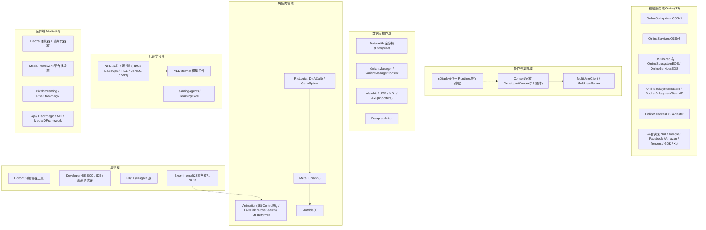

### 25.2.2 nDisplay 集群通信架构

nDisplay 本体位于 `Runtime/nDisplay`(第 24 章范围),这里按任务要求给出其通信架构。主节点(Primary)运行 `FDisplayClusterClusterNodeCtrlMain`,其内 `FDisplayClusterNetApiFacade` 是所有网络请求入口:"Access to the cluster sync API (Game thread only)"带 `check(IsInGameThread())`,`GetRenderSyncAPI()` 注明 "RHI thread only"(`Plugins/Runtime/nDisplay/Source/DisplayCluster/Private/Cluster/NetAPI/DisplayClusterNetApiFacade.h:30-38`)。主节点 `FDisplayClusterTcpListener` 接受各 Secondary 的 TCP 连接,每协议一个服务(`Network/Service/` 下 `FDisplayClusterClusterSyncService`——头文件注释 "Cluster synchronization TCP server"、`FDisplayClusterRenderSyncService`、`ClusterEventsJson/Binary`、`GenericBarrier`、`InternalComm`)。Secondary 侧每节点一组客户端(`FDisplayClusterClusterSyncClient` 等)。帧同步由主节点两个 `FDisplayClusterBarrier`(Barrier v2,构造参数 `Name, CallersAllowed, Timeout`,基于 `FEvent`,`DisplayClusterBarrier.h:16-37`)完成:Game Thread 障栅与 Render Thread 障栅。

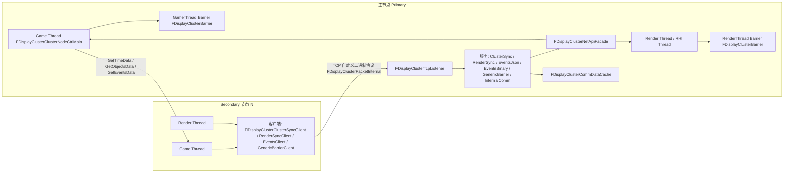

### 25.2.3 Concert / Multi-User 通信架构

Concert 传输层(`ConcertMain/ConcertTransport`)构建在引擎 MessageBus 之上:`FConcertLocalEndpoint`(`ConcertTransport/Private/ConcertLocalEndpoint.h:25`)内部持有 `FMessageEndpoint`,对每个远端维护 `FConcertRemoteEndpoint`。线程模型三部分:(1)专用保活线程 `FConcertLocalEndpointKeepAliveRunnable : FRunnable`,循环调用 `SendKeepAlives()` 并重发可靠消息(`ConcertLocalEndpoint.cpp:19-58`);(2)Game Thread `FTSTicker::GetCoreTicker().AddTicker(..., &FConcertLocalEndpoint::HandleTick, 0.0f)`(`ConcertLocalEndpoint.cpp:102`)泵送已收消息队列;(3)MessageBus 自身工作线程完成 UDP 组播发现与 TCP 传输。消息模型:Request/Response/Event 三类 + ACK(`QueueAck`/`SendAck`/`SendPendingMessages` 可靠重发),序列化经 `ConcertIdentifierTable` + `ConcertScratchpad` 压缩。会话层:`IConcertClient`(`ConcertClient/Public/IConcertClient.h:161`)负责发现/连接/会话生命周期;服务器侧 `IConcertServer::CreateSession`(`IConcertServer.h:150`)建立 `IConcertServerSession`;Multi-User 在其上加 `IConcertClientWorkspace`(`ConcertSyncClient/.../IConcertClientWorkspace.h:26`,资源锁 `LockResources` :58)与 `FConcertSyncTransactionEvent` 变更事件(`ConcertSyncCore/.../ConcertSyncSessionTypes.h:107`),服务器落盘到 `FConcertSyncSessionDatabase`(`ConcertSyncSessionDatabase.h:51`)。

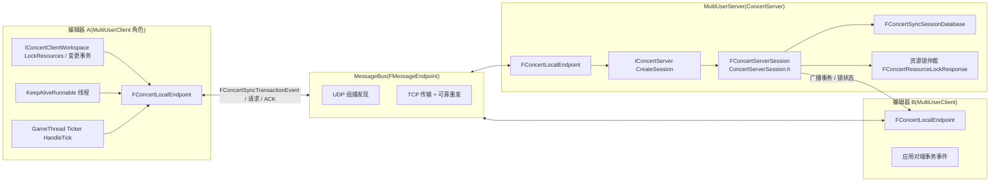

## 25.3 类图

### 25.3.1 Online OSSv1(工厂与子系统)

`IOnlineSubsystem`(`OnlineSubsystem/Source/Public/OnlineSubsystem.h:150`)以纯虚 getter 暴露 28 个功能接口;实现基类为 `FOnlineSubsystemImpl`(`OnlineSubsystemImpl.h`);各平台模块实现 `IOnlineFactory::CreateSubsystem`(`OnlineSubsystem.h:649-663`)并注册到 `FOnlineSubsystemModule`。异步任务基类 `FOnlineAsyncTaskManager : FRunnable`(`OnlineAsyncTaskManager.h:304`,串行/并行双队列,GameThread Initialize→OnlineThread Tick→GameThread Finalize/TriggerDelegates,:288-303 注释)。

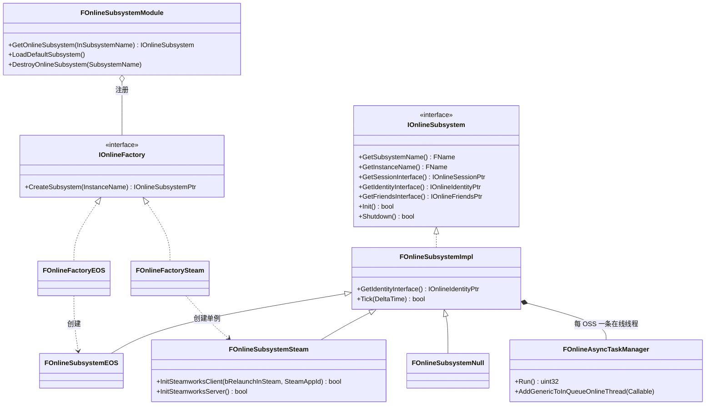

### 25.3.2 Online OSSv2(注册表与组件)

OSSv2 以服务实例为中心:`IOnlineServices`(`OnlineServices/Source/OnlineServicesInterface/Public/Online/OnlineServices.h:64`)的 16 个接口 getter 由组件机制实现——`FOnlineServicesEOSGS::RegisterComponents()` 逐个 `Components.Register<FAuthEOSGS>(*this)` 等(`OnlineServicesEOSGS/Source/Private/Online/OnlineServicesEOSGS.cpp:68-96`)。工厂经 `FOnlineServicesRegistry::RegisterServicesFactory`(`OnlineServicesRegistry.h:54`)注册,优先级为 int32(EOS 比 EOSGS 高 1:`FOnlineServicesEOSModule::GetRegistryPriority()`,`OnlineServicesEOSModule.cpp:29-31`)。

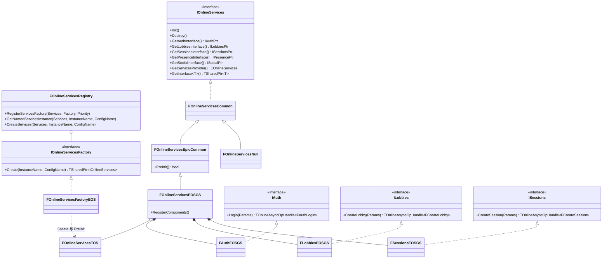

### 25.3.3 Mutable(资产、系统与任务图)

`UCustomizableObject`(`Mutable/Source/CustomizableObject/Public/MuCO/CustomizableObject.h:173`)持有编辑器图 `Source`(UEdGraph,EditorOnly,:266)与编译入口 `Compile(const FCompileParams&)`(:388);`UCustomizableObjectSystem`(:116,单例 `GetInstance()`:129)将实现全部委托给 `UCustomizableObjectSystemPrivate`(`Internal/MuCO/CustomizableObjectSystemPrivate.h:444`,同时实现 `IStreamingManager`,`UpdateResourceStreaming` :473)。生成流程中的操作上下文为 `FUpdateContextPrivate`,MuR 侧核心为 `UE::Mutable::Private::FSystem`(`MutableRuntime/Internal/MuR/System.h`)与 `FLiveInstance`(由 `FSystem::NewInstance` 创建)。编译器 `FCustomizableObjectCompiler`(`CustomizableObjectEditor/Private/MuCOE/CustomizableObjectCompiler.h:39`)拥有专用线程 `CompileThread`/`SaveDDThread`(:149/:153)与 MPSC 游戏线程任务队列(:180)。

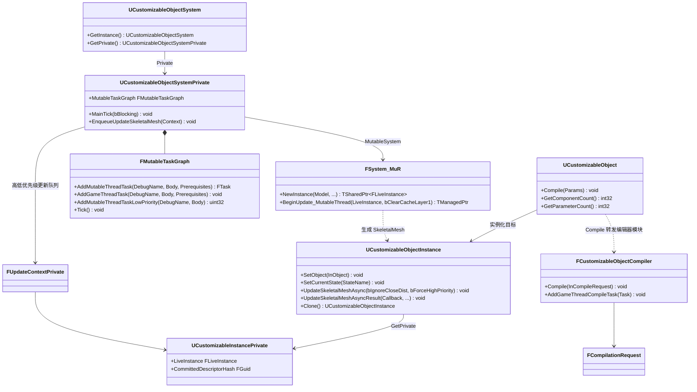

注:`FSystem_MuR` 在源码中的全名为 `UE::Mutable::Private::FSystem`(类图节点名不含 `::`)。

### 25.3.4 NNE(运行时接口与实现)

NNE 核心接口在引擎模块 `NNE`(`Source/Runtime/NNE/Public/`)中,运行时以 `UObject` 接口实现并注册到全局注册表 `UE::NNE::RegisterRuntime`(`NNE.h:27`)。RDG/HLSL 运行时实现类为 `UNNERuntimeRDGHlslImplRDG`(`NNERuntimeRDG/Private/NNERuntimeRDGModule.cpp:74`);IREE 运行时按设备注册 Cpu/Cuda/Vulkan/Rdg 四个(`NNERuntimeIREEModule.cpp:120-158`);ORT 在 Windows 注册 `NNERuntimeORTDml`(`NNERuntimeORT/Private/NNERuntimeORT.cpp:223-225`)。

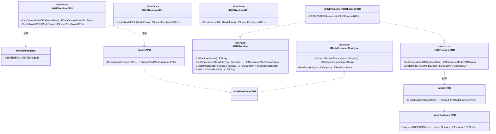

### 25.3.5 Datasmith 与 VariantManager

导入侧:`IDatasmithTranslator`(`DatasmithImporter/Source/DatasmithTranslator/Public/DatasmithTranslator.h:44`,`Initialize(FDatasmithTranslatorCapabilities&)` :55)由各格式翻译器实现;`FDatasmithImportContext`(`DatasmithImporter/Public/DatasmithImportContext.h:211`)同时持有原始与过滤后的 `IDatasmithScene`(:252-255,libdatasmith 元素树)。VariantManager:`ULevelVariantSets → UVariantSet → UVariant → UVariantObjectBinding → UPropertyValue`(含 `PropertyValueColor/Material/Option/SoftObject` 子类),场景入口 `ALevelVariantSetsActor`(`LevelVariantSetsActor.h:46` 附近)。

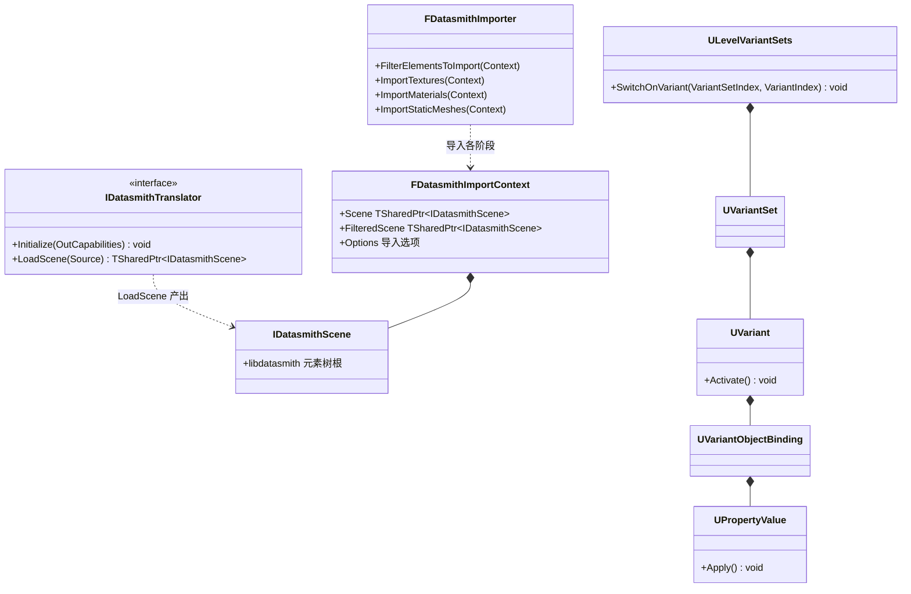

注:`FDatasmithImporter::FilterElementsToImport/ImportTextures/ImportMaterials/ImportStaticMeshes` 为 `DatasmithImportFactory.cpp:205/213/227/246` 调用的命名空间函数;`IDatasmithTranslator::LoadScene` 的完整签名以头文件为准(此处示意为"产出 IDatasmithScene")。

## 25.4 数据字典

| 类型 | 字段/成员 | 类型 | 含义 | 取值/约束 | 源码位置 |
|---|---|---|---|---|---|
| `EOnlineServices`(enum class : uint8) | Null/Epic/Xbox/PSN/Nintendo/Reserved_5/Steam/Google/GooglePlay/Apple/AppleGameKit/Samsung/Oculus/… | uint8 枚举 | OSSv2 服务提供方类型,`EOnlineServices::Default` 表示按配置解析 | — | Source/Runtime/CoreOnline/Public/Online/CoreOnline.h:219 |
| `FEOSSDKPlatformConfig` | ProductId/SandboxId/ClientId/ClientSecret/EncryptionKey/DeploymentId | FString | EOS 平台实例凭证,来自 `[EOSSDK]`/`[EOSSDK.<name>]` ini | 均可为空,缺失时相关接口不注册 | Plugins/Online/EOSShared/Source/EOSShared/Public/IEOSSDKManager.h:16-27 |
| `FEOSSDKPlatformConfig` | TickBudgetInMilliseconds | int32 | 每次 `EOS_Platform_Tick` 的时间预算 | 默认 1(ms) | IEOSSDKManager.h:38 |
| `FEOSSDKPlatformConfig` | bIsServer/bDisableOverlay/bDisableSocialOverlay/bEnableRTC | bool | 服务器模式、禁用 overlay/social、启用 RTC | 默认 false/false/false/true | IEOSSDKManager.h:30-37 |
| `FDisplayClusterBarrier`(构造参数) | Name/CallersAllowed/Timeout | FString/TSet~FString~/uint32 | 障栅名、参与节点集合、超时(ms);`Wait(CallerId,…)`/`WaitWithData(CallerId,RequestData,OutResponseData,…)` 阻塞至全员到达 | 返回 `EDisplayClusterBarrierWaitResult` | Plugins/Runtime/nDisplay/.../Network/Barrier/DisplayClusterBarrier.h:23,36-37 |
| `EDisplayClusterSyncGroup`(enum class : uint8) | PreTick=0/Tick/PostTick | uint8 | nDisplay 对象数据同步分组 | — | Plugins/Runtime/nDisplay/.../DisplayCluster/Public/DisplayClusterEnums.h:39 |
| `FCompileParams`(Mutable) | bSkipIfCompiled/bAsync/OptimizationLevel/TextureCompression/CompileOnlySelectedInstance/Callback/CallbackNative | bool/enum/委托 | 编译请求参数;`ECustomizableObjectTextureCompression`:None/Fast/HighQuality | OptimizationLevel 可为 FromCustomizableObject | Plugins/Mutable/Source/CustomizableObject/Public/MuCO/CustomizableObject.h:133-169 |
| `EUpdateResult`(Mutable) | Success/Warning/Error/ErrorOptimized/ErrorReplaced/ErrorDiscarded/Error16BitBoneIndex/ErrorUncompiled | uint8 枚举 | 实例更新结果 | ErrorOptimized=命中"结果与当前一致"跳过 | CustomizableObjectInstance.h:218-231 |
| `FTensorBindingCPU` | Data/SizeInBytes | void*/uint64 | CPU 推理输入输出绑定,调用方持有内存 | 必须 ≥ 张量实际字节数 | Source/Runtime/NNE/Public/NNERuntimeRunSync.h:18-22 |
| `FTensorBindingRDG` | Buffer | FRDGBufferRef | RDG 推理张量绑定 | 仅 Render Thread | Source/Runtime/NNE/Public/NNERuntimeRDG.h:25-27 |
| `FConcertCreateSessionArgs`(Concert) | ServerAdminEndpointId/…(IConcertClient.h:115 起) | FGuid 等 | 客户端建会话参数 | — | ConcertMain/ConcertClient/Public/IConcertClient.h:115 |
| `FConcertSyncTransactionEvent`(Concert) | 事务载荷(ConcertSyncSessionTypes.h:107 起) | struct | Multi-User 变更同步的最小事件单位 | 经 ConcertIdentifierTable 序列化 | ConcertSync/ConcertSyncCore/.../ConcertSyncSessionTypes.h:107 |

## 25.5 接口清单

### 25.5.1 OnlineSubsystem(OSSv1)`IOnlineSubsystem`

获取实例的静态入口(均为 `Plugins/Online/OnlineSubsystem/Source/Public/OnlineSubsystem.h`):

| 原型 | 功能 | 线程约束 | 位置 |
|---|---|---|---|
| `static IOnlineSubsystem* Get(const FName& SubsystemName = NAME_None)` | 按名取子系统实例,内部转 `FOnlineSubsystemModule::GetOnlineSubsystem` | 未在头文件标注线程约束 | OnlineSubsystem.h:168 |
| `static IOnlineSubsystem* GetByPlatform(bool bAutoLoad=true)` | 取本机平台原生子系统 | 未在头文件标注线程约束 | :182 |
| `static IOnlineSubsystem* GetByConfig(const FString& ConfigString, bool bAutoLoad = true)` | 按配置键取子系统 | 未在头文件标注线程约束 | :201 |
| `static void Destroy(FName SubsystemName)` / `static void ReloadDefaultSubsystem()` | 销毁/重载默认子系统(后者注释 "intended for editor use only") | 未标注(后者限编辑器) | :216/:230 |
| `static bool DoesInstanceExist(const FName& SubsystemName = NAME_None)` / `static bool IsLoaded(...)` / `static UE_API bool IsEnabled(const FName& SubsystemName, const FName& InstanceName = NAME_None)` | 存在性/已加载/启用查询 | 未在头文件标注线程约束 | :242/:257/:272 |

功能接口 getter(全部纯虚,` = 0`;返回 `TSharedPtr<..., ESPMode::ThreadSafe>`。**这就是 OSSv1 的接口清单**,共 28 项):

| Getter | 返回接口 | 职责 | 位置 |
|---|---|---|---|
| `GetSessionInterface()` | `IOnlineSessionPtr` | 会话/匹配 | :304 |
| `GetFriendsInterface()` | `IOnlineFriendsPtr` | 好友 | :310 |
| `GetMessageSanitizer(int32 LocalUserNum, FString& OutAuthTypeToExclude)` | `IMessageSanitizerPtr` | 跨平台文本净化 | :318 |
| `GetGroupsInterface()` | `IOnlineGroupsPtr` | 群组 | :324 |
| `GetPartyInterface()` | `IOnlinePartyPtr` | 派对 | :330 |
| `GetSharedCloudInterface()` | `IOnlineSharedCloudPtr` | 共享云文件 | :336 |
| `GetUserCloudInterface()` | `IOnlineUserCloudPtr` | 用户云文件 | :342 |
| `GetEntitlementsInterface()` | `IOnlineEntitlementsPtr` | 权益 | :348 |
| `GetLeaderboardsInterface()` | `IOnlineLeaderboardsPtr` | 排行榜 | :354 |
| `GetVoiceInterface()` | `IOnlineVoicePtr` | 语音 | :360 |
| `GetExternalUIInterface()` | `IOnlineExternalUIPtr` | 平台外部 UI | :366 |
| `GetTimeInterface()` | `IOnlineTimePtr` | 服务器时间 | :372 |
| `GetIdentityInterface()` | `IOnlineIdentityPtr` | 登录/身份 | :378 |
| `GetTitleFileInterface()` | `IOnlineTitleFilePtr` | 标题文件 | :384 |
| `GetStoreV2Interface()` | `IOnlineStoreV2Ptr` | 商店 V2 | :390 |
| `GetPurchaseInterface()` | `IOnlinePurchasePtr` | 购买 | :396 |
| `GetEventsInterface()` | `IOnlineEventsPtr` | 遥测事件 | :402 |
| `GetAchievementsInterface()` | `IOnlineAchievementsPtr` | 成就 | :408 |
| `GetSharingInterface()` | `IOnlineSharingPtr` | 分享 | :414 |
| `GetUserInterface()` | `IOnlineUserPtr` | 用户信息 | :420 |
| `GetMessageInterface()` | `IOnlineMessagePtr` | 消息 | :426 |
| `GetPresenceInterface()` | `IOnlinePresencePtr` | 在线状态 | :432 |
| `GetChatInterface()` | `IOnlineChatPtr` | 聊天 | :438 |
| `GetStatsInterface()` | `IOnlineStatsPtr` | 统计 | :444 |
| `GetGameActivityInterface()` | `IOnlineGameActivityPtr` | 游戏活动 | :450 |
| `GetGameItemStatsInterface()` | `IOnlineGameItemStatsPtr` | 道具统计 | :456 |
| `GetGameMatchesInterface()` | `IOnlineGameMatchesPtr` | 比赛匹配 | :462 |
| `GetOnlineContentAgeRestrictionInterface()` | `IOnlineContentAgeRestrictionPtr` | 内容年龄限制 | :468 |
| `GetTurnBasedInterface()` / `GetTournamentInterface()` | `IOnlineTurnBasedPtr` / `IOnlineTournamentPtr` | 回合制/锦标赛 | :483/:489 |

生命周期与其他:`virtual bool Init() = 0`(:552)、`virtual void PreUnload() = 0`(:557)、`virtual bool Shutdown() = 0`(:563)、`virtual UObject* GetNamedInterface(FName)`/`SetNamedInterface`(:505/:513)、`virtual bool IsDedicated() const`/`IsServer()`/`IsLocalPlayer(const FUniqueNetId&)`(:522/:530/:546)。子系统创建工厂:`class IOnlineFactory { virtual IOnlineSubsystemPtr CreateSubsystem(FName InstanceName) = 0; }`(:649-663)。接口头文件全部位于 `Source/Public/Interfaces/`(如 `OnlineSessionInterface.h`、`OnlineIdentityInterface.h`,共 39 个,含 `OnlineStoreInterfaceV2.h`、`TurnBasedMatchInterface.h` 等遗留头)。

异步任务模型:`FOnlineAsyncTaskManager`(`OnlineAsyncTaskManager.h:304`)的 GameThread/OnlineThread 状态机为 `Initialize()`(GameThread)→ `Tick()`(OnlineThread,直至 `IsDone()`)→ `Finalize()` + `TriggerDelegates()`(GameThread),头文件 :288-303 注释明示;`AddGenericToInQueueOnlineThread`(:472)供任意线程投递回调。

### 25.5.2 OnlineServices(OSSv2)`UE::Online::IOnlineServices`

实例入口(命名空间自由函数,`Plugins/Online/OnlineServices/Source/OnlineServicesInterface/Public/Online/OnlineServices.h`):

| 原型 | 功能 | 位置 |
|---|---|---|
| `ONLINESERVICESINTERFACE_API TSharedPtr<IOnlineServices> GetServices(EOnlineServices OnlineServices = EOnlineServices::Default, FName InstanceName = NAME_None, FName InstanceConfigName = NAME_None)` | 取/懒创建服务实例 | OnlineServices.h:232 |
| `template <typename ServicesClass> TSharedPtr<ServicesClass> GetServices(FName InstanceName = NAME_None, FName InstanceConfigName = NAME_None)` | 取指定实现类型 | :241 |
| `ONLINESERVICESINTERFACE_API bool IsLoaded(EOnlineServices OnlineServices = EOnlineServices::Default, FName InstanceName = NAME_None, FName InstanceConfigName = NAME_None)` | 是否已加载 | :222 |
| `ONLINESERVICESINTERFACE_API void DestroyService(...)` / `DestroyAllNamedServices(EOnlineServices)` / `DestroyAllServicesWithName(FName)` | 销毁实例 | :252/:259/:266 |

`IOnlineServices` 纯虚接口 getter 清单(16 项,OnlineServices.h:82-158;**OSSv2 的标准接口**即由这些 getter 返回;每个接口头文件在 `Source/OnlineServicesInterface/Public/Online/` 下:`Auth.h`、`Lobbies.h`、`Sessions.h`、`Presence.h`、`Social.h`、`Achievements.h`、`Commerce.h`、`UserInfo.h`、`ExternalUI.h`、`Leaderboards.h`、`Stats.h`、`Connectivity.h`、`Privileges.h`、`TitleFile.h`、`UserFile.h`):

| Getter | 接口 | 位置 |
|---|---|---|
| `GetAchievementsInterface()` | `IAchievements` | :82 |
| `GetAuthInterface()` | `IAuth` | :87 |
| `GetCommerceInterface()` | `ICommerce` | :92 |
| `GetUserInfoInterface()` | `IUserInfo` | :97 |
| `GetSocialInterface()`(好友/屏蔽列表等社交关系;**OSSv2 中没有独立的 IFriends**,好友并入 Social) | `ISocial` | :104 |
| `GetPresenceInterface()` | `IPresence` | :109 |
| `GetExternalUIInterface()` | `IExternalUI` | :114 |
| `GetLeaderboardsInterface()` | `ILeaderboards` | :120 |
| `GetLobbiesInterface()` | `ILobbies` | :126 |
| `GetSessionsInterface()` | `ISessions` | :132 |
| `GetStatsInterface()` | `IStats` | :138 |
| `GetConnectivityInterface()` | `IConnectivity` | :143 |
| `GetPrivilegesInterface()` | `IPrivileges` | :148 |
| `GetTitleFileInterface()` | `ITitleFile` | :153 |
| `GetUserFileInterface()` | `IUserFile` | :158 |
| `GetInterface<InterfaceType>()` | 泛型取任意标准/实现私有接口,经 `AssignBaseInterfaceSharedPtr`(私有纯虚 :204) | :186-201 |

`IAuth` 全部方法(`Auth.h`,异步操作返回 `TOnlineAsyncOpHandle<T>`,完成后触发对应 `TOnlineEvent`):`Login(FAuthLogin::Params&&)` :477、`Logout` :482、`CreateAccount` :487、`LinkAccount` :492、`ModifyAccountAttributes` :497、`QueryExternalServerAuthTicket` :504、`QueryExternalAuthToken` :511、`QueryVerifiedAuthTicket` :526、`CancelVerifiedAuthTicket` :533、`BeginVerifiedAuthSession` :549、`EndVerifiedAuthSession` :554、`GetLocalOnlineUserByOnlineAccountId` :559、`GetLocalOnlineUserByPlatformUserId` :564、`GetAllLocalOnlineUsers` :569(后三个同步,返回 `TOnlineResult<T>`)。

`ILobbies`(`Lobbies.h`):`CreateLobby` :634、`FindLobbies` :642、`RestoreLobbies` :650、`JoinLobby` :658、`LeaveLobby` :666、`InviteLobbyMember` :674、`DeclineLobbyInvitation` :682、`KickLobbyMember` :690、`PromoteLobbyMember` :699、`ModifyLobbySchema` :712、`ModifyLobbyJoinPolicy` :721、`ModifyLobbyAttributes` :731、`ModifyLobbyMemberAttributes` :741;同步查询 `GetPresenceLobby` :752、`IsPresenceLobby` :760、`GetJoinedLobbies` :768、`GetReceivedInvitations` :776。

`ISessions`(`Sessions.h`):`GetAllSessions/GetSessionByName/GetSessionName/GetSessionById` :721/:729/:737/:745、`GetPresenceSession/IsPresenceSession/SetPresenceSession/ClearPresenceSession` :753-777、`CreateSession` :786、`UpdateSessionSettings` :795、`LeaveSession` :803、`FindSessions` :811、`StartMatchmaking` :819、`JoinSession` :827、`AddSessionMember/RemoveSessionMember` :836/:845、`SendSessionInvite` :853、`GetSessionInviteById/GetAllSessionInvites/RejectSessionInvite` :861-877。

注册与工厂:`FOnlineServicesRegistry`(`OnlineServicesRegistry.h:32`)的 `RegisterServicesFactory(EOnlineServices, TUniquePtr<IOnlineServicesFactory>&&, int32 Priority = 0)` :54、`GetNamedServicesInstance` :84、`CreateServices` :118、`SetDefaultServiceOverride` :133;EOS 注册见 `FOnlineServicesEOSModule::StartupModule`(`OnlineServicesEOSModule.cpp:36`,`RegisterServicesFactory(EOnlineServices::Epic, ...)` :43)。

### 25.5.3 EOSShared `IEOSSDKManager`(ModularFeature,名称 "EOSSDKManager")

| 原型 | 功能 | 线程/时机 | 位置 |
|---|---|---|---|
| `virtual bool IsInitialized() const = 0` | EOSSDK 是否已 `EOS_Initialize` | 任意 | Plugins/Online/EOSShared/Source/EOSShared/Public/IEOSSDKManager.h:117 |
| `virtual const FEOSSDKPlatformConfig* GetPlatformConfig(const FString& PlatformConfigName, bool bLoadIfMissing = false) = 0` | 取平台配置(可从 ini 加载) | 任意(读) | :119 |
| `virtual bool AddPlatformConfig(const FEOSSDKPlatformConfig& PlatformConfig, bool bOverwriteExistingConfig = false) = 0` | 注册平台配置 | 配置阶段 | :120 |
| `virtual IEOSPlatformHandlePtr CreatePlatform(const FString& PlatformConfigName, FName InstanceName = NAME_None) = 0` / `CreatePlatform(EOS_Platform_Options& PlatformOptions)` | 创建/复用 EOS 平台句柄(同配置名复用) | GameThread 为主 | :128/:131 |
| `virtual TArray<IEOSPlatformHandlePtr> GetActivePlatforms() = 0` | 全部活动平台 | 任意 | :134 |
| `virtual TSharedRef<IEOSFastTickLock> GetFastTickLock() = 0` | RAII 快速 tick 锁(overlay 可见等场景) | GameThread | :154 |
| `virtual void AddCallbackObject(TUniquePtr<class FCallbackBase> CallbackObj) = 0` | 托管 EOS 回调对象生命周期至 `EOS_Shutdown` | 任意 | :152 |

委托(IEOSSDKManager.h:156-165):`OnPreInitializeSDK`/`OnPreInitializeSDK2`(可改写 `EOS_InitializeOptions`)、`OnPostInitializeSDK`、`OnDefaultPlatformConfigNameChanged`、`OnPreCreateNamedPlatform`/`OnPreCreatePlatform`/`OnPlatformCreated`、`OnPreReleasePlatform`、`OnRequestRuntimeLibraryName`、`OnNetworkStatusChanged`。初始化实现 `FEOSSDKManager::Initialize()`(EOSSDKManager.cpp:229:装配 `EOS_InitializeOptions`(ApiVersion=4,自定义分配器 `EosMalloc/EosRealloc/EosFree` :279-281)→ `EOSInitialize` :288 → 挂接 `EOS_Logging_SetCallback` :300 与网络状态代理 :313 → 广播 `OnPostInitializeSDK` :320)。Tick:仅当有活动平台时注册 `FTSTicker::GetCoreTicker().AddTicker(..., &FEOSSDKManager::Tick, TickIntervalSeconds)`(:791-808,入口 `check(IsInGameThread())` :793),`Tick` 内按 `TickBudgetInMilliseconds` 预算循环 `EOS_Platform_Tick(PlatformHandle)`(:967)。

EOS 两个模块家族的接入点:OSSv1 侧 `FOnlineFactoryEOS::CreateSubsystem`(`OnlineSubsystemEOS/Private/OnlineSubsystemEOSModule.cpp:37-48`,失败即 `Shutdown` 并返回空);OSSv2 侧 `FOnlineServicesFactoryEOS::Create` 调 `FOnlineServicesEOS::PreInit()`(`OnlineServicesEOSModule.cpp:13-26`),链条 `FOnlineServicesEpicCommon::PreInit` → `PlatformFactory.CreatePlatform(...)` 获得句柄(`OnlineServicesEpicCommon/Private/Online/OnlineServicesEpicCommon.cpp:28-31`)。Steam 侧:`FOnlineSubsystemSteam::InitSteamworksClient(bool bRelaunchInSteam, int32 SteamAppId)`(`OnlineSubsystemSteam/Private/OnlineSubsystemSteam.cpp:503`)经 `FSteamSharedModule::ObtainSteamClientInstanceHandle()`(:521)并逐一 `GET_STEAMWORKS_INTERFACE` 校验(SteamUtils/SteamUser/SteamFriends/SteamRemoteStorage/SteamUserStats/SteamMatchmakingServers/SteamApps/SteamNetworking/SteamMatchmaking,:534-550);服务器侧 `InitSteamworksServer()`(:587)校验 SteamGameServer 族接口(:607-610)。

### 25.5.4 NNE 接口

| 原型 | 功能 | 线程约束 | 位置 |
|---|---|---|---|
| `NNE_API ERegisterRuntimeStatus RegisterRuntime(TWeakInterfacePtr<INNERuntime> Runtime)` | 注册运行时(调用方保持强引用防 GC) | 启动期 | Source/Runtime/NNE/Public/NNE.h:27 |
| `NNE_API TWeakInterfacePtr<INNERuntime> GetRuntime(const FString& Name)` 及模板 `GetRuntime<T>` | 按名/按接口取运行时 | 任意 | :52/:63 |
| `virtual FString GetRuntimeName() const = 0`(INNERuntime) | 运行时名(如 "NNERuntimeRDG") | — | NNERuntime.h:50 |
| `virtual ECanCreateModelDataStatus CanCreateModelData(const FString& FileType, TConstArrayView64<uint8> FileData, const TMap<FString, TConstArrayView64<uint8>>& AdditionalFileData, const FGuid& FileId, const ITargetPlatform* TargetPlatform) const = 0` | 判断能否烘焙模型数据(onnx 等) | Cook/导入 | NNERuntime.h:62 |
| `virtual TSharedPtr<UE::NNE::FSharedModelData> CreateModelData(...) = 0` | 产出运行时特定模型数据存入 `UNNEModelData` | Cook/导入 | NNERuntime.h:74 |
| `virtual ECanCreateModelCPUStatus CanCreateModelCPU(const TObjectPtr<UNNEModelData> ModelData) const = 0` / `virtual TSharedPtr<UE::NNE::IModelCPU> CreateModelCPU(const TObjectPtr<UNNEModelData> ModelData) = 0`(INNERuntimeCPU) | CPU 模型创建 | 任意(数据保持有效) | NNERuntimeCPU.h:75/:87 |
| `virtual ECanCreateModelRDGStatus CanCreateModelRDG(...) const = 0` / `virtual TSharedPtr<UE::NNE::IModelRDG> CreateModelRDG(...) = 0`(INNERuntimeRDG) | RDG 模型创建;文档注明模型可随后移交渲染线程 | 任意/随后 RenderThread | NNERuntimeRDG.h:157/:169 |
| `virtual ESetInputTensorShapesStatus SetInputTensorShapes(TConstArrayView<FTensorShape> InInputShapes) = 0`(IModelInstanceRunSync) | 形状推理,运行前置条件,"potentially expensive, lazily" | CPU 任意;RDG 版可 RenderThread | NNERuntimeRunSync.h:82 / NNERuntimeRDG.h:91 |
| `virtual ERunSyncStatus RunSync(TConstArrayView<FTensorBindingCPU> InInputTensors, TConstArrayView<FTensorBindingCPU> InOutputTensors) = 0` | 同步推理,阻塞调用线程 | 任意线程(可放入异步任务) | NNERuntimeRunSync.h:96 |
| `virtual EEnqueueRDGStatus EnqueueRDG(FRDGBuilder& RDGBuilder, TConstArrayView<FTensorBindingRDG> Inputs, TConstArrayView<FTensorBindingRDG> Outputs) = 0`(IModelInstanceRDG) | 向 RDG 图入队算子,"must be called from the render thread" | **RenderThread** | NNERuntimeRDG.h:105 |

五个运行时的注册事实:`NNERuntimeRDG`——`FNNERuntimeRDGModule::StartupModule` 按 `FDataDrivenShaderPlatformInfo::GetSupportsNNEShaders` 与硬件检测决定注册 `UNNERuntimeRDGHlslImplRDG`(可推理)或仅编辑器烘焙用 `UNNERuntimeRDGHlslImpl`(NNERuntimeRDGModule.cpp:67-101);`NNERuntimeBasicCpu`(NNERuntimeBasicCpuModule.cpp:17);`NNERuntimeIREE` 注册 Cpu/Cuda/Vulkan/Rdg 四个接口对象(NNERuntimeIREEModule.cpp:120-158);`NNERuntimeCoreML`(NNERuntimeCoreMLModule.cpp:80);`NNERuntimeORT` 注册 DirectML 后端,运行时名 `NNERuntimeORTDml`,仅接受 `onnx` 输入(NNERuntimeORT.cpp:223-231,RegisterRuntime 于 NNERuntimeORTModule.cpp:113)。

### 25.5.5 Mutable 公共入口

| 原型 | 功能 | 线程约束 | 位置 |
|---|---|---|---|
| `CUSTOMIZABLEOBJECT_API void Compile(const FCompileParams& Params)`(UCustomizableObject) | 编译:转发 `ICustomizableObjectEditorModule::CompileCustomizableObject`(:1350,构造 `FCompilationRequest` 后入队) | GameThread(编辑器) | CustomizableObject.h:388 |
| `CUSTOMIZABLEOBJECT_API bool ConditionalAutoCompile()` | 条件自动编译 | GameThread | :396 |
| `CUSTOMIZABLEOBJECT_API void SetObject(UCustomizableObject* InObject)` / `SetCurrentState(const FString& StateName)`(UCustomizableObjectInstance) | 设定目标对象与状态 | GameThread | CustomizableObjectInstance.h:328/:348 |
| `CUSTOMIZABLEOBJECT_API void UpdateSkeletalMeshAsync(bool bIgnoreCloseDist = false, bool bForceHighPriority = false)` | 异步生成并更新组件 SkeletalMesh | GameThread(内部 `check(IsInGameThread())`,CustomizableObjectSystem.cpp:1270) | CustomizableObjectInstance.h:392 |
| `CUSTOMIZABLEOBJECT_API void UpdateSkeletalMeshAsyncResult(FInstanceUpdateDelegate Callback, bool bIgnoreCloseDist = false, bool bForceHighPriority = false)` | 带完成回调的异步生成(含 `FInstanceUpdateNativeDelegate` 重载) | GameThread 发起,回调 GameThread | :397/:399 |
| `CUSTOMIZABLEOBJECT_API UCustomizableObjectInstance* Clone()` / `CloneStatic(UObject* Outer)` | 克隆实例(瞬态/静态) | GameThread | :403/:407 |
| `CUSTOMIZABLEOBJECT_API void DestroyLiveUpdateInstance()` | 销毁 Live Update 实例 | GameThread | :414 |
| `static UE_API UCustomizableObjectSystem* GetInstance()`(UCustomizableObjectSystem) | 系统单例(懒创建) | GameThread | CustomizableObjectSystem.h:129 |
| `UE_API void SetWorkingMemory(int32 KiloBytes)` / `GetWorkingMemory()` | 工作内存上限(软限制),对应 CVar `mutable.WorkingMemory` | GameThread | :226/:230 |
| `UE_API void SetGenerateInstancesWithinRange(bool bActive)` / `SetInstanceGenerationRange(float Distance)` / `AddViewCenter(const AActor*)` | 视野范围内实例生成管理 | GameThread | :241-:253 |
| 委托 `FObjectInstanceUpdatedDelegate UpdatedDelegate` / `FPreSetSkeletalMeshDelegate` | 实例更新完成/换网格前广播 | GameThread | CustomizableObjectInstance.h:299-:310 |

内部关键函数(用于 25.6/25.7 流程引用):`UCustomizableObjectSystemPrivate::EnqueueUpdateSkeletalMesh`(CustomizableObjectSystem.cpp:1267)、`UpdateTick`(:2942,从 High/Low 优先级队列 `TryPopFirst` 并调 `TryStartUpdate` :3535 / `StartUpdate` :3625)、`StartUpdate` 将 `Task_Game_StartUpdate` 作为 GameThread 任务入队(:3655-3661,`impl::Task_Game_StartUpdate` 内完成 `FSystem::NewInstance` :2754 与 Mutable 任务链发射 :2853-2934)、`FSystem::BeginUpdate_MutableThread`(MutableRuntime/Private/MuR/System.cpp:201)。

### 25.5.6 Concert / nDisplay / Datasmith 关键入口

Concert(`IConcertClient`,IConcertClient.h:161):`Configure(const UConcertClientConfig*)`、`Startup()`/`Shutdown()`、`StartDiscovery()`/`StopDiscovery()`、`StartAutoConnect()`、`GetKnownServers()`、`TFuture<EConcertResponseCode> CreateSession(const FGuid& ServerAdminEndpointId, const FConcertCreateSessionArgs&)`(:308)、`OnSessionStartup/OnSessionShutdown/OnSessionConnectionChanged` 委托。工作区(`IConcertClientWorkspace.h:26`):`TFuture<FConcertResourceLockResponse> LockResources(TArray<FName> InResourceName)` :58、`UnlockResources` :65、`FindOrRequestTransactionEvent(int64 TransactionEventId, bool bMetaDataOnly)` :145。服务器(`IConcertServer.h:18`):`FConcertSessionInfo CreateSessionInfo() const` :112、`TSharedPtr<IConcertServerSession> CreateSession(const FConcertSessionInfo&, FText& OutFailureReason)` :150、`bool DestroySession(const FGuid&, FText&)` :212。

nDisplay(`FDisplayClusterClusterNodeCtrlMain` 实现的 `IDisplayClusterProtocolClusterSync`,DisplayClusterClusterNodeCtrlMain.h:41-52):`WaitForGameStart()`、`WaitForFrameStart()`、`WaitForFrameEnd()`、`GetTimeData(double& OutDeltaTime, double& OutGameTime, TOptional<FQualifiedFrameTime>& OutFrameTime)`、`GetObjectsData(EDisplayClusterSyncGroup, TMap<FString, TArray<uint8>>&)`、`GetEventsData(...)`、`GetNativeInputData(...)`、`PropagateStatesData(const TArray<uint8>&, TArray<uint8>&)`;障栅 `FDisplayClusterBarrier::Wait(CallerId, double* OutThreadWaitTime, double* OutBarrierWaitTime)` 与 `WaitWithData(CallerId, RequestData, OutResponseData, ...)`(DisplayClusterBarrier.h:36-37)。

Datasmith:`IDatasmithTranslator::Initialize(FDatasmithTranslatorCapabilities& OutCapabilities)`(DatasmithTranslator.h:55)及 `LoadScene` 族;导入主函数 `DatasmithImportFactoryImpl::ImportDatasmithScene(FDatasmithImportContext&, bool& bOutOperationCancelled)`(DatasmithImportFactory.cpp:183),阶段函数 `FDatasmithImporter::FilterElementsToImport/ImportTextures/ImportMaterials/ImportStaticMeshes`(:205/:213/:227/:246)。VariantManager 内容侧:`ULevelVariantSets`/`UVariantSet`/`UVariant`/`UVariantObjectBinding`/`UPropertyValue`(VariantManagerContent/Public/,如 LevelVariantSets.h:17)。

## 25.6 关键流程

### 25.6.1 OSSv1 默认子系统加载(失败回退 Null)

依据 `FOnlineSubsystemModule::LoadDefaultSubsystem`(OnlineSubsystemModule.cpp:205-227)与 `TryLoadSubsystemAndSetDefault`(:164-203)。

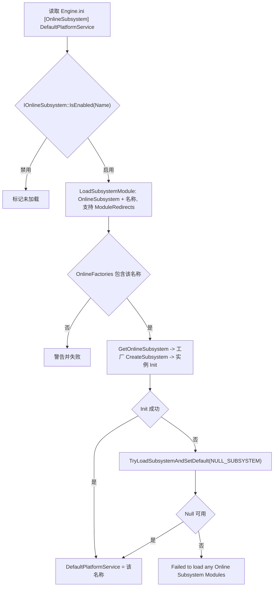

### 25.6.2 OSSv2 实例化与 EOS 接入

`GetServices(EOnlineServices::Epic)` → `FOnlineServicesRegistry::GetNamedServicesInstance/CreateServices` → 工厂链(StartupModule 时 `FOnlineServicesEOSModule::StartupModule` 以优先级 `EOSGS+1` 注册 `Epic` 工厂)→ `FOnlineServicesFactoryEOS::Create` → `FOnlineServicesEOS(→EOSGS→EpicCommon)::PreInit` → `PlatformFactory.CreatePlatform` →(需要时)`IEOSSDKManager::Initialize`(`EOS_Initialize`)→ `RegisterComponents`(`FAuthEOSGS`/`FLobbiesEOSGS`/`FSessionsEOSGS`/`FStatsEOSGS`/`FTitleFileEOSGS`(仅当 `EOS_Platform_GetTitleStorageInterface` 非空)/`FUserFileEOSGS` 等)→ `Init`。EOSGS 的 `PreInit` 另创建 `FSocketSubsystemEOS` 并 `Init`(OnlineServicesEOSGS.cpp:40-50)。生命周期:`DestroyService`/`Destroy` 显式销毁 → `FSocketSubsystemEOS::Shutdown`(EOSGS Destroy :55-66)。EOS 调用经 `EOS_Async(EOS_Auth_Login, ...)`、`EOS_Async(EOS_Connect_Login, ...)` 封装(AuthEOSGS.cpp:888/:1082)。

### 25.6.3 NNE 模型烘焙与推理

烘焙:`UNNEModelData` 持原始文件,编辑器/Cook 遍历已注册运行时 `CanCreateModelData`,首个支持者 `CreateModelData` 生成运行时格式并以 `GetModelDataIdentifier` 构造 DDC 键(NNERuntime.h:62-86 注释)。推理(CPU):`GetRuntime<INNERuntimeCPU>(Name)` → `CreateModelCPU(ModelData)` → `CreateModelInstanceCPU()` → `SetInputTensorShapes`(一次)→ 每帧 `RunSync(Inputs, Outputs)`。推理(RDG):`CreateModelRDG` → `CreateModelInstanceRDG` → 在 RenderThread 上 `EnqueueRDG(RDGBuilder, ...)` 把算子并入渲染图。

### 25.6.4 Mutable:编译与运行时生成

```mermaid
flowchart TD
    subgraph COMP["编译期 编辑器"]
        C1["UCustomizableObject::Compile(FCompileParams)"] --> C2["ICustomizableObjectEditorModule::CompileCustomizableObject"]
        C2 --> C3["FCompilationRequest 入队 EnqueueCompileRequest"]
        C3 --> C4["FCustomizableObjectCompiler 专用 CompileThread"]
        C4 --> C5["生成 mu Model AST 并优化"]
        C5 --> C6["SaveDDThread 写 DerivedDataCache"]
        C4 -.->|"MPSC 队列 PendingGameThreadCompileTasks"| C7["GameThread 收尾与回调"]
    end
    subgraph GEN["运行时生成"]
        G1["GameThread: UpdateSkeletalMeshAsync"] --> G2["EnqueueUpdateSkeletalMesh check IsInGameThread"]
        G2 --> G3{"描述符哈希 == 已提交哈希"}
        G3 -->|是| G4["优化跳过 EUpdateResult::ErrorOptimized"]
        G3 -->|否| G5["入 High/LowPriorityInstanceUpdates 队列"]
        G5 --> G6["UpdateTick 取出 -> TryStartUpdate -> StartUpdate"]
        G6 --> G6B["GameThread 任务 Task_Game_StartUpdate: FSystem NewInstance 创建 FLiveInstance 并设置 Parameters 与 State"]
        G6B --> G8["BeginUpdate_MutableThread 生成 FInstance"]
        G8 --> G9["Mutable 线程任务链 GetSkeletalMeshes -> GetLODs -> GetSurfaces -> GetMaterials -> SkeletonData -> ParameterRelevancy -> ImageDescriptors -> GetImages -> PrepareTextures"]
        G9 --> G10["GameThread: LoadAdditionalAssetsAndData 与 Task_Game_ConvertResources"]
        G10 --> G11["FinishUpdateGlobal: 设置组件 SkeletalMesh 广播 UpdatedDelegate"]
    end
```

任务链各环节名与依赖顺序取自 CustomizableObjectSystem.cpp:2853-2934(`AddMutableThreadTask(TEXT("Task_Mutable_GetSkeletalMeshes"), ...)` 等 9 个任务以 `Prerequisites` 串联,随后 `AddGameThreadTask(TEXT("Task_Game_ConvertResources"), ...)`)。

### 25.6.5 Datasmith 导入主路径

`ImportDatasmithScene`(DatasmithImportFactory.cpp:183):`FilterElementsToImport`(:205,按脏数据过滤出 `FilteredScene`)→ `ImportTextures`(:213,进度 20%)→ `ImportMaterials`(:227,5%,注释指出材质先于静态网格以确定网格构建要求)→ `CreateSceneAsset`(:236)→ `ImportStaticMeshes`(:246,25%)→ `FDatasmithStaticMeshImporter::PreBuildStaticMeshes` → `ImportClothes`(已弃用)→ 若 `ShouldImportActors()` 则 `ImportActors` → `ImportLevelSequences` → `ImportLevelVariantSets` → `FinalizeImport` → `SetupSceneViewport`,阶段之间检查 `bUserCancelled`(置 `bOutOperationCancelled`),最后发送 Analytics(DatasmithImportFactory.cpp:258-315)。CAD 路径额外经 `DatasmithDispatcher` 模块并行翻译(`DatasmithCADImporter` 插件,`CADLibrary`+`DatasmithCADTranslator`+`DatasmithOpenNurbsTranslator`)。

## 25.7 时序图

### 25.7.1 OSSv2 EOS 登录与建房

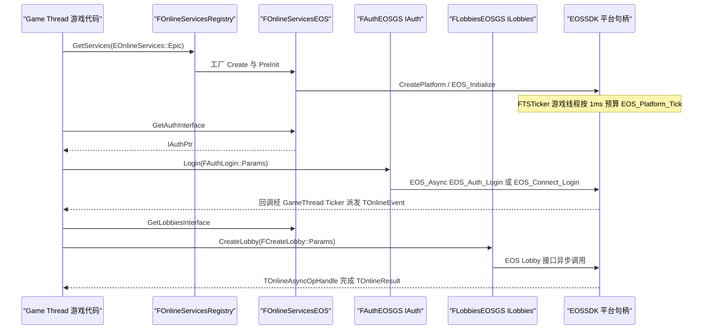

### 25.7.2 Mutable 实例异步生成

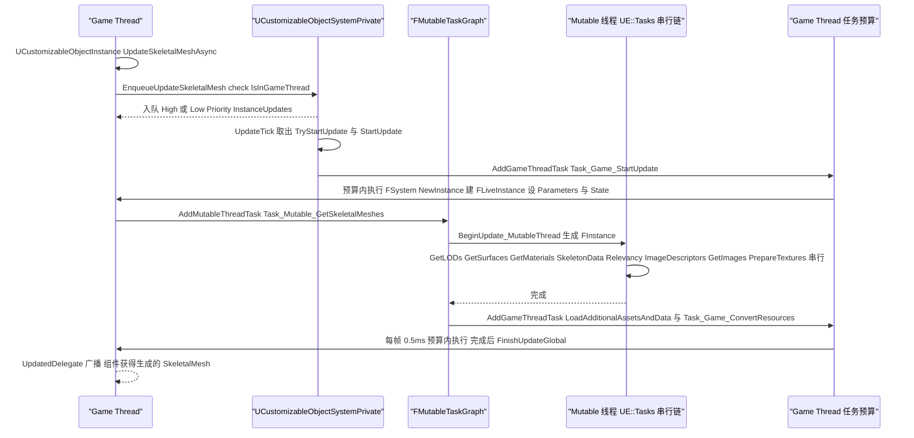

### 25.7.3 nDisplay 帧同步(Game Thread + Render Thread 双障栅)

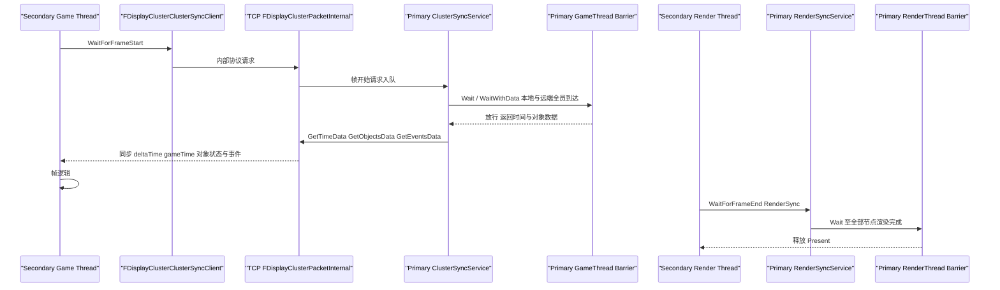

### 25.7.4 Concert Multi-User 编辑同步

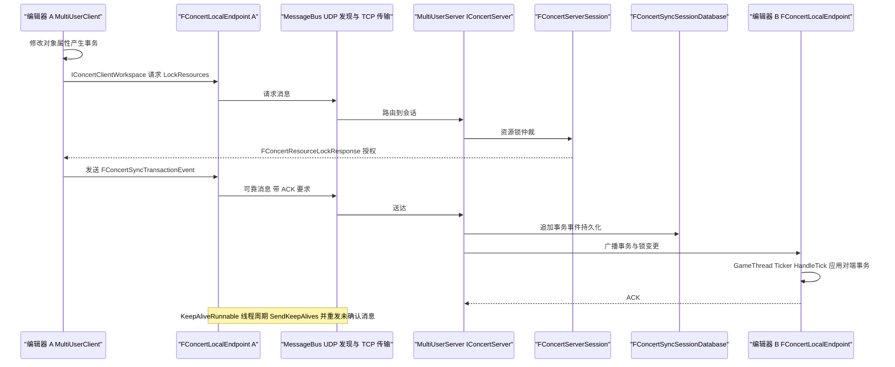

## 25.8 线程模型与同步

| 子系统 | 线程 | 依据 |
|---|---|---|
| EOS SDK | **Game Thread** ticker 驱动 `EOS_Platform_Tick`;`SetupTicker` 入口 `check(IsInGameThread())` | EOSSDKManager.cpp:793/:806/:967;预算 `TickBudgetInMilliseconds=1`(IEOSSDKManager.h:38);overlay 可见时经 `IEOSFastTickLock` RAII 加速(`IEOSSDKManager.h:46-50`) |
| OSSv1 异步 | 每个子系统一条 **OnlineThread**(`FOnlineAsyncTaskManager : FRunnable`,`Run()` :402);任务状态机 GameThread `Initialize` → OnlineThread `Tick` → GameThread `Finalize`+`TriggerDelegates` | OnlineAsyncTaskManager.h:288-303/:304 |
| OSSv1 模块表 | `FOnlineSubsystemModule` 以 `UE::TScopeLock Lock(OnlineSubsystemsLock)` 保护 `OnlineSubsystems` 映射(PreUnload/Shutdown 遍历处) | OnlineSubsystemModule.cpp:244/:257 |
| OSSv2 | 操作对象 `TOnlineAsyncOpHandle` 内部走任务系统;EOS 回调统一经 GameThread ticker 泵出(见 25.7.1);`FOnlineServicesCommon : public IOnlineServices, public FTSTickerObjectBase, public FSelfRegisteringExec`——服务实例自身即 GameThread ticker 对象(OnlineServices/Source/OnlineServicesCommon/Public/Online/OnlineServicesCommon.h:19-22);实例销毁经 `DestroyService` 显式调用 | OnlineServices.h:232-266、OnlineServicesCommon.h:19-22 |
| Concert | **三线程协作**:KeepAlive `FRunnable` 线程(重发/保活)、GameThread `FTSTicker` `HandleTick`(泵已收消息队列)、MessageBus 工作线程(UDP 发现+TCP);发送队列在 endpoint 内串行化 | ConcertLocalEndpoint.cpp:19-58/:102 |
| nDisplay | Game Thread(ClusterSync API `check(IsInGameThread())`)、Render/RHI Thread(`GetRenderSyncAPI` "RHI thread only")、每 TCP 连接的服务线程(`FDisplayClusterTcpListener` + Session);障栅基于 `FEvent` 跨线程等待,超时 `Timeout` 参数 | DisplayClusterNetApiFacade.h:30-38、DisplayClusterBarrier.h:16-37 |
| Mutable | **Mutable 线程** = UE::Tasks 串行链,优先级 `LowLevelTasks::ETaskPriority::BackgroundHigh`(FMutableTaskGraph.cpp:12),任务间以 Prerequisites 保证互斥;**Game Thread 任务**每帧预算 `mutable.GameThreadTaskMaxTime`=0.5ms(FMutableTaskGraph.cpp:22-24);低优先级任务同时至多 1 个在飞、可取消(FMutableTaskGraph.h:24-34);编译期专用 `CompileThread`/`SaveDDThread` 两个 `FRunnableThread` + MPSC `PendingGameThreadCompileTasks`(CustomizableObjectCompiler.h:149-180);同步原语 `FCriticalSection MutableTaskLock`(FMutableTaskGraph.h:104) | 各处行号如左 |
| NNE | CPU 推理任意线程阻塞(`RunSync`,NNERuntimeRunSync.h:96);RDG 推理仅 Render Thread(`EnqueueRDG` 文档 "must be called from the render thread",NNERuntimeRDG.h:105);`SetInputTensorShapes` RDG 版"might be called from the render thread"(:91) | NNERuntimeRunSync.h:96、NNERuntimeRDG.h:91/:105 |
| Mutable 实例并发 | `mutable.EnableParallelUpdates`(默认 true)允许初始生成、Mips、LOD 并行;`CVarMutableTaskLowPriorityMaxWaitTime`(默认 3s)超时强发低优先级任务 | FMutableTaskGraph.cpp:15-27 |

## 25.9 配置与扩展点

| 类别 | 条目 | 说明 | 位置 |
|---|---|---|---|
| ini | `[OnlineSubsystem] DefaultPlatformService` | 默认 OSSv1 名称,失败回退 `NULL_SUBSYSTEM` | OnlineSubsystemModule.cpp:208 |
| ini | `[OnlineSubsystem] NativePlatformService` / `bLoadNativeOSSBeforeDefault` / `AdditionalModulesToLoad` / `ConfigDefinedPlatformServices` / `ModuleRedirects` | 原生服务、预加载顺序、附加模块、配置定义服务映射、模块重定向 | OnlineSubsystemModule.cpp:80-155 |
| ini | `[EOSSDK]`(`bDllLoadFailureIsFatal` 等)与 `[EOSSDK.<PlatformConfigName>]`(ProductId/SandboxId/ClientId/ClientSecret/EncryptionKey/DeploymentId/TickBudgetInMilliseconds/bIsServer/bDisableOverlay/bEnableRTC) | EOSSDK 加载与平台配置 | EOSSDKManager.cpp:201、IEOSSDKManager.h:16-40 |
| CVar | `mutable.EnableParallelUpdates`、`mutable.GameThreadTaskMaxTime`(0.5ms)、`mutable.MutableTaskLowPriorityMaxWaitTime`(3s)、`mutable.EnableMutableTaskLowPriority`、`mutable.WorkingMemory`、`mutable.EnableMeshCache`、`mutable.ClearWorkingMemoryOnUpdateEnd` 等 | 生成并行度、GT 预算、低优先级策略、内存上限、网格缓存 | FMutableTaskGraph.cpp:15-33、CustomizableObjectSystem.h:29-43 |
| 模块接口 | `IOnlineFactory::CreateSubsystem`(OSSv1 插件入口) | 新平台以插件模块+工厂接入,模块名由 `"OnlineSubsystem" + 名称` 拼出(OnlineSubsystemModule.cpp:24) | OnlineSubsystem.h:649 |
| 模块接口 | `IOnlineServicesFactory::Create` + `FOnlineServicesRegistry::RegisterServicesFactory(Services, Factory, Priority)`(OSSv2 插件入口,优先级可覆盖) | OnlineServicesRegistry.h:54、OnlineServicesEOSModule.cpp:36-45 |
| ModularFeature | `IEOSSDKManager`(名称 "EOSSDKManager") | EOSSDK 由独立插件 `EOSShared` 提供,供 OSSv1/OSSv2/VoiceChat 共用 | IEOSSDKManager.h:97-113 |
| UObject 接口 | `INNERuntime`/`INNERuntimeCPU`/`INNERuntimeRDG`/`INNERuntimeGPU`/`INNERuntimeNPU` + `UE::NNE::RegisterRuntime` | 新推理后端以 UObject 实现 + 启动期注册 | NNE.h:27、NNERuntimeRDGModule.cpp:54-101 |
| 委托 | EOS `OnPreInitializeSDK(2)`/`OnPostInitializeSDK`/`OnPlatformCreated` 等;Mutable `FCompileDelegate`/`UpdatedDelegate`/`FPostCompileDelegate`;Concert `OnSessionStartup/Shutdown`、`OnKnownServersUpdated`;OSSv1 `OnConnectionStatusChanged` | 各处挂接点 | IEOSSDKManager.h:85-94、CustomizableObject.h:127-133、IConcertClient.h、OnlineSubsystem.h:595 |
| nDisplay | 配置资产 `UDisplayClusterConfigurationData`(节点/集群/视口/网络)与 Generic Barrier API(`IDisplayClusterGenericBarriersClient`) | 集群拓扑与用户级障栅扩展 | Plugins/Runtime/nDisplay(交叉引用) |
| 插件模板 | `Developer/BlankPlugin`、`Developer/UObjectPlugin` | 官方最小插件/自声明 UObject 示例 | 表 25.1.3 |

## 25.10 已知限制/未确认项

1. **交叉引用编号**:撰写本章时 `design/` 目录尚无其它章节文件,兄弟章节(第 24 章插件目录第 1 部分、Niagara/Control Rig/LiveLink/Sequencer/USD/Interchange 等专题章)编号未定,故交叉引用以"第 24 章"/"专题章节"文字标注,未给出具体章节号。
2. **MetaHuman**:9 个插件(尤其 `MetaHumanAnimator` 的 28 个模块)仅做目录级整理与模块名说明,未逐模块读源码;`UMetaHumanCollection` 等类名经头文件检索确认,其管线细节未在本章验证。
3. **Media/Animation 大部分插件**按描述符归类描述;Electra 家族内部线程模型(ElectraPlayerRuntime 的解码线程池)未在本章展开。
4. **附录未收录的 31 个模块声明**:附录 `modules.json` 未收录以下本章范围内模块(多为测试模块、Preload 模块、平台受限模块或无被解析公共头的桥接模块):AMFCodecsRHI、AjaMediaFactory、AudioExperimentalRuntime、AutomationTestToolsetTests、BlackmagicMediaFactory、EditorTRSGizmoTests、InterchangeAxFAssets、Iris、LiveCodingToolsetTests、MetaHumanAnimationSerializationEditor、ModelContextProtocolEngineTests、NVCodecsRHI、NiagaraUIRendererEditor、OpenImageDenoise、OptiXDenoise、PythonScriptPluginPreload、SubsonicEngineTest、TerminalTests、UAFAnimNodeUncookedOnly、USDMultiUser、USDPregenCore、VTCodecsRHI、WireInterface2020~WireInterface2026_0(10 个)。其中 `Iris`(网络复制实验)在 Experimental 目录但接口体系属 Networking 专题;`WireInterface*` 为 DatasmithCADImporter 的版本化第三方桥接,推断为按平台开关裁剪后无独立公共头,未进一步确认。
5. **nDisplay**:位于 `Runtime/nDisplay`(非本章目录),本章仅按要求绘制通信架构与帧同步时序;其渲染/媒体/配置子系统未展开。
6. **`FOnlineSubsystemImpl`**:作为各实现公共基类的成员细节(如 `Tick` 的调度)未逐行阅读,仅确认其存在与继承关系。
7. **同名模块**:本章范围内模块声明 996 个、去重后 983 个(不同插件间存在同名模块,如 `AjaMediaFactory` 在同一描述符内重复声明两次);附录索引按模块名唯一化处理。
8. 描述符统计基于 `.uplugin` 静态解析(容错处理 BOM 与尾逗号),与 UBT 运行时实际编译模块可能在平台裁剪上有差异。

## 25.11 附录索引

本章覆盖模块的完整"模块 → 附录文件"映射(983 个唯一模块名)见续篇 **`25_plugins_catalog_experimental_editor_part3.md`**;Experimental 全量插件表与总览图见 **`25_plugins_catalog_experimental_editor_part2.md`**。映射规则:`appendix/api/<Tier>/<Module>[.partNN].md`,Tier 依据模块根路径(本章绝大多数为 `Plugins`,少数为 `Runtime`/`Developer`)。重点模块(本章深度引用)速查:

| 模块 | 附录文件(相对本章) |
|---|---|
| OnlineSubsystem | ../appendix/api/Plugins/OnlineSubsystem.md |
| OnlineServicesInterface / OnlineServicesCommon | ../appendix/api/Plugins/OnlineServicesInterface.md、../appendix/api/Plugins/OnlineServicesCommon.md |
| OnlineServicesEOS / OnlineServicesEOSGS / OnlineServicesEpicCommon / OnlineServicesNull / OnlineServicesOSSAdapter | ../appendix/api/Plugins/OnlineServicesEOS.md 等同名文件 |
| OnlineSubsystemEOS / OnlineSubsystemSteam / OnlineSubsystemNull / OnlineSubsystemUtils | ../appendix/api/Plugins/OnlineSubsystemEOS.md 等同名文件 |
| EOSShared / SocketSubsystemEOS / SocketSubsystemSteamIP / VoiceChat / EOSVoiceChat / EOSOverlayInputProvider | ../appendix/api/Plugins/EOSShared.md 等同名文件 |
| NNE(引擎核心) | ../appendix/api/Runtime/NNE.md |
| NNERuntimeRDG / NNERuntimeBasicCpu / NNERuntimeIREE / NNERuntimeCoreML / NNERuntimeORT | ../appendix/api/Plugins/NNERuntimeRDG.md 等同名文件 |
| CustomizableObject / MutableRuntime / MutableTools / CustomizableObjectEditor / MutableValidation | ../appendix/api/Plugins/CustomizableObject.md 等同名文件 |
| Concert / ConcertClient / ConcertServer / ConcertTransport / ConcertSyncClient / ConcertSyncCore / ConcertSyncServer / MultiUserClient / MultiUserServer | ../appendix/api/Plugins/Concert.md 等同名文件 |
| DatasmithImporter / DatasmithTranslator / DatasmithContent / VariantManager / VariantManagerContent / DatasmithCADImporter(内含模块) | ../appendix/api/Plugins/DatasmithImporter.md 等同名文件 |
| AlembicImporter / USDImporter 系(USDSchemas/USDStage/…) | ../appendix/api/Plugins/AlembicImporter.md、../appendix/api/Plugins/USDStage.md 等 |
| CoreOnline(引擎核心,EOnlineServices 所在) | ../appendix/api/Runtime/CoreOnline.md |

Engine 侧引用模块(非本章目录但被本章引用):`NNE`(Runtime)、`CoreOnline`(Runtime)、`nDisplay` 全模块(Plugins/Runtime/nDisplay,属第 24 章范围)、`DatasmithFacade`/`DatasmithExporter`(Developer)。
