# 25(续)Experimental 全量插件表与总览(25.12)

本文件为第 25 章续篇,含 25.12.1 全量插件表(287 个,按插件名字母序)、25.12.2 子目录分组说明、25.12.3 Experimental 插件总览图。类型缩写与主文件 25.1.1 相同(`R`=Runtime、`E`=Editor、`U`=UncookedOnly、`RnC`=RuntimeNoCommandlet、`EnC`=EditorNoCommandlet、`C`=ClientOnly、`CnC`=ClientOnlyNoCommandlet、`R+P`=RuntimeAndProgram、`E+P`=EditorAndProgram、`DT`=DeveloperTool、`P`=Program)。职责列为描述符 `Description` 原文(截断处理)。

## 25.12.1 全量插件表(287 个,按字母序)

| 插件 | 路径 | 代码模块 | 类型 | 默认启用 | 职责 |
|---|---|---|---|---|---|
| AbilitySystemGameFeatureActions | Experimental/AbilitySystemGameFeatureActions | AbilitySystemGameFeatureActions | R | — | Game feature actions to support modular use of the gameplay abilities system |
| ActorPalette | Experimental/ActorPalette | ActorPalette | E | — | Allows creation of Actor Palettes based on existing levels to quickly select actors and drag them into the... |
| AdvancedRenamer | Experimental/AdvancedRenamer | AdvancedRenamer | E | 是 | Rename multiple selected actors or assets, and standardize their prefixes and suffixes. |
| AIAssistant | Experimental/AIAssistant | AIAssistant | E | — | AI Assistant(描述符未提供描述) |
| AIModuleToolset | Experimental/Toolsets/AIModuleToolset | AIModuleToolset | E | — | Toolset for AIModule Systems |
| AllToolsets | Experimental/Toolsets/AllToolsets | — | 无代码模块 | — | Aggregator plugin that depends on all Toolsets plugins. |
| AMFCodecs | Experimental/AVCodecs/AMFCodecs | AMFCodecs,AMFCodecsRHI | R | — | Adds codecs from the AMD Advanced Media Framework SDK to AVCodecs |
| AnimationAssistantToolset | Experimental/Toolsets/AnimationAssistantToolset | AnimationAssistantToolset | E | — | Toolset for Animation Systems |
| AnimationLayering | Experimental/Animation/AnimationLayering | AnimationLayering,AnimationLayeringUncookedOnly | R+U | — | Animation Layering(描述符未提供描述) |
| AnimDatabase | Experimental/Animation/AnimDatabase | AnimDatabase,AnimDatabaseEditor | E+R | — | AnimDatabase(描述符未提供描述) |
| AnimGen | Experimental/Animation/AnimGen | AnimGen,AnimGenEditor | R+U | — | AnimGen(描述符未提供描述) |
| AnimToTexture | Experimental/AnimToTexture | AnimToTexture,AnimToTextureEditor | E+R | — | Converts SkeletalMesh Animations into Textures |
| AsyncMessageSystem | Experimental/AsyncMessageSystem | AsyncMessageSystem | R | — | Async Message System |
| AsyncMessageSystemTests | Experimental/AsyncMessageSystemTests | AsyncMessageSystemTests | R | — | Async Message System Tests |
| AudioProperties | Experimental/AudioProperties | AudioProperties,AudioPropertiesEditor | E | — | Allows to define arbitrary derivable sets of properties to be injected in any audio asset |
| AutomationTestToolset | Experimental/Toolsets/AutomationTestToolset | AutomationTestToolset,AutomationTestToolsetTests | E | — | Automation test discovery and execution tools. |
| AutomationUtils | Experimental/AutomationUtils | AutomationUtils,AutomationUtilsEditor | E+R | 是 | Tools and Utilities for Automation purposes |
| AvalancheDisplayCluster | Experimental/AvalancheDisplayCluster | AvalancheDisplayCluster | R | — | Motion Design Synchronization extensions for nDisplay clustering |
| AvalancheSequenceNavigator | Experimental/AvalancheSequenceNavigator | AvalancheSequenceNavigator | E | — | Sequence Navigator Bridge for embedded Motion Design Sequences |
| AVCodecsCore | Experimental/AVCodecs/AVCodecsCore | AVCodecsCore,AVCodecsCoreRHI | R | — | Core Plugin for various Audio/Video codecs |
| BackChannel | Experimental/BackChannel | BackChannel | RnC | 是 | BackChannel is an experimental plugin that allows external tools and apps to query for and push data into a... |
| BaseCharacterFXEditor | Experimental/CharacterFXEditor/BaseCharacterFXEditor | BaseCharacterFXEditor | E | — | Base classes for character FX asset editors |
| BlueprintSnapNodes | Experimental/BlueprintSnapNodes | BlueprintSnapNodes | U | — | Prototype of an alternative way to lay out Blueprint nodes in a more compact manner |
| BlueprintStats | Experimental/BlueprintStats | BlueprintStats | E | — | Blueprint Stats |
| Buoyancy | Experimental/Buoyancy | Buoyancy | R | — | Set of tools for adding buoyant behavior to objects which interact with water bodies generated by the Water plugin |
| ChaosCaching | Experimental/ChaosCaching | ChaosCaching,ChaosCachingEditor | E+R | — | Chaos Cache asset support for recording and playing back physics simulations |
| ChaosCachingUSD | Experimental/ChaosCachingUSD | ChaosCachingUSD | E | — | Adds support for using USD files for caching Chaos flesh simulations |
| ChaosClothAssetToolset | Experimental/Toolsets/ChaosClothAssetToolset | ChaosClothAssetToolset | E | — | AI agent tools for creating and assigning ChaosClothAsset clothing to skeletal meshes. |
| ChaosClothEditor | Experimental/ChaosClothEditor | — | 无代码模块 | — | Deprecated plugin, please use the Chaos Cloth plugin instead. |
| ChaosDataflowSolver | Experimental/ChaosDataflowSolver | ChaosDataflowSolver | R | — | ChaosDataflowSolver(描述符未提供描述) |
| ChaosEditor | Experimental/ChaosEditor | FractureEditor | E | 是 | Destruction Tools |
| ChaosFlesh | Experimental/ChaosFlesh | ChaosFlesh,ChaosFleshEngine,ChaosFleshEditor,ChaosFleshNodes,ChaosFleshDeprecatedNodes | E+R | — | Chaos Flesh Simulation |
| ChaosModularVehicle | Experimental/ChaosModularVehicle | ChaosModularVehicle,ChaosModularVehicleEngine,ChaosModularVehicleEditor | R+U | — | Modular Vehicle Integration |
| ChaosModularVehicleExamples | Experimental/ChaosModularVehicleExamples | — | 无代码模块 | — | Modular Vehicle Example Assets |
| ChaosMover | Experimental/ChaosMover | ChaosMover | R | — | Chaos Mover is an Unreal Engine plugin to support Chaos physics based character movement using the Mover framework. |
| ChaosNiagara | Experimental/ChaosNiagara | ChaosNiagara | R | 是 | Import destruction data from Chaos into Niagara to generate secondary destruction effects. |
| ChaosRigidAsset | Experimental/ChaosRigidAsset | ChaosRigidAssetEditor,ChaosRigidAssetNodes,ChaosRigidAssetEngine | E+R | — | Rigid Asset plugin for creating and utilising collections of rigid bodies |
| ChaosRigidPhysicsAsync | Experimental/ChaosRigidPhysicsAsync | ChaosRigidPhysicsAsync | R | — | Provides the Chaos Rigid Body Physics Engine (Async Implementation) |
| ChaosSolverPlugin | Experimental/ChaosSolverPlugin | ChaosSolverEditor | E | 是 | Physics Solver |
| ChaosUserDataPT | Experimental/ChaosUserDataPT | ChaosUserDataPT | R | 是 | Custom per-particle userdata. Write-only on game thread, read-only on physics thread. |
| ChaosVehiclesPlugin | Experimental/ChaosVehiclesPlugin | ChaosVehicles,ChaosVehiclesEditor | R+U | — | Chaos Vehicle Integration |
| CharacterAI | Experimental/CharacterAI | CharacterAI | R | 是 | Adds code and assets related to implementing AI in a character-based project. |
| CineCameraRigs | Experimental/CineCameraRigs | CineCameraRigs,CineCameraRigsEditor | E+R | — | Extended camera rigs for cinematic workflow |
| CineCameraSceneCapture | Experimental/CineCameraSceneCapture | CineCameraSceneCapture | R | — | This plugin adds the ability to render cine camera views into Render Targets identically to Scene Capture |
| CinematicSequenceNavigator | Experimental/CinematicSequenceNavigator | CinematicSequenceNavigator | E | — | Sequence Navigator Bridge for Cinematic Assemblies |
| CodeEditor | Experimental/CodeEditor | CodeEditor | E | — | [EXPERIMENTAL] Allows editing of code from within the Unreal editor |
| CodeView | Experimental/CodeView | CodeView | E | — | Provides an in-editor code view of game classes and structures with direct IDE accessibility |
| ColorCorrectRegions | Experimental/ColorCorrectRegions | ColorCorrectRegions,ColorCorrectRegionsEditor | E+R | — | Color correction/shading constrained to regions/volumes |
| CommonConversation | Experimental/CommonConversation | CommonConversationRuntime,CommonConversationGraph,CommonConversationEditor | E+R+U | — | An *experimental* plugin for authoring graph-based conversation trees |
| ConfigSettingsToolset | Experimental/Toolsets/ConfigSettingsToolset | ConfigSettingsToolset | E | — | Toolset for listing, inspecting, and editing Config Settings sections via the AI Toolset Registry. |
| ContextualAnimation | Experimental/Animation/ContextualAnimation | ContextualAnimation,ContextualAnimationEditor | E+R | — | ContextualAnimation(描述符未提供描述) |
| ControlFlows | Experimental/ControlFlows | ControlFlows | R | — | Tool to cleanly implement Asynchronous Operations |
| ControlRigDynamics | Experimental/ControlRigDynamics | ControlRigDynamics,ControlRigDynamicsEditor | E+R | — | Support for simple dynamics/cosmetic simulation in control rig |
| ControlRigPhysics | Experimental/ControlRigPhysics | ControlRigPhysics,ControlRigPhysicsEditor | E+R | 是 | Support for physics simulation in control rig |
| ConversationToolset | Experimental/Toolsets/ConversationToolset | ConversationToolset | E | — | Toolset for Conversation Systems |
| CurveExpression | Experimental/Animation/CurveExpression | CurveExpression,CurveExpressionEditor | R+U | — | Experimental Curve Remapper using Simple Math Expressions |
| DataflowAgent | Experimental/Toolsets/DataflowAgent | DataflowAgent | E | — | AI Agent toolset for editing Dataflow graphs |
| DataprepGeometryOperations | Experimental/Enterprise/DataprepGeometryOperations | DataprepGeometryOperations | E | — | Experimental geometry processing operations usable in the Dataprep Editor. |
| DataRegistryToolset | Experimental/Toolsets/DataRegistryToolset | DataRegistryToolset | E | — | Toolset for querying and inspecting Data Registries |
| DatasmithInterchange | Experimental/Enterprise/DatasmithInterchange | DatasmithInterchange | R | — | Interchange Importer for Datasmith. |
| DatasmithRuntime | Experimental/Enterprise/DatasmithRuntime | DatasmithRuntime | R | — | Datasmith Runtime(描述符未提供描述) |
| DaySequence | Experimental/DaySequence | DaySequenceEditor,DaySequence | E+R | — | DaySequence(描述符未提供描述) |
| DefaultInstallBundleManager | Experimental/DefaultInstallBundleManager | DefaultInstallBundleManager | R | — | Default engine handler for downloading, patching, and mounting content bundles while the game is running. |
| DetailPoseModel | Experimental/Animation/MLDeformer/DetailPoseModel | DetailPoseModel,DetailPoseModelEditor | E+R | — | Detail Pose Model for the ML Deformer Framework |
| DirectMeshControl | Experimental/Animation/DirectMeshControl | DirectMeshControl,DirectMeshControlRig | E | — | Animate using click & drag and surface selection. |
| DrawDebugLibrary | Experimental/DrawDebugLibrary | DrawDebugLibrary | R | — | A library of common debug drawing functions. |
| DynamicMaterialMediaStreamBridge | Experimental/DynamicMaterialMediaStreamBridge | DynamicMaterialMediaStreamBridge,DynamicMaterialMediaStreamBridgeEditor | E+R | — | Integrates the Media Stream plugin with the Material Designer. |
| DynamicWind | Experimental/DynamicWind | DynamicWind,DynamicWindEditor | E+R | — | Extremely experimental dynamic wind support for Nanite foliage. |
| EditorDataStorage | Experimental/EditorDataStorage | TedsCore,TedsUI | E+U | 是 | A central extendable data storage for editors and their corresponding data with support for viewing and editing... |
| EditorDataStorageFeatures | Experimental/EditorDataStorageFeatures | TedsActorCompatibility,TedsAlerts,TedsAssetData,TedsContentBrowser,TedsDebugger,TedsOutliner,TedsPropertyEditor,TedsQueryStack,TedsRevisionControl,TedsSettings,TedsTableViewer,TedsEverythingPicker,TedsTypeInfo,TedsTypedElementBridge,TedsEditorCompatibility,TedsOperations,UnifiedFavorites | E | — | Experimental UI Features for the Editor, built on TEDS: Editor Data Storage. |
| EditorPerformance | Experimental/EditorPerformance | EditorPerformance,StallLogSubsystem,CrashDiagnostics | E | 是 | Plugin that provides Editor Performance feedback to developers |
| EditorTelemetry | Experimental/EditorTelemetry | EditorTelemetry | E | 是 | Plugin that emits common telemetry events from the Editor |
| EditorToolset | Experimental/Toolsets/EditorToolset | EditorToolset | E | — | Toolsets for interacting with the Unreal Editor and core types (Blueprints, Actors, Properties, etc.) via the... |
| EditorTRSGizmo | Experimental/EditorTRSGizmo | EditorTRSGizmoTests | E | 是 | A temporary plugin for New TRS Gizmo work |
| EvaluationNotifies | Experimental/EvaluationNotifies | EvaluationNotifiesRuntime,EvaluationNotifiesEditor | R+U | — | A system for animation notifies which have animation evaluation time code. |
| ExampleCharacterFXEditor | Experimental/CharacterFXEditor/ExampleCharacterFXEditor | ExampleCharacterFXEditor | E | — | Example asset editor using the BaseCharacterFXEditor base classes |
| FastGeoStreaming | Experimental/FastGeoStreaming | FastGeoStreaming,FastGeoStreamingEditor | E+R | — | A system that extracts and converts a partitioned world's geometry to optimize world streaming performance. |
| FieldSystemPlugin | Experimental/FieldSystemPlugin | FieldSystemEditor | E | — | Analytic Field |
| FloatingProperties | Experimental/FloatingProperties | FloatingProperties | E | — | Show floating properties from the details panel directly on the active viewport. |
| Fracture | Experimental/Fracture | FractureEngine | R | — | Adds Module for FractureEditor |
| FullBodyIK | Experimental/FullBodyIK | FullBodyIK,PBIK | R | — | Full Body IK(描述符未提供描述) |
| GameFeaturesToolset | Experimental/Toolsets/GameFeaturesToolset | GameFeaturesToolset | E | — | Toolset for listing, inspecting, and creating Game Feature Plugins via the AI Toolset Registry. |
| GameplayBehaviors | Experimental/GameplayBehaviors | GameplayBehaviorsModule,GameplayBehaviorsModule,GameplayBehaviorsEditorModule | E+R+U | — | Encapsulated fire-and-forget behaviors for AI agents |
| GameplayGraph | Experimental/GameplayGraph | GameplayGraph | R | — | A graph representation model and common graph alogrithms that can be used for gameplay. |
| GameplayTagsToolset | Experimental/Toolsets/GameplayTagsToolset | GameplayTagsToolset | E | — | Toolset for reading and managing gameplay tags via the AI Toolset Registry. |
| GASToolsets | Experimental/Toolsets/GASToolsets | GASToolsets | E | — | Toolsets for the Gameplay Ability System |
| Gauntlet | Experimental/Gauntlet | Gauntlet | R | — | Provides a helper class for creating and managing tests in your game |
| GDKPlatformDLC | Experimental/Microsoft/GDKPlatformDLC | GDKPlatformDLC | RnC | — | Experimental support for DLC in GDK. |
| GeometryCacheAbcFile | Experimental/GeometryCacheAbcFile | GeometryCacheAbcFile | E | — | Support Geometry Cache from Alembic file without importing |
| GeometryCacheLevelSequenceBaker | Experimental/GeometryCacheLevelSequenceBaker | GeometryCacheLevelSequenceBaker | E | — | Bake Skeletal Meshes in Level Sequence to Geometry Cache |
| GeometryCollectionPlugin | Experimental/GeometryCollectionPlugin | GeometryCollectionEditor,GeometryCollectionTracks,GeometryCollectionSequencer,GeometryCollectionNodes,GeometryCollectionDepNodes | E+R | — | Adds Geometry Collection Container. |
| GeometryDataflow | Experimental/GeometryDataflow | GeometryDataflowNodes,DataflowMedialSkeleton | R | — | Geometry Processing in Dataflow. |
| GeometryFlow | Experimental/GeometryFlow | GeometryFlowCore,GeometryFlowMeshProcessing,GeometryFlowMeshProcessingEditor | E+R | — | Geometry DataFlow Graph |
| GizmoFramework | Experimental/GizmoFramework | GizmoSettings | E | — | Toggle use of the new TRS Gizmos |
| GlobalConfigurationData | Experimental/GlobalConfigurationData | GlobalConfigurationData,GlobalConfigurationDataCore | R | 是 | A system that is used to query configuration data that can come from many different sources without knowing... |
| GPULightmass | Experimental/GPULightmass | GPULightmass,GPULightmassEditor | E+U | — | Static lighting building & previewing system using DXR |
| HairCardGenerator | Experimental/HairCardGenerator | HairCardGeneratorEditor,HairCardGeneratorDataflow | E | — | Procedurally generate hair cards from hair strands |
| HairModelingToolset | Experimental/HairModelingToolset | HairModelingToolset | E | — | Adds a set of tools for Groom/Hair Modeling to Modeling Tools Mode |
| HairStrandsMutable | Experimental/HairStrandsMutable | HairStrandsMutable,HairStrandsMutableEditor | R+U | — | Adds Mutable functionality to work with Grooms from the HairStrands plugin |
| HierarchyTable | Experimental/Animation/HierarchyTable | HierarchyTableRuntime,HierarchyTableEditor | R+U | — | Hierarchy Table(描述符未提供描述) |
| HierarchyTableAnimation | Experimental/Animation/HierarchyTableAnimation | HierarchyTableAnimationRuntime,HierarchyTableAnimationEditor,HierarchyTableAnimationUncookedOnly | E+R+U | — | Animation-specific type definitions for Hierarchy Tables |
| HttpInsights | Experimental/HttpInsights | HttpInsights | E+P | 是 | Allows capturing HTTP traffic |
| ImagePlate | Experimental/ImagePlate | ImagePlate,ImagePlateEditor | E+R | — | Actor and component types that provide a camera-aligned image plate |
| ImpostorBaker | Experimental/ImpostorBaker | — | 无代码模块 | — | Generates a variety of Impostors for use as distant mesh LODs. |
| InEditorDocumentation | Experimental/InEditorDocumentation | InEditorDocumentation | E | — | Navigate a configured tutorial within the Unreal Editor as you explore a project. |
| InlineMaterialInstance | Experimental/InlineMaterialInstance | InlineMaterialInstanceEditor | E | — | Allows creation and modification of materials within the property editor |
| InstanceDataObjectFixupTool | Experimental/InstanceDataObjectFixupTool | InstanceDataObjectFixupTool | E | — | Editor tool for redirecting loose InstanceDataObject properties |
| InteractionInterface | Experimental/InteractionInterface | InteractableInterface | R | — | Interaction Interface |
| InterchangeAxF | Experimental/InterchangeAxF/Runtime | InterchangeAxF | E | — | Imports AxF2UE files from X-Rite Pantora as Substrate materials via the Interchange framework. |
| InterchangeAxfAssets | Experimental/InterchangeAxF/Assets | InterchangeAxFAssets | R | 是 | The Interchange AxF Assets plugin exposes the assets used by the InterchangeAxf import plugin. |
| Iris | Experimental/Iris | Iris | R | — | Iris networking. |
| JWT | Experimental/JWT | JWT | R | — | An API for working with JSON Web Token (JWT) data. |
| Landmass | Experimental/Landmass | Landmass,LandmassEditor | E+R | — | Landmass(描述符未提供描述) |
| LearningAgents | Experimental/LearningAgents | LearningAgents,LearningAgentsTraining,LearningAgentsTrainingEditor,LearningAgentsReplay | E+R | — | Learning Agents is a machine learning library for AI character control in games. It simplifies the use of... |
| LearningCore | Experimental/LearningCore | Learning,LearningTraining | R | — | Learning Core is a machine learning library for Unreal Engine. |
| LedWallCalibration | Experimental/VirtualProduction/LedWallCalibration | LedWallCalibrationEditor,LedWallCalibration | E+R | — | Tools for Led Wall calibration |
| LevelSequenceNavigatorBridge | Experimental/LevelSequenceNavigatorBridge | LevelSequenceNavigatorBridge | E | 是 | Sequence Navigator Bridge for Level Sequences |
| LibVpxCodecs | Experimental/AVCodecs/LibVpxCodecs | LibVpxCodecs | R | — | Adds codecs from LibVpx to AVCodecs |
| LiveCodingToolset | Experimental/Toolsets/LiveCodingToolset | LiveCodingToolset,LiveCodingToolsetTests | E | — | Live Coding compile toolset. |
| LiveLinkControlRig | Experimental/LiveLinkControlRig | LiveLinkControlRig | R | — | Allows access to LiveLink Data through Control Rig |
| LiveLinkFaceImporter | Experimental/LiveLinkFaceImporter | LiveLinkFaceImporter | E | — | Imports CSV recordings from the Live Link Face app. |
| LiveLinkOpenVR | Experimental/LiveLinkOpenVR | LiveLinkOpenVR | R | — | Live Link plugin for OpenVR (Not supported for native arm64.) |
| LocalizableMessage | Experimental/LocalizableMessage | LocalizableMessage,LocalizableMessageBlueprint | R | 是 | Utility for a text message that can be replicated. It supports parameter resolution for the client. |
| Locomotor | Experimental/Animation/Locomotor | Locomotor | R | — | Procedural animation for Control Rig. |
| LowLevelNetTrace | Experimental/LowLevelNetTrace | LowLevelNetTrace | R | 是 | Actively monitors & reports system network throughput. |
| MCPClientToolset | Experimental/Toolsets/MCPClientToolset | MCPClientToolset | E | — | An adapter that allows toolset registry customers (like the EDA) to connect to local/private MCP servers. |
| MediaStream | Experimental/MediaStream | MediaStream,MediaStreamEditor | E+R | — | Content/type agnostic chainable media proxy with media player integration. |
| MeshModelingToolsetExp | Experimental/MeshModelingToolsetExp | MeshModelingToolsExp,MeshModelingToolsEditorOnlyExp,GeometryProcessingAdapters,ModelingEditorUI,ModelingUI | E+R | — | A set of experimental modules implementing 3D mesh creation and editing based on the Interactive Tools Framework |
| MeshPartition | Experimental/MeshPartition | MeshPartition,MeshPartitionEditor,MeshPartitionCompute,MeshPartitionModelingToolset,MeshPartitionEditorUI | E+R | — | Large-scale mesh authoring system through spatial partitioning, non-destructive modifier editing, and... |
| MeshPartitionWater | Experimental/MeshPartitionWater | MeshPartitionWater | E | — | Interoperability of Mesh Partition with the Water plugin. |
| MeshResizing | Experimental/MeshResizing | MeshResizingCore,MeshResizingDataflowNodes,MeshResizingEditorTools | E+R | — | Mesh Resizing |
| MeshTerrainMode | Experimental/MeshTerrainMode | MeshTerrainMode | E | — | Mesh Terrain Mode includes a suite of interactive tools for creating and editing Mesh Partitions in the Editor |
| MessageBusTester | Experimental/MessageBusTester | MessageBusTester,MessageBusTesterEditor | R+U | — | Plugin to test and monitor message bus reliability |
| MetaHumanCalibrationDiagnostics | Experimental/MetaHuman/MetaHumanCalibrationDiagnostics | MetaHumanCalibrationDiagnostics | E | — | The official MetaHuman Calibration Diagnostics Unreal Engine toolkit |
| MetaHumanCharacterUAF | Experimental/MetaHuman/MetaHumanCharacterUAF | MetaHumanCharacterUAFEditor | E | — | UAF (Unreal Animation Framework) support for MetaHuman Creator |
| MetaHumanGenerator | Experimental/Toolsets/MetaHumanGenerator | MetaHumanGenerator | E | — | Simplified MetaHuman toolset for AI-driven character creation and editing |
| MetaHumanRuntime | Experimental/MetaHuman/MetaHumanRuntime | — | 无代码模块 | — | Deprecated plugin now redirected to MetaHumanSDK |
| MetasoundExperimental | Experimental/MetasoundExperimental | AudioExperimentalRuntime,MetasoundExperimentalRuntime,MetasoundExperimentalEngineRuntime,MetasoundExperimentalEditor | E+R | — | Metasound developmental plugin, for new features before they are ready for prime time |
| MLflow | Experimental/MLflow | — | 无代码模块 | — | Optional mlflow python package and dependencies |
| ModelContextProtocol | Experimental/ModelContextProtocol | ModelContextProtocol,ModelContextProtocolEngine,ModelContextProtocolEditor,ModelContextProtocolTests,ModelContextProtocolEngineTests,ModelContextProtocolEditorTests | E+R+U | — | Anthropic MCP (Model Context Protocol) server implementation for Unreal Engine. |
| MotionTrajectory | Experimental/Animation/MotionTrajectory | MotionTrajectory | R | — | Generate predictions and track history of character motion. |
| MotorSimOutputMotoSynth | Experimental/MotorSimOutputMotoSynth | MotorSimOutputMotoSynth | R | — | A MotorSim Output component using MotoSynth. |
| MotoSynth | Experimental/MotoSynth | MotoSynth,MotoSynthEditor | E+R | — | An experimental granular vehicle engine. Intended to explore and demonstrate potential capabilities. Not supported. |
| Mover | Experimental/Mover | Mover,MoverCVDData,MoverEditor,MoverCVDEditor | R+U | — | Mover is an Unreal Engine plugin to support movement of actors with rollback networking. Please refer to the... |
| MoverAnimNext | Experimental/MoverAnimNext | MoverAnimNext | R | — | This plugin adds UAF support for the Mover plugin. |
| MoverExamples | Experimental/MoverExamples | MoverExamples | R | — | Non-essential classes and content for the Mover plugin. Includes sample code, test maps, etc to help developers... |
| MoverIntegrations | Experimental/MoverIntegrations | MoverIntegrations,MoverMassIntegration | R | — | Mover Integrations is a Unreal Engine plugin acting as an umbrella to cover a variety of modules supporting... |
| MoverTests | Experimental/MoverTests | MoverTests | R | — | Series of test content for the Mover system. |
| MovieSceneAnimMixer | Experimental/MovieSceneAnimMixer | MovieSceneAnimMixer,MovieSceneAnimMixerEditor,MovieSceneAnimMixerScripting | R+U | — | System for mixing layered animation in sequences |
| MovieSceneMixedControlRig | Experimental/MovieSceneMixedControlRig | MovieSceneMixedControlRig,MovieSceneMixedControlRigEditor | E+R | — | System for using the Anim Mixer to mix control rig tracks |
| MovieScenePoseSearchTracks | Experimental/MovieScenePoseSearchTracks | MovieScenePoseSearchTracks,MovieScenePoseSearchTracksEditor | E+R | — | Sequencer pose search tracks using the Anim Mixer |
| MutableAssetUserData | Experimental/MutableAssetUserData | MutableAssetUserData | R | 是 | Adds Asset User Data type and operations. |
| MutableClothing | Experimental/MutableClothing | MutableClothing | R | — | Adds Mutable functionality to work with clothing |
| MutableDataflow | Experimental/MutableDataflow | MutableDataflowEditor | U | — | Adds Mutable functionality to work with Dataflow objects from the Dataflow plugin. WARNING: All nodes in this... |
| MutableExtensionExample | Experimental/MutableExtensionExample | MutableExtensionExample | R | — | Example plugin which adds new external operations to Mutable. |
| MutablePopulation | Experimental/MutablePopulation | CustomizableObjectPopulation,CustomizableObjectPopulationEditor | E+R | — | Extend the Mutable plugin to support Population assets. |
| MVVMToolset | Experimental/Toolsets/MVVMToolset | MVVMToolset | E | — | Toolset for creating and managing MVVM data via the AI Toolset Registry. |
| NaniteAssemblyEditorUtils | Experimental/NaniteAssemblyEditorUtils | NaniteAssemblyEditorUtils | E | — | Experimental support for Nanite Assembly creation in blueprint. |
| NaniteDisplacedMesh | Experimental/NaniteDisplacedMesh | NaniteDisplacedMesh,NaniteDisplacedMeshEditor | E+R | — | Asset and component types that provide a basic pre-displacement pipeline for Nanite meshes |
| NetworkServiceDiscovery | Experimental/NetworkServiceDiscovery | NetworkServiceDiscovery | R | — | Cross-platform mDNS/DNS-SD service discovery using native platform APIs (NSNetServiceBrowser on Apple,... |
| NeuralRendering | Experimental/NeuralRendering | NeuralPostProcessing | R+P | — | Enable neural rendering features including: neural post processing |
| NFORDenoise | Experimental/NFORDenoise | NFORDenoise | R+P | 是 | Spatial-temporal denoising engine for the Unreal Path Tracer (mainly used with MRQ). It denoises each pixel... |
| NiagaraToolsets | Experimental/Toolsets/NiagaraToolsets | NiagaraToolsets | E | — | A collection of tool calls allowing an AI assistant the ability to interact with Niagara. |
| NNEModelTests | Experimental/NNE/NNEModelTests | NNEModelTests,NNEModelTestsEditor | E+R | — | Infrastructure to import and add neural network model tests to automation tests that run on different NNE runtimes. |
| NNERuntimeBasicCpu | Experimental/NNERuntimeBasicCpu | NNERuntimeBasicCpu | R+P | — | Performant, cross-platform, CPU runtime for the NNE plugin that supports basic models. |
| NNERuntimeCoreML | Experimental/NNERuntimeCoreML | NNERuntimeCoreMLEditor,NNERuntimeCoreML,NNERuntimeCoreMLUtils | E+R+P | — | CoreML backed runtime for the Neural Network Engine (NNE). |
| NNERuntimeIREE | Experimental/NNERuntimeIREE | IREETracing,IREEUtils,IREEDriverRDG,NNERuntimeIREE,NNERuntimeIREEEditor,NNERuntimeIREEShader | E+R | — | A runtime implementing the Neural Network Engine (NNE) API which is based on IREE, MLIR and LLVM and compiles... |
| NNERuntimeRDG | Experimental/NNERuntimeRDG | NNEHlslShaders,NNERuntimeRDG,NNERuntimeRDGData,NNERuntimeRDGUtils | E+P+R+P | — | A runtime implementing the Neural Network Engine (NNE) API, using the Render Dependency Graph (RDG). |
| NVCodecs | Experimental/AVCodecs/NVCodecs | NVCodecs,NVCodecsRHI,NVDEC,NVENC | R | — | Adds codecs from the NVIDIA Media Codec SDK to AVCodecs |
| OpenImageDenoise | Experimental/OpenImageDenoise | OpenImageDenoise | C | — | Denoising engine for the Unreal Path Tracer based on Intel's OpenImageDenoise library. |
| Optimus | Experimental/Animation/Optimus | — | 无代码模块 | — | Deprecated plugin now redirected to DeformerGraph |
| OptiXDenoise | Experimental/OptiXDenoise | OptiXDenoise | R+P | — | Denoising engine for the Unreal Path Tracer based on NVIDIA's OptiX AI-Accelerated Denoiser library. |
| PanoramicCapture | Experimental/PanoramicCapture | PanoramicCapture | U | — | A plugin to capture a sequence of panoramic images in monoscopic or stereoscopic (top/bottom). |
| PCGBiomeCore | Experimental/PCGBiomeCore | PCGBiomeCore | R | — | PCG Biome Creation Tool |
| PCGBiomeSample | Experimental/PCGBiomeSample | — | 无代码模块 | — | PCG Biome Sample Plugin |
| PCGFastGeoInterop | Experimental/PCGInterops/PCGFastGeoInterop | PCGFastGeoInterop | R | — | Extra plugin for Procedural Content Generation Framework which enables runtime spawning of primitives using... |
| PCGInstancedActorsInterop | Experimental/PCGInterops/PCGInstancedActorsInterop | PCGInstancedActorsInterop | R | — | Extra plugin for Procedural Content Generation Framework interacting with Instanced Actors plugin. |
| PCGMeshPartitionInterop | Experimental/PCGMeshPartitionInterop | PCGMeshPartitionInterop,PCGMeshPartitionInteropEditor | E+R | — | Interoperability of Mesh Partition with PCG. |
| PCGNaniteAssembliesInterop | Experimental/PCGInterops/PCGNaniteAssembliesInterop | PCGNaniteAssembliesInterop | E | — | Extra plugin for Procedural Content Generation Framework interacting with Nanite Assemblies. |
| PCGNiagaraInterop | Experimental/PCGInterops/PCGNiagaraInterop | PCGNiagaraInterop | R | — | Extra plugin for Procedural Content Generation Framework interacting with the Niagara system. |
| PCGPrimitives | Experimental/PCGPrimitives | — | 无代码模块 | — | PCG Primitives and Examples Library for World Building |
| PCGPrimitives_MeshPartitionInterop | Experimental/PCGPrimitives_MeshPartitionInterop | — | 无代码模块 | — | Extra PCG Primitives and Examples Library for Mesh Partition interop |
| PCGToolset | Experimental/Toolsets/PCGToolset | PCGToolset | E | — | A collection of tools allowing the assistant to create and modify PCG graphs |
| PCGWaterInterop | Experimental/PCGInterops/PCGWaterInterop | PCGWaterInterop | R | — | Extra plugin for Procedural Content Generation Framework interacting with the Water system. |
| PhysicsToolsets | Experimental/Toolsets/PhysicsToolsets | PhysicsToolsets | E | — | AI-callable toolsets for working with Unreal Engine physics. |
| PixelStreamingPlayer | Experimental/PixelStreamingPlayer | PixelStreamingPlayer,PixelStreamingPlayerEditor | E+R | — | Support for receiving a pixel streaming stream and displaying it in game. |
| PlainProps | Experimental/PlainProps | PlainProps | R | — | New Serialization Stack Prototype |
| PlainPropsEngine | Experimental/PlainPropsEngine | PlainPropsEngine | R | — | New Serialization Stack Prototype - Engine Bindings |
| PlainPropsUObject | Experimental/PlainPropsUObject | PlainPropsUObject | R | — | New Serialization Stack Prototype - CoreUObject Bindings |
| PlanarCut | Experimental/PlanarCutPlugin | PlanarCut | R | — | Adds Module for Planar Cuts. |
| PlatformCrypto | Experimental/PlatformCrypto | PlatformCrypto,PlatformCryptoTypes,PlatformCryptoContext | R+P | 是 | Exposes a unified API for cryptography functionality provided by the platform, if available. Otherwise,... |
| PlatformDLC | Experimental/PlatformDLC | PlatformDLC | RnC | — | Experimental support for native platform DLC (on supported platforms) |
| PlayerInputDebugger | Experimental/PlayerInputDebugger | PlayerInputDebugger | E | — | Plugin for debugging input related things |
| PluginAudit | Experimental/PluginAudit | PluginAudit | E | — | Editor plugin for auditing plugin connectivity. |
| PluginReferenceViewer | Experimental/PluginReferenceViewer | PluginReferenceViewer | E | — | Editor plugin for viewing plugin references. |
| PluginTemplateTool | Experimental/PluginTemplateTool | PluginTemplateTool | E | — | Editor plugin for managing plugin template content folders. |
| PluginToolset | Experimental/Toolsets/PluginToolset | PluginToolset | E | — | Toolset for listing, inspecting, and creating Plugins via the AI Toolset Registry. |
| PostProcessMaterialChainGraph | Experimental/PostProcessMaterialChainGraph | PPMChainGraph,PPMChainGraphEditor | E+R | — | Post Process Material Chain Graph allows users to stack post process materials and render those into render... |
| PregenContent | Experimental/USDPregen/Templates/PregenContent | — | 无代码模块 | — | Shared content assets for USD Pregen, usable across multiple projects |
| ProceduralVegetationEditor | Experimental/ProceduralVegetationEditor | ProceduralVegetation,ProceduralVegetationEditor | E+R | — | Node Graph based Editor that allows users to create Nanite Foliage ready vegetation directly in the engine.... |
| PSDImporter | Experimental/PSDImporter | PSDImporterEditor,PSDImporter,PSDImporterCore | E+R | — | PSD Importer(描述符未提供描述) |
| PSDImporterMaterialDesignerBridge | Experimental/PSDImporterMaterialDesignerBridge | PSDImporterMaterialDesignerBridge | E | — | PSD Importer Material Designer Bridge(描述符未提供描述) |
| PythonFoundationPackages | Experimental/PythonFoundationPackages | — | 无代码模块 | — | Common Python packages such as NumPy and PyTorch used by engine plugins |
| PythonMLPackages | Experimental/PythonMLPackages | — | 无代码模块 | — | Auto-install Pytorch and related ML packages used by engine plugins |
| PythonScriptPlugin | Experimental/PythonScriptPlugin | PythonScriptPluginPreload,PythonScriptPlugin | R+U | — | Python integration for the Unreal Editor. |
| QuicMessaging | Experimental/QuicMessaging | QuicMessaging,QuicMessagingTransport | R+P | — | Adds a QUIC based transport layer to the messaging sub-system for sending and receiving messages between... |
| RawInput | Experimental/RawInput | RawInput | R | — | RawInput provides an interface to receive input from Flight Sticks, Steering Wheels, and other non-XInput... |
| RazerChromaDevices | Experimental/RazerChromaDevices | RazerChromaDevices,RazerChromaEditor | CnC+E | — | Provides some functionality to set Razer Chroma effects at runtime. |
| RelativeIKOp | Experimental/Animation/RelativeIKOp | RelativeIKOp,RelativeBodyAnimInfo,BodyIntersectIKOp,RelativeBodyAnimUtils,PreviewPropOp | E+R | — | A collection of Retarget Ops for preserving spatial relationships on retargeted animations |
| RemoteControlActorModifierBridge | Experimental/RemoteControlActorModifierBridge | RemoteControlActorModifierBridge | E | — | Interface between the Remote Control, Actor Modifier and Property Animator plugins. |
| RemoteControlComponents | Experimental/RemoteControlComponents | RemoteControlComponents,RemoteControlComponentsEditor | E+R | — | Remote Control Components(描述符未提供描述) |
| RemoteSession | Experimental/RemoteSession | RemoteSession,RemoteSessionEditor | E+R | — | A plugin for Unreal that allows one instance to act as a thin-client (rendering and input) to a second instance |
| RenderGrid | Experimental/RenderGrid | RenderGrid,RenderGridDeveloper,RenderGridEditor | E | — | Advanced pipeline for use in creating rendered cinematics. |
| RigLogicUAF | Experimental/RigLogicUAF | RigLogicUAF,RigLogicUAFUncookedOnly | R+U | — | RigLogic for UAF |
| RigMapper | Experimental/Animation/RigMapper | RigMapperEditor,RigMapper,RigMapperDeveloper | R+U | — | A set of animation remapping features |
| RigMapperOp | Experimental/Animation/RigMapperOp | RigMapperOp | R | — | Experimental Retarget Op for re-mapping curves using RigMapper Definitions |
| RuntimeTelemetry | Experimental/RuntimeTelemetry | RuntimeTelemetry | R+P | 是 | Plugin that emits common telemetry events from the Editor |
| ScreenReader | Experimental/ScreenReader | ScreenReader | R | — | A plugin that contains accessibility classes and frameworks that can be extended to offer vision accessibility... |
| Scribble | Experimental/Animation/Scribble | Scribble,ScribbleEditor | E+R | — | A user interface plugin providing scribble capabilities. |
| SecuritySandbox | Experimental/SecuritySandbox | SecuritySandbox | R | — | Provides features to help reduce the operating system permissions your game client runs with and therefore... |
| SemanticSearch | Experimental/SemanticSearch | SemanticSearch,SemanticSearchEditorIntegrations | E | — | Very early work in progress of a semantic search system for assets. |
| SemanticSearchToolset | Experimental/Toolsets/SemanticSearchToolset | SemanticSearchToolset | E | — | Exposes the SemanticSearch plugin's hybrid vector+BM25 asset search as an AI Toolset Registry tool. |
| SequenceNavigator | Experimental/SequenceNavigator | SequenceNavigator | E | 是 | An advanced sequence bread-crumbing tool with editing capabilities. |
| SequencerAnimMixerToolset | Experimental/Toolsets/SequencerAnimMixerToolset | — | 无代码模块 | — | EDA toolset for the Sequencer Animation Mixer |
| SerializationUtils | Experimental/SerializationUtils | JsonSerialization,XmlSerialization | R | — | Utilities for serialization (xml, json, etc) with extended functionality. |
| Shotgrid | Experimental/Shotgrid | Shotgrid | E | — | Flow Production Tracking (formerly known as Shotgun and/or ShotGrid) integration for the Unreal Editor. |
| SimpleHMD | Experimental/SimpleHMD | SimpleHMD | R | — | SimpleHMD is a sample of a basic stereo HMD implementation |
| SkeletalMeshMorphTargetEditingTools | Experimental/Animation/SkeletalMeshMorphTargetEditingTools | SkeletalMeshMorphTargetEditingTools | E | — | Tools to edit morph targets within the skeletal mesh editor. |
| SkeletalReduction | Experimental/SkeletalReduction | SkeletalMeshReduction | E | 是 | A plugin to generate LOD for deforming meshes. |
| SlateIM | Experimental/SlateIM | SlateIM,SlateIMEngine,SlateIMInGame,SlateIMBlueprint | R | — | An immediate mode wrapper for Slate. Intended for building debugging tools. |
| SlateInspectorToolset | Experimental/Toolsets/SlateInspectorToolset | SlateInspectorToolset,SlateInspectorToolsetTests | E | — | Slate UI automation and inspection tools. |
| SlateModelViewViewModel | Experimental/SlateModelViewViewModel | SlateMVVM | R | — | Implementation of the Model View Viewmodel pattern for Slate |
| SlateScreenReader | Experimental/SlateScreenReader | SlateScreenReader | R | — | A screen reader that provides vision accessibility services for Slate. |
| SpatialReadiness | Experimental/SpatialReadiness | SpatialReadiness | R | — | (描述符未提供描述) |
| StateGraph | Experimental/StateGraph | StateGraph,StateGraphManager | R | — | Generic state machine management class. |
| StateTreeToolset | Experimental/Toolsets/StateTreeToolset | StateTreeToolset | E | — | Toolset for StateTree Inspection |
| StructUtils | Experimental/StructUtils | StructUtils,StructUtilsEngine | R | — | Experimental Struct Utilities supplying InstancedStruct type |
| SubmitToolEditor | Experimental/SubmitToolEditor | SubmitToolEditor | E | — | Sets up Submit Tool to be launched by the editor |
| Subsonic | Experimental/Subsonic | SubsonicCore,SubsonicEngine,SubsonicEditor,SubsonicEngineTest | R+U | — | Subsonic is a high-level audio authoring and playback system. This plugin is experimental and as such there is... |
| SurfaceEffects | Experimental/SurfaceEffects | SurfaceEffects | R | — | A flexible, context-driven surface system |
| TargetDeviceServicesScripting | Experimental/TargetDeviceServicesScripting | TargetDeviceServicesScripting | E | — | Set of blueprint functions that enables working with TargetDeviceServices module via scripting |
| TargetingSystem | Experimental/GameplayTargetingSystem | TargetingSystem | R | — | Generic targeting system for use with gameplay abilities, aim assist, etc |
| TechAudioTools | Experimental/TechAudioTools | TechAudioTools,TechAudioToolsMetaSound,TechAudioToolsMetaSoundEditor | E+R | — | A collection of audio-related tools and utilities. |
| Tensorboard | Experimental/Tensorboard | — | 无代码模块 | — | Optional tensorboard python package and dependencies |
| Terminal | Experimental/Terminal | Terminal,TerminalTests | E | — | Native Slate terminal emulator. |
| TetMeshing | Experimental/TetMeshing | TetMeshing | R | — | Adds Module for Generating and Refining Tetrahedral Meshes. |
| TextToSpeech | Experimental/TextToSpeech | TextToSpeech | R | — | A text to speech system that can be used to make auditory speech announcements given input strings. |
| ToolPresets | Experimental/ToolPresets | ToolPresetAsset,ToolPresetEditor | E | 是 | Adds support for saving and loading tool settings as presets. |
| ToolsetRegistry | Experimental/ToolsetRegistry | ToolsetRegistry | E | — | Toolset Registry(描述符未提供描述) |
| TrajectoryTools | Experimental/Animation/TrajectoryTools | TrajectoryTools | E | — | Workflows for gameplay trajectories, such as extracting them from recordings. |
| UAF | Experimental/UAF/UAF | UAF,UAFEditor,UAFUncookedOnly,UAFTestData | DT+E+R+U | — | Framework for defining functional data flow for animation systems |
| UAFAnimGraph | Experimental/UAF/UAFAnimGraph | UAFAnimGraph,UAFAnimGraphEditor,UAFAnimGraphUncookedOnly | E+R+U | — | Framework for defining animation graphs. |
| UAFAnimNode | Experimental/UAF/UAFAnimNode | UAFAnimNode,UAFAnimNodeEditor,UAFAnimNodeUncookedOnly | E+R+U | — | Nodes system for UAF. |
| UAFChooser | Experimental/UAF/UAFChooser | UAFChooser,UAFChooserEditor,UAFChooserUncookedOnly | E+R+U | — | Chooser integration for UAF. |
| UAFControlRig | Experimental/UAF/UAFControlRig | UAFControlRig,UAFControlRigEditor | E+R | — | Control Rig integration for UAF. |
| UAFLayering | Experimental/UAF/UAFLayering | UAFLayering,UAFLayeringEditor,UAFLayeringUncookedOnly | E+R+U | — | Framework to define a layering setup in UAF |
| UAFMass | Experimental/UAF/UAFMass | UAFMass | R | — | Mass integration for UAF. |
| UAFMirroring | Experimental/UAF/UAFMirroring | UAFMirroring,UAFMirroringUncookedOnly | R+U | — | Keyframe mirroring for UAF |
| UAFPoseSearch | Experimental/UAF/UAFPoseSearch | UAFPoseSearch,UAFPoseSearchUncookedOnly | R+U | — | Pose Search integration for UAF. |
| UAFSharedAssets | Experimental/UAF/UAFSharedAssets | — | 无代码模块 | — | UAF Default Assets that interact with multiple plugins |
| UAFStateTree | Experimental/UAF/UAFStateTree | UAFStateTree,UAFStateTreeUncookedOnly,UAFStateTreeEditor | E+R+U | — | StateTree integration for UAF. |
| UAFTestSuites | Experimental/UAF/UAFTestSuites | UAFCQTestSuite,UAFTestSuite,UAFAnimGraphTestSuite,UAFAnimNodeTestData | DT+E+U | — | UAF Automated Tests |
| UAFWarping | Experimental/UAF/UAFWarping | UAFWarping | R | — | Framework for animation and pose warping for UAF. |
| UIFramework | Experimental/UIFramework | UIFramework | R | — | A framework to control UMG from server. |
| UMGToolSet | Experimental/Toolsets/UMGToolSet | UMGToolSet | E | — | AI assistant tools for creating and manipulating UMG widgets via reflection. |
| USDPregen | Experimental/USDPregen | USDPregenCore,USDPregenHttpWorker,USDPregenPy,USDPregenWrapper,USDPregenInterchange,USDPregenInterchangeEditor,USDPregenUObjectStorage | E | — | Library to assist with pre-generating USD-based content. |
| UserToolBoxBasicCommand | Experimental/UserToolBoxBasicCommand | UserToolBoxBasicCommand | E | — | Basic set of command to populate a custom editor tab |
| UserToolBoxCore | Experimental/UserToolBoxCore | UserToolBoxCore | E | — | Core functionnality to create custom editor tab |
| VEUV | Experimental/VEUV | VEUVCore,VEUVEditor | E+R | — | Volume encoded UV parameterization |
| VirtualHeightfieldMesh | Experimental/VirtualHeightfieldMesh | VirtualHeightfieldMesh,VirtualHeightfieldMeshEditor | E+R | — | Mesh renderer for virtual texture heightfields |
| VirtualProductionUtilities | Experimental/VirtualProductionUtilities | VPUtilities,VPUtilitiesEditor,VPBookmark,VPBookmarkEditor | E+R+U | — | Utility classes and functions for Virtual Production |
| Volumetrics | Experimental/Volumetrics | — | 无代码模块 | — | A library of volume creation and rendering tools using Blueprints. |
| VPRoles | Experimental/VirtualProduction/VPRoles | VPRoles,VPRolesEditor | E+R | — | Allows users to manage Virtual Production Role assignment. |
| VPSettings | Experimental/VirtualProduction/VPSettings | VPSettings | R | — | Allows users to manage Virtual Production settings. |
| VTCodecs | Experimental/AVCodecs/VTCodecs | VTCodecs,VTCodecsRHI | R | — | Adds codecs from the Apple Video Toolbox Framework to AVCodecs |
| Water | Experimental/Water | Water,WaterEditor | E+R | — | Full suite of water tools and rendering techniques to easily add oceans, river, lakes or custom water bodies... |
| WaterAdvanced | Experimental/WaterAdvanced | WaterAdvanced | R | — | Collection of easy to use water simulation systems built on the Niagara Fluids and Water plugins |
| WaterExtras | Experimental/WaterExtras | — | 无代码模块 | — | Samples, test maps, etc intended to help developers start using the water system. Not intended to be used... |
| WaveFunctionCollapse | Experimental/WaveFunctionCollapse | WaveFunctionCollapse | E | — | Wave Function Collapse tools for tile-based model synthesis |
| WebAPI | Experimental/Web/WebAPI | WebAPI,WebAPIEditor,WebAPIBlueprintGraph,WebAPIOpenAPI,WebAPILiquidJS | E+R+U | — | Automated generation of web based APIs |
| WebSocketMessaging | Experimental/WebSocketMessaging | WebSocketMessaging | R | — | Adds a WebSocket based transport layer to the messaging sub-system for sending and receiving messages between... |
| WebSocketNetworking | Experimental/WebSocketNetworking | WebSocketNetworking | R | — | WebSocket Networking - NOTE: MUST disable all other existing NetDriverDefinitions in order to use... |
| WidgetEditorToolPalette | Experimental/WidgetEditorToolPalette | WidgetEditorToolPalette | E | — | A set of tools to enhance UMG creation UX |
| WMFCodecs | Experimental/AVCodecs/WMFCodecs | WMFCodecs | R | — | Adds codecs from the Windows Media Foundation to AVCodecs |
| Workspace | Experimental/Workspace | WorkspaceEditor | E | — | Editor framework allowing multiple assets to be edited in a unified workspace UI |
| WorldConditionsToolset | Experimental/Toolsets/WorldConditionsToolset | WorldConditionsToolset | E | — | Toolset for WorldConditions Inspection |
| XRCreativeFramework | Experimental/XRCreativeFramework | XRCreative,XRCreativeEditor | E+R | — | XR Creative Framework(描述符未提供描述) |

## 25.12.2 子目录分组说明

Experimental 目录除顶层 201 个插件外还有 14 个功能子目录(树深 2~3 级,共 86 个插件):

| 子目录 | 插件数 | 内容概要 |
|---|---|---|
| `Animation/` | 18 | AnimDatabase、AnimGen、AnimationLayering、ContextualAnimation、CurveExpression、DirectMeshControl、HierarchyTable(含 HierarchyTableAnimation 扩展)、Locomotor、MLDeformer/DetailPoseModel、MotionTrajectory、Optimus(无代码模块)、RelativeIKOp、RigMapper(含 RigMapperOp)、Scribble、SkeletalMeshMorphTargetEditingTools、TrajectoryTools |
| `AVCodecs/` | 6 | Audio/Video 编解码新栈:AVCodecsCore、AMFCodecs(AMD)、LibVpxCodecs(VP8/9)、NVCodecs(NVDEC/NVENC)、VTCodecs(Apple VideoToolbox)、WMFCodecs |
| `CharacterFXEditor/` | 2 | BaseCharacterFXEditor 框架 + ExampleCharacterFXEditor 示例(角色特效资产编辑器框架) |
| `Enterprise/` | 3 | DataprepGeometryOperations、DatasmithInterchange(Interchange 桥)、DatasmithRuntime(运行时 Datasmith 导入) |
| `InterchangeAxF/` | 2 | AxF 材质经 Interchange 管线的资产与运行时插件 |
| `MetaHuman/` | 3 | MetaHumanCalibrationDiagnostics、MetaHumanCharacterUAF、MetaHumanRuntime(无代码模块) |
| `Microsoft/` | 1 | GDKPlatformDLC(GDK 平台 DLC) |
| `NNE/` | 1 | NNEModelTests(+Editor 模块,NNE 模型测试) |
| `PCGInterops/` | 5 | PCG 与 FastGeo/InstancedActors/NaniteAssemblies/Niagara/Water 的互操作插件 |
| `Toolsets/` | 27 | Toolset Registry 生态:AI/AnimationAssistant/AutomationTest/ChaosClothAsset/ConfigSettings/Conversation/DataRegistry/DataflowAgent/Editor/GAS/GameFeatures/GameplayTags/LiveCoding/MCPClient/MVVM/MetaHumanGenerator/Niagara/PCG/Physics/Plugin/SemanticSearch/SequencerAnimMixer(无代码模块)/SlateInspector/StateTree/UMG/WorldConditions 工具集 + AllToolsets 聚合(无代码模块) |
| `UAF/` | 13 | 通用动画框架(Universal Animation Framework):UAF 本体、UAFAnimGraph、UAFAnimNode、UAFChooser、UAFControlRig、UAFLayering、UAFMass、UAFMirroring、UAFPoseSearch、UAFSharedAssets(无代码模块)、UAFStateTree、UAFTestSuites、UAFWarping |
| `USDPregen/Templates/` | 1 | PregenContent(无代码模块,USD 预生成模板内容;其宿主 `USDPregen` 为顶层插件) |
| `VirtualProduction/` | 3 | LedWallCalibration、VPRoles、VPSettings |
| `Web/` | 1 | WebAPI(OpenAPI/LiquidJS 客户端代码生成) |

其余顶层插件按功能可归为:物理/Chaos 家族(ChaosCaching、ChaosCachingUSD、ChaosDataflowSolver、ChaosEditor、ChaosFlesh、ChaosModularVehicle(+Examples)、ChaosMover、ChaosNiagara、ChaosRigidAsset、ChaosRigidPhysicsAsync、ChaosSolverPlugin、ChaosUserDataPT、ChaosVehiclesPlugin、Fracture、PlanarCutPlugin、TetMeshing、FieldSystemPlugin、GeometryCollectionPlugin)、几何/建模(GeometryFlow、GeometryDataflow、MeshModelingToolsetExp、MeshPartition(+Water/TerrainMode/PCG 互操作)、MeshResizing、HairCardGenerator、HairModelingToolset、ImpostorBaker(无代码模块)、VEUV、SkeletalReduction、GPULightmass、NaniteDisplacedMesh、NaniteAssemblyEditorUtils、VirtualHeightfieldMesh、FastGeoStreaming、ProceduralVegetationEditor)、水/植被(Water、WaterAdvanced、WaterExtras(无代码模块)、Landmass、Buoyancy)、AI/ML(LearningAgents、LearningCore、MLflow(无代码模块,Python 包)、Tensorboard(无代码模块)、ModelContextProtocol、AIAssistant、GameplayBehaviors、GameplayGraph、TargetingSystem、CharacterAI、CommonConversation、StateGraph)、数据/序列化(EditorDataStorage(TEDS)+ 17 个 Teds* 特性模块、PlainProps 三件套、SerializationUtils、StructUtils、InstanceDataObjectFixupTool、GlobalConfigurationData、DaySequence、SequenceNavigator 族、MovieSceneAnimMixer 族)、网络/消息(AsyncMessageSystem(+Tests)、Iris、WebSocketMessaging、WebSocketNetworking、QuicMessaging、MessageBusTester、LocalizableMessage、LowLevelNetTrace、NetworkServiceDiscovery、BackChannel、RemoteSession、RemoteControlComponents、RemoteControlActorModifierBridge、UIFramework)、渲染/后期(NFORDenoise、OpenImageDenoise、OptiXDenoise、NeuralRendering、DynamicWind、ColorCorrectRegions、ImagePlate、PixelStreamingPlayer、PostProcessMaterialChainGraph、InlineMaterialInstance、Volumetrics(无代码模块))、NNE 运行时(NNERuntimeBasicCpu、NNERuntimeCoreML、NNERuntimeIREE、NNERuntimeRDG,正文见 25.5.4/25.6.3/25.8;测试插件 NNEModelTests 在 NNE 子目录)、Mover 家族(Mover、MoverAnimNext(UAF 桥)、MoverExamples、MoverIntegrations、MoverTests)、Mutable 扩展(MutableAssetUserData、MutableClothing、MutableDataflow、MutableExtensionExample、MutablePopulation,见 25.6.4)、编辑器工具(AdvancedRenamer、ActorPalette、AssetSearch 类的 PluginAudit/PluginReferenceViewer/PluginTemplateTool、BlueprintStats、CodeEditor、CodeView、EditorPerformance、EditorTelemetry/RuntimeTelemetry、FloatingProperties、InEditorDocumentation、SemanticSearch、Shotgrid、SubmitToolEditor、Terminal、ToolPresets、ToolsetRegistry、UserToolBox 两个、WidgetEditorToolPalette、Workspace、PythonScriptPlugin、PythonFoundationPackages/PythonMLPackages(无代码模块)、PSDImporter(+MaterialDesignerBridge)、MediaStream、DynamicMaterialMediaStreamBridge、USDPregen)、输入/外设(RawInput、RazerChromaDevices、PlayerInputDebugger、SimpleHMD、LiveLinkOpenVR、LiveLinkControlRig、LiveLinkFaceImporter)、无障碍(ScreenReader、SlateScreenReader、TextToSpeech)、音频(AudioProperties、MetasoundExperimental、MotoSynth、MotorSimOutputMotoSynth、Subsonic、TechAudioTools)、UI(SlateIM、SlateModelViewViewModel)、安全/平台(PlatformCrypto、PlatformDLC、SecuritySandbox、DefaultInstallBundleManager、SpatialReadiness、InteractionInterface、ControlFlows、SurfaceEffects、DrawDebugLibrary、Gauntlet、AutomationUtils、EvaluationNotifies、AnimToTexture、CineCameraRigs、CineCameraSceneCapture、GeometryCacheAbcFile、GeometryCacheLevelSequenceBaker、PanoramicCapture、FullBodyIK、PCGBiomeCore(+Sample 无代码模块)、PCGPrimitives(+MeshPartition 互操作,无代码模块)、WaveFunctionCollapse、XRCreativeFramework、VirtualProductionUtilities、JWT、HttpInsights、TargetDeviceServicesScripting)。

## 25.12.3 Experimental 插件总览图

顶层 201 个插件按功能域聚合(计数经脚本按插件路径核对,合计=201),加上 14 个子目录域:

```mermaid
flowchart TD
    ROOT["Experimental 287 个插件 = 顶层 201 + 子目录 86"]
    ROOT --> TOP["顶层插件 201"]
    ROOT --> SUBS["子目录 14 个共 86"]
    TOP --> PHYS["物理与 Chaos 19"]
    TOP --> GEO["几何与建模 19"]
    TOP --> EDIT["编辑器与开发工具 35"]
    TOP --> GAME["运行时框架与游戏性杂项 36"]
    TOP --> DATA["数据与序列化 TEDS PlainProps 序列导航 17"]
    TOP --> NET["网络与消息 15"]
    TOP --> AIML["AI 与 ML 12"]
    TOP --> REND["渲染与后期 11"]
    TOP --> NNEF["NNE 运行时 4"]
    TOP --> MOVER["Mover 移动族 5"]
    TOP --> MUTX["Mutable 扩展 5"]
    TOP --> WATER["水与植被 5"]
    TOP --> INPUT["输入与外设 7"]
    TOP --> AUDIO["音频 6"]
    TOP --> ACC["无障碍 3"]
    TOP --> UI["UI 框架 2"]
    SUBS --> ANIM["Animation 子目录 18"]
    SUBS --> TOOL["Toolsets 子目录 27"]
    SUBS --> UAF["UAF 子目录 13"]
    SUBS --> AVC["AVCodecs 6"]
    SUBS --> PCGI["PCGInterops 5"]
    SUBS --> ENT["Enterprise 3"]
    SUBS --> MHE["MetaHuman 3"]
    SUBS --> VP["VirtualProduction 3"]
    SUBS --> CFX["CharacterFXEditor 2"]
    SUBS --> AXF["InterchangeAxF 2"]
    SUBS --> MIC["Microsoft 1"]
    SUBS --> NNED["NNE 1"]
    SUBS --> USDP["USDPregen Templates 1"]
    SUBS --> WEB["Web 1"]
    NNEF --> NNELINK["与 NNE 目录 2 个插件共用接口体系 见 25.5.4"]
    NNED --> NNELINK
    MUTX --> MUTLINK["依赖 Mutable 主插件 见 25.6.4"]
    AVC --> AVLINK["面向 AVEncoder 与 PixelStreaming2"]
```

图注:功能域划分为撰写者归纳(描述符 `Category` 存在大量 "Other"/空值),"编辑器与开发工具"含 Python/PSD/MediaStream/USDPregen 等 35 个,"运行时框架与游戏性杂项"36 个(AbilitySystemGameFeatureActions、ControlFlows、FullBodyIK、Gauntlet、PlatformCrypto、WaveFunctionCollapse 等);具体归属以 25.12.1 表为准。无代码模块插件(18 个)计入所属域。

