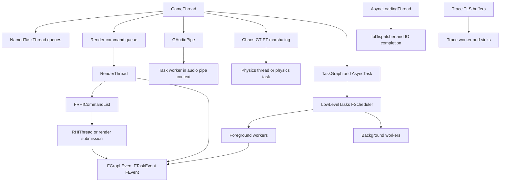
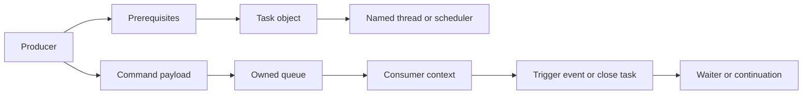
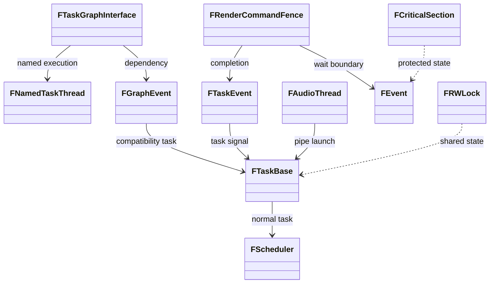
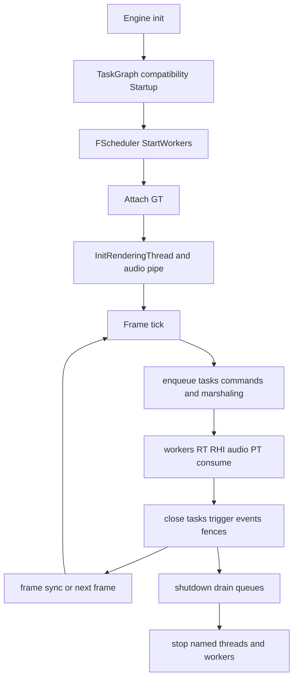
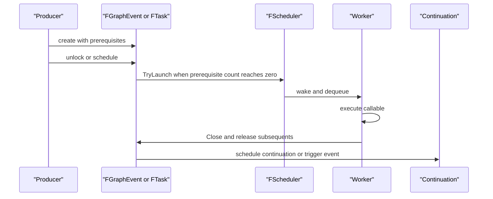
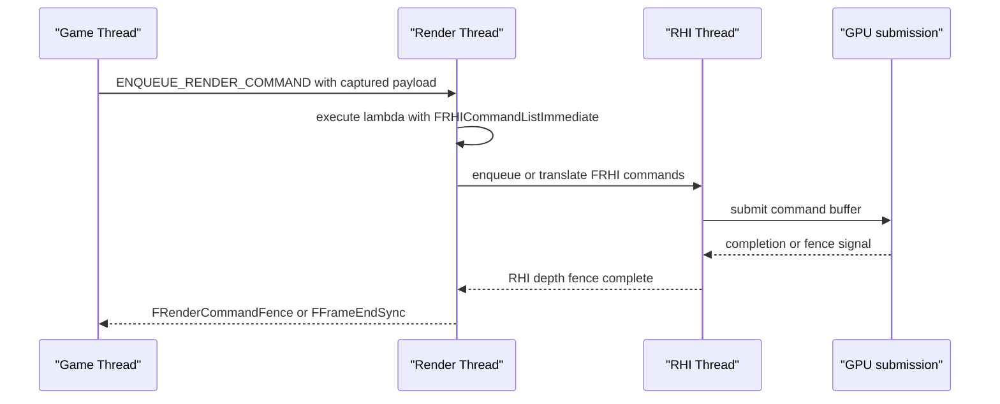
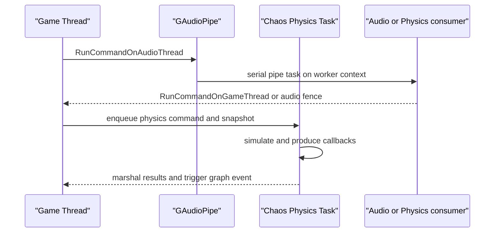
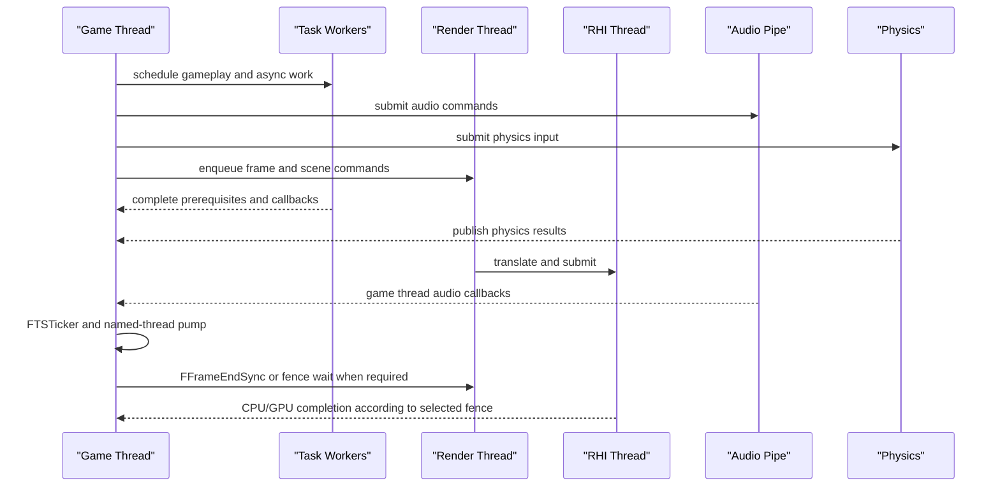

# 26 全引擎线程、消息传递、互斥模型与同步点

本章以 UE 5.8.3-release 源码为证，横切整理线程、队列、锁、原子与同步点。路径均相对 `$E` (`/home/timeshift/opensource/game_engine/unreal/UnrealEngine-5.8.3-release/Engine`)；行号为本版本源码行号。第 2 章已详细解释 HAL、TaskGraph、UE::Tasks 与 LowLevelTasks 的实现，本章只提取其跨子系统契约；第 7 章详述 GT→RT→RHI/RDG；第 12 章详述 Chaos；第 14 章详述音频；第 23 章详述 Trace/Stats 诊断，本章补充它们之间的连接。

## 26.1 职责、边界与模块清单

|模块|源码路径|本章横切职责|与既有章节的新增边界|
|---|---|---|---|
|Core|Runtime/Core|FRunnable、TaskGraph 兼容层、UE::Tasks、LowLevelTasks、锁、事件、无锁容器|把第 2 章的局部原语放进全引擎通信矩阵|
|RenderCore/RHI|Runtime/RenderCore、Runtime/RHI|RT/RHI 队列、render fence、frame sync|把第 7 章的渲染流水线和其他线程等待关系统一列出|
|Engine/AudioMixer|Runtime/Engine、Runtime/AudioMixer|`FAudioThread`/`GAudioPipe`、音频 fence|补第 14 章的 GT↔音频命令边界|
|CoreUObject|Runtime/CoreUObject|AsyncLoadingThread 与 UObject 线程约束|补异步加载对 GT/IO/任务系统的连接|
|Chaos|Runtime/Experimental/Chaos、Runtime/Engine|GT↔PT marshaling、物理同步|补第 12 章的跨线程数据所有权表|
|TraceLog/Stats|Runtime/TraceLog、Runtime/Core|TLS trace 缓冲、Stats pipe|补第 23 章的生产线程与消费线程关系|
|Sockets/HTTP/UDP Messaging|Runtime/Sockets、Runtime/HTTP、Plugins/Messaging|网络/消息线程的队列边界|详细网络链路留给第 27/31 章，本章只列线程契约|

**边界结论：** `GameThread`、`RenderThread`、`RHIThread` 是命名执行上下文；5.8.3 的 AudioThread 名称是历史兼容 API，实际由 `UE::Tasks::FPipe` 串行化任务，不保证专用 OS 线程（`Engine/Public/AudioThread.h:14-18`）。TaskGraph 的普通 worker 已下沉到 `FScheduler`，而命名线程仍有 `FNamedTaskThread` 队列（`Core/Private/Async/TaskGraph.cpp:681-709,909-938`）。

## 26.2 总体架构

通信分为四层：一是“定向执行”(`ENamedThreads`、`EExtendedTaskPriority`)，二是“依赖执行”(`FGraphEvent`、`UE::Tasks::FTask`/`FTaskEvent`)，三是“命令队列”(`ENQUEUE_RENDER_COMMAND`、`GAudioPipe`、Chaos marshaling)，四是“阻塞/唤醒”(`FEvent`、`FEventCount`、fence)。生产者只转移可安全存活的载荷；消费者在线程约束内读取。委托不是队列，除非委托内部明确转发到目标线程。

与第 02 章的差异是：第 02 章给出实现和类型字典；本章增加每种机制的生产者、载荷所有权、消费者、可见性、阻塞和取消语义。与第 07 章的差异是：本章把 RT fence 与音频、物理和 IO 等待放在同一张表；与第 12/14 章的差异是：本章明确“同步”与“线程专属状态”的区别；与第 23 章的差异是：本章只追踪诊断数据如何跨线程流动，不重复 Trace 事件格式。

## 26.3 类图

|类型|横切职责|源码位置|
|---|---|---|
|`FTaskGraphInterface`|命名线程注册、排队、等待和兼容 API|`Core/Public/Async/TaskGraphInterfaces.h:301-438`|
|`FNamedTaskThread`|为 GT/RT/RHI 等命名线程保存双优先级 StallQueue|`Core/Private/Async/TaskGraph.cpp:681-938`|
|`FTaskBase`|前置计数、后续任务、调度和完成通知|`Core/Public/Tasks/TaskPrivate.h:159-751`|
|`FScheduler`|前台/后台/待命 worker、本地队列和等待队列|`Core/Public/Async/Fundamental/Scheduler.h:116-179`|
|`FRenderCommandFence`|把 render 或 RHI 阶段完成转换为可等待任务|`RenderCore/Public/RenderCommandFence.h:14-53`|
|`FAudioThread`|音频 pipe 的公共转发入口|`Engine/Public/AudioThread.h:21-77`|

## 26.4 数据字典

|字段/枚举|类型与源码约束|含义|源码位置|
|---|---|---|---|
|`ENamedThreads::Type`|位编码，线程索引、线程优先级、任务优先级|定向任务目的地；`SetPriorities` 用 `check` 校验掩码|`Core/Public/Async/TaskGraphInterfaces.h:181-208`|
|`ESubsequentsMode`|`TrackSubsequents` / `FireAndForget`|是否允许后续任务依赖，后者降低图开销|`Core/Public/Async/TaskGraphInterfaces.h:246-255`|
|`FFrameEndSync::EFlushMode`|`EndFrame` / `Threads`|按帧进度等待，或等待 CPU 渲染线程但不等 GPU|`RenderCore/Public/RenderingThread.h:44-57`|
|`FRenderCommandFence::ESyncDepth`|`RenderThread` / `RHIThread` / `Swapchain`|选择 fence 信号阶段|`RenderCore/Public/RenderCommandFence.h:17-29`|
|`EAsyncExecution`|TaskGraph、主线程、Tick、Thread、ThreadPool 等|`Async` 的执行后端选择|`Core/Public/Async/Async.h:24-54`|
|`EEventMode`|AutoReset / ManualReset|事件消费一次或保持触发|`Core/Public/HAL/Event.h:41-69`|
|`FSchedulerTls::FTlsValues`|ActiveScheduler、LocalQueue、WorkerType、唤醒/待命标志|worker 的 TLS 调度上下文|`Core/Public/Async/Fundamental/Scheduler.h:55-80`|
|`FPipe::LastTask`|`std::atomic<FTaskBase*>`|同一 pipe 中的串行尾任务|`Core/Public/Tasks/Pipe.h:136-138`|
|`FRenderCommandFence::CompletionTask`|`UE::Tasks::FTask`|fence 完成的任务表示|`RenderCore/Public/RenderCommandFence.h:51-52`|

## 26.5 接口清单

以下原型逐字取自头文件，去掉导出宏；参数名和默认值保留。线程约束以源码中的 `check`、注释或调用路径为准。

### 26.5.1 TaskGraph、UE::Tasks 与异步

|原型|功能、参数与返回|线程约束与位置|
|---|---|---|
|`virtual void AttachToThread(ENamedThreads::Type CurrentThread)=0`|把当前 OS 线程登记为命名线程|必须在目标线程自身调用；`Core/Public/Async/TaskGraphInterfaces.h:341`|
|`virtual ENamedThreads::Type GetCurrentThreadIfKnown(bool bLocalQueue = false) = 0`|返回当前已知命名线程/worker 类型|任意线程；`TaskGraphInterfaces.h:309`|
|`virtual void TriggerEventWhenTasksComplete(FEvent* InEvent, const FGraphEventArray& Tasks, ENamedThreads::Type CurrentThreadIfKnown = ENamedThreads::AnyThread, ENamedThreads::Type TriggerThread = ENamedThreads::AnyHiPriThreadHiPriTask)=0`|所有图事件完成后触发事件|任意生产者；事件所有权由调用者管理；`TaskGraphInterfaces.h:407`|
|`CORE_API void StartWorkers(uint32 NumForegroundWorkers = 0, uint32 NumBackgroundWorkers = 0, FThread::EForkable IsForkable = FThread::NonForkable, EThreadPriority InWorkerPriority = EThreadPriority::TPri_Normal, EThreadPriority InBackgroundPriority = EThreadPriority::TPri_BelowNormal, uint64 InWorkerAffinity = 0, uint64 InBackgroundAffinity = 0, uint32 InWorkersStackSize = 0)`|创建 LowLevelTasks 前台/后台 worker|源码要求 GT；`Core/Public/Async/Fundamental/Scheduler.h:116`，实现 `Scheduler.cpp:231-360`|
|`CORE_API static const FTask* GetActiveTask()`|得到当前 worker 的活动底层任务|任意线程，非 worker 可为空；`Core/Public/Async/Fundamental/Task.h:357-365`|
|`CORE_API bool FTaskBase::Wait(FTimeout Timeout)`|等待任务完成，可能收回/执行可执行任务|任意线程；命名线程等待可泵自己的队列；`Core/Public/Tasks/TaskPrivate.h:475`，实现 `TaskPrivate.cpp:246-284`|
|`CORE_API void FTaskBase::Close()`|关闭任务、释放后续并唤醒等待者|完成路径调用；`TaskPrivate.h:549`|
|`CORE_API void AsyncTask(ENamedThreads::Type Thread, TFunction<void()> Function)`|把闭包投递到指定命名线程|闭包必须满足目标线程生命周期；典型 RT 用法见 `RenderCore/Public/RenderingThread.h:504-533`|

### 26.5.2 渲染与 RHI

|原型|功能、参数与返回|线程约束与位置|
|---|---|---|
|`RENDERCORE_API void InitRenderingThread()`|初始化渲染线程|GT 初始化阶段；`RenderCore/Public/RenderingThread.h:86`|
|`RENDERCORE_API void ShutdownRenderingThread()`|停止渲染线程|关闭阶段；`RenderingThread.h:89`|
|`RENDERCORE_API void FlushRenderingCommands()`|等待所有待处理渲染命令完成|只应从 GT 使用；`RenderingThread.h:109-111`；实现递归检测见 `RenderingThread.cpp:1274-1315`|
|`RENDERCORE_API void FFrameEndSync::Sync(EFlushMode FlushMode)`|按 `EndFrame` 或 `Threads` 同步|调用者通常 GT；`RenderingThread.h:46-57`|
|`RENDERCORE_API void BeginFence(ESyncDepth SyncDepth = ESyncDepth::RenderThread)`|插入 RT/RHI/swapchain fence|由提交方调用，Wait 不能形成 RT→GT 反向等待；`RenderCommandFence.h:31-41`|
|`RENDERCORE_API void Wait(bool bProcessGameThreadTasks = false) const`|等待 render fence|可能阻塞；GT 等待时可选择泵 GT 任务；`RenderCommandFence.h:37-44`|
|`RENDERCORE_API bool IsFenceComplete() const`|无阻塞查询 fence|任意查询方；`RenderCommandFence.h:43-44`|
|`extern RENDERCORE_API class FRHICommandListImmediate& GetImmediateCommandList_ForRenderCommand()`|获取 render command 使用的即时 RHI 命令列表|RT/RHI 命令上下文；`RenderingThread.h:136`|

### 26.5.3 音频、事件和锁

|原型|功能、参数与返回|线程约束与位置|
|---|---|---|
|`static ENGINE_API void StartAudioThread()` / `static ENGINE_API void StopAudioThread()`|启停音频任务上下文|GT 生命周期管理；`Engine/Public/AudioThread.h:51-55`|
|`static ENGINE_API void RunCommandOnAudioThread(TUniqueFunction<void()> InFunction, const TStatId InStatId = TStatId())`|向 `GAudioPipe` 串行投递闭包，安全时可立即执行|调用方通常 GT；源码明确“not safe ... other than GameThread”，示例 `AudioMixer/Private/AudioMixerSubmix.cpp:833-842`|
|`static ENGINE_API void ProcessAllCommands()`|处理已入队音频命令|音频 pipe 上下文或关闭路径；`AudioThread.h:60-61`|
|`static ENGINE_API void RunCommandOnGameThread(TUniqueFunction<void()> InFunction, const TStatId InStatId = TStatId())`|音频方向回调转回 GT|只能在安全 GT pump 点消费；`AudioThread.h:63-64`|
|`static ENGINE_API void SuspendAudioThread()` / `static ENGINE_API void ResumeAudioThread()`|增加/减少 GT 维护的挂起计数|GT 控制；`AudioThread.h:69-70`|
|`ENGINE_API void BeginFence()`|向音频命令队列加入 fence 命令|发起方通常 GT；`Engine/Public/AudioThread.h:107-112`|
|`ENGINE_API void Wait(bool bProcessGameThreadTasks = false) const`|等待音频 fence 命令退休|可能阻塞；可选择泵 GT 任务；`Engine/Public/AudioThread.h:114-121`|
|`ENGINE_API bool IsFenceComplete() const`|无阻塞查询音频 fence|任意查询方；`Engine/Public/AudioThread.h:120-121`|
|`virtual void Trigger()` / `virtual void Reset()`|事件触发和复位|任意线程；通常配合池化 `FEventRef`；`Core/Public/HAL/Event.h:52-59`|
|`explicit FScopeLock(TNotNull<FCriticalSection*> InSyncObject)`|RAII 获取递归临界区|锁的生命周期必须短且不跨队列等待；`Core/Public/Misc/ScopeLock.h:148`|
|`int32 Increment()` / `int32 Decrement()` / `int32 Add( int32 Amount ) / int32 Set( int32 Value ) / int32 GetValue() const`|线程安全计数|旧 API，头文件建议改用 `std::atomic`；`Core/Public/HAL/ThreadSafeCounter.h:52-123`|

## 26.6 关键流程

### 26.6.1 全引擎线程表

下表只列源码中能确认创建点/入口的线程或执行上下文；“未声明”是源码没有给出该属性，不以平台默认值代替。

|线程/上下文|创建点与入口 Run|优先级/亲和性|生命周期|主要消费队列|
|---|---|---|---|---|
|GameThread|进程主线程进入引擎 loop；附着 `AttachToThread(GameThread)`，`Core/Private/Async/TaskGraph.cpp:2593`|主线程；源码未在该处声明固定优先级/亲和性|进程启动至退出|主循环、GT named queue、FTSTicker、GT task pump|
|RenderThread|`FRunnableThread::Create(... GetRenderingThreadPriority(), GetRenderingThreadMask()...)`，`RenderCore/Private/RenderingThread.cpp:621`；入口 `RenderingThreadMain` `:230`|`GetRenderingThreadPriority`；默认值在 `GenericPlatformAffinity.h:120`；mask 为 `GetRenderingThreadMask()`|`InitRenderingThread` 至 `ShutdownRenderingThread`|Render command queue、RenderThread named queue、RDG/RHI command list|
|RHIThread|由 RHI 初始化/渲染线程配置创建；RT 将命令送入 RHI command list，RHI 后端提交；统一创建调用在 `RenderCore/Private/RenderingThread.cpp:621` 附近的 RHI 配置分支|后端/平台决定；本处未声明固定优先级和 mask|RHI 初始化至 RHI shutdown|`FRHICommandListImmediate`、并行 translation/submission|
|TaskGraph named GT/RT/RHI|`FNamedTaskThread` 对每个命名线程初始化，`Core/Private/Async/TaskGraph.cpp:1308-1310`|由 `ENamedThreads` 编码选择；源码未给统一 OS 优先级|随 TaskGraph，命名线程附着/拆除|双优先级 `FStallingTaskQueue`，`StallRestartEvent`|
|LowLevelTasks foreground workers|`FScheduler::StartWorkers`→`CreateWorker`，`Core/Private/Async/Fundamental/Scheduler.cpp:292-337`|`GetTaskThreadPriority()`；affinity `GetTaskGraphThreadMask()`，worker 偏移见 `Scheduler.cpp:201`;默认优先级不可泛化|TaskGraph Startup 至 Shutdown|本地队列、全局溢出队列、steal 队列|
|LowLevelTasks background/standby workers|同上，后台与超发创建；`Scheduler.cpp:243-360`|后台优先级与 affinity 参数；待命 worker 由超发策略唤醒|调度器生命周期或 oversubscription 范围|后台等待队列、待命等待事件|
|AudioThread（历史名）|`FAudioThread::StartAudioThread`，`Engine/Private/AudioThread.cpp:629`；实际 `GAudioPipe` `Core/Private/HAL/ThreadingBase.cpp:245`|无专用 OS 线程；随 worker 执行，固定 pipe 顺序|Start/Stop audio context|`GAudioPipe`，GT 方向 `FGameThreadAudioCommandQueue`|
|AsyncLoadingThread|`FRunnableThread::Create(this, TEXT("FAsyncLoadingThread"), 0, TPri_Normal)`，`CoreUObject/Private/Serialization/AsyncLoading2.cpp:11342`；`Run` `:11351`|`TPri_Normal`；源码未声明 affinity|启用配置后 StartThread 至 package loader shutdown|package/load request queue、EventQueue、IoDispatcher 完成事件|
|IoDispatcher thread|`FRunnableThread::Create(this, TEXT("IoDispatcher"), 0, TPri_AboveNormal, GetIoDispatcherThreadMask())`，`Core/Private/IO/IoDispatcher.cpp:862-866`；`Run` `PlatformIoDispatcherBase.cpp:873`|`TPri_AboveNormal`；`GetIoDispatcherThreadMask()`|IoDispatcher Start/Stop|IoStore batch/read queue、completion callbacks|
|Stats pipe context|`UE::Tasks::FPipe GStatsPipe`，`Core/Private/Stats/StatsSystemTypes.cpp:50`；不是专用线程，`FThreadStats::StartThread`仅初始化|无专用优先级/affinity|统计系统启动至 shutdown|`GStatsPipe.Launch`、统计缓冲和聚合任务|
|Trace worker|TraceLog 的事件写入使用 TLS buffers；worker/传输创建点分散在 `TraceLog/Private`，本章未确认单一 `FRunnableThread::Create`|源码未确认统一优先级/affinity|Trace session start/stop|TLS block queues、TCP/file sinks|
|HTTP worker|HTTP backend 按平台实现创建；本横切范围未确认 5.8.3 的单一公共创建点和统一 Run 名称|源码未声明统一优先级/affinity|HTTP module lifecycle|Curl/平台 HTTP completion queue|
|Socket/UDP Messaging workers|平台 socket 与 UdpMessaging processor 线程由插件/平台实现创建；统一入口未在 Core 源码确认|源码未声明统一优先级/affinity|Messaging endpoint/module lifecycle|receive/send queues、Message Bus dispatch|
|Shader compile workers|`FShaderCompilingManager` 使用线程池/任务系统；不同 target 可启用不同编译器进程|具体 worker 数、priority、affinity 由配置/外部 compiler 决定，未确认统一线程 Run|编译管理器生命周期|shader compile job queue、results queue|
|PSO compile workers|Pipeline cache/PSO 任务使用 TaskGraph/线程池；源码未确认独立常驻线程|未声明统一 priority/affinity|PSO cache lifecycle|PSO request/result queues|
|Physics thread/PT|Chaos solver 的异步模拟与 `ISimCallbackObject`/marshaling；线程入口受 solver mode 与 task backend 控制，未确认单一常驻 `Run`|源码未声明统一 priority/affinity|solver start/stop 或每次异步 step|GT command buffer、PT callback/marshalling queues|
|Heartbeat/monitor threads|渲染 heartbeat 等由 RenderCore/平台监测创建；源码可确认其用途，但未确认全引擎统一创建/Run 契约|未声明|对应 subsystem lifecycle|health events/monitor state|

## 26.7 时序图

### 26.7.1 任务依赖、前置与完成

### 26.7.2 GT→RT→RHI

### 26.7.3 Audio/Physics marshaling

### 26.7.4 每帧总图

## 26.8 线程模型与同步

### 26.8.1 消息传递机制总表

|机制|生产者→载荷|队列所有权/消费者|可见性与阻塞|失败/取消|
|---|---|---|---|---|
|`TGraphTask`/`FGraphEvent`|任意线程→任务对象与 prerequisites|TaskGraph named queue 或 `FScheduler`；目标线程消费|原子 prerequisite/close 建立可见性；Wait 可能泵队列或阻塞|未满足前置不执行；任务关闭后续继承，图本身无通用取消|
|`UE::Tasks::Launch`/`FTaskEvent`|任意→闭包、`FTask`、event|LowLevelTasks scheduler/pipe|`FTaskBase` 原子状态；Wait 可收回执行|task close；`FTaskEvent::Trigger` 幂等，未触发析构为生命周期错误|
|`ENQUEUE_RENDER_COMMAND`|GT/任意合法调用者→捕获值 lambda|Render command queue，RT 消费|队列提交顺序与任务状态；非阻塞 enqueue|无通用取消；资源必须活到 lambda 执行|
|`FRHICommandList`|RT/RDG pass→RHI command payload|RT 记录，RHI 线程/后端提交|命令列表顺序；fence 提供阶段完成|命令已提交后不能取消；设备丢失走后端错误路径|
|`RunCommandOnAudioThread`|GT→`GAudioPipe` 闭包|pipe 尾任务串行执行|pipe 原子尾指针，通常非阻塞；`ProcessAllCommands`可等待|Stop/关闭时排空；无单项取消|
|Chaos GT↔PT marshaling|GT snapshot/command→PT，PT results/callback→GT|solver callback/marshalling buffer|快照所有权转移，事件/任务完成建立可见性|solver stop 时丢弃/排空；具体取消取决于 callback 实现|
|`AsyncTask`|任意→指定 `ENamedThreads` 闭包|named queue|任务入队后由命名线程 pump；可阻塞等待|无通用取消，生命周期由闭包捕获对象保证|
|`TQueue`/`TMpscQueue`/`TLockFree*`|多 producer→节点 payload|容器所有者决定 consumer；无锁结构不自动调度|CAS/原子发布；通常非阻塞，空队列由调用方轮询/事件化|队列关闭类型才有 close；普通队列无取消|
|`FEvent`/`FTaskEvent`|生产者 Trigger→等待方|事件不拥有业务载荷；等待方消费|FEvent 可阻塞，FTaskEvent 走 task wait|Reset/close 由拥有者负责，错误复位可能丢唤醒|
|FTSTicker/GameThread pump|任意注册 ticker→GT 每帧 Tick|Ticker 委托列表由 ticker/GT 拥有|非阻塞，执行发生在 GT pump|返回 false 移除；委托本身不迁移线程|
|Delegate|广播者→绑定回调|广播线程直接调用绑定者|没有隐含跨线程同步或迁移|解绑/生命周期由 Delegate owner 管理；动态委托不等于线程安全|
|Message Bus|endpoint→消息对象/Envelope|Message Bus endpoint 通常由 Messaging 模块调度|需以 endpoint/transport 实现为准，未在本章统一确认|订阅取消、endpoint shutdown；详见第 31 章|

**关键判定：** 委托、ticker、普通 `TQueue` 只是调用/存储机制，不自动跨线程；只有明确的 `AsyncTask`、命名队列、pipe 或事件等待才构成线程转移。Message Bus 的协议、endpoint 和跨进程传输留在第 31 章，本章只把它作为外部消息边界交叉引用。

### 26.8.2 互斥与无锁模型

|模型|代表源码/使用|读写和生命周期约定|死锁/误用规避|
|---|---|---|---|
|`FCriticalSection` + `FScopeLock`|别名为 `UE::FPlatformRecursiveMutex`，`Core/Public/HAL/CriticalSection.h:52-56`；Audio stats 使用 `AudioThread.h:40`|保护短小共享状态，RAII 作用域结束即释放|不要持锁等待 RT/AT/PT 或回调；递归能力不代表可跨线程重入|
|`FRWLock`|`FPlatformRWLock` 的 Read/WriteLock，`CriticalSection.h:13-48`|读者共享，写者独占；不可递归|升级读锁为写锁可能死锁；固定锁顺序|
|`FMutex`/任务内部 mutex|`FPrerequisites::Mutex`、`FSubsequents::Mutex` 保护任务图注册，`Core/Public/Tasks/TaskPrivate.h:712-796`|只保护 prerequisite/subsequent 线性化点|不得在锁内执行用户闭包或等待依赖任务|
|自旋/parking|LowLevelTasks local queue、`FEventCount`、WaitingQueue；`Scheduler.cpp:496-515`|短竞争先 spin，长期竞争 park 到事件|不要把长 IO/渲染等待放在自旋区|
|原子与内存序|`FTaskBase`、scheduler 唤醒协议；新代码使用 `std::atomic` 和显式 memory order；旧 `FThreadSafeCounter` 标为 deprecated|原子仅同步该变量及明确发布协议，不保护关联对象生命周期|不能用 relaxed 原子替代完整对象所有权；先发布载荷再发布指针|
|TLS|`RunnableTlsSlot`、`FSchedulerTls::FTlsValues`、Trace/Stats TLS|线程私有状态无需锁；TLS 槽分配/释放需在受控生命周期|TLS 不会使 UObject/共享容器线程安全|
|无锁结构|`TLockFreePointerList*`、`TMpscQueue`、`FStallingTaskQueue`|按容器规定 producer/consumer 数和节点寿命|ABA/节点回收、关闭和所有权必须遵守容器实现；不能泛化为任意无锁|
|GameThread-only|UObject 世界、许多委托和资源销毁路径以 `check(IsInGameThread())` 或调用约定限制|这是线程归属，不是互斥保护|不能用 `FCriticalSection` 规避 UObject 非线程安全；应 marshal 回 GT|

### 26.8.3 Fence 与同步点

|同步点|等待线程|信号方|何时可阻塞|典型风险|
|---|---|---|---|---|
|`FlushRenderingCommands`|GT|RT 完成所有 pending commands，内部调用 `FFrameEndSync::Sync(Threads)`，`RenderingThread.cpp:1274-1315`|只在 GT、资源销毁/切换等明确边界|RT lambda 等 GT 锁或 GT 等 RT 造成环；源码警告递归 flush `:1177`|
|`FFrameEndSync::Sync`|通常 GT|RT/命令管线按 EndFrame 或 Threads 模式完成|帧末或配置要求时|过度使用会串行化帧；Threads 不等 GPU，不能误作 GPU fence|
|`FRenderCommandFence`|GT 或发起者|RT、RHI 或 swapchain，依 `ESyncDepth`|`Wait` 会阻塞，可选择泵 GT tasks|RHI/RT 反向等待 GT；捕获已销毁资源|
|GPU fence|RT/RHI/CPU waiter|GPU timeline/后端完成|可查询或等待，具体后端|CPU 等 GPU 时持有共享锁；设备丢失/未提交命令导致永不完成|
|Audio fence|GT/音频命令发起者|`GAudioPipe` 命令 close/`FAudioCommandFence`|关闭、设备切换可等待|音频闭包回调 GT 或音频线程互等；第 14 章详述|
|Physics sync|GT|PT solver step 完成并 marshal results|固定步或需要结果时|GT 持锁等待 PT，PT callback 再取 GT 锁|
|`FGraphEvent`|任意任务等待方|前置任务 close|命名线程 Wait 可能 pump，worker 可收回执行|依赖环、命名线程不泵导致饥饿|
|`FTaskEvent`|任意|显式 `Trigger`|Wait 可睡眠；适合任务依赖|忘记 Trigger 或析构前未完成|
|`FAudioCommandFence`|GT/音频命令发起者|音频 pipe 的最后 batch task|`Wait` 可选择泵 GT 任务；`AudioThread.h:102-126`|音频闭包回调 GT 或音频线程互等|
|`FEvent`|任意|`Trigger`|可阻塞，AutoReset/ManualReset 语义不同|Reset 时序丢唤醒；事件池借还错误|

## 26.9 配置与扩展点

|扩展/诊断|源码证据|线程意义|
|---|---|---|
|Task priority|`FAutoConsoleTaskPriority` 读取线程/任务优先级并在缺失 high/background worker 时降级，`Core/Public/Async/TaskGraphInterfaces.h:212-241`|优先级是调度提示，不改变数据所有权或线程安全|
|Render thread toggles|`GIsThreadedRendering`、`GUseThreadedRendering`、`LatchRenderThreadConfiguration`，`RenderCore/Public/RenderingThread.h:60-92`|关闭 threaded rendering 时 render command 可立即执行，不能假设一定有 RT|
|Async loading|`s.AsyncLoadingThreadEnabled`、`AsyncLoadingThread`/`NoAsyncLoadingThread`，`CoreUObject/Private/Serialization/AsyncPackageLoader.cpp:131-147`|决定是否存在独立 async loading context|
|Audio mode|`FAudioThread::SetUseThreadedAudio`/`IsUsingThreadedAudio`，`Engine/Public/AudioThread.h:66-67`|即使启用名称仍表示 pipe context，不应据名称推断 OS thread|
|Assertions|`IsInGameThread`、`IsInRenderingThread`、`IsInAudioThread` 检查分别见 `RenderCore/Public/RenderingThread.h:504-533`、`AudioMixer/Private/AudioMixerSubmix.cpp:318` 等|断言是线程契约证据；失败应 marshal，而非加锁掩盖|
|Trace/Stats|`TRACE_CPUPROFILER_EVENT_SCOPE(FlushRenderingCommands)`，`RenderingThread.cpp:1281`；`GStatsPipe` `StatsSystemTypes.cpp:50`|诊断事件从生产线程 TLS/pipe 流向 Trace/Stats 消费端，详见第 23 章|
|TSAN/race annotations|Core sanitizer tests 存在 `RaceDetectorTests.cpp`，`Core/Tests/Sanitizer`；本章未确认所有跨模块结构都有注解|不能把缺少注解视作无数据竞争|

## 26.10 已知限制/未确认项

1. 本章确认了 Core、RenderCore、Engine 音频、CoreUObject 异步加载、IoDispatcher、Stats pipe 的创建点和入口；HTTP、Socket、UDP Messaging、Trace worker、ShaderCompile、PSO、Chaos PT、Heartbeat 在 5.8.3 中有多个平台/插件实现，未在源码中确认一个全平台统一的线程创建点、Run 函数、优先级和 affinity，因此表中明确写“未声明”，不以旧版本经验补齐。
2. RHIThread 是否独立 OS 线程取决于 RHI/平台配置；本章只确认 `FRHICommandListImmediate` 和 fence 的阶段契约，未把 Vulkan/D3D12/Metal 的后端线程误合并为一个引擎线程。
3. “AudioThread”是兼容命名：源码明确说明已替换为 piped tasks；平台音频 callback 线程属于 AudioMixer/平台实现，不能与 `GAudioPipe` 等同。
4. Chaos 的 PT 调度可由任务系统或 solver 模式变化；已确认 GT/PT marshaling 语义，但未声称存在所有平台相同的常驻 `FPhysicsThread::Run`。
5. 委托广播、`TQueue`、Message Bus 不自动建立跨线程内存可见性；具体实现若需要确认应进入第 31 章和第 27 章。第 23 章的 Trace/Stats 输出格式、网络协议和 Insights 分析不在本章重复。
6. 所有源码行号属于 5.8.3-release 当前树；平台宏、构建选项、命令行可能改变线程数量、是否创建线程以及是否 inline 执行。未声明的优先级/亲和性不能从函数名推导。

## 26.11 附录索引

- `Runtime/Core`：`appendix/api/Runtime/Core*.md`；对应第 02 章的 HAL、Tasks、TaskGraph、Containers 符号。
- `Runtime/RenderCore`：`appendix/api/Runtime/RenderCore*.md`；对应第 07 章的 RenderCore/RDG/fence 符号。
- `Runtime/RHI`：`appendix/api/Runtime/RHI*.md`；对应 RHI command list 与同步接口。
- `Runtime/Engine`：`appendix/api/Runtime/Engine*.md`；对应 `AudioThread`、Chaos/Engine marshaling 和 GT API。
- `Runtime/CoreUObject`：`appendix/api/Runtime/CoreUObject*.md`；对应 AsyncLoadingThread 与 UObject 线程约束。
- `Runtime/TraceLog`：`appendix/api/Runtime/TraceLog*.md`；对应第 23 章 Trace 生产/消费接口。
- `Runtime/PhysicsCore`、`Runtime/Experimental/Chaos`：`appendix/api/Runtime/PhysicsCore*.md`、`appendix/api/Runtime/Experimental_Chaos*.md`；对应第 12 章。
- `Runtime/AudioMixer`：`appendix/api/Runtime/AudioMixer*.md`；对应第 14 章。
- `Runtime/Sockets`、`Runtime/HTTP`、`Plugins/Messaging`：对应第 27、31 章的详细网络与消息协议。
