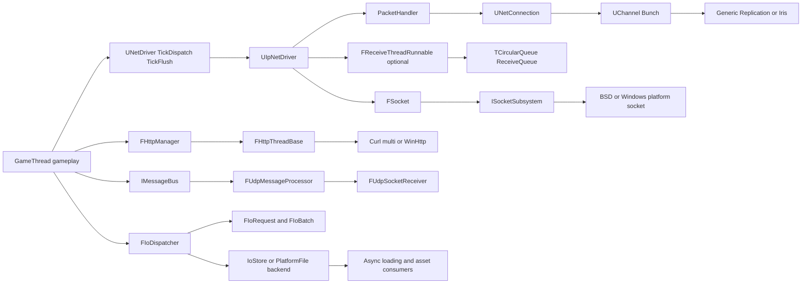
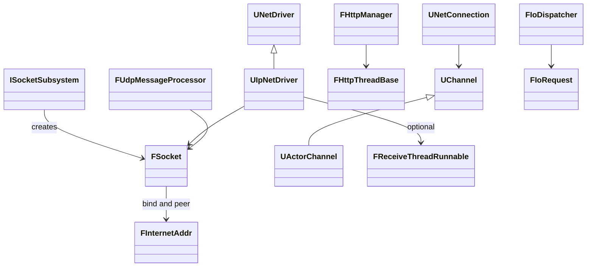
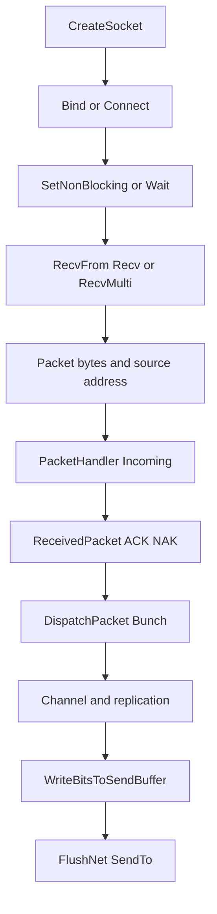
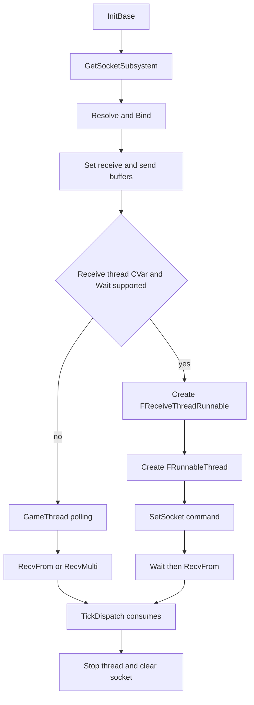
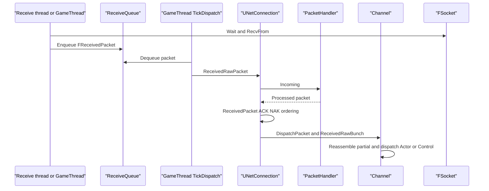
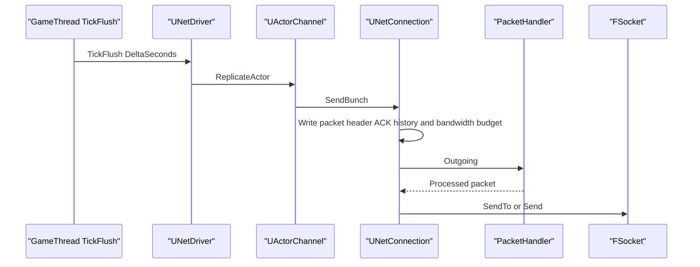
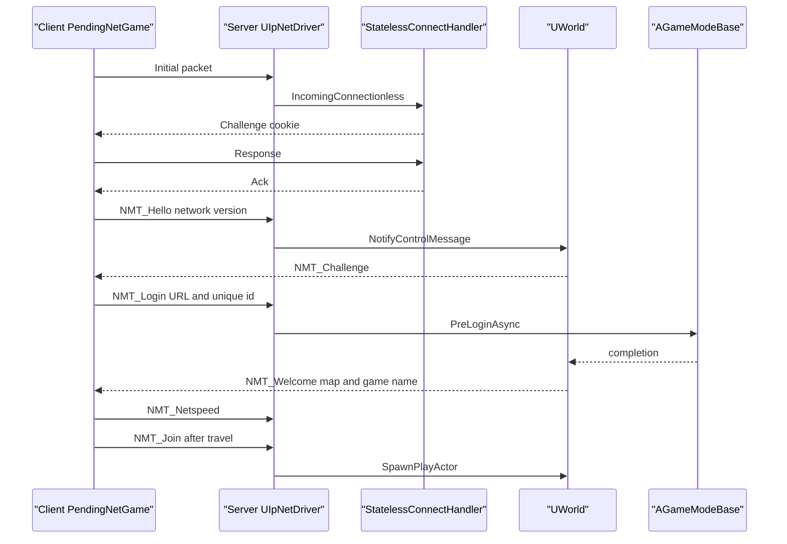
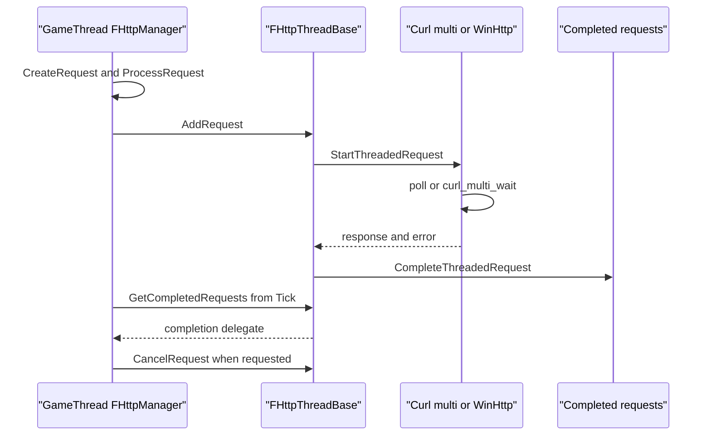
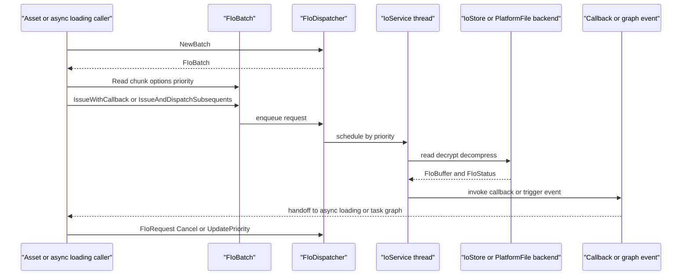
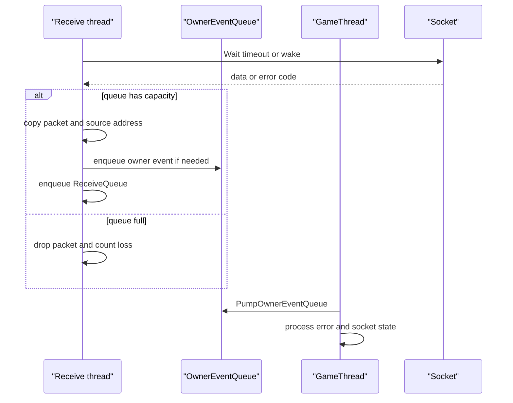

# 27 网络收发线程、消息管线与 IO 调度详细设计

本章针对 UE 5.8.3-release 源码，路径均相对 `$E`（`/home/timeshift/opensource/game_engine/unreal/UnrealEngine-5.8.3-release/Engine`）。结论优先来自已读取的 `.h/.cpp`；无法由当前源码确认的实现或平台行为集中列入 X.10。第 11 章描述网络复制语义，本章只补充线程、队列、套接字和 IO 交接；第 20 章描述资产/包加载，本章只追踪 IO 调度接口和线程归属。

## X.1 职责、边界与模块清单

|模块|路径|关键依赖/实现|本章边界|
|---|---|---|---|
|Sockets|Source/Runtime/Sockets|Core、平台 BSD/Windows socket|`ISocketSubsystem`、`FSocket`、地址、等待、错误码|
|Networking|Source/Runtime/Networking|Core、Sockets|`FUdpSocketReceiver`、`FTcpListener` 等通用 FRunnable|
|Engine Net|Source/Runtime/Engine|Sockets、PacketHandler、NetCore|`UNetDriver`、`UNetConnection`、Channel、PacketHandler 接合|
|OnlineSubsystemUtils|Plugins/Online/OnlineSubsystemUtils|Engine、Sockets|5.8.3 `UIpNetDriver`、`UIpConnection`、接收线程|
|PacketHandler|Source/Runtime/PacketHandlers/PacketHandler|Core、NetCommon|加密/握手/包改写链|
|HTTP|Source/Runtime/Online/HTTP|平台 Curl/WinHTTP/EventLoop|`FHttpManager`、`FHttpThreadBase`、完成回调|
|WebSockets/SSL/XMPP/Stomp/ICMP|Source/Runtime/Online/*|平台或第三方库|公共入口和线程归属边界|
|Messaging|Source/Runtime/Messaging、Plugins/Messaging|Sockets、Networking|Message Bus、Udp/Tcp transport、序列化和可靠语义|
|Core IO|Source/Runtime/Core/IO|PlatformFile、IoStore|`FIoDispatcher`、`FIoRequest`、优先级、取消、回调|
|IoStore OnDemand/Zen|Source/Runtime/Experimental/IoStore、StorageServerClient|HTTP/StorageServer|按源码存在的后端入口和差异|

网络对象生命周期在 GameThread 创建和销毁；socket 的实际系统调用可在 GameThread、专用接收线程或 transport 线程执行。IO 请求的句柄和缓冲由调用方持有引用，完成回调由 backend/dispatcher 线程触发，不能推断为 GameThread 回调。

## X.2 总体架构

网络主链的线程转移只有启用 `net.IpNetDriverUseReceiveThread` 时发生：接收线程生产字节包，GameThread 消费并调用 UObject/Channel。发送仍由连接 Tick/Flush 路径发起。HTTP 和 Messaging 的 transport 线程不直接获得网络 Actor 的线程权限。IO dispatcher 只交付字节缓冲或状态，不直接执行 UObject 反射。

## X.3 类图与组件职责

`ISocketSubsystem` 是平台分发和能力查询入口，`FSocket` 是对 BSD/WinSock 等句柄的引擎抽象，`FInternetAddr` 保存网络字节序地址。`UIpNetDriver` 拥有 socket 和可选接收 runnable；`UNetConnection` 只在收到包进入连接解析后拥有可靠性、ACK、Channel 状态。`FHttpManager` 管理请求生命周期，`FHttpThreadBase` 承担请求启动、取消和完成数组交换。`FUdpMessageProcessor` 自己有 processor 线程，并通过 `FUdpSocketReceiver` 接收 socket 数据。`FIoDispatcher` 只暴露 chunk 读请求和状态句柄。

## X.4 数据字典

|类型/字段|定义或取值|含义/线程约束|源码位置|
|---|---|---|---|
|`ESocketReceiveFlags::Type`|`None`、平台 receive flags|传递给 `Recv`/`RecvFrom`；由 socket 调用线程使用|`Source/Runtime/Sockets/Public/SocketTypes.h`|
|`ESocketWaitConditions::Type`|socket readable/writable/exception 等|`Wait` 阻塞条件|`Source/Runtime/Sockets/Public/SocketTypes.h`|
|`ESocketErrors`|`SE_NO_ERROR` 及平台映射错误|通过 `ISocketSubsystem::GetLastErrorCode()` 查询|`Sockets/Public/SocketSubsystem.h:366`|
|`ESocketConnectionState`|socket 连接状态枚举|TCP/平台连接状态|`Sockets/Public/Sockets.h:248` 附近|
|`FReceivedPacket`|`TArray<uint8> Data`、地址、`Error`、平台时间|接收线程到 GT 的拥有数据|`OnlineSubsystemUtils/Classes/IpNetDriver.h:336-355`|
|`ReceiveQueue`|`TCircularQueue<FReceivedPacket>`|满时 `Enqueue` 失败并丢包|`IpNetDriver.h:379-380`|
|`CommandQueue`|`TSpscQueue<TUniqueFunction<void()>>`|GT→接收线程，只执行 socket 命令|`IpNetDriver.h:389-404`|
|`OwnerEventQueue`|`TSpscQueue<TUniqueFunction<void()>>`|接收线程→GT，GT 在 `TickDispatch` pump|`IpNetDriver.h:405-406`|
|`NMT_Hello/Login/Join`|控制通道消息|登录握手；参数表和顺序见第 11 章 11.4.4|`Engine/Public/Net/DataChannel.h:173-248`|
|`FOutBunch.bReliable`|位字段|可靠 bunch 进入重发/ACK 记账|`Engine/Public/Net/DataBunch.h:23`|
|`bPartialInitial/bPartialFinal`|位字段|大 bunch 分片重组边界|`Engine/Public/Net/DataBunch.h:23`|
|`EIoDispatcherPriority`|Min、Low、Medium、High、Max|请求排序提示，不等于 OS 线程优先级|`Core/Public/IO/IoDispatcherPriority.h:8-15`|
|`FIoReadOptions`|offset、size、target VA、flags|指定 chunk 子范围和目标缓冲|`Core/Public/IO/IoDispatcher.h:103-176`|
|`FIoRequest`|状态、结果、Cancel、UpdatePriority|可复制句柄，引用内部 request|`Core/Public/IO/IoDispatcher.h:178-204`|
|`FIoBuffer`|拥有或引用读取结果的缓冲|回调交付给消费者；生命周期由返回值/引用管理|`Core/Public/IO/IoBuffer.h`|
|`IMessageContext`|消息类型、序列化 payload、annotations|Message Bus 的线程安全消息上下文|`Messaging/Public/IMessageContext.h`|
|`FUdpMessageSegment`|消息 ID、segment、协议版本等|UDP 大消息分段与重组|`UdpMessaging/Private/Transport/UdpMessageSegment.h`|

网络可靠性和 NetSpeed 的常量、ACK/NAK、`RELIABLE_BUFFER=512`、`MAX_CHSEQUENCE=1024`、超时与 `NMT_Netspeed` 已在第 11 章 11.4；此处只说明它们位于 GameThread 的 `UNetConnection` 状态，不由 socket 线程修改。

## X.5 接口清单

### X.5.1 Socket 公共接口

|逐字原型|功能、参数/返回|线程约束|位置|
|---|---|---|---|
|`virtual FSocket* CreateSocket(const FName& SocketType, const FString& SocketDescription, bool bForceUDP = false)`|创建 socket，返回堆对象或空|创建者负责生命周期；不能并发销毁|`Sockets/Public/SocketSubsystem.h:98`|
|`virtual TSharedRef<FInternetAddr> CreateInternetAddr()`|创建地址对象|可在调用线程使用|`Sockets/Public/SocketSubsystem.h:330`|
|`virtual ESocketErrors GetLastErrorCode() = 0`|读取平台最后 socket 错误|必须紧随失败调用查询，错误码是线程/平台相关|`Sockets/Public/SocketSubsystem.h:366`|
|`virtual bool SendTo(const uint8* Data, int32 Count, int32& BytesSent, const FInternetAddr& Destination)`|UDP/无连接发送|调用线程执行，返回值不代表跨线程安全|`Sockets/Public/Sockets.h:181`|
|`virtual bool Send(const uint8* Data, int32 Count, int32& BytesSent)`|连接 socket 发送|调用线程执行|`Sockets/Public/Sockets.h:190`|
|`virtual bool RecvFrom(uint8* Data, int32 BufferSize, int32& BytesRead, FInternetAddr& Source, ESocketReceiveFlags::Type Flags = ESocketReceiveFlags::None)`|收 datagram 和来源地址|调用线程执行；`BytesRead` 必须检查|`Sockets/Public/Sockets.h:206`|
|`virtual bool Recv(uint8* Data, int32 BufferSize, int32& BytesRead, ESocketReceiveFlags::Type Flags = ESocketReceiveFlags::None)`|收 connected socket 数据|调用线程执行；0 字节不是有效载荷|`Sockets/Public/Sockets.h:221`|
|`virtual bool RecvMulti(FRecvMulti& MultiData, ESocketReceiveFlags::Type Flags=ESocketReceiveFlags::None)`|批量收包|一个 `FRecvMulti` 应贯穿 socket 生命周期|`Sockets/Public/Sockets.h:232`|
|`virtual bool Wait(ESocketWaitConditions::Type Condition, FTimespan WaitTime) = 0`|等待可读/可写/异常|可阻塞；接收线程用以避免忙轮询|`Sockets/Public/Sockets.h:241`|
|`virtual bool SetNonBlocking(bool bIsNonBlocking = true) = 0`|切换阻塞模式|必须在 socket 选项配置阶段完成|`Sockets/Public/Sockets.h:271`|
|`virtual bool SetReceiveBufferSize(int32 Size, int32& NewSize) = 0`|设置 OS 接收缓冲|设置结果必须读取 `NewSize`|`Sockets/Public/Sockets.h`|
|`virtual bool SetSendBufferSize(int32 Size, int32& NewSize) = 0`|设置 OS 发送缓冲|与网络层发送队列不同|`Sockets/Public/Sockets.h`|

BSD 实现逐项覆盖 `SendTo`、`Send`、`RecvFrom`、`Recv`、`SetNonBlocking`（`Sockets/Private/BSDSockets/SocketsBSD.h:98-106`）；Windows 实现另有 `RecvFromWithPktInfo`（`Sockets/Private/Windows/SocketsWindows.h:29`）。因此 `FSocket` 不是固定 BSD ABI，平台实现负责错误码和等待能力。

### X.5.2 NetDriver 与连接接口

|逐字原型|功能|线程约束|位置|
|---|---|---|---|
|`virtual void TickDispatch( float DeltaTime )`|本帧读 socket、分派 connectionless/连接包|GameThread|`Engine/Public/Net/NetDriver.h:1742`|
|`virtual void TickFlush(float DeltaSeconds)`|复制、连接 Tick、FlushNet|GameThread；服务端部分连接 Tick 可按第 11 章条件并行|`Engine/Public/Net/NetDriver.h:1748`|
|`virtual void LowLevelSend(TSharedPtr<const FInternetAddr> Address, void* Data, int32 CountBits, FOutPacketTraits& Traits)`|无连接握手发送|调用者线程；通常 GT 或接收握手上下文|`Engine/Public/Net/NetDriver.h:1762`|
|`virtual void ReceivedRawPacket(void* Data,int32 Count)`|连接原始包入口|必须在连接允许的 Tick 线程调用|`Engine/Public/Net/NetConnection.h:1354`|
|`virtual void ReceivedPacket( FBitReader& Reader, bool bIsReinjectedPacket=false, bool bDispatchPacket=true )`|解析 packet header、ACK、乱序|GameThread/并行连接 Tick 约束|`Engine/Public/Net/NetConnection.h:1378`|
|`virtual void DispatchPacket( FBitReader& Reader, int32 PacketId, bool& bOutSkipAck, bool& bOutHasBunchErrors )`|拆 packet 为 bunch 并找 channel|不得从裸 socket 线程直接调用 UObject|`Engine/Public/Net/NetConnection.h:1385`|
|`virtual void LowLevelSend(void* Data, int32 CountBits, FOutPacketTraits& Traits)`|连接实际发送|由 `FlushNet` 调用；socket 所在线程由连接 Tick 决定|`Engine/Public/Net/NetConnection.h:1063`|
|`virtual FPacketIdRange SendBunch(FOutBunch* Bunch, bool Merge)`|合并/分片/排队 bunch|Channel 所属连接 Tick 线程|`Engine/Public/Net/Channel.h:159`|
|`ENGINE_API void ReceivedRawBunch( FInBunch & Bunch, bool & bOutSkipAck )`|可靠序号排序、分片拼接|Channel 线程专属|`Engine/Public/Net/Channel.h:146`|
|`ENGINE_API int64 ReplicateActor()`|写属性、RPC、子对象 bunch|GameThread 复制阶段|`Engine/Public/Net/ActorChannel.h:190`|
|`ENGINE_API void ProcessBunch( FInBunch & Bunch )`|读取内容块和 RPC|GameThread；最终可能 `ProcessEvent`|`Engine/Public/Net/ActorChannel.h:174`|

### X.5.3 PacketHandler、握手和带宽

|逐字原型|功能|线程约束|位置|
|---|---|---|---|
|`void Initialize(UE::Handler::Mode Mode, uint32 InMaxPacketBits, bool bConnectionlessOnly=false, TSharedPtr<class IAnalyticsProvider> InProvider=nullptr, FDDoSDetection* InDDoS=nullptr, FName InDriverProfile=NAME_None)`|装载 handler profile|随 NetDriver 初始化|`PacketHandler/Public/PacketHandler.h:275`|
|`EIncomingResult Incoming(FReceivedPacketView& PacketView)`|执行入站 handler 链|与连接解析同线程；组件必须满足并行连接约束|`PacketHandler/Public/PacketHandler.h:382`|
|`const ProcessedPacket Outgoing(uint8* Packet, int32 CountBits, FOutPacketTraits& Traits)`|执行出站 handler 链|与 `FlushNet` 同线程|`PacketHandler/Public/PacketHandler.h:398`|
|`virtual void Incoming(FIncomingPacketRef PacketRef)`|组件改写入站包|由 handler owner 线程调用|`PacketHandler/Public/PacketHandler.h:801`|
|`virtual void Outgoing(FBitWriter& Packet, FOutPacketTraits& Traits)`|组件加密/封装出站包|由 handler owner 线程调用|`PacketHandler/Public/PacketHandler.h:815`|
|`ENGINE_API void SendChallengeControlMessage()`|发送 `NMT_Challenge`|GameThread connection 状态|`Engine/Public/Net/NetConnection.h:1656`|
|`virtual bool HandleReceiveNetUpgrade(uint32 RemoteNetworkVersion, EEngineNetworkRuntimeFeatures RemoteNetworkFeatures, UE::Net::ENetUpgradeSource NetUpgradeSource=UE::Net::ENetUpgradeSource::ControlChannel)`|处理网络版本升级|控制通道线程|`Engine/Public/Net/NetConnection.h:1985`|

`NMT_Login` 后 `PreLoginAsync` 的完成回调必须回到可修改 World/connection 状态的线程；本章不把异步认证 provider 的内部线程误认为 NetDriver 线程。`NetSpeed` 只参与连接带宽预算和复制优先级，不改变 socket buffer 或 OS 发送能力。可靠 ACK/NAK、resend、ordering、partial bunch、timeout 的状态机由 `UNetConnection`/`UChannel` 保存，具体字段见第 11 章。

### X.5.4 HTTP

|逐字原型|功能|线程约束|位置|
|---|---|---|---|
|`virtual TSharedRef<IHttpRequest, ESPMode::ThreadSafe> CreateRequest()`|创建请求|通常 GT 创建，返回线程安全共享引用|`Online/HTTP/Public/HttpModule.h:71`|
|`virtual void StartThread()`|启动 HTTP worker/event loop|模块初始化|`Online/HTTP/Private/HttpThread.h:44`|
|`virtual void StopThread()`|停止并等待 HTTP worker|模块关闭；阻塞调用者|`Online/HTTP/Private/HttpThread.h:49`|
|`virtual void AddRequest(FHttpRequestCommon* Request)`|把请求交给 HTTP 线程|非 HTTP 线程可调用|`Online/HTTP/Private/HttpThread.h:61`|
|`virtual void CancelRequest(FHttpRequestCommon* Request)`|标记取消|明确注明由非 HTTP 线程调用|`Online/HTTP/Private/HttpThread.h:68`|
|`virtual void GetCompletedRequests(TArray<FHttpRequestCommon*>& OutCompletedRequests)`|取出完成数组并清空|非 HTTP 线程调用；管理器注释说明不支持并发读取|`Online/HTTP/Private/HttpThread.h:75`|
|`virtual void Tick() override`|无独立线程时手动泵|单线程平台由 owner 调用|`Online/HTTP/Private/HttpThread.h:78`|
|`virtual void HttpThreadTick(float DeltaSeconds)`|处理 transport、timer、完成|HTTP worker/event-loop 线程|`Online/HTTP/Private/HttpThread.h:110`|
|`virtual bool StartThreadedRequest(FHttpRequestCommon* Request)`|启动平台请求|HTTP worker|`Online/HTTP/Private/HttpThread.h:115`|
|`virtual void CompleteThreadedRequest(FHttpRequestCommon* Request)`|转移完成请求|HTTP worker，随后由 manager Tick 广播|`Online/HTTP/Private/HttpThread.h:120`|

Curl 实现把 easy handle 加入 multi；`curl_multi_perform`/`curl_multi_info_read` 在 `CurlHttpThread.cpp:15-47`。event-loop 变体使用 `curl_multi_wait`（`CurlMultiWaitEventLoopHttpThread.cpp:55-108`）。`FHttpManager::Tick` 在 `HttpManager.cpp:494-564` 取 completed requests，随后 `BroadcastHttpRequestCompleted`（`:648`）执行委托；因此不能把平台 socket 完成线程当成用户回调线程。WinHTTP、Apple、Unix 通过 `CreatePlatformHttpManager` 分发（各平台头文件的 `CreatePlatformHttpManager`）。

### X.5.5 Messaging、WebSocket、SSL、XMPP、Stomp、ICMP

|入口原型/类型|功能与线程模型|位置|
|---|---|---|
|`virtual void Publish(void* Message, UScriptStruct* TypeInfo, EMessageScope Scope, const TMap<FName, FString>& Annotations, const FTimespan& Delay, const FDateTime& Expiration, const TSharedRef<IMessageSender, ESPMode::ThreadSafe>& Publisher) = 0`|发布消息；Bus/endpoint 负责排队与 dispatch|`Messaging/Public/IMessageBus.h:171`|
|`virtual bool TransportMessage(const TSharedRef<IMessageContext, ESPMode::ThreadSafe>& Context, const TArray<FGuid>& Recipients) = 0`|传输序列化消息到 UDP/TCP 等|`Messaging/Public/IMessageTransport.h:54`|
|`FUdpMessageProcessor::Run()`|processor 线程消费入站/出站 segment|`UdpMessaging/Private/Transport/UdpMessageProcessor.cpp:396-433`|
|`FUdpMessageProcessor::EnqueueInboundSegment(...)`|socket receiver 向 processor 投递 payload|`UdpMessageProcessor.cpp:253-267`|
|`FUdpMessageProcessor::EnqueueOutboundMessage(...)`|Bus 向 processor 投递消息上下文|`UdpMessageProcessor.cpp:267`|
|`virtual uint32 Run() override` (`FUdpSocketReceiver`)|socket 接收线程；回调 `OnDataReceived`|`Networking/Public/Common/UdpSocketReceiver.h:88,129`|
|`virtual void Connect() = 0` (`IWebSocket`)|创建 WebSocket 连接；实际事件线程由 libwebsockets/platform 实现|`Online/WebSockets/Public/IWebSocket.h:16`|
|`virtual void Send(const FString& Data) = 0` (`IWebSocket`)|发送文本帧；不得假定 callback 在调用线程|`Online/WebSockets/Public/IWebSocket.h:34`|
|`virtual void Send(const FString& Destination, const FString& Body, const FStompHeader& Header=FStompHeader(), const FStompRequestCompleted& CompletionCallback = FStompRequestCompleted()) = 0`|STOMP frame 发送|`Online/Stomp/Public/IStompClient.h:65`|
|`static ICMP_API void IcmpEcho(const FString& TargetAddress, float Timeout, FIcmpEchoResultCallback HandleResult)`|异步 ICMP echo；源码注释说明解析和收发在独立线程，结果回 GT|`Online/ICMP/Public/Icmp.h:133`|
|`static ICMP_API void UDPEchoMany(const TArray<FIcmpTarget>& Targets, float Timeout, FIcmpEchoManyCompleteCallback CompletionCallback)`|批量 UDP ping|`Online/ICMP/Public/Icmp.h:205`|
|`FXmppModule`/`FXmppConnection`|XMPP module 和连接/Presence/Chat/MUC/PubSub 分域|`Online/XMPP/Public/XmppModule.h:28`|
|`FSslModule`|SSL 模块入口，OpenSSL/平台证书封装|`Online/SSL/Public/ISslCertificateManager.h`|

### X.5.6 IO

|逐字原型|功能|线程/所有权|位置|
|---|---|---|---|
|`CORE_API FIoRequest Read(const FIoChunkId& Chunk, FIoReadOptions Options, int32 Priority)`|向 batch 增加 chunk read|调用线程建请求|`Core/Public/IO/IoDispatcher.h:236`|
|`CORE_API FIoRequest ReadWithCallback(const FIoChunkId& ChunkId, const FIoReadOptions& Options, int32 Priority, FIoReadCallback&& Callback)`|增加带回调 read|callback 由 dispatcher/backend 完成线程调用|`IoDispatcher.h:237`|
|`CORE_API void Issue()`|提交 batch|提交后 request 状态由 dispatcher 管理|`IoDispatcher.h:239`|
|`CORE_API void IssueWithCallback(TFunction<void()>&& Callback)`|batch 完成后触发 callback|源码未保证 GT；调用方需自行 marshal|`IoDispatcher.h:240`|
|`CORE_API void IssueAndTriggerEvent(FEvent* Event)`|完成时 trigger event|事件所有权归调用者|`IoDispatcher.h:241`|
|`CORE_API void IssueAndDispatchSubsequents(FGraphEventRef Event)`|完成时 dispatch graph subsequents|与 TaskGraph 交接，不执行 UObject|`IoDispatcher.h:242`|
|`CORE_API FIoStatus Status() const`|查询状态|可查询但不能替代完成同步|`IoDispatcher.h:189`|
|`CORE_API const FIoBuffer* GetResult() const`|取得结果指针|必须保持 request/结果生命周期|`IoDispatcher.h:190`|
|`CORE_API void Cancel()`|取消请求|取消是 dispatcher/backend 协议，不保证已完成 callback 不发生|`IoDispatcher.h:192`|
|`CORE_API void UpdatePriority(int32 NewPriority)`|更新请求优先级|请求仍归 dispatcher 调度|`IoDispatcher.h:193`|
|`CORE_API FIoBatch NewBatch()`|创建批量提交器|`FIoDispatcher` 非拷贝|`IoDispatcher.h:313`|
|`CORE_API void Mount(TSharedRef<IIoDispatcherBackend> Backend, int32 Priority = 0)`|挂载 filesystem/IoStore/HTTP backend|初始化/挂载阶段调用|`IoDispatcher.h:311`|

## X.6 关键流程

### X.6.1 Socket 与 NetDriver 初始化/退出

`UIpNetDriver::InitBase` 先解析地址、创建并绑定 socket，按客户端/服务器设置期望的接收/发送 buffer（`IpNetDriver.cpp:900-914`）。若 CVar 非零且 subsystem 支持 `Wait`，创建 `FReceiveThreadRunnable` 和 `FRunnableThread`（`:924-929`）。`RecvMulti` 与接收线程互斥，代码在 `:966-969` 明确警告。退出必须先停止 runnable、让 `Wait` 唤醒、等待线程，再释放共享 socket；本版本的 `ClearSocket`/command queue 负责线程边界。

### X.6.2 收包与发包

### X.6.3 连接建立

### X.6.4 HTTP

`FHttpManager::Initialize` starts the selected thread (`HttpManager.cpp:121-137`); `Shutdown` flushes/cancels outstanding requests (`:152-180`). Completion delegate的最终线程由 `FHttpManager::Tick` 的调用者决定，除非平台实现明确走单线程模式。

### X.6.5 IoDispatcher

`FPlatformIoDispatcherBase` 的 `FIoServiceThread::Run` 循环持续调用 `ProcessBlocks`，无工作时等待 `WakeUpEvent`，停止时以原子标志退出（`Core/Internal/IO/PlatformIoDispatcherBase.cpp:846-888`）。初始化多线程 dispatcher 会创建 `IoService #1`（AboveNormal）和 `IoService #2`（BelowNormal）（`:929-938`）。

## X.7 时序图

X.6 已给出六条跨组件图；本节补充线程交接与错误路径。

错误处理边界：`RecvFrom` 的 `true` 不保证有数据，必须检查 `BytesRead`；`false` 表示关闭或不可恢复错误，随后由调用者查询 subsystem error。接收线程不能直接关闭 UObject connection，必须经 owner queue 或 GT 消费。

## X.8 线程模型与同步

|执行者|线程|队列/锁/边界|源码证据|
|---|---|---|---|
|`UNetDriver::TickDispatch/TickFlush`|GameThread|World tick 委托；消费接收队列、推进 Channel|`NetDriver.h:1742,1748`|
|`FReceiveThreadRunnable::Run`|专用 FRunnable|生产 `TCircularQueue`，消费 `CommandQueue`，生产 `OwnerEventQueue`|`IpNetDriver.h:358-415`，`IpNetDriver.cpp:2021-2151`|
|Socket poll path|GameThread|`RecvMulti` 或逐个 `RecvFrom`；没有额外 receive thread|`IpNetDriver.cpp:933-969,1039-1079`|
|PacketHandler/connection|调用者；通常 GT|不拥有跨线程队列；并行 connection tick 时组件需支持并行 outgoing|第 11 章 11.8，`StatelessConnectHandlerComponent.h:176`|
|HTTP worker|平台 HTTP 线程或 event loop|新请求/取消入队，完成请求出队；无线程平台由 `Tick` 泵|`HttpThread.h:33-139`|
|UDP Messaging receiver|`FUdpSocketReceiver` FRunnable|socket 回调将 `FArrayReader` 交给 transport|`UdpMessageTransport.cpp:367-382`|
|UDP Messaging processor|`FUdpMessageProcessor` FRunnable|入站/出站 segment 队列，重组、ACK、序列化|`UdpMessageProcessor.cpp:178-180,396-433`|
|IO service #1/#2|`FRunnableThread`|request manager、block processing、WakeUpEvent；原子 stop|`PlatformIoDispatcherBase.cpp:846-938`|
|Async loading|AsyncLoadingThread 或 task context|消费 IO 完成，随后按 CoreUObject 线程规则交接|第 20、26 章；本章只确认 dispatcher contract|

socket 对象由 GameThread 共享指针持有，接收线程使用由 `SetSocket` command 设置的副本；不能让多个线程同时调用同一 socket 的关闭/选项修改而没有该 command 边界。OS socket receive/send buffer 是内核缓冲，`ReceiveQueue` 是引擎内存队列，二者满时的丢包位置不同。普通 Delegate、Message Bus 和 `TQueue` 不自动把回调迁移到 GT；必须看具体 transport/manager 的 pump。

## X.9 配置与扩展点

|配置/扩展|源码作用|位置|
|---|---|---|
|`net.IpNetDriverUseReceiveThread`|启用可选专用接收线程|`IpNetDriver.cpp:58-66,924-929`|
|`net.IpNetDriverReceiveThreadQueueMaxPackets`|限制接收队列容量，满时丢包|`IpNetDriver.cpp:58-66,2004-2018`|
|`net.IpNetDriverReceiveThreadWaitTimeMS`|接收线程 `FSocket::Wait` 超时；负值表示无限等待但 Shutdown 应取消|`IpNetDriver.cpp:68-71`|
|`net.UseRecvMulti`/`net.RecvMultiCapacity`|GameThread 批量接收；与 receive thread 互斥|`IpNetDriver.cpp:73-80,933-969`|
|`net.UseRecvTimestamps`|启用 RecvMulti/平台时间戳|`IpNetDriver.cpp:942-952`|
|`[PacketHandlerComponents]`|按 DriverProfile 装载 handler component|`PacketHandler.h:275-276`|
|`net.EnableCongestionControl`、`net.EnableGracefulClose`|连接拥塞/优雅关闭行为|第 11 章 11.9|
|HTTP platform manager|Curl、WinHTTP、Apple/Unix `CreatePlatformHttpManager`|`HTTP/Public/*PlatformHttp.h`|
|HTTP completion delegates|request complete、manager added/completed delegates|`HTTP/Public/HttpManager.h:44-50,156-163`|
|UdpMessaging settings|multicast/unicast endpoint、buffer、receiver wait|`UdpMessaging/Private/Transport/UdpMessageTransport.cpp:285-382`|
|Io backend mount priority|多个 backend 按 mount priority 选择|`Core/Public/IO/IoDispatcher.h:311`|
|`EIoDispatcherPriority`|请求排序级别|`Core/Public/IO/IoDispatcherPriority.h:8-15`|
|StorageServer/OnDemand|可替换 IoDispatcher backend；源码存在 `StorageServerIoDispatcherBackend`、`OnDemandHttpIoDispatcherBackend`|对应 `StorageServerClient`、`Experimental/IoStore/OnDemand` 私有目录|

Iris 的 `ReplicationSystem::NetUpdate`、`PollAndCopy` 可启用并行任务，但最终 `UActorChannel`/DataStream 写包仍受 NetDriver connection tick 约束，详见第 11 章 11.6.4、11.8。RPC 和 replication 的 UObject 数据传递不在 socket/HTTP/IO worker 上直接执行。

## X.10 已知限制/未确认项

1. 本章确认了 UE 5.8.3 的 `FReceiveThreadRunnable` 实际命名和队列方向；未把所有平台 socket 的内部 OS wait 实现统一成 BSD，因为 Windows、Unix/BSD 和第三方 SteamSockets 具有不同实现。
2. `FSocket` 的“线程安全”没有在公共接口中声明为可并发读写；本章只确认 UIpNetDriver 使用 `SetSocket` command 和共享指针建立边界，不能据此推导任意 socket 方法可并发调用。
3. HTTP 的 Curl multi/event-loop 路径已确认，WinHTTP/Apple 的具体 callback 线程和取消时序未逐行展开；因此回调线程结论只写 manager 的 completed-request pump，不声称所有平台一致。
4. WebSockets、SSL、XMPP、Stomp 的公共入口已确认，但 libwebsockets、OpenSSL、strophe 和平台实现的内部 worker 数量、优先级、重连状态机未逐行读取。
5. `FUdpMessageProcessor` 的 segment 处理、ACK/重传和大消息重组入口已确认；TcpMessaging 的具体连接线程实现未在当前取证批次中逐行确认，不能将其套用 UDP processor 模型。
6. `FIoDispatcher` 的公共 request/batch/priority/cancel contract、`FIoServiceThread` 创建和停止已确认；具体 IoStore 压缩、解密、Zen/StorageServer/OnDemand backend 的每个状态转移和回调线程依平台/backend 变化，未统一推断。
7. IO callback 原型没有承诺 GameThread；调用方若要访问 UObject，必须使用 `AsyncTask(ENamedThreads::GameThread, ...)` 或等价交接。具体异步加载器的交接点属于第 20 章和 CoreUObject 实现。
8. `NMT_Challenge/Login/Join/Welcome` 的协议字段、NetSpeed、可靠性和 timeout 已在第 11 章确认；本章不重复所有 NMT 字段，也不将认证 provider 的异步线程归入 NetDriver。
9. Iris 的过滤、poll、数据流和并行任务边界引用第 11 章；本章没有声称 Iris worker 能直接调用 UObject `ProcessEvent`。
10. 平台 socket buffer 的实际内核上限、错误码数值和 `Wait` 的中断细节由平台 API 决定；源码只确认 UE 抽象、配置请求和错误码映射入口。
11. 章节行号基于 UE 5.8.3-release 当前树；编译宏、命令行、平台 backend 和单线程配置会改变线程是否创建、回调执行上下文和队列容量。

## X.11 附录索引

|模块|附录|
|---|---|
|Sockets|`../appendix/api/Runtime/Sockets.md`|
|Networking|`../appendix/api/Runtime/Networking.md`|
|Engine 网络|`../appendix/api/Runtime/Engine.part01.md` 至 `Engine.part06.md`|
|PacketHandler|`../appendix/api/Runtime/PacketHandler.md`|
|OnlineSubsystemUtils|`../appendix/api/Plugins/OnlineSubsystemUtils.md`|
|HTTP|`../appendix/api/Runtime/HTTP.md`|
|WebSockets/WebSocketServer|`../appendix/api/Runtime/WebSockets.md`、`WebSocketServer.md`|
|SSL/XMPP/Stomp/ICMP|`../appendix/api/Runtime/SSL.md`、`XMPP.md`、`Stomp.md`、`Icmp.md`|
|Messaging|`../appendix/api/Runtime/Messaging.md`、`MessagingCommon.md`、`MessagingRpc.md`|
|UdpMessaging/TcpMessaging|`../appendix/api/Plugins/UdpMessaging.md`、`TcpMessaging.md`|
|Core IO|`../appendix/api/Runtime/Core*.md`，对应 `IO/IoDispatcher.h`、`IO/IoBuffer.h`、Platform IO 符号|
|IoStore OnDemand/StorageServerClient|`../appendix/api/Runtime/Experimental_IoStore*.md`、`StorageServerClient*.md`|
|交叉引用|`design/11_networking_replication.md`、`design/20_assets_cook_package_io.md`、`design/26_threading_concurrency_overall.md`|
