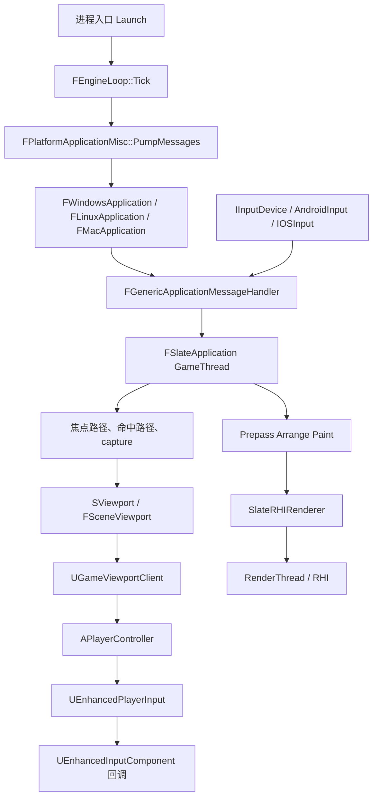
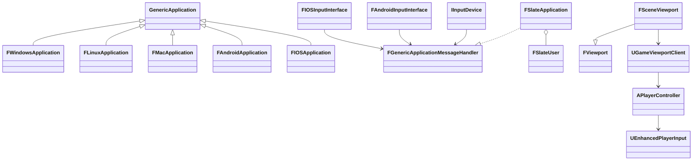
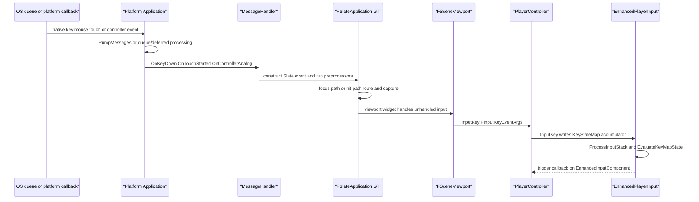
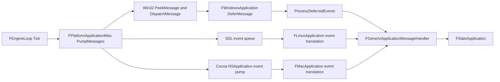
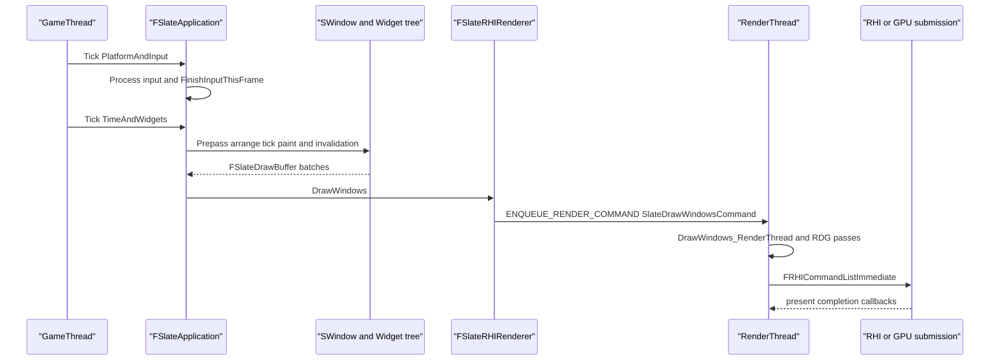
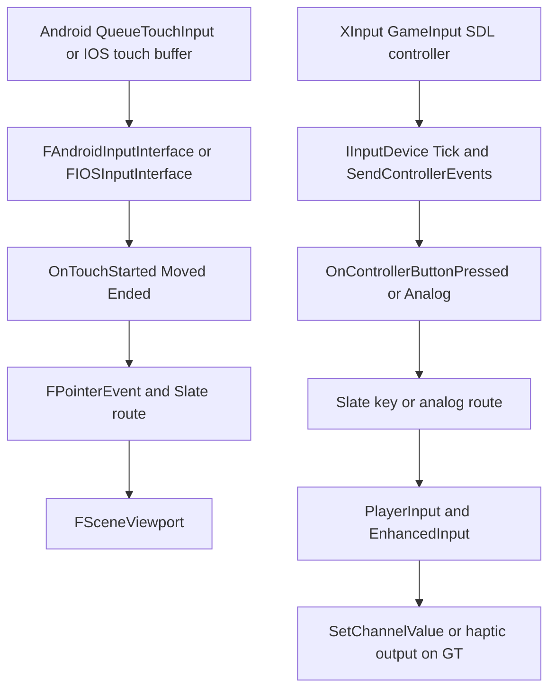
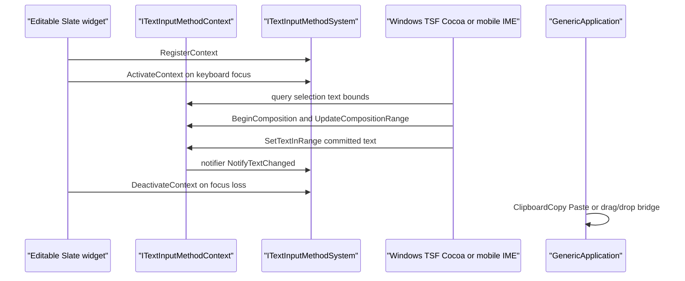
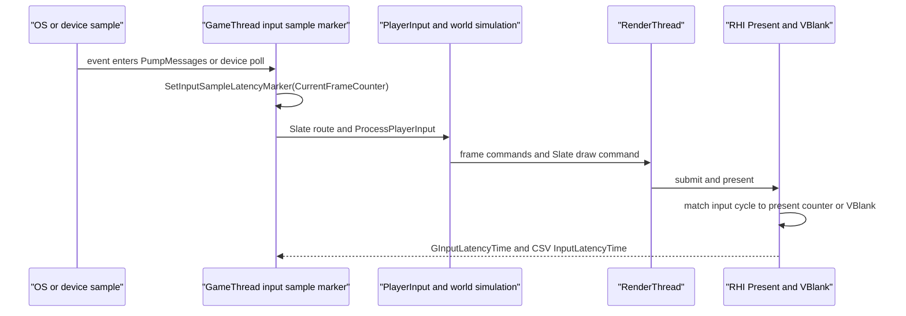
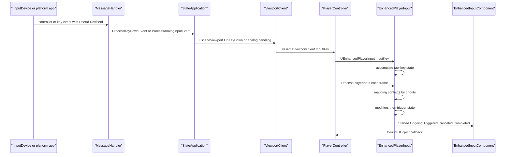
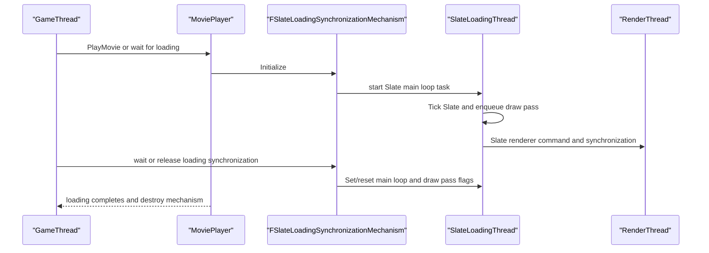

# 28 UI、输入采集线程与事件路由详细设计

源码根 `$UE=/home/timeshift/opensource/game_engine/unreal/UnrealEngine-5.8.3-release`，引擎路径均相对 `$E`。本章是第10章的线程、平台和延迟补遗，不重复 Slate/UMG 的基础类表；行号按当前 5.8.3-release 源码实测。

## 28.1 职责、边界与模块清单

|模块|源码路径|职责与本章新增边界|
|---|---|---|
|ApplicationCore|Source/Runtime/ApplicationCore|GenericApplication、平台窗口、OS 消息泵、触摸、IME、剪贴板、拖放|
|InputCore|Source/Runtime/InputCore|FKey、EKeys、FInputDeviceId、FPlatformUserId、触摸与轴类型|
|InputDevice|Source/Runtime/InputDevice|IInputDevice、线程亲和性、力反馈和触觉输出|
|SlateCore/Slate|Source/Runtime/SlateCore、Slate|Slate GT/SlateLoadingThread 约束、FSlateApplication 路由、焦点/capture|
|UMG|Source/Runtime/UMG|UWidget/UUserWidget/WidgetTree/生成类、属性通知与失效|
|Engine|Source/Runtime/Engine|FViewport/FSceneViewport、UGameViewportClient、PlayerController 输入帧|
|EnhancedInput|Plugins/EnhancedInput/Source/EnhancedInput|采样、映射、触发器、回调及上下文切换|
|SlateRHIRenderer|Source/Runtime/SlateRHIRenderer|GT 批次到 RenderThread/RHI 的交接|
|MoviePlayer|Source/Runtime/MoviePlayer、MoviePlayerProxy|加载屏 Slate 线程同步机制|
|RHI/Launch|Source/Runtime/RHI、Launch|输入采样延迟标记、Present/GPU 端测量|

本章不把“设备线程安全”误写成“设备必有独立线程”：`IInputDevice::GetThreadAffinity` 的默认值是 `GameThreadOnly`（InputDevice/Public/IInputDevice.h:13-49）。

## 28.2 总体架构

进程主线程完成 ApplicationCore 创建和 Slate 绑定后，平台消息泵、Slate 输入路由、UMG 对象访问和 PlayerController 输入状态均由 GameThread 串行消费；渲染仅转移绘制批次和资源代理，不转移 UWidget/UObject 所有权。Android/IOS 平台回调可来自系统线程，但源码只在明确的队列/转交函数处确认，不对未声明的回调线程做推断。

## 28.3 类图

- `GenericApplication` 的平台无关入口在 `ApplicationCore/Public/GenericPlatform/GenericApplication.h:444-550`。
- Windows/ Linux/ Mac 都显式覆写 `PumpMessages` 和 `ProcessDeferredEvents`；Android 以 `FAndroidInputInterface` 提供设备和触摸桥接，IOS 以 `FIOSInputInterface` 提供桥接（各平台头文件位置见 28.11）。
- Slate 与 UMG 的基础继承、绘制批次和路由类图见第10章；本图只补线程边界和平台实现。

## 28.4 数据字典

|类型/字段|含义|约束|源码位置|
|---|---|---|---|
|`FKey` / `EKeys`|键名及预注册键|由 `FName` 标识，元数据查询为 const|InputCore/Classes/InputCoreTypes.h:48-127,345-830|
|`FPlatformUserId`|平台用户标识|`PLATFORMUSERID_NONE` 表示无效|Core/Public/Misc/CoreMiscDefines.h:464-511|
|`FInputDeviceId`|输入设备标识|`INPUTDEVICEID_NONE` 表示无效|同上:518 附近|
|`EInputDeviceThreadAffinity`|设备 Tick/SendControllerEvents 允许线程|`GameThreadOnly` 或 `InputThreadSafe`|InputDevice/Public/IInputDevice.h:19-26|
|`IInputInterface`|平台输入输出接口|设备输出函数仍要求 GT|ApplicationCore/Public/GenericPlatform/GenericApplication.h:547-550；平台实现头文件|
|`FDeferredWindowsMessage`|Win32 延迟消息记录|由 `DeferMessage` 入队，`ProcessDeferredEvents` 消费|ApplicationCore/Private/Windows/WindowsApplication.cpp:4188-4230|
|`FDeferredAndroidMessage`|Android JNI/触摸延迟记录|由 `DeferMessage` 进入 Android 输入队列|ApplicationCore/Public/Android/AndroidInputInterface.h:281|
|`FInputKeyEventArgs`|视口键事件参数|含 Viewport、InputDevice、Key、Event、Delta、DeltaTime|Engine/Public/InputKeyEventArgs.h:21-186|
|`FKeyEvent`|Slate 键盘事件|含 Key、用户、设备、重复标志|SlateCore/Public/Input/Events.h:430 附近|
|`FPointerEvent`|鼠标/触摸事件|含 PointerIndex、位置、Wheel、EffectingButton、触摸标志|SlateCore/Public/Input/Events.h:693 附近|
|`FInputActionValue`|EnhancedInput 已映射值|Boolean/Axis1D/Axis2D/Axis3D|EnhancedInput/Public/InputActionValue.h|
|`ETriggerEvent`/`ETriggerState`|动作回调位与触发状态|None、Started、Ongoing、Triggered、Canceled、Completed|EnhancedInput/Public/InputTriggers.h:18-56|
|`GInputLatencyTime`|采样到帧翻转的 cycle 数|由 RHI Present/VBlank 关联更新|RHI/Public/RHICommandList.h:147-148; RHI/Private/RHIUtilities.cpp:794-869|
|`InputLatencyTime`|引擎统计的平滑毫秒值|`0.9 * old + 0.1 * raw`|Engine/Private/UnrealClient.cpp:401-402|
|`ITextInputMethodContext`|可编辑文本上下文|查询/修改选区、文本、组合态和屏幕边界|ApplicationCore/Public/GenericPlatform/ITextInputMethodSystem.h:14-138|
|`ITextInputMethodSystem`|平台 IME 服务|ApplyDefaults/Register/Activate/Deactivate context|同上:168-218|
|`FSlateLoadingSynchronizationMechanism`|加载屏 Slate 线程同步对象|拥有加载线程计数、绘制任务和主循环状态|MoviePlayer/Private/MoviePlayerThreading.h:16；.cpp:42-142|

## 28.5 接口清单

### 28.5.1 ApplicationCore 与消息处理

|逐字原型|功能|线程约束|位置|
|---|---|---|---|
|`virtual void PollGameDeviceState( const float TimeDelta )`|轮询外部设备|调用者通常 GT；实现可把 `InputThreadSafe` 设备交给输入线程|GenericApplication.h:463|
|`virtual void PumpMessages( const float TimeDelta )`|取 OS 消息并派发|平台窗口线程，UE 主循环中为 GT|GenericApplication.h:465|
|`virtual void ProcessDeferredEvents( const float TimeDelta )`|消费平台延迟队列|同消息泵线程；Windows/Mac/Linux 明确覆写|GenericApplication.h:467|
|`virtual void Tick ( const float TimeDelta )`|平台应用 Tick|GT，Android/平台实现按源码调用|GenericApplication.h:469|
|`virtual IInputInterface* GetInputInterface()`|取平台输入输出接口|由应用生命周期持有；调用线程未在基类声明|GenericApplication.h:547|
|`virtual ITextInputMethodSystem *GetTextInputMethodSystem()`|取平台 IME 系统|Slate 编辑控件焦点变化时调用，基类未声明额外线程|GenericApplication.h:549|
|`virtual void FinishedInputThisFrame()`|输入帧结束钩子|GT 主循环输入阶段末尾|GenericApplication.h:568|
|`virtual bool OnKeyDown(const int32 KeyCode, const uint32 CharacterCode, const bool IsRepeat)`|消息转键按下|消息泵线程；通常 GT|GenericApplicationMessageHandler.h:256|
|`virtual bool OnControllerAnalog(FGamepadKeyNames::Type KeyName, FPlatformUserId PlatformUserId, FInputDeviceId InputDeviceId, float AnalogValue)`|转模拟轴|设备声明线程可为输入线程；Slate 消费仍须符合其线程检查|GenericApplicationMessageHandler.h:335|
|`virtual bool OnTouchStarted(const TSharedPtr< FGenericWindow >& Window, const FVector2D& Location, float Force, int32 TouchIndex, FPlatformUserId PlatformUserId, FInputDeviceId DeviceId)`|转触摸开始|平台回调/队列消费线程；Android/IOS 以各自转交路径为准|GenericApplicationMessageHandler.h:378|
|`virtual EDropEffect::Type OnDragDrop(const TSharedPtr< FGenericWindow >& Window )`|转拖放完成|窗口消息线程；Windows 非窗口线程先延迟|GenericApplicationMessageHandler.h:542|

### 28.5.2 设备和平台输入

|逐字原型|功能|线程约束|位置|
|---|---|---|---|
|`virtual void Tick( float DeltaTime ) = 0`|检查连接和设备状态|`GetThreadAffinity` 指定 GT 或输入线程|InputDevice/Public/IInputDevice.h:38|
|`virtual void SendControllerEvents() = 0`|采样并向 MessageHandler 发事件|同上|同上:41|
|`virtual EInputDeviceThreadAffinity GetThreadAffinity() const`|声明设备采集线程安全性|默认 GT-only；InputThreadSafe 要求无 UObject/Slate 调用|同上:44-49|
|`virtual void SetChannelValue (int32 ControllerId, FForceFeedbackChannelType ChannelType, float Value) = 0`|单通道力反馈|无论采集亲和性，输出由 GT 调用|同上:60|
|`virtual void SetChannelValues (int32 ControllerId, const FForceFeedbackValues &values) = 0`|批量力反馈|GT|同上:61|
|`virtual class IHapticDevice* GetHapticDevice()`|取得触觉接口|设备实现决定；调用契约未声明为任意线程|同上:79-83|
|`static void QueueTouchInput(const TArray<TouchInput>& InTouchEvents)`|Android 触摸入队|生产者线程未在声明中固定；消费路径在 Android 输入接口|AndroidInputInterface.h:251|
|`static void DeferMessage(const FDeferredAndroidMessage& DeferredMessage)`|Android 事件延迟|用于跨 JNI/应用回调到消费阶段|同上:281|
|`static void JoystickAxisEvent(int32 deviceId, int32 axisId, float axisValue)`|Android 摇杆轴桥接|JNI/平台回调线程未声明，后续由输入接口发送|同上:273|
|`static void MouseButtonEvent(int32 deviceId, int32 buttonId, bool buttonDown)`|Android 鼠标桥接|同上|同上:279|
|`static FInputDeviceId RegisterSurfaceForTouch(const TSharedRef<FAndroidWindow>& Window)`|给额外 Surface 注册触摸设备|调用者需负责用户映射及 QueueTouchInput 转交|同上:260|

### 28.5.3 Slate、视口和增强输入

|逐字原型|功能|线程约束|位置|
|---|---|---|---|
|`SLATE_API void Tick(ESlateTickType TickType = ESlateTickType::All)`|平台输入、时间、Widget Tick|`check(IsInGameThread() || TickType == ESlateTickType::Time)`|Slate/Private/Framework/Application/SlateApplication.cpp:1621-1631|
|`SLATE_API bool ProcessKeyDownEvent( const FKeyEvent& InKeyEvent )`|预处理器、焦点路径键路由|GT|Slate/Public/Framework/Application/SlateApplication.h:1343|
|`SLATE_API FReply RoutePointerDownEvent(const FWidgetPath& WidgetsUnderPointer, const FPointerEvent& PointerEvent)`|命中路径隧穿/冒泡|GT；更新焦点和 pointer capture|同上:1763；实现约 5414|
|`SLATE_API bool ProcessMouseButtonDownEvent(const TSharedPtr< FGenericWindow >& PlatformWindow, const FPointerEvent& InMouseEvent)`|鼠标按下统一入口|GT|同上:1302|
|`ENGINE_API virtual bool InputKey(const FInputKeyEventArgs& EventArgs) override`|视口输入入口|GT，Slate 回调内|Engine/Classes/Engine/GameViewportClient.h:177|
|`ENGINE_API virtual void ProcessPlayerInput(const float DeltaTime, const bool bGamePaused)`|帧级 PlayerInput 求值|GT，源码 `check(IsInGameThread() && !InputStack.Num())`|Engine/Classes/GameFramework/PlayerController.h:1997; Private/PlayerController.cpp:2742|
|`UE_API virtual bool InputKey(const FInputKeyEventArgs& Params) override`|EnhancedPlayerInput 累加键状态|GT|EnhancedInput/Public/EnhancedPlayerInput.h:123|
|`UE_API virtual void EvaluateKeyMapState(const float DeltaTime, const bool bGamePaused, OUT TArray<TPair<FKey, FKeyState*>>& KeysWithEvents) override`|映射、修饰器、触发器求值|GT|同上:164|
|`UE_API virtual void AddMappingContext(const UInputMappingContext* MappingContext, int32 Priority, const FModifyContextOptions& Options = FModifyContextOptions())`|上下文增删/优先级|GT；没有源码证据支持后台线程切换|EnhancedInput/Public/EnhancedInputSubsystemInterface.h:265|
|`FEnhancedInputActionEventBinding& BindAction(const UInputAction* Action, ETriggerEvent TriggerEvent, UObject* Object, FName FunctionName)`|动作事件绑定|GT 初始化/SetupInputComponent|EnhancedInput/Public/EnhancedInputComponent.h:497|

### 28.5.4 IME、剪贴板、拖放和加载屏

|逐字原型|功能|线程约束|位置|
|---|---|---|---|
|`virtual TSharedPtr<ITextInputMethodChangeNotifier> RegisterContext(const TSharedRef<ITextInputMethodContext>& Context) = 0`|注册可编辑文本上下文|文本控件生命周期和 Slate 焦点线程|ITextInputMethodSystem.h:187|
|`virtual void ActivateContext(const TSharedRef<ITextInputMethodContext>& Context) = 0`|焦点获得时激活 IME|GT/Slate 线程|同上:202|
|`virtual void DeactivateContext(const TSharedRef<ITextInputMethodContext>& Context) = 0`|焦点失去时停用|GT/Slate 线程|同上:209|
|`virtual void BeginComposition() = 0`|开始组合输入|平台 IME 回调上下文|ITextInputMethodSystem.h:123|
|`virtual void UpdateCompositionRange(const int32 InBeginIndex, const uint32 InLength) = 0`|更新组合串范围|同上|同上:133|
|`virtual void EndComposition() = 0`|结束组合|同上|同上:138|
|`static void ClipboardCopy(const TCHAR* Str)`|系统剪贴板写入|平台实现；线程未由通用接口声明|GenericPlatform/GenericPlatformApplicationMisc.h:304；各平台 Misc.h|
|`static void ClipboardPaste(class FString& Dest)`|系统剪贴板读取|同上|同上:307|
|`FSlateLoadingSynchronizationMechanism::Initialize()`|创建/启动加载屏 Slate 同步|加载屏初始化上下文|MoviePlayer/Private/MoviePlayerThreading.cpp:55|
|`void FSlateLoadingSynchronizationMechanism::SlateThreadRunMainLoop()`|加载屏线程主循环|SlateLoadingThread；具体线程创建由 MoviePlayer 机制控制|同上:128|

## 28.6 关键流程

### 28.6.1 OS 到游戏输入

### 28.6.2 窗口消息泵架构

Windows 的窗口对象属于创建它的 GUI/主线程，UE 的窗口消息由该线程的 Win32 queue 处理；`FWindowsWindow` 在非主线程收到 OLE 拖放时调用 `DeferDragDropOperation`（WindowsApplication.h:323-324），再由应用泵处理。Linux 的 `FLinuxApplication` 明确使用 SDL 事件队列并保存窗口属性以避免批量事件中的位置漂移（LinuxApplication.h:116-126）。Mac 的 `FMacApplication::PumpMessages` 转到 `FMacPlatformApplicationMisc::PumpMessages(true)`（MacApplication.cpp:425-437）。Android/IOS 的 Activity/UIKit 生命周期与输入回调并非 GenericApplication 的统一 OS queue；在源码确认的范围内，输入经各自接口转发，未声明的原生回调线程不推断。

### 28.6.3 Slate Tick、Paint 到 RT/RHI

`FSlateDrawElement` 只在 GT 或 SlateLoadingThread 追加，`SLATE_CROSS_THREAD_CHECK` 定义于 SlateCore/Public/SlateGlobals.h:109。`FSlateRHIRenderer` 的 `DrawWindows_Private` 和 RT 绘制位置见第10章及 SlateRHIRenderer/Private/SlateRHIRenderer.cpp:1512、1212；这里的跨线程载荷是 draw buffer/资源代理，不是 UObject Widget。

### 28.6.4 触摸、手柄和力反馈

Windows RawInput、XInput、GameInput 和 SDL 均不是同一个公共实现：RawInput 插件以 Windows message handler 接入，GameInput 设备实现 `IInputDevice`，Linux 的 SDL 事件由 `FLinuxApplication` 解析；本树只表示公共转交点。5.8.3 源码确认 Android 提供 `QueueTouchInput`, `JoystickAxisEvent`, `JoystickButtonEvent` 和 `DeferMessage`（AndroidInputInterface.h:251-283），IOS 在 `IOSInputInterface.cpp:211-227` 将触摸记录转为 MessageHandler 回调。具体 RawInput/XInput 内部采样线程在本树中未统一声明。

### 28.6.5 IME、软键盘、剪贴板和拖放

`ITextInputMethodContext` 要求文本控件维护上下文对象；`ITextInputMethodSystem` 只规定注册和焦点生命周期，并未规定所有平台回调线程。Windows 的 TSF 适配是 `WindowsTextInputMethodSystem.h:81-85`，Mac 是 `MacTextInputMethodSystem.h:16-20`；Android/iOS 还提供 `RequiresVirtualKeyboard` 和平台软键盘事件，但统一 IME 上下文实现未在本次源码范围内确认。剪贴板通用接口位于 GenericPlatformApplicationMisc.h:304-307，Windows OLE 拖放在 WindowsWindow.cpp:1320-1380，Linux/Mac 平台也有应用层拖放队列/代理。

### 28.6.6 输入延迟时间线

源码中没有与本任务名称完全一致的 `GInputLatencyTimer`、`BeginInputFrame` 或 `EndInputFrame` 全局接口；实际存在的是 `UEngine::SetInputSampleLatencyMarker`（Launch/Private/LaunchEngineLoop.cpp:5781）、`GInputLatencyTime`（RHI/Public/RHICommandList.h:147-148）、RHI 的 VBlank 关联（RHI/Private/RHIUtilities.cpp:794-869）以及 `STAT_InputLatencyTime`/CSV `InputLatencyTime`（Engine/Private/UnrealClient.cpp:401-439、LaunchEngineLoop.cpp:1527-1529）。因此不可把文档中的俗称当作源码 API。

## 28.7 时序图

### 28.7.1 EnhancedInput 完整链路

### 28.7.2 加载屏 Slate 线程同步

`FSlateLoadingSynchronizationMechanism` 的状态函数为 `Is/Set/ResetSlateDrawPassEnqueued` 和 `Is/Set/ResetSlateMainLoopRunning`（MoviePlayerThreading.cpp:93-142）。`FMoviePlayerProxy::SetIsSlateThreadAllowed` 在 LaunchEngineLoop.cpp:5990-5992 控制进入主循环阶段；它不是把普通 UMG 访问变成线程安全，而是允许 Slate 绘制相关路径在加载屏线程运行。

## 28.8 线程模型与同步

|对象/阶段|线程|同步与源码判定|
|---|---|---|
|Win32/Cocoa/SDL 消息队列|对应窗口所属 GUI 线程；UE 常规运行中为 GT|平台 PumpMessages 调用点与平台 API；统一基类不声明额外线程|
|`FGenericApplicationMessageHandler`|消息泵/设备事件生产线程|`IInputDevice` 可声明 InputThreadSafe；回调本身不自动 marshal|
|Android/IOS 原生输入回调|平台回调线程或系统主线程|本树仅确认 `QueueTouchInput`/IOS touch buffer；未在源码声明处不得指定线程|
|`FSlateApplication`、SWidget、FSlateUser、UMG UObject|GT；加载屏允许 SlateLoadingThread|`SlateApplication.cpp:1629` 和 `SlateGlobals.h:109` 的线程检查|
|`FSceneViewport`、`UGameViewportClient`、PlayerInput|GT|`ProcessPlayerInput` 的 `check(IsInGameThread())`，输入累加器不能跨线程写|
|EnhancedInput mapping/trigger/callback|GT|AddMappingContext、EvaluateKeyMapState 和 ProcessPlayerInput 均属于 GT 调用路径|
|`FSlateDrawBuffer`/batch|GT 或 SlateLoadingThread 生成|绘制元素有跨线程检查，交接后由 RT 消费；生命周期依 renderer 命令完成|
|SlateRHIRenderer RT pass|RenderThread，RHI 按 RHI 模式|`ENQUEUE_RENDER_COMMAND`，`DrawWindow_RenderThread`；见第07章|
|加载屏同步|SlateLoadingThread 与 GT|FSlateLoadingSynchronizationMechanism 状态/任务；具体 OS 线程创建细节仅由 MoviePlayer 实现控制|
|力反馈、灯光、触觉输出|GT|IInputDevice.h:13-17 明确输出方法总由 GT 调用|

跨线程规则是“转移不可变事件/绘制批次，不能转移 UObject 借用”：设备线程若直接调用 Slate、UObject 或 PlayerInput 是违反接口约束；应把事件放入平台/设备队列，在 GT pump 点消费。普通 Delegate、TQueue 和平台回调不提供隐含内存屏障，需由实际队列或任务机制确认。

## 28.9 配置与扩展点

- `EInputDeviceThreadAffinity` 是设备扩展的线程契约；旧插件不覆写即 `GameThreadOnly`（InputDevice/Public/IInputDevice.h:19-49）。
- `IInputDeviceModule` 经 `IModularFeatures` 发现并创建设备；WindowsApplication、AndroidApplication、IOSApplication 都持有外部输入设备列表，具体发现调用见各平台 `OnInputDeviceModuleRegistered`。
- RawInput 插件的 `FRawInputWindows` 通过 `IWindowsMessageHandler` 接收 WM_INPUT；GameInput Windows 模块使用 `IGameInputDeviceInterface`，其线程声明需以插件头文件为准；Linux Application 使用 SDL，未发现公共 XInput 实现。
- `FSlateApplication::RegisterInputPreProcessor` 是 UI 优先拦截扩展点；CommonUI/CommonInput 基于此类预处理器，但其激活栈细节见第10章。
- `ITextInputMethodSystem` 由平台 Application 提供；GenericApplication 还暴露虚拟键盘显示/隐藏和剪贴板变更事件（GenericApplication.h:524-532）。
- `FGenericApplicationMessageHandler` 拥有触摸、手柄、拖放、窗口焦点、IME 相关公共回调；平台实现可以只实现实际支持的回调。
- 输入延迟可通过 `stat unit`/Engine stats、CSV `InputLatencyTime` 和 Trace VSync bookmarks 观察；源码没有注册名为 `BeginInputFrame` 的公共 CVar。

## 28.10 已知限制/未确认项

1. Windows 的 `DeferMessage`、`ProcessDeferredEvents`、RawInput 和 OLE 拖放路径已逐点确认；Linux SDL、Mac Cocoa 的 PumpMessages 入口已确认，但本章没有把 SDL/Cocoa 第三方内部线程模型扩展为 UE 契约。
2. Android 的 `QueueTouchInput`、JNI 设备事件、Surface 设备 id 和 deferred message API 已确认；这些 API 的生产者线程在声明中未固定，不能写成“Android 输入线程”这一确定线程名称。
3. IOS 的 `FIOSInputInterface` 触摸缓冲到 MessageHandler 路径已确认；UIKit 回调和游戏线程转交的完整锁/队列实现未在本章逐行展开，生产线程写“未声明”。
4. XInput、Windows RawInput、GameInput、SDL 都是不同适配路径；源码没有一个统一的“输入采集线程”。`IInputDevice::InputThreadSafe` 只表示实现允许输入线程调用 Tick/SendControllerEvents，不证明该线程一定被创建。
5. 加载屏存在 `FSlateLoadingSynchronizationMechanism` 和 `SlateLoadingThread` 检查，但 MoviePlayer 是否启用该路径取决于加载屏配置和运行阶段；未把它等同于始终存在的常驻 Slate 线程。
6. 本章按实际源码记录输入延迟：没有找到名为 `GInputLatencyTimer`、`BeginInputFrame`、`EndInputFrame` 的引擎公共符号；可验证链路是 `SetInputSampleLatencyMarker` → RHI VBlank 匹配 → `GInputLatencyTime`/CSV/Stats。RHI 后端是否能提供有效 Present/VBlank 时间取决于平台和 RHI。
7. `ITextInputMethodContext` 明确了查询、组合和文本修改原型，但各平台 IME 回调线程、Android/iOS 软键盘具体实现和剪贴板权限不由该通用接口统一声明。
8. 第10章遗漏的补遗已覆盖：Windows/Linux/Mac/Android/IOS Application 入口、设备线程亲和性与输出边界、Deferred/Queue 输入、IME 上下文原型、加载屏同步对象、真实输入延迟符号和 GT-only/RT proxy 边界。

## 28.11 附录索引

|范围|附录文件|
|---|---|
|ApplicationCore|`appendix/api/Runtime/ApplicationCore.md`|
|InputCore|`appendix/api/Runtime/InputCore.md`|
|InputDevice|`appendix/api/Runtime/InputDevice.md`|
|SlateCore / Slate|`appendix/api/Runtime/SlateCore.md`、`appendix/api/Runtime/Slate.md`|
|SlateRHIRenderer|`appendix/api/Runtime/SlateRHIRenderer.md`|
|UMG / FieldNotification|`appendix/api/Runtime/UMG.md`、`appendix/api/Runtime/FieldNotification.md`|
|Engine 视口与输入|`appendix/api/Runtime/Engine.part01.md` ~ `Engine.part06.md`|
|EnhancedInput|`appendix/api/Plugins/EnhancedInput.md`|
|RawInput / GameInput|`appendix/api/Plugins/RawInput.md`、`appendix/api/Plugins/GameInputBase.md`、`appendix/api/Plugins/GameInputWindows.md`|
|MoviePlayer / MoviePlayerProxy|`appendix/api/Runtime/MoviePlayer.md`、`appendix/api/Runtime/MoviePlayerProxy.md`|
|RHI / Launch|`appendix/api/Runtime/RHI*.md`、`appendix/api/Runtime/Launch*.md`|

本章与第10章的关系：第10章提供 Widget、UMG、Slate 路由和基础接口全景；第28章只补平台消息泵、输入采集线程、事件转交、IME/拖放、加载屏同步和输入延迟证据。
