# 29 渲染线程、RHI线程与GPU提交横切详细设计

本章只补第06、07章没有展开的线程交互。源码根为 `$UE=/home/timeshift/opensource/game_engine/unreal/UnrealEngine-5.8.3-release`，引擎相对路径均以 `$E` 为根，行号按本源码树核对。第08章的渲染器顺序、第26章的全引擎线程总表不重复。

## 29.1 职责、边界与模块清单

|模块|源码路径|依赖/边界|本章关注点|
|---|---|---|---|
|RenderCore|Runtime/RenderCore|依赖 RHI、CoreUObject|GT→RT命令捕获、Fence、FrameEndSync、RenderCommandPipe|
|RHI|Runtime/RHI|平台无关命令/资源接口|命令列表录制、Translate、Submit、GPU fence/readback|
|D3D12RHI|Runtime/D3D12RHI|D3D12、RHICore、RenderCore|Queue、SubmissionThread、InterruptThread、Residency、Present|
|VulkanRHI|Runtime/VulkanRHI|Vulkan、RHICore、RenderCore|Graphics/Async/Transfer queue、semaphore、fence、swapchain|
|OpenGLDrv|Runtime/OpenGLDrv|OpenGL、RHI|单上下文所有权、无独立显式队列|
|NullDrv|Runtime/NullDrv|RHI、RenderCore|无GPU完成时间线的哑实现|
|Engine|Runtime/Engine|Renderer、RenderCore|ShaderCompile、DerivedData、streaming生产者交接|
|Renderer/Slate/Media/Niagara/Audio|Runtime/Renderer等|通过RenderCore/RHI入口接入|跨线程命令边界，不展开各自渲染算法|

边界：第06章定义RHI对象与后端概览，第07章定义RDG和渲染线程主流程；本章记录它们之间的所有权、等待和提交阶段，不重新列出完整符号附录。

## 29.2 总体架构

```mermaid
flowchart LR
 GT["Game Thread"] --> CAP["captured lambda"]
 CAP --> PIPE["FRenderThreadCommandPipe"]
 PIPE --> RT["ActualRenderingThread"]
 RT --> RDG["FRDGBuilder Setup Compile Execute"]
 RDG --> CL["FRHICommandListImmediate"]
 CL --> EXE["FRHICommandListExecutor"]
 EXE --> TR["parallel translate"]
 TR --> RHI["RHIThread or task"]
 RHI --> SUB["backend submission"]
 SUB --> GPU["GPU queue"]
 GPU --> PRESENT["Present or fence"]
```

RT是TaskGraph具名线程，不等于每个并行渲染任务；`RenderingThreadMain` 在 `RenderCore/Private/RenderingThread.cpp:227-277` 调用 `AttachToThread(ENamedThreads::ActualRenderingThread)`。RHI专用线程仅在 `ERHIThreadMode::DedicatedThread` 下存在，任务模式由同一执行器使用任务队列替代。

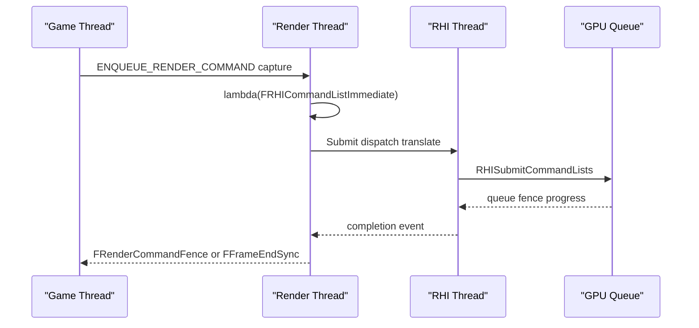

## 29.3 类图

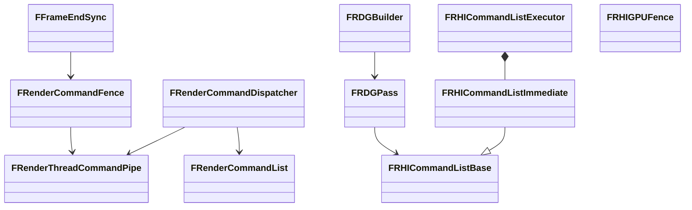

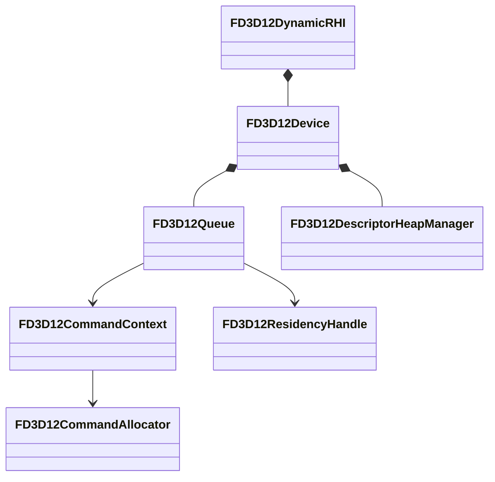

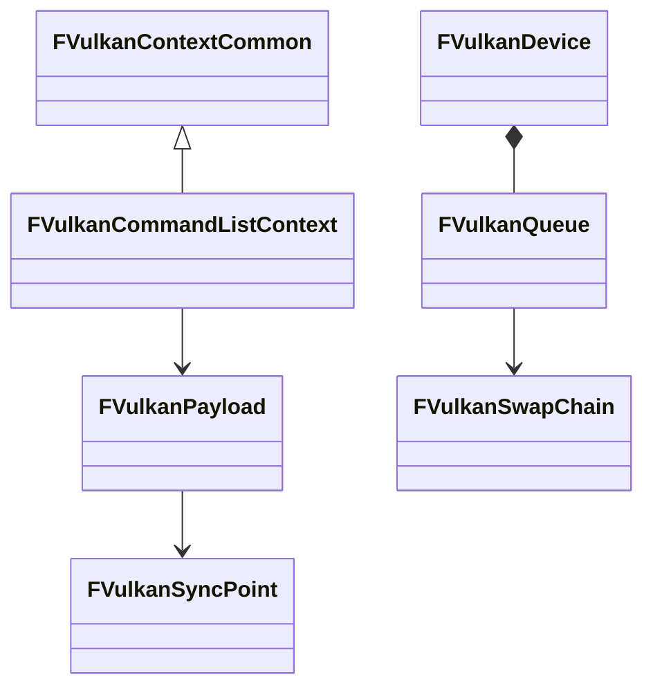

## 29.4 数据字典

|字段/类型|含义|取值/约束|源码位置|
|---|---|---|---|
|`ERHIThreadMode`|RHI执行模式|`None`、`DedicatedThread`、`Tasks`|`Runtime/RHI/Public/RHICommandList.h:98-103`|
|`ERHISubmitFlags`|提交附加语义|`SubmitToGPU`、`DeleteResources`、`FlushRHIThread`、`EndFrame`等|`RHICommandList.h:4353-4384`|
|`EImmediateFlushType::Type`|ImmediateFlush级别|`WaitForOutstandingTasksOnly`、`DispatchToRHIThread`、`FlushRHIThread`、`FlushRHIThreadFlushResources`|`RHICommandList.h:4330-4339`|
|`ERHIPipeline`|RHI队列掩码|`Graphics`、`AsyncCompute`、`All`|`Runtime/RHI/Public/RHIPipeline.h:9-24`|
|`FRHIGPUFence`|GPU完成标记|`Clear()`、非阻塞`Poll()`|`RHIResources.h:2397-2417`|
|`FRHIGPUMemoryReadback::Fence`|readback可读条件|必须先复制并确认fence，再Lock|`RHI/Public/RHIGPUReadback.h:18-31`|
|`FRDGPass::Pipeline`|pass所属队列|Graphics或AsyncCompute，由`GetPipeline()`返回|`RenderCore/Public/RenderGraphPass.h:285-295`|
|`FRenderCommandFence::ESyncDepth`|GT等待深度|RenderThread、RHIThread、Swapchain|`RenderCore/Public/RenderCommandFence.h:17-29`|
|`r.OneFrameThreadLag`|帧末同步策略|`<=0`强制full sync；正值允许一帧管线滞后|`RenderCore/Private/RenderingThread.cpp:2435-2500`|
|`FRHICommandListExecutor::FTaskPipe`|三阶段有序任务链|Dispatch、Translate、Submit各有pipe|`RHI/Public/RHICommandList.h:5133-5163`|
|`FRDGTransientResourceAllocator`|瞬态资源分配器|按资源生命周期复用/别名|`RenderCore/Public/RenderGraphResourcePool.h:113`|
|`FD3D12Queue::PendingSubmission`|提交载荷队列|MPSC，后端SubmissionThread消费|`D3D12RHI/Private/D3D12Device.h:98-101`|
|`FVulkanQueue::NextTimelineSemaphoreValue`|Vulkan队列进度|单调递增；能力支持时使用timeline semaphore|`VulkanRHI/Private/VulkanQueue.h:91-137`|

## 29.5 接口清单

### 29.5.1 GT→RT命令与捕获

|原型/宏|功能|线程约束|源码位置|
|---|---|---|---|
|`#define ENQUEUE_RENDER_COMMAND(Type, ...)`|生成tag并调用dispatcher|任意合法生产线程；捕获值必须活到RT执行|`RenderCore/Public/RenderingThread.h:1087-1093`|
|`template <typename RenderCommandTag> static void FRenderCommandDispatcher::Enqueue(TUniqueFunction<void(FRHICommandListImmediate&)>&& Function)`|TLS列表、AutoRTFM commit或RT pipe三路分发|任意；RT内可直接执行|`RenderingThread.h:992-1016`|
|`template <typename RenderCommandTag, typename LambdaType> static void FRenderThreadCommandPipe::Enqueue(LambdaType&& Lambda)`|创建GraphTask或投入命令pipe|任意生产者；消费为RT|`RenderingThread.h:499-527`|
|`static FRenderCommandList* FRenderCommandList::Create(ERenderCommandListFlags InFlags = None, EPageSize InPageSize = Small)`|创建TLS/并行录制列表|任意录制线程|`RenderingThread.h:753-756`|
|`void FRenderCommandList::Close()`|关闭录制，阻止继续追加|录制线程|`RenderingThread.h:800`|
|`void FRenderCommandList::Submit(FRenderCommandList* InParentCommandList = nullptr)`|移交父列表或全局pipe|录制结束后调用|`RenderingThread.h:877`|
|`void FRenderCommandFence::BeginFence(ESyncDepth SyncDepth = ESyncDepth::RenderThread)`|插入RT/RHI/swapchain完成点|GT发起；源码要求`IsInGameThread()`|`RenderCore/Public/RenderCommandFence.h:35`;实现`RenderingThread.cpp:977-1051`|
|`void FRenderCommandFence::Wait(bool bProcessGameThreadTasks = false) const`|GT阻塞等待并可pump GT task|GT；不能在RT递归等待GT|`RenderCommandFence.h:41`;`RenderingThread.cpp:1260-1269`|
|`bool FRenderCommandFence::IsFenceComplete() const`|非阻塞探测|GT或AsyncLoadingThread|`RenderCommandFence.h:44`|
|`void FFrameEndSync::Sync(EFlushMode FlushMode)`|按EndFrame/Threads推进帧栅栏|GT；`Threads`不等GPU|`RenderingThread.h:56`;`RenderingThread.cpp:2480-2573`|
|`void FlushRenderingCommands()`|停止pipe录制、flush RHI资源并执行full线程同步|GT；递归调用仅告警并升级等待|`RenderingThread.h:111`;`RenderingThread.cpp:1274-1315`|

捕获闭包的关键不是“指针入队”而是捕获对象的生命周期：`TRenderThreadStruct`构造入队Init、析构入队Delete（`RenderingThread.h:1161-1221`）；`FRenderCommandList::FRecordScope`析构按StopAction关闭/提交（`RenderingThread.h:772-784`）。因此GT栈引用、临时`TArrayView`和未持有引用的UObject均不能直接捕获。`FRenderCommandPipe`在回放任务内重入时直接执行，避免同一pipe自等待（`RenderingThread.h:626-645`）。

### 29.5.2 RT→RHI翻译与提交

|原型|功能|线程约束|源码位置|
|---|---|---|---|
|`void FRHICommandListBase::FinishRecording()`|封闭并行列表，建立移交边界|录制线程末尾|`RHI/Public/RHICommandList.h:519`|
|`FGraphEventRef FRHICommandListBase::RHIThreadFence(bool bSetLockFence = false)`|在RHI队列建立事件|RT或翻译链|`RHICommandList.h:751`|
|`void FRHICommandListImmediate::ImmediateFlush(EImmediateFlushType::Type FlushType, ERHISubmitFlags SubmitFlags = ERHISubmitFlags::None)`|触发Dispatch/Translate/Submit等待|RT；RHI bypass时直接执行|`RHICommandList.h:4465`|
|`void FRHICommandListImmediate::QueueAsyncCommandListSubmit(TArrayView<FQueuedCommandList> CommandLists, ETranslatePriority ParallelTranslatePriority = ETranslatePriority::Disabled, int32 MinDrawsPerTranslate = 0)`|把并行列表挂入一次提交|RT|`RHICommandList.h:4453`|
|`FGraphEventRef FRHICommandListExecutor::Submit(TConstArrayView<FRHICommandListBase*> AdditionalCommandLists, ERHISubmitFlags SubmitFlags)`|建立SubmitState并排队三段pipe|RT调用；消费在RHI/任务线程|`RHICommandList.h:5053`;实现`RHICommandList.cpp:1470-1620`|
|`void FRHICommandListExecutor::FSubmitState::Dispatch_ProcessCommandList(FRHICommandListBase* CmdList)`|把列表进入翻译调度|Dispatch pipe|`RHICommandList.cpp:849`|
|`void FRHICommandListExecutor::FSubmitState::Submit_SubmitToGPU(FTranslateState* First, FTaskPipe::ITask& Task, uint64 TracingSubmissionID)`|汇总平台列表并提交|RHI线程/Submit pipe|`RHICommandList.cpp:1307-1410`|
|`FRHIFinalizeContextsResult FDynamicRHI::RHIFinalizeContexts(FRHIFinalizeContextsArgs&& Args) = 0`|关闭平台上下文，生成平台命令列表|并行翻译线程或RHI线程|`RHI/Public/DynamicRHI.h:848`|
|`void FDynamicRHI::RHISubmitCommandLists(FRHISubmitCommandListsArgs&& Args) = 0`|把平台列表交给后端队列|RHI线程|`DynamicRHI.h:881`|
|`void FRHICommandListImmediate::SubmitAndBlockUntilGPUIdle(const bool bDeleteResources = false)`|提交并阻塞到GPU idle|RT；不得持共享锁调用|`RHICommandList.h:4674`|
|`bool FRHICommandListImmediate::StallRHIThread()`|借用RHI上下文并阻止RHI任务|RT；配对`UnStallRHIThread`|`RHICommandList.h:4467-4469`|

`r.RHICmdBypass`锁存后，`FRHICommandListBase::Bypass()`使RHI调用直接落到context；否则命令用`ALLOC_COMMAND`挂入链表。`Submit`内按Dispatch→Translate→Submit保序，`AllowParallelTranslate()`仅决定Translate是否拆分，不改变最终`RHISubmitCommandLists`顺序（`RHICommandList.cpp:1470-1620`）。`ERHIPipeline`把Graphics和AsyncCompute上下文分开；后端是否真的有独立队列由能力和平台实现决定。

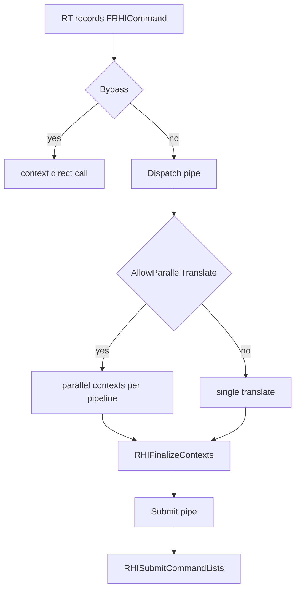

## 29.6 关键流程

### 29.6.1 RDG Setup→Compile→Execute

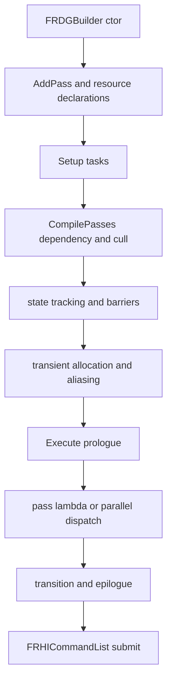

`FRDGBuilder::Execute()`在`RenderCore/Private/RenderGraphBuilder.cpp:1766-2234`串起Setup、Compile和Execute。依赖来自资源读写与`AddPassDependency`；`FRDGPass::TextureStates/BufferStates`生成前后访问态。`FRDGBarrierBatchBegin::Submit`把转换与alias信息落为RHI transition（`RenderGraphPass.h:114-134`）。引用数为零的资源被裁剪；瞬态分配器根据生命周期重叠关系复用内存，而`QueueTextureExtraction`把资源转为跨图池对象，禁止在图销毁后继续使用未提取的RDG句柄。

### 29.6.2 AsyncCompute和并行pass

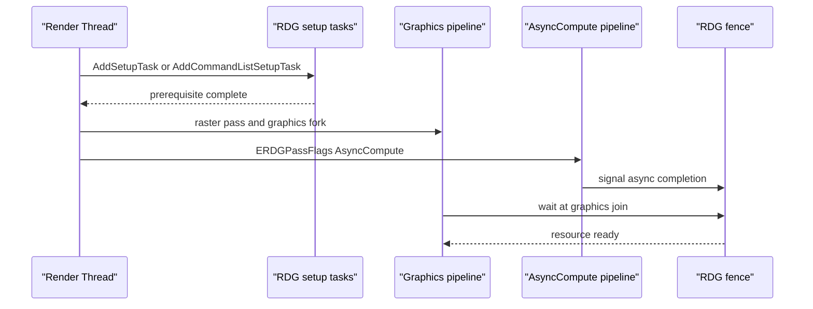

`ERDGPassFlags::AsyncCompute`和`FRDGPass::GetPipeline()`位置为`RenderCore/Public/RenderGraphDefinitions.h:129-161`、`RenderGraphPass.h:285-295`；图形fork/join字段在`RenderGraphPass.h:463-467`。异步重叠只在`GRHISupportsAsyncCompute`及资源状态可表达时成立，RDG会在跨pipeline读写处插入fence/transition；“同时提交”不等于驱动一定使用独立硬件队列。

### 29.6.3 GPU fence、readback和Present

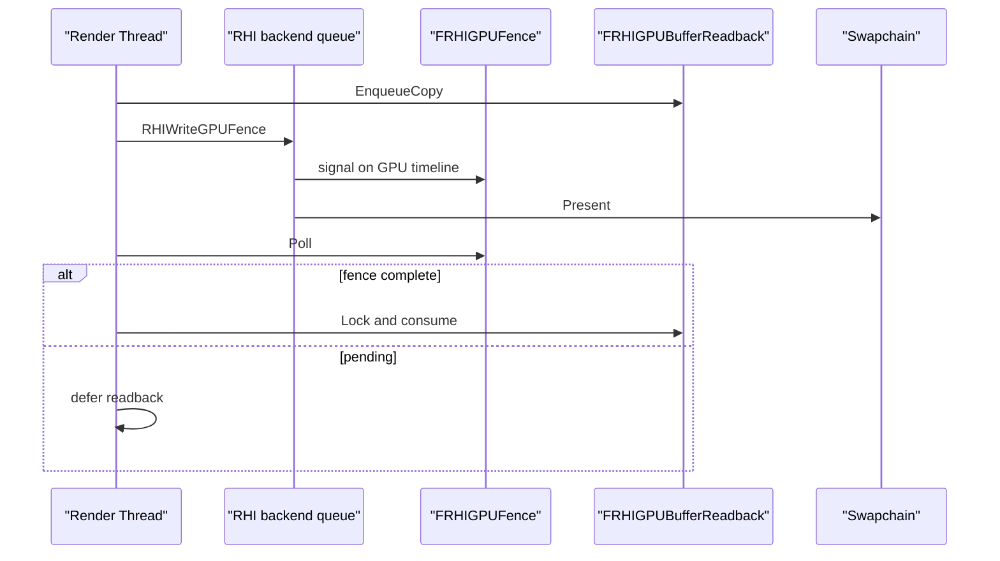

`FRHIGPUBufferReadback`和`FRHIGPUTextureReadback`继承`FRHIGPUMemoryReadback`，声明在`RHI/Public/RHIGPUReadback.h:18-160`；它们内部创建`RHICreateGPUFence`（同文件:26-31）。锁定前必须确认fence已完成，`DynamicRHI.h:326-351`的注释明确该约束。纹理映射走`RHIMapStagingSurface`，`DynamicRHI.h:591-595`要求成功映射后调用Unmap。

D3D12中`FD3D12Queue`封装`ID3D12CommandQueue`和`FD3D12Fence`，由`FD3D12Queue::ExecuteCommandLists`提交（`D3D12RHI/Private/D3D12Queue.h:85-137`）；Present可由`FD3D12Viewport::PresentOnSubmissionThread`执行（`D3D12Viewport.cpp:632`），也可在RHI路径直接调用swapchain Present。Vulkan中`FVulkanQueue`保存`VkQueue`、timeline semaphore状态和submit接口（`VulkanRHI/Private/VulkanQueue.h:52-137`），swapchain调用`vkQueuePresentKHR`（`VulkanSwapChain.h:52`）。OpenGL没有同等显式queue/timeline，靠上下文所有权和驱动同步；NullDrv没有真实GPU完成事件。

### 29.6.4 D3D12提交和后端线程

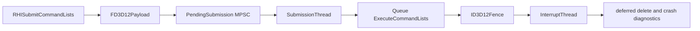

`FD3D12DynamicRHI`持有SubmissionThread/InterruptThread和PendingPayloads（`D3D12RHI/Private/D3D12RHIPrivate.h:195-259`）。`FD3D12Device`持有按队列分类的graphics/copy/async上下文、descriptor heap manager和PSO cache（`D3D12Device.h:153`）；allocator、descriptor和residency对象由设备/队列生命周期管理，不是额外UE命名线程。D3D12驱动内部线程、内核调度和GPU执行线程不暴露给UE，文档不能把它们计入引擎线程表。

### 29.6.5 Vulkan提交和后端线程

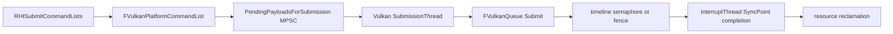

5.8.3没有旧名称`FVulkanCommandBufferManager`；命令上下文由`FVulkanContextCommon`/`FVulkanCommandListContext`（`VulkanContext.h:58,245`）维护，平台列表是`FVulkanPlatformCommandList`（`VulkanSubmission.h:208`）。队列类型为Graphics、AsyncCompute、Transfer（`VulkanQueue.h:26-33`）。timeline semaphore是否使用由运行期能力决定；不支持时使用二进制semaphore/fence路径。Vulkan loader/driver内部工作线程不可见，UE可确认的仅是RHI的SubmissionThread和InterruptThread。

### 29.6.6 异步资源生产者交接

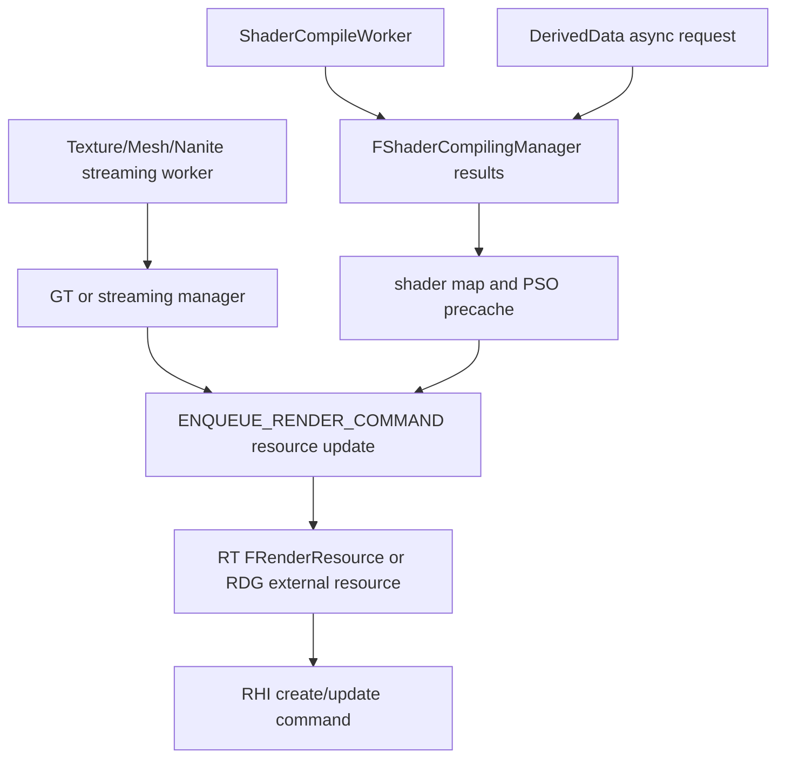

`FShaderCompilingManager::SubmitJobs`、`FinishCompilation`和`ProcessAsyncResults`的声明位于`Engine/Public/ShaderCompiler.h:1305-1356`；编译结果回填不等于RHI shader对象已经创建，RHI创建仍须经过RT/RHI线程契约。PSO收集入口为`FMeshPassProcessor::CollectPSOInitializers`（`Renderer/Public/MeshPassProcessor.h:2287`），运行时缓存/创建由RenderCore PipelineStateCache负责；源码确认的是异步请求和回填接口，不能据此声称固定常驻PSO线程。Texture/Mesh/Nanite streaming完成后通过各自manager把可安全持有的资源描述或页更新交给RT，Nanite入口`GStreamingManager.BeginAsyncUpdate/EndAsyncUpdate`位于`Renderer/Private/DeferredShadingRenderer.cpp:2049,2374`。

### 29.6.7 跨RT生产者边界

- Slate：`FSlateRHIRenderer::DrawWindows`在GT构造draw buffer并入队`SlateDrawWindowsCommand`（`SlateRHIRenderer/Private/SlateRHIRenderer.cpp:1404-1407`），RT执行`DrawWindow_RenderThread`，不允许GT直接触碰RHI资源。
- Media：媒体解码/采集线程产出帧数据，RenderCore的MediaShaders只接收已同步的纹理或上传描述；本源码未确认所有Media backend使用同一个线程名。
- Niagara：系统模拟/数据接口在游戏或Niagara任务线程产生更新，Renderer通过FXSystem/`ENQUEUE_RENDER_COMMAND`交给RT；GPU模拟结果在RDG pass中回读，不能在生产线程直接Map。
- Audio：`FAudioThread::RunCommandOnAudioThread`是`GAudioPipe`串行pipe，不是RT队列；只有音频可视化或媒体纹理接入时另经渲染命令边界。
- Renderer/Scene：`BeginRenderingViewFamilies`构造ViewFamily后交给`RenderViewFamily_RenderThread`（`Renderer/Private/SceneRendering.cpp:5359,5215`），SceneProxy是GT快照，RT才创建其RHI资源。

## 29.7 时序图

### 29.7.1 Setup到GPU

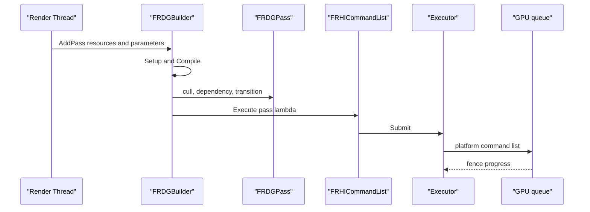

### 29.7.2 Present与CPU等待

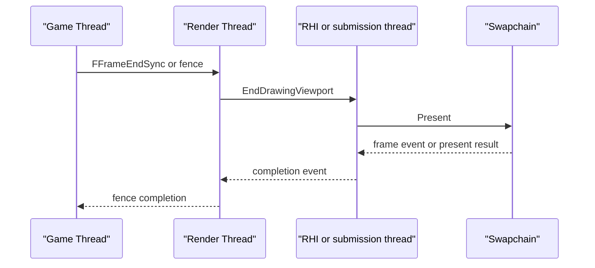

## 29.8 线程模型与同步

|上下文|拥有的状态|输入/输出|是否UE线程|源码依据|
|---|---|---|---|---|
|GT|UObject、ViewFamily、命令捕获对象|生成render command|是|`IsInGameThread`调用约束|
|RT|场景代理、RDG builder、Immediate command list|消费GT命令，向RHI提交|是|`RenderingThreadMain:227-277`|
|Parallel rendering task|局部RDG setup、子RHI list|汇入父列表|UE任务上下文|`FRDGBuilder` Parallel flags|
|RHIThread|翻译上下文、Submit顺序|平台command list|配置启用时是|`FRHIThread`，`RenderingThread.cpp:161-224`|
|D3D12/Vulkan SubmissionThread|payload和queue提交|驱动queue|是后端线程|各DynamicRHI Private头文件|
|GPU/驱动线程|实际执行、内核调度|硬件时间线|否，UE不可见|平台API对象仅暴露queue/fence|

同步规则：命令capture必须拥有值或显式引用；`FRenderCommandFence`只确认选定阶段，不自动确认GPU idle；`FFrameEndSync::Threads`不等GPU。GPU fence是设备时间线条件，readback Lock前必须Poll成功。任何线程在持有跨线程锁时调用`FlushRenderingCommands`、`SubmitAndBlockUntilGPUIdle`或等待RHI fence都可能形成反向等待。

## 29.9 配置与扩展点

|配置/入口|作用|位置|
|---|---|---|
|`r.RHIThread.Enable`|0关闭、1 DedicatedThread、2 Tasks|`RenderCore/Private/RenderingThread.cpp:1443`|
|`r.RHICmdBypass`|直达context或录制命令|`RHI/Private/RHICommandList.cpp:56,1880`|
|`r.OneFrameThreadLag`|控制FrameEndSync是否full sync|`RenderCore/Private/RenderingThread.cpp:2435-2500`|
|`r.RenderCommandPipeMode`|None/RenderThread/All|`RenderCore/Public/RenderingThread.h:390`|
|`IRenderCaptureProvider::CaptureFrame/BeginCapture/EndCapture`|RenderDoc/PIX等捕获适配点|`RenderCore/Public/IRenderCaptureProvider.h:62-88`|
|`FRHIBreadcrumbNode`/`BeginBreadcrumbGPU`|GPU路径标记|`RHI/Public/RHIBreadcrumbs.h:136-246`、`RHIContext.h:370-371`|
|`RDG_EVENT_NAME`、`SCOPED_NAMED_EVENT`|RDG、CPU和GPU事件关联|`RenderCore/Public/RenderGraphEvent.h`、`RenderingThread.h:130`|
|`RHICreateGPUFence`、`RHIGPUReadback`|异步完成/回读扩展|`DynamicRHI.h:292,591`、`RHIGPUReadback.h`|

## 29.10 已知限制/未确认项

1. 本源码确认了UE侧RT、RHIThread、D3D12/Vulkan SubmissionThread和InterruptThread；驱动内部线程、操作系统GPU调度线程和硬件执行单元不可见，不能给出其线程名、优先级或队列实现。
2. `r.RHIThread.Enable=Tasks`的实际worker分配由TaskGraph/LowLevelTasks运行期调度，源码没有一个固定的“RHI task OS线程”；因此不能把它列为常驻线程。
3. D3D12 Present是否使用SubmissionThread受`GUseSubmissionThreadPresent`及平台条件控制；Vulkan swapchain acquire的延迟模式由平台/CVar路径决定，本章只确认调用接口和分支。
4. Vulkan timeline semaphore是能力条件路径；不支持时的二进制semaphore/fence组合由后端封装，不能将所有设备都描述为timeline。
5. OpenGL/Null没有与D3D12/Vulkan等价的显式GPU提交线程和硬件时间线；OpenGL仅确认上下文所有权接口，Null仅确认哑RHI接口。
6. PSO缓存、DerivedData、Texture/Mesh/Nanite streaming存在平台和配置分支；源码确认了任务/结果/RT交接入口，未确认一个统一的全平台worker创建点。
7. Media、Niagara各插件的生产线程由具体实现决定；本章只确认它们进入RT必须经过RenderCore/RDG/RHI边界，未将插件内部线程合并为单一模型。
8. RenderDoc、PIX、Nsight的具体抓帧协议和宿主进程由外部工具实现；UE侧可确认的是`IRenderCaptureProvider`、DrawEvent和RHI breadcrumbs接口。

## 29.11 附录索引

|模块|附录|
|---|---|
|Runtime/RenderCore|`appendix/api/Runtime/RenderCore.md`|
|Runtime/RHI|`appendix/api/Runtime/RHI*.md`|
|Runtime/D3D12RHI|`appendix/api/Runtime/D3D12RHI.md`|
|Runtime/VulkanRHI|`appendix/api/Runtime/VulkanRHI.md`|
|Runtime/OpenGLDrv|`appendix/api/Runtime/OpenGLDrv.md`|
|Runtime/NullDrv|`appendix/api/Runtime/NullDrv.md`|
|Runtime/Engine|`appendix/api/Runtime/Engine*.md`|
|Runtime/Renderer|`appendix/api/Runtime/Renderer*.md`|
|Runtime/SlateRHIRenderer、Media、Niagara、AudioMixer|对应Runtime模块附录文件|

本章与第06、07、08、26章的关系：第06章查后端能力和RHI公共接口，第07章查RDG/RT基础设施，第08章查Renderer阶段，第26章查全引擎线程与同步；本章只提供它们连接处的时序、所有权和平台差异。
