# 30 诊断工具接入方式、数据通道与架构详细设计

源码根 `$UE=/home/timeshift/opensource/game_engine/unreal/UnrealEngine-5.8.3-release`，引擎相对路径均以 `$E=Engine/` 为根。本文只记录在 5.8.3-release 当前树中能定位到的接口、控制入口、格式、线程和生命周期；外部工具未公开或未在源码确认的协议放入 X.10。

## X.1 职责、边界与模块清单

|模块|源码路径|接入职责|公共依赖/边界|
|---|---|---|---|
|TraceLog|Source/Runtime/TraceLog|UE::Trace 事件、TLS 块、worker、文件/网络/relay|Core；不负责 Insights UI|
|Core ProfilingDebugging|Source/Runtime/Core|FTraceAuxiliary、CSV、CPU/Memory trace、LLM|TraceLog；命令行/CVar 接入|
|Core Stats/Logging/Crash|Source/Runtime/Core|STAT、日志、崩溃上下文|平台 HAL；信号/SEH 分支|
|TraceAnalysis|Source/Developer/TraceAnalysis|IAnalyzer 与事件分析|仅离线/流式分析契约|
|TraceServices|Source/Developer/TraceServices|IAnalysisService、Session、Provider|TraceAnalysis、Cbor|
|TraceInsights/UnrealInsights|Source/Developer/TraceInsights、Source/Programs/UnrealInsights|分析 UI 与进程入口|外部工具协议不由此模块定义|
|Automation*|Source/Runtime/AutomationTest、AutomationMessages、AutomationWorker、Source/Developer/AutomationController|Controller/Worker 测试消息与结果|MessageEndpoint、GT Tick|
|SessionServices/Messaging|Source/Runtime/SessionServices、Plugins/Messaging|会话发现、Trace 控制与消息传输|UDP/TCP 实现按平台/配置变化|
|RemoteControl|Plugins/VirtualProduction/RemoteControl|HTTP/WebSocket 反射控制|WebRemoteControl、HttpServer、NetworkingWebSockets|
|RHI/RenderCore/Renderer|Source/Runtime/RHI、RenderCore、Renderer|breadcrumbs、DrawEvent、GPU fence/capture|RT/RHI/GPU 阶段边界|
|CrashReportCore/CrashReportClient|Source/Runtime/CrashReportCore、Source/Programs/CrashReportClient|目录报告、压缩、上传|Receiver/DataRouter URL|
|GameplayDebugger/ChaosVD/RewindDebugger|Runtime 与 Plugins|专用运行时采集和回放|各模块自有 Trace/消息协议|

边界：第23章描述基础采集实现，第26章描述通用线程/队列，第29章描述 RT/RHI/GPU 提交；本章只增加“工具如何接入、数据如何离开生产进程、何处丢失/阻塞及安全边界”。

## X.2 总体架构

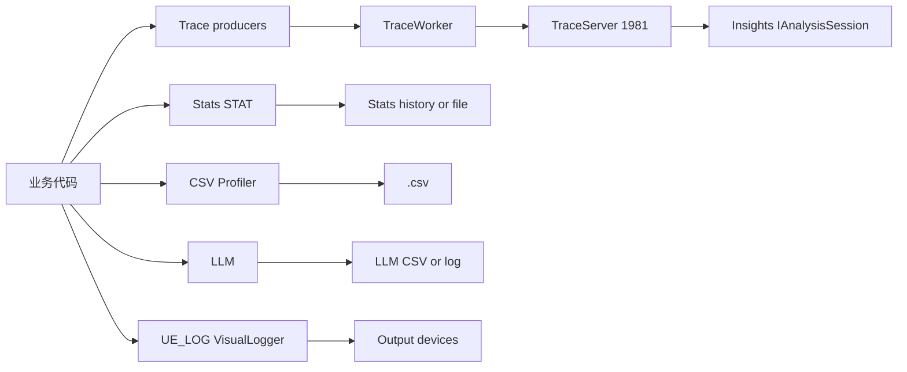

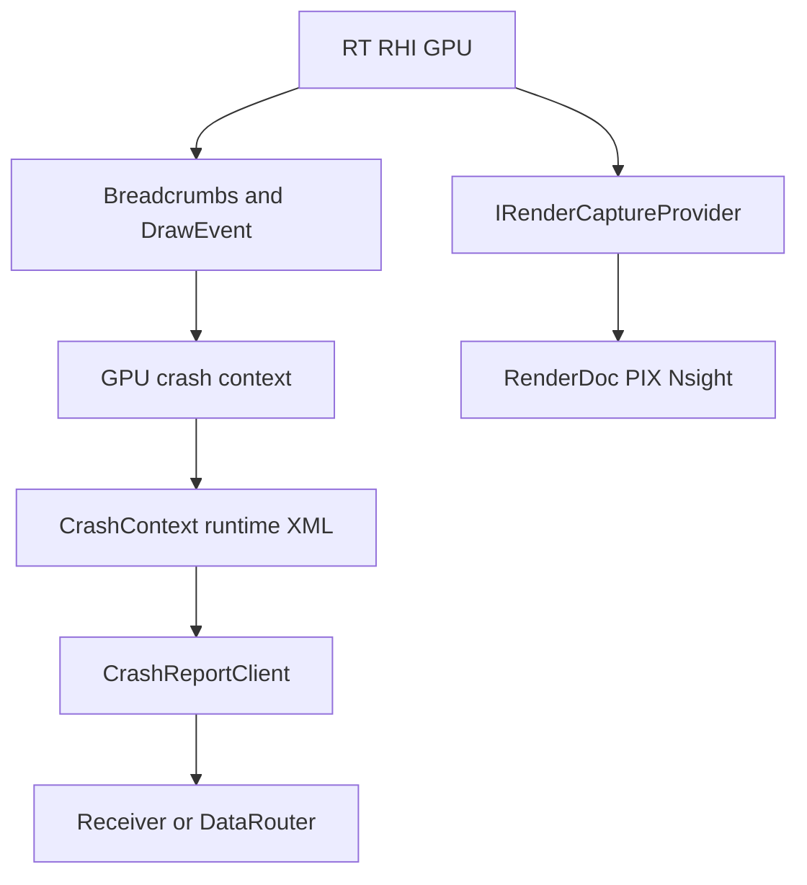

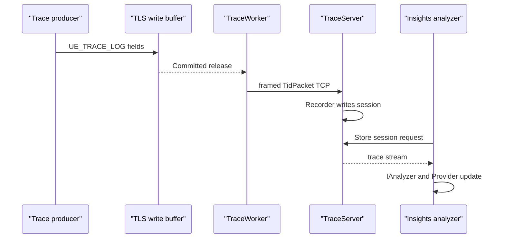

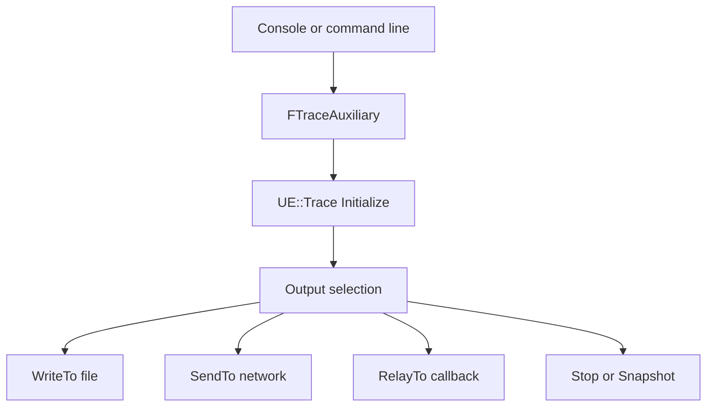

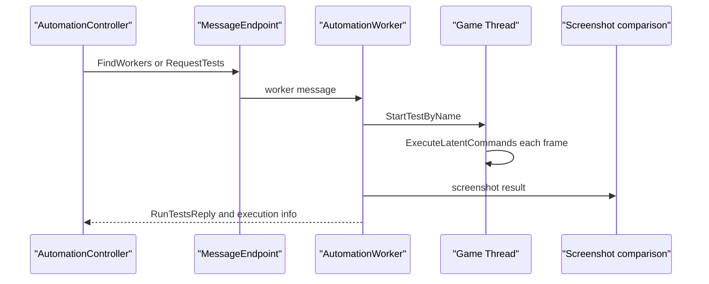

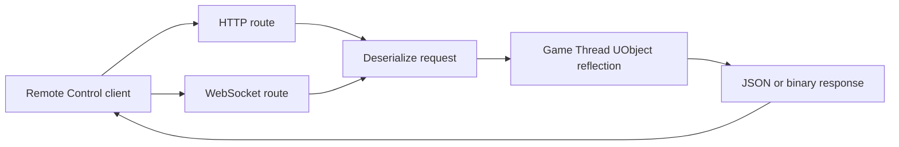

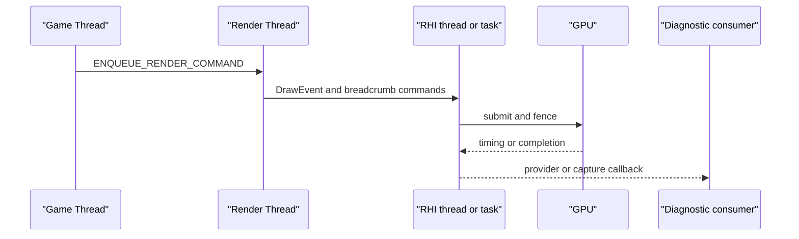

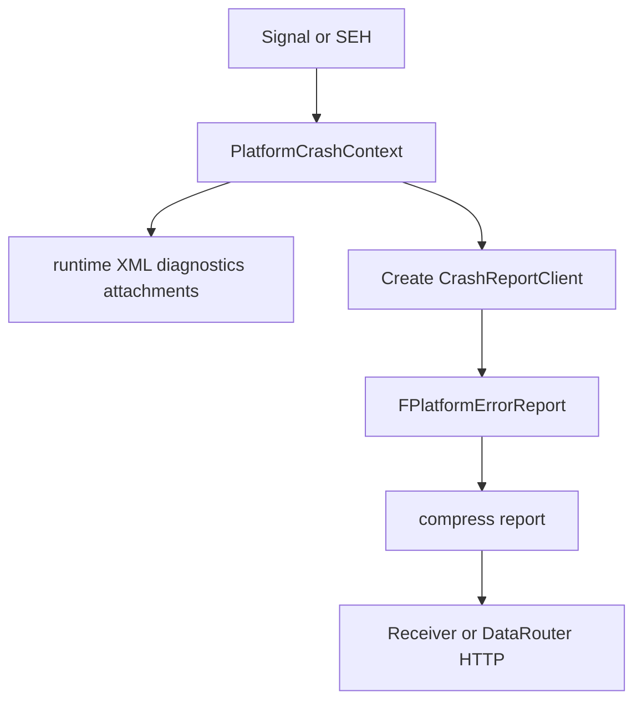

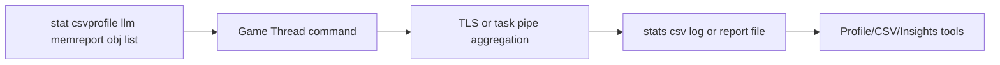

## X.3 类图

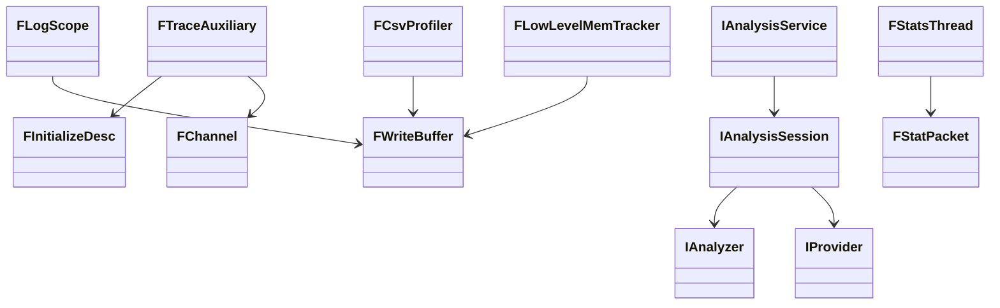

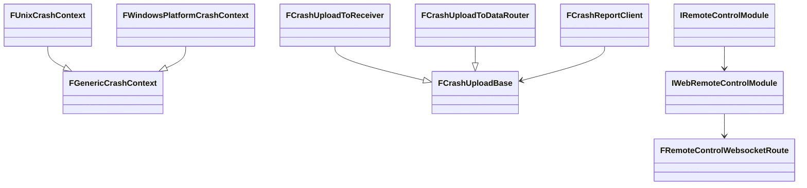

`FLogScope`、`FWriteBuffer`、Stats 和 Crash 的实现细节见第23章；此处的新增边界是输出/分析端接口。`IRemoteControlModule` 位于 `Plugins/VirtualProduction/RemoteControl/Source/RemoteControl/Public/IRemoteControlModule.h`，Web 层接口位于 `WebRemoteControl/Public/IWebRemoteControlModule.h`。类图不把外部 RenderDoc/PIX/Nsight 当 UE 类。

## X.4 数据字典

|名称|类型/格式|含义、约束|源码位置|
|---|---|---|---|
|`FWriteBuffer`|固定块 TLS 缓冲|事件提交前仅生产线程写，worker 按 `Committed` 收割|`Source/Runtime/TraceLog/Private/Trace/Detail/Writer.inl:12-35`|
|`ETransport`|`Raw/Packet/TidPacket/TidPacketSync`|Trace 传输编码层级|`Source/Runtime/TraceLog/Private/Trace/Detail/Transport.h:11-19`|
|`FTidPacketBase`|16-bit packet size/thread id|高位标记压缩包，随协议版本解释|`.../Transport.h:40-52`|
|`FInitializeDesc`|Trace 初始化描述|尾缓冲、块池、worker、important cache 开关|`Source/Runtime/TraceLog/Public/Trace/Trace.h:136-159`|
|`FStatistics`|Trace 统计结构|缓存、块池、发送字节等运行遥测|`Trace/Trace.h:237-252`|
|`FStatPacket`|帧号、线程号、`FStatMessage` 数组|Stats TLS 到 `GStatsPipe` 的所有权单元|`Source/Runtime/Core/Public/Stats/StatsSystemTypes.h:1038-1056`|
|`ECsvCustomStatOp`|`Set/Min/Max/Accumulate`|CSV 自定义值聚合操作|`Source/Runtime/Core/Public/ProfilingDebugging/CsvProfiler.h:219-225`|
|`ELLMTag`|`uint8` 枚举|malloc 归因标签，项目/平台可扩展|`Source/Runtime/Core/Public/HAL/LowLevelMemTracker.h:94-116`|
|`ELogVerbosity`|NoLogging/Fatal/Error/Warning/Display/Log/Verbose/VeryVerbose|编译期与运行期双重过滤|`Source/Runtime/Core/Public/Logging/LogVerbosity.h:14-38`|
|`FLogRecord`|结构化日志记录|类别、级别、参数化消息，进入 `GLog` 与 Log trace|`Source/Runtime/Core/Public/Logging/StructuredLog.h`|
|`ECrashContextType`|Crash/Assert/Ensure/Stall/GPUCrash/Hang/OOM 等|写入 `CrashContext.runtime.xml`|`Source/Runtime/Core/Public/GenericPlatform/GenericPlatformCrashContext.h:111-123`|
|`FPlatformErrorReport`|崩溃目录视图|读取 runtime XML、日志和附件|`Source/Runtime/CrashReportCore/Public/PlatformErrorReport.h`|
|`FRemoteControlWebSocketMessage`|`FGuid ClientId`、payload/route 元数据|WebSocket route 分发单元|`Plugins/VirtualProduction/RemoteControl/Source/WebRemoteControl/Public/RemoteControlWebsocketRoute.h:7-32`|
|`FHttpServerRequest`|verb、path、headers、body|Remote Control HTTP 输入，JSON/结构反序列化|`Plugins/VirtualProduction/RemoteControl/Source/WebRemoteControl/Private/RemoteControlInternalUtils.h:39-45`|
|`FHttpServerResponse`|状态码、headers、body|HTTP 或封装 WebSocket 回应|`.../WebRemoteControlInternalUtils.h:39-67`|
|`FRHIBreadcrumbNode`|GPU breadcrumb 树节点|RT/RHI 标记 GPU 工作区段|`Source/Runtime/RHI/Public/RHIBreadcrumbs.h:136-246`|
|`FRHIGPUFence`|GPU 完成标记|`Poll()` 非阻塞，readback Lock 前必须完成|`Source/Runtime/RHI/Public/RHIResources.h:2397-2417`|
|`FAutomationWorkerRunTests`|AutomationMessages USTRUCT|Controller→Worker 测试请求|`Source/Runtime/AutomationMessages/Public/AutomationWorkerMessages.h`|
|`.utrace`|Trace 二进制会话流|Recorder 写入，Store 提供分析输入；协议由 TraceLog transport 定义|`Source/Programs/UnrealTraceServer/src/Recorder.cpp`|
|CSV|文本表格+metadata|`FCsvProfiler` 捕获文件，列/元数据由源码动态产生|`Source/Runtime/Core/Private/ProfilingDebugging/CsvProfiler.cpp`|
|Crash XML|`CrashContext.runtime.xml`|崩溃属性、平台字段和会话信息|`GenericPlatformCrashContext.cpp`|
## X.5 接口清单

### X.5.1 Trace 与 TraceServer

|源码原型|接入/启停|线程、缓冲、失败策略|位置|
|---|---|---|---|
|`void Initialize(const FInitializeDesc& Desc)`|初始化 TraceLog、TLS、块池与 worker|启动期一次；生产线程写 TLS，worker 异步收割|`Source/Runtime/TraceLog/Public/Trace/Trace.h:285`|
|`void StartWorkerThread()`|无 worker 配置下启动 worker|一次；线程名 `TraceWorker`，优先级/亲和性未在公共接口声明|`Trace.h:290`、`Private/Trace/Writer.cpp:1122`|
|`bool SendTo(const TCHAR* Host, uint32 Port=0, uint16 Flags=FSendFlags::None)`|网络 trace，端口0使用1981|连接/发送由 worker 完成；连接失败保留尾部/记录状态，不阻塞生产线程|`Trace.h:330`、`Writer.cpp:1343-1359`|
|`bool WriteTo(const TCHAR* Path, uint16 Flags=FSendFlags::None)`|写 `.utrace` 文件|worker 写文件；文件错误由输出状态反映，源码未定义重试|`Trace.h:339`|
|`bool RelayTo(UPTRINT InHandle, IoWriteFunc WriteFunc, IoCloseFunc CloseFunc, uint16 Flags=FSendFlags::None)`|嵌入宿主自定义 sink|回调由 worker 调用；背压由回调返回/实现决定，Trace API 未定义队列上限|`Trace.h:349`|
|`bool WriteSnapshotTo(const TCHAR* Path, uint32 MaxTailSize=0)`|尾部环形缓存快照|取内部同步后落盘；未提交块和超过 tail 的事件不在快照中|`Trace.h:356`|
|`bool Stop()`、`bool ToggleChannel(const TCHAR* ChannelName, bool bEnabled)`|停止输出、频道门控|任意调用方；频道状态影响后续事件，已写数据不回收|`Trace.h:394-409`|
|`void ThreadRegister(const TCHAR* Name, uint32 SystemId, int32 SortHint)`|注册 trace 线程定义|线程入口调用一次；名称/系统元数据进入定义流|`Trace.h:431`|
|`static bool Start(EConnectionType Type, const TCHAR* Target, const TCHAR* Channels=TEXT("default"), FOptions* Options=nullptr, const FLogCategoryAlias& LogCategory=LogCore)`|FTraceAuxiliary 统一入口|控制台 `Trace.Start`、命令行自动启动均走此处；启用频道并选择 File/Network/Relay|`Core/Public/ProfilingDebugging/TraceAuxiliary.h:152`|
|`static bool Stop()`、`static bool WriteSnapshot(const TCHAR* FilePath, uint32 MaxTailSize=0)`|辅助层停止/快照|在 GT 命令或外部控制请求中执行；未确认所有平台都允许任意线程|`TraceAuxiliary.h:230-253`|
|`static bool IsConnected()`|查询 Trace 会话连接|无副作用|`TraceAuxiliary.h:330`|
|`FTraceServerControls::Start()` / `Stop()`|本地拉起 UnrealTraceServer|桌面非 shipping 条件；`-notraceserver`/`-buildmachine` 禁止|`TraceAuxiliary.h:418-447`|
|宏 `UE_TRACE_EVENT_BEGIN`、`UE_TRACE_LOG`、`UE_TRACE_CHANNEL`|声明事件、写字段、定义频道|事件字段为静态布局；通道关闭时不进入写缓冲|`Trace/Detail/Trace.h:77-224`|

Trace framing：生产者提交 `Committed`，worker 收割块后编码 `TidPacket`，必要时使用 LZ4 标记；同步包使用 tid `0x3fff`。控制端口为 1985，数据 Recorder 端口默认为 1981，Store 端口为 1989，均由源码常量确认：`Trace/Private/Control.cpp:57`、`Trace/Private/Writer.cpp:1353`、`Programs/UnrealTraceServer/src/StoreSettings.h:14-15`。1981/1989 的 TCP/Store 交互具体请求报文未在 UE 公共 API 中完整公开，见 X.10。

### X.5.2 Insights 分析与工具进程

|源码原型|功能/数据流|线程与生命周期|位置|
|---|---|---|---|
|`virtual TSharedPtr<const IAnalysisSession> StartAnalysis(const TCHAR* SessionUri)=0`|从文件/Store URI 创建分析会话|Insights 后台分析任务；session 生命周期由服务/共享指针管理|`TraceServices/Public/TraceServices/AnalysisService.h:39`|
|`StartAnalysis(uint32 TraceId, const TCHAR* SessionName, TUniquePtr<UE::Trace::IInDataStream>&& DataStream)`|从流分析在线会话|数据流所有权移动给分析服务；未声明调用方线程|`AnalysisService.h:48`|
|`virtual void AddProvider(const FName& Name, TSharedPtr<IProvider> Provider, TSharedPtr<IEditableProvider> EditableProvider=nullptr)`|注册 Timing/Memory/Log 等 provider|分析会话写侧；查询侧通过 session 读接口|`TraceServices/Public/TraceServices/Model/AnalysisSession.h:128`|
|`virtual void OnAnalysisBegin(const FOnAnalysisContext& Context)` / `OnAnalysisEnd()`|IAnalyzer 生命周期|按事件流顺序在分析线程调用；异常/取消策略由服务实现|`TraceAnalysis/Public/Trace/Analyzer.h:28-45`|
|`IUnrealInsightsModule::GetInsightsManager()` / `GetAnalysisSession() const`|前端管理器和当前 session|Insights UI Game/Slate 线程；分析数据由后台更新|`TraceInsights/Public/Insights/IUnrealInsightsModule.h:206-259`|

Insights 与 TraceServer 是独立进程关系。UnrealInsights 通过 `TraceServices` 获取文件/流，`TraceAnalysis` 只定义 analyzer/dispatch 契约；源码未确认 UnrealInsights 与 Store 间的完整 HTTP/WebSocket/自定义请求协议，不能把 1989 推断为通用 REST 端口。

### X.5.3 Stats、CSV、LLM、MemReport、Obj List、Log、VisualLogger

|入口|输出/启停|线程/聚合|位置|
|---|---|---|---|
|`FThreadStats::AddMessage(FName, EStatOperation::Type)`|`SCOPE_CYCLE_COUNTER`、计数 STAT 写 TLS|任意生产线程；`FStatsThread` 经 `GStatsPipe` 聚合|`Core/Public/Stats/StatsSystemTypes.h:1324-1332`|
|`FThreadStats::Flush(bool bHasBrokenCallstacks=false, bool bForceFlush=false)`|Packet 发送至 stats pipe|ScopeCount归零/帧推进/显式 flush；队列阈值约5ms或16包，raw约24MB|`StatsSystemTypes.h:1227`、`StatsSystemTypes.cpp:896-918`|
|`FCsvProfiler::BeginStat(const char*, uint32, const char*=nullptr)` / `EndStat`|CSV 作用域采样|任意线程 TLS；CSVProfiler 线程处理|`ProfilingDebugging/CsvProfiler.h:430-433`|
|`FCsvProfiler::RecordCustomStat(...)`|Set/Min/Max/Accumulate 自定义列|生产线程记录，处理线程聚合|`CsvProfiler.h:438-443`|
|`FCsvProfiler::SetMetadata(const TCHAR*, const TCHAR*)`|写捕获 metadata|捕获生命周期内调用；键值格式由 CSV writer 生成|`CsvProfiler.h:457`|
|`FLowLevelMemTracker::ProcessCommandLine(const TCHAR*)` / `Exec(const TCHAR*, FOutputDevice&)`|`-LLM`、`llm` 命令启停/报告|命令由 GT 执行；malloc hook 任意线程 TLS 标签|`HAL/LowLevelMemTracker.h:558,645`|
|`OnLowLevelAlloc(...)` / `OnLowLevelFree(...)`|记录分配/释放|FMalloc 路径任意线程，必须避免跟踪自身分配递归|`LowLevelMemTracker.h:573-597`|
|`DumpOpenCallstacks(const TCHAR*, const FMallocLeakReportOptions&)`|调用栈文件导出|建议停机或稳定边界；文件格式由实现生成，未声明正式 schema|`HAL/MallocLeakDetection.h:190`|
|控制台 `stat startfile/stopfile/raw`|Stats HUD、原始流或文件|GT 命令；Stats pipe 仍按线程包聚合|`StatsSystemTypes.cpp:1205-1252`|
|控制台 `csvprofile start/stop`、宏 `CSV_CUSTOM_STAT`|开始/结束 CSV 捕获|GameThread 控制，生产者可多线程|`CsvProfiler.cpp:1050-1121`、`CsvProfiler.h:90-172`|
|`UE_LOG` / `FOutputDeviceRedirector::SerializeRecord`|类别过滤后输出设备和 Log trace|任意线程；非主日志线程进入 MPSC，专用日志线程 flush|`Core/Public/Logging/LogMacros.h:278-283`、`Misc/OutputDeviceRedirector.h:124-144`|
|`FVisualLogger::CategorizedLogfImpl(...)` 与 `UE_VLOG*`|对象/几何可视化日志|源码前置 `IsRecording()`；绘制/编辑器消费不等于跨线程迁移|`Engine/Public/VisualLogger/VisualLogger.h:43-64,223-245`|
|`memreport`、`obj list`、`obj refs`|UObject/内存诊断控制台命令|由 Engine/UObject Exec 链在 GT 处理；文本输出到 `FOutputDevice`，源码未确认统一机器可读格式|`CoreUObject/Private/UObject/Obj.cpp`、`Engine/Private/UnrealEngine.cpp`|

`CSV` 为文本行列文件，字段和 metadata 在 `CsvProfiler.cpp` 动态生成，不能把列名固定成跨版本协议。`STAT` 的稳定内部单元是 `FStatPacket/FStatMessage`，不是文件格式。`memreport`、`obj list`、VisualLogger 输出格式在 5.8.3 源码中没有一个统一版本化 schema。

### X.5.4 GPU/Render diagnostic

|接口/宏|接入用途|线程/生命周期|位置|
|---|---|---|---|
|`FRHIBreadcrumbNode`、`BeginBreadcrumbGPU`|GPU breadcrumb 层级标记|RT/RHI 录制并随命令提交；GPU crash 路径读取|`RHI/Public/RHIBreadcrumbs.h:136-246`、`RHIContext.h:370-371`|
|`SCOPED_DRAW_EVENT`、`SCOPED_DRAW_EVENTF`|RHI DrawEvent 名称|渲染命令上下文；事件作用域析构关闭|`RHI/Public/RHICommandList.h`、`RHI/Public/RHIContext.h`|
|`RHICreateGPUFence`、`FRHIGPUFence::Poll()`|GPU 完成探针|RT/RHI 创建，CPU 轮询；readback Lock 前必须完成|`RHI/Public/DynamicRHI.h:292`、`RHIResources.h:2397-2417`|
|`FRHIGPUBufferReadback` / `FRHIGPUTextureReadback`|GPU 数据异步回读|命令提交后异步；fence 未完成不得 Lock|`RHI/Public/RHIGPUReadback.h:18-160`|
|`IRenderCaptureProvider::CaptureFrame/BeginCapture/EndCapture`|RenderDoc/PIX 等捕获适配|RT/RHI capture 生命周期；具体外部工具实现不在 UE|`RenderCore/Public/IRenderCaptureProvider.h:62-88`|
|`RDG_EVENT_NAME` / `SCOPED_NAMED_EVENT`|RDG、CPU、GPU 名称关联|RT/RDG pass 构建期|`RenderCore/Public/RenderGraphEvent.h`|
|Shader Print/VisualizeTexture|渲染器/Shader 插件的调试数据和可视化 pass|需通过 RDG/RHI 资源生命周期；本树未确认一个统一跨平台 public API|`Renderer`、`RenderCore` 的具体实现分支，外部协议未确认|
|GPU profiler/timing|RHI timestamp/query 与 Renderer profiler 采集|GPU 时间线能力依平台；CPU 等待受第29章 fence 约束|`RHI/Public/RHICommandList.h`、平台 RHI 私有实现|

RenderThread stall 调查必须先区分 `FlushRenderingCommands`、RHI fence 和 GPU fence：第26章/29章确认三者等待深度不同；持锁调用 GPU idle 或 RT flush 会制造反向等待。`DrawEvent`、breadcrumbs 和 capture provider 是可确认的 UE hook，RenderDoc/PIX/Nsight 的宿主协议不是 UE API。

### X.5.5 Crash

|接口|功能|线程/进程|位置|
|---|---|---|---|
|`FGenericCrashContext::Initialize()`|预取崩溃时不可得信息|启动期一次|`Core/Public/GenericPlatform/GenericPlatformCrashContext.h:478`|
|`virtual void SerializeAsXML(const TCHAR* Filename) const`|写 runtime XML|崩溃线程/平台报告线程|`GenericPlatformCrashContext.h:573`|
|`template<typename Type> void AddCrashProperty(const TCHAR*, const Type&) const`|增加属性|崩溃上下文寿命内|`GenericPlatformCrashContext.h:582-584`|
|`static void DumpAdditionalContext(const TCHAR*, const FAdditionalCrashContextParams&)`|广播附加数据提供者|崩溃路径；附件落到报告目录|`GenericPlatformCrashContext.h:666-667`|
|`FUnixPlatformMisc::SetCrashHandler(void (*)(const FGenericCrashContext&))`|安装 signal handlers|必须 GameThread；SA_SIGINFO/SA_ONSTACK|`Core/Private/Unix/UnixPlatformCrashContext.cpp:1224-1312`|
|`PlatformCrashHandler(int32, siginfo_t*, void*)`|signal 入口|崩溃线程，备用栈；切换崩溃分配器|`UnixPlatformCrashContext.cpp:1059-1109`|
|`LONG WINAPI EngineUnhandledExceptionFilter(LPEXCEPTION_POINTERS)`|Windows SEH 入口|崩溃线程投递 `FCrashReportingThread`|`WindowsPlatformCrashContext.cpp:1808-1850`|
|`FCrashUploadToReceiver::BeginUpload(...)`|Receiver 检查并压缩 POST|CrashReportClient 进程的 HTTP 回调|`CrashReportCore/Public/CrashUpload.h:157-205`|
|`FCrashUploadToDataRouter::BeginUpload(...)`|DataRouter 上传与附件|CrashReportClient 进程|`CrashUpload.h:207-255`|
|`FCrashReportClient`|读取目录、UI、用户同意、上传|独立进程主线程+HTTP 异步|`Programs/CrashReportClient/Private/CrashReportClient.h:59,200-203`|

Unix 生成 `Saved/Crashes/.../Diagnostics.txt`、`CrashContext.runtime.xml` 和日志副本；Windows minidump 接口在 `WindowsPlatformCrashContext.cpp`，平台具体 dump 数据不应与 XML 混为同一格式。报告目录是生产进程与 CRC 的进程间边界，CRC 不直接读取崩溃进程内存。

### X.5.6 专用诊断与自动化

|模块/接口|接入方式和数据|线程/协议边界|位置|
|---|---|---|---|
|`FGameplayDebuggerCategory::DrawCategory` / `OnDataPackReplicated`|类别采集、复制数据包、客户端画布绘制|采集逻辑与绘制分离；绘制 GT|`Runtime/GameplayDebugger/Public/GameplayDebuggerCategory.h:48-102`|
|`FChaosVDModule`|ChaosVD 前端模块|回放 UI 在编辑器线程；录制/TraceBasedDebuggers 由各自模块实现|`Plugins/ChaosVD/Source/ChaosVD/Public/ChaosVDModule.h:25`|
|Rewind Debugger|通过 `RewindDebugger`、Trace/Insights 轨道接入|源码确认插件存在和 Trace 依赖；具体 query/provider 以插件源实现|`Plugins/RewindDebugger` 与 `Plugins/TraceUtilities`|
|`IAutomationControllerManager::RequestTests/RunTests/StopTests/Tick`|Controller 发现、调度、聚合|编辑器 GT；消息端点将请求送 Worker|`Developer/AutomationController/Public/IAutomationControllerManager.h:180-203`|
|`FAutomationTestFramework::StartTestByName` / `ExecuteLatentCommands`|Worker 侧执行测试|GT，每帧泵 latent/network 队列|`Runtime/AutomationTest/Public/Misc/AutomationTest.h:1086-1130`|
|`FAutomationWorkerModule::Tick()`|消息收件、执行、上报|Engine Tick 的 GT；`.WithInbox()` 缓冲到 Tick|`Runtime/AutomationWorker/Private/AutomationWorkerModule.cpp:65-97`|
|`FAutomationScreenshotComparison`|截图像素比较及报告|截图文件和 comparison report；对比实现由 ScreenShotComparison|`Developer/ScreenShotComparison` 公共头与 `AutomationTest` screenshot delegates|
|NetworkProfiler|旧网络分析器程序|C# WinForms/文件分析；UE 5.8.3 源码未确认新的实时端口|`Source/Programs/NetworkProfiler`|
|`ITraceController` / `ISessionManager`|Session Frontend 控制目标会话 trace|消息/控制服务；具体 transport 按 SessionServices 实现|`Source/Runtime/SessionServices/Public/ITraceController.h`、`ISessionManager.h`|

### X.5.7 Remote Control、Session Frontend 与 Messaging

|接口|协议/端口/数据|线程与安全|位置|
|---|---|---|---|
|`virtual FOnWebServerStarted& OnHttpServerStarted()=0`|HTTP server 生命周期通知|WebRemoteControl 模块生命周期|`Plugins/VirtualProduction/RemoteControl/Source/WebRemoteControl/Public/IWebRemoteControlModule.h:41`|
|`virtual bool IsHttpServerRunning()=0` / `IsWebSocketServerRunning()`|服务状态|任意查询；具体启动在模块实现|`IWebRemoteControlModule.h:51-67`|
|`virtual FOnWebSocketConnectionOpened& OnWebSocketConnectionOpened()=0`|客户端连接通知|模块线程/回调线程，源码未承诺 GT；调用者需确认实现|`IWebRemoteControlModule.h:72-77`|
|`void FWebSocketMessageHandler::RegisterWebSocketRoute(...)`|注册 WS 路由|消息路由器；payload 是结构反序列化对象|`WebRemoteControl/Private/WebSocketMessageHandler.h:83-117`|
|`bool DeserializeCall(const FHttpServerRequest&, FRCCall&, const FHttpResultCallback&)`|HTTP JSON/结构输入转 Remote Control 调用|请求线程进入回调，修改 UObject 必须回 GT；实现负责 marshal|`WebRemoteControlInternalUtils.h:39-45`|
|`IMessageEndpoint`/`FMessageEndpointBuilder`|Session/Automation/Messaging endpoint|消息对象和 inbox，具体 UDP/TCP transport 由 Messaging 实现|`Runtime/Messaging/Public/IMessageEndpoint.h`、`MessageEndpointBuilder.h`|
|`ISessionManager` / `ITraceController`|发现会话、发送 trace 控制命令|Session Frontend 编辑器 GT；目标进程以 Session/Messaging 接收|`Runtime/SessionServices/Public/ISessionManager.h`、`ITraceController.h`|

Remote Control 的 HTTP/WebSocket 端口由配置/CVar/模块实现决定；本次源码检查确认服务接口和请求结构，但未确认一个全平台固定端口。HTTP body、WebSocket message 的公开模型可以确认，完整 wire framing 由 HttpServer/NetworkingWebSockets 外部模块负责。

## X.6 关键流程

### X.6.1 Trace 接入与关闭

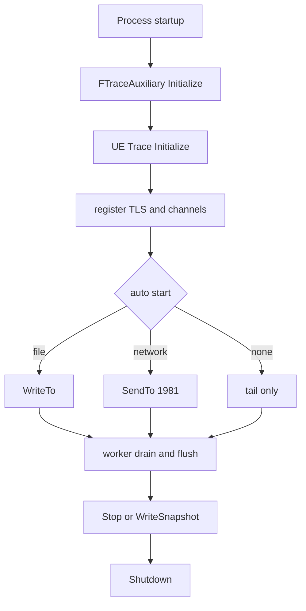

命令行 `-trace=...`、`-tracehost`、`-tracefile`、`-traceautostart=0/1` 由 `FTraceAuxiliary::Initialize` 解析；控制台 `Trace.Start`、`Trace.Stop`、`Trace.Snapshot`、`Trace.ToggleChannel` 走同一辅助入口。频道关闭只阻止后续 `UE_TRACE_LOG` 进入事件路径，不能撤销已提交块。块池达到上限时新块申请受限，生产者可能只保留重要事件/尾缓冲；源码没有把它定义为可靠传输队列。

### X.6.2 Stats/CSV/LLM 文件路径

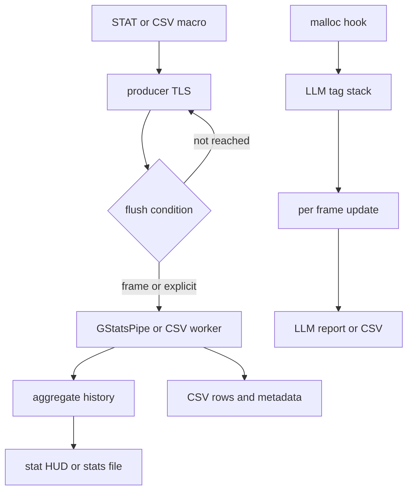

`stat startfile/stopfile`、`stat raw` 和 `csvprofile start/stop` 是 GT 控制面；采样热路径不等待文件 IO。Stats 的 `FStatPacket` 转交给 pipe 后由聚合端拥有，CSV 处理线程的间隔由 `CVarCsvProcessingThreadTimeBetweenUpdates` 控制。LLM 的 `OnLowLevelAlloc/Free` 位于 malloc 路径，标签栈使用 TLS 且禁止把跟踪自身分配重新计入。内存压力、队列满、进程退出造成的未 flush 数据按各实现丢失；源码未提供统一确认/重放协议。

### X.6.3 Crash 报告

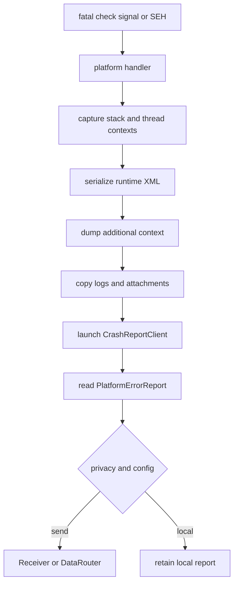

Unix signal handler使用备用栈和平台崩溃分配器，不能依赖普通业务锁/堆分配；Windows 将异常事件交给低优先级 `FCrashReportingThread`，并由 `WriteMinidump` 生成 dump。崩溃报告目录是跨进程稳定边界；CRC 上传失败时本地目录仍是可留存结果，源码未定义跨重启的统一重试服务。

### X.6.4 Remote Control 与 Session

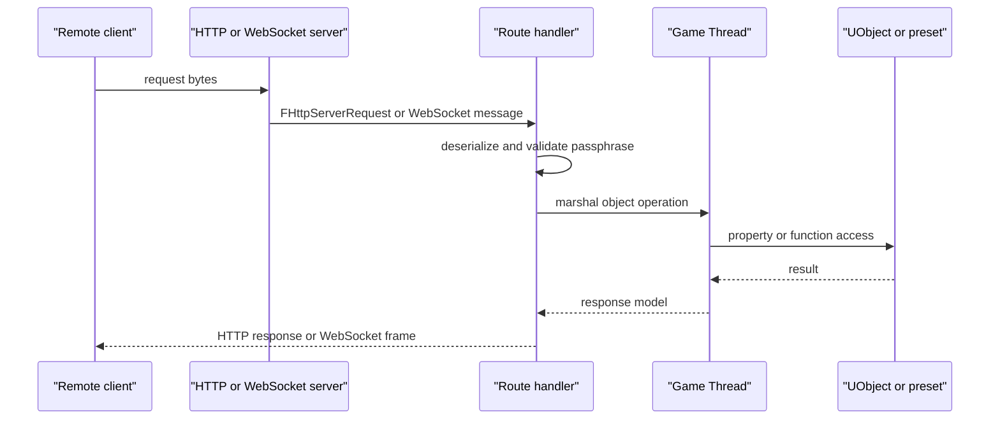

Remote Control 内部可确认 `CreateHttpResponse`、content-type/CORS、passphrase invalid response 和 WebSocket route；没有源码证据表明所有 route 都自动切换到 GT，因此扩展 route 必须自行遵守 UObject 线程契约。Session Frontend 通过 SessionServices/Messaging 发现和控制会话，`ITraceController` 是 trace 控制抽象，不等于 Trace 数据 TCP 端口。

## X.7 时序图

### X.7.1 Trace producer 到 Insights

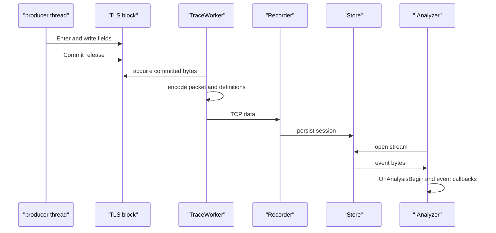

### X.7.2 Stats/CSV/LLM

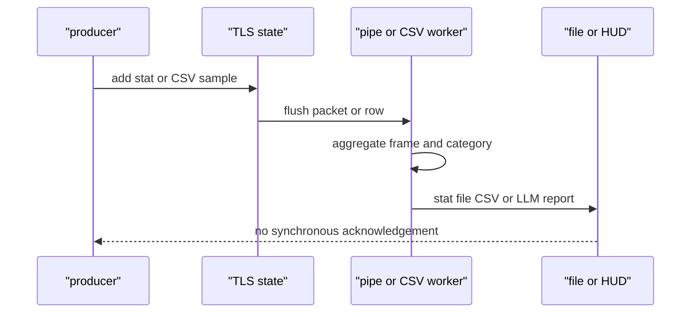

### X.7.3 GPU diagnostic

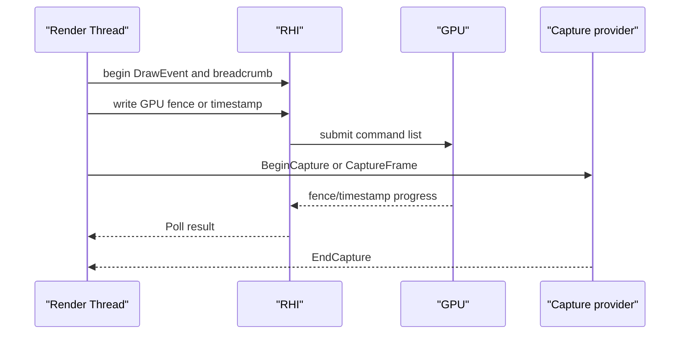

### X.7.4 Crash 与上传

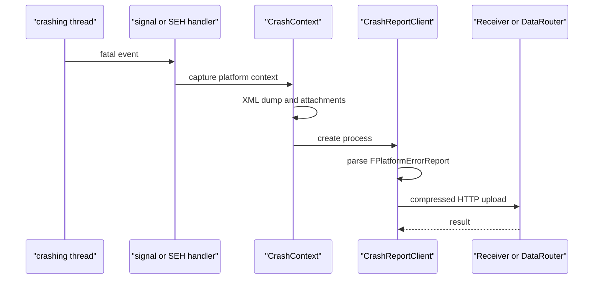

## X.8 线程模型与同步

|接入链|生产线程|消费/聚合线程|同步、背压、丢失策略|
|---|---|---|---|
|Trace|任意 UE 线程，各自 TLS|TraceWorker；无 worker 时 `Update()` 调用者|`Committed`/`EtxOffset` release/acquire；块池上限限制新块，未提交/超尾部数据可能丢失；不等待网络|
|Trace control|Console/Session/Insights 请求线程|TraceWorker 控制状态机|1985 控制 socket 非阻塞；命令通过 pending 状态交接；响应语义以控制实现为准|
|Stats|任意线程 TLS `FThreadStats`|`GStatsPipe` 单 pipe 任务|Packet 交接后聚合；阈值触发处理；源码未提供可靠落盘确认|
|CSV|任意采样线程 TLS|CSVProfiler 线程|定时处理；采样停止/进程退出时依 flush 路径，未定义跨进程重放|
|LLM|任意 malloc 路径|帧更新/命令线程|TLS tag stack 和原子计数；暂停宏防递归，不能持锁等待其它诊断系统|
|Log|任意线程|主日志线程或可选专用日志线程|`TMpscQueue`、`FEventCount`、设备 `FRWLock`；Panic 旁路直接写设备|
|VisualLogger|调用线程采集|编辑器 LogVisualizer/文件 writer|`IsRecording()` 门控；具体 writer 线程/文件协议未统一确认|
|GPU|RT/RHI|GPU timeline/后端 interrupt|fence/timestamp/breadcrumb；CPU Poll 非阻塞，设备丢失走后端错误路径|
|Crash|signal/SEH 崩溃线程|Windows crash thread、CRC 进程|崩溃路径不依赖普通锁；报告目录作为进程边界，上传异步|
|Automation|Controller 编辑器 GT|Worker 游戏进程 GT 每帧 Tick|MessageEndpoint inbox 缓冲；latent 队列无通用取消，未完成命令阻塞后续命令|
|Remote Control|HTTP/WS 请求回调|实现需 marshal 到 GT 的 UObject 操作|请求队列/WS backpressure 由 HttpServer/WebSocket 实现；源码未确认全局限流|
|Session/Messaging|Session/Message endpoint|endpoint inbox/模块线程|消息 transport 可配置；普通 delegate 不建立跨线程同步|

生命周期规则：Trace/CSV/LLM 的 producer API 只能在相应系统初始化后使用；Trace Stop 后不能假定通道关闭会立即使所有 worker 退出，必须遵循 Shutdown。CrashContext 初始化早于错误发生；CRC 只在目录生成后启动。Automation Worker 必须随 Engine Tick 处理 inbox，Controller 停止时调用 `StopTests`。Remote Control server 停止前应解除 route 和外部 WebSocket logger，避免回调访问已卸载模块。

## X.9 配置与扩展点

|配置/扩展|源码确认|
|---|---|
|Trace command line|`-trace`、`-tracehost`、`-tracefile`、`-tracetailmb`、`-traceautostart`、`-notraceserver`、`-buildmachine`，`Core/Private/ProfilingDebugging/TraceAuxiliary.cpp:2361-2488`|
|Trace console|`Trace.Start`、`Trace.Stop`、`Trace.Snapshot`、`Trace.ToggleChannel`，`TraceAuxiliary.cpp:1900+`|
|Trace channel/event|`UE_TRACE_CHANNEL`、`UE_TRACE_EVENT_BEGIN`、`UE_TRACE_LOG`，`Trace/Detail/Trace.h:77-224`|
|Stats|`STATS`、`UE_USE_LIGHTWEIGHT_STATS`、`-StatCmds`、`stat raw/startfile/stopfile`，`Stats.h:25-29`、`StatsSystemTypes.cpp:1205-1252`|
|CSV|`csvprofile`、`CSV_CUSTOM_STAT`、`CSV_PROFILER_STATS`、`csvProfilerHighPriority`，`CsvProfiler.h:90-172`|
|LLM|`-LLM`、`-NOLLM`、`-LLMCSV`、`-LLMTAGSETS`、`llm` Exec，`LowLevelMemTracker.h:558-645`|
|Logging|`Log category` verbosity/break commands、`-Log`、`-abslog=`、`EnableBacklog`，`OutputDeviceRedirector.h:70-103`|
|Crash|`[CrashReportClient]`、`CrashReportReceiverIP`、`DataRouterURL`、`bImplicitSend`、`bAgreeToCrashUpload`，`CrashReportCoreConfig.h:70-73,169-172`|
|Automation|`EngineTestModules`、`Automation RunTests`、`-TestExit`、`-unattended`、screenshot comparison delegates，`AutomationTest.cpp:751+`|
|RHI capture|`IRenderCaptureProvider`、`r.RHIThread.Enable`、`r.RHICmdBypass`、breadcrumbs/DrawEvent，`RenderCore/Public/IRenderCaptureProvider.h`、`RHI/Public/RHIBreadcrumbs.h`|
|Remote Control|`RemoteControl`/`WebRemoteControl` module settings、HTTP/WS routes、passphrase validation/CORS helpers，`WebRemoteControlInternalUtils.h:328-357`|
|Insights extension|实现 `IAnalyzer`，在 `IAnalysisSession::AddProvider` 注册 provider；各 Insights 插件按模块启用|
|专用扩展|GameplayDebugger category、ChaosVD/TraceBasedDebuggers、RewindDebugger track/provider、ScreenShotComparison comparator、Session `ITraceController`|

安全边界以源码为准：Trace 有 `SecureInitialize/SecureSendTo` 条件路径；Remote Control 有 passphrase/CORS/content-type 校验辅助；Crash 上传受隐私配置和 URL 控制；但本文不把这些接口当完整认证模型，未确认 TLS/密钥生命周期的全平台实现。

## X.10 已知限制/未确认项

1. Trace 事件布局、`TidPacket`、同步包和 LZ4 标记已由 TraceLog 源码确认；UnrealTraceServer 1981 Recorder 与 1989 Store 的完整 wire framing、请求字段、版本协商和重连协议未在公共接口中完整确认，不能写成 REST/WebSocket 协议。
2. Insights 的 `IAnalysisService`、`IAnalysisSession`、`IAnalyzer`、Provider 接口已确认；UnrealInsights 与 Store 的具体跨进程请求协议、认证、流控和远端 Store 部署方式未由 UE 源码完整确认。
3. Remote Control 的 HTTP/WebSocket route、请求结构、JSON/结构反序列化、passphrase/CORS 辅助已确认；HTTP/WS 监听端口、TLS、认证策略、frame 分片/压缩的最终 wire 行为由 HttpServer/NetworkingWebSockets/配置决定，未确认一个固定跨平台值。
4. RenderDoc、PIX、Nsight 的外部捕获协议、宿主进程、平台 SDK 版本和 GPU driver 线程不可由 UE 源码确认；UE 侧仅能确认 `IRenderCaptureProvider`、DrawEvent、breadcrumbs、fence/timestamp hook。
5. Shader Print、VisualizeTexture、GPU profiler 在不同 Renderer/RHI/插件路径有多个实现；本章确认其必须经过 RDG/RHI 生命周期，但未找到单一全平台 public 接口和统一输出格式。
6. VisualLogger 的 `FVisualLogger`/`UE_VLOG*` 入口确认；完整 `.vlog` 序列化 schema、writer 线程和 LogVisualizer 与运行时的所有传输细节未逐项核对。
7. `memreport`、`obj list`、`obj refs` 是 Exec 文本命令；源码没有统一版本化机器可读格式，也没有固定网络端口。其输出必须视为诊断文本，不可当稳定 API。
8. GameplayDebugger、ChaosVD、RewindDebugger、NetworkProfiler 均存在源码入口；各自专用数据包、Trace provider、回放索引和跨进程协议分支较多，未确认一个共同格式或端口。
9. Automation screenshot comparison 的 UE 接口和比较模块存在；截图编码、阈值配置、平台色彩/窗口差异、远程设备传输细节由 ScreenShotComparison、平台实现和 Gauntlet 配置决定，未确认统一协议。
10. Crash 的 Unix signal/备用栈、Windows SEH/crash thread、XML/附件目录、CRC 上传类已确认；Windows minidump 字段、Crash Receiver/DataRouter 服务端协议、压缩包 schema 和重试/隐私后端未在引擎源码中确认。
11. 线程优先级、亲和性和 queue depth 只在明确的源码创建点记录；平台 HTTP、WebSocket、Messaging、GPU driver 内部线程不应从工具名称推导。第26/29章中“未声明”的约束在本章继续有效。
12. 安全方面只记录源码能见的 passphrase/CORS/secure trace/隐私 CVar；未确认 Remote Control 是否默认绑定 loopback、外部 TLS 终止、Session Frontend 的网络访问控制，不能给出部署安全保证。

## X.11 附录索引

|范围|附录文件|
|---|---|
|Runtime TraceLog|`appendix/api/Runtime/TraceLog.md`|
|Runtime Core Stats/ProfilingDebugging/Logging/LLM/Crash|`appendix/api/Runtime/Core.part01.md` ~ `Core.part03.md`|
|Runtime RHI/RenderCore|`appendix/api/Runtime/RHI*.md`、`appendix/api/Runtime/RenderCore*.md`|
|Runtime Automation/Session/Messaging|`appendix/api/Runtime/AutomationTest.md`、`AutomationMessages.md`、`AutomationWorker.md`、`SessionServices.md`、`Messaging*.md`|
|Runtime Engine/GameplayDebugger/CrashReportCore|`appendix/api/Runtime/Engine*.md`、`GameplayDebugger.md`、`CrashReportCore.md`|
|Developer TraceAnalysis/TraceServices/TraceInsights|`appendix/api/Developer/TraceAnalysis.md`、`TraceServices.md`、`TraceInsights*.md`|
|Developer Automation/ScreenShot/Session|`appendix/api/Developer/AutomationController.md`、`AutomationDriver.md`、`ScreenShotComparison*.md`|
|Programs Insights/TraceServer/Crash|`appendix/api/Programs/UnrealInsights.md`、`TraceAnalyzer.md`、`TraceQuery.md`、`CrashReportClient.md`；UnrealTraceServer 的 C++/服务端协议不以公共符号附录替代|
|Plugins RemoteControl|`appendix/api/Plugins/RemoteControl.md`、`WebRemoteControl.md`、`RemoteControlProtocol.md`|
|Plugins ChaosVD/Rewind/TraceBasedDebuggers|对应 `appendix/api/Plugins/ChaosVD*.md`、`RewindDebugger*.md`、`TraceBasedDebuggers*.md`|
|Plugins Insights/GPU diagnostics|`appendix/api/Plugins/RenderGraphInsights.md`、`RenderTrace.md`、`GameplayInsights.md`、`SlateInsights.md`、`AudioInsights*.md` 等对应文件|

交叉引用：第23章提供 Trace/Stats/CSV/LLM/Crash/Automation 的基础实现和已有缺口；第26章提供 TLS、TaskGraph、pipe、MPSC、fence 和等待风险；第29章提供 RT/RHI/GPU 提交、capture provider、breadcrumbs/fence 线程边界。本章新增的是工具接入契约、跨进程边界、启停方式、背压/丢失语义和外部协议未确认清单。
