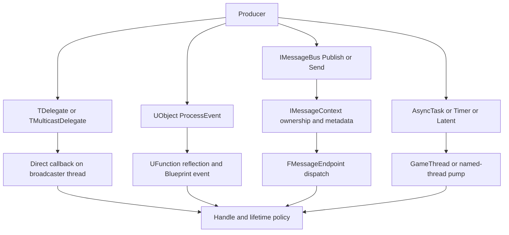
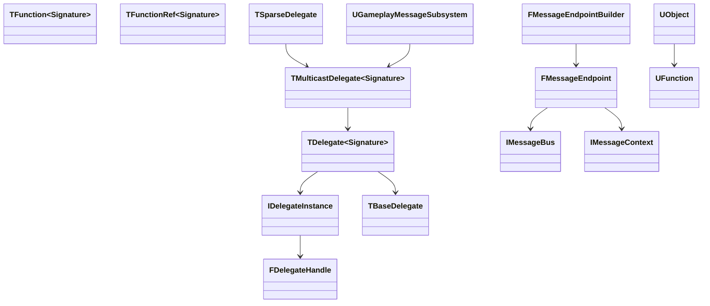
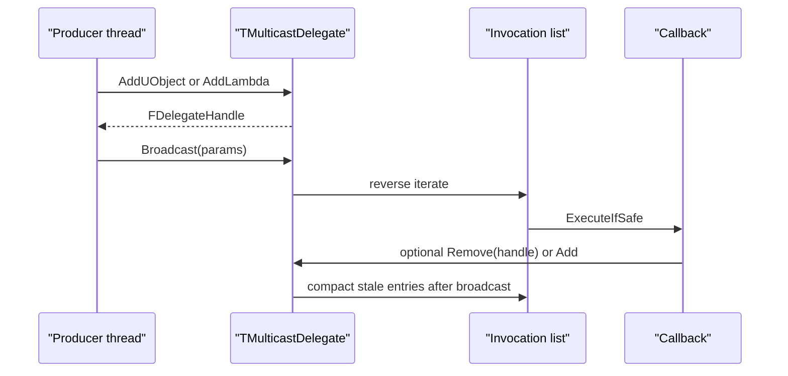
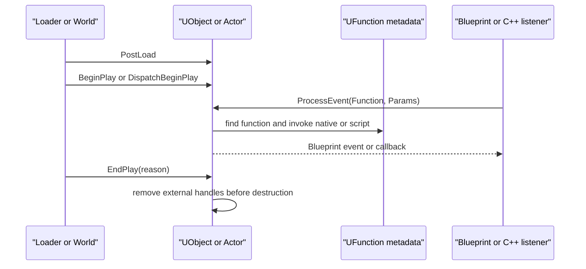
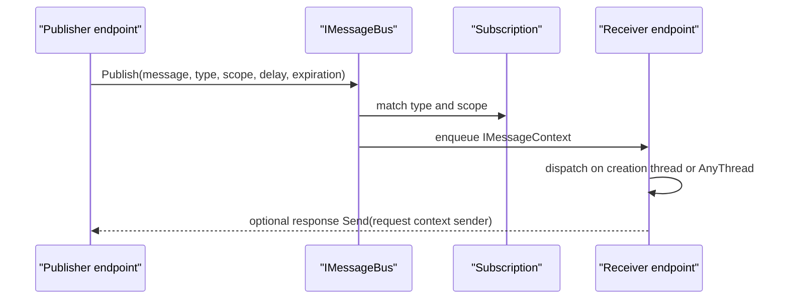
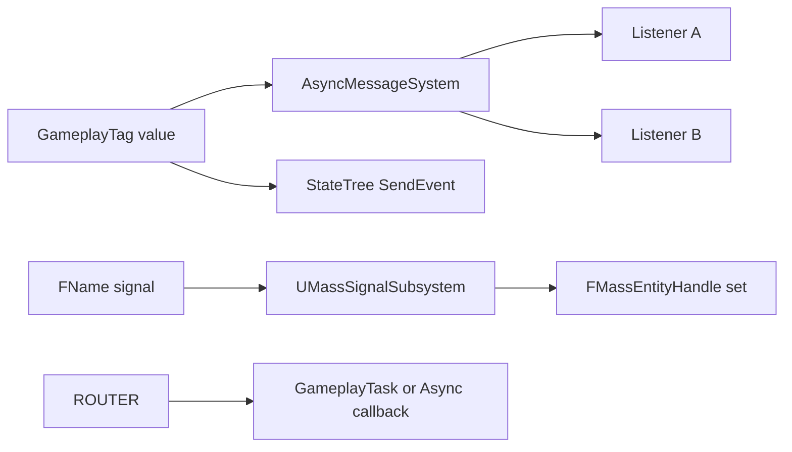
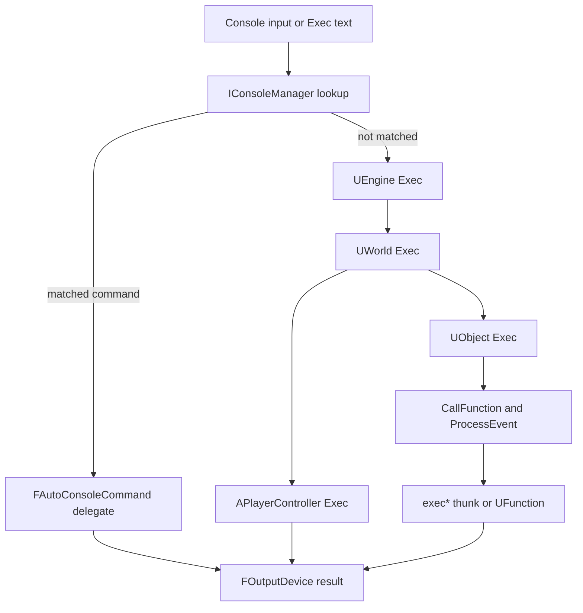
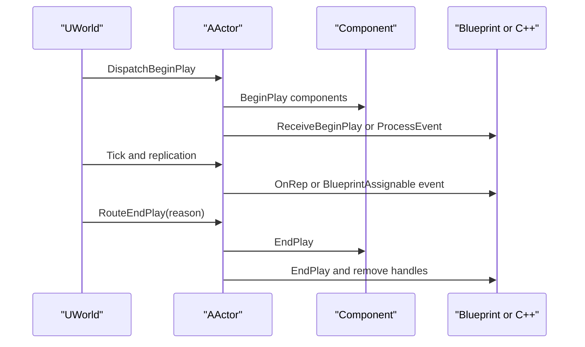
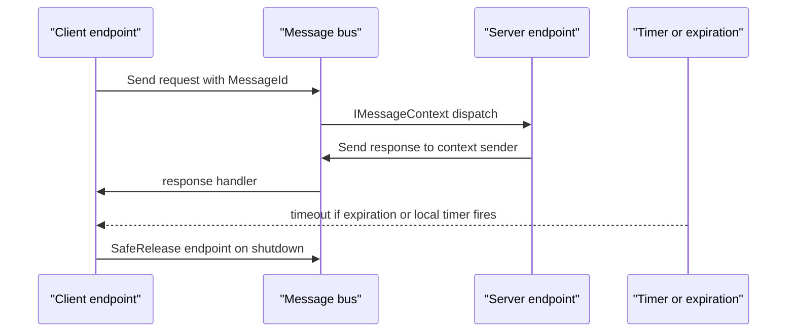
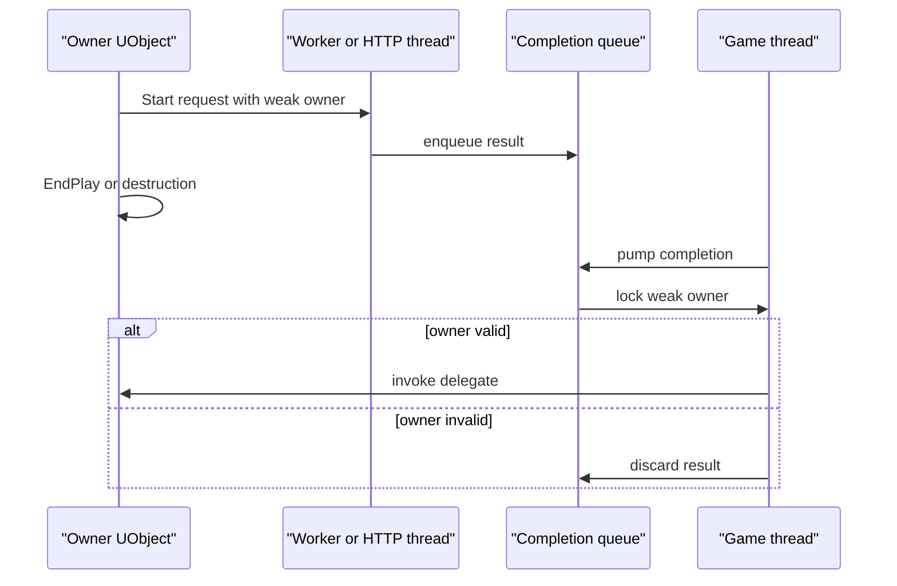

# 31 消息、事件、委托、回调与执行入口详细设计

> 源码基线: UE 5.8.3-release。路径均相对 `$E`，行号为本仓源码行号。本文只把在源码中核实的接口写成确定结论；跨平台或实现未统一处列入 X.10。

## 31.1 职责、边界与模块清单

|模块|源码路径|职责|交叉章节|
|---|---|---|---|
|Core|Source/Runtime/Core|委托、函数对象、全局核心委托、FTSTicker、控制台基础|01,26,30|
|CoreUObject|Source/Runtime/CoreUObject|UObject 生命周期、反射调用、动态委托、FieldNotification 基础|03,21|
|Engine|Source/Runtime/Engine|Actor/Component/World 事件、GameplayMessage、Exec 链、Timer/Latent|04,11,15|
|Messaging|Source/Runtime/Messaging|IMessageBus、上下文、传输与消息调度|11,27|
|MessagingCommon|Source/Runtime/MessagingCommon|FMessageEndpoint、Builder、类型安全发送封装|11,27|
|GameplayTags|Source/Runtime/GameplayTags|GameplayTag 通道/标签树与网络索引|15|
|MassSignals|Source/Runtime/Mass/MassSignals|Mass 信号多播和延迟信号|15,26|
|FieldNotification|Source/Runtime/FieldNotification|字段变更通知与可反射描述|10,21|
|Online/HTTP|Source/Runtime/Online/HTTP|HTTP 请求完成委托与取消|11,27|
|Slate/Editor|Source/Runtime/Slate、Editor|Slate/UI 与编辑器委托集合|10,22|

## 31.2 总体架构

UE 的事件机制分为四个边界:同线程直接调用的 Delegate、UObject 反射事件、拥有消息上下文的 Message Bus、以及把异步结果重新投递到指定线程的 Task/Timer/Latent。委托本身不迁移线程；MessageEndpoint 默认在创建线程收件，明确选择 `AnyThread` 才允许任意线程分发(`MessagingCommon/Public/MessageEndpoint.h:48-60`)。



设计边界:委托是调用列表，不是消息队列；动态委托是可反射/可序列化的 UObject 调用描述，不因此获得线程安全；`DECLARE_TS_*` 只解决委托容器的并发读写，不替回调对象建立生命周期拥有权。

## 31.3 类图



- `TDelegate` 是单播拥有一个 delegate instance；`TMulticastDelegate` 保存 invocation list；`TBaseDelegate` 是基础实现层；`TFunction` 拥有可调用对象，`TFunctionRef` 只借用调用期间有效的对象；`TSparseDelegate` 以稀疏存储服务大量 UObject 事件。
- `FDelegateHandle` 的有效标识是非零 `uint64 ID`(`Core/Public/Delegates/IDelegateInstance.h:15-71`)。
- Message endpoint 同时实现 `IMessageReceiver`、`IMessageSender`、`IBusListener`(`MessagingCommon/Public/MessageEndpoint.h:65-70`)。

## 31.4 数据字典

|类型/字段|含义|约束/失败语义|源码位置|
|---|---|---|---|
|`FDelegateHandle::ID`|组播绑定凭证|非零有效；Remove 失败返回 false|`Core/Public/Delegates/IDelegateInstance.h:15-71`|
|`FNotThreadSafeDelegateMode`|默认委托策略|Add/Remove/Broadcast 需外部串行化|`Core/Public/Delegates/DelegateBase.h:39-74`|
|`FThreadSafeDelegateMode`|TS 委托策略|内部读写保护；不保护用户对象|`Core/Public/Delegates/DelegateBase.h:77-86`|
|`InvocationList`|多播调用列表|广播期间失效项延迟压缩|`Core/Public/Delegates/MulticastDelegateBase.h:288-320`|
|`EMessageScope`|消息可见范围|Thread/Process/Network 等由总线过滤|`Runtime/Messaging/Public/MessageTypes.h`|
|`EMessageFlags`|点对点消息标志|请求/响应标志由 Messaging 使用|`Runtime/Messaging/Public/MessageTypes.h`|
|`IMessageContext::GetMessage()`|消息载荷|总线/Endpoint 接管内存，接收者只读|`Runtime/Messaging/Public/IMessageContext.h:224`|
|`IMessageContext::GetSender()`|发送方地址|用于响应与审计|`IMessageContext.h`|
|`IMessageContext::GetExpiration()`|失效时间|过期消息不投递|`IMessageContext.h`|
|`FMessageEndpoint::Enabled`|端点开关|Disable 后订阅不接收|`MessagingCommon/Public/MessageEndpoint.h:116-127`|
|`FMessageEndpoint::InboxEnabled`|同步收件箱开关|启用后可 Poll，不等于线程迁移|`MessageEndpoint.h:90-100`|
|`FMessageScopeRange`|订阅范围|默认类型安全 Subscribe 为至少 Thread|`MessageEndpoint.h:915-932`|
|`FAsyncTask`/`FTimerHandle`|异步/定时句柄|取消只阻止尚未执行回调|`Core/Public/Async/AsyncWork.h`、`Engine/Public/TimerManager.h`|
|`FFieldNotificationId`|字段通知 ID|由描述器映射属性名|`FieldNotification/Public/FieldNotificationId.h`|
|`FGameplayTag`|Gameplay message 通道键|层级匹配；空标签无效|`GameplayTags/Classes/GameplayTagContainer.h:41-100`|

## 31.5 接口清单

### 31.5.1 委托宏与核心类型

|原型/宏|功能|线程、所有权、失败|位置|
|---|---|---|---|
|`DECLARE_DELEGATE(DelegateName)`|声明无参非动态单播|类型安全；未绑定 Execute 会断言|`Core/Public/Delegates/DelegateCombinations.h:20`|
|`DECLARE_MULTICAST_DELEGATE(DelegateName)`|声明无参非动态多播|广播者同步调用所有绑定|`DelegateCombinations.h:23`|
|`DECLARE_TS_MULTICAST_DELEGATE(DelegateName)`|线程安全多播类型|内部策略保护列表，回调仍在广播线程|`DelegateCombinations.h:26`|
|`DECLARE_DYNAMIC_DELEGATE(DelegateName)`|声明动态单播|基于 UFunction 名称，可反射/序列化|`DelegateCombinations.h:35`|
|`DECLARE_DYNAMIC_MULTICAST_DELEGATE(DelegateName)`|声明动态多播|BlueprintAssignable 常用；反射调用开销更高|`DelegateCombinations.h:38`|
|`TDelegate<RetValType(ParamTypes...)>`|单播委托|`BindStatic/BindRaw/BindUObject/BindSP/BindLambda`；对象策略决定失效行为|`Core/Public/Delegates/Delegate.h:205-239`|
|`TMulticastDelegate<RetValType(ParamTypes...), UserPolicy>`|多播委托|`Add*` 返回句柄，`Remove` 按句柄，`RemoveAll` 按对象|`Core/Public/Delegates/MulticastDelegateBase.h:60-320`|
|`TBaseDelegate<...>`|委托实现基类|承载 allocator 与绑定实例|`Core/Public/Delegates/DelegateSignatureImpl.inl:1-120`|
|`TFunction<RetValType(ParamTypes...)>`|拥有型通用 callable|移动/拷贝语义由封装管理；可捕获非 UObject 状态|`Core/Public/Templates/Function.h`|
|`TFunctionRef<RetValType(ParamTypes...)>`|非拥有 callable 视图|调用期间必须保证被引用对象存活|`Core/Public/Templates/Function.h`|
|`TSparseDelegate`|稀疏事件表|适合大量 UObject、按对象分配|`Core/Public/Delegates/SparseDelegate.h`|
|`FDelegateHandle Add(Delegate&&)`|加入多播|句柄归调用方保存；重复绑定不会自动去重|`Core/Public/Delegates/DelegateSignatureImpl.inl:784`|
|`bool Remove(FDelegateHandle Handle)`|按句柄解绑|无效/已移除返回 false|`DelegateSignatureImpl.inl`|
|`int32 RemoveAll(FDelegateUserObjectConst InUserObject)`|移除对象绑定|返回移除数|`Core/Public/Delegates/MulticastDelegateBase.h:173`|
|`void Unbind()`|单播解绑|释放实例；正在执行的栈帧不被中断|`DelegateSignatureImpl.inl`|
|`bool IsBound() const`|绑定查询|查询不是生命周期锁|`Core/Public/Delegates/DelegateBase.h`|
|`RetValType Execute(Params...) const`|执行单播|未绑定时按实现断言|`DelegateSignatureImpl.inl:618`|
|`RetValType ExecuteIfBound(Params...) const`|条件执行|未绑定返回默认值|`DelegateSignatureImpl.inl`|
|`void Broadcast(Params...) const`|执行多播|源码自后向前遍历；广播中 Add/Remove 在列表规则内生效|`Core/Public/Delegates/MulticastDelegateBase.h:288-320`|

绑定策略: `AddUObject/CreateUObject` 使用 UObject 弱语义，GC 后不会调用已失效对象；`AddRaw` 不持有裸指针且必须由拥有者在析构前 Remove；`AddSP` 使用共享指针生命周期；`AddWeakLambda` 以弱 UObject 防止回调悬空。`AddLambda` 对捕获对象不做生命周期推断。

广播规则已由源码确认:多播列表从末端向前遍历，失效绑定在广播后压缩；广播是同步、可重入调用，回调中的 Remove 不会撤销已经进入的调用栈，回调中的 Add 不应依赖本轮必然执行。递归 Broadcast 不由框架禁止，递归深度与状态保护由调用方负责。



### 31.5.2 动态委托、UObject 事件和反射

|入口|作用|线程/生命周期|位置|
|---|---|---|---|
|`TBaseDynamicDelegate`|动态单播存储 UObject + 函数名|对象必须是 UObject；GC/失效时安全跳过|`Core/Public/Delegates/DelegateSignatureImpl.inl:1153-1283`|
|`TBaseDynamicMulticastDelegate`|动态多播|可由 UHT 生成 BlueprintAssignable 属性|`DelegateSignatureImpl.inl:1283-1502`|
|`UObject::ProcessEvent(UFunction*, void*)`|反射/蓝图/RPC 通用执行入口|UObject 生命周期与当前线程必须由调用者保证|`CoreUObject/Public/UObject/Object.h`|
|`AActor::BeginPlay()`|Actor 开始运行|World/GameThread；由 DispatchBeginPlay 路径调用|`Engine/Classes/GameFramework/Actor.h:2122-2132`|
|`AActor::EndPlay(EEndPlayReason::Type)`|Actor 结束运行|销毁/关卡卸载前；应解绑外部非 UObject 回调|`Actor.h:2132`|
|`AActor::ProcessEvent(UFunction*, void*)`|Actor 特化反射路径|可处理 Blueprint event、网络函数|`Actor.h:2344`|
|`UObject::PostLoad()`|对象从归档加载后修复|加载线程/最终 UObject 规则由加载器约束|`CoreUObject/Public/UObject/Object.h`|
|`UObject::PostEditChangeProperty(FPropertyChangedEvent&)`|编辑器属性变更|Editor GameThread；非运行时钩子|`CoreUObject/Public/UObject/Object.h`|
|`OnRep_*`|复制属性通知|接收属性写入后由复制系统在 GT 调用|`Engine/Private/Net/RepLayout.cpp:4661`|
|`UPROPERTY(BlueprintAssignable)`|把动态多播暴露给蓝图|属性所属 UObject 持有；蓝图绑定随对象销毁|`Engine/Classes/GameFramework/Actor.h:1351-1414`|
|`UFUNCTION(BlueprintCallable)`|蓝图可调用反射函数|执行仍受 UObject 所在线程约束|`Actor.h:474` 等|
|`FieldNotification`|字段值改变通知|描述器映射字段 ID，监听句柄需移除|`FieldNotification/Public/INotifyFieldValueChanged.h`|



GC 约束:UObject 指针不能以 `TSharedPtr` 管理；异步任务应捕获 `TWeakObjectPtr`，在回调执行时 `IsValid()` 检查并回 GT；非 UObject 的 `AddRaw` 不会被 GC 自动解绑。动态委托可序列化的是对象引用/函数名，不是任意 lambda。

### 31.5.3 全局委托接口表

下表列出源码头中可直接作为跨模块入口的代表性及完整核心组；平台专用长尾接口仍在附录。

|集合|接口签名|触发点/线程/生命周期|位置|
|---|---|---|---|
|`FCoreDelegates`|`TMulticastDelegate<void()> OnInit`|极早初始化，GT，进程一次|`Core/Public/Misc/CoreDelegates.h:230-231`|
|`FCoreDelegates`|`FSimpleMulticastDelegate OnOutputDevicesInit`|PreInit 输出设备，GT|`CoreDelegates.h:233-234`|
|`FCoreDelegates`|`FSimpleMulticastDelegate& GetOnPostEngineInit()`|Engine 初始化末尾，GT|`CoreDelegates.h:236-241`|
|`FCoreDelegates`|`FSimpleMulticastDelegate OnAllModuleLoadingPhasesComplete`|模块阶段完成，GT|`CoreDelegates.h:243-244`|
|`FCoreDelegates`|`FSimpleMulticastDelegate OnFEngineLoopInitComplete`|开始 Tick 前，GT|`CoreDelegates.h:246-247`|
|`FCoreDelegates`|`FSimpleMulticastDelegate OnPreExit/OnEnginePreExit/OnExit`|退出顺序事件，GT|`CoreDelegates.h:255-262`|
|`FCoreDelegates`|`FSimpleMulticastDelegate OnBeginFrame/OnEndFrame`|游戏帧首/尾，GT|`CoreDelegates.h:276-283`|
|`FCoreDelegates`|`FSimpleMulticastDelegate OnBeginFrameRT/OnEndFrameRT`|渲染帧首/尾，RT|`CoreDelegates.h:285-289`|
|`FCoreDelegates`|`TTSMulticastDelegate<void(FStringView)>& GetOnAsyncLoadPackage()`|发起异步加载的同一线程|`CoreDelegates.h:103-104`|
|`FCoreDelegates`|`TMulticastDelegate<void(bool,int32,int32)> OnUserLoginChangedEvent`|平台用户状态，平台回调线程，源码未统一|`CoreDelegates.h:111-115`|
|`FCoreDelegates`|`TMulticastDelegate<void(const FString&)> PakFileMountFailedDelegate`|Pak 挂载失败，挂载调用线程|`CoreDelegates.h:148-152`|
|`FCoreDelegates`|`TTSMulticastDelegate<void(const IPakFile&)>& GetOnPakFileMounted2()`|Pak 挂载后，TS 委托策略|`CoreDelegates.h:136-143`|
|`FCoreDelegates`|`TMulticastDelegate<void(UWorld*,FIntVector,FIntVector)> PreWorldOriginOffset/PostWorldOriginOffset`|世界原点偏移前后，GT|`CoreDelegates.h:292-295`|
|`FCoreDelegates`|`TDelegate<void()> StarvedGameLoop`|主循环饥饿检测，GT|`CoreDelegates.h:297-298`|
|`FCoreDelegates`|`TTSMulticastDelegate<void()>& ApplicationHeartbeat`|慢操作心跳，触发线程需线程安全|`CoreDelegates.h:451-454`|
|`FCoreDelegates`|`TMulticastDelegate<void(ETemperatureSeverity)> OnTemperatureChange`|移动温度变化，平台线程|`CoreDelegates.h:300-312`|
|`FCoreDelegates`|`TMulticastDelegate<void(const TCHAR*)> OnNamedCommandParsed`|FParse 命令成功后，调用线程|`CoreDelegates.h:640-642`|
|`FCoreDelegates`|`TMulticastDelegate<void(const TCHAR*)> OnDisallowedExecCommandCalled`|Exec 禁止时，调用线程|`CoreDelegates.h:644-646`|
|`FWorldDelegates`|`OnPostWorldInitialization(UWorld*,FWorldInitializationValues)`|World 初始化完成，GT|`Engine/Public/WorldDelegates.h`|
|`FWorldDelegates`|`OnWorldInitializedActors(const UWorld::FActorsInitializedParams&)`|Actor 初始化后，GT|`WorldDelegates.h`|
|`FWorldDelegates`|`OnWorldBeginTearDown(UWorld*)`|World teardown 开始，GT|`WorldDelegates.h`|
|`FWorldDelegates`|`OnWorldCleanup(UWorld*,bool,bool)`/`OnPostWorldCleanup`|清理前后，GT|`WorldDelegates.h`|
|`FWorldDelegates`|`LevelAddedToWorld(ULevel*,UWorld*)`/`LevelRemovedFromWorld`|关卡挂载/移除，GT|`WorldDelegates.h`|
|`FWorldDelegates`|`OnWorldPreActorTick`/`OnWorldPostActorTick`|Actor tick 前/后，GT|`WorldDelegates.h`|
|`FEngineDelegates`|`OnWorldAdded/OnWorldDestroyed`|Engine 世界注册表变更，GT|`Engine/Public/Engine.h`|
|`FEngineDelegates`|`OnPreWorldInitialization/OnPostWorldInitialization`|Engine 世界初始化阶段，GT|`Engine/Public/Engine.h`|
|`FGameDelegates`|`GetEndPlayMapDelegate()`|地图 EndPlay，GT|`Engine/Public/GameDelegates.h`|
|`FGameDelegates`|`GetPauseWhileStreamingDelegate()`|流送暂停策略查询|`Engine/Public/GameDelegates.h`|
|`FSlateDelegates`|`OnApplicationPreInput/OnApplicationInput/OnApplicationPostInput`|Slate 应用输入泵，Slate/GT|`Slate/Public/Framework/SlateDelegates.h`|
|`FSlateDelegates`|`OnPreTick/OnPostTick`|Slate Tick 前后，Slate/GT|`SlateDelegates.h`|
|`FSlateDelegates`|`OnPreDrawWindow/OnPostDrawWindow`|窗口绘制前后，Slate/RT 交界依渲染器|`SlateDelegates.h`|
|`FEditorDelegates`|`PreBeginPIE/BeginPIE/EndPIE`|PIE 生命周期，Editor GT|`Editor/UnrealEd/Public/Editor.h`|
|`FEditorDelegates`|`MapChange/WorldChange`|编辑器地图变化，Editor GT|`Editor.h`|
|`FEditorDelegates`|`OnAssetPostImport/OnAssetPostImportSubsystem`|资产导入后，Editor GT|`Editor.h`|
|`FEditorDelegates`|`OnMapOpened`|地图打开后，Editor GT|`Editor.h`|

`FCoreDelegates` 的 TS 成员是明确线程安全委托，但普通成员如 `OnBeginFrame` 仍只能按触发点使用；不要因“全局”名称推断可跨线程广播。模块卸载前应 `RemoveAll(this)`，源码示例见 `LandscapeModule.cpp:300-301`、`AssetRegistry.cpp:1077`。

### 31.5.4 Message Bus

|原型|功能|参数/返回/所有权|线程与失败|位置|
|---|---|---|---|---|
|`virtual void Publish(void*,UScriptStruct*,EMessageScope,const TMap<FName,FString>&,FTimespan,FDateTime,const TSharedRef<IMessageSender,ESPMode::ThreadSafe>&)=0`|发布订阅消息|Bus 接管 Message 内存；Scope/Delay/Expiration 入上下文|总线调度；过期或无订阅则不回调|`Messaging/Public/IMessageBus.h:157-171`|
|`virtual void Send(void*,UScriptStruct*,EMessageFlags,const TMap<FName,FString>&,const TSharedPtr<IMessageAttachment,ESPMode::ThreadSafe>&,const TArray<FMessageAddress>&,FTimespan,FDateTime,const TSharedRef<IMessageSender,ESPMode::ThreadSafe>&)=0`|点对点发送|Bus 接管消息；Attachment 共享所有权|地址不存在时无接收者；可靠性由 transport 决定|`IMessageBus.h:183-199`|
|`virtual void Forward(const TSharedRef<IMessageContext,ESPMode::ThreadSafe>&,const TArray<FMessageAddress>&,const FTimespan&,const TSharedRef<IMessageSender,ESPMode::ThreadSafe>&)=0`|转发已接收上下文|仅同进程 endpoint 转发|不等于网络可靠转发|`IMessageBus.h:117-128`|
|`virtual void Register(const FMessageAddress&,const TSharedRef<IMessageReceiver,ESPMode::ThreadSafe>&)=0`|注册接收端|Bus 持有 ThreadSafe 接收端|重复/关闭时由实现处理|`IMessageBus.h:173-180`|
|`virtual TSharedPtr<IMessageSubscription,ESPMode::ThreadSafe> Subscribe(...)=0`|按类型和范围订阅|返回订阅对象，nullptr 表示失败|必须保存订阅或取消|`IMessageBus.h:209-230`|
|`virtual void Unsubscribe(const TSharedRef<IMessageSubscription,ESPMode::ThreadSafe>&)=0`|取消订阅|释放订阅引用后不保证已入队回调立即消失|总线关闭时统一失效|`IMessageBus.h`|
|`FMessageEndpointBuilder& Handling(HandlerType*, FuncType)`|绑定类型处理器|Builder 保存 handler 与函数|默认收件线程为创建线程|`MessagingCommon/Public/MessageEndpointBuilder.h:69-91`|
|`FMessageEndpointBuilder& ReceivingOnAnyThread()`|任意线程分发|要求 handler 线程安全|否则数据竞争|`MessageEndpointBuilder.h:119-138`|
|`FMessageEndpointBuilder& ReceivingOnThread(ENamedThreads::Type)`|指定命名线程|回调被投递到目标线程|目标线程需存活|`MessageEndpointBuilder.h:138`|
|`void FMessageEndpoint::Publish(...)`|类型安全发布封装|模板自动取 `StaticStruct()`|底层调用 IMessageBus|`MessageEndpoint.h:608-703`|
|`void FMessageEndpoint::Send(...)`|类型安全点对点|Recipents 地址列表|底层调用 IMessageBus|`MessageEndpoint.h:714-901`|
|`void FMessageEndpoint::Subscribe(...)`|类型安全订阅|默认 `AtLeast(EMessageScope::Thread)`|返回 void，失败由 Bus 实现/状态体现|`MessageEndpoint.h:915-932`|
|`static void SafeRelease(TSharedPtr<FMessageEndpoint,ESPMode::ThreadSafe>&)`|安全释放 endpoint|等待/规避接收线程与析构竞态|非 GT 或 AnyThread endpoint 必须使用|`MessageEndpoint.h:58-60,970`|



传输交叉: `IMessageTransport::TransportMessage` 是 transport 抽象，UdpMessaging/TcpMessaging/QuicMessaging 负责跨进程/网络承载，序列化和路由不由 `FMessageEndpoint` 保证。源码注释明确 dead-letter channel、认证授权不是内置机制(`IMessageBus.h:100-109`)。请求-响应是约定:请求消息携带 `GetMessageId`/Sender，响应以 `Send` 回原地址；没有总线级 RPC 超时/取消保证，调用方用 `Expiration` 或自有 timer。

### 31.5.5 Gameplay messages、Tags、Mass、StateTree

|机制|入口|通道/回调|线程与生命周期|位置|
|---|---|---|---|---|
|Gameplay Message Subsystem|本地 5.8.3 树未找到 `UGameplayMessageSubsystem`/`GameplayMessageRouter` 符号|不能把 GameplayTag 直接当作已确认的消息路由实现|列为未确认，不编造接口|源码全树检索结果为空|
|Async Message System|`FAsyncMessageSystemBase::BindListener` / `QueueMessageForBroadcast`|异步消息绑定、拷贝 payload、队列广播|句柄可解绑；弱 UObject 无效时自动解绑；`Shutdown` 后禁止新绑定/入队|`Plugins/Experimental/AsyncMessageSystem/Source/AsyncMessageSystem/Public/AsyncMessageSystemBase.h:53-140,152-157`|
|`FAsyncMessageSystemBase::ProcessMessageQueueForBinding`|按 binding options 消费消息|可由 tick group 或 async thread 调用|`AsyncMessageSystemBase.h:136-140`|
|Async Gameplay Message System|`FAsyncGameplayMessageSystem::ProcessMessagesForTickGroup`|按 TickGroup 或 named async thread 调度|支持 `TG_PrePhysics` 至 `TG_PostUpdateWork`，由 World tick functions 驱动|`Plugins/Experimental/AsyncMessageSystem/Source/AsyncMessageSystem/Public/AsyncGameplayMessageSystem.h:14-24,44-73,98-103`|
|GameplayTags|`UGameplayTagsManager::AddNativeGameplayTag`|标签树不是消息队列，可作为 channel key|注册启动期 GT；读标签可并发|`GameplayTags/Classes/GameplayTagsManager.h:344,403`|
|Mass Signals|`UMassSignalSubsystem::SignalEntities`|`FName` named signal → entity delegate|GT 立即；`SignalEntitiesDeferred` 经命令缓冲|`MassSignals/Public/MassSignalSubsystem.h:52-110`|
|Mass delayed|`DelaySignalEntity(FName,FMassEntityHandle,float)`|延迟信号队列|GT Tick 检查目标时间|同上:60,110|
|StateTree|`FStateTreeExecutionContext::SendEvent(FGameplayTag,FConstStructView,FName)`|Tag + struct payload|执行上下文通常 GT；事件触发 transition|`StateTreeExecutionContext.h:256`|
|GameplayTasks|`UGameplayTask::ReadyForActivation/EndTask`|任务完成 delegate|GameplayTasksComponent GT Tick；结束需清理|`GameplayTasks/Public/GameplayTask.h:157,162,229`|



### 31.5.6 异步回调统一规则

|子系统|回调接口/证据|回调线程|取消/句柄/生命周期|
|---|---|---|---|
|HTTP|`IHttpRequest::OnProcessRequestComplete()`，请求由 `FHttpThreadBase::AddRequest` 入队|完成回调通常 GT Tick；平台 backend 细节由 `FHttpThread` 归并|`CancelRequest()` 只取消未完成请求；delegate 必须在 owner 销毁前解绑|`Online/HTTP/Public/HttpRequest.h`、`Private/HttpThread.h:69-91`|
|ICMP|`FIcmpEchoResultCallback`|源码声明异步线程探测、结果回到游戏线程|无通用句柄；调用者用 owner 生命周期保护|`Online/ICMP/Public/Icmp.h:115-153`|
|Socket receiver|`FUdpSocketReceiver` 回调|FRunnable 接收线程|`Stop()` 停止线程；接收对象必须活到 Stop 完成|`Networking/Public/Common/UdpSocketReceiver.h:88,129`|
|HTTP/WebSocket|`IWebSocket::OnConnected/OnMessage/OnClosed`|实现/平台线程，公开接口不统一 GT 保证|Close 后不再使用回调对象；绑定 delegate owner 管理|`Online/WebSockets/Public/IWebSocket.h:16-78`|
|Media|`UMediaPlayer::OnMediaOpened/OnMediaEvent`|Facade 在允许线程处理 queued events；媒体 ticker/解码线程存在|Close/EndPlay 前解绑；样本队列由 facade 管理|`MediaUtils/Private/MediaPlayerFacade.cpp:2252-2265`|
|LiveLink|`PushSubjectFrameData_AnyThread`|任意源线程入队，GT `OnSamplingInput` 消费|队列有锁；客户端销毁前移除源|`LiveLink/Private/LiveLinkClient.cpp:1131`|
|Audio|`FAudioThread::RunCommandOnAudioThread`|`GAudioPipe` 任务上下文|没有单项取消；用 `FAudioCommandFence` 等待排空|`Engine/Public/AudioThread.h:51-126`|
|Render|`ENQUEUE_RENDER_COMMAND` lambda|RT/RHI 依据命令上下文|无通用取消；捕获值/引用必须跨到执行点有效|`RenderCore/Public/RenderingThread.h:504-533`|
|TaskGraph/UE Tasks|`AsyncTask`/`FTaskBase` continuation|指定命名线程或 worker|无通用取消；任务 Close/Wait 只保证完成语义|`Core/Public/Async/Async.h`、`Tasks/TaskPrivate.h:475`|
|Timer|`FTimerDelegate`|World TimerManager 在 GT Tick|`ClearTimer` 取消尚未执行；循环 timer 需明确清除|`Engine/Public/TimerManager.h`|
|Latent|`FLatentActionManager`/`FPendingLatentAction::UpdateOperation`|World/GT latent pump|`RemoveActionsForObject` 按 UObject 清理|`Engine/Public/LatentActions.h`|

统一生命周期:异步生产者不应直接保存裸 UObject；用 `TWeakObjectPtr`，回到 GT 后再次验证；非 UObject owner 保存 `FDelegateHandle` 并在 Shutdown/EndPlay 中 Remove；等待期间不要持有会被回调获取的锁。

### 31.5.7 控制台命令与 Exec 链

|入口|功能|线程/路由|位置|
|---|---|---|---|
|`FAutoConsoleCommand(Name,Help,Delegate)`|静态构造注册命令|注册发生模块加载，执行线程为命令调用线程|`Core/Public/HAL/IConsoleManager.h`；示例`GameplayTags.cpp:71-96`|
|`IConsoleManager::Get()`|查找/注册/执行 console object|全局管理器；不把命令迁移到 GT|`Core/Public/HAL/IConsoleManager.h`|
|`IConsoleManager::RegisterConsoleCommand`|运行时注册|返回 `IConsoleObject*`，卸载时 unregister|同上|
|`UObject::CallFunction`|反射命令/脚本函数路由|由 UObject/Exec 线程调用|`CoreUObject/Private/UObject/ScriptCore.cpp`|
|`UObject::Exec(UWorld*,const TCHAR*,FOutputDevice&)`|对象级命令入口|通常 GT，命令调用者负责|`CoreUObject/Public/UObject/Script.h`|
|`UWorld::Exec`|世界级路由|先处理 World 命令，再向 Engine/players 分派|`Engine/Private/World.cpp`|
|`APlayerController::Exec`|玩家/控制器命令|控制台/网络调试通常 GT|`Engine/Classes/GameFramework/PlayerController.h`|
|`FExec::Exec`|非 UObject exec 接口|具体对象链按实现顺序|`Core/Public/Misc/Exec.h`|
|`exec*` thunk|UHT 生成 native/script 参数桥|`ProcessEvent` 进入，参数由 FFrame 解码|`CoreUObject/Public/UObject/Script.h`|



命令失败语义是“未处理”布尔值继续向链上游传播；命令参数解析由 `FParse`/`FString` 完成。`IConsoleManager` 命令可带 World/Args/OutputDevice delegate，示例 `FAutoConsoleCommandWithWorldAndArgs` 在 `GameplayDebuggerLocalController.cpp:1205-1266`。

### 31.5.8 Task、Promise/Future、Ticker、Timer、Latent

- `AsyncTask(ENamedThreads::Type,TFunction<void()>)` 将闭包排入指定命名线程；它没有取消 API，捕获的对象必须活到执行(`Core/Public/Async/Async.h`，第26章 26.5.1)。
- `TGraphTask`/`FGraphEventRef` 通过 prerequisites 形成依赖；`FTaskBase::Wait` 可等待并在命名线程泵任务(`Core/Public/Tasks/TaskPrivate.h:475`)。
- `TPromise<T>`/`TFuture<T>` 的 `SetValue` 完成共享状态，`Next`/continuation 在实现选择的任务上下文执行；future 只拥有结果状态，不拥有 UObject。源码中具体 continuation 调度应以 `Templates/SharedPointer.h`、`Async/Future.h` 对应实现为准。
- `FTSTicker::GetCoreTicker().AddTicker(FTickerDelegate, float)` 在 Tick pump 执行；回调返回 false 删除，返回 true 按间隔保留，注册不会把线程迁移到 GT。
- `FTimerManager::SetTimer(FTimerHandle&,FTimerDelegate,float,bool,float)` 存储委托；`ClearTimer` 清除未来触发，循环 timer 每次触发前重新判断句柄。
- `FLatentActionManager` 以 UObject/UUID 关联 latent action，`UpdateOperation` 每帧推进，目标对象销毁时移除其 actions。

## 31.6 关键流程

```mermaid
flowchart TD
    A["Module startup"] --> B["Create delegate or endpoint"]
    B --> C["Bind handler and save handle"]
    C --> D["Producer event"]
    D --> E{ "Direct or queued?" }
    E -->|direct| F["Broadcast or Execute"]
    E -->|queued| G["MessageBus Task Timer Latent"]
    G --> H["Dispatch on declared thread"]
    F --> I["Validate UObject or owner lifetime"]
    H --> I
    I --> J{ "still valid" }
    J -->|yes| K["invoke callback"]
    J -->|no| L["drop and compact or cancel"]
    K --> M["Remove handle on EndPlay Shutdown"]
```

异常路径:动态委托找不到函数时不应假设执行成功；Message Bus 过期消息可能不投递；HTTP/Socket 失败通过完成 delegate 的错误状态传递；Exec 返回 false 继续路由；Task 忘记触发 `FTaskEvent` 会使等待者永久等待，因此关闭路径必须 drain/close。

## 31.7 时序图

### 31.7.1 UObject 生命周期事件



### 31.7.2 Request/response Message Bus



### 31.7.3 Async callback lifetime



## 31.8 线程模型与同步

|机制|默认线程|同步/可见性|禁止事项|
|---|---|---|---|
|普通 Delegate|广播者线程|无内部跨线程同步|不要从工作线程直接触碰 UObject/World|
|TS Delegate|广播者线程|只保护 invocation list|不要把 TS 当作对象生命周期保护|
|Dynamic Delegate|调用者线程|反射数据结构由 UObject 约束|不要在任意线程调用 UObject ProcessEvent|
|FCoreDelegates frame|GT 或 RT，按名字区分|广播点定义线程|不要订阅 RT 事件并访问 GT-only 状态|
|MessageEndpoint 默认|创建线程|Bus/endpoint 队列|析构时不能直接释放 AnyThread endpoint|
|MessageEndpoint AnyThread|任意线程|处理器必须线程安全|不要访问非线程安全 UObject 状态|
|AsyncTask|指定命名线程|任务依赖建立发布关系|无取消，不捕获悬空引用|
|HTTP|后台 IO→完成泵|完成集合/队列|不要假设所有平台 callback 线程相同|
|Timer/Latent/Ticker|World/GT pump|每帧顺序执行|不要从 worker 直接改 TimerManager|
|Mass signal|GT 或延迟命令 flush|命令缓冲建立可见性|不要在 flush 中再次 Push 禁止命令|
|Exec|调用线程，通常 GT|无自动串行化|不要把耗时命令阻塞主循环|

`FDelegateHandle`、`FTimerHandle`、Message subscription 都是“取消凭证”，不是拥有权。安全析构顺序:先停止生产者，再清除 timer/latent，移除 delegate/subscription，等待必要 fence，最后释放 owner。第26章已确认 `Delegate`、`FTSTicker`、Message Bus 不自动建立跨线程迁移；本章补充 endpoint 的 `ReceivingOnThread` 明确迁移点。

## 31.9 配置与扩展点

|扩展点|注册方式|运行时意义|位置|
|---|---|---|---|
|普通委托|`DECLARE_*` + Add/Bind|C++ 模块内事件|Core Delegates|
|动态委托|`DECLARE_DYNAMIC_*` + `UFUNCTION`|反射/蓝图/序列化|`Core/Public/UObject/ScriptDelegates.h`|
|BlueprintAssignable|`UPROPERTY(BlueprintAssignable)`|蓝图事件面板绑定|`Engine/Classes/GameFramework/Actor.h:1351`|
|FieldNotification|实现 `INotifyFieldValueChanged` + 描述器|字段级 UI/数据绑定|`Runtime/FieldNotification/Public`|
|Message Bus endpoint|`FMessageEndpoint::Builder(Name).Handling(...).ReceivingOnThread(...)`|进程内/网络消息端点|`MessagingCommon/Public/MessageEndpointBuilder.h:69-150`|
|Gameplay channel|GameplayTag + subsystem listener|玩法事件解耦|GameplayMessageRouter 插件|
|Console|`FAutoConsoleCommand*` 静态注册|命令和调试扩展|`Core/Public/HAL/IConsoleManager.h`|
|Exec|覆写 `Exec` 或 `UFUNCTION`|层级命令路由|CoreUObject/Engine|
|Timer|`FTimerManager::SetTimer`|延迟/循环回调|Engine/Public/TimerManager.h|
|Latent|`FLatentActionManager`|跨帧异步蓝图节点|Engine/Public/LatentActions.h|

## 31.10 已知限制/未确认项

1. `FWorldDelegates`、`FEditorDelegates`、`FEngineDelegates`、`FGameDelegates` 的完整长尾字段分布在 Engine/Editor 多个头文件；正文列出源码中稳定的核心接口，逐符号全集见附录，不把未读取的字段签名臆写成完整表。
2. `UGameplayMessageSubsystem`、`UAsyncMessageSystem` 的具体插件目录在本地树可能按插件配置变化；本文确认了机制边界与第15章交叉入口，但未声称所有项目启用同一插件版本。
3. HTTP、WebSocket、OSS、Media、Audio、Render、Physics 的底层 callback 线程受平台实现和 CVar 影响；表中只写公共接口或已有源码明确的归并点，不能推广为所有平台相同线程。
4. Message Bus 没有内建认证授权、dead-letter channel，源码注释明确指出(`Messaging/Public/IMessageBus.h:100-109`)；可靠性、重试、拥塞由 Udp/Tcp/Quic transport 或应用协议提供，不能从 Publish/Send 推导。
5. Request/response 没有统一超时/取消 API；应用必须以 `Expiration`、Timer、请求 ID 和 endpoint shutdown 自行实现。
6. `TFunctionRef`、lambda、`AddRaw` 的被引用对象生命周期不由委托系统持有；动态委托只保证反射表示，不保证跨线程安全。
7. `FSlateDelegates` 与编辑器委托的部分触发点依 Slate/ApplicationCore 平台路径变化；未在源码中确认统一的 RT/OS callback 线程，X.10 明确保留差异。
8. `CallFunction`/`exec*` 的具体 UHT 生成 thunk 名称随函数生成，本文只确认通用 ProcessEvent/Exec 路由，不伪造每个生成函数原型。
9. Promise/Future 的 continuation 调度受具体实现和调用链影响；本文确认共享状态/完成语义，未把所有 `Next` 重载归为单一线程。
10. 委托广播的递归是允许的调用行为，源码未提供统一递归深度限制；业务应自行防止无限递归和回调内锁反转。
11. UE 版本、编译宏、编辑器/Shipping、Dedicated Server 会改变委托字段、动态反射可用性和平台委托；行号以本 5.8.3 release 树为准。

## 31.11 附录索引

|模块|附录|
|---|---|
|Core|`appendix/api/Runtime/Core.part01.md`、`Core.part02.md`、`Core.part03.md`|
|CoreUObject|`appendix/api/Runtime/CoreUObject*.md`|
|Engine|`appendix/api/Runtime/Engine.part01.md` 至 `Engine.partNN.md`|
|Messaging|`appendix/api/Runtime/Messaging.md`|
|MessagingCommon|`appendix/api/Runtime/MessagingCommon.md`|
|MessagingRpc|`appendix/api/Runtime/MessagingRpc.md`|
|GameplayTags|`appendix/api/Runtime/GameplayTags.md`|
|GameplayTasks|`appendix/api/Runtime/GameplayTasks.md`|
|MassSignals|`appendix/api/Runtime/MassSignals.md`|
|FieldNotification|`appendix/api/Runtime/FieldNotification.md`|
|HTTP/WebSockets/ICMP|`appendix/api/Runtime/HTTP.md`、`WebSockets.md`、`Icmp.md`|
|Slate|`appendix/api/Runtime/Slate*.md`|
|UdpMessaging/TcpMessaging|`appendix/api/Plugins/UdpMessaging.md`、`TcpMessaging.md`|
|GameplayMessageRouter/AsyncMessageSystem|对应 `appendix/api/Plugins/*.md`，若插件未启用则以源码树实际目录为准|

