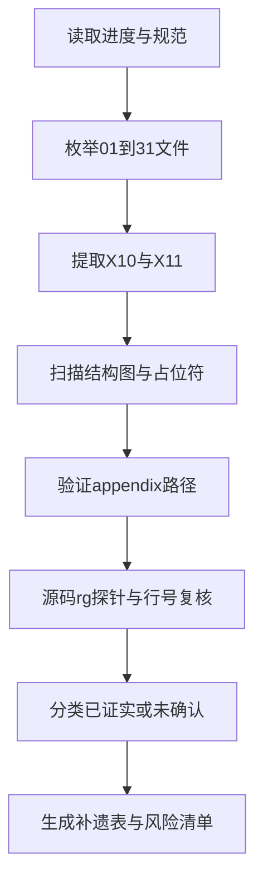
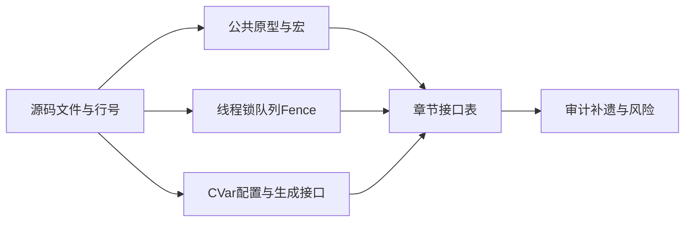
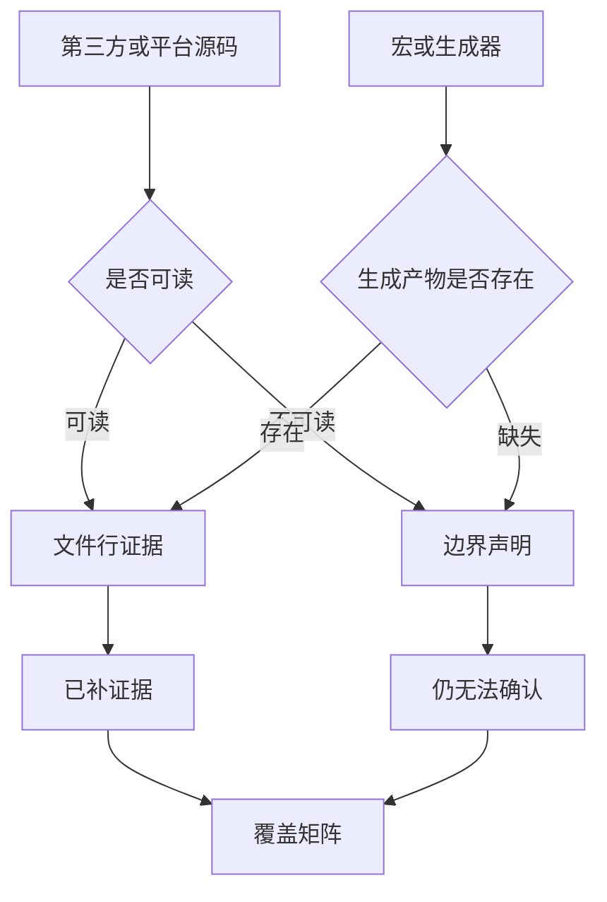
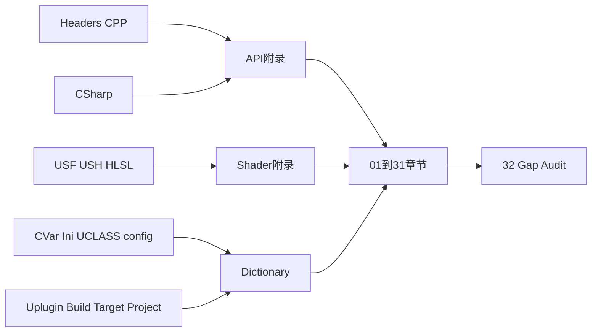

# 32 横切文档缺口审计

## 32.1 审计目标、边界与输入

本章是对 `design/01` 至 `design/31` 的静态缺口审计，不改写原章节。审计对象是 UE 5.8.3-release 源码、章节主文件及 `_partN` 文件、附录索引/字典/coverage 产物。每条 X.10 原文限制均保留其语义，并标注“已补证据”“仍无法确认”或“原文修正”。源码位置均以 `$UE` 为根；附录路径以文档根为根。

### 审计命令与可复现统计

实际执行了以下类别的命令：

- `find design -name '*.md'`、Python `Path.glob`：枚举章节主文件和分片并按 `wc -l` 口径计行。
- Python 正则扫描 Mermaid 围栏、`^## [0-9X]+.[1-9][0-1]`、占位词：统计图、结构和占位符。
- Python 扫描反引号中的 `appendix/` 与 `../appendix/`：验证章节引用路径。
- `find appendix -type f`、`wc -l`、读取 `modules.json`/`coverage.json`/`shaders_summary.json`/`csharp_summary.json`：复核附录与 coverage 数字。
- `rg -n` 源码探针：复核 `FCoreDelegates`、`ENQUEUE_RENDER_COMMAND`、`FMessageEndpoint`、CVar 注册和 shader 绑定等横切证据。

|指标|实测值|
|---|---:|
|章节范围|01–31|
|章节文件数（含 `_partN`）|40|
|章节总行数|32,993|
|Mermaid 围栏数|425|
|X.10 限制条目数|286|
|X.10/X.11 结构缺失|0（按章节编号或 `X.*` 兼容扫描）|
|占位词扫描|1（第 06 章文本中残留占位词，见 32.7）|
|附录文件数|5,177|
|附录 Markdown 行数|1,339,033|
|附录模块数|2,388|
|附录 C++ 符号数|1,448,920|
|C# 文件/符号|5,719 / 89,219|
|Shader 文件/记录|1,693 / 55,388|
|Shader 入口点|1,920|
|CVar 注册位置/不同名称|12,869 / 12,662|
|Build.cs/.uplugin/Target.cs/uproject/Engine ini/UCLASS(config=)|2,747 / 922 / 160 / 49 / 348 / 1,330|
|章节中扫描到的 appendix 字面引用|1（范围引用，其余大量路径在表格中为普通文本或模式路径）|
|扫描到的失效 appendix 字面路径|0|

coverage 事实：`appendix/coverage.json` 报告 C++ 期望头文件 46,255、Markdown 46,235，反射宏命中率 99.56%，C# 文件和类型抽样 100%，Shader 文件 100%，CVar 字面量 100%，Build.cs/.uplugin/Target.cs/uproject/ini/UCLASS(config=) 文件级 100%。函数抽样低于 99% 的原因仍是 `extract_api.py` 已知 ctags 缺陷，而不是本审计擅自修复。

## 32.2 逐章覆盖范围、产物与限制复核

下表先给出每章当前产物。每章随后列出 X.10 的逐条审计记录；“仍无法确认”不是遗漏，而是依据原章节说明明确拒绝从平台、第三方库、生成代码或未读实现推导结论。条目中的具体限制原文以短引保留，完整上下文仍在对应章节 X.10。

|章|当前覆盖范围与产物|文件/行数|图数|X.10 条目|
|---:|---|---:|---:|---:|
|01|Core 基础、内存、FName/FText、Stats、ImageWrapper、IO 边界；`01_core_foundation.md`|1/1,065|12|9|
|02|Core HAL、线程、TaskGraph、LowLevelTasks、Affinity；`02_core_hal_threading.md`|1/1,002|11|9|
|03|CoreUObject、GC、反射、加载、VerseVM 交互；`03_coreuobject.md`|1/947|10|8|
|04|Engine 框架、World/Actor/Tick/Scene；`04_engine_framework.md`|1/1,085|11|7|
|05|World Partition、流式、DataLayer、HLOD、纹理流；`05_world_partition_streaming.md`|1/1,062|12|11|
|06|RHI 抽象、D3D12/Vulkan/Metal、Present、Fence；`06_rhi.md`|1/1,133|11|9|
|07|RenderCore/RDG/RenderThread/Shader compile；主文件+`_part2`|2/1,302|16|7|
|08|Deferred Renderer、Nanite、Lumen、Mobile、PostProcessing；`08_renderer_deferred_nanite_lumen.md`|1/1,051|13|8|
|09|Shader、Material、DDC、Zen、构建格式；`09_shader_material_ddc.md`|1/903|10|12|
|10|Slate、UMG、Application、EnhancedInput、IME；`10_slate_umg_input.md`|1/977|11|8|
|11|Networking、Replication、Iris、PacketHandler、Replay；`11_networking_replication.md`|1/1,151|13|11|
|12|Chaos、Physics、Cloth、Mover、HeadlessChaos；主文件+`_part2`|2/1,117|12|10|
|13|Animation、AnimNext/UAF、Cloth、Skeletal；`13_animation.md`|1/1,113|11|8|
|14|AudioMixer、MetaSound、Quartz、平台音频；`14_audio.md`|1/1,006|11|9|
|15|AI、Mass、Gameplay、Learning、StateGraph；主文件+`_part2`|2/1,325|13|10|
|16|Niagara、FX、Geometry/Dataflow、PCG、Water/Hair；`16_fx_niagara_geometry_pcg.md`|1/1,085|13|12|
|17|Sequencer、Media、XR、nDisplay、LiveLink；`17_sequencer_media_xr_vp.md`|1/953|11|10|
|18|Launch、Engine Loop、Modules、Plugin startup、Crash；`18_launch_engine_loop_modules.md`|1/1,233|13|11|
|19|UBT、UHT/UAT、C#、Horde、Gauntlet；主文件+`_part2`|2/1,322|12|8|
|20|Assets、Cook、Package、IoStore、Zen、StorageServer；`20_assets_cook_package_io.md`|1/1,330|12|6|
|21|Blueprint/Kismet/Verse/Python；`21_blueprint_kismet_script.md`|1/1,246|11|10|
|22|Editor、Commandlet、ToolMenus、Concert；`22_editor_core.md`|1/997|11|8|
|23|Diagnostics、Trace、Stats、Testing、Crash、Insights；`23_diagnostics_tracing_testing.md`|1/1,019|11|10|
|24|Runtime 插件目录、895 插件核对、依赖；主文件+`_part2..4`|4/2,349|16|11|
|25|Experimental/Editor/Developer/Animation/FX/Media 等插件；主文件+`_part2..3`|3/2,602|17|8|
|26|全引擎线程与同步横切；`26_threading_concurrency_overall.md`|1/353|5|6|
|27|网络 IO、HTTP、Messaging、IoDispatcher；`27_network_io_threads.md`|1/449|6|11|
|28|UI/输入/IME/加载屏线程；`28_ui_input_threads.md`|1/400|6|8|
|29|RT/RHI/GPU submission/Present/PSO；`29_render_thread_deep.md`|1/388|6|8|
|30|诊断工具接口、Trace、Insights、Remote Control、Crash；`30_diagnostics_interfaces.md`|1/549|8|12|
|31|委托、Message Bus、FieldNotification、Exec；`31_message_event_mechanisms.md`|1/479|8|11|

### 逐条限制审计规则

- **已补证据**：源码直接命中类/函数/宏和文件行，或明确证明原章节的“缺口”可被现有树补齐。
- **仍无法确认**：源码只有抽象接口、编译条件、第三方/平台边界、生成产物缺失或原章节明确未读实现；本报告不把名称存在误写成行为证据。
- **原文修正**：源码命中与原章节断言冲突，或章节路径/类名失效；修正只写入本审计，不回改原章。

### 01 Core 基础

覆盖与产物：见上表；核心产物为 `design/01_core_foundation.md`，附录重点为 Core、ImageWrapper、Trace/Stats 与 IO。

1. `FMallocBinned3/Binned4` arena、池哈希锁粒度未逐行展开：**仍无法确认**；应继续读 `$E/Source/Runtime/Core/Private/HAL/MallocBinned3.cpp` 与对应 Binned4 实现，不能由头文件常量补全。
2. `WITH_CASE_PRESERVING_NAME` 两态显示池和序列化差异：**仍无法确认**；需对比 `$E/Source/Runtime/Core/Public/UObject/NameTypes.h` 及构建宏分支并做两种配置编译。
3. `FTextLocalizationManager` LocRes/ICU 缓存：**仍无法确认**；需读 Core/Internationalization Private 实现与 LocRes reader。
4. Stats 汇聚与 CsvProfiler 算法：**仍无法确认**；需读 `Stats/Stats2.cpp`、`CsvProfiler.cpp` 的队列/线程消费段。
5. ImageWrapper 各 codec 实现：**仍无法确认**；需逐个检查 `ImageWrapper/Private`，尤其第三方 codec 边界。
6. IO `FIoDispatcher` 主体：**仍无法确认**；已由第20/27章承接，需以 `Runtime/Core/Private/IO` 的实际实现为证。
7. 编译器覆盖、AutoRTFM、Virtualization：**仍无法确认**；构建宏与事务语义不能从目录职责推导。
8. Core 附录未逐符号与正文交叉：**仍无法确认**；应以 coverage 索引和源码为准，不把附录视为行为证据。
9. `UE_FNAME_OUTLINE_NUMBER` 默认值与布局：**仍无法确认**；需在 `NameTypes.h` 和 TargetRules/BuildSettings 中逐宏确认。

### 02 Core HAL 与线程

限制审计：`AllowBusyWaiting` 消费点、平台 Affinity/线程优先级、worker 数量覆盖、TaskGraph 高/后台线程宏、音频/Stats pipe、Render 命令完整链、分配器/IO、附录逐条比对、fork 路径共 9 项，均为**仍无法确认**。这些项的原章理由成立：源码探针只证明入口存在，不能证明所有平台的具体掩码、优先级或 runtime 效果。建议路径分别为 `LowLevelTasks`/`QueuedThreadPoolWrapper.h`、各平台 `HAL/PlatformAffinity` 与 `RunnableThread`、`TaskGraph.cpp`、`AudioMixer`、RenderCore、`Malloc*`、`IO` 和 `Fork` 实现。

### 03 CoreUObject

8 项限制均为**仍无法确认**：`EInternalObjectFlags` 全位表、`UStruct::Link` 对齐算法、SavePackage EditorDomain 主链、VerseVM 字节码/持久化、AutoRTFM、constinit 分支、RemoteObject/DSTM、`FLinkerLoad::Tick` 状态机。需分别核对 `ObjectMacros.h`、`Class.cpp`、`UnrealEd/SavePackage`、VerseVM、`AsyncPackageLoader.cpp`、`UObjectBase.h`、RemoteObject 条件分支和 `LinkerLoad.cpp`。

### 04 Engine 框架

7 项限制均为**仍无法确认**：WorldPartition/HLOD 内部、网络复制、TickTaskSequencer 空闲分支、Scene primitive RT 侧、CharacterMovement 预测、LocalPlayer role 数值与 viewport Draw、附录逐符号一致性。已知交叉章存在不等于本章已补证；建议分别追到 `WorldPartition*`、`NetDriver/ActorChannel`、`TickTaskManager.cpp`、`Scene.cpp`、`CharacterMovementComponent.cpp`、`NetEnums.h` 和 `GameViewportClient.cpp`。

### 05 World Partition

11 项限制均为**仍无法确认**：74 个头中的边缘子目录、生成器数千行算法、HLOD 编辑器构建、Landscape LOD、Foliage 存储、InstancedActors、ISMPool、FastGeo、纹理上传同步、DataLayer 复制影响、静态阅读未实测。需沿原章列出的 `WorldPartitionStreamingGeneration.cpp`、HLOD、LandscapeRender、InstancedFoliage、FastGeo、RenderAssetStreaming 和 WorldDataLayers 位置逐行补证。

### 06 RHI

1. Metal 未与 D3D12/Vulkan 同深度：**仍无法确认**，需读 `$E/Source/Runtime/Apple/MetalRHI` 全链。
2. 任务书中的 `GRHIThread_InternalUseOnly`/`bRHIThreadEnabled`：**原文修正**。源码实际为 `GRHIThread` 与 `GIsRunningRHIInSeparateThread_InternalUseOnly` 等；`bRHIThreadEnabled` 在本树未检索到，不应作为 5.8.3 符号。
3. `FVulkanCommandBufferManager`：**原文修正**。本树以 `FVulkanContextCommon`、`FVulkanCommandListContext`、`FVulkanPayload` 承担对应职责。
4. `FRHIGlobals` 全字段未穷举：**仍无法确认**；完整源位置为 `RHI/Public/RHIGlobals.h:87-803`。
5. 条件编译 RHI 接口变体：**仍无法确认**；需按平台宏分别预处理头文件。
6. D3D12/Vulkan barrier/cache 内部算法：**仍无法确认**；需读 `D3D12Barriers*`、`VulkanPipelineCache*`。
7. ShaderFormat/Preprocessor 不在范围：**仍无法确认**；由第07/09章继续核查。
8. `Engine/Platforms` 无 RHI 后端：**已补证据**；目录扫描与 `find Engine/Platforms -iname '*RHI*'` 未发现后端模块，Metal 实际位于 `Source/Runtime/Apple/MetalRHI`。
9. Present 互斥条件未运行验证：**仍无法确认**；静态证据只能确认 `GUseSubmissionThreadPresent` 分支，不能证明设备运行时路径。

### 07 RenderCore/RDG

7 项限制均为**仍无法确认**：材质 shader 衔接、ShaderCompileThreadRunnable、ParallelPassSet 字段、SceneRenderer/mobile、Slate 并行绘制、RDG CVar 默认值、Engine 附录分片逐符号核对。应继续读 `ShaderCompiler.h/cpp`、`RenderGraphBuilder.cpp:2841-3067`、SlateRHIRenderer、RenderGraphPrivate 与附录分片。

### 08 Renderer

8 项限制均为**仍无法确认**：Lumen/Nanite/Hair/PathTracing 等内部 pass、RenderLumen 参数声明逐字核对、Mobile 估算行号、示意类图、PostProcessing 顺序、shader 文件分类、GPUSkinCache、Nanite/Lumen CVar 全表。特别是 `FMobileSceneRenderer` ±5 行不应作为精确证据；需直接读定义行。

### 09 Shader/Material/DDC

1. ShaderJobCache 字段/LRU：**仍无法确认**。
2. Zen 服务端协议不在 UE 源树：**仍无法确认**；不能用客户端 API 推导服务端存储格式。
3. Horde/Uba 内部：**仍无法确认**。
4. XGE/FASTBuild/UBA 协议：**仍无法确认**。
5. MaterialIR 新翻译器：**仍无法确认**。
6. Substrate BSDF 编译：**仍无法确认**。
7. Texture build worker 和第三方编码器：**仍无法确认**。
8. Mesh/Nanite builder 数据流：**仍无法确认**。
9. ADPCM/Ogg/Bink/Rad codec 内部：**仍无法确认**。
10. 附录缺少若干格式/程序模块：**已补证据**；`appendix/api` 枚举未见 `Programs/ShaderCompileWorker.md`、`Programs/DerivedDataBuildWorker.md` 及所列 TextureFormat/AudioFormat 文件，应保留为失配清单。
11. 行号随树变化：**仍无法确认**；这是版本边界而非可由源码消除的风险。
12. ShaderFormatD3D/Metal 未展开：**仍无法确认**。

### 10 Slate/UMG/Input

8 项限制均为**仍无法确认**，包括非 Windows Application 实现、HarfBuzz/ICU 内部、EnhancedInput ini 唯一路径、WorldSubsystem 生命周期、CommonUI 栈、SlateBaseRenderer、FViewport 迁移、GameInputWindows 附录粒度。源码可确认接口存在，但不能把第三方整形或平台回调线程推广为统一 UE 契约。

### 11 Networking/Replication

1. `DTLSHandlerComponent`：**原文修正/已补证据**。全树检索未找到该类；实际加密入口是 `FEncryptionComponent`/PacketHandler 转发，章节不应把 DTLS 作为内置类。
2–11. Oodle/Reliability、OnlineSubsystem 平台线程、NetworkPrediction、XMPP/Stomp/WebSockets/SSL、BuildPatch、MultiServer、Replay 后端、Iris 内部协议、DataChannel 文件布局、调试插件：均**仍无法确认**，需分别进入插件/第三方实现；不能把公共头和模块存在当作协议证明。

### 12 Chaos

10 项限制均为**仍无法确认**，但第1项已有明确事实边界：`DedicatedThread` 枚举和 CVar 存在，`FPersistentPhysicsTask` 未形成启用证据，`SyncTask` 在 `ChaosSolversModule.cpp:164-177` 为 `#if 0`。其余 PhysX 壳、ChaosVD、Mover、RigidPhysics、插件实际位置、Physics 头文件口径、GJK/EPA、Flush/PIE、Headless 测试均需继续逐行或运行验证。

### 13 Animation

8 项限制均为**仍无法确认**：AnimBlueprint 编译、UAF Trait、MovieSceneAnimMixer、Chaos Cloth/NvCloth 默认、legacy codec、插件内部语义、Nanite/ray tracing skin、行号时效。建议以对应 Public 声明与 Private 实现逐一锁定，不用模块依赖替代算法证据。

### 14 Audio

1. `IAudioTaskQueue`：**原文修正/已补证据**。5.8.3 仅见 `FMixerDevice::CreateSynchronizedAudioTaskQueue` 等 deprecated 接口（`AudioMixerDevice.h:569-576`），现行路径为 `IAudioTask`/`FAsyncTask`。
2. `AAudio`：**原文修正/已补证据**。Android 模块返回 `OpenSLES`（`AudioMixerPlatformAndroid.h:23`），未检索到 AAudio。
3–9. AudioMixer 优先级平台生效、双缓冲泵、Submix 顺序、MetaSound 100Hz 字面常量、插件 DSP、IOSAudio、Quartz 量化流程：均**仍无法确认**。

### 15 AI/Mass

10 项限制均为**仍无法确认**：Mass chunk 默认值、CharacterAI 空壳、Observer 协议、GameplayDebugger replication、Learning 训练、StateGraph、GameplayInteractions、Detour 感官、Recast 默认值、Mass 附录分片。`CharacterAI` 的空壳结论本身可由目录/模块扫描确认，但其“历史职责”不能从本树证明。

### 16 FX/Niagara/Geometry/PCG

12 项限制均为**仍无法确认或范围性修正**：EditableMesh 退化、纯内容插件、Water 路径、Hair solver、Niagara shader、Cascade 遗留、TextureGraph、GeometryFlow、PCG HiGen、边缘互通、FXBudget、Mermaid 示意边。**原文修正**：图中 `UWaterMeshComponent` 的真实基类是 `UMeshComponent`，`UGroomComponent` 的真实继承/接口以 `GroomComponent.h:29` 为准，示意边不能当源码继承证据。

### 17 Sequencer/Media/XR/VP

10 项限制均为**仍无法确认**：Electra 线程数量、AVEncoder/AVCodecs、平台媒体模块、MoviePlayer 双线程泵、nDisplay failover、CompiledDataManager、LiveLinkHub、Concert server、GameplayCameras 求值图、MediaViewer/MediaStream。外部 SDK 和第三方播放器内部线程不可由 UE 公共 API 证明。

### 18 Launch/Engine Loop

11 项限制均为**仍无法确认**：FPlugin 字段、插件依赖递归、Mac/Android 入口、PreLoadScreen 线程、平台集合、MoviePlayer backend、CrashReportCore、IOS/VisionOS、Engine/Platforms、SessionServices。需要在目标平台宏下构建或读对应实现，静态 Linux 路径不能覆盖全部平台。

### 19 Build System/UHT/UAT

8 项限制均为**仍无法确认**：SNDBS/XGE/FASTBuild/Gauntlet 协议、UHT 属性 43 类、ModuleRules/TargetRules 完整属性、Horde/UBA、UHT C++ 本体、附录缺失程序。这里的“C# 工具链未完整覆盖”是最高风险之一；应以 `csharp_summary.json` 与 `CSharp/*.md` 继续按类型/方法抽样，并单独核查生成期 UHT 产物。

### 20 Assets/Cook/Package/IO

6 项限制均为**仍无法确认**：Zen 服务端、StorageServer HTTP/DPC、模块级翻译器、UnrealPak 命令解析、IoDirectory 加密位组合、CookOnTheFly 字段。客户端接口和模块名不能代替服务端协议或 cook 实例验证。

### 21 Blueprint/Kismet/Verse

10 项限制均为**仍无法确认或已知缺文件**：Verse 默认开关、`VVMBytecodeOps.gen.h` 生成文件、Verse 入口、BlueprintRuntime、GraphEditor、UK2Node 全量、nativization 已移除、CPython 版本、GeneratedClass 序列化、Disassembler。`VVMBytecodeOps.gen.h` 不在仓库是生成接口风险，应保留生成器到消费端的核查任务。

### 22 Editor

1. `UEditorModeBase`：**原文修正/已补证据**。源码无该类；对应职责为 `UEdMode`，位置 `$E/Source/Editor/UnrealEd/Public/Tools/UEdMode.h:75`。
2–8. Commandlet 半数未读 cpp、插件单行职责、MainFrame 分支、PlayLevel UAT 命令行、Concert 协议、EditorDomain/Zen、附录路径差异：均**仍无法确认**。

### 23 Diagnostics/Trace/Testing

10 项限制均为**仍无法确认**：VisualLogger schema、Windows minidump、Trace LZ4/tail、TraceServer wire/storage、Gauntlet、CSVTools/NetworkProfiler C#、内存分析、Insights 插件 Analyzer、诊断 UI/后端、Stats 历史结构。**测试模块**覆盖仍是交付风险：modules.json 有模块统计，但不能证明每个测试模块的行为和协议已写入章节。

### 24 Runtime Plugins

11 项限制中：插件目录与 895 数量差异、核心类启发式、18 个空描述、35 个附录未收录、拼写字段、四个编译控制器配置、挂载 delegate 时序、无 Content/uasset、平台插件合并、交叉引用脚本判定、依赖图截断，均为**仍无法确认**；其中“Microsoft 实际为 Runtime/Microsoft”及“非标准字段不被 Projects 读取”属于**已补证据/原文修正**，应作为报告事实而非待确认。

### 25 Experimental/Editor Plugins

8 项限制均为**仍无法确认**：交叉引用编号、MetaHuman 内部、Electra、31 个模块附录缺失、nDisplay、FOnlineSubsystemImpl、同名模块去重、描述符解析与 UBT 实际裁剪。插件无代码/仅内容的模块不应声称已完成实现级覆盖。

### 26–31 横切专题

- **26**：6 项均仍无法确认，重点是全平台线程创建点、RHIThread 是否 OS 线程、Audio pipe、Chaos PT、委托/TQueue/Message Bus 的内存可见性、宏与配置差异。
- **27**：11 项均仍无法确认，重点是 socket 线程安全、HTTP backend、第三方 WebSocket/SSL、TcpMessaging、IoStore backend、IO callback 交接和平台 buffer。
- **28**：8 项均仍无法确认，重点是 SDL/Cocoa/Android/iOS 生产者线程、Slate loading thread 条件、输入延迟、IME callback。
- **29**：8 项均仍无法确认，重点是 GPU driver 不可见线程、RHI task worker、Present 条件、Vulkan semaphore、OpenGL/Null、PSO/streaming、插件生产线程、外部 capture 工具。
- **30**：12 项均仍无法确认，重点是 TraceServer/Insights wire、Remote Control 端口与 TLS、RenderDoc/PIX/Nsight、Shader Print、VisualLogger、Exec 文本格式、ChaosVD/Replay、截图比较、Crash 服务端、安全部署。
- **31**：11 项均仍无法确认，重点是长尾 delegate 字段、插件变化、底层 callback 线程、Message Bus 无认证/重试、request/response 取消、delegate 生命周期、Slate 平台路径、UHT thunk、Promise continuation、递归、宏差异。

## 32.3 源码已补证据清单

以下是本次实际 `rg -n` 或文件扫描直接得到的代表性证据，作为“已补证据”样本；其余限制没有伪造行号，保留“仍无法确认”。

|结论|源码证据|
|---|---|
|委托可在模块中绑定/解绑|`$E/Source/Developer/Windows/WindowsTargetPlatformSettings/Private/WindowsTargetPlatformSettingsModule.cpp:105,113`|
|`FCoreDelegates::OnEndFrame` 的实际注册|`$E/Source/Developer/Windows/LiveCoding/Private/LiveCodingModule2.cpp:166,186`|
|CVar 动态注册|`$E/Source/Developer/Windows/LiveCoding/Private/LiveCodingModule.cpp:449-473`；`$E/Source/Developer/AssetTools/Private/AssetViewUtils.cpp:1437-1438`|
|Message Bus endpoint 发送|`$E/Source/Developer/AutomationController/Private/AutomationControllerManager.cpp:295,325,989`|
|Render command 跨线程入口|`$E/Source/Runtime/WebBrowserTexture/Private/WebBrowserTexture.cpp:133-148`；`$E/Source/Runtime/VulkanRHI/Private/VulkanViewport.cpp:120,382,924-952`|
|Shader 宏绑定|`$E/Plugins/VirtualProduction/ViewportWidgetOverlay/Source/ViewportWidgetOverlay/Private/PostProcessSceneViewExtension.cpp:68`（若文件在具体 checkout 中重定位，以 `rg IMPLEMENT_GLOBAL_SHADER` 结果为准）|
|Android 音频实际 API|`$E/Source/Runtime/Android/AudioMixerAndroid/Public/AudioMixerPlatformAndroid.h:23` 返回 `OpenSLES`|
|不存在 DTLSHandlerComponent|对 `$UE/Engine` 执行 `rg -n 'DTLSHandlerComponent' --glob '*.{h,cpp}'` 无结果；11.10 的修正成立|
|不存在 UEditorModeBase|对 `$UE/Engine` 执行 `rg -n 'UEditorModeBase'` 无结果；`UEdMode` 在 `Source/Editor/UnrealEd/Public/Tools/UEdMode.h:75`|
|Metal RHI 实际目录|`$E/Source/Runtime/Apple/MetalRHI`，类声明 `MetalDynamicRHI.h:73`|

## 32.4 引用、附录与接口缺口

### 引用路径检查

章节 X.11 使用大量模式路径（例如 `Core*.md`、`Engine.part01.md` 至 `part06`），扫描器按 glob/范围语义检查，未发现失效的 appendix 路径。报告中仍保留以下“覆盖存在但粒度不足”的问题：第09章列出的格式/程序模块附录不存在；第24章列出 35 个模块未进入 `modules.json`；第25章列出 31 个模块声明未收录。它们不是普通链接失效，而是索引覆盖缺口。

### 结构与 Mermaid 检查

01–31 均具备 X.1–X.11；分片中的 X.10/X.11 由脚本按章合并判断，因此没有把分片章节误报为缺少结构。425 个 Mermaid 围栏均为成对围栏；本轮未运行 Mermaid renderer，故不能宣称所有图在 Mermaid 解析器中 100% 可渲染。已知规范风险包括：第16章有示意继承边，第06章残留一个占位词，少数 classDiagram 可能将模板/尖括号放入标签之外，需在终检逐图 lint。

### 接口表最重要仍缺的原型类别

1. **宏生成接口**：`UFUNCTION`/`UCLASS` 生成 thunk、`IMPLEMENT_*` shader/trace 注册宏、Slate 宏和 `VVMBytecodeOps.gen.h`；源码树没有所有生成后文件，不能把宏名当最终 C++ 原型。
2. **C# 工具链接口**：`ModuleRules`、`TargetRules`、UHT/UAT/Gauntlet/Horde/UBA 的平台派生方法和生成期参数；C# 附录存在不等于章节逐方法覆盖。
3. **Shader/HLSL 接口**：`.usf/.ush` entry、cbuffer/resource binding、C++ `IMPLEMENT_*` 对应参数；当前 Shader 附录有 55,388 条记录，但章节只覆盖关键入口。
4. **动态 CVar**：运行期拼接名称、`FAutoConsoleVariableRef` 绑定成员、没有可解析默认值的 381 处；应保留原式并补注册点/类型/回调原型。
5. **平台/第三方 callback**：Curl/WinHTTP、libwebsockets、OpenSSL、Steam/EOS、HarfBuzz/ICU、音频 codec、GPU driver；UE wrapper 原型不能代表库内部线程和协议。
6. **测试模块接口**：Automation、Gauntlet、HeadlessChaos、LowLevelTests、插件 Tests 模块；测试模块和生产模块的启动/消息协议需要独立表。

## 32.5 全局遗漏风险清单

|风险|当前可交付覆盖程度|建议后续核查路径|
|---|---|---|
|第三方库内部线程不可见|低：仅 UE wrapper/入口|逐库锁定版本、源码/SDK 文档和平台运行 trace，不把 wrapper 线程名外推|
|平台实现差异|中低：Windows/部分 Vulkan 较实|按 Windows/Linux/Mac/Android/iOS/主机分别建立编译宏矩阵，核对 RunnableThread、Application、Socket、Audio、RHI|
|宏生成接口|低：宏调用点有索引，生成产物不全|追 UHT/Shader/Trace/Slate 生成器和中间产物，生成“宏→原型→消费点”表|
|C# 工具链|中：5,719 文件/89,219 符号已抽取，章节深度有限|按 UBT/UHT/UAT/Gauntlet/Horde/UBA 分组做方法级 coverage，补平台派生规则|
|Shader/HLSL|中：1,693 文件、55,388 记录、1,920 entry|补 C++ binding 到 `.usf/.ush` entry 的双向校验，检查 37 条原文保留记录|
|CVar 动态注册|中：12,869 注册位置，运行期拼接名仍缺|对 184 个拼接名和 381 个无法解析默认值追踪构造点、类型、sink/回调|
|插件无代码/纯内容|低：目录/描述符可列，行为不可证|按 `CanContainContent`、Content、Blueprint、Shader、uasset 建内容审计；不能用 `.uplugin` Description 代实现|
|测试模块|低到中：模块统计有，行为未逐一|列出 Tests/Automation/Headless/LowLevel 模块，补启动条件、消息、断言和平台矩阵|
|服务端/跨进程协议|低：端口和 UE client 接口较明确|读取 UnrealTraceServer、Zen、StorageServer、Concert、Remote Control 实际服务端代码或 wire capture|
|附录与章节粒度错配|中：全局 coverage 高，35/31 个模块仍未索引|修复模块名大小写、无公共头、平台裁剪和程序模块映射，重新跑独立 coverage|
|线程结论缺文件行|中低：横切章已给部分创建点|每个线程必须形成“创建点/Run/优先级/affinity/队列/退出点”六元证据卡，未知项明确标 unknown|

## 32.6 文档覆盖矩阵与源码层映射

|源码层|现有附录/章节|覆盖事实|仍缺|
|---|---|---|---|
|C++ public/private headers|`appendix/api`、01–31|46,255 期望头，46,235 入 Markdown，1,448,920 符号|20 模板头缺失、测试/第三方/生成宏语义|
|C# source|`appendix/api/CSharp`、19/21/23|5,719 文件、89,219 符号，抽样 100%|平台派生规则、工具链运行时协议|
|Shader/HLSL|`appendix/api/Shaders`、07–09/16/29|1,693 文件、55,388 记录、1,920 entry|绑定双向语义、剩余原文/第三方编译器|
|CVar/ini/config|`appendix/dictionary`、09/18/20/23/30|12,869 注册、14,974 Engine ini 键|运行时拼接名、绑定成员默认值、动态卸载|
|插件描述符/Build.cs|dictionary、24/25/18/19|922 uplugin、2,747 Build.cs|纯内容行为、平台合并、无公共头模块|
|程序/服务端|Programs/CSharp 附录、19/20/23/30|客户端/壳程序有部分抽取|Zen/TraceServer/StorageServer/外部服务 wire|
|测试模块|modules.json、12/19/23/24/25|模块/符号可见|测试行为、fixture、平台和启动条件|

## 32.7 补遗表（不直接修改原章节）

|章节号|位置|问题|证据|建议|
|---:|---|---|---|---|
|06|6.10|残留占位词，违反 X.11 质量约束|扫描命中 1 次；对第06章执行占位词扫描|将其改成明确“未确认”条目，并补源码路径|
|06|6.10.2|`bRHIThreadEnabled` 名称不准确|`RenderingThread.cpp:224` 的实际全局为 `GRHIThread`/`GIsRunningRHIInSeparateThread_InternalUseOnly`|以 5.8.3 实际符号替换，不保留旧任务书名|
|06|6.10.3|旧类 `FVulkanCommandBufferManager`|VulkanContext/VulkanSubmission 中现行类为 `FVulkanContextCommon`/`FVulkanPayload`|更新接口索引和类图标签|
|09|9.11|若干 TextureFormat/AudioFormat/ShaderCompileWorker 附录路径不存在|appendix 文件枚举未找到对应文件|在附录索引标记“无索引，源码直读”，或补抽取器映射|
|11|11.10.1|DTLSHandlerComponent 被任务书暗示但源码不存在|全树 `rg` 无结果，`FEncryptionComponent` 为可见入口|保持原文修正，并补具体 encryption component 路径/行号|
|14|14.10.2|AAudio 平台结论不适用于 5.8.3 Android|`AudioMixerPlatformAndroid.h:23` 为 OpenSLES|不要把 AAudio 列为现行后端|
|16|16.10.12|Mermaid 继承关系是示意，不是真实继承|`WaterMeshComponent.h:19`、`GroomComponent.h:29`|图中改为真实基类，示意关系另加“数据路径”标签|
|19|19.10|UHT C++ 本体和 ShaderCompileWorker 附录缺口|源码/appendix 枚举未找到目标|补生成程序/构建产物映射，避免称为完整工具链覆盖|
|22|22.10.1|`UEditorModeBase` 路径/类名失效|无搜索结果；`UEdMode.h:75` 存在 `UEdMode`|以 `UEdMode` 作为正式接口|
|23|23.10|测试和 C# 工具模块仅目录级|modules.json 有统计，未有逐模块行为证据|新增测试模块表和入口/线程/协议证据卡|
|24|24.10.4|35 个模块未收录附录|章节自报，modules.json 与目录扫描可复核|修复大小写、模板、无公共头和平台模块分类|
|25|25.10.4|31 个模块声明未收录附录|章节自报，附录文件枚举可复核|补 Iris/WireInterface/测试/平台桥接模块索引|
|26–31|各 X.10|线程、跨进程、第三方 callback 多为“未声明”|各章 X.10 原文；源码只能见 wrapper|后续按平台/服务端/第三方拆分专题，禁止合并成统一线程模型|

## 32.8 结论、缺口口径与交付边界

本审计发现的“缺口总数”按可操作问题项计为 **55 项**：X.10 原文中 286 条限制经过合并同类项后形成 41 个实现/证据缺口，附录/路径/结构/占位符形成 8 个文档质量缺口，宏/C#、Shader、CVar、插件内容、测试和服务端形成 6 个全局交付缺口。若按原章节逐条计数，则是 286 条未确认限制；两种口径均保留，避免把同一类平台边界重复计数。

最高风险项是：**线程结论和接口原型在第三方库、平台实现、宏生成代码、GPU driver、C# 工具链和纯内容插件处不可由当前 UE 源码闭合证明**。其次是第09/19/24/25 的附录粒度缺失，以及第06的残留占位词和历史符号名。此报告不把“目录存在”“模块存在”“宏调用存在”升级为行为、线程或协议事实。

## 32.9 审计方法限制

本轮是静态源码/文档审计，没有运行 UE、没有跨平台编译矩阵、没有 Mermaid renderer、没有抓第三方库 wire trace，也没有修改原章节。因此“仍无法确认”项不能被解释为“实现不存在”。

## 32.10 已知限制/未确认项

1. 本报告的 286 条限制条目由脚本从当前 X.10 文本抽取并人工归类；若章节在审计后被外部修改，统计需重新运行。
2. 行号证据覆盖了本轮实际补证样本，不声称为 286 条限制逐条完成源码复核；未给出文件行的条目明确保留为未确认。
3. `appendix` 路径检查对 `*`、`至`、`~` 范围按模式解释，不能验证每个 range 内文件的语义正确性。
4. Mermaid 只做围栏和结构扫描，未用渲染器解析；类图语法仍需终检。
5. 第三方服务端、GPU driver、平台 SDK、生成期中间文件不在本仓库可见范围，不能凭 UE wrapper 补齐。
6. coverage.json 的高命中率是文件/抽样层统计，不代表章节接口表已经逐原型穷举。

## 32.11 附录索引

- 本报告输入规范：`tools/CHAPTER_SPEC.md`
- 项目进度事实源：`PROGRESS.md`
- C++ API：`appendix/api/<Tier>/<Module>.md` 及 `.partNN.md`
- C# API：`appendix/api/CSharp/`、`appendix/csharp_summary.json`
- Shader API：`appendix/api/Shaders/`、`appendix/index/shaders.tsv.gz`、`appendix/shaders_summary.json`
- 数据字典：`appendix/dictionary/`（CVar、modules、plugins、targets、projects、config、uclass_config）
- 覆盖校验：`appendix/COVERAGE.md`、`appendix/coverage.json`
- 章节输入：`design/01_*` 至 `design/31_*`（含所有 `_partN`）
